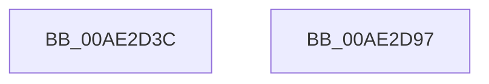

# PopCurrentSystemPowerSourceState

- RVA: `0x00AE2D3C`–`0x00AE2D98` (길이 `92` bytes)
- VA: `0x0000000140AE2D3C`
- 실행 섹션: `PAGE`
- PDB 이름 있음: `예`; PDB Function 태그: `아니요`
- unwind 정보 RVA: `0x0005CF00`
- 디코드: `21`개 명령, `92/92` bytes 표시
- 미해석 바이트: `0` (있으면 어셈블리에 `.byte`로 보존)

> 이 문서는 커널 이미지의 기계어와 PDB 기호를 분석해 생성했습니다. 4번과 5번은 함수 원형과 자료형을 바이너리 사용 방식에서 추정한 C 해석이며 원본 소스 복구 결과는 아닙니다.

## 1. Dependencies

- 직접 호출 지점: **2**; 고유 호출 대상: **2**
- 직접 호출자로 확인된 함수: **1**
- RIP 상대 이미지 참조: **6**

### Outgoing calls
- `0x00AE2D4C` → [PopAcquireRwLockShared](../../text/2D/PopAcquireRwLockShared_function_002D9A40.md) (function, `0x002D9A40`)
- `0x00AE2D8C` → [PopReleaseRwLock](../../text/2D/PopReleaseRwLock_function_002DFBBC.md) (function, `0x002DFBBC`)

### Direct callers
- [NtPowerInformation](../95/NtPowerInformation_function_00955D80.md) at `0x00957D96`

### Static image references
- `0x00AE2D45` → RVA `0x00F0C238` (`.data`; read)
- `0x00AE2D51` → RVA `0x00F0C248` (`.data`; read)
- `0x00AE2D62` → RVA `0x00F0C258` (`.data`; read)
- `0x00AE2D6D` → RVA `0x00F0C268` (`.data`; read)
- `0x00AE2D78` → RVA `0x00F0C278` (`.data`; read)
- `0x00AE2D83` → RVA `0x00F0C288` (`.data`; read)

## 2. Other-region calls and transfers

- 다른 실행 섹션으로 향하는 call: **2**
  - `0x00AE2D4C` → [PopAcquireRwLockShared](../../text/2D/PopAcquireRwLockShared_function_002D9A40.md) (`PAGE` → `.text`)
  - `0x00AE2D8C` → [PopReleaseRwLock](../../text/2D/PopReleaseRwLock_function_002DFBBC.md) (`PAGE` → `.text`)
- 별도 외부 분기/꼬리 이동을 확인하지 못했습니다.

## 3. Assembly (complete function range)

```asm
00AE2D3C  40 53                           push rbx
00AE2D3E  48 83 EC 20                     sub rsp, 0x20
00AE2D42  48 8B D9                        mov rbx, rcx
00AE2D45  48 8D 0D EC 94 42 00            lea rcx, [rip + 0x4294ec]
00AE2D4C  E8 EF 6C 7F FF                  call 0x1402d9a40
00AE2D51  0F 10 05 F0 94 42 00            movups xmm0, xmmword ptr [rip + 0x4294f0]
00AE2D58  48 8D 0D D9 94 42 00            lea rcx, [rip + 0x4294d9]
00AE2D5F  0F 29 03                        movaps xmmword ptr [rbx], xmm0
00AE2D62  0F 10 0D EF 94 42 00            movups xmm1, xmmword ptr [rip + 0x4294ef]
00AE2D69  0F 29 4B 10                     movaps xmmword ptr [rbx + 0x10], xmm1
00AE2D6D  0F 10 05 F4 94 42 00            movups xmm0, xmmword ptr [rip + 0x4294f4]
00AE2D74  0F 29 43 20                     movaps xmmword ptr [rbx + 0x20], xmm0
00AE2D78  0F 10 0D F9 94 42 00            movups xmm1, xmmword ptr [rip + 0x4294f9]
00AE2D7F  0F 29 4B 30                     movaps xmmword ptr [rbx + 0x30], xmm1
00AE2D83  8B 05 FF 94 42 00               mov eax, dword ptr [rip + 0x4294ff]
00AE2D89  89 43 40                        mov dword ptr [rbx + 0x40], eax
00AE2D8C  E8 2B CE 7F FF                  call 0x1402dfbbc
00AE2D91  48 83 C4 20                     add rsp, 0x20
00AE2D95  5B                              pop rbx
00AE2D96  C3                              ret
00AE2D97  CC                              int3
```

## 4. C-style interpretation (structured pseudocode)

```c
__int64 __fastcall PopCurrentSystemPowerSourceState(__int64 a1)
{
    __int64 result;
    __int64 v_rsp;

    v_rsp = (v_rsp) - (32);
    result = PopAcquireRwLockShared(v_rip + 4363500, a2, a3, a4);
    *(unsigned __int64 *)(a1) = v_xmm0;
    *(unsigned __int64 *)(a1 + 16) = v_xmm1;
    *(unsigned __int64 *)(a1 + 32) = v_xmm0;
    *(unsigned __int64 *)(a1 + 48) = v_xmm1;
    *(unsigned int *)(a1 + 64) = (unsigned int)((unsigned int)(*(unsigned int *)(v_rip + 4363519)));
    result = PopReleaseRwLock(v_rip + 4363481, a2, a3, a4);
    v_rsp = (v_rsp) + (32);
    return result;
}
```

## 5. (Beta) C Style

```c
int64_t PopCurrentSystemPowerSourceState(void *Arg1)
{
    uint8_t *arg1 = (uint8_t *)Arg1;

    int64_t result;
    int64_t local_rsp;

    local_rsp = (local_rsp) - (32);
    result = PopAcquireRwLockShared(v_rip + 4363500, a2, a3, a4);
    *(uint64_t *)(arg1) = v_xmm0;
    *(uint64_t *)(arg1 + 0x10) = v_xmm1;
    *(uint64_t *)(arg1 + 0x20) = v_xmm0;
    *(uint64_t *)(arg1 + 0x30) = v_xmm1;
    *(uint32_t *)(arg1 + 0x40) = (uint32_t)((uint32_t)(*(uint32_t *)(v_rip + 0x4294FF)));
    result = PopReleaseRwLock(v_rip + 4363481, a2, a3, a4);
    local_rsp = (local_rsp) + (32);
    return result;
}
```

### 관측된 메모리 오프셋

구조체 형식이 확인되지 않은 접근은 인자 기준의 오프셋으로만 기록했습니다.

| 기준 인자 | 오프셋 표현 | 폭 (bit) | 접근 |
|---|---:|---:|---|
| `Arg1` | `+ 0x0` | `128` | `W` |
| `Arg1` | `+ 0x10` | `128` | `W` |
| `Arg1` | `+ 0x20` | `128` | `W` |
| `Arg1` | `+ 0x30` | `128` | `W` |
| `Arg1` | `+ 0x40` | `32` | `W` |

## 6. Execution-region graph

[열기: 2D/3D 그래프와 함수 탐색 컨트롤 패널](../../../control-panel.html?section=page&rva=0x00AE2D3C&view=graph)

- 2D 그래프는 위에서 아래로 흐르고, 3D 그래프는 빈 공간을 드래그해 회전합니다. Shift+드래그는 이동, 휠은 확대·축소, 함수 노드 선택은 대상 보고서 이동입니다.

### Static fallback


