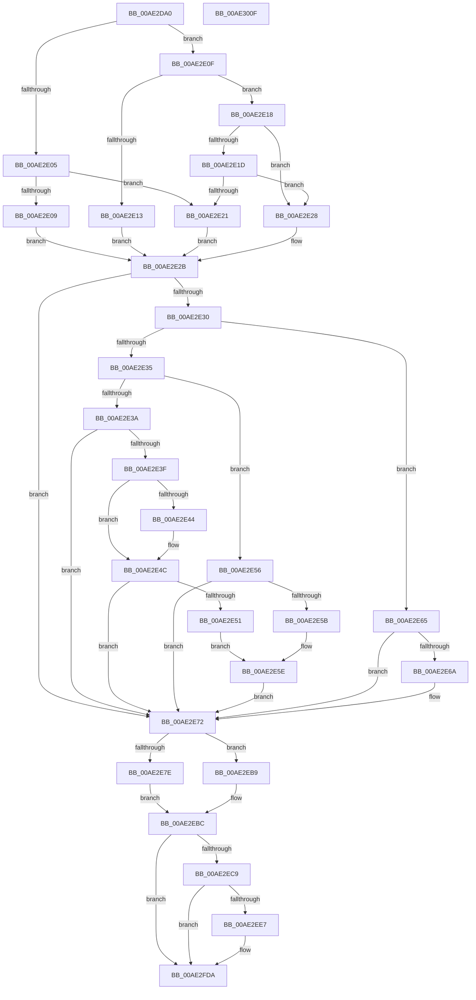

# PopEvaluateWeakChargerState

- RVA: `0x00AE2DA0`–`0x00AE3010` (길이 `624` bytes)
- VA: `0x0000000140AE2DA0`
- 실행 섹션: `PAGE`
- PDB 이름 있음: `예`; PDB Function 태그: `아니요`
- unwind 정보 RVA: `0x000CCEC8`
- 디코드: `152`개 명령, `624/624` bytes 표시
- 미해석 바이트: `0` (있으면 어셈블리에 `.byte`로 보존)

> 이 문서는 커널 이미지의 기계어와 PDB 기호를 분석해 생성했습니다. 4번과 5번은 함수 원형과 자료형을 바이너리 사용 방식에서 추정한 C 해석이며 원본 소스 복구 결과는 아닙니다.

## 1. Dependencies

- 직접 호출 지점: **6**; 고유 호출 대상: **6**
- 직접 호출자로 확인된 함수: **1**
- RIP 상대 이미지 참조: **10**

### Outgoing calls
- `0x00AE2DD9` → [PopAcquireRwLockExclusive](../../text/43/PopAcquireRwLockExclusive_function_00430B44.md) (function, `0x00430B44`)
- `0x00AE2EA2` → [ZwUpdateWnfStateData](../../text/6B/ZwUpdateWnfStateData_function_006B0D10.md) (function, `0x006B0D10`)
- `0x00AE2EDA` → [tlgKeywordOn](../../text/42/tlgKeywordOn_function_0042EAA0.md) (function, `0x0042EAA0`)
- `0x00AE2FD5` → [tlgWriteTransfer_EtwWriteTransfer](../../text/42/tlgWriteTransfer_EtwWriteTransfer_function_004260E0.md) (function, `0x004260E0`)
- `0x00AE2FE1` → [PopReleaseRwLock](../../text/2D/PopReleaseRwLock_function_002DFBBC.md) (function, `0x002DFBBC`)
- `0x00AE2FED` → [_security_check_cookie](../../text/6A/_security_check_cookie_function_006AC640.md) (function, `0x006AC640`)

### Direct callers
- [PopBatteryWorker](PopBatteryWorker_function_00AE1650.md) at `0x00AE2331`

### Static image references
- `0x00AE2DBF` → RVA `0x00E0A740` (`.data`; read)
- `0x00AE2DD2` → RVA `0x00F09010` (`.data`; read)
- `0x00AE2DDE` → RVA `0x00F09044` (`.data`; read)
- `0x00AE2DE8` → RVA `0x00F09040` (`.data`; read)
- `0x00AE2E76` → RVA `0x00F09048` (`.data`; read)
- `0x00AE2E8D` → RVA `0x00020AA0` (`.rdata`; read)
- `0x00AE2EB0` → RVA `0x00F09048` (`.data`; write)
- `0x00AE2EBC` → RVA `0x00E07748` (`.data`; read)
- `0x00AE2EF5` → RVA `0x0004C884` (`.rdata`; read)
- `0x00AE2F33` → RVA `0x00F09000` (`.data`; read)

## 2. Other-region calls and transfers

- 다른 실행 섹션으로 향하는 call: **6**
  - `0x00AE2DD9` → [PopAcquireRwLockExclusive](../../text/43/PopAcquireRwLockExclusive_function_00430B44.md) (`PAGE` → `.text`)
  - `0x00AE2EA2` → [ZwUpdateWnfStateData](../../text/6B/ZwUpdateWnfStateData_function_006B0D10.md) (`PAGE` → `.text`)
  - `0x00AE2EDA` → [tlgKeywordOn](../../text/42/tlgKeywordOn_function_0042EAA0.md) (`PAGE` → `.text`)
  - `0x00AE2FD5` → [tlgWriteTransfer_EtwWriteTransfer](../../text/42/tlgWriteTransfer_EtwWriteTransfer_function_004260E0.md) (`PAGE` → `.text`)
  - `0x00AE2FE1` → [PopReleaseRwLock](../../text/2D/PopReleaseRwLock_function_002DFBBC.md) (`PAGE` → `.text`)
  - `0x00AE2FED` → [_security_check_cookie](../../text/6A/_security_check_cookie_function_006AC640.md) (`PAGE` → `.text`)
- 별도 외부 분기/꼬리 이동을 확인하지 못했습니다.

## 3. Assembly (complete function range)

```asm
00AE2DA0  48 8B C4                        mov rax, rsp
00AE2DA3  48 89 58 08                     mov qword ptr [rax + 8], rbx
00AE2DA7  48 89 70 10                     mov qword ptr [rax + 0x10], rsi
00AE2DAB  48 89 78 18                     mov qword ptr [rax + 0x18], rdi
00AE2DAF  55                              push rbp
00AE2DB0  41 56                           push r14
00AE2DB2  41 57                           push r15
00AE2DB4  48 8D 68 C8                     lea rbp, [rax - 0x38]
00AE2DB8  48 81 EC 20 01 00 00            sub rsp, 0x120
00AE2DBF  48 8B 05 7A 79 32 00            mov rax, qword ptr [rip + 0x32797a]
00AE2DC6  48 33 C4                        xor rax, rsp
00AE2DC9  48 89 45 10                     mov qword ptr [rbp + 0x10], rax
00AE2DCD  40 8A F9                        mov dil, cl
00AE2DD0  8B F2                           mov esi, edx
00AE2DD2  48 8D 0D 37 62 42 00            lea rcx, [rip + 0x426237]
00AE2DD9  E8 66 DD 94 FF                  call 0x140430b44
00AE2DDE  44 8B 0D 5F 62 42 00            mov r9d, dword ptr [rip + 0x42625f]
00AE2DE5  45 33 F6                        xor r14d, r14d
00AE2DE8  8B 15 52 62 42 00               mov edx, dword ptr [rip + 0x426252]
00AE2DEE  83 C8 FF                        or eax, 0xffffffff
00AE2DF1  44 88 74 24 40                  mov byte ptr [rsp + 0x40], r14b
00AE2DF6  45 8B D6                        mov r10d, r14d
00AE2DF9  45 8A C6                        mov r8b, r14b
00AE2DFC  45 8D 7E 01                     lea r15d, [r14 + 1]
00AE2E00  44 3B C8                        cmp r9d, eax
00AE2E03  74 0A                           je 0x140ae2e0f
00AE2E05  3B D0                           cmp edx, eax
00AE2E07  75 18                           jne 0x140ae2e21
00AE2E09  41 8D 4E 02                     lea ecx, [r14 + 2]
00AE2E0D  EB 1C                           jmp 0x140ae2e2b
00AE2E0F  3B D0                           cmp edx, eax
00AE2E11  74 05                           je 0x140ae2e18
00AE2E13  41 8B CF                        mov ecx, r15d
00AE2E16  EB 13                           jmp 0x140ae2e2b
00AE2E18  44 3B C8                        cmp r9d, eax
00AE2E1B  74 0B                           je 0x140ae2e28
00AE2E1D  3B D0                           cmp edx, eax
00AE2E1F  74 07                           je 0x140ae2e28
00AE2E21  B9 03 00 00 00                  mov ecx, 3
00AE2E26  EB 03                           jmp 0x140ae2e2b
00AE2E28  41 8B CE                        mov ecx, r14d
00AE2E2B  40 84 FF                        test dil, dil
00AE2E2E  74 42                           je 0x140ae2e72
00AE2E30  41 2B CF                        sub ecx, r15d
00AE2E33  74 30                           je 0x140ae2e65
00AE2E35  41 2B CF                        sub ecx, r15d
00AE2E38  74 1C                           je 0x140ae2e56
00AE2E3A  41 3B CF                        cmp ecx, r15d
00AE2E3D  75 33                           jne 0x140ae2e72
00AE2E3F  45 85 C9                        test r9d, r9d
00AE2E42  74 08                           je 0x140ae2e4c
00AE2E44  41 B0 02                        mov r8b, 2
00AE2E47  44 88 44 24 40                  mov byte ptr [rsp + 0x40], r8b
00AE2E4C  41 3B D7                        cmp edx, r15d
00AE2E4F  75 21                           jne 0x140ae2e72
00AE2E51  45 0A C7                        or r8b, r15b
00AE2E54  EB 08                           jmp 0x140ae2e5e
00AE2E56  45 85 C9                        test r9d, r9d
00AE2E59  74 17                           je 0x140ae2e72
00AE2E5B  41 B0 02                        mov r8b, 2
00AE2E5E  44 88 44 24 40                  mov byte ptr [rsp + 0x40], r8b
00AE2E63  EB 0D                           jmp 0x140ae2e72
00AE2E65  41 3B D7                        cmp edx, r15d
00AE2E68  75 08                           jne 0x140ae2e72
00AE2E6A  45 8A C7                        mov r8b, r15b
00AE2E6D  44 88 7C 24 40                  mov byte ptr [rsp + 0x40], r15b
00AE2E72  41 0F B6 C0                     movzx eax, r8b
00AE2E76  39 05 CC 61 42 00               cmp dword ptr [rip + 0x4261cc], eax
00AE2E7C  74 3B                           je 0x140ae2eb9
00AE2E7E  44 89 74 24 30                  mov dword ptr [rsp + 0x30], r14d
00AE2E83  48 8D 54 24 40                  lea rdx, [rsp + 0x40]
00AE2E88  44 89 74 24 28                  mov dword ptr [rsp + 0x28], r14d
00AE2E8D  48 8D 0D 0C DC 53 FF            lea rcx, [rip - 0xac23f4]
00AE2E94  45 33 C9                        xor r9d, r9d
00AE2E97  4C 89 74 24 20                  mov qword ptr [rsp + 0x20], r14
00AE2E9C  45 8B C7                        mov r8d, r15d
00AE2E9F  41 8A DF                        mov bl, r15b
00AE2EA2  E8 69 DE BC FF                  call 0x1406b0d10
00AE2EA7  44 0F B6 44 24 40               movzx r8d, byte ptr [rsp + 0x40]
00AE2EAD  44 8B D0                        mov r10d, eax
00AE2EB0  44 89 05 91 61 42 00            mov dword ptr [rip + 0x426191], r8d
00AE2EB7  EB 03                           jmp 0x140ae2ebc
00AE2EB9  41 8A DE                        mov bl, r14b
00AE2EBC  83 3D 85 48 32 00 05            cmp dword ptr [rip + 0x324885], 5
00AE2EC3  0F 86 11 01 00 00               jbe 0x140ae2fda
00AE2EC9  48 BA 00 00 00 00 00 40 00 00   movabs rdx, 0x400000000000
00AE2ED3  48 8D 0D 6E 48 32 00            lea rcx, [rip + 0x32486e]
00AE2EDA  E8 C1 BB 94 FF                  call 0x14042eaa0
00AE2EDF  84 C0                           test al, al
00AE2EE1  0F 84 F3 00 00 00               je 0x140ae2fda
00AE2EE7  48 8D 44 24 41                  lea rax, [rsp + 0x41]
00AE2EEC  44 88 44 24 41                  mov byte ptr [rsp + 0x41], r8b
00AE2EF1  48 89 45 80                     mov qword ptr [rbp - 0x80], rax
00AE2EF5  48 8D 15 88 99 56 FF            lea rdx, [rip - 0xa96678]
00AE2EFC  8B 05 3E 61 42 00               mov eax, dword ptr [rip + 0x42613e]
00AE2F02  48 8D 0D 3F 48 32 00            lea rcx, [rip + 0x32483f]
00AE2F09  89 44 24 4C                     mov dword ptr [rsp + 0x4c], eax
00AE2F0D  45 33 C9                        xor r9d, r9d
00AE2F10  48 8D 44 24 4C                  lea rax, [rsp + 0x4c]
00AE2F15  4C 89 7D 88                     mov qword ptr [rbp - 0x78], r15
00AE2F19  48 89 45 90                     mov qword ptr [rbp - 0x70], rax
00AE2F1D  45 33 C0                        xor r8d, r8d
00AE2F20  8B 05 1E 61 42 00               mov eax, dword ptr [rip + 0x42611e]
00AE2F26  89 44 24 50                     mov dword ptr [rsp + 0x50], eax
00AE2F2A  48 8D 44 24 50                  lea rax, [rsp + 0x50]
00AE2F2F  48 89 45 A0                     mov qword ptr [rbp - 0x60], rax
00AE2F33  8A 05 C7 60 42 00               mov al, byte ptr [rip + 0x4260c7]
00AE2F39  88 44 24 42                     mov byte ptr [rsp + 0x42], al
00AE2F3D  48 8D 44 24 42                  lea rax, [rsp + 0x42]
00AE2F42  48 89 45 B0                     mov qword ptr [rbp - 0x50], rax
00AE2F46  48 8D 44 24 43                  lea rax, [rsp + 0x43]
00AE2F4B  48 89 45 C0                     mov qword ptr [rbp - 0x40], rax
00AE2F4F  48 8D 44 24 48                  lea rax, [rsp + 0x48]
00AE2F54  48 89 45 D0                     mov qword ptr [rbp - 0x30], rax
00AE2F58  48 8D 44 24 44                  lea rax, [rsp + 0x44]
00AE2F5D  48 89 45 E0                     mov qword ptr [rbp - 0x20], rax
00AE2F61  48 8D 44 24 54                  lea rax, [rsp + 0x54]
00AE2F66  48 89 45 F0                     mov qword ptr [rbp - 0x10], rax
00AE2F6A  48 8D 44 24 58                  lea rax, [rsp + 0x58]
00AE2F6F  48 89 45 00                     mov qword ptr [rbp], rax
00AE2F73  48 8D 44 24 60                  lea rax, [rsp + 0x60]
00AE2F78  48 89 44 24 28                  mov qword ptr [rsp + 0x28], rax
00AE2F7D  C7 44 24 20 0B 00 00 00         mov dword ptr [rsp + 0x20], 0xb
00AE2F85  48 C7 45 98 04 00 00 00         mov qword ptr [rbp - 0x68], 4
00AE2F8D  48 C7 45 A8 04 00 00 00         mov qword ptr [rbp - 0x58], 4
00AE2F95  4C 89 7D B8                     mov qword ptr [rbp - 0x48], r15
00AE2F99  40 88 7C 24 43                  mov byte ptr [rsp + 0x43], dil
00AE2F9E  4C 89 7D C8                     mov qword ptr [rbp - 0x38], r15
00AE2FA2  66 89 74 24 48                  mov word ptr [rsp + 0x48], si
00AE2FA7  48 C7 45 D8 02 00 00 00         mov qword ptr [rbp - 0x28], 2
00AE2FAF  88 5C 24 44                     mov byte ptr [rsp + 0x44], bl
00AE2FB3  4C 89 7D E8                     mov qword ptr [rbp - 0x18], r15
00AE2FB7  44 89 54 24 54                  mov dword ptr [rsp + 0x54], r10d
00AE2FBC  48 C7 45 F8 04 00 00 00         mov qword ptr [rbp - 8], 4
00AE2FC4  48 C7 44 24 58 00 00 00 01      mov qword ptr [rsp + 0x58], 0x1000000
00AE2FCD  48 C7 45 08 08 00 00 00         mov qword ptr [rbp + 8], 8
00AE2FD5  E8 06 31 94 FF                  call 0x1404260e0
00AE2FDA  48 8D 0D 2F 60 42 00            lea rcx, [rip + 0x42602f]
00AE2FE1  E8 D6 CB 7F FF                  call 0x1402dfbbc
00AE2FE6  48 8B 4D 10                     mov rcx, qword ptr [rbp + 0x10]
00AE2FEA  48 33 CC                        xor rcx, rsp
00AE2FED  E8 4E 96 BC FF                  call 0x1406ac640
00AE2FF2  4C 8D 9C 24 20 01 00 00         lea r11, [rsp + 0x120]
00AE2FFA  49 8B 5B 20                     mov rbx, qword ptr [r11 + 0x20]
00AE2FFE  49 8B 73 28                     mov rsi, qword ptr [r11 + 0x28]
00AE3002  49 8B 7B 30                     mov rdi, qword ptr [r11 + 0x30]
00AE3006  49 8B E3                        mov rsp, r11
00AE3009  41 5F                           pop r15
00AE300B  41 5E                           pop r14
00AE300D  5D                              pop rbp
00AE300E  C3                              ret
00AE300F  CC                              int3
```

## 4. C-style interpretation (structured pseudocode)

```c
__int64 __fastcall PopEvaluateWeakChargerState(unsigned __int8 a1, int a2)
{
    __int64 result;
    __int64 v_r14;
    __int64 v_rsp;
    unsigned int v_stack_m108;
    unsigned int v_stack_m110;
    unsigned __int64 v_stack_m118;
    unsigned __int64 v_stack_m18;
    unsigned __int64 v_stack_mD8;
    unsigned __int64 v_stack_mE0;
    unsigned __int64 v_stack_mE4;
    unsigned int v_stack_mE8;
    unsigned int v_stack_mEC;
    unsigned __int64 v_stack_mF0;
    unsigned __int64 v_stack_mF4;
    unsigned __int64 v_stack_mF5;
    unsigned __int8 v_stack_mF6;
    unsigned __int64 v_stack_mF7;
    unsigned __int8 v_stack_mF8;

    *(unsigned __int64 *)(v_rsp + 8) = v_rbx;
    *(unsigned __int64 *)(v_rsp + 16) = v_rsi;
    *(unsigned __int64 *)(v_rsp + 24) = v_rdi;
    v_rsp = (v_rsp) - (288);
    result = (*(unsigned __int64 *)(v_rip + 3307898)) ^ (v_rsp);
    *(unsigned __int64 *)(v_rsp - 56 + 16) = result;
    result = PopAcquireRwLockExclusive(v_rip + 4350519, a2, a3, a4);
    v_r14 = 0;
    result = (unsigned int)((result) | (0xFFFFFFFFULL));
    v_stack_mF8 = 0;
    if (((unsigned int)((unsigned int)(*(unsigned int *)(v_rip + 4350559)))) == ((unsigned int)(result))) goto loc_00AE2E0F;
    if (((unsigned int)((unsigned int)(*(unsigned int *)(v_rip + 4350546)))) != ((unsigned int)(result))) goto loc_00AE2E21;
    goto loc_00AE2E2B;
loc_00AE2E0F:
    if (((unsigned int)((unsigned int)(*(unsigned int *)(v_rip + 4350546)))) == ((unsigned int)(result))) goto loc_00AE2E18;
    goto loc_00AE2E2B;
loc_00AE2E18:
    if (((unsigned int)((unsigned int)(*(unsigned int *)(v_rip + 4350559)))) == ((unsigned int)(result))) goto loc_00AE2E28;
    if (((unsigned int)((unsigned int)(*(unsigned int *)(v_rip + 4350546)))) == ((unsigned int)(result))) goto loc_00AE2E28;
loc_00AE2E21:
    goto loc_00AE2E2B;
loc_00AE2E28:
loc_00AE2E2B:
    if (a1 == 0) goto loc_00AE2E72;
    a1 = (unsigned int)((0) - ((unsigned int)(v_r14 + 1)));
    if (condition_is_equal) goto loc_00AE2E65;
    a1 = (unsigned int)((a1) - ((unsigned int)(v_r14 + 1)));
    if (condition_is_equal) goto loc_00AE2E56;
    if (a1 != ((unsigned int)(v_r14 + 1))) goto loc_00AE2E72;
    if ((unsigned int)((unsigned int)(*(unsigned int *)(v_rip + 4350559))) != 0) {
        a3 = 2;
        v_stack_mF8 = (unsigned __int8)(a3);
    }
    if (((unsigned int)((unsigned int)(*(unsigned int *)(v_rip + 4350546)))) != ((unsigned int)(v_r14 + 1))) goto loc_00AE2E72;
    a3 = (unsigned __int8)((a3) | ((unsigned __int8)(v_r14 + 1)));
    goto loc_00AE2E5E;
loc_00AE2E56:
    if ((unsigned int)((unsigned int)(*(unsigned int *)(v_rip + 4350559))) == 0) goto loc_00AE2E72;
loc_00AE2E5E:
    v_stack_mF8 = 2;
    goto loc_00AE2E72;
loc_00AE2E65:
    if (((unsigned int)((unsigned int)(*(unsigned int *)(v_rip + 4350546)))) == ((unsigned int)(v_r14 + 1))) {
        a3 = (unsigned __int8)(v_r14 + 1);
        v_stack_mF8 = (unsigned __int8)(v_r14 + 1);
    }
    if ((*(unsigned int *)(v_rip + 4350412)) == ((unsigned int)((unsigned __int8)(a3)))) goto loc_00AE2EB9;
    v_stack_m108 = 0;
    v_stack_m110 = 0;
    a4 = 0;
    v_stack_m118 = 0;
    result = ZwUpdateWnfStateData(v_rip - 11281396, v_stack_mF8, (unsigned int)((unsigned int)(v_r14 + 1)), a4);
    *(unsigned int *)(v_rip + 4350353) = (unsigned int)(v_stack_mF8);
    goto loc_00AE2EBC;
loc_00AE2EB9:
loc_00AE2EBC:
    if ((*(unsigned int *)(v_rip + 3295365)) <= 5) goto loc_00AE2FDA;
    result = tlgKeywordOn(v_rip + 3295342, v_stack_mF8, v_stack_mF8, a4);
    if ((unsigned __int8)(result) != 0) {
        result = v_stack_mF7;
        v_stack_mF7 = (unsigned __int8)(v_stack_mF8);
        *(unsigned __int64 *)(v_rsp - 56 - 128) = result;
        a2 = v_rip - 11101816;
        result = *(unsigned int *)(v_rip + 4350270);
        a1 = v_rip + 3295295;
        v_stack_mEC = (unsigned int)(result);
        a4 = 0;
        result = v_stack_mEC;
        *(unsigned __int64 *)(v_rsp - 56 - 120) = v_r14 + 1;
        *(unsigned __int64 *)(v_rsp - 56 - 112) = result;
        a3 = 0;
        result = *(unsigned int *)(v_rip + 4350238);
        v_stack_mE8 = (unsigned int)(result);
        result = v_stack_mE8;
        *(unsigned __int64 *)(v_rsp - 56 - 96) = result;
        result = *(unsigned __int8 *)(v_rip + 4350151);
        v_stack_mF6 = (unsigned __int8)(result);
        result = v_stack_mF6;
        *(unsigned __int64 *)(v_rsp - 56 - 80) = result;
        result = v_stack_mF5;
        *(unsigned __int64 *)(v_rsp - 56 - 64) = result;
        result = v_stack_mF0;
        *(unsigned __int64 *)(v_rsp - 56 - 48) = result;
        result = v_stack_mF4;
        *(unsigned __int64 *)(v_rsp - 56 - 32) = result;
        result = v_stack_mE4;
        *(unsigned __int64 *)(v_rsp - 56 - 16) = result;
        result = v_stack_mE0;
        *(unsigned __int64 *)(v_rsp - 56) = result;
        result = v_stack_mD8;
        v_stack_m110 = result;
        v_stack_m118 = 11;
        *(unsigned __int64 *)(v_rsp - 56 - 104) = 4;
        *(unsigned __int64 *)(v_rsp - 56 - 88) = 4;
        *(unsigned __int64 *)(v_rsp - 56 - 72) = v_r14 + 1;
        v_stack_mF5 = a1;
        *(unsigned __int64 *)(v_rsp - 56 - 56) = v_r14 + 1;
        v_stack_mF0 = (unsigned __int16)((unsigned int)(a2));
        *(unsigned __int64 *)(v_rsp - 56 - 40) = 2;
        v_stack_mF4 = 0;
        *(unsigned __int64 *)(v_rsp - 56 - 24) = v_r14 + 1;
        v_stack_mE4 = (unsigned int)((unsigned int)((unsigned int)(result)));
        *(unsigned __int64 *)(v_rsp - 56 - 8) = 4;
        v_stack_mE0 = 0x1000000ULL;
        *(unsigned __int64 *)(v_rsp - 56 + 8) = 8;
        result = tlgWriteTransfer_EtwWriteTransfer(a1, a2, a3, a4);
    }
    result = PopReleaseRwLock(v_rip + 4349999, a2, a3, a4);
    a1 = (*(unsigned __int64 *)(v_rsp - 56 + 16)) ^ (v_rsp);
    result = _security_check_cookie(a1, a2, a3, a4);
    return result;
}
```

## 5. (Beta) C Style

```c
int64_t PopEvaluateWeakChargerState(uint8_t Arg1, int32_t Arg2)
{
    int64_t result;
    int64_t local_r14;
    int64_t local_rsp;
    uint32_t v_stack_m108;
    uint32_t v_stack_m110;
    uint64_t v_stack_m118;
    uint64_t v_stack_m18;
    uint64_t v_stack_mD8;
    uint64_t v_stack_mE0;
    uint64_t v_stack_mE4;
    uint32_t v_stack_mE8;
    uint32_t v_stack_mEC;
    uint64_t v_stack_mF0;
    uint64_t v_stack_mF4;
    uint64_t v_stack_mF5;
    uint8_t v_stack_mF6;
    uint64_t v_stack_mF7;
    uint8_t v_stack_mF8;

    *(uint64_t *)(local_rsp + 0x8) = local_rbx;
    *(uint64_t *)(local_rsp + 0x10) = local_rsi;
    *(uint64_t *)(local_rsp + 0x18) = local_rdi;
    local_rsp = (local_rsp) - (288);
    result = (*(uint64_t *)(v_rip + 0x32797A)) ^ (local_rsp);
    *(uint64_t *)(local_rsp - 0x38 + 0x10) = result;
    result = PopAcquireRwLockExclusive(v_rip + 4350519, Arg2, a3, a4);
    local_r14 = 0;
    result = (uint32_t)((result) | (0xFFFFFFFFULL));
    v_stack_mF8 = 0;
    if (((uint32_t)((uint32_t)(*(uint32_t *)(v_rip + 0x42625F)))) == ((uint32_t)(result))) goto loc_00AE2E0F;
    if (((uint32_t)((uint32_t)(*(uint32_t *)(v_rip + 0x426252)))) != ((uint32_t)(result))) goto loc_00AE2E21;
    goto loc_00AE2E2B;
loc_00AE2E0F:
    if (((uint32_t)((uint32_t)(*(uint32_t *)(v_rip + 0x426252)))) == ((uint32_t)(result))) goto loc_00AE2E18;
    goto loc_00AE2E2B;
loc_00AE2E18:
    if (((uint32_t)((uint32_t)(*(uint32_t *)(v_rip + 0x42625F)))) == ((uint32_t)(result))) goto loc_00AE2E28;
    if (((uint32_t)((uint32_t)(*(uint32_t *)(v_rip + 0x426252)))) == ((uint32_t)(result))) goto loc_00AE2E28;
loc_00AE2E21:
    goto loc_00AE2E2B;
loc_00AE2E28:
loc_00AE2E2B:
    if (Arg1 == 0) goto loc_00AE2E72;
    Arg1 = (uint32_t)((0) - ((uint32_t)(local_r14 + 1)));
    if (condition_is_equal) goto loc_00AE2E65;
    Arg1 = (uint32_t)((Arg1) - ((uint32_t)(local_r14 + 1)));
    if (condition_is_equal) goto loc_00AE2E56;
    if (Arg1 != ((uint32_t)(local_r14 + 1))) goto loc_00AE2E72;
    if ((uint32_t)((uint32_t)(*(uint32_t *)(v_rip + 0x42625F))) != 0) {
        a3 = 2;
        v_stack_mF8 = (uint8_t)(a3);
    }
    if (((uint32_t)((uint32_t)(*(uint32_t *)(v_rip + 0x426252)))) != ((uint32_t)(local_r14 + 1))) goto loc_00AE2E72;
    a3 = (uint8_t)((a3) | ((uint8_t)(local_r14 + 1)));
    goto loc_00AE2E5E;
loc_00AE2E56:
    if ((uint32_t)((uint32_t)(*(uint32_t *)(v_rip + 0x42625F))) == 0) goto loc_00AE2E72;
loc_00AE2E5E:
    v_stack_mF8 = 2;
    goto loc_00AE2E72;
loc_00AE2E65:
    if (((uint32_t)((uint32_t)(*(uint32_t *)(v_rip + 0x426252)))) == ((uint32_t)(local_r14 + 1))) {
        a3 = (uint8_t)(local_r14 + 1);
        v_stack_mF8 = (uint8_t)(local_r14 + 1);
    }
    if ((*(uint32_t *)(v_rip + 0x4261CC)) == ((uint32_t)((uint8_t)(a3)))) goto loc_00AE2EB9;
    v_stack_m108 = 0;
    v_stack_m110 = 0;
    a4 = 0;
    v_stack_m118 = 0;
    result = ZwUpdateWnfStateData(v_rip - 11281396, v_stack_mF8, (uint32_t)((uint32_t)(local_r14 + 1)), a4);
    *(uint32_t *)(v_rip + 0x426191) = (uint32_t)(v_stack_mF8);
    goto loc_00AE2EBC;
loc_00AE2EB9:
loc_00AE2EBC:
    if ((*(uint32_t *)(v_rip + 0x324885)) <= 5) goto loc_00AE2FDA;
    result = tlgKeywordOn(v_rip + 3295342, v_stack_mF8, v_stack_mF8, a4);
    if ((uint8_t)(result) != 0) {
        result = v_stack_mF7;
        v_stack_mF7 = (uint8_t)(v_stack_mF8);
        *(uint64_t *)(local_rsp - 0x38 - 0x80) = result;
        Arg2 = v_rip - 11101816;
        result = *(uint32_t *)(v_rip + 0x42613E);
        Arg1 = v_rip + 3295295;
        v_stack_mEC = (uint32_t)(result);
        a4 = 0;
        result = v_stack_mEC;
        *(uint64_t *)(local_rsp - 0x38 - 0x78) = local_r14 + 1;
        *(uint64_t *)(local_rsp - 0x38 - 0x70) = result;
        a3 = 0;
        result = *(uint32_t *)(v_rip + 0x42611E);
        v_stack_mE8 = (uint32_t)(result);
        result = v_stack_mE8;
        *(uint64_t *)(local_rsp - 0x38 - 0x60) = result;
        result = *(uint8_t *)(v_rip + 0x4260C7);
        v_stack_mF6 = (uint8_t)(result);
        result = v_stack_mF6;
        *(uint64_t *)(local_rsp - 0x38 - 0x50) = result;
        result = v_stack_mF5;
        *(uint64_t *)(local_rsp - 0x38 - 0x40) = result;
        result = v_stack_mF0;
        *(uint64_t *)(local_rsp - 0x38 - 0x30) = result;
        result = v_stack_mF4;
        *(uint64_t *)(local_rsp - 0x38 - 0x20) = result;
        result = v_stack_mE4;
        *(uint64_t *)(local_rsp - 0x38 - 0x10) = result;
        result = v_stack_mE0;
        *(uint64_t *)(local_rsp - 0x38) = result;
        result = v_stack_mD8;
        v_stack_m110 = result;
        v_stack_m118 = 11;
        *(uint64_t *)(local_rsp - 0x38 - 0x68) = 4;
        *(uint64_t *)(local_rsp - 0x38 - 0x58) = 4;
        *(uint64_t *)(local_rsp - 0x38 - 0x48) = local_r14 + 1;
        v_stack_mF5 = Arg1;
        *(uint64_t *)(local_rsp - 0x38 - 0x38) = local_r14 + 1;
        v_stack_mF0 = (uint16_t)((uint32_t)(Arg2));
        *(uint64_t *)(local_rsp - 0x38 - 0x28) = 2;
        v_stack_mF4 = 0;
        *(uint64_t *)(local_rsp - 0x38 - 0x18) = local_r14 + 1;
        v_stack_mE4 = (uint32_t)((uint32_t)((uint32_t)(result)));
        *(uint64_t *)(local_rsp - 0x38 - 0x8) = 4;
        v_stack_mE0 = 0x1000000ULL;
        *(uint64_t *)(local_rsp - 0x38 + 0x8) = 8;
        result = tlgWriteTransfer_EtwWriteTransfer(Arg1, Arg2, a3, a4);
    }
    result = PopReleaseRwLock(v_rip + 4349999, Arg2, a3, a4);
    Arg1 = (*(uint64_t *)(local_rsp - 0x38 + 0x10)) ^ (local_rsp);
    result = _security_check_cookie(Arg1, Arg2, a3, a4);
    return result;
}
```

## 6. Execution-region graph

[열기: 2D/3D 그래프와 함수 탐색 컨트롤 패널](../../../control-panel.html?section=page&rva=0x00AE2DA0&view=graph)

- 2D 그래프는 위에서 아래로 흐르고, 3D 그래프는 빈 공간을 드래그해 회전합니다. Shift+드래그는 이동, 휠은 확대·축소, 함수 노드 선택은 대상 보고서 이동입니다.

### Static fallback


