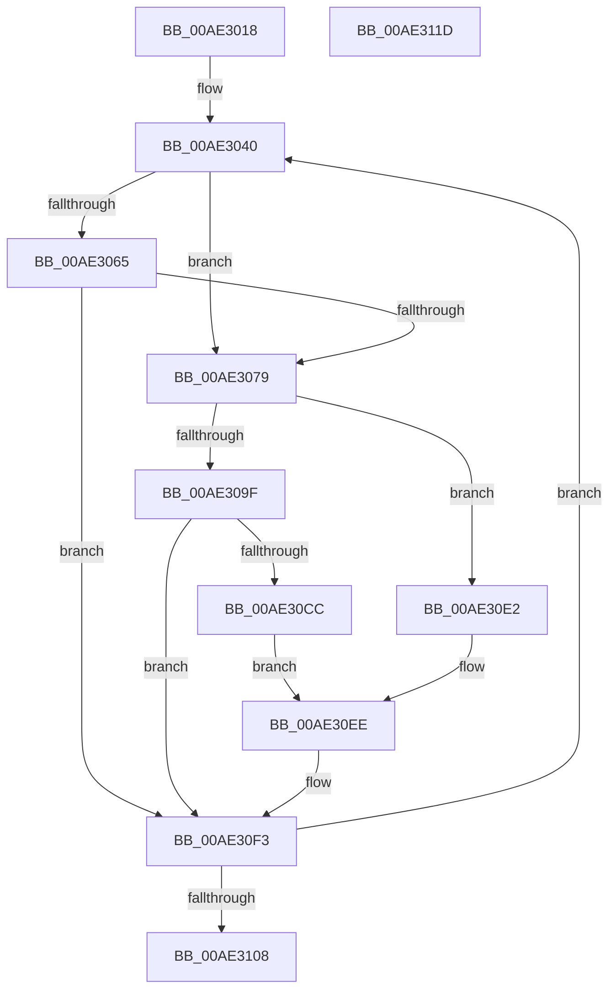

# PopRecalculateCBTriggerLevels

- RVA: `0x00AE3018`–`0x00AE311E` (길이 `262` bytes)
- VA: `0x0000000140AE3018`
- 실행 섹션: `PAGE`
- PDB 이름 있음: `예`; PDB Function 태그: `아니요`
- unwind 정보 RVA: `0x000CCFC0`
- 디코드: `60`개 명령, `262/262` bytes 표시
- 미해석 바이트: `0` (있으면 어셈블리에 `.byte`로 보존)

> 이 문서는 커널 이미지의 기계어와 PDB 기호를 분석해 생성했습니다. 4번과 5번은 함수 원형과 자료형을 바이너리 사용 방식에서 추정한 C 해석이며 원본 소스 복구 결과는 아닙니다.

## 1. Dependencies

- 직접 호출 지점: **5**; 고유 호출 대상: **4**
- 직접 호출자로 확인된 함수: **1**
- RIP 상대 이미지 참조: **2**

### Outgoing calls
- `0x00AE302B` → [PopAcquirePolicyLock](../../pagelk/B7/PopAcquirePolicyLock_function_00B783C0.md) (function, `0x00B783C0`)
- `0x00AE30AB` → [PopDiagTraceBatteryTriggerFlags](../A8/PopDiagTraceBatteryTriggerFlags_function_00A84A50.md) (function, `0x00A84A50`)
- `0x00AE30C3` → [PopBatteryCheckTrigger](../A7/PopBatteryCheckTrigger_function_00A77AF4.md) (function, `0x00A77AF4`)
- `0x00AE30EE` → [PopDiagTraceBatteryTriggerFlags](../A8/PopDiagTraceBatteryTriggerFlags_function_00A84A50.md) (function, `0x00A84A50`)
- `0x00AE3108` → [PopReleasePolicyLock](../../pagelk/B7/PopReleasePolicyLock_function_00B78410.md) (function, `0x00B78410`)

### Direct callers
- [PopBatteryApplyCompositeState](PopBatteryApplyCompositeState_function_00AE0CD0.md) at `0x00AE10D3`

### Static image references
- `0x00AE3035` → RVA `0x00F0C020` (`.data`; read)
- `0x00AE3040` → RVA `0x00F0CE68` (`.data`; read)

## 2. Other-region calls and transfers

- 다른 실행 섹션으로 향하는 call: **2**
  - `0x00AE302B` → [PopAcquirePolicyLock](../../pagelk/B7/PopAcquirePolicyLock_function_00B783C0.md) (`PAGE` → `PAGELK`)
  - `0x00AE3108` → [PopReleasePolicyLock](../../pagelk/B7/PopReleasePolicyLock_function_00B78410.md) (`PAGE` → `PAGELK`)
- 별도 외부 분기/꼬리 이동을 확인하지 못했습니다.

## 3. Assembly (complete function range)

```asm
00AE3018  48 89 5C 24 10                  mov qword ptr [rsp + 0x10], rbx
00AE301D  48 89 74 24 18                  mov qword ptr [rsp + 0x18], rsi
00AE3022  89 4C 24 08                     mov dword ptr [rsp + 8], ecx
00AE3026  57                              push rdi
00AE3027  48 83 EC 20                     sub rsp, 0x20
00AE302B  E8 90 53 09 00                  call 0x140b783c0
00AE3030  83 64 24 30 00                  and dword ptr [rsp + 0x30], 0
00AE3035  48 8D 35 E4 8F 42 00            lea rsi, [rip + 0x428fe4]
00AE303C  33 C0                           xor eax, eax
00AE303E  33 C9                           xor ecx, ecx
00AE3040  4C 8B 15 21 9E 42 00            mov r10, qword ptr [rip + 0x429e21]
00AE3047  48 8D 40 04                     lea rax, [rax + 4]
00AE304B  44 8B C1                        mov r8d, ecx
00AE304E  4C 8D 0C 40                     lea r9, [rax + rax*2]
00AE3052  49 C1 E0 05                     shl r8, 5
00AE3056  43 8B 54 CA 04                  mov edx, dword ptr [r10 + r9*8 + 4]
00AE305B  41 3B 94 30 80 01 00 00         cmp edx, dword ptr [r8 + rsi + 0x180]
00AE3063  75 14                           jne 0x140ae3079
00AE3065  41 8B 8C 30 6C 01 00 00         mov ecx, dword ptr [r8 + rsi + 0x16c]
00AE306D  C1 E9 07                        shr ecx, 7
00AE3070  83 E1 01                        and ecx, 1
00AE3073  43 38 0C CA                     cmp byte ptr [r10 + r9*8], cl
00AE3077  74 7A                           je 0x140ae30f3
00AE3079  41 89 94 30 80 01 00 00         mov dword ptr [r8 + rsi + 0x180], edx
00AE3081  48 8D 4C 24 30                  lea rcx, [rsp + 0x30]
00AE3086  41 8B 84 30 6C 01 00 00         mov eax, dword ptr [r8 + rsi + 0x16c]
00AE308E  48 8D 96 68 01 00 00            lea rdx, [rsi + 0x168]
00AE3095  49 03 D0                        add rdx, r8
00AE3098  43 80 3C CA 00                  cmp byte ptr [r10 + r9*8], 0
00AE309D  74 43                           je 0x140ae30e2
00AE309F  0F BA E8 07                     bts eax, 7
00AE30A3  41 89 84 30 6C 01 00 00         mov dword ptr [r8 + rsi + 0x16c], eax
00AE30AB  E8 A0 19 FA FF                  call 0x140a84a50
00AE30B0  8B 5C 24 30                     mov ebx, dword ptr [rsp + 0x30]
00AE30B4  48 C1 E3 05                     shl rbx, 5
00AE30B8  48 8D 3C 33                     lea rdi, [rbx + rsi]
00AE30BC  48 8D 8F 68 01 00 00            lea rcx, [rdi + 0x168]
00AE30C3  E8 2C 4A F9 FF                  call 0x140a77af4
00AE30C8  84 C0                           test al, al
00AE30CA  74 27                           je 0x140ae30f3
00AE30CC  83 8C 33 6C 01 00 00 02         or dword ptr [rbx + rsi + 0x16c], 2
00AE30D4  48 8D 97 68 01 00 00            lea rdx, [rdi + 0x168]
00AE30DB  48 8D 4C 24 30                  lea rcx, [rsp + 0x30]
00AE30E0  EB 0C                           jmp 0x140ae30ee
00AE30E2  0F BA F0 07                     btr eax, 7
00AE30E6  41 89 84 30 6C 01 00 00         mov dword ptr [r8 + rsi + 0x16c], eax
00AE30EE  E8 5D 19 FA FF                  call 0x140a84a50
00AE30F3  8B 44 24 30                     mov eax, dword ptr [rsp + 0x30]
00AE30F7  FF C0                           inc eax
00AE30F9  89 44 24 30                     mov dword ptr [rsp + 0x30], eax
00AE30FD  8B C8                           mov ecx, eax
00AE30FF  83 F8 04                        cmp eax, 4
00AE3102  0F 82 38 FF FF FF               jb 0x140ae3040
00AE3108  E8 03 53 09 00                  call 0x140b78410
00AE310D  48 8B 5C 24 38                  mov rbx, qword ptr [rsp + 0x38]
00AE3112  48 8B 74 24 40                  mov rsi, qword ptr [rsp + 0x40]
00AE3117  48 83 C4 20                     add rsp, 0x20
00AE311B  5F                              pop rdi
00AE311C  C3                              ret
00AE311D  CC                              int3
```

## 4. C-style interpretation (structured pseudocode)

```c
__int64 __fastcall PopRecalculateCBTriggerLevels(int a1)
{
    __int64 result;
    __int64 v_rbx;
    __int64 v_rsp;
    unsigned __int64 v_stack_p10;
    unsigned __int64 v_stack_p18;
    unsigned int v_stack_p8;

    v_stack_p10 = v_rbx;
    v_stack_p18 = v_rsi;
    v_stack_p8 = a1;
    v_rsp = (v_rsp) - (32);
    result = PopAcquirePolicyLock(a1, a2, a3, a4);
    result = 0;
    a1 = 0;
loc_00AE3040:
    a3 = (0) << (5);
    if (((unsigned int)((unsigned int)(*(unsigned int *)(*(unsigned __int64 *)(v_rip + 4365857) + result + 4 + result + 4 * 2 * 8 + 4)))) != (*(unsigned int *)(a3 + v_rip + 4362212 * 1 + 384))) goto loc_00AE3079;
    a1 = (unsigned int)(((unsigned int)(*(unsigned int *)(a3 + v_rip + 4362212 * 1 + 364))) >> (7));
    a1 = (unsigned int)((a1) & (1));
    if ((*(unsigned __int8 *)(*(unsigned __int64 *)(v_rip + 4365857) + result + 4 + result + 4 * 2 * 8)) == ((unsigned __int8)(a1))) goto loc_00AE30F3;
loc_00AE3079:
    *(unsigned int *)(a3 + v_rip + 4362212 * 1 + 384) = (unsigned int)((unsigned int)(*(unsigned int *)(*(unsigned __int64 *)(v_rip + 4365857) + result + 4 + result + 4 * 2 * 8 + 4)));
    a2 = (v_rip + 4362212 + 360) + (a3);
    if ((*(unsigned __int8 *)(*(unsigned __int64 *)(v_rip + 4365857) + result + 4 + result + 4 * 2 * 8)) == 0) goto loc_00AE30E2;
    *(unsigned int *)(a3 + v_rip + 4362212 * 1 + 364) = (unsigned int)((unsigned int)(*(unsigned int *)(a3 + v_rip + 4362212 * 1 + 364)));
    result = PopDiagTraceBatteryTriggerFlags(v_stack_p8, a2, a3, result + 4 + result + 4 * 2);
    v_rbx = ((unsigned int)(v_stack_p8)) << (5);
    result = PopBatteryCheckTrigger(v_rbx + v_rip + 4362212 * 1 + 360, a2, a3, result + 4 + result + 4 * 2);
    if ((unsigned __int8)(result) == 0) goto loc_00AE30F3;
    goto loc_00AE30EE;
loc_00AE30E2:
    *(unsigned int *)(a3 + v_rip + 4362212 * 1 + 364) = (unsigned int)(result);
loc_00AE30EE:
    result = PopDiagTraceBatteryTriggerFlags(v_stack_p8, v_rbx + v_rip + 4362212 * 1 + 360, a3, result + 4 + result + 4 * 2);
loc_00AE30F3:
    result = (unsigned int)(((unsigned int)(v_stack_p8)) + 1);
    v_stack_p8 = (unsigned int)(result);
    if (((unsigned int)(result)) < 4) goto loc_00AE3040;
    result = PopReleasePolicyLock((unsigned int)((unsigned int)(result)), v_rbx + v_rip + 4362212 * 1 + 360, a3, result + 4 + result + 4 * 2);
    v_rsp = (v_rsp) + (32);
    return result;
}
```

## 5. (Beta) C Style

```c
int64_t PopRecalculateCBTriggerLevels(int32_t Arg1)
{
    int64_t result;
    int64_t local_rbx;
    int64_t local_rsp;
    uint64_t v_stack_p10;
    uint64_t v_stack_p18;
    uint32_t v_stack_p8;

    v_stack_p10 = local_rbx;
    v_stack_p18 = local_rsi;
    v_stack_p8 = Arg1;
    local_rsp = (local_rsp) - (32);
    result = PopAcquirePolicyLock(Arg1, a2, a3, a4);
    result = 0;
    Arg1 = 0;
loc_00AE3040:
    a3 = (0) << (5);
    if (((uint32_t)((uint32_t)(*(uint32_t *)(*(uint64_t *)(v_rip + 0x429E21) + result + 0x4 + result + 0x4 * 2 * 8 + 0x4)))) != (*(uint32_t *)(a3 + v_rip + 0x428FE4 * 1 + 0x180))) goto loc_00AE3079;
    Arg1 = (uint32_t)(((uint32_t)(*(uint32_t *)(a3 + v_rip + 0x428FE4 * 1 + 0x16C))) >> (7));
    Arg1 = (uint32_t)((Arg1) & (1));
    if ((*(uint8_t *)(*(uint64_t *)(v_rip + 0x429E21) + result + 0x4 + result + 0x4 * 2 * 8)) == ((uint8_t)(Arg1))) goto loc_00AE30F3;
loc_00AE3079:
    *(uint32_t *)(a3 + v_rip + 0x428FE4 * 1 + 0x180) = (uint32_t)((uint32_t)(*(uint32_t *)(*(uint64_t *)(v_rip + 0x429E21) + result + 0x4 + result + 0x4 * 2 * 8 + 0x4)));
    a2 = (v_rip + 4362212 + 360) + (a3);
    if ((*(uint8_t *)(*(uint64_t *)(v_rip + 0x429E21) + result + 0x4 + result + 0x4 * 2 * 8)) == 0) goto loc_00AE30E2;
    *(uint32_t *)(a3 + v_rip + 0x428FE4 * 1 + 0x16C) = (uint32_t)((uint32_t)(*(uint32_t *)(a3 + v_rip + 0x428FE4 * 1 + 0x16C)));
    result = PopDiagTraceBatteryTriggerFlags(v_stack_p8, a2, a3, result + 4 + result + 4 * 2);
    local_rbx = ((uint32_t)(v_stack_p8)) << (5);
    result = PopBatteryCheckTrigger(local_rbx + v_rip + 4362212 * 1 + 360, a2, a3, result + 4 + result + 4 * 2);
    if ((uint8_t)(result) == 0) goto loc_00AE30F3;
    goto loc_00AE30EE;
loc_00AE30E2:
    *(uint32_t *)(a3 + v_rip + 0x428FE4 * 1 + 0x16C) = (uint32_t)(result);
loc_00AE30EE:
    result = PopDiagTraceBatteryTriggerFlags(v_stack_p8, local_rbx + v_rip + 4362212 * 1 + 360, a3, result + 4 + result + 4 * 2);
loc_00AE30F3:
    result = (uint32_t)(((uint32_t)(v_stack_p8)) + 1);
    v_stack_p8 = (uint32_t)(result);
    if (((uint32_t)(result)) < 4) goto loc_00AE3040;
    result = PopReleasePolicyLock((uint32_t)((uint32_t)(result)), local_rbx + v_rip + 4362212 * 1 + 360, a3, result + 4 + result + 4 * 2);
    local_rsp = (local_rsp) + (32);
    return result;
}
```

## 6. Execution-region graph

[열기: 2D/3D 그래프와 함수 탐색 컨트롤 패널](../../../control-panel.html?section=page&rva=0x00AE3018&view=graph)

- 2D 그래프는 위에서 아래로 흐르고, 3D 그래프는 빈 공간을 드래그해 회전합니다. Shift+드래그는 이동, 휠은 확대·축소, 함수 노드 선택은 대상 보고서 이동입니다.

### Static fallback


