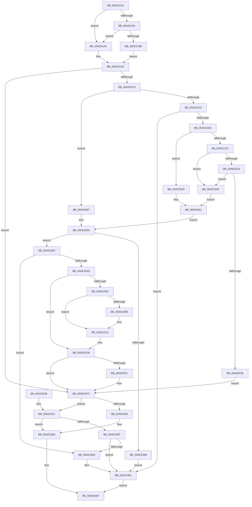

# PspAssignProcessQuotaBlock

- RVA: `0x00AE3124`–`0x00AE3365` (길이 `577` bytes)
- VA: `0x0000000140AE3124`
- 실행 섹션: `PAGE`
- PDB 이름 있음: `예`; PDB Function 태그: `아니요`
- unwind 정보 RVA: `0x000CE2B0`
- 디코드: `161`개 명령, `577/577` bytes 표시
- 미해석 바이트: `0` (있으면 어셈블리에 `.byte`로 보존)

> 이 문서는 커널 이미지의 기계어와 PDB 기호를 분석해 생성했습니다. 4번과 5번은 함수 원형과 자료형을 바이너리 사용 방식에서 추정한 C 해석이며 원본 소스 복구 결과는 아닙니다.

## 1. Dependencies

- 직접 호출 지점: **17**; 고유 호출 대상: **14**
- 직접 호출자로 확인된 함수: **2**
- RIP 상대 이미지 참조: **5**

### Outgoing calls
- `0x00AE3171` → [memset](../../text/6C/memset_function_006C6C40.md) (function, `0x006C6C40`)
- `0x00AE318A` → [SeQueryUserSidToken](../99/SeQueryUserSidToken_function_00990950.md) (function, `0x00990950`)
- `0x00AE31B8` → [PspLookupProcessQuotaBlock](PspLookupProcessQuotaBlock_function_00AE336C.md) (function, `0x00AE336C`)
- `0x00AE31DE` → [PspReadUserQuotaLimits](../A6/PspReadUserQuotaLimits_function_00A68108.md) (function, `0x00A68108`)
- `0x00AE3219` → [PspLockQuotaListShared](../../text/49/PspLockQuotaListShared_function_0049F3E4.md) (function, `0x0049F3E4`)
- `0x00AE322D` → [PspSafeReferenceQuotaBlock](../A8/PspSafeReferenceQuotaBlock_function_00A87E14.md) (function, `0x00A87E14`)
- `0x00AE323C` → [PspUnlockQuotaListShared](../../text/4A/PspUnlockQuotaListShared_function_004A5234.md) (function, `0x004A5234`)
- `0x00AE3253` → [PspUnlockQuotaListShared](../../text/4A/PspUnlockQuotaListShared_function_004A5234.md) (function, `0x004A5234`)
- `0x00AE327E` → [ExAllocatePool2](../../poolcode/B8/ExAllocatePool2_function_00B820F0.md) (function, `0x00B820F0`)
- `0x00AE329E` → [PspInitializeQuotaBlock](../78/PspInitializeQuotaBlock_function_00780EB0.md) (function, `0x00780EB0`)
- `0x00AE32B2` → [Feature_2056154424__private_IsEnabledDeviceUsageNoInline](../../text/5E/Feature_2056154424__private_IsEnabledDeviceUsageNoInline_function_005E276C.md) (function, `0x005E276C`)
- `0x00AE32C5` → [PspGetQuotaSid](../../text/5E/PspGetQuotaSid_function_005E2B9C.md) (function, `0x005E2B9C`)
- `0x00AE32D3` → [RtlCopySid](../9A/RtlCopySid_function_009A9A50.md) (function, `0x009A9A50`)
- `0x00AE32E4` → [PspLookupProcessQuotaBlock](PspLookupProcessQuotaBlock_function_00AE336C.md) (function, `0x00AE336C`)
- `0x00AE32F4` → [PspDereferenceQuota](../90/PspDereferenceQuota_function_009075A4.md) (function, `0x009075A4`)
- `0x00AE3316` → [_security_check_cookie](../../text/6A/_security_check_cookie_function_006AC640.md) (function, `0x006AC640`)
- `0x00AE335C` → [PspDereferenceQuota](../90/PspDereferenceQuota_function_009075A4.md) (function, `0x009075A4`)

### Direct callers
- [PspAllocateProcess](../A1/PspAllocateProcess_function_00A13B3C.md) at `0x00A150D6`
- [sub_00B2E606](../B2/Unknown_function_00B2E606.md) at `0x00B2E644`

### Static image references
- `0x00AE3140` → RVA `0x00E0A740` (`.data`; read)
- `0x00AE31FB` → RVA `0x00FD9DF8` (`PAGEDATA`; read)
- `0x00AE3202` → RVA `0x00FD9C48` (`PAGEDATA`; read)
- `0x00AE321E` → RVA `0x00FD9DB8` (`PAGEDATA`; read)
- `0x00AE3337` → RVA `0x00E27F80` (`.data`; read)

## 2. Other-region calls and transfers

- 다른 실행 섹션으로 향하는 call: **8**
  - `0x00AE3171` → [memset](../../text/6C/memset_function_006C6C40.md) (`PAGE` → `.text`)
  - `0x00AE3219` → [PspLockQuotaListShared](../../text/49/PspLockQuotaListShared_function_0049F3E4.md) (`PAGE` → `.text`)
  - `0x00AE323C` → [PspUnlockQuotaListShared](../../text/4A/PspUnlockQuotaListShared_function_004A5234.md) (`PAGE` → `.text`)
  - `0x00AE3253` → [PspUnlockQuotaListShared](../../text/4A/PspUnlockQuotaListShared_function_004A5234.md) (`PAGE` → `.text`)
  - `0x00AE327E` → [ExAllocatePool2](../../poolcode/B8/ExAllocatePool2_function_00B820F0.md) (`PAGE` → `POOLCODE`)
  - `0x00AE32B2` → [Feature_2056154424__private_IsEnabledDeviceUsageNoInline](../../text/5E/Feature_2056154424__private_IsEnabledDeviceUsageNoInline_function_005E276C.md) (`PAGE` → `.text`)
  - `0x00AE32C5` → [PspGetQuotaSid](../../text/5E/PspGetQuotaSid_function_005E2B9C.md) (`PAGE` → `.text`)
  - `0x00AE3316` → [_security_check_cookie](../../text/6A/_security_check_cookie_function_006AC640.md) (`PAGE` → `.text`)
- 별도 외부 분기/꼬리 이동을 확인하지 못했습니다.

## 3. Assembly (complete function range)

```asm
00AE3124  48 89 5C 24 20                  mov qword ptr [rsp + 0x20], rbx
00AE3129  55                              push rbp
00AE312A  56                              push rsi
00AE312B  57                              push rdi
00AE312C  41 54                           push r12
00AE312E  41 55                           push r13
00AE3130  41 56                           push r14
00AE3132  41 57                           push r15
00AE3134  48 8D 6C 24 D9                  lea rbp, [rsp - 0x27]
00AE3139  48 81 EC A0 00 00 00            sub rsp, 0xa0
00AE3140  48 8B 05 F9 75 32 00            mov rax, qword ptr [rip + 0x3275f9]
00AE3147  48 33 C4                        xor rax, rsp
00AE314A  48 89 45 17                     mov qword ptr [rbp + 0x17], rax
00AE314E  83 65 AB 00                     and dword ptr [rbp - 0x55], 0
00AE3152  49 8B D8                        mov rbx, r8
00AE3155  83 65 A7 00                     and dword ptr [rbp - 0x59], 0
00AE3159  4C 8B EA                        mov r13, rdx
00AE315C  48 8B F9                        mov rdi, rcx
00AE315F  48 89 4D AF                     mov qword ptr [rbp - 0x51], rcx
00AE3163  BE 44 00 00 00                  mov esi, 0x44
00AE3168  48 8D 4D B7                     lea rcx, [rbp - 0x49]
00AE316C  44 8B C6                        mov r8d, esi
00AE316F  33 D2                           xor edx, edx
00AE3171  E8 CA 3A BE FF                  call 0x1406c6c40
00AE3176  4C 8D 4D A7                     lea r9, [rbp - 0x59]
00AE317A  44 8B C6                        mov r8d, esi
00AE317D  48 8D 55 B7                     lea rdx, [rbp - 0x49]
00AE3181  48 8B CB                        mov rcx, rbx
00AE3184  45 32 E4                        xor r12b, r12b
00AE3187  45 33 F6                        xor r14d, r14d
00AE318A  E8 C1 D7 EA FF                  call 0x140990950
00AE318F  48 85 FF                        test rdi, rdi
00AE3192  74 11                           je 0x140ae31a5
00AE3194  8B 47 50                        mov eax, dword ptr [rdi + 0x50]
00AE3197  A8 10                           test al, 0x10
00AE3199  74 0A                           je 0x140ae31a5
00AE319B  33 F6                           xor esi, esi
00AE319D  41 B4 01                        mov r12b, 1
00AE31A0  89 75 A7                        mov dword ptr [rbp - 0x59], esi
00AE31A3  EB 07                           jmp 0x140ae31ac
00AE31A5  8B 75 A7                        mov esi, dword ptr [rbp - 0x59]
00AE31A8  4C 8D 75 B7                     lea r14, [rbp - 0x49]
00AE31AC  45 0F B6 C4                     movzx r8d, r12b
00AE31B0  45 33 C9                        xor r9d, r9d
00AE31B3  8B D6                           mov edx, esi
00AE31B5  49 8B CE                        mov rcx, r14
00AE31B8  E8 AF 01 00 00                  call 0x140ae336c
00AE31BD  48 8B D8                        mov rbx, rax
00AE31C0  48 85 C0                        test rax, rax
00AE31C3  0F 85 33 01 00 00               jne 0x140ae32fc
00AE31C9  48 85 FF                        test rdi, rdi
00AE31CC  0F 85 95 00 00 00               jne 0x140ae3267
00AE31D2  4C 8D 45 07                     lea r8, [rbp + 7]
00AE31D6  48 8D 55 AB                     lea rdx, [rbp - 0x55]
00AE31DA  48 8D 4D B7                     lea rcx, [rbp - 0x49]
00AE31DE  E8 25 4F F8 FF                  call 0x140a68108
00AE31E3  8B F8                           mov edi, eax
00AE31E5  85 C0                           test eax, eax
00AE31E7  0F 88 74 01 00 00               js 0x140ae3361
00AE31ED  39 5D AB                        cmp dword ptr [rbp - 0x55], ebx
00AE31F0  74 6B                           je 0x140ae325d
00AE31F2  65 48 8B 3C 25 88 01 00 00      mov rdi, qword ptr gs:[0x188]
00AE31FB  4C 8D 3D F6 6B 4F 00            lea r15, [rip + 0x4f6bf6]
00AE3202  48 8B 35 3F 6A 4F 00            mov rsi, qword ptr [rip + 0x4f6a3f]
00AE3209  45 33 F6                        xor r14d, r14d
00AE320C  44 21 75 A7                     and dword ptr [rbp - 0x59], r14d
00AE3210  48 8B D6                        mov rdx, rsi
00AE3213  48 8B CF                        mov rcx, rdi
00AE3216  41 B4 01                        mov r12b, 1
00AE3219  E8 C6 C1 9B FF                  call 0x14049f3e4
00AE321E  48 8B 1D 93 6B 4F 00            mov rbx, qword ptr [rip + 0x4f6b93]
00AE3225  48 85 DB                        test rbx, rbx
00AE3228  74 23                           je 0x140ae324d
00AE322A  48 8B CB                        mov rcx, rbx
00AE322D  E8 E2 4B FA FF                  call 0x140a87e14
00AE3232  85 C0                           test eax, eax
00AE3234  74 17                           je 0x140ae324d
00AE3236  48 8B D6                        mov rdx, rsi
00AE3239  48 8B CF                        mov rcx, rdi
00AE323C  E8 F3 1F 9C FF                  call 0x1404a5234
00AE3241  F0 FF 83 04 02 00 00            lock inc dword ptr [rbx + 0x204]
00AE3248  E9 AF 00 00 00                  jmp 0x140ae32fc
00AE324D  48 8B D6                        mov rdx, rsi
00AE3250  48 8B CF                        mov rcx, rdi
00AE3253  E8 DC 1F 9C FF                  call 0x1404a5234
00AE3258  8B 75 A7                        mov esi, dword ptr [rbp - 0x59]
00AE325B  EB 04                           jmp 0x140ae3261
00AE325D  4C 8D 7D 07                     lea r15, [rbp + 7]
00AE3261  48 8B 7D AF                     mov rdi, qword ptr [rbp - 0x51]
00AE3265  EB 03                           jmp 0x140ae326a
00AE3267  45 33 FF                        xor r15d, r15d
00AE326A  8B D6                           mov edx, esi
00AE326C  B9 48 00 00 00                  mov ecx, 0x48
00AE3271  48 81 C2 40 02 00 00            add rdx, 0x240
00AE3278  41 B8 50 73 51 62               mov r8d, 0x62517350
00AE327E  E8 6D EE 09 00                  call 0x140b820f0
00AE3283  48 8B D8                        mov rbx, rax
00AE3286  48 85 C0                        test rax, rax
00AE3289  75 0A                           jne 0x140ae3295
00AE328B  BF 9A 00 00 C0                  mov edi, 0xc000009a
00AE3290  E9 CC 00 00 00                  jmp 0x140ae3361
00AE3295  4C 8B C3                        mov r8, rbx
00AE3298  49 8B D7                        mov rdx, r15
00AE329B  48 8B CF                        mov rcx, rdi
00AE329E  E8 0D DC C9 FF                  call 0x140780eb0
00AE32A3  8B F8                           mov edi, eax
00AE32A5  85 C0                           test eax, eax
00AE32A7  0F 88 AC 00 00 00               js 0x140ae3359
00AE32AD  4D 85 F6                        test r14, r14
00AE32B0  74 26                           je 0x140ae32d8
00AE32B2  E8 B5 F4 AF FF                  call 0x1405e276c
00AE32B7  85 C0                           test eax, eax
00AE32B9  74 07                           je 0x140ae32c2
00AE32BB  83 8B 18 02 00 00 01            or dword ptr [rbx + 0x218], 1
00AE32C2  48 8B CB                        mov rcx, rbx
00AE32C5  E8 D2 F8 AF FF                  call 0x1405e2b9c
00AE32CA  48 8B D0                        mov rdx, rax
00AE32CD  4C 8D 45 B7                     lea r8, [rbp - 0x49]
00AE32D1  8B CE                           mov ecx, esi
00AE32D3  E8 78 67 EC FF                  call 0x1409a9a50
00AE32D8  45 0F B6 C4                     movzx r8d, r12b
00AE32DC  4C 8B CB                        mov r9, rbx
00AE32DF  8B D6                           mov edx, esi
00AE32E1  49 8B CE                        mov rcx, r14
00AE32E4  E8 83 00 00 00                  call 0x140ae336c
00AE32E9  48 8B F8                        mov rdi, rax
00AE32EC  48 85 C0                        test rax, rax
00AE32EF  74 0B                           je 0x140ae32fc
00AE32F1  48 8B CB                        mov rcx, rbx
00AE32F4  E8 AB 42 E2 FF                  call 0x1409075a4
00AE32F9  48 8B DF                        mov rbx, rdi
00AE32FC  49 83 BD F8 02 00 00 00         cmp qword ptr [r13 + 0x2f8], 0
00AE3304  75 31                           jne 0x140ae3337
00AE3306  49 89 9D F8 02 00 00            mov qword ptr [r13 + 0x2f8], rbx
00AE330D  33 C0                           xor eax, eax
00AE330F  48 8B 4D 17                     mov rcx, qword ptr [rbp + 0x17]
00AE3313  48 33 CC                        xor rcx, rsp
00AE3316  E8 25 93 BC FF                  call 0x1406ac640
00AE331B  48 8B 9C 24 F8 00 00 00         mov rbx, qword ptr [rsp + 0xf8]
00AE3323  48 81 C4 A0 00 00 00            add rsp, 0xa0
00AE332A  41 5F                           pop r15
00AE332C  41 5E                           pop r14
00AE332E  41 5D                           pop r13
00AE3330  41 5C                           pop r12
00AE3332  5F                              pop rdi
00AE3333  5E                              pop rsi
00AE3334  5D                              pop rbp
00AE3335  C3                              ret
00AE3336  CC                              int3
00AE3337  48 8D 15 42 4C 34 00            lea rdx, [rip + 0x344c42]
00AE333E  48 8B C2                        mov rax, rdx
00AE3341  F0 49 0F B1 9D F8 02 00 00      lock cmpxchg qword ptr [r13 + 0x2f8], rbx
00AE334A  48 3B C2                        cmp rax, rdx
00AE334D  74 BE                           je 0x140ae330d
00AE334F  BF 01 00 00 C0                  mov edi, 0xc0000001
00AE3354  48 85 DB                        test rbx, rbx
00AE3357  74 08                           je 0x140ae3361
00AE3359  48 8B CB                        mov rcx, rbx
00AE335C  E8 43 42 E2 FF                  call 0x1409075a4
00AE3361  8B C7                           mov eax, edi
00AE3363  EB AA                           jmp 0x140ae330f
```

## 4. C-style interpretation (structured pseudocode)

```c
__int64 __fastcall PspAssignProcessQuotaBlock(__int64 a1, __int64 a2, __int64 a3)
{
    __int64 result;
    __int64 v_r12;
    __int64 v_r14;
    __int64 v_r15;
    __int64 v_rbx;
    __int64 v_rsi;
    __int64 v_rsp;
    unsigned __int64 v_stack_m48;
    unsigned __int64 v_stack_m58;
    unsigned __int64 v_stack_m5F;
    unsigned __int64 v_stack_mA8;
    unsigned __int64 v_stack_mB0;
    unsigned int v_stack_mB4;
    unsigned int v_stack_mB8;
    unsigned __int64 v_stack_p20;

    v_stack_p20 = v_rbx;
    v_rsp = (v_rsp) - (160);
    result = (*(unsigned __int64 *)(v_rip + 3307001)) ^ (v_rsp);
    v_stack_m48 = result;
    v_stack_mB0 = a1;
    a2 = 0;
    result = memset(v_stack_mA8, a2, 68, a4);
    v_r12 = 0;
    v_r14 = 0;
    result = SeQueryUserSidToken(a3, v_stack_mA8, 68, v_stack_mB8);
    if (a1 == 0) goto loc_00AE31A5;
    if ((((unsigned __int8)((unsigned int)(*(unsigned int *)(a1 + 80)))) & (16)) == 0) goto loc_00AE31A5;
    v_rsi = 0;
    v_stack_mB8 = 0;
    goto loc_00AE31AC;
loc_00AE31A5:
loc_00AE31AC:
    a4 = 0;
    result = PspLookupProcessQuotaBlock(v_stack_mA8, (unsigned int)((unsigned int)((unsigned int)(v_stack_mB8))), 1, a4);
    if (result != 0) goto loc_00AE32FC;
    if (a1 != 0) goto loc_00AE3267;
    result = PspReadUserQuotaLimits(v_stack_mA8, v_stack_mB4, v_stack_m58, a4);
    if (sign_flag) goto loc_00AE3361;
    if (v_stack_mB4 == ((unsigned int)(result))) goto loc_00AE325D;
    v_r14 = 0;
    result = PspLockQuotaListShared(*(unsigned __int64 *)(gs_base + (0 + 392)), *(unsigned __int64 *)(v_rip + 5204543), v_stack_m58, a4);
    if (*(unsigned __int64 *)(v_rip + 5204883) == 0) goto loc_00AE324D;
    result = PspSafeReferenceQuotaBlock(*(unsigned __int64 *)(v_rip + 5204883), *(unsigned __int64 *)(v_rip + 5204543), v_stack_m58, a4);
    if ((unsigned int)(result) == 0) goto loc_00AE324D;
    result = PspUnlockQuotaListShared(*(unsigned __int64 *)(gs_base + (0 + 392)), *(unsigned __int64 *)(v_rip + 5204543), v_stack_m58, a4);
    goto loc_00AE32FC;
loc_00AE324D:
    result = PspUnlockQuotaListShared(*(unsigned __int64 *)(gs_base + (0 + 392)), *(unsigned __int64 *)(v_rip + 5204543), v_stack_m58, a4);
    goto loc_00AE3261;
loc_00AE325D:
loc_00AE3261:
    goto loc_00AE326A;
loc_00AE3267:
    v_r15 = 0;
loc_00AE326A:
    a2 = ((unsigned int)((unsigned int)((unsigned int)(v_stack_mB8)))) + (576);
    result = ExAllocatePool2(72, a2, (unsigned int)(0x62517350ULL), a4);
    if (result != 0) goto loc_00AE3295;
    goto loc_00AE3361;
loc_00AE3295:
    result = PspInitializeQuotaBlock((unsigned int)(0xC000009AULL), 0, result, a4);
    if (sign_flag) goto loc_00AE3359;
    if (0 == 0) goto loc_00AE32D8;
    result = Feature_2056154424__private_IsEnabledDeviceUsageNoInline((unsigned int)(0xC000009AULL), 0, result, a4);
    if ((unsigned int)(result) != 0) {
    }
    result = PspGetQuotaSid(result, 0, result, a4);
    result = RtlCopySid((unsigned int)((unsigned int)((unsigned int)(v_stack_mB8))), result, v_stack_mA8, a4);
loc_00AE32D8:
    result = PspLookupProcessQuotaBlock(0, (unsigned int)((unsigned int)((unsigned int)(v_stack_mB8))), 1, result);
    v_rbx = result;
    if (result != 0) {
        a1 = result;
        result = PspDereferenceQuota(a1, (unsigned int)((unsigned int)((unsigned int)(v_stack_mB8))), 1, result);
        v_rbx = result;
    }
    if ((*(unsigned __int64 *)(a2 + 760)) != 0) goto loc_00AE3337;
    *(unsigned __int64 *)(a2 + 760) = v_rbx;
loc_00AE330D:
    result = 0;
loc_00AE330F:
    a1 = (v_stack_m48) ^ (v_rsp);
    result = _security_check_cookie(a1, (unsigned int)((unsigned int)((unsigned int)(v_stack_mB8))), 1, result);
    v_rsp = (v_rsp) + (160);
    return result;
loc_00AE3337:
    if ((v_rip + 3427394) == (v_rip + 3427394)) goto loc_00AE330D;
    result = v_rip + 3427394;
    if (v_stack_p20 != 0) {
        a1 = v_stack_p20;
        result = PspDereferenceQuota(a1, v_rip + 3427394, 1, result);
    }
    goto loc_00AE330F;
}
```

## 5. (Beta) C Style

```c
int64_t PspAssignProcessQuotaBlock(int64_t Arg1, void *Arg2, int64_t Arg3)
{
    uint8_t *arg2 = (uint8_t *)Arg2;

    int64_t result;
    int64_t local_r12;
    int64_t local_r14;
    int64_t local_r15;
    int64_t local_rbx;
    int64_t local_rsi;
    int64_t local_rsp;
    uint64_t v_stack_m48;
    uint64_t v_stack_m58;
    uint64_t v_stack_m5F;
    uint64_t v_stack_mA8;
    uint64_t v_stack_mB0;
    uint32_t v_stack_mB4;
    uint32_t v_stack_mB8;
    uint64_t v_stack_p20;

    v_stack_p20 = local_rbx;
    local_rsp = (local_rsp) - (160);
    result = (*(uint64_t *)(v_rip + 0x3275F9)) ^ (local_rsp);
    v_stack_m48 = result;
    v_stack_mB0 = Arg1;
    Arg2 = 0;
    result = memset(v_stack_mA8, Arg2, 68, a4);
    local_r12 = 0;
    local_r14 = 0;
    result = SeQueryUserSidToken(Arg3, v_stack_mA8, 68, v_stack_mB8);
    if (Arg1 == 0) goto loc_00AE31A5;
    if ((((uint8_t)((uint32_t)(*(uint32_t *)(Arg1 + 0x50)))) & (16)) == 0) goto loc_00AE31A5;
    local_rsi = 0;
    v_stack_mB8 = 0;
    goto loc_00AE31AC;
loc_00AE31A5:
loc_00AE31AC:
    a4 = 0;
    result = PspLookupProcessQuotaBlock(v_stack_mA8, (uint32_t)((uint32_t)((uint32_t)(v_stack_mB8))), 1, a4);
    if (result != 0) goto loc_00AE32FC;
    if (Arg1 != 0) goto loc_00AE3267;
    result = PspReadUserQuotaLimits(v_stack_mA8, v_stack_mB4, v_stack_m58, a4);
    if (sign_flag) goto loc_00AE3361;
    if (v_stack_mB4 == ((uint32_t)(result))) goto loc_00AE325D;
    local_r14 = 0;
    result = PspLockQuotaListShared(*(uint64_t *)(gs_base + (0 + 0x188)), *(uint64_t *)(v_rip + 0x4F6A3F), v_stack_m58, a4);
    if (*(uint64_t *)(v_rip + 0x4F6B93) == 0) goto loc_00AE324D;
    result = PspSafeReferenceQuotaBlock(*(uint64_t *)(v_rip + 0x4F6B93), *(uint64_t *)(v_rip + 0x4F6A3F), v_stack_m58, a4);
    if ((uint32_t)(result) == 0) goto loc_00AE324D;
    result = PspUnlockQuotaListShared(*(uint64_t *)(gs_base + (0 + 0x188)), *(uint64_t *)(v_rip + 0x4F6A3F), v_stack_m58, a4);
    goto loc_00AE32FC;
loc_00AE324D:
    result = PspUnlockQuotaListShared(*(uint64_t *)(gs_base + (0 + 0x188)), *(uint64_t *)(v_rip + 0x4F6A3F), v_stack_m58, a4);
    goto loc_00AE3261;
loc_00AE325D:
loc_00AE3261:
    goto loc_00AE326A;
loc_00AE3267:
    local_r15 = 0;
loc_00AE326A:
    Arg2 = ((uint32_t)((uint32_t)((uint32_t)(v_stack_mB8)))) + (576);
    result = ExAllocatePool2(72, Arg2, (uint32_t)(0x62517350ULL), a4);
    if (result != 0) goto loc_00AE3295;
    goto loc_00AE3361;
loc_00AE3295:
    result = PspInitializeQuotaBlock((uint32_t)(0xC000009AULL), 0, result, a4);
    if (sign_flag) goto loc_00AE3359;
    if (0 == 0) goto loc_00AE32D8;
    result = Feature_2056154424__private_IsEnabledDeviceUsageNoInline((uint32_t)(0xC000009AULL), 0, result, a4);
    if ((uint32_t)(result) != 0) {
    }
    result = PspGetQuotaSid(result, 0, result, a4);
    result = RtlCopySid((uint32_t)((uint32_t)((uint32_t)(v_stack_mB8))), result, v_stack_mA8, a4);
loc_00AE32D8:
    result = PspLookupProcessQuotaBlock(0, (uint32_t)((uint32_t)((uint32_t)(v_stack_mB8))), 1, result);
    local_rbx = result;
    if (result != 0) {
        Arg1 = result;
        result = PspDereferenceQuota(Arg1, (uint32_t)((uint32_t)((uint32_t)(v_stack_mB8))), 1, result);
        local_rbx = result;
    }
    if ((*(uint64_t *)(arg2 + 0x2F8)) != 0) goto loc_00AE3337;
    *(uint64_t *)(arg2 + 0x2F8) = local_rbx;
loc_00AE330D:
    result = 0;
loc_00AE330F:
    Arg1 = (v_stack_m48) ^ (local_rsp);
    result = _security_check_cookie(Arg1, (uint32_t)((uint32_t)((uint32_t)(v_stack_mB8))), 1, result);
    local_rsp = (local_rsp) + (160);
    return result;
loc_00AE3337:
    if ((v_rip + 3427394) == (v_rip + 3427394)) goto loc_00AE330D;
    result = v_rip + 3427394;
    if (v_stack_p20 != 0) {
        Arg1 = v_stack_p20;
        result = PspDereferenceQuota(Arg1, v_rip + 3427394, 1, result);
    }
    goto loc_00AE330F;
}
```

### 관측된 메모리 오프셋

구조체 형식이 확인되지 않은 접근은 인자 기준의 오프셋으로만 기록했습니다.

| 기준 인자 | 오프셋 표현 | 폭 (bit) | 접근 |
|---|---:|---:|---|
| `Arg2` | `+ 0x2F8` | `64` | `R` |
| `Arg2` | `+ 0x2F8` | `64` | `W` |

## 6. Execution-region graph

[열기: 2D/3D 그래프와 함수 탐색 컨트롤 패널](../../../control-panel.html?section=page&rva=0x00AE3124&view=graph)

- 2D 그래프는 위에서 아래로 흐르고, 3D 그래프는 빈 공간을 드래그해 회전합니다. Shift+드래그는 이동, 휠은 확대·축소, 함수 노드 선택은 대상 보고서 이동입니다.

### Static fallback


