# PspChangeProcessExecutionState

- RVA: `0x00AEC594`–`0x00AEC7E3` (길이 `591` bytes)
- VA: `0x0000000140AEC594`
- 실행 섹션: `PAGE`
- PDB 이름 있음: `예`; PDB Function 태그: `아니요`
- unwind 정보 RVA: `0x000CF34C`
- 디코드: `178`개 명령, `591/591` bytes 표시
- 미해석 바이트: `0` (있으면 어셈블리에 `.byte`로 보존)

> 이 문서는 커널 이미지의 기계어와 PDB 기호를 분석해 생성했습니다. 4번과 5번은 함수 원형과 자료형을 바이너리 사용 방식에서 추정한 C 해석이며 원본 소스 복구 결과는 아닙니다.

## 1. Dependencies

- 직접 호출 지점: **12**; 고유 호출 대상: **12**
- 직접 호출자로 확인된 함수: **5**
- RIP 상대 이미지 참조: **3**

### Outgoing calls
- `0x00AEC665` → [KiStackAttachProcess](../../text/21/KiStackAttachProcess_function_00216820.md) (function, `0x00216820`)
- `0x00AEC680` → [MmInSwapWorkingSet](../../text/45/MmInSwapWorkingSet_function_0045B6C4.md) (function, `0x0045B6C4`)
- `0x00AEC69A` → [PsRemoveDeepFreezeOptimizations](../AB/PsRemoveDeepFreezeOptimizations_function_00AB5FA4.md) (function, `0x00AB5FA4`)
- `0x00AEC6B3` → [PsFreezeProcess](../AA/PsFreezeProcess_function_00AA6D04.md) (function, `0x00AA6D04`)
- `0x00AEC6BD` → [PsThawMultiProcess](../../text/45/PsThawMultiProcess_function_0045FFE0.md) (function, `0x0045FFE0`)
- `0x00AEC6D4` → [PsApplyDeepFreezeOptimizations](../AA/PsApplyDeepFreezeOptimizations_function_00AA9EDC.md) (function, `0x00AA9EDC`)
- `0x00AEC6F2` → [MmOutSwapWorkingSet](../../text/2A/MmOutSwapWorkingSet_function_002A6BC8.md) (function, `0x002A6BC8`)
- `0x00AEC782` → [KiUnstackDetachProcess](../../text/21/KiUnstackDetachProcess_function_00217D30.md) (function, `0x00217D30`)
- `0x00AEC794` → [ExGetExtensionTable](../../text/42/ExGetExtensionTable_function_00428814.md) (function, `0x00428814`)
- `0x00AEC7A4` → [guard_dispatch_icall](../../text/6B/guard_dispatch_icall_function_006BAAD0.md) (function, `0x006BAAD0`)
- `0x00AEC7B0` → [ExReleaseExtensionTable](../../text/45/ExReleaseExtensionTable_function_00456DC0.md) (function, `0x00456DC0`)
- `0x00AEC7BF` → [_security_check_cookie](../../text/6A/_security_check_cookie_function_006AC640.md) (function, `0x006AC640`)

### Direct callers
- [PspExecuteJobFreezeThawCallback](../../text/4E/PspExecuteJobFreezeThawCallback_function_004E9850.md) at `0x004E9899`
- [PsSwapProcessWorkingSet](../78/PsSwapProcessWorkingSet_function_00781C24.md) at `0x00781D2E`
- [PspRemoveProcessFromJobChain](../90/PspRemoveProcessFromJobChain_function_00907288.md) at `0x00907572`
- [PspInsertThread](../9F/PspInsertThread_function_009F0314.md) at `0x009F0851`
- [PspAssignProcessToJob](../A2/PspAssignProcessToJob_function_00A23370.md) at `0x00A2381A`

### Static image references
- `0x00AEC5B3` → RVA `0x00E0A740` (`.data`; read)
- `0x00AEC6E9` → RVA `0x00E67AD8` (`.data`; read)
- `0x00AEC78D` → RVA `0x00FC6EA8` (`ALMOSTRO`; read)

## 2. Other-region calls and transfers

- 다른 실행 섹션으로 향하는 call: **9**
  - `0x00AEC665` → [KiStackAttachProcess](../../text/21/KiStackAttachProcess_function_00216820.md) (`PAGE` → `.text`)
  - `0x00AEC680` → [MmInSwapWorkingSet](../../text/45/MmInSwapWorkingSet_function_0045B6C4.md) (`PAGE` → `.text`)
  - `0x00AEC6BD` → [PsThawMultiProcess](../../text/45/PsThawMultiProcess_function_0045FFE0.md) (`PAGE` → `.text`)
  - `0x00AEC6F2` → [MmOutSwapWorkingSet](../../text/2A/MmOutSwapWorkingSet_function_002A6BC8.md) (`PAGE` → `.text`)
  - `0x00AEC782` → [KiUnstackDetachProcess](../../text/21/KiUnstackDetachProcess_function_00217D30.md) (`PAGE` → `.text`)
  - `0x00AEC794` → [ExGetExtensionTable](../../text/42/ExGetExtensionTable_function_00428814.md) (`PAGE` → `.text`)
  - `0x00AEC7A4` → [guard_dispatch_icall](../../text/6B/guard_dispatch_icall_function_006BAAD0.md) (`PAGE` → `.text`)
  - `0x00AEC7B0` → [ExReleaseExtensionTable](../../text/45/ExReleaseExtensionTable_function_00456DC0.md) (`PAGE` → `.text`)
  - `0x00AEC7BF` → [_security_check_cookie](../../text/6A/_security_check_cookie_function_006AC640.md) (`PAGE` → `.text`)
- 별도 외부 분기/꼬리 이동을 확인하지 못했습니다.

## 3. Assembly (complete function range)

```asm
00AEC594  48 89 5C 24 10                  mov qword ptr [rsp + 0x10], rbx
00AEC599  48 89 74 24 18                  mov qword ptr [rsp + 0x18], rsi
00AEC59E  48 89 7C 24 20                  mov qword ptr [rsp + 0x20], rdi
00AEC5A3  55                              push rbp
00AEC5A4  41 54                           push r12
00AEC5A6  41 55                           push r13
00AEC5A8  41 56                           push r14
00AEC5AA  41 57                           push r15
00AEC5AC  48 8B EC                        mov rbp, rsp
00AEC5AF  48 83 EC 70                     sub rsp, 0x70
00AEC5B3  48 8B 05 86 E1 31 00            mov rax, qword ptr [rip + 0x31e186]
00AEC5BA  48 33 C4                        xor rax, rsp
00AEC5BD  48 89 45 F0                     mov qword ptr [rbp - 0x10], rax
00AEC5C1  83 65 BC 00                     and dword ptr [rbp - 0x44], 0
00AEC5C5  0F 57 C0                        xorps xmm0, xmm0
00AEC5C8  45 33 E4                        xor r12d, r12d
00AEC5CB  C6 45 B8 00                     mov byte ptr [rbp - 0x48], 0
00AEC5CF  0F 11 45 C0                     movups xmmword ptr [rbp - 0x40], xmm0
00AEC5D3  45 32 ED                        xor r13b, r13b
00AEC5D6  4C 8B F1                        mov r14, rcx
00AEC5D9  0F 11 45 D0                     movups xmmword ptr [rbp - 0x30], xmm0
00AEC5DD  0F 11 45 E0                     movups xmmword ptr [rbp - 0x20], xmm0
00AEC5E1  0F 0D 89 F8 07 00 00            prefetchw byte ptr [rcx + 0x7f8]
00AEC5E8  8B 81 F8 07 00 00               mov eax, dword ptr [rcx + 0x7f8]
00AEC5EE  41 8D 7C 24 01                  lea edi, [r12 + 1]
00AEC5F3  EB 4A                           jmp 0x140aec63f
00AEC5F5  8B 4D B4                        mov ecx, dword ptr [rbp - 0x4c]
00AEC5F8  8B F1                           mov esi, ecx
00AEC5FA  8B C1                           mov eax, ecx
00AEC5FC  C1 EE 18                        shr esi, 0x18
00AEC5FF  C1 E8 10                        shr eax, 0x10
00AEC602  40 0A F0                        or sil, al
00AEC605  C1 E9 08                        shr ecx, 8
00AEC608  40 3A F1                        cmp sil, cl
00AEC60B  0F 84 A4 01 00 00               je 0x140aec7b5
00AEC611  8B 45 B4                        mov eax, dword ptr [rbp - 0x4c]
00AEC614  89 45 B0                        mov dword ptr [rbp - 0x50], eax
00AEC617  8A 45 B0                        mov al, byte ptr [rbp - 0x50]
00AEC61A  40 0A C7                        or al, dil
00AEC61D  88 45 B0                        mov byte ptr [rbp - 0x50], al
00AEC620  8B 45 B4                        mov eax, dword ptr [rbp - 0x4c]
00AEC623  8B 55 B0                        mov edx, dword ptr [rbp - 0x50]
00AEC626  F0 41 0F B1 96 F8 07 00 00      lock cmpxchg dword ptr [r14 + 0x7f8], edx
00AEC62F  89 45 B0                        mov dword ptr [rbp - 0x50], eax
00AEC632  8B 55 B0                        mov edx, dword ptr [rbp - 0x50]
00AEC635  8B 45 B4                        mov eax, dword ptr [rbp - 0x4c]
00AEC638  3B D0                           cmp edx, eax
00AEC63A  74 13                           je 0x140aec64f
00AEC63C  8B 45 B0                        mov eax, dword ptr [rbp - 0x50]
00AEC63F  89 45 B4                        mov dword ptr [rbp - 0x4c], eax
00AEC642  8A 45 B4                        mov al, byte ptr [rbp - 0x4c]
00AEC645  40 84 C7                        test dil, al
00AEC648  74 AB                           je 0x140aec5f5
00AEC64A  E9 66 01 00 00                  jmp 0x140aec7b5
00AEC64F  40 8A DE                        mov bl, sil
00AEC652  45 32 FF                        xor r15b, r15b
00AEC655  32 D9                           xor bl, cl
00AEC657  45 84 ED                        test r13b, r13b
00AEC65A  75 11                           jne 0x140aec66d
00AEC65C  4C 8D 45 C0                     lea r8, [rbp - 0x40]
00AEC660  33 D2                           xor edx, edx
00AEC662  49 8B CE                        mov rcx, r14
00AEC665  E8 B6 A1 72 FF                  call 0x140216820
00AEC66A  44 8A EF                        mov r13b, dil
00AEC66D  F6 C3 02                        test bl, 2
00AEC670  74 13                           je 0x140aec685
00AEC672  40 F6 C6 02                     test sil, 2
00AEC676  74 05                           je 0x140aec67d
00AEC678  44 8A FF                        mov r15b, dil
00AEC67B  EB 08                           jmp 0x140aec685
00AEC67D  49 8B CE                        mov rcx, r14
00AEC680  E8 3F F0 96 FF                  call 0x14045b6c4
00AEC685  F6 C3 04                        test bl, 4
00AEC688  74 15                           je 0x140aec69f
00AEC68A  40 F6 C6 04                     test sil, 4
00AEC68E  75 0F                           jne 0x140aec69f
00AEC690  48 8D 55 BC                     lea rdx, [rbp - 0x44]
00AEC694  89 7D BC                        mov dword ptr [rbp - 0x44], edi
00AEC697  49 8B CE                        mov rcx, r14
00AEC69A  E8 05 99 FC FF                  call 0x140ab5fa4
00AEC69F  40 84 DF                        test dil, bl
00AEC6A2  74 1E                           je 0x140aec6c2
00AEC6A4  40 88 7D B8                     mov byte ptr [rbp - 0x48], dil
00AEC6A8  40 8A D7                        mov dl, dil
00AEC6AB  49 8B CE                        mov rcx, r14
00AEC6AE  40 84 F7                        test dil, sil
00AEC6B1  74 07                           je 0x140aec6ba
00AEC6B3  E8 4C A6 FB FF                  call 0x140aa6d04
00AEC6B8  EB 08                           jmp 0x140aec6c2
00AEC6BA  44 8B C7                        mov r8d, edi
00AEC6BD  E8 1E 39 97 FF                  call 0x14045ffe0
00AEC6C2  40 22 DE                        and bl, sil
00AEC6C5  F6 C3 04                        test bl, 4
00AEC6C8  74 0F                           je 0x140aec6d9
00AEC6CA  48 8D 55 BC                     lea rdx, [rbp - 0x44]
00AEC6CE  89 7D BC                        mov dword ptr [rbp - 0x44], edi
00AEC6D1  49 8B CE                        mov rcx, r14
00AEC6D4  E8 03 D8 FB FF                  call 0x140aa9edc
00AEC6D9  40 8A DE                        mov bl, sil
00AEC6DC  40 8A FE                        mov dil, sil
00AEC6DF  45 84 FF                        test r15b, r15b
00AEC6E2  74 27                           je 0x140aec70b
00AEC6E4  33 D2                           xor edx, edx
00AEC6E6  49 8B CE                        mov rcx, r14
00AEC6E9  39 15 E9 B3 37 00               cmp dword ptr [rip + 0x37b3e9], edx
00AEC6EF  0F 95 C2                        setne dl
00AEC6F2  E8 D1 A4 7B FF                  call 0x1402a6bc8
00AEC6F7  85 C0                           test eax, eax
00AEC6F9  79 10                           jns 0x140aec70b
00AEC6FB  41 B8 99 00 00 C0               mov r8d, 0xc0000099
00AEC701  41 3B C0                        cmp eax, r8d
00AEC704  45 0F 44 E0                     cmove r12d, r8d
00AEC708  80 E3 FD                        and bl, 0xfd
00AEC70B  41 0F 0D 8E F8 07 00 00         prefetchw byte ptr [r14 + 0x7f8]
00AEC713  41 8B 86 F8 07 00 00            mov eax, dword ptr [r14 + 0x7f8]
00AEC71A  89 45 B4                        mov dword ptr [rbp - 0x4c], eax
00AEC71D  8B 45 B4                        mov eax, dword ptr [rbp - 0x4c]
00AEC720  8B D0                           mov edx, eax
00AEC722  C1 E8 18                        shr eax, 0x18
00AEC725  C1 EA 10                        shr edx, 0x10
00AEC728  8A C8                           mov cl, al
00AEC72A  0A CA                           or cl, dl
00AEC72C  40 8A F1                        mov sil, cl
00AEC72F  40 3A CF                        cmp cl, dil
00AEC732  74 04                           je 0x140aec738
00AEC734  3A CB                           cmp cl, bl
00AEC736  75 33                           jne 0x140aec76b
00AEC738  8A 4D B0                        mov cl, byte ptr [rbp - 0x50]
00AEC73B  80 E1 FE                        and cl, 0xfe
00AEC73E  88 45 B3                        mov byte ptr [rbp - 0x4d], al
00AEC741  88 4D B0                        mov byte ptr [rbp - 0x50], cl
00AEC744  8B 45 B4                        mov eax, dword ptr [rbp - 0x4c]
00AEC747  88 5D B1                        mov byte ptr [rbp - 0x4f], bl
00AEC74A  88 55 B2                        mov byte ptr [rbp - 0x4e], dl
00AEC74D  8B 4D B0                        mov ecx, dword ptr [rbp - 0x50]
00AEC750  F0 41 0F B1 8E F8 07 00 00      lock cmpxchg dword ptr [r14 + 0x7f8], ecx
00AEC759  89 45 B0                        mov dword ptr [rbp - 0x50], eax
00AEC75C  8B 4D B0                        mov ecx, dword ptr [rbp - 0x50]
00AEC75F  8B 45 B4                        mov eax, dword ptr [rbp - 0x4c]
00AEC762  3B C8                           cmp ecx, eax
00AEC764  74 11                           je 0x140aec777
00AEC766  8B 45 B0                        mov eax, dword ptr [rbp - 0x50]
00AEC769  EB AF                           jmp 0x140aec71a
00AEC76B  8A CB                           mov cl, bl
00AEC76D  BF 01 00 00 00                  mov edi, 1
00AEC772  E9 D8 FE FF FF                  jmp 0x140aec64f
00AEC777  45 84 ED                        test r13b, r13b
00AEC77A  74 0B                           je 0x140aec787
00AEC77C  33 D2                           xor edx, edx
00AEC77E  48 8D 4D C0                     lea rcx, [rbp - 0x40]
00AEC782  E8 A9 B5 72 FF                  call 0x140217d30
00AEC787  80 7D B8 00                     cmp byte ptr [rbp - 0x48], 0
00AEC78B  74 28                           je 0x140aec7b5
00AEC78D  48 8B 0D 14 A7 4D 00            mov rcx, qword ptr [rip + 0x4da714]
00AEC794  E8 7B C0 93 FF                  call 0x140428814
00AEC799  48 85 C0                        test rax, rax
00AEC79C  74 17                           je 0x140aec7b5
00AEC79E  48 8B 00                        mov rax, qword ptr [rax]
00AEC7A1  49 8B CE                        mov rcx, r14
00AEC7A4  E8 27 E3 BC FF                  call 0x1406baad0
00AEC7A9  48 8B 0D F8 A6 4D 00            mov rcx, qword ptr [rip + 0x4da6f8]
00AEC7B0  E8 0B A6 96 FF                  call 0x140456dc0
00AEC7B5  41 8B C4                        mov eax, r12d
00AEC7B8  48 8B 4D F0                     mov rcx, qword ptr [rbp - 0x10]
00AEC7BC  48 33 CC                        xor rcx, rsp
00AEC7BF  E8 7C FE BB FF                  call 0x1406ac640
00AEC7C4  4C 8D 5C 24 70                  lea r11, [rsp + 0x70]
00AEC7C9  49 8B 5B 38                     mov rbx, qword ptr [r11 + 0x38]
00AEC7CD  49 8B 73 40                     mov rsi, qword ptr [r11 + 0x40]
00AEC7D1  49 8B 7B 48                     mov rdi, qword ptr [r11 + 0x48]
00AEC7D5  49 8B E3                        mov rsp, r11
00AEC7D8  41 5F                           pop r15
00AEC7DA  41 5E                           pop r14
00AEC7DC  41 5D                           pop r13
00AEC7DE  41 5C                           pop r12
00AEC7E0  5D                              pop rbp
00AEC7E1  C3                              ret
00AEC7E2  CC                              int3
```

## 4. C-style interpretation (structured pseudocode)

```c
__int64 __fastcall PspChangeProcessExecutionState(__int64 a1)
{
    __int64 result;
    __int64 v_r12;
    __int64 v_r13;
    __int64 v_r15;
    __int64 v_rbx;
    __int64 v_rsi;
    __int64 v_rsp;
    unsigned __int64 v_stack_m28;
    unsigned __int64 v_stack_m38;
    unsigned __int64 v_stack_m48;
    unsigned __int64 v_stack_m58;
    unsigned __int64 v_stack_m68;
    unsigned int v_stack_m6C;
    unsigned __int8 v_stack_m70;
    unsigned int v_stack_m74;
    unsigned __int8 v_stack_m75;
    unsigned __int8 v_stack_m76;
    unsigned __int8 v_stack_m77;
    unsigned int v_stack_m78;
    unsigned __int64 v_stack_p10;
    unsigned __int64 v_stack_p18;
    unsigned __int64 v_stack_p20;

    v_stack_p10 = v_rbx;
    v_stack_p18 = v_rsi;
    v_stack_p20 = v_rdi;
    v_rsp = (v_rsp) - (112);
    result = (*(unsigned __int64 *)(v_rip + 3268998)) ^ (v_rsp);
    v_stack_m38 = result;
    v_r12 = 0;
    v_stack_m70 = 0;
    v_stack_m68 = v_xmm0;
    v_r13 = 0;
    v_stack_m58 = v_xmm0;
    v_stack_m48 = v_xmm0;
    goto loc_00AEC63F;
loc_00AEC5F5:
    v_rsi = (unsigned int)(((unsigned int)((unsigned int)((unsigned int)(v_stack_m74)))) >> (24));
    result = (unsigned int)(((unsigned int)((unsigned int)((unsigned int)(v_stack_m74)))) >> (16));
    v_rsi = (unsigned __int8)((v_rsi) | ((unsigned __int8)(result)));
    a1 = (unsigned int)(((unsigned int)(v_stack_m74)) >> (8));
    if (((unsigned __int8)(v_rsi)) == ((unsigned __int8)(a1))) goto loc_00AEC7B5;
    v_stack_m78 = (unsigned int)((unsigned int)(v_stack_m74));
    result = (unsigned __int8)((v_stack_m78) | ((unsigned __int8)(v_r12 + 1)));
    v_stack_m78 = (unsigned __int8)(result);
    v_stack_m78 = (unsigned int)((unsigned int)(v_stack_m74));
    if (((unsigned int)((unsigned int)(v_stack_m78))) == ((unsigned int)((unsigned int)(v_stack_m74)))) goto loc_00AEC64F;
loc_00AEC63F:
    v_stack_m74 = (unsigned int)((unsigned int)(v_stack_m78));
    if ((((unsigned __int8)(v_r12 + 1)) & ((unsigned __int8)(v_stack_m74))) == 0) goto loc_00AEC5F5;
    goto loc_00AEC7B5;
loc_00AEC64F:
    v_r15 = 0;
    v_rbx = (unsigned __int8)(((unsigned __int8)(v_rsi)) ^ ((unsigned __int8)(a1)));
    result = v_stack_m74;
    if (0 == 0) {
        a3 = v_stack_m68;
        a2 = 0;
        a1 = a1;
        result = KiStackAttachProcess(a1, a2, a3, a4);
        v_r13 = (unsigned __int8)(v_r12 + 1);
    }
    if ((((unsigned __int8)(v_rbx)) & (2)) == 0) goto loc_00AEC685;
    if ((((unsigned __int8)(v_rsi)) & (2)) == 0) goto loc_00AEC67D;
    goto loc_00AEC685;
loc_00AEC67D:
    result = MmInSwapWorkingSet(a1, a2, a3, a4);
loc_00AEC685:
    if ((((unsigned __int8)(v_rbx)) & (4)) == 0) goto loc_00AEC69F;
    if ((((unsigned __int8)(v_rsi)) & (4)) == 0) {
        a2 = v_stack_m6C;
        v_stack_m6C = (unsigned int)(v_r12 + 1);
        a1 = a1;
        result = PsRemoveDeepFreezeOptimizations(a1, a2, a3, a4);
    }
    if ((((unsigned __int8)(v_r12 + 1)) & ((unsigned __int8)(v_rbx))) == 0) goto loc_00AEC6C2;
    v_stack_m70 = (unsigned __int8)(v_r12 + 1);
    if ((((unsigned __int8)(v_r12 + 1)) & ((unsigned __int8)(v_rsi))) == 0) goto loc_00AEC6BA;
    result = PsFreezeProcess(a1, (unsigned __int8)(v_r12 + 1), a3, a4);
    goto loc_00AEC6C2;
loc_00AEC6BA:
    result = PsThawMultiProcess(a1, (unsigned __int8)(v_r12 + 1), (unsigned int)((unsigned int)(v_r12 + 1)), a4);
loc_00AEC6C2:
    v_rbx = (unsigned __int8)((v_rbx) & ((unsigned __int8)(v_rsi)));
    if ((((unsigned __int8)(v_rbx)) & (4)) != 0) {
        a2 = v_stack_m6C;
        v_stack_m6C = (unsigned int)(v_r12 + 1);
        a1 = a1;
        result = PsApplyDeepFreezeOptimizations(a1, a2, (unsigned int)((unsigned int)(v_r12 + 1)), a4);
    }
    if ((unsigned __int8)((unsigned __int8)(v_r12 + 1)) == 0) goto loc_00AEC70B;
    a2 = 0;
    a2 = ((*(unsigned int *)(v_rip + 3650537)) != 0) ? 1 : 0;
    result = MmOutSwapWorkingSet(a1, a2, (unsigned int)((unsigned int)(v_r12 + 1)), a4);
    v_rbx = (unsigned __int8)(v_rsi);
    if (sign_flag) {
        a3 = 0xC0000099ULL;
        if (((unsigned int)(result)) == ((unsigned int)(a3))) { v_r12 = (unsigned int)(a3); }
        v_rbx = (unsigned __int8)(((unsigned __int8)(v_rsi)) & (253));
    }
loc_00AEC71A:
    v_stack_m74 = (unsigned int)((unsigned int)(*(unsigned int *)(a1 + 2040)));
    result = (unsigned int)(((unsigned int)(v_stack_m74)) >> (24));
    a2 = (unsigned int)(((unsigned int)((unsigned int)((unsigned int)(v_stack_m74)))) >> (16));
    a1 = (unsigned __int8)(((unsigned __int8)(result)) | ((unsigned __int8)(a2)));
    if (((unsigned __int8)(a1)) == ((unsigned __int8)((unsigned __int8)(v_rsi)))) goto loc_00AEC738;
    if (((unsigned __int8)(a1)) != ((unsigned __int8)(v_rbx))) goto loc_00AEC76B;
loc_00AEC738:
    a1 = (unsigned __int8)((v_stack_m78) & (254));
    v_stack_m75 = (unsigned __int8)(result);
    v_stack_m78 = (unsigned __int8)(a1);
    v_stack_m77 = (unsigned __int8)(v_rbx);
    v_stack_m76 = (unsigned __int8)(a2);
    v_stack_m78 = (unsigned int)((unsigned int)(v_stack_m74));
    if (((unsigned int)((unsigned int)(v_stack_m78))) == ((unsigned int)((unsigned int)(v_stack_m74)))) goto loc_00AEC777;
    goto loc_00AEC71A;
loc_00AEC76B:
    goto loc_00AEC64F;
loc_00AEC777:
    result = (unsigned int)(v_stack_m78);
    if ((unsigned __int8)(v_r13) != 0) {
        a2 = 0;
        a1 = v_stack_m68;
        result = KiUnstackDetachProcess(a1, a2, a3, a4);
    }
    if (v_stack_m70 == 0) goto loc_00AEC7B5;
    result = ExGetExtensionTable(*(unsigned __int64 *)(v_rip + 5089044), a2, a3, a4);
    if (result != 0) {
        result = *(unsigned __int64 *)(result);
        a1 = a1;
        result = guard_dispatch_icall(a1, a2, a3, a4);
        a1 = *(unsigned __int64 *)(v_rip + 5089016);
        result = ExReleaseExtensionTable(a1, a2, a3, a4);
    }
    a1 = (v_stack_m38) ^ (v_rsp);
    result = _security_check_cookie(a1, a2, a3, a4);
    return result;
}
```

## 5. (Beta) C Style

```c
int64_t PspChangeProcessExecutionState(void *Arg1)
{
    uint8_t *arg1 = (uint8_t *)Arg1;

    int64_t result;
    int64_t local_r12;
    int64_t local_r13;
    int64_t local_r15;
    int64_t local_rbx;
    int64_t local_rsi;
    int64_t local_rsp;
    uint64_t v_stack_m28;
    uint64_t v_stack_m38;
    uint64_t v_stack_m48;
    uint64_t v_stack_m58;
    uint64_t v_stack_m68;
    uint32_t v_stack_m6C;
    uint8_t v_stack_m70;
    uint32_t v_stack_m74;
    uint8_t v_stack_m75;
    uint8_t v_stack_m76;
    uint8_t v_stack_m77;
    uint32_t v_stack_m78;
    uint64_t v_stack_p10;
    uint64_t v_stack_p18;
    uint64_t v_stack_p20;

    v_stack_p10 = local_rbx;
    v_stack_p18 = local_rsi;
    v_stack_p20 = local_rdi;
    local_rsp = (local_rsp) - (112);
    result = (*(uint64_t *)(v_rip + 0x31E186)) ^ (local_rsp);
    v_stack_m38 = result;
    local_r12 = 0;
    v_stack_m70 = 0;
    v_stack_m68 = v_xmm0;
    local_r13 = 0;
    v_stack_m58 = v_xmm0;
    v_stack_m48 = v_xmm0;
    goto loc_00AEC63F;
loc_00AEC5F5:
    local_rsi = (uint32_t)(((uint32_t)((uint32_t)((uint32_t)(v_stack_m74)))) >> (24));
    result = (uint32_t)(((uint32_t)((uint32_t)((uint32_t)(v_stack_m74)))) >> (16));
    local_rsi = (uint8_t)((local_rsi) | ((uint8_t)(result)));
    Arg1 = (uint32_t)(((uint32_t)(v_stack_m74)) >> (8));
    if (((uint8_t)(local_rsi)) == ((uint8_t)(Arg1))) goto loc_00AEC7B5;
    v_stack_m78 = (uint32_t)((uint32_t)(v_stack_m74));
    result = (uint8_t)((v_stack_m78) | ((uint8_t)(local_r12 + 1)));
    v_stack_m78 = (uint8_t)(result);
    v_stack_m78 = (uint32_t)((uint32_t)(v_stack_m74));
    if (((uint32_t)((uint32_t)(v_stack_m78))) == ((uint32_t)((uint32_t)(v_stack_m74)))) goto loc_00AEC64F;
loc_00AEC63F:
    v_stack_m74 = (uint32_t)((uint32_t)(v_stack_m78));
    if ((((uint8_t)(local_r12 + 1)) & ((uint8_t)(v_stack_m74))) == 0) goto loc_00AEC5F5;
    goto loc_00AEC7B5;
loc_00AEC64F:
    local_r15 = 0;
    local_rbx = (uint8_t)(((uint8_t)(local_rsi)) ^ ((uint8_t)(Arg1)));
    result = v_stack_m74;
    if (0 == 0) {
        a3 = v_stack_m68;
        a2 = 0;
        Arg1 = Arg1;
        result = KiStackAttachProcess(Arg1, a2, a3, a4);
        local_r13 = (uint8_t)(local_r12 + 1);
    }
    if ((((uint8_t)(local_rbx)) & (2)) == 0) goto loc_00AEC685;
    if ((((uint8_t)(local_rsi)) & (2)) == 0) goto loc_00AEC67D;
    goto loc_00AEC685;
loc_00AEC67D:
    result = MmInSwapWorkingSet(Arg1, a2, a3, a4);
loc_00AEC685:
    if ((((uint8_t)(local_rbx)) & (4)) == 0) goto loc_00AEC69F;
    if ((((uint8_t)(local_rsi)) & (4)) == 0) {
        a2 = v_stack_m6C;
        v_stack_m6C = (uint32_t)(local_r12 + 1);
        Arg1 = Arg1;
        result = PsRemoveDeepFreezeOptimizations(Arg1, a2, a3, a4);
    }
    if ((((uint8_t)(local_r12 + 1)) & ((uint8_t)(local_rbx))) == 0) goto loc_00AEC6C2;
    v_stack_m70 = (uint8_t)(local_r12 + 1);
    if ((((uint8_t)(local_r12 + 1)) & ((uint8_t)(local_rsi))) == 0) goto loc_00AEC6BA;
    result = PsFreezeProcess(Arg1, (uint8_t)(local_r12 + 1), a3, a4);
    goto loc_00AEC6C2;
loc_00AEC6BA:
    result = PsThawMultiProcess(Arg1, (uint8_t)(local_r12 + 1), (uint32_t)((uint32_t)(local_r12 + 1)), a4);
loc_00AEC6C2:
    local_rbx = (uint8_t)((local_rbx) & ((uint8_t)(local_rsi)));
    if ((((uint8_t)(local_rbx)) & (4)) != 0) {
        a2 = v_stack_m6C;
        v_stack_m6C = (uint32_t)(local_r12 + 1);
        Arg1 = Arg1;
        result = PsApplyDeepFreezeOptimizations(Arg1, a2, (uint32_t)((uint32_t)(local_r12 + 1)), a4);
    }
    if ((uint8_t)((uint8_t)(local_r12 + 1)) == 0) goto loc_00AEC70B;
    a2 = 0;
    a2 = ((*(uint32_t *)(v_rip + 0x37B3E9)) != 0) ? 1 : 0;
    result = MmOutSwapWorkingSet(Arg1, a2, (uint32_t)((uint32_t)(local_r12 + 1)), a4);
    local_rbx = (uint8_t)(local_rsi);
    if (sign_flag) {
        a3 = 0xC0000099ULL;
        if (((uint32_t)(result)) == ((uint32_t)(a3))) { local_r12 = (uint32_t)(a3); }
        local_rbx = (uint8_t)(((uint8_t)(local_rsi)) & (253));
    }
loc_00AEC71A:
    v_stack_m74 = (uint32_t)((uint32_t)(*(uint32_t *)(arg1 + 0x7F8)));
    result = (uint32_t)(((uint32_t)(v_stack_m74)) >> (24));
    a2 = (uint32_t)(((uint32_t)((uint32_t)((uint32_t)(v_stack_m74)))) >> (16));
    Arg1 = (uint8_t)(((uint8_t)(result)) | ((uint8_t)(a2)));
    if (((uint8_t)(Arg1)) == ((uint8_t)((uint8_t)(local_rsi)))) goto loc_00AEC738;
    if (((uint8_t)(Arg1)) != ((uint8_t)(local_rbx))) goto loc_00AEC76B;
loc_00AEC738:
    Arg1 = (uint8_t)((v_stack_m78) & (254));
    v_stack_m75 = (uint8_t)(result);
    v_stack_m78 = (uint8_t)(Arg1);
    v_stack_m77 = (uint8_t)(local_rbx);
    v_stack_m76 = (uint8_t)(a2);
    v_stack_m78 = (uint32_t)((uint32_t)(v_stack_m74));
    if (((uint32_t)((uint32_t)(v_stack_m78))) == ((uint32_t)((uint32_t)(v_stack_m74)))) goto loc_00AEC777;
    goto loc_00AEC71A;
loc_00AEC76B:
    goto loc_00AEC64F;
loc_00AEC777:
    result = (uint32_t)(v_stack_m78);
    if ((uint8_t)(local_r13) != 0) {
        a2 = 0;
        Arg1 = v_stack_m68;
        result = KiUnstackDetachProcess(Arg1, a2, a3, a4);
    }
    if (v_stack_m70 == 0) goto loc_00AEC7B5;
    result = ExGetExtensionTable(*(uint64_t *)(v_rip + 0x4DA714), a2, a3, a4);
    if (result != 0) {
        result = *(uint64_t *)(result);
        Arg1 = Arg1;
        result = guard_dispatch_icall(Arg1, a2, a3, a4);
        Arg1 = *(uint64_t *)(v_rip + 0x4DA6F8);
        result = ExReleaseExtensionTable(Arg1, a2, a3, a4);
    }
    Arg1 = (v_stack_m38) ^ (local_rsp);
    result = _security_check_cookie(Arg1, a2, a3, a4);
    return result;
}
```

### 관측된 메모리 오프셋

구조체 형식이 확인되지 않은 접근은 인자 기준의 오프셋으로만 기록했습니다.

| 기준 인자 | 오프셋 표현 | 폭 (bit) | 접근 |
|---|---:|---:|---|
| `Arg1` | `+ 0x7F8` | `8` | `R` |
| `Arg1` | `+ 0x7F8` | `32` | `R` |

## 6. Execution-region graph

[열기: 2D/3D 그래프와 함수 탐색 컨트롤 패널](../../../control-panel.html?section=page&rva=0x00AEC594&view=graph)

- 2D 그래프는 위에서 아래로 흐르고, 3D 그래프는 빈 공간을 드래그해 회전합니다. Shift+드래그는 이동, 휠은 확대·축소, 함수 노드 선택은 대상 보고서 이동입니다.

### Static fallback

```mermaid
flowchart TD
  bb_00AEC594[BB_00AEC594]
  bb_00AEC5F5[BB_00AEC5F5]
  bb_00AEC611[BB_00AEC611]
  bb_00AEC63C[BB_00AEC63C]
  bb_00AEC63F[BB_00AEC63F]
  bb_00AEC64A[BB_00AEC64A]
  bb_00AEC64F[BB_00AEC64F]
  bb_00AEC65C[BB_00AEC65C]
  bb_00AEC66D[BB_00AEC66D]
  bb_00AEC672[BB_00AEC672]
  bb_00AEC678[BB_00AEC678]
  bb_00AEC67D[BB_00AEC67D]
  bb_00AEC685[BB_00AEC685]
  bb_00AEC68A[BB_00AEC68A]
  bb_00AEC690[BB_00AEC690]
  bb_00AEC69F[BB_00AEC69F]
  bb_00AEC6A4[BB_00AEC6A4]
  bb_00AEC6B3[BB_00AEC6B3]
  bb_00AEC6BA[BB_00AEC6BA]
  bb_00AEC6C2[BB_00AEC6C2]
  bb_00AEC6CA[BB_00AEC6CA]
  bb_00AEC6D9[BB_00AEC6D9]
  bb_00AEC6E4[BB_00AEC6E4]
  bb_00AEC6FB[BB_00AEC6FB]
  bb_00AEC70B[BB_00AEC70B]
  bb_00AEC71A[BB_00AEC71A]
  bb_00AEC734[BB_00AEC734]
  bb_00AEC738[BB_00AEC738]
  bb_00AEC766[BB_00AEC766]
  bb_00AEC76B[BB_00AEC76B]
  bb_00AEC777[BB_00AEC777]
  bb_00AEC77C[BB_00AEC77C]
  bb_00AEC787[BB_00AEC787]
  bb_00AEC78D[BB_00AEC78D]
  bb_00AEC79E[BB_00AEC79E]
  bb_00AEC7B5[BB_00AEC7B5]
  bb_00AEC7E2[BB_00AEC7E2]
  bb_00AEC594 -->|branch| bb_00AEC63F
  bb_00AEC5F5 -->|branch| bb_00AEC7B5
  bb_00AEC5F5 -->|fallthrough| bb_00AEC611
  bb_00AEC611 -->|branch| bb_00AEC64F
  bb_00AEC611 -->|fallthrough| bb_00AEC63C
  bb_00AEC63C -->|flow| bb_00AEC63F
  bb_00AEC63F -->|branch| bb_00AEC5F5
  bb_00AEC63F -->|fallthrough| bb_00AEC64A
  bb_00AEC64A -->|branch| bb_00AEC7B5
  bb_00AEC64F -->|branch| bb_00AEC66D
  bb_00AEC64F -->|fallthrough| bb_00AEC65C
  bb_00AEC65C -->|flow| bb_00AEC66D
  bb_00AEC66D -->|branch| bb_00AEC685
  bb_00AEC66D -->|fallthrough| bb_00AEC672
  bb_00AEC672 -->|branch| bb_00AEC67D
  bb_00AEC672 -->|fallthrough| bb_00AEC678
  bb_00AEC678 -->|branch| bb_00AEC685
  bb_00AEC67D -->|flow| bb_00AEC685
  bb_00AEC685 -->|branch| bb_00AEC69F
  bb_00AEC685 -->|fallthrough| bb_00AEC68A
  bb_00AEC68A -->|branch| bb_00AEC69F
  bb_00AEC68A -->|fallthrough| bb_00AEC690
  bb_00AEC690 -->|flow| bb_00AEC69F
  bb_00AEC69F -->|branch| bb_00AEC6C2
  bb_00AEC69F -->|fallthrough| bb_00AEC6A4
  bb_00AEC6A4 -->|branch| bb_00AEC6BA
  bb_00AEC6A4 -->|fallthrough| bb_00AEC6B3
  bb_00AEC6B3 -->|branch| bb_00AEC6C2
  bb_00AEC6BA -->|flow| bb_00AEC6C2
  bb_00AEC6C2 -->|branch| bb_00AEC6D9
  bb_00AEC6C2 -->|fallthrough| bb_00AEC6CA
  bb_00AEC6CA -->|flow| bb_00AEC6D9
  bb_00AEC6D9 -->|branch| bb_00AEC70B
  bb_00AEC6D9 -->|fallthrough| bb_00AEC6E4
  bb_00AEC6E4 -->|branch| bb_00AEC70B
  bb_00AEC6E4 -->|fallthrough| bb_00AEC6FB
  bb_00AEC6FB -->|flow| bb_00AEC70B
  bb_00AEC70B -->|flow| bb_00AEC71A
  bb_00AEC71A -->|branch| bb_00AEC738
  bb_00AEC71A -->|fallthrough| bb_00AEC734
  bb_00AEC734 -->|branch| bb_00AEC76B
  bb_00AEC734 -->|fallthrough| bb_00AEC738
  bb_00AEC738 -->|branch| bb_00AEC777
  bb_00AEC738 -->|fallthrough| bb_00AEC766
  bb_00AEC766 -->|branch| bb_00AEC71A
  bb_00AEC76B -->|branch| bb_00AEC64F
  bb_00AEC777 -->|branch| bb_00AEC787
  bb_00AEC777 -->|fallthrough| bb_00AEC77C
  bb_00AEC77C -->|flow| bb_00AEC787
  bb_00AEC787 -->|branch| bb_00AEC7B5
  bb_00AEC787 -->|fallthrough| bb_00AEC78D
  bb_00AEC78D -->|branch| bb_00AEC7B5
  bb_00AEC78D -->|fallthrough| bb_00AEC79E
  bb_00AEC79E -->|flow| bb_00AEC7B5
```


