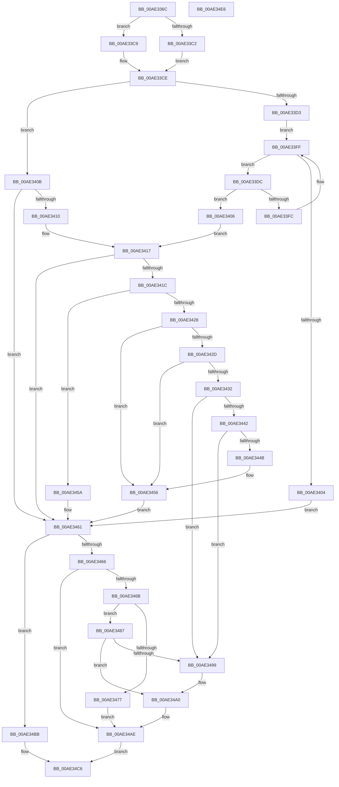

# PspLookupProcessQuotaBlock

- RVA: `0x00AE336C`–`0x00AE34E7` (길이 `379` bytes)
- VA: `0x0000000140AE336C`
- 실행 섹션: `PAGE`
- PDB 이름 있음: `예`; PDB Function 태그: `아니요`
- unwind 정보 RVA: `0x000A06E8`
- 디코드: `113`개 명령, `379/379` bytes 표시
- 미해석 바이트: `0` (있으면 어셈블리에 `.byte`로 보존)

> 이 문서는 커널 이미지의 기계어와 PDB 기호를 분석해 생성했습니다. 4번과 5번은 함수 원형과 자료형을 바이너리 사용 방식에서 추정한 C 해석이며 원본 소스 복구 결과는 아닙니다.

## 1. Dependencies

- 직접 호출 지점: **9**; 고유 호출 대상: **9**
- 직접 호출자로 확인된 함수: **1**
- RIP 상대 이미지 참조: **3**

### Outgoing calls
- `0x00AE339E` → [PspHashKeyValue](../A5/PspHashKeyValue_function_00A5EC40.md) (function, `0x00A5EC40`)
- `0x00AE33C2` → [PspLockQuotaListExclusive](../../text/4D/PspLockQuotaListExclusive_function_004D81A8.md) (function, `0x004D81A8`)
- `0x00AE33C9` → [PspLockQuotaListShared](../../text/49/PspLockQuotaListShared_function_0049F3E4.md) (function, `0x0049F3E4`)
- `0x00AE33E6` → [PspGetQuotaSid](../../text/5E/PspGetQuotaSid_function_005E2B9C.md) (function, `0x005E2B9C`)
- `0x00AE33F3` → [RtlEqualSid](../../text/40/RtlEqualSid_function_00400AD0.md) (function, `0x00400AD0`)
- `0x00AE341F` → [PspSafeReferenceQuotaBlock](../A8/PspSafeReferenceQuotaBlock_function_00A87E14.md) (function, `0x00A87E14`)
- `0x00AE3487` → [Feature_2056154424__private_IsEnabledDeviceUsageNoInline](../../text/5E/Feature_2056154424__private_IsEnabledDeviceUsageNoInline_function_005E276C.md) (function, `0x005E276C`)
- `0x00AE34B4` → [PspUnlockQuotaListExclusive](../../text/4D/PspUnlockQuotaListExclusive_function_004D9988.md) (function, `0x004D9988`)
- `0x00AE34C1` → [PspUnlockQuotaListShared](../../text/4A/PspUnlockQuotaListShared_function_004A5234.md) (function, `0x004A5234`)

### Direct callers
- [PspAssignProcessQuotaBlock](PspAssignProcessQuotaBlock_function_00AE3124.md) at `0x00AE31B8`
- [PspAssignProcessQuotaBlock](PspAssignProcessQuotaBlock_function_00AE3124.md) at `0x00AE32E4`

### Static image references
- `0x00AE33A8` → RVA `0x00FD9C48` (`PAGEDATA`; read)
- `0x00AE3410` → RVA `0x00FD9DB8` (`PAGEDATA`; read)
- `0x00AE3477` → RVA `0x00FD9DB8` (`PAGEDATA`; write)

## 2. Other-region calls and transfers

- 다른 실행 섹션으로 향하는 call: **7**
  - `0x00AE33C2` → [PspLockQuotaListExclusive](../../text/4D/PspLockQuotaListExclusive_function_004D81A8.md) (`PAGE` → `.text`)
  - `0x00AE33C9` → [PspLockQuotaListShared](../../text/49/PspLockQuotaListShared_function_0049F3E4.md) (`PAGE` → `.text`)
  - `0x00AE33E6` → [PspGetQuotaSid](../../text/5E/PspGetQuotaSid_function_005E2B9C.md) (`PAGE` → `.text`)
  - `0x00AE33F3` → [RtlEqualSid](../../text/40/RtlEqualSid_function_00400AD0.md) (`PAGE` → `.text`)
  - `0x00AE3487` → [Feature_2056154424__private_IsEnabledDeviceUsageNoInline](../../text/5E/Feature_2056154424__private_IsEnabledDeviceUsageNoInline_function_005E276C.md) (`PAGE` → `.text`)
  - `0x00AE34B4` → [PspUnlockQuotaListExclusive](../../text/4D/PspUnlockQuotaListExclusive_function_004D9988.md) (`PAGE` → `.text`)
  - `0x00AE34C1` → [PspUnlockQuotaListShared](../../text/4A/PspUnlockQuotaListShared_function_004A5234.md) (`PAGE` → `.text`)
- 별도 외부 분기/꼬리 이동을 확인하지 못했습니다.

## 3. Assembly (complete function range)

```asm
00AE336C  48 8B C4                        mov rax, rsp
00AE336F  48 89 58 10                     mov qword ptr [rax + 0x10], rbx
00AE3373  48 89 68 18                     mov qword ptr [rax + 0x18], rbp
00AE3377  48 89 70 20                     mov qword ptr [rax + 0x20], rsi
00AE337B  48 89 48 08                     mov qword ptr [rax + 8], rcx
00AE337F  57                              push rdi
00AE3380  41 54                           push r12
00AE3382  41 55                           push r13
00AE3384  41 56                           push r14
00AE3386  41 57                           push r15
00AE3388  48 83 EC 20                     sub rsp, 0x20
00AE338C  65 4C 8B 3C 25 88 01 00 00      mov r15, qword ptr gs:[0x188]
00AE3395  49 8B E9                        mov rbp, r9
00AE3398  45 8B E0                        mov r12d, r8d
00AE339B  48 8B F9                        mov rdi, rcx
00AE339E  E8 9D B8 F7 FF                  call 0x140a5ec40
00AE33A3  44 8B D0                        mov r10d, eax
00AE33A6  33 DB                           xor ebx, ebx
00AE33A8  48 8B 05 99 68 4F 00            mov rax, qword ptr [rip + 0x4f6899]
00AE33AF  49 8B CF                        mov rcx, r15
00AE33B2  4B 8D 14 52                     lea rdx, [r10 + r10*2]
00AE33B6  48 8D 34 D0                     lea rsi, [rax + rdx*8]
00AE33BA  48 8B D6                        mov rdx, rsi
00AE33BD  48 85 ED                        test rbp, rbp
00AE33C0  74 07                           je 0x140ae33c9
00AE33C2  E8 E1 4D 9F FF                  call 0x1404d81a8
00AE33C7  EB 05                           jmp 0x140ae33ce
00AE33C9  E8 16 C0 9B FF                  call 0x14049f3e4
00AE33CE  48 85 FF                        test rdi, rdi
00AE33D1  74 38                           je 0x140ae340b
00AE33D3  4C 8D 76 08                     lea r14, [rsi + 8]
00AE33D7  49 8B 3E                        mov rdi, qword ptr [r14]
00AE33DA  EB 23                           jmp 0x140ae33ff
00AE33DC  4C 8D AF F8 FD FF FF            lea r13, [rdi - 0x208]
00AE33E3  49 8B CD                        mov rcx, r13
00AE33E6  E8 B1 F7 AF FF                  call 0x1405e2b9c
00AE33EB  48 8B 4C 24 50                  mov rcx, qword ptr [rsp + 0x50]
00AE33F0  48 8B D0                        mov rdx, rax
00AE33F3  E8 D8 D6 91 FF                  call 0x140400ad0
00AE33F8  84 C0                           test al, al
00AE33FA  75 0A                           jne 0x140ae3406
00AE33FC  48 8B 3F                        mov rdi, qword ptr [rdi]
00AE33FF  49 3B FE                        cmp rdi, r14
00AE3402  75 D8                           jne 0x140ae33dc
00AE3404  EB 5B                           jmp 0x140ae3461
00AE3406  49 8B DD                        mov rbx, r13
00AE3409  EB 0C                           jmp 0x140ae3417
00AE340B  45 85 E4                        test r12d, r12d
00AE340E  74 51                           je 0x140ae3461
00AE3410  48 8B 1D A1 69 4F 00            mov rbx, qword ptr [rip + 0x4f69a1]
00AE3417  48 85 DB                        test rbx, rbx
00AE341A  74 45                           je 0x140ae3461
00AE341C  48 8B CB                        mov rcx, rbx
00AE341F  E8 F0 49 FA FF                  call 0x140a87e14
00AE3424  85 C0                           test eax, eax
00AE3426  75 32                           jne 0x140ae345a
00AE3428  48 85 ED                        test rbp, rbp
00AE342B  74 29                           je 0x140ae3456
00AE342D  45 85 E4                        test r12d, r12d
00AE3430  75 24                           jne 0x140ae3456
00AE3432  48 81 C3 08 02 00 00            add rbx, 0x208
00AE3439  48 8B 0B                        mov rcx, qword ptr [rbx]
00AE343C  48 39 59 08                     cmp qword ptr [rcx + 8], rbx
00AE3440  75 57                           jne 0x140ae3499
00AE3442  48 8B 43 08                     mov rax, qword ptr [rbx + 8]
00AE3446  48 39 18                        cmp qword ptr [rax], rbx
00AE3449  75 4E                           jne 0x140ae3499
00AE344B  48 89 08                        mov qword ptr [rax], rcx
00AE344E  48 89 41 08                     mov qword ptr [rcx + 8], rax
00AE3452  48 83 23 00                     and qword ptr [rbx], 0
00AE3456  33 DB                           xor ebx, ebx
00AE3458  EB 07                           jmp 0x140ae3461
00AE345A  F0 FF 83 04 02 00 00            lock inc dword ptr [rbx + 0x204]
00AE3461  48 85 ED                        test rbp, rbp
00AE3464  74 55                           je 0x140ae34bb
00AE3466  48 85 DB                        test rbx, rbx
00AE3469  75 43                           jne 0x140ae34ae
00AE346B  48 8D BD 08 02 00 00            lea rdi, [rbp + 0x208]
00AE3472  45 85 E4                        test r12d, r12d
00AE3475  74 10                           je 0x140ae3487
00AE3477  48 89 2D 3A 69 4F 00            mov qword ptr [rip + 0x4f693a], rbp
00AE347E  48 C7 07 01 00 00 00            mov qword ptr [rdi], 1
00AE3485  EB 27                           jmp 0x140ae34ae
00AE3487  E8 E0 F2 AF FF                  call 0x1405e276c
00AE348C  48 8D 46 08                     lea rax, [rsi + 8]
00AE3490  48 8B 48 08                     mov rcx, qword ptr [rax + 8]
00AE3494  48 39 01                        cmp qword ptr [rcx], rax
00AE3497  74 07                           je 0x140ae34a0
00AE3499  B9 03 00 00 00                  mov ecx, 3
00AE349E  CD 29                           int 0x29
00AE34A0  48 89 07                        mov qword ptr [rdi], rax
00AE34A3  48 89 4F 08                     mov qword ptr [rdi + 8], rcx
00AE34A7  48 89 39                        mov qword ptr [rcx], rdi
00AE34AA  48 89 78 08                     mov qword ptr [rax + 8], rdi
00AE34AE  48 8B D6                        mov rdx, rsi
00AE34B1  49 8B CF                        mov rcx, r15
00AE34B4  E8 CF 64 9F FF                  call 0x1404d9988
00AE34B9  EB 0B                           jmp 0x140ae34c6
00AE34BB  48 8B D6                        mov rdx, rsi
00AE34BE  49 8B CF                        mov rcx, r15
00AE34C1  E8 6E 1D 9C FF                  call 0x1404a5234
00AE34C6  48 8B 6C 24 60                  mov rbp, qword ptr [rsp + 0x60]
00AE34CB  48 8B C3                        mov rax, rbx
00AE34CE  48 8B 5C 24 58                  mov rbx, qword ptr [rsp + 0x58]
00AE34D3  48 8B 74 24 68                  mov rsi, qword ptr [rsp + 0x68]
00AE34D8  48 83 C4 20                     add rsp, 0x20
00AE34DC  41 5F                           pop r15
00AE34DE  41 5E                           pop r14
00AE34E0  41 5D                           pop r13
00AE34E2  41 5C                           pop r12
00AE34E4  5F                              pop rdi
00AE34E5  C3                              ret
00AE34E6  CC                              int3
```

## 4. C-style interpretation (structured pseudocode)

```c
__int64 __fastcall PspLookupProcessQuotaBlock(__int64 a1, __int64 a2, int a3, __int64 a4)
{
    __int64 result;
    __int64 v_rbx;
    __int64 v_rsp;
    unsigned __int64 v_stack_p10;
    unsigned __int64 v_stack_p18;
    unsigned __int64 v_stack_p20;
    unsigned __int64 v_stack_p8;

    *(unsigned __int64 *)(v_rsp + 16) = v_rbx;
    *(unsigned __int64 *)(v_rsp + 24) = v_rbp;
    *(unsigned __int64 *)(v_rsp + 32) = v_rsi;
    *(unsigned __int64 *)(v_rsp + 8) = a1;
    v_rsp = (v_rsp) - (32);
    result = PspHashKeyValue(a1, a2, a3, a4);
    v_rbx = 0;
    if (a4 == 0) goto loc_00AE33C9;
    result = PspLockQuotaListExclusive(*(unsigned __int64 *)(gs_base + (0 + 392)), *(unsigned __int64 *)(v_rip + 5204121) + (unsigned int)((unsigned int)(result)) + (unsigned int)((unsigned int)(result)) * 2 * 8, a3, a4);
    goto loc_00AE33CE;
loc_00AE33C9:
    result = PspLockQuotaListShared(*(unsigned __int64 *)(gs_base + (0 + 392)), *(unsigned __int64 *)(v_rip + 5204121) + (unsigned int)((unsigned int)(result)) + (unsigned int)((unsigned int)(result)) * 2 * 8, a3, a4);
loc_00AE33CE:
    if (a1 == 0) goto loc_00AE340B;
    goto loc_00AE33FF;
loc_00AE33DC:
    result = PspGetQuotaSid(*(unsigned __int64 *)(*(unsigned __int64 *)(v_rip + 5204121) + (unsigned int)((unsigned int)(result)) + (unsigned int)((unsigned int)(result)) * 2 * 8 + 8) - 520, *(unsigned __int64 *)(v_rip + 5204121) + (unsigned int)((unsigned int)(result)) + (unsigned int)((unsigned int)(result)) * 2 * 8, a3, a4);
    result = RtlEqualSid(v_stack_p8, result, a3, a4);
    if ((unsigned __int8)(result) != 0) goto loc_00AE3406;
loc_00AE33FF:
    if ((*(unsigned __int64 *)(*(unsigned __int64 *)(*(unsigned __int64 *)(v_rip + 5204121) + (unsigned int)((unsigned int)(result)) + (unsigned int)((unsigned int)(result)) * 2 * 8 + 8))) != (*(unsigned __int64 *)(v_rip + 5204121) + (unsigned int)((unsigned int)(result)) + (unsigned int)((unsigned int)(result)) * 2 * 8 + 8)) goto loc_00AE33DC;
    goto loc_00AE3461;
loc_00AE3406:
    goto loc_00AE3417;
loc_00AE340B:
    if ((unsigned int)((unsigned int)(a3)) == 0) goto loc_00AE3461;
loc_00AE3417:
    if (*(unsigned __int64 *)(v_rip + 5204385) == 0) goto loc_00AE3461;
    result = PspSafeReferenceQuotaBlock(*(unsigned __int64 *)(v_rip + 5204385), result, a3, a4);
    if ((unsigned int)(result) != 0) goto loc_00AE345A;
    if (a4 == 0) goto loc_00AE3456;
    if ((unsigned int)((unsigned int)(a3)) != 0) goto loc_00AE3456;
    v_rbx = (*(unsigned __int64 *)(v_rip + 5204385)) + (520);
    if ((*(unsigned __int64 *)(*(unsigned __int64 *)(v_rbx) + 8)) != v_rbx) goto loc_00AE3499;
    if ((*(unsigned __int64 *)(*(unsigned __int64 *)(v_rbx + 8))) != v_rbx) goto loc_00AE3499;
    *(unsigned __int64 *)(*(unsigned __int64 *)(v_rbx + 8)) = *(unsigned __int64 *)(v_rbx);
    *(unsigned __int64 *)(*(unsigned __int64 *)(v_rbx) + 8) = *(unsigned __int64 *)(v_rbx + 8);
loc_00AE3456:
    v_rbx = 0;
    goto loc_00AE3461;
loc_00AE345A:
loc_00AE3461:
    if (a4 == 0) goto loc_00AE34BB;
    if (0 != 0) goto loc_00AE34AE;
    if ((unsigned int)((unsigned int)(a3)) == 0) goto loc_00AE3487;
    *(unsigned __int64 *)(v_rip + 5204282) = a4;
    *(unsigned __int64 *)(a4 + 520) = 1;
    goto loc_00AE34AE;
loc_00AE3487:
    result = Feature_2056154424__private_IsEnabledDeviceUsageNoInline(*(unsigned __int64 *)(v_rbx), result, a3, a4);
    if ((*(unsigned __int64 *)(*(unsigned __int64 *)(*(unsigned __int64 *)(v_rip + 5204121) + (unsigned int)((unsigned int)(result)) + (unsigned int)((unsigned int)(result)) * 2 * 8 + 8 + 8))) != (*(unsigned __int64 *)(v_rip + 5204121) + (unsigned int)((unsigned int)(result)) + (unsigned int)((unsigned int)(result)) * 2 * 8 + 8)) {
        a1 = 3;
    }
    *(unsigned __int64 *)(a4 + 520) = *(unsigned __int64 *)(v_rip + 5204121) + (unsigned int)((unsigned int)(result)) + (unsigned int)((unsigned int)(result)) * 2 * 8 + 8;
    *(unsigned __int64 *)(a4 + 520 + 8) = a1;
    *(unsigned __int64 *)(a1) = a4 + 520;
    *(unsigned __int64 *)(*(unsigned __int64 *)(v_rip + 5204121) + (unsigned int)((unsigned int)(result)) + (unsigned int)((unsigned int)(result)) * 2 * 8 + 8 + 8) = a4 + 520;
loc_00AE34AE:
    result = PspUnlockQuotaListExclusive(*(unsigned __int64 *)(gs_base + (0 + 392)), *(unsigned __int64 *)(v_rip + 5204121) + (unsigned int)((unsigned int)(result)) + (unsigned int)((unsigned int)(result)) * 2 * 8, a3, a4);
    goto loc_00AE34C6;
loc_00AE34BB:
    result = PspUnlockQuotaListShared(*(unsigned __int64 *)(gs_base + (0 + 392)), *(unsigned __int64 *)(v_rip + 5204121) + (unsigned int)((unsigned int)(result)) + (unsigned int)((unsigned int)(result)) * 2 * 8, a3, a4);
loc_00AE34C6:
    v_rsp = (v_rsp) + (32);
    return 0;
}
```

## 5. (Beta) C Style

```c
int64_t PspLookupProcessQuotaBlock(int64_t Arg1, int64_t Arg2, int32_t Arg3, int64_t Arg4)
{
    int64_t result;
    int64_t local_rbx;
    int64_t local_rsp;
    uint64_t v_stack_p10;
    uint64_t v_stack_p18;
    uint64_t v_stack_p20;
    uint64_t v_stack_p8;

    *(uint64_t *)(local_rsp + 0x10) = local_rbx;
    *(uint64_t *)(local_rsp + 0x18) = local_rbp;
    *(uint64_t *)(local_rsp + 0x20) = local_rsi;
    *(uint64_t *)(local_rsp + 0x8) = Arg1;
    local_rsp = (local_rsp) - (32);
    result = PspHashKeyValue(Arg1, Arg2, Arg3, Arg4);
    local_rbx = 0;
    if (Arg4 == 0) goto loc_00AE33C9;
    result = PspLockQuotaListExclusive(*(uint64_t *)(gs_base + (0 + 0x188)), *(uint64_t *)(v_rip + 0x4F6899) + (uint32_t)((uint32_t)(result)) + (uint32_t)((uint32_t)(result)) * 2 * 8, Arg3, Arg4);
    goto loc_00AE33CE;
loc_00AE33C9:
    result = PspLockQuotaListShared(*(uint64_t *)(gs_base + (0 + 0x188)), *(uint64_t *)(v_rip + 0x4F6899) + (uint32_t)((uint32_t)(result)) + (uint32_t)((uint32_t)(result)) * 2 * 8, Arg3, Arg4);
loc_00AE33CE:
    if (Arg1 == 0) goto loc_00AE340B;
    goto loc_00AE33FF;
loc_00AE33DC:
    result = PspGetQuotaSid(*(uint64_t *)(*(uint64_t *)(v_rip + 0x4F6899) + (uint32_t)((uint32_t)(result)) + (uint32_t)((uint32_t)(result)) * 2 * 8 + 0x8) - 520, *(uint64_t *)(v_rip + 0x4F6899) + (uint32_t)((uint32_t)(result)) + (uint32_t)((uint32_t)(result)) * 2 * 8, Arg3, Arg4);
    result = RtlEqualSid(v_stack_p8, result, Arg3, Arg4);
    if ((uint8_t)(result) != 0) goto loc_00AE3406;
loc_00AE33FF:
    if ((*(uint64_t *)(*(uint64_t *)(*(uint64_t *)(v_rip + 0x4F6899) + (uint32_t)((uint32_t)(result)) + (uint32_t)((uint32_t)(result)) * 2 * 8 + 0x8))) != (*(uint64_t *)(v_rip + 0x4F6899) + (uint32_t)((uint32_t)(result)) + (uint32_t)((uint32_t)(result)) * 2 * 8 + 8)) goto loc_00AE33DC;
    goto loc_00AE3461;
loc_00AE3406:
    goto loc_00AE3417;
loc_00AE340B:
    if ((uint32_t)((uint32_t)(Arg3)) == 0) goto loc_00AE3461;
loc_00AE3417:
    if (*(uint64_t *)(v_rip + 0x4F69A1) == 0) goto loc_00AE3461;
    result = PspSafeReferenceQuotaBlock(*(uint64_t *)(v_rip + 0x4F69A1), result, Arg3, Arg4);
    if ((uint32_t)(result) != 0) goto loc_00AE345A;
    if (Arg4 == 0) goto loc_00AE3456;
    if ((uint32_t)((uint32_t)(Arg3)) != 0) goto loc_00AE3456;
    local_rbx = (*(uint64_t *)(v_rip + 0x4F69A1)) + (520);
    if ((*(uint64_t *)(*(uint64_t *)(local_rbx) + 0x8)) != local_rbx) goto loc_00AE3499;
    if ((*(uint64_t *)(*(uint64_t *)(local_rbx + 0x8))) != local_rbx) goto loc_00AE3499;
    *(uint64_t *)(*(uint64_t *)(local_rbx + 0x8)) = *(uint64_t *)(local_rbx);
    *(uint64_t *)(*(uint64_t *)(local_rbx) + 0x8) = *(uint64_t *)(local_rbx + 0x8);
loc_00AE3456:
    local_rbx = 0;
    goto loc_00AE3461;
loc_00AE345A:
loc_00AE3461:
    if (Arg4 == 0) goto loc_00AE34BB;
    if (0 != 0) goto loc_00AE34AE;
    if ((uint32_t)((uint32_t)(Arg3)) == 0) goto loc_00AE3487;
    *(uint64_t *)(v_rip + 0x4F693A) = Arg4;
    *(uint64_t *)(Arg4 + 0x208) = 1;
    goto loc_00AE34AE;
loc_00AE3487:
    result = Feature_2056154424__private_IsEnabledDeviceUsageNoInline(*(uint64_t *)(local_rbx), result, Arg3, Arg4);
    if ((*(uint64_t *)(*(uint64_t *)(*(uint64_t *)(v_rip + 0x4F6899) + (uint32_t)((uint32_t)(result)) + (uint32_t)((uint32_t)(result)) * 2 * 8 + 0x8 + 0x8))) != (*(uint64_t *)(v_rip + 0x4F6899) + (uint32_t)((uint32_t)(result)) + (uint32_t)((uint32_t)(result)) * 2 * 8 + 8)) {
        Arg1 = 3;
    }
    *(uint64_t *)(Arg4 + 0x208) = *(uint64_t *)(v_rip + 0x4F6899) + (uint32_t)((uint32_t)(result)) + (uint32_t)((uint32_t)(result)) * 2 * 8 + 8;
    *(uint64_t *)(Arg4 + 0x208 + 0x8) = Arg1;
    *(uint64_t *)(Arg1) = Arg4 + 520;
    *(uint64_t *)(*(uint64_t *)(v_rip + 0x4F6899) + (uint32_t)((uint32_t)(result)) + (uint32_t)((uint32_t)(result)) * 2 * 8 + 0x8 + 0x8) = Arg4 + 520;
loc_00AE34AE:
    result = PspUnlockQuotaListExclusive(*(uint64_t *)(gs_base + (0 + 0x188)), *(uint64_t *)(v_rip + 0x4F6899) + (uint32_t)((uint32_t)(result)) + (uint32_t)((uint32_t)(result)) * 2 * 8, Arg3, Arg4);
    goto loc_00AE34C6;
loc_00AE34BB:
    result = PspUnlockQuotaListShared(*(uint64_t *)(gs_base + (0 + 0x188)), *(uint64_t *)(v_rip + 0x4F6899) + (uint32_t)((uint32_t)(result)) + (uint32_t)((uint32_t)(result)) * 2 * 8, Arg3, Arg4);
loc_00AE34C6:
    local_rsp = (local_rsp) + (32);
    return 0;
}
```

## 6. Execution-region graph

[열기: 2D/3D 그래프와 함수 탐색 컨트롤 패널](../../../control-panel.html?section=page&rva=0x00AE336C&view=graph)

- 2D 그래프는 위에서 아래로 흐르고, 3D 그래프는 빈 공간을 드래그해 회전합니다. Shift+드래그는 이동, 휠은 확대·축소, 함수 노드 선택은 대상 보고서 이동입니다.

### Static fallback


