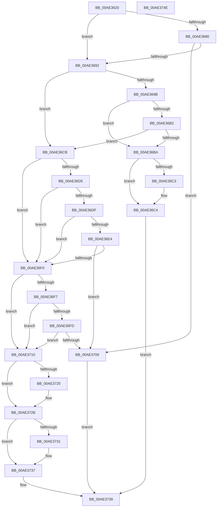

# PspProcessOpen

- RVA: `0x00AE3620`–`0x00AE374F` (길이 `303` bytes)
- VA: `0x0000000140AE3620`
- 실행 섹션: `PAGE`
- PDB 이름 있음: `예`; PDB Function 태그: `아니요`
- unwind 정보 RVA: `0x0005C954`
- 디코드: `91`개 명령, `303/303` bytes 표시
- 미해석 바이트: `0` (있으면 어셈블리에 `.byte`로 보존)

> 이 문서는 커널 이미지의 기계어와 PDB 기호를 분석해 생성했습니다. 4번과 5번은 함수 원형과 자료형을 바이너리 사용 방식에서 추정한 C 해석이며 원본 소스 복구 결과는 아닙니다.

## 1. Dependencies

- 직접 호출 지점: **5**; 고유 호출 대상: **5**
- 직접 호출자로 확인된 함수: **1**
- RIP 상대 이미지 참조: **3**

### Outgoing calls
- `0x00AE3641` → [Feature_ID51912085__private_IsEnabledPreCheck](../../text/46/Feature_ID51912085__private_IsEnabledPreCheck_function_00467684.md) (function, `0x00467684`)
- `0x00AE3666` → [PspIsParentProcess](../../text/45/PspIsParentProcess_function_00458BD8.md) (function, `0x00458BD8`)
- `0x00AE3689` → [PsTestProtectedProcessIncompatibility](../A1/PsTestProtectedProcessIncompatibility_function_00A1003C.md) (function, `0x00A1003C`)
- `0x00AE3692` → [Feature_OutsideInProtection__private_IsEnabledDeviceUsageNoInline](../../text/5C/Feature_OutsideInProtection__private_IsEnabledDeviceUsageNoInline_function_005CD968.md) (function, `0x005CD968`)
- `0x00AE36A9` → [SeComputeMandatoryDeniedAccess](../../text/60/SeComputeMandatoryDeniedAccess_function_006076BC.md) (function, `0x006076BC`)

### Direct callers
- [ObpIncrementHandleCountEx](../86/ObpIncrementHandleCountEx_function_0086DA10.md) at `0x0086E01B`

### Static image references
- `0x00AE364D` → RVA `0x00B4C274` (`PAGE`; read)
- `0x00AE36BA` → RVA `0x00F0662C` (`.data`; read)
- `0x00AE36E4` → RVA `0x00F06568` (`.data`; read)

## 2. Other-region calls and transfers

- 다른 실행 섹션으로 향하는 call: **4**
  - `0x00AE3641` → [Feature_ID51912085__private_IsEnabledPreCheck](../../text/46/Feature_ID51912085__private_IsEnabledPreCheck_function_00467684.md) (`PAGE` → `.text`)
  - `0x00AE3666` → [PspIsParentProcess](../../text/45/PspIsParentProcess_function_00458BD8.md) (`PAGE` → `.text`)
  - `0x00AE3692` → [Feature_OutsideInProtection__private_IsEnabledDeviceUsageNoInline](../../text/5C/Feature_OutsideInProtection__private_IsEnabledDeviceUsageNoInline_function_005CD968.md) (`PAGE` → `.text`)
  - `0x00AE36A9` → [SeComputeMandatoryDeniedAccess](../../text/60/SeComputeMandatoryDeniedAccess_function_006076BC.md) (`PAGE` → `.text`)
- 별도 외부 분기/꼬리 이동을 확인하지 못했습니다.

## 3. Assembly (complete function range)

```asm
00AE3620  48 8B C4                        mov rax, rsp
00AE3623  48 89 58 08                     mov qword ptr [rax + 8], rbx
00AE3627  48 89 68 10                     mov qword ptr [rax + 0x10], rbp
00AE362B  48 89 70 18                     mov qword ptr [rax + 0x18], rsi
00AE362F  57                              push rdi
00AE3630  48 83 EC 20                     sub rsp, 0x20
00AE3634  83 60 20 00                     and dword ptr [rax + 0x20], 0
00AE3638  49 8B F9                        mov rdi, r9
00AE363B  49 8B E8                        mov rbp, r8
00AE363E  40 8A F2                        mov sil, dl
00AE3641  E8 3E 40 98 FF                  call 0x140467684
00AE3646  0F B6 87 FA 05 00 00            movzx eax, byte ptr [rdi + 0x5fa]
00AE364D  4C 8D 15 20 8C 06 00            lea r10, [rip + 0x68c20]
00AE3654  48 C1 E8 04                     shr rax, 4
00AE3658  48 8B D7                        mov rdx, rdi
00AE365B  48 8B CD                        mov rcx, rbp
00AE365E  48 8D 04 40                     lea rax, [rax + rax*2]
00AE3662  45 8B 14 82                     mov r10d, dword ptr [r10 + rax*4]
00AE3666  E8 6D 55 97 FF                  call 0x140458bd8
00AE366B  48 8B 5C 24 50                  mov rbx, qword ptr [rsp + 0x50]
00AE3670  41 8B CA                        mov ecx, r10d
00AE3673  83 E1 FE                        and ecx, 0xfffffffe
00AE3676  84 C0                           test al, al
00AE3678  41 0F 44 CA                     cmove ecx, r10d
00AE367C  85 0B                           test dword ptr [rbx], ecx
00AE367E  74 12                           je 0x140ae3692
00AE3680  4C 8B C7                        mov r8, rdi
00AE3683  48 8B D5                        mov rdx, rbp
00AE3686  40 8A CE                        mov cl, sil
00AE3689  E8 AE C9 F2 FF                  call 0x140a1003c
00AE368E  84 C0                           test al, al
00AE3690  75 77                           jne 0x140ae3709
00AE3692  E8 D1 A2 AE FF                  call 0x1405cd968
00AE3697  85 C0                           test eax, eax
00AE3699  74 30                           je 0x140ae36cb
00AE369B  44 8B 03                        mov r8d, dword ptr [rbx]
00AE369E  4C 8D 4C 24 48                  lea r9, [rsp + 0x48]
00AE36A3  40 8A D6                        mov dl, sil
00AE36A6  48 8B CF                        mov rcx, rdi
00AE36A9  E8 0E 40 B2 FF                  call 0x1406076bc
00AE36AE  85 C0                           test eax, eax
00AE36B0  78 08                           js 0x140ae36ba
00AE36B2  8B 03                           mov eax, dword ptr [rbx]
00AE36B4  85 44 24 48                     test dword ptr [rsp + 0x48], eax
00AE36B8  74 11                           je 0x140ae36cb
00AE36BA  83 3D 6B 2F 42 00 00            cmp dword ptr [rip + 0x422f6b], 0
00AE36C1  74 01                           je 0x140ae36c4
00AE36C3  CC                              int3
00AE36C4  B8 C0 01 00 C0                  mov eax, 0xc00001c0
00AE36C9  EB 6E                           jmp 0x140ae3739
00AE36CB  48 83 BF 40 06 00 00 00         cmp qword ptr [rdi + 0x640], 0
00AE36D3  74 1B                           je 0x140ae36f0
00AE36D5  48 83 BD 40 06 00 00 00         cmp qword ptr [rbp + 0x640], 0
00AE36DD  75 11                           jne 0x140ae36f0
00AE36DF  40 84 F6                        test sil, sil
00AE36E2  74 0C                           je 0x140ae36f0
00AE36E4  8B 05 7E 2E 42 00               mov eax, dword ptr [rip + 0x422e7e]
00AE36EA  F7 D0                           not eax
00AE36EC  85 03                           test dword ptr [rbx], eax
00AE36EE  75 19                           jne 0x140ae3709
00AE36F0  8B 13                           mov edx, dword ptr [rbx]
00AE36F2  F6 C2 01                        test dl, 1
00AE36F5  74 19                           je 0x140ae3710
00AE36F7  40 80 FE 01                     cmp sil, 1
00AE36FB  75 13                           jne 0x140ae3710
00AE36FD  F7 87 FC 05 00 00 00 00 00 08   test dword ptr [rdi + 0x5fc], 0x8000000
00AE3707  74 07                           je 0x140ae3710
00AE3709  B8 22 00 00 C0                  mov eax, 0xc0000022
00AE370E  EB 29                           jmp 0x140ae3739
00AE3710  8B C2                           mov eax, edx
00AE3712  83 E0 28                        and eax, 0x28
00AE3715  3C 28                           cmp al, 0x28
00AE3717  0F 95 C1                        setne cl
00AE371A  0F BA E2 0A                     bt edx, 0xa
00AE371E  0F 93 C0                        setae al
00AE3721  84 C8                           test al, cl
00AE3723  75 06                           jne 0x140ae372b
00AE3725  0F BA EA 0C                     bts edx, 0xc
00AE3729  89 13                           mov dword ptr [rbx], edx
00AE372B  0F BA E2 09                     bt edx, 9
00AE372F  73 06                           jae 0x140ae3737
00AE3731  0F BA EA 0D                     bts edx, 0xd
00AE3735  89 13                           mov dword ptr [rbx], edx
00AE3737  33 C0                           xor eax, eax
00AE3739  48 8B 5C 24 30                  mov rbx, qword ptr [rsp + 0x30]
00AE373E  48 8B 6C 24 38                  mov rbp, qword ptr [rsp + 0x38]
00AE3743  48 8B 74 24 40                  mov rsi, qword ptr [rsp + 0x40]
00AE3748  48 83 C4 20                     add rsp, 0x20
00AE374C  5F                              pop rdi
00AE374D  C3                              ret
00AE374E  CC                              int3
```

## 4. C-style interpretation (structured pseudocode)

```c
__int64 __fastcall PspProcessOpen(__int64 a1, unsigned __int8 a2, __int64 a3, __int64 a4, __int64 a5)
{
    __int64 result;
    __int64 v_rsp;
    unsigned __int64 v_stack_p10;
    unsigned __int64 v_stack_p18;
    unsigned __int64 v_stack_p20;
    unsigned __int64 v_stack_p8;

    *(unsigned __int64 *)(v_rsp + 8) = v_rbx;
    *(unsigned __int64 *)(v_rsp + 16) = v_rbp;
    *(unsigned __int64 *)(v_rsp + 24) = v_rsi;
    v_rsp = (v_rsp) - (32);
    result = Feature_ID51912085__private_IsEnabledPreCheck(a1, a2, a3, a4);
    result = (*(unsigned __int8 *)(a4 + 1530)) >> (4);
    result = PspIsParentProcess(a3, a4, a3, a4);
    a1 = (unsigned int)(((unsigned int)((unsigned int)((unsigned int)(*(unsigned int *)(v_rip + 429088 + result + result * 2 * 4))))) & (0xFFFFFFFEULL));
    if ((unsigned __int8)(result) == 0) { a1 = (unsigned int)((unsigned int)(*(unsigned int *)(v_rip + 429088 + result + result * 2 * 4))); }
    if (((*(unsigned int *)(a5)) & ((unsigned int)(a1))) == 0) goto loc_00AE3692;
    result = PsTestProtectedProcessIncompatibility(a2, a3, a4, a4);
    if ((unsigned __int8)(result) != 0) goto loc_00AE3709;
loc_00AE3692:
    result = Feature_OutsideInProtection__private_IsEnabledDeviceUsageNoInline(a2, a3, a4, a4);
    if ((unsigned int)(result) == 0) goto loc_00AE36CB;
    result = SeComputeMandatoryDeniedAccess(a4, a2, (unsigned int)(*(unsigned int *)(a5)), v_stack_p20);
    if (sign_flag) goto loc_00AE36BA;
    if (((v_stack_p20) & ((unsigned int)((unsigned int)(*(unsigned int *)(a5))))) == 0) goto loc_00AE36CB;
loc_00AE36BA:
    if ((*(unsigned int *)(v_rip + 4337515)) != 0) {
    }
    goto loc_00AE3739;
loc_00AE36CB:
    if ((*(unsigned __int64 *)(a4 + 1600)) == 0) goto loc_00AE36F0;
    if ((*(unsigned __int64 *)(a3 + 1600)) != 0) goto loc_00AE36F0;
    if (a2 == 0) goto loc_00AE36F0;
    result = (unsigned int)(~((unsigned int)(*(unsigned int *)(v_rip + 4337278))));
    if (((*(unsigned int *)(a5)) & ((unsigned int)(result))) != 0) goto loc_00AE3709;
loc_00AE36F0:
    if ((((unsigned __int8)((unsigned int)(*(unsigned int *)(a5)))) & (1)) == 0) goto loc_00AE3710;
    if (a2 != 1) goto loc_00AE3710;
    if (((*(unsigned int *)(a4 + 1532)) & (0x8000000ULL)) == 0) goto loc_00AE3710;
loc_00AE3709:
    goto loc_00AE3739;
loc_00AE3710:
    result = (unsigned int)(((unsigned int)((unsigned int)((unsigned int)(*(unsigned int *)(a5))))) & (40));
    a1 = (((unsigned __int8)(result)) != 40) ? 1 : 0;
    result = (((unsigned __int8)(result)) >= 40) ? 1 : 0;
    if ((((unsigned __int8)(result)) & ((unsigned __int8)(a1))) == 0) {
        *(unsigned int *)(a5) = (unsigned int)((unsigned int)(*(unsigned int *)(a5)));
    }
    if (!(condition_is_above_or_equal)) {
        *(unsigned int *)(a5) = (unsigned int)((unsigned int)(*(unsigned int *)(a5)));
    }
    result = 0;
loc_00AE3739:
    v_rsp = (v_rsp) + (32);
    return result;
}
```

## 5. (Beta) C Style

```c
int64_t PspProcessOpen(int64_t Arg1, uint8_t Arg2, void *Arg3, void *Arg4, void *Arg5)
{
    uint8_t *arg3 = (uint8_t *)Arg3;
    uint8_t *arg4 = (uint8_t *)Arg4;
    uint8_t *arg5 = (uint8_t *)Arg5;

    int64_t result;
    int64_t local_rsp;
    uint64_t v_stack_p10;
    uint64_t v_stack_p18;
    uint64_t v_stack_p20;
    uint64_t v_stack_p8;

    *(uint64_t *)(local_rsp + 0x8) = local_rbx;
    *(uint64_t *)(local_rsp + 0x10) = local_rbp;
    *(uint64_t *)(local_rsp + 0x18) = local_rsi;
    local_rsp = (local_rsp) - (32);
    result = Feature_ID51912085__private_IsEnabledPreCheck(Arg1, Arg2, Arg3, Arg4);
    result = (*(uint8_t *)(arg4 + 0x5FA)) >> (4);
    result = PspIsParentProcess(Arg3, Arg4, Arg3, Arg4);
    Arg1 = (uint32_t)(((uint32_t)((uint32_t)((uint32_t)(*(uint32_t *)(v_rip + 0x68C20 + result + result * 2 * 4))))) & (0xFFFFFFFEULL));
    if ((uint8_t)(result) == 0) { Arg1 = (uint32_t)((uint32_t)(*(uint32_t *)(v_rip + 0x68C20 + result + result * 2 * 4))); }
    if (((*(uint32_t *)(arg5)) & ((uint32_t)(Arg1))) == 0) goto loc_00AE3692;
    result = PsTestProtectedProcessIncompatibility(Arg2, Arg3, Arg4, Arg4);
    if ((uint8_t)(result) != 0) goto loc_00AE3709;
loc_00AE3692:
    result = Feature_OutsideInProtection__private_IsEnabledDeviceUsageNoInline(Arg2, Arg3, Arg4, Arg4);
    if ((uint32_t)(result) == 0) goto loc_00AE36CB;
    result = SeComputeMandatoryDeniedAccess(Arg4, Arg2, (uint32_t)(*(uint32_t *)(arg5)), v_stack_p20);
    if (sign_flag) goto loc_00AE36BA;
    if (((v_stack_p20) & ((uint32_t)((uint32_t)(*(uint32_t *)(arg5))))) == 0) goto loc_00AE36CB;
loc_00AE36BA:
    if ((*(uint32_t *)(v_rip + 0x422F6B)) != 0) {
    }
    goto loc_00AE3739;
loc_00AE36CB:
    if ((*(uint64_t *)(arg4 + 0x640)) == 0) goto loc_00AE36F0;
    if ((*(uint64_t *)(arg3 + 0x640)) != 0) goto loc_00AE36F0;
    if (Arg2 == 0) goto loc_00AE36F0;
    result = (uint32_t)(~((uint32_t)(*(uint32_t *)(v_rip + 0x422E7E))));
    if (((*(uint32_t *)(arg5)) & ((uint32_t)(result))) != 0) goto loc_00AE3709;
loc_00AE36F0:
    if ((((uint8_t)((uint32_t)(*(uint32_t *)(arg5)))) & (1)) == 0) goto loc_00AE3710;
    if (Arg2 != 1) goto loc_00AE3710;
    if (((*(uint32_t *)(arg4 + 0x5FC)) & (0x8000000ULL)) == 0) goto loc_00AE3710;
loc_00AE3709:
    goto loc_00AE3739;
loc_00AE3710:
    result = (uint32_t)(((uint32_t)((uint32_t)((uint32_t)(*(uint32_t *)(arg5))))) & (40));
    Arg1 = (((uint8_t)(result)) != 40) ? 1 : 0;
    result = (((uint8_t)(result)) >= 40) ? 1 : 0;
    if ((((uint8_t)(result)) & ((uint8_t)(Arg1))) == 0) {
        *(uint32_t *)(arg5) = (uint32_t)((uint32_t)(*(uint32_t *)(arg5)));
    }
    if (!(condition_is_above_or_equal)) {
        *(uint32_t *)(arg5) = (uint32_t)((uint32_t)(*(uint32_t *)(arg5)));
    }
    result = 0;
loc_00AE3739:
    local_rsp = (local_rsp) + (32);
    return result;
}
```

### 관측된 메모리 오프셋

구조체 형식이 확인되지 않은 접근은 인자 기준의 오프셋으로만 기록했습니다.

| 기준 인자 | 오프셋 표현 | 폭 (bit) | 접근 |
|---|---:|---:|---|
| `Arg3` | `+ 0x640` | `64` | `R` |
| `Arg4` | `+ 0x5FA` | `8` | `R` |
| `Arg4` | `+ 0x5FC` | `32` | `R` |
| `Arg4` | `+ 0x640` | `64` | `R` |
| `Arg5` | `+ 0x0` | `32` | `R` |
| `Arg5` | `+ 0x0` | `32` | `W` |

## 6. Execution-region graph

[열기: 2D/3D 그래프와 함수 탐색 컨트롤 패널](../../../control-panel.html?section=page&rva=0x00AE3620&view=graph)

- 2D 그래프는 위에서 아래로 흐르고, 3D 그래프는 빈 공간을 드래그해 회전합니다. Shift+드래그는 이동, 휠은 확대·축소, 함수 노드 선택은 대상 보고서 이동입니다.

### Static fallback


