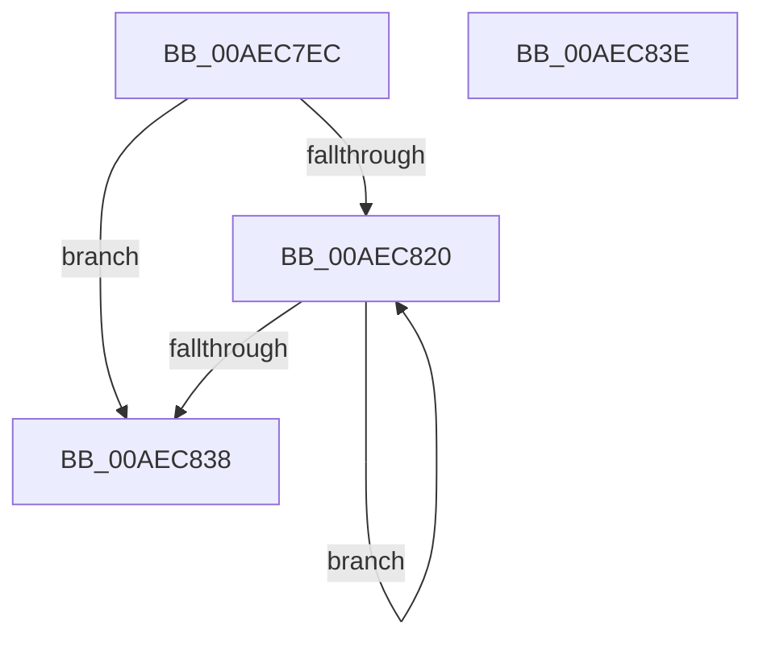

# PspRequestProcessExecutionState

- RVA: `0x00AEC7EC`–`0x00AEC83F` (길이 `83` bytes)
- VA: `0x0000000140AEC7EC`
- 실행 섹션: `PAGE`
- PDB 이름 있음: `예`; PDB Function 태그: `아니요`
- unwind 정보 RVA: `0x00071750`
- 디코드: `23`개 명령, `83/83` bytes 표시
- 미해석 바이트: `0` (있으면 어셈블리에 `.byte`로 보존)

> 이 문서는 커널 이미지의 기계어와 PDB 기호를 분석해 생성했습니다. 4번과 5번은 함수 원형과 자료형을 바이너리 사용 방식에서 추정한 C 해석이며 원본 소스 복구 결과는 아닙니다.

## 1. Dependencies

- 직접 호출 지점: **0**; 고유 호출 대상: **0**
- 직접 호출자로 확인된 함수: **4**
- RIP 상대 이미지 참조: **0**

### Outgoing calls
- 직접 디코드된 call 명령이 없습니다.

### Direct callers
- [PspSetProcessFreezeStateCallback](../../text/4E/PspSetProcessFreezeStateCallback_function_004E98E0.md) at `0x004E9A09`
- [PsSwapProcessWorkingSet](../78/PsSwapProcessWorkingSet_function_00781C24.md) at `0x00781D26`
- [PspApplyJobChainLimitsToProcess](../87/PspApplyJobChainLimitsToProcess_function_0087EB5C.md) at `0x0087EBD8`
- [PspRemoveProcessFromJobChain](../90/PspRemoveProcessFromJobChain_function_00907288.md) at `0x0090753A`

### Static image references
- 디코드된 RIP-relative 메모리 참조가 없습니다.

## 2. Other-region calls and transfers

- 다른 실행 섹션으로 향하는 call: **0**
- 별도 외부 분기/꼬리 이동을 확인하지 못했습니다.

## 3. Assembly (complete function range)

```asm
00AEC7EC  48 89 5C 24 08                  mov qword ptr [rsp + 8], rbx
00AEC7F1  41 F7 D8                        neg r8d
00AEC7F4  41 F6 D1                        not r9b
00AEC7F7  45 8A C1                        mov r8b, r9b
00AEC7FA  44 8A D2                        mov r10b, dl
00AEC7FD  4D 1B DB                        sbb r11, r11
00AEC800  48 8B D9                        mov rbx, rcx
00AEC803  49 F7 DB                        neg r11
00AEC806  41 8A 84 0B FA 07 00 00         mov al, byte ptr [r11 + rcx + 0x7fa]
00AEC80E  44 22 C0                        and r8b, al
00AEC811  44 0A C2                        or r8b, dl
00AEC814  F0 45 0F B0 84 0B FA 07 00 00   lock cmpxchg byte ptr [r11 + rcx + 0x7fa], r8b
00AEC81E  74 18                           je 0x140aec838
00AEC820  41 8A C9                        mov cl, r9b
00AEC823  8A D0                           mov dl, al
00AEC825  22 C8                           and cl, al
00AEC827  41 0A CA                        or cl, r10b
00AEC82A  F0 41 0F B0 8C 1B FA 07 00 00   lock cmpxchg byte ptr [r11 + rbx + 0x7fa], cl
00AEC834  3A C2                           cmp al, dl
00AEC836  75 E8                           jne 0x140aec820
00AEC838  48 8B 5C 24 08                  mov rbx, qword ptr [rsp + 8]
00AEC83D  C3                              ret
00AEC83E  CC                              int3
```

## 4. C-style interpretation (structured pseudocode)

```c
__int64 __fastcall PspRequestProcessExecutionState(__int64 a1, unsigned __int8 a2, int a3, unsigned __int8 a4)
{
    __int64 v_r11;
    unsigned __int64 v_stack_p8;

    v_stack_p8 = v_rbx;
    a3 = (unsigned int)(-(a3));
    a4 = (unsigned __int8)(~(a4));
    v_r11 = -(v_r11);
    a3 = (unsigned __int8)((a4) & ((unsigned __int8)(*(unsigned __int8 *)(v_r11 + a1 * 1 + 2042))));
    a3 = (unsigned __int8)((a3) | (a2));
    if (condition_is_equal) goto loc_00AEC838;
loc_00AEC820:
    a1 = (unsigned __int8)((a4) & ((unsigned __int8)(*(unsigned __int8 *)(v_r11 + a1 * 1 + 2042))));
    a1 = (unsigned __int8)((a1) | (a2));
    if (((unsigned __int8)(*(unsigned __int8 *)(v_r11 + a1 * 1 + 2042))) != ((unsigned __int8)((unsigned __int8)(*(unsigned __int8 *)(v_r11 + a1 * 1 + 2042))))) goto loc_00AEC820;
loc_00AEC838:
    return *(unsigned __int8 *)(v_r11 + a1 * 1 + 2042);
}
```

## 5. (Beta) C Style

```c
int64_t PspRequestProcessExecutionState(int64_t Arg1, uint8_t Arg2, int32_t Arg3, uint8_t Arg4)
{
    int64_t local_r11;
    uint64_t v_stack_p8;

    v_stack_p8 = local_rbx;
    Arg3 = (uint32_t)(-(Arg3));
    Arg4 = (uint8_t)(~(Arg4));
    local_r11 = -(local_r11);
    Arg3 = (uint8_t)((Arg4) & ((uint8_t)(*(uint8_t *)(local_r11 + Arg1 * 1 + 0x7FA))));
    Arg3 = (uint8_t)((Arg3) | (Arg2));
    if (condition_is_equal) goto loc_00AEC838;
loc_00AEC820:
    Arg1 = (uint8_t)((Arg4) & ((uint8_t)(*(uint8_t *)(local_r11 + Arg1 * 1 + 0x7FA))));
    Arg1 = (uint8_t)((Arg1) | (Arg2));
    if (((uint8_t)(*(uint8_t *)(local_r11 + Arg1 * 1 + 0x7FA))) != ((uint8_t)((uint8_t)(*(uint8_t *)(local_r11 + Arg1 * 1 + 0x7FA))))) goto loc_00AEC820;
loc_00AEC838:
    return *(uint8_t *)(local_r11 + Arg1 * 1 + 0x7FA);
}
```

## 6. Execution-region graph

[열기: 2D/3D 그래프와 함수 탐색 컨트롤 패널](../../../control-panel.html?section=page&rva=0x00AEC7EC&view=graph)

- 2D 그래프는 위에서 아래로 흐르고, 3D 그래프는 빈 공간을 드래그해 회전합니다. Shift+드래그는 이동, 휠은 확대·축소, 함수 노드 선택은 대상 보고서 이동입니다.

### Static fallback


