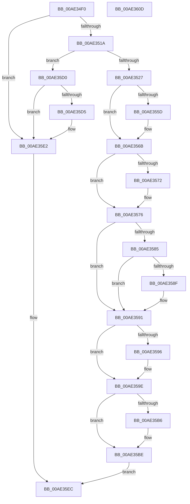

# PspSetProcessPpmPolicy

- RVA: `0x00AE34F0`–`0x00AE360E` (길이 `286` bytes)
- VA: `0x0000000140AE34F0`
- 실행 섹션: `PAGE`
- PDB 이름 있음: `예`; PDB Function 태그: `아니요`
- unwind 정보 RVA: `0x00060300`
- 디코드: `80`개 명령, `286/286` bytes 표시
- 미해석 바이트: `0` (있으면 어셈블리에 `.byte`로 보존)

> 이 문서는 커널 이미지의 기계어와 PDB 기호를 분석해 생성했습니다. 4번과 5번은 함수 원형과 자료형을 바이너리 사용 방식에서 추정한 C 해석이며 원본 소스 복구 결과는 아닙니다.

## 1. Dependencies

- 직접 호출 지점: **10**; 고유 호출 대상: **9**
- 직접 호출자로 확인된 함수: **0**
- RIP 상대 이미지 참조: **2**

### Outgoing calls
- `0x00AE350D` → [Feature_UserPresenceThrottling__private_IsEnabledDeviceUsageNoInline](../../text/25/Feature_UserPresenceThrottling__private_IsEnabledDeviceUsageNoInline_function_00257E70.md) (function, `0x00257E70`)
- `0x00AE351A` → [Feature_DisableUserPresenceQosByPolicy__private_IsEnabledDeviceUsageNoInline](../../text/4F/Feature_DisableUserPresenceQosByPolicy__private_IsEnabledDeviceUsageNoInline_function_004F42EC.md) (function, `0x004F42EC`)
- `0x00AE354C` → [KeAbPreAcquire](../../text/21/KeAbPreAcquire_function_00210230.md) (function, `0x00210230`)
- `0x00AE3566` → [ExfAcquirePushLockExclusiveEx](../../text/20/ExfAcquirePushLockExclusiveEx_function_0020FC90.md) (function, `0x0020FC90`)
- `0x00AE35A3` → [KeSetProcessPpmPolicy](../../text/3C/KeSetProcessPpmPolicy_function_003C1CCC.md) (function, `0x003C1CCC`)
- `0x00AE35B9` → [ExfTryToWakePushLock](../../text/26/ExfTryToWakePushLock_function_00265DD0.md) (function, `0x00265DD0`)
- `0x00AE35C1` → [KeAbPostRelease](../../text/2E/KeAbPostRelease_function_002E1600.md) (function, `0x002E1600`)
- `0x00AE35C9` → [KiLeaveCriticalRegionUnsafe](../../text/25/KiLeaveCriticalRegionUnsafe_function_0025F010.md) (function, `0x0025F010`)
- `0x00AE35E7` → [KeSetProcessPpmPolicy](../../text/3C/KeSetProcessPpmPolicy_function_003C1CCC.md) (function, `0x003C1CCC`)
- `0x00AE35EF` → [PspEnqueueProcessQosChangeNotification](../../text/5E/PspEnqueueProcessQosChangeNotification_function_005E2ED0.md) (function, `0x005E2ED0`)

### Direct callers
- 이 함수 시작 RVA로 연결되는 직접 call은 확인되지 않았습니다. 간접 호출은 완전히 역산할 수 없습니다.

### Static image references
- `0x00AE357C` → RVA `0x00F06630` (`.data`; read)
- `0x00AE3585` → RVA `0x00F06634` (`.data`; read)

## 2. Other-region calls and transfers

- 다른 실행 섹션으로 향하는 call: **10**
  - `0x00AE350D` → [Feature_UserPresenceThrottling__private_IsEnabledDeviceUsageNoInline](../../text/25/Feature_UserPresenceThrottling__private_IsEnabledDeviceUsageNoInline_function_00257E70.md) (`PAGE` → `.text`)
  - `0x00AE351A` → [Feature_DisableUserPresenceQosByPolicy__private_IsEnabledDeviceUsageNoInline](../../text/4F/Feature_DisableUserPresenceQosByPolicy__private_IsEnabledDeviceUsageNoInline_function_004F42EC.md) (`PAGE` → `.text`)
  - `0x00AE354C` → [KeAbPreAcquire](../../text/21/KeAbPreAcquire_function_00210230.md) (`PAGE` → `.text`)
  - `0x00AE3566` → [ExfAcquirePushLockExclusiveEx](../../text/20/ExfAcquirePushLockExclusiveEx_function_0020FC90.md) (`PAGE` → `.text`)
  - `0x00AE35A3` → [KeSetProcessPpmPolicy](../../text/3C/KeSetProcessPpmPolicy_function_003C1CCC.md) (`PAGE` → `.text`)
  - `0x00AE35B9` → [ExfTryToWakePushLock](../../text/26/ExfTryToWakePushLock_function_00265DD0.md) (`PAGE` → `.text`)
  - `0x00AE35C1` → [KeAbPostRelease](../../text/2E/KeAbPostRelease_function_002E1600.md) (`PAGE` → `.text`)
  - `0x00AE35C9` → [KiLeaveCriticalRegionUnsafe](../../text/25/KiLeaveCriticalRegionUnsafe_function_0025F010.md) (`PAGE` → `.text`)
  - `0x00AE35E7` → [KeSetProcessPpmPolicy](../../text/3C/KeSetProcessPpmPolicy_function_003C1CCC.md) (`PAGE` → `.text`)
  - `0x00AE35EF` → [PspEnqueueProcessQosChangeNotification](../../text/5E/PspEnqueueProcessQosChangeNotification_function_005E2ED0.md) (`PAGE` → `.text`)
- 별도 외부 분기/꼬리 이동을 확인하지 못했습니다.

## 3. Assembly (complete function range)

```asm
00AE34F0  48 89 5C 24 08                  mov qword ptr [rsp + 8], rbx
00AE34F5  48 89 6C 24 10                  mov qword ptr [rsp + 0x10], rbp
00AE34FA  48 89 74 24 18                  mov qword ptr [rsp + 0x18], rsi
00AE34FF  57                              push rdi
00AE3500  41 56                           push r14
00AE3502  41 57                           push r15
00AE3504  48 83 EC 20                     sub rsp, 0x20
00AE3508  8B FA                           mov edi, edx
00AE350A  48 8B F1                        mov rsi, rcx
00AE350D  E8 5E 49 77 FF                  call 0x140257e70
00AE3512  85 C0                           test eax, eax
00AE3514  0F 84 C8 00 00 00               je 0x140ae35e2
00AE351A  E8 CD 0D A1 FF                  call 0x1404f42ec
00AE351F  85 C0                           test eax, eax
00AE3521  0F 84 A9 00 00 00               je 0x140ae35d0
00AE3527  65 4C 8B 3C 25 88 01 00 00      mov r15, qword ptr gs:[0x188]
00AE3530  48 8D AE 18 08 00 00            lea rbp, [rsi + 0x818]
00AE3537  48 83 CB FF                     or rbx, 0xffffffffffffffff
00AE353B  45 33 C0                        xor r8d, r8d
00AE353E  33 D2                           xor edx, edx
00AE3540  48 8B CD                        mov rcx, rbp
00AE3543  66 41 01 9F E4 01 00 00         add word ptr [r15 + 0x1e4], bx
00AE354B  90                              nop
00AE354C  E8 DF CC 72 FF                  call 0x140210230
00AE3551  F0 48 0F BA 6D 00 00            lock bts qword ptr [rbp], 0
00AE3558  4C 8B F0                        mov r14, rax
00AE355B  73 0E                           jae 0x140ae356b
00AE355D  4C 8B C5                        mov r8, rbp
00AE3560  48 8B D0                        mov rdx, rax
00AE3563  48 8B CD                        mov rcx, rbp
00AE3566  E8 25 C7 72 FF                  call 0x14020fc90
00AE356B  B1 01                           mov cl, 1
00AE356D  4D 85 F6                        test r14, r14
00AE3570  74 04                           je 0x140ae3576
00AE3572  41 88 4E 0A                     mov byte ptr [r14 + 0xa], cl
00AE3576  89 BE 20 08 00 00               mov dword ptr [rsi + 0x820], edi
00AE357C  83 3D AD 30 42 00 00            cmp dword ptr [rip + 0x4230ad], 0
00AE3583  75 0C                           jne 0x140ae3591
00AE3585  8A 05 A9 30 42 00               mov al, byte ptr [rip + 0x4230a9]
00AE358B  84 C0                           test al, al
00AE358D  75 02                           jne 0x140ae3591
00AE358F  32 C9                           xor cl, cl
00AE3591  83 FF 09                        cmp edi, 9
00AE3594  75 08                           jne 0x140ae359e
00AE3596  84 C9                           test cl, cl
00AE3598  8D 47 FE                        lea eax, [rdi - 2]
00AE359B  0F 45 F8                        cmovne edi, eax
00AE359E  8B D7                           mov edx, edi
00AE35A0  48 8B CE                        mov rcx, rsi
00AE35A3  E8 24 E7 8D FF                  call 0x1403c1ccc
00AE35A8  F0 48 0F C1 5D 00               lock xadd qword ptr [rbp], rbx
00AE35AE  80 E3 06                        and bl, 6
00AE35B1  80 FB 02                        cmp bl, 2
00AE35B4  75 08                           jne 0x140ae35be
00AE35B6  48 8B CD                        mov rcx, rbp
00AE35B9  E8 12 28 78 FF                  call 0x140265dd0
00AE35BE  48 8B CD                        mov rcx, rbp
00AE35C1  E8 3A E0 7F FF                  call 0x1402e1600
00AE35C6  49 8B CF                        mov rcx, r15
00AE35C9  E8 42 BA 77 FF                  call 0x14025f010
00AE35CE  EB 1C                           jmp 0x140ae35ec
00AE35D0  83 FF 09                        cmp edi, 9
00AE35D3  75 0D                           jne 0x140ae35e2
00AE35D5  83 3D 54 30 42 00 00            cmp dword ptr [rip + 0x423054], 0
00AE35DC  8D 47 FE                        lea eax, [rdi - 2]
00AE35DF  0F 45 F8                        cmovne edi, eax
00AE35E2  8B D7                           mov edx, edi
00AE35E4  48 8B CE                        mov rcx, rsi
00AE35E7  E8 E0 E6 8D FF                  call 0x1403c1ccc
00AE35EC  48 8B CE                        mov rcx, rsi
00AE35EF  E8 DC F8 AF FF                  call 0x1405e2ed0
00AE35F4  48 8B 5C 24 40                  mov rbx, qword ptr [rsp + 0x40]
00AE35F9  48 8B 6C 24 48                  mov rbp, qword ptr [rsp + 0x48]
00AE35FE  48 8B 74 24 50                  mov rsi, qword ptr [rsp + 0x50]
00AE3603  48 83 C4 20                     add rsp, 0x20
00AE3607  41 5F                           pop r15
00AE3609  41 5E                           pop r14
00AE360B  5F                              pop rdi
00AE360C  C3                              ret
00AE360D  CC                              int3
```

## 4. C-style interpretation (structured pseudocode)

```c
__int64 __fastcall PspSetProcessPpmPolicy(__int64 a1, int a2, int a3)
{
    __int64 result;
    __int64 v_rbx;
    __int64 v_rdi;
    __int64 v_rsp;
    unsigned __int64 v_stack_p10;
    unsigned __int64 v_stack_p18;
    unsigned __int64 v_stack_p8;

    v_stack_p8 = v_rbx;
    v_stack_p10 = v_rbp;
    v_stack_p18 = v_rsi;
    v_rsp = (v_rsp) - (32);
    result = Feature_UserPresenceThrottling__private_IsEnabledDeviceUsageNoInline(a1, a2, a3, a4);
    if ((unsigned int)(result) == 0) goto loc_00AE35E2;
    result = Feature_DisableUserPresenceQosByPolicy__private_IsEnabledDeviceUsageNoInline(a1, a2, a3, a4);
    if ((unsigned int)(result) == 0) goto loc_00AE35D0;
    v_rbx = (v_rbx) | (-1);
    a3 = 0;
    a2 = 0;
    result = KeAbPreAcquire(a1 + 2072, a2, a3, a4);
    if (!(condition_is_above_or_equal)) {
        a3 = a1 + 2072;
        a2 = result;
        a1 = a1 + 2072;
        result = ExfAcquirePushLockExclusiveEx(a1, a2, a3, a4);
    }
    if (result != 0) {
        *(unsigned __int8 *)(result + 10) = 1;
    }
    *(unsigned int *)(a1 + 2080) = (unsigned int)((unsigned int)(a2));
    if ((*(unsigned int *)(v_rip + 4337837)) != 0) goto loc_00AE3591;
    if ((unsigned __int8)(*(unsigned __int8 *)(v_rip + 4337833)) == 0) {
        a1 = 0;
    }
    result = *(unsigned __int8 *)(v_rip + 4337833);
    v_rdi = (unsigned int)(a2);
    if (((unsigned int)((unsigned int)(a2))) == 9) {
        result = (unsigned int)(a2) - 2;
        v_rdi = (unsigned int)(a2);
        if (0 != 0) { v_rdi = (unsigned int)(result); }
    }
    result = KeSetProcessPpmPolicy(0, (unsigned int)((unsigned int)(v_rdi)), a3, a4);
    v_rbx = (unsigned __int8)((v_rbx) & (6));
    if (((unsigned __int8)(v_rbx)) == 2) {
        a1 = a1 + 2072;
        result = ExfTryToWakePushLock(a1, (unsigned int)((unsigned int)(v_rdi)), a3, a4);
    }
    result = KeAbPostRelease(a1 + 2072, (unsigned int)((unsigned int)(v_rdi)), a3, a4);
    result = KiLeaveCriticalRegionUnsafe(*(unsigned __int64 *)(gs_base + (0 + 392)), (unsigned int)((unsigned int)(v_rdi)), a3, a4);
    goto loc_00AE35EC;
loc_00AE35D0:
    if (((unsigned int)(v_rdi)) == 9) {
        result = v_rdi - 2;
        if ((*(unsigned int *)(v_rip + 4337748)) != 0) { v_rdi = (unsigned int)(result); }
    }
    result = KeSetProcessPpmPolicy(a1, (unsigned int)((unsigned int)(v_rdi)), a3, a4);
loc_00AE35EC:
    result = PspEnqueueProcessQosChangeNotification(a1, (unsigned int)((unsigned int)(v_rdi)), a3, a4);
    v_rsp = (v_rsp) + (32);
    return result;
}
```

## 5. (Beta) C Style

```c
int64_t PspSetProcessPpmPolicy(void *Arg1, int32_t Arg2, int32_t Arg3)
{
    uint8_t *arg1 = (uint8_t *)Arg1;

    int64_t result;
    int64_t local_rbx;
    int64_t local_rdi;
    int64_t local_rsp;
    uint64_t v_stack_p10;
    uint64_t v_stack_p18;
    uint64_t v_stack_p8;

    v_stack_p8 = local_rbx;
    v_stack_p10 = local_rbp;
    v_stack_p18 = local_rsi;
    local_rsp = (local_rsp) - (32);
    result = Feature_UserPresenceThrottling__private_IsEnabledDeviceUsageNoInline(Arg1, Arg2, Arg3, a4);
    if ((uint32_t)(result) == 0) goto loc_00AE35E2;
    result = Feature_DisableUserPresenceQosByPolicy__private_IsEnabledDeviceUsageNoInline(Arg1, Arg2, Arg3, a4);
    if ((uint32_t)(result) == 0) goto loc_00AE35D0;
    local_rbx = (local_rbx) | (-1);
    Arg3 = 0;
    Arg2 = 0;
    result = KeAbPreAcquire(Arg1 + 2072, Arg2, Arg3, a4);
    if (!(condition_is_above_or_equal)) {
        Arg3 = Arg1 + 2072;
        Arg2 = result;
        Arg1 = Arg1 + 2072;
        result = ExfAcquirePushLockExclusiveEx(Arg1, Arg2, Arg3, a4);
    }
    if (result != 0) {
        *(uint8_t *)(result + 0xA) = 1;
    }
    *(uint32_t *)(arg1 + 0x820) = (uint32_t)((uint32_t)(Arg2));
    if ((*(uint32_t *)(v_rip + 0x4230AD)) != 0) goto loc_00AE3591;
    if ((uint8_t)(*(uint8_t *)(v_rip + 0x4230A9)) == 0) {
        Arg1 = 0;
    }
    result = *(uint8_t *)(v_rip + 0x4230A9);
    local_rdi = (uint32_t)(Arg2);
    if (((uint32_t)((uint32_t)(Arg2))) == 9) {
        result = (uint32_t)(Arg2) - 2;
        local_rdi = (uint32_t)(Arg2);
        if (0 != 0) { local_rdi = (uint32_t)(result); }
    }
    result = KeSetProcessPpmPolicy(0, (uint32_t)((uint32_t)(local_rdi)), Arg3, a4);
    local_rbx = (uint8_t)((local_rbx) & (6));
    if (((uint8_t)(local_rbx)) == 2) {
        Arg1 = Arg1 + 2072;
        result = ExfTryToWakePushLock(Arg1, (uint32_t)((uint32_t)(local_rdi)), Arg3, a4);
    }
    result = KeAbPostRelease(Arg1 + 2072, (uint32_t)((uint32_t)(local_rdi)), Arg3, a4);
    result = KiLeaveCriticalRegionUnsafe(*(uint64_t *)(gs_base + (0 + 0x188)), (uint32_t)((uint32_t)(local_rdi)), Arg3, a4);
    goto loc_00AE35EC;
loc_00AE35D0:
    if (((uint32_t)(local_rdi)) == 9) {
        result = local_rdi - 2;
        if ((*(uint32_t *)(v_rip + 0x423054)) != 0) { local_rdi = (uint32_t)(result); }
    }
    result = KeSetProcessPpmPolicy(Arg1, (uint32_t)((uint32_t)(local_rdi)), Arg3, a4);
loc_00AE35EC:
    result = PspEnqueueProcessQosChangeNotification(Arg1, (uint32_t)((uint32_t)(local_rdi)), Arg3, a4);
    local_rsp = (local_rsp) + (32);
    return result;
}
```

### 관측된 메모리 오프셋

구조체 형식이 확인되지 않은 접근은 인자 기준의 오프셋으로만 기록했습니다.

| 기준 인자 | 오프셋 표현 | 폭 (bit) | 접근 |
|---|---:|---:|---|
| `Arg1` | `+ 0x0` | `64` | `R/W` |
| `Arg1` | `+ 0x818` | `64` | `R` |
| `Arg1` | `+ 0x820` | `32` | `W` |

## 6. Execution-region graph

[열기: 2D/3D 그래프와 함수 탐색 컨트롤 패널](../../../control-panel.html?section=page&rva=0x00AE34F0&view=graph)

- 2D 그래프는 위에서 아래로 흐르고, 3D 그래프는 빈 공간을 드래그해 회전합니다. Shift+드래그는 이동, 휠은 확대·축소, 함수 노드 선택은 대상 보고서 이동입니다.

### Static fallback


