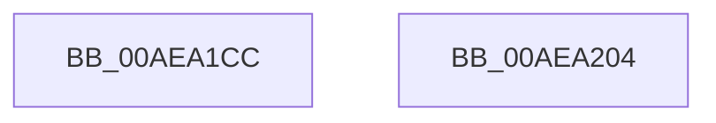

# PspSetProcessPriorityByClassIgnoreForegroundBoost

- RVA: `0x00AEA1CC`–`0x00AEA205` (길이 `57` bytes)
- VA: `0x0000000140AEA1CC`
- 실행 섹션: `PAGE`
- PDB 이름 있음: `예`; PDB Function 태그: `아니요`
- unwind 정보 RVA: `0x00064C80`
- 디코드: `16`개 명령, `57/57` bytes 표시
- 미해석 바이트: `0` (있으면 어셈블리에 `.byte`로 보존)

> 이 문서는 커널 이미지의 기계어와 PDB 기호를 분석해 생성했습니다. 4번과 5번은 함수 원형과 자료형을 바이너리 사용 방식에서 추정한 C 해석이며 원본 소스 복구 결과는 아닙니다.

## 1. Dependencies

- 직접 호출 지점: **2**; 고유 호출 대상: **2**
- 직접 호출자로 확인된 함수: **1**
- RIP 상대 이미지 참조: **1**

### Outgoing calls
- `0x00AEA1F1` → [KeSetPriorityAndQuantumProcess](../../text/3C/KeSetPriorityAndQuantumProcess_function_003C2EC0.md) (function, `0x003C2EC0`)
- `0x00AEA1F9` → [PspEnqueueProcessQosChangeNotification](../../text/5E/PspEnqueueProcessQosChangeNotification_function_005E2ED0.md) (function, `0x005E2ED0`)

### Direct callers
- [NtSetInformationProcess](NtSetInformationProcess_function_00AE5370.md) at `0x00AE5C34`

### Static image references
- `0x00AEA1D9` → RVA `0x00B4BB88` (`PspPriorityTable`; read)

## 2. Other-region calls and transfers

- 다른 실행 섹션으로 향하는 call: **2**
  - `0x00AEA1F1` → [KeSetPriorityAndQuantumProcess](../../text/3C/KeSetPriorityAndQuantumProcess_function_003C2EC0.md) (`PAGE` → `.text`)
  - `0x00AEA1F9` → [PspEnqueueProcessQosChangeNotification](../../text/5E/PspEnqueueProcessQosChangeNotification_function_005E2ED0.md) (`PAGE` → `.text`)
- 별도 외부 분기/꼬리 이동을 확인하지 못했습니다.

## 3. Assembly (complete function range)

```asm
00AEA1CC  40 53                           push rbx
00AEA1CE  48 83 EC 30                     sub rsp, 0x30
00AEA1D2  0F B6 91 47 03 00 00            movzx edx, byte ptr [rcx + 0x347]
00AEA1D9  48 8D 05 A8 19 06 00            lea rax, [rip + 0x619a8]
00AEA1E0  83 64 24 20 00                  and dword ptr [rsp + 0x20], 0
00AEA1E5  45 33 C9                        xor r9d, r9d
00AEA1E8  45 33 C0                        xor r8d, r8d
00AEA1EB  48 8B D9                        mov rbx, rcx
00AEA1EE  8B 14 90                        mov edx, dword ptr [rax + rdx*4]
00AEA1F1  E8 CA 8C 8D FF                  call 0x1403c2ec0
00AEA1F6  48 8B CB                        mov rcx, rbx
00AEA1F9  E8 D2 8C AF FF                  call 0x1405e2ed0
00AEA1FE  48 83 C4 30                     add rsp, 0x30
00AEA202  5B                              pop rbx
00AEA203  C3                              ret
00AEA204  CC                              int3
```

## 4. C-style interpretation (structured pseudocode)

```c
__int64 __fastcall PspSetProcessPriorityByClassIgnoreForegroundBoost(__int64 a1, __int64 a2, int a3, int a4)
{
    __int64 result;
    __int64 v_rsp;
    unsigned int v_stack_m18;

    v_rsp = (v_rsp) - (48);
    a4 = 0;
    a3 = 0;
    result = KeSetPriorityAndQuantumProcess(a1, (unsigned int)(*(unsigned int *)(v_rip + 399784 + *(unsigned __int8 *)(a1 + 839) * 4)), a3, a4);
    result = PspEnqueueProcessQosChangeNotification(a1, (unsigned int)(*(unsigned int *)(v_rip + 399784 + *(unsigned __int8 *)(a1 + 839) * 4)), a3, a4);
    v_rsp = (v_rsp) + (48);
    return result;
}
```

## 5. (Beta) C Style

```c
int64_t PspSetProcessPriorityByClassIgnoreForegroundBoost(void *Arg1, int64_t Arg2, int32_t Arg3, int32_t Arg4)
{
    uint8_t *arg1 = (uint8_t *)Arg1;

    int64_t result;
    int64_t local_rsp;
    uint32_t v_stack_m18;

    local_rsp = (local_rsp) - (48);
    Arg4 = 0;
    Arg3 = 0;
    result = KeSetPriorityAndQuantumProcess(Arg1, (uint32_t)(*(uint32_t *)(v_rip + 0x619A8 + *(uint8_t *)(arg1 + 0x347) * 4)), Arg3, Arg4);
    result = PspEnqueueProcessQosChangeNotification(Arg1, (uint32_t)(*(uint32_t *)(v_rip + 0x619A8 + *(uint8_t *)(arg1 + 0x347) * 4)), Arg3, Arg4);
    local_rsp = (local_rsp) + (48);
    return result;
}
```

### 관측된 메모리 오프셋

구조체 형식이 확인되지 않은 접근은 인자 기준의 오프셋으로만 기록했습니다.

| 기준 인자 | 오프셋 표현 | 폭 (bit) | 접근 |
|---|---:|---:|---|
| `Arg1` | `+ 0x347` | `8` | `R` |

## 6. Execution-region graph

[열기: 2D/3D 그래프와 함수 탐색 컨트롤 패널](../../../control-panel.html?section=page&rva=0x00AEA1CC&view=graph)

- 2D 그래프는 위에서 아래로 흐르고, 3D 그래프는 빈 공간을 드래그해 회전합니다. Shift+드래그는 이동, 휠은 확대·축소, 함수 노드 선택은 대상 보고서 이동입니다.

### Static fallback


