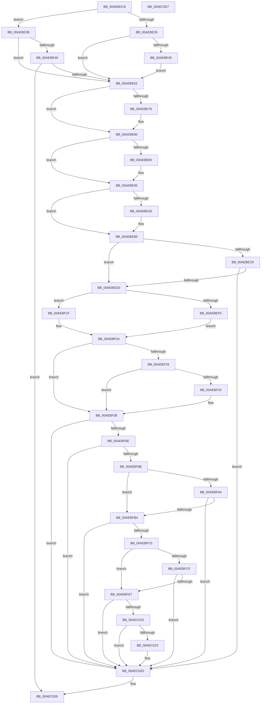

# PspSetupUserProcessAddressSpace

- RVA: `0x00AEBDC8`–`0x00AEC058` (길이 `656` bytes)
- VA: `0x0000000140AEBDC8`
- 실행 섹션: `PAGE`
- PDB 이름 있음: `예`; PDB Function 태그: `아니요`
- unwind 정보 RVA: `0x000C4F10`
- 디코드: `179`개 명령, `656/656` bytes 표시
- 미해석 바이트: `0` (있으면 어셈블리에 `.byte`로 보존)

> 이 문서는 커널 이미지의 기계어와 PDB 기호를 분석해 생성했습니다. 4번과 5번은 함수 원형과 자료형을 바이너리 사용 방식에서 추정한 C 해석이며 원본 소스 복구 결과는 아닙니다.

## 1. Dependencies

- 직접 호출 지점: **20**; 고유 호출 대상: **18**
- 직접 호출자로 확인된 함수: **1**
- RIP 상대 이미지 참조: **3**

### Outgoing calls
- `0x00AEBE55` → [PspGetStandardHandleList](../A9/PspGetStandardHandleList_function_00A98CC8.md) (function, `0x00A98CC8`)
- `0x00AEBE98` → [PsGetProcessServerSilo](../../text/44/PsGetProcessServerSilo_function_0044BEE0.md) (function, `0x0044BEE0`)
- `0x00AEBEA0` → [PsGetServerSiloGlobals](../../text/22/PsGetServerSiloGlobals_function_002250A0.md) (function, `0x002250A0`)
- `0x00AEBEBD` → [KiStackAttachProcess](../../text/21/KiStackAttachProcess_function_00216820.md) (function, `0x00216820`)
- `0x00AEBECE` → [PspLocateInPEManifest](../98/PspLocateInPEManifest_function_0098F568.md) (function, `0x0098F568`)
- `0x00AEBEEC` → [Feature_CreateProcessSegmentHeapEnablement__private_IsEnabledDeviceUsageNoInline](../../text/5E/Feature_CreateProcessSegmentHeapEnablement__private_IsEnabledDeviceUsageNoInline_function_005E33C0.md) (function, `0x005E33C0`)
- `0x00AEBEF8` → [PspCalculateUserAttributeListSize](../78/PspCalculateUserAttributeListSize_function_00784104.md) (function, `0x00784104`)
- `0x00AEBF5F` → [ZwAllocateVirtualMemory](../../text/6A/ZwAllocateVirtualMemory_function_006AD3D0.md) (function, `0x006AD3D0`)
- `0x00AEBF6E` → [Feature_CreateProcessSegmentHeapEnablement__private_IsEnabledDeviceUsageNoInline](../../text/5E/Feature_CreateProcessSegmentHeapEnablement__private_IsEnabledDeviceUsageNoInline_function_005E33C0.md) (function, `0x005E33C0`)
- `0x00AEBF7C` → [PspCopyAndFixupParameters](PspCopyAndFixupParameters_function_00AEB878.md) (function, `0x00AEB878`)
- `0x00AEBFA9` → [PspPrepareSystemDllInitBlock](../8C/PspPrepareSystemDllInitBlock_function_008CE128.md) (function, `0x008CE128`)
- `0x00AEBFBA` → [PspWow64SetupUserProcessAddressSpace](../../text/49/PspWow64SetupUserProcessAddressSpace_function_004903C4.md) (function, `0x004903C4`)
- `0x00AEBFD2` → [PsWow64GetProcessNtdllType](../8C/PsWow64GetProcessNtdllType_function_008CE464.md) (function, `0x008CE464`)
- `0x00AEBFDC` → [PspPrepareSystemDllInitBlock](../8C/PspPrepareSystemDllInitBlock_function_008CE128.md) (function, `0x008CE128`)
- `0x00AEBFEA` → [KeCopyXfdMaskToPeb](../../text/4B/KeCopyXfdMaskToPeb_function_004B23C4.md) (function, `0x004B23C4`)
- `0x00AEBFF7` → [PspUpdatePebForAffinityChange](../A5/PspUpdatePebForAffinityChange_function_00A50790.md) (function, `0x00A50790`)
- `0x00AEC018` → [MmMapApiSetView](../98/MmMapApiSetView_function_00980E98.md) (function, `0x00980E98`)
- `0x00AEC026` → [PspMapSiloSharedDataView](../A6/PspMapSiloSharedDataView_function_00A6F850.md) (function, `0x00A6F850`)
- `0x00AEC032` → [KiUnstackDetachProcess](../../text/21/KiUnstackDetachProcess_function_00217D30.md) (function, `0x00217D30`)
- `0x00AEC041` → [_security_check_cookie](../../text/6A/_security_check_cookie_function_006AC640.md) (function, `0x006AC640`)

### Direct callers
- [PspAllocateProcess](../A1/PspAllocateProcess_function_00A13B3C.md) at `0x00A15EDE`

### Static image references
- `0x00AEBDD9` → RVA `0x00E0A740` (`.data`; read)
- `0x00AEBE68` → RVA `0x00FD9BB4` (`PAGEDATA`; read)
- `0x00AEBE89` → RVA `0x00FD9E2C` (`PAGEDATA`; read)

## 2. Other-region calls and transfers

- 다른 실행 섹션으로 향하는 call: **10**
  - `0x00AEBE98` → [PsGetProcessServerSilo](../../text/44/PsGetProcessServerSilo_function_0044BEE0.md) (`PAGE` → `.text`)
  - `0x00AEBEA0` → [PsGetServerSiloGlobals](../../text/22/PsGetServerSiloGlobals_function_002250A0.md) (`PAGE` → `.text`)
  - `0x00AEBEBD` → [KiStackAttachProcess](../../text/21/KiStackAttachProcess_function_00216820.md) (`PAGE` → `.text`)
  - `0x00AEBEEC` → [Feature_CreateProcessSegmentHeapEnablement__private_IsEnabledDeviceUsageNoInline](../../text/5E/Feature_CreateProcessSegmentHeapEnablement__private_IsEnabledDeviceUsageNoInline_function_005E33C0.md) (`PAGE` → `.text`)
  - `0x00AEBF5F` → [ZwAllocateVirtualMemory](../../text/6A/ZwAllocateVirtualMemory_function_006AD3D0.md) (`PAGE` → `.text`)
  - `0x00AEBF6E` → [Feature_CreateProcessSegmentHeapEnablement__private_IsEnabledDeviceUsageNoInline](../../text/5E/Feature_CreateProcessSegmentHeapEnablement__private_IsEnabledDeviceUsageNoInline_function_005E33C0.md) (`PAGE` → `.text`)
  - `0x00AEBFBA` → [PspWow64SetupUserProcessAddressSpace](../../text/49/PspWow64SetupUserProcessAddressSpace_function_004903C4.md) (`PAGE` → `.text`)
  - `0x00AEBFEA` → [KeCopyXfdMaskToPeb](../../text/4B/KeCopyXfdMaskToPeb_function_004B23C4.md) (`PAGE` → `.text`)
  - `0x00AEC032` → [KiUnstackDetachProcess](../../text/21/KiUnstackDetachProcess_function_00217D30.md) (`PAGE` → `.text`)
  - `0x00AEC041` → [_security_check_cookie](../../text/6A/_security_check_cookie_function_006AC640.md) (`PAGE` → `.text`)
- 별도 외부 분기/꼬리 이동을 확인하지 못했습니다.

## 3. Assembly (complete function range)

```asm
00AEBDC8  40 53                           push rbx
00AEBDCA  55                              push rbp
00AEBDCB  56                              push rsi
00AEBDCC  57                              push rdi
00AEBDCD  41 54                           push r12
00AEBDCF  41 55                           push r13
00AEBDD1  41 56                           push r14
00AEBDD3  41 57                           push r15
00AEBDD5  48 83 EC 78                     sub rsp, 0x78
00AEBDD9  48 8B 05 60 E9 31 00            mov rax, qword ptr [rip + 0x31e960]
00AEBDE0  48 33 C4                        xor rax, rsp
00AEBDE3  48 89 44 24 60                  mov qword ptr [rsp + 0x60], rax
00AEBDE8  33 C0                           xor eax, eax
00AEBDEA  4C 8B E1                        mov r12, rcx
00AEBDED  48 21 44 24 30                  and qword ptr [rsp + 0x30], rax
00AEBDF2  45 33 FF                        xor r15d, r15d
00AEBDF5  48 89 44 24 58                  mov qword ptr [rsp + 0x58], rax
00AEBDFA  0F 57 C0                        xorps xmm0, xmm0
00AEBDFD  65 48 8B 04 25 88 01 00 00      mov rax, qword ptr gs:[0x188]
00AEBE06  49 8B F1                        mov rsi, r9
00AEBE09  41 0F B6 49 11                  movzx ecx, byte ptr [r9 + 0x11]
00AEBE0E  4D 8B E8                        mov r13, r8
00AEBE11  49 8B A9 D8 00 00 00            mov rbp, qword ptr [r9 + 0xd8]
00AEBE18  48 8B FA                        mov rdi, rdx
00AEBE1B  C1 E9 02                        shr ecx, 2
00AEBE1E  83 E1 03                        and ecx, 3
00AEBE21  48 89 44 24 40                  mov qword ptr [rsp + 0x40], rax
00AEBE26  0F 11 44 24 48                  movups xmmword ptr [rsp + 0x48], xmm0
00AEBE2B  83 E9 01                        sub ecx, 1
00AEBE2E  74 0B                           je 0x140aebe3b
00AEBE30  83 F9 01                        cmp ecx, 1
00AEBE33  75 2D                           jne 0x140aebe62
00AEBE35  4C 8D 7D 20                     lea r15, [rbp + 0x20]
00AEBE39  EB 27                           jmp 0x140aebe62
00AEBE3B  41 8B 81 20 01 00 00            mov eax, dword ptr [r9 + 0x120]
00AEBE42  41 39 41 58                     cmp dword ptr [r9 + 0x58], eax
00AEBE46  75 1A                           jne 0x140aebe62
00AEBE48  48 8D 54 24 48                  lea rdx, [rsp + 0x48]
00AEBE4D  49 8B CC                        mov rcx, r12
00AEBE50  4C 8D 7C 24 48                  lea r15, [rsp + 0x48]
00AEBE55  E8 6E CE FA FF                  call 0x140a98cc8
00AEBE5A  85 C0                           test eax, eax
00AEBE5C  0F 88 D7 01 00 00               js 0x140aec039
00AEBE62  8B 5D 08                        mov ebx, dword ptr [rbp + 8]
00AEBE65  44 8B F3                        mov r14d, ebx
00AEBE68  8B 05 46 DD 4E 00               mov eax, dword ptr [rip + 0x4edd46]
00AEBE6E  41 81 E6 60 00 00 01            and r14d, 0x1000060
00AEBE75  A8 01                           test al, 1
00AEBE77  74 07                           je 0x140aebe80
00AEBE79  0F BA EB 0F                     bts ebx, 0xf
00AEBE7D  89 5D 08                        mov dword ptr [rbp + 8], ebx
00AEBE80  83 BD 0C 04 00 00 00            cmp dword ptr [rbp + 0x40c], 0
00AEBE87  75 0C                           jne 0x140aebe95
00AEBE89  8B 05 9D DF 4E 00               mov eax, dword ptr [rip + 0x4edf9d]
00AEBE8F  89 85 0C 04 00 00               mov dword ptr [rbp + 0x40c], eax
00AEBE95  48 8B CF                        mov rcx, rdi
00AEBE98  E8 43 00 96 FF                  call 0x14044bee0
00AEBE9D  48 8B C8                        mov rcx, rax
00AEBEA0  E8 FB 91 73 FF                  call 0x1402250a0
00AEBEA5  80 B8 F8 03 00 00 00            cmp byte ptr [rax + 0x3f8], 0
00AEBEAC  74 07                           je 0x140aebeb5
00AEBEAE  0F BA EB 1D                     bts ebx, 0x1d
00AEBEB2  89 5D 08                        mov dword ptr [rbp + 8], ebx
00AEBEB5  4D 8B C5                        mov r8, r13
00AEBEB8  33 D2                           xor edx, edx
00AEBEBA  48 8B CF                        mov rcx, rdi
00AEBEBD  E8 5E A9 72 FF                  call 0x140216820
00AEBEC2  F6 46 10 10                     test byte ptr [rsi + 0x10], 0x10
00AEBEC6  74 15                           je 0x140aebedd
00AEBEC8  48 8B D6                        mov rdx, rsi
00AEBECB  48 8B CF                        mov rcx, rdi
00AEBECE  E8 95 36 EA FF                  call 0x14098f568
00AEBED3  8B D8                           mov ebx, eax
00AEBED5  85 C0                           test eax, eax
00AEBED7  0F 88 50 01 00 00               js 0x140aec02d
00AEBEDD  8B 45 00                        mov eax, dword ptr [rbp]
00AEBEE0  48 03 85 F0 03 00 00            add rax, qword ptr [rbp + 0x3f0]
00AEBEE7  48 89 44 24 30                  mov qword ptr [rsp + 0x30], rax
00AEBEEC  E8 CF 74 AF FF                  call 0x1405e33c0
00AEBEF1  85 C0                           test eax, eax
00AEBEF3  74 2A                           je 0x140aebf1f
00AEBEF5  48 8B CE                        mov rcx, rsi
00AEBEF8  E8 07 82 C9 FF                  call 0x140784104
00AEBEFD  4C 8B 44 24 30                  mov r8, qword ptr [rsp + 0x30]
00AEBF02  BA 07 00 00 00                  mov edx, 7
00AEBF07  49 8D 48 FF                     lea rcx, [r8 - 1]
00AEBF0B  48 23 CA                        and rcx, rdx
00AEBF0E  48 2B D1                        sub rdx, rcx
00AEBF11  49 8D 0C 10                     lea rcx, [r8 + rdx]
00AEBF15  48 03 C8                        add rcx, rax
00AEBF18  48 89 4C 24 30                  mov qword ptr [rsp + 0x30], rcx
00AEBF1D  EB 05                           jmp 0x140aebf24
00AEBF1F  48 8B 4C 24 30                  mov rcx, qword ptr [rsp + 0x30]
00AEBF24  45 85 F6                        test r14d, r14d
00AEBF27  75 0F                           jne 0x140aebf38
00AEBF29  B8 00 00 02 00                  mov eax, 0x20000
00AEBF2E  48 3B C8                        cmp rcx, rax
00AEBF31  73 05                           jae 0x140aebf38
00AEBF33  48 89 44 24 30                  mov qword ptr [rsp + 0x30], rax
00AEBF38  48 8D 96 E0 00 00 00            lea rdx, [rsi + 0xe0]
00AEBF3F  C7 44 24 28 04 00 00 00         mov dword ptr [rsp + 0x28], 4
00AEBF47  48 83 22 00                     and qword ptr [rdx], 0
00AEBF4B  4C 8D 4C 24 30                  lea r9, [rsp + 0x30]
00AEBF50  45 33 C0                        xor r8d, r8d
00AEBF53  C7 44 24 20 00 30 00 00         mov dword ptr [rsp + 0x20], 0x3000
00AEBF5B  48 83 C9 FF                     or rcx, 0xffffffffffffffff
00AEBF5F  E8 6C 14 BC FF                  call 0x1406ad3d0
00AEBF64  8B D8                           mov ebx, eax
00AEBF66  85 C0                           test eax, eax
00AEBF68  0F 88 BF 00 00 00               js 0x140aec02d
00AEBF6E  E8 4D 74 AF FF                  call 0x1405e33c0
00AEBF73  4C 8B C6                        mov r8, rsi
00AEBF76  49 8B D7                        mov rdx, r15
00AEBF79  49 8B CC                        mov rcx, r12
00AEBF7C  E8 F7 F8 FF FF                  call 0x140aeb878
00AEBF81  8B D8                           mov ebx, eax
00AEBF83  85 C0                           test eax, eax
00AEBF85  0F 88 A2 00 00 00               js 0x140aec02d
00AEBF8B  65 48 8B 04 25 88 01 00 00      mov rax, qword ptr gs:[0x188]
00AEBF94  48 8B 88 B8 00 00 00            mov rcx, qword ptr [rax + 0xb8]
00AEBF9B  F6 81 70 01 00 00 01            test byte ptr [rcx + 0x170], 1
00AEBFA2  75 10                           jne 0x140aebfb4
00AEBFA4  48 8B D6                        mov rdx, rsi
00AEBFA7  33 C9                           xor ecx, ecx
00AEBFA9  E8 7A 21 DE FF                  call 0x1408ce128
00AEBFAE  8B D8                           mov ebx, eax
00AEBFB0  85 C0                           test eax, eax
00AEBFB2  78 79                           js 0x140aec02d
00AEBFB4  48 8B D6                        mov rdx, rsi
00AEBFB7  48 8B CF                        mov rcx, rdi
00AEBFBA  E8 05 44 9A FF                  call 0x1404903c4
00AEBFBF  8B D8                           mov ebx, eax
00AEBFC1  85 C0                           test eax, eax
00AEBFC3  78 68                           js 0x140aec02d
00AEBFC5  48 83 BF 10 03 00 00 00         cmp qword ptr [rdi + 0x310], 0
00AEBFCD  74 18                           je 0x140aebfe7
00AEBFCF  48 8B CF                        mov rcx, rdi
00AEBFD2  E8 8D 24 DE FF                  call 0x1408ce464
00AEBFD7  8B C8                           mov ecx, eax
00AEBFD9  48 8B D6                        mov rdx, rsi
00AEBFDC  E8 47 21 DE FF                  call 0x1408ce128
00AEBFE1  8B D8                           mov ebx, eax
00AEBFE3  85 C0                           test eax, eax
00AEBFE5  78 46                           js 0x140aec02d
00AEBFE7  48 8B CF                        mov rcx, rdi
00AEBFEA  E8 D5 63 9C FF                  call 0x1404b23c4
00AEBFEF  48 8B 4C 24 40                  mov rcx, qword ptr [rsp + 0x40]
00AEBFF4  48 8B D7                        mov rdx, rdi
00AEBFF7  E8 94 47 F6 FF                  call 0x140a50790
00AEBFFC  65 48 8B 04 25 88 01 00 00      mov rax, qword ptr gs:[0x188]
00AEC005  48 8B 90 B8 00 00 00            mov rdx, qword ptr [rax + 0xb8]
00AEC00C  F6 82 70 01 00 00 01            test byte ptr [rdx + 0x170], 1
00AEC013  75 18                           jne 0x140aec02d
00AEC015  48 8B CF                        mov rcx, rdi
00AEC018  E8 7B 4E E9 FF                  call 0x140980e98
00AEC01D  8B D8                           mov ebx, eax
00AEC01F  85 C0                           test eax, eax
00AEC021  78 0A                           js 0x140aec02d
00AEC023  48 8B CF                        mov rcx, rdi
00AEC026  E8 25 38 F8 FF                  call 0x140a6f850
00AEC02B  8B D8                           mov ebx, eax
00AEC02D  33 D2                           xor edx, edx
00AEC02F  49 8B CD                        mov rcx, r13
00AEC032  E8 F9 BC 72 FF                  call 0x140217d30
00AEC037  8B C3                           mov eax, ebx
00AEC039  48 8B 4C 24 60                  mov rcx, qword ptr [rsp + 0x60]
00AEC03E  48 33 CC                        xor rcx, rsp
00AEC041  E8 FA 05 BC FF                  call 0x1406ac640
00AEC046  48 83 C4 78                     add rsp, 0x78
00AEC04A  41 5F                           pop r15
00AEC04C  41 5E                           pop r14
00AEC04E  41 5D                           pop r13
00AEC050  41 5C                           pop r12
00AEC052  5F                              pop rdi
00AEC053  5E                              pop rsi
00AEC054  5D                              pop rbp
00AEC055  5B                              pop rbx
00AEC056  C3                              ret
00AEC057  CC                              int3
```

## 4. C-style interpretation (structured pseudocode)

```c
__int64 __fastcall PspSetupUserProcessAddressSpace(__int64 a1, __int64 a2, __int64 a3, __int64 a4)
{
    __int64 result;
    __int64 v_r14;
    __int64 v_r15;
    __int64 v_rbx;
    __int64 v_rsp;
    unsigned __int64 v_stack_m58;
    unsigned __int64 v_stack_m60;
    unsigned __int64 v_stack_m70;
    unsigned __int64 v_stack_m78;
    unsigned __int64 v_stack_m88;
    unsigned int v_stack_m90;
    unsigned int v_stack_m98;

    v_rsp = (v_rsp) - (120);
    result = (*(unsigned __int64 *)(v_rip + 3271008)) ^ (v_rsp);
    v_stack_m58 = result;
    result = 0;
    v_r15 = 0;
    v_stack_m60 = 0;
    a1 = (unsigned int)((*(unsigned __int8 *)(a4 + 17)) >> (2));
    a1 = (unsigned int)((a1) & (3));
    v_stack_m78 = *(unsigned __int64 *)(gs_base + (0 + 392));
    v_stack_m70 = v_xmm0;
    a1 = (unsigned int)((a1) - (1));
    if (condition_is_equal) goto loc_00AEBE3B;
    if (((unsigned int)(a1)) != 1) goto loc_00AEBE62;
    goto loc_00AEBE62;
loc_00AEBE3B:
    if ((*(unsigned int *)(a4 + 88)) != ((unsigned int)((unsigned int)(*(unsigned int *)(a4 + 288))))) goto loc_00AEBE62;
    result = PspGetStandardHandleList(a1, v_stack_m70, a3, a4);
    if (sign_flag) goto loc_00AEC039;
loc_00AEBE62:
    v_r14 = (unsigned int)(((unsigned int)((unsigned int)((unsigned int)(*(unsigned int *)(*(unsigned __int64 *)(a4 + 216) + 8))))) & (0x1000060ULL));
    if ((((unsigned __int8)((unsigned int)(*(unsigned int *)(v_rip + 5168454)))) & (1)) != 0) {
        *(unsigned int *)(*(unsigned __int64 *)(a4 + 216) + 8) = (unsigned int)((unsigned int)(*(unsigned int *)(*(unsigned __int64 *)(a4 + 216) + 8)));
    }
    result = (unsigned int)(*(unsigned int *)(v_rip + 5168454));
    if ((*(unsigned int *)(*(unsigned __int64 *)(a4 + 216) + 1036)) == 0) {
        result = *(unsigned int *)(v_rip + 5169053);
        *(unsigned int *)(*(unsigned __int64 *)(a4 + 216) + 1036) = (unsigned int)(result);
    }
    result = PsGetProcessServerSilo(a2, v_stack_m70, a3, a4);
    result = PsGetServerSiloGlobals(result, v_stack_m70, a3, a4);
    if ((*(unsigned __int8 *)(result + 1016)) != 0) {
        *(unsigned int *)(*(unsigned __int64 *)(a4 + 216) + 8) = (unsigned int)((unsigned int)(*(unsigned int *)(*(unsigned __int64 *)(a4 + 216) + 8)));
    }
    a2 = 0;
    result = KiStackAttachProcess(0, a2, a3, a4);
    if (((*(unsigned __int8 *)(a4 + 16)) & (16)) == 0) goto loc_00AEBEDD;
    result = PspLocateInPEManifest(0, a4, a3, a4);
    if (sign_flag) goto loc_00AEC02D;
loc_00AEBEDD:
    result = ((unsigned int)(*(unsigned int *)(*(unsigned __int64 *)(a4 + 216)))) + (*(unsigned __int64 *)(*(unsigned __int64 *)(a4 + 216) + 1008));
    v_stack_m88 = result;
    result = Feature_CreateProcessSegmentHeapEnablement__private_IsEnabledDeviceUsageNoInline(0, a4, a3, a4);
    if ((unsigned int)(result) == 0) goto loc_00AEBF1F;
    result = PspCalculateUserAttributeListSize(a4, a4, a3, a4);
    a1 = (v_stack_m88 - 1) & (7);
    a2 = (7) - (a1);
    a1 = (v_stack_m88 + a2 * 1) + (result);
    v_stack_m88 = a1;
    goto loc_00AEBF24;
loc_00AEBF1F:
loc_00AEBF24:
    if ((unsigned int)(v_r14) != 0) goto loc_00AEBF38;
    if (v_stack_m88 < ((unsigned int)(0x20000ULL))) {
        v_stack_m88 = (unsigned int)(0x20000ULL);
    }
    v_stack_m90 = 4;
    a3 = 0;
    v_stack_m98 = 0x3000ULL;
    a1 = (v_stack_m88) | (-1);
    result = ZwAllocateVirtualMemory(a1, a4 + 224, a3, v_stack_m88);
    if (sign_flag) goto loc_00AEC02D;
    result = Feature_CreateProcessSegmentHeapEnablement__private_IsEnabledDeviceUsageNoInline(a1, a4 + 224, a3, v_stack_m88);
    result = PspCopyAndFixupParameters(a1, v_stack_m70, a4, v_stack_m88);
    if (sign_flag) goto loc_00AEC02D;
    if (((*(unsigned __int8 *)(*(unsigned __int64 *)(*(unsigned __int64 *)(gs_base + (0 + 392)) + 184) + 368)) & (1)) != 0) goto loc_00AEBFB4;
    a1 = 0;
    result = PspPrepareSystemDllInitBlock(a1, a4, a4, v_stack_m88);
    if (sign_flag) goto loc_00AEC02D;
loc_00AEBFB4:
    result = PspWow64SetupUserProcessAddressSpace(a2, a4, a4, v_stack_m88);
    if (sign_flag) goto loc_00AEC02D;
    if ((*(unsigned __int64 *)(a2 + 784)) == 0) goto loc_00AEBFE7;
    result = PsWow64GetProcessNtdllType(a2, a4, a4, v_stack_m88);
    result = PspPrepareSystemDllInitBlock((unsigned int)((unsigned int)(result)), a4, a4, v_stack_m88);
    if (sign_flag) goto loc_00AEC02D;
loc_00AEBFE7:
    result = KeCopyXfdMaskToPeb(a2, a4, a4, v_stack_m88);
    result = PspUpdatePebForAffinityChange(v_stack_m78, a2, a4, v_stack_m88);
    if (((*(unsigned __int8 *)(*(unsigned __int64 *)(*(unsigned __int64 *)(gs_base + (0 + 392)) + 184) + 368)) & (1)) != 0) goto loc_00AEC02D;
    result = MmMapApiSetView(a2, *(unsigned __int64 *)(*(unsigned __int64 *)(gs_base + (0 + 392)) + 184), a4, v_stack_m88);
    v_rbx = (unsigned int)((unsigned int)(result));
    if (!(sign_flag)) {
        a1 = a2;
        result = PspMapSiloSharedDataView(a1, *(unsigned __int64 *)(*(unsigned __int64 *)(gs_base + (0 + 392)) + 184), a4, v_stack_m88);
        v_rbx = (unsigned int)(result);
    }
    a2 = 0;
    result = KiUnstackDetachProcess(0, a2, a4, v_stack_m88);
loc_00AEC039:
    a1 = (v_stack_m58) ^ (v_rsp);
    result = _security_check_cookie(a1, a2, a4, v_stack_m88);
    v_rsp = (v_rsp) + (120);
    return result;
}
```

## 5. (Beta) C Style

```c
int64_t PspSetupUserProcessAddressSpace(int64_t Arg1, void *Arg2, int64_t Arg3, void *Arg4)
{
    uint8_t *arg2 = (uint8_t *)Arg2;
    uint8_t *arg4 = (uint8_t *)Arg4;

    int64_t result;
    int64_t local_r14;
    int64_t local_r15;
    int64_t local_rbx;
    int64_t local_rsp;
    uint64_t v_stack_m58;
    uint64_t v_stack_m60;
    uint64_t v_stack_m70;
    uint64_t v_stack_m78;
    uint64_t v_stack_m88;
    uint32_t v_stack_m90;
    uint32_t v_stack_m98;

    local_rsp = (local_rsp) - (120);
    result = (*(uint64_t *)(v_rip + 0x31E960)) ^ (local_rsp);
    v_stack_m58 = result;
    result = 0;
    local_r15 = 0;
    v_stack_m60 = 0;
    Arg1 = (uint32_t)((*(uint8_t *)(arg4 + 0x11)) >> (2));
    Arg1 = (uint32_t)((Arg1) & (3));
    v_stack_m78 = *(uint64_t *)(gs_base + (0 + 0x188));
    v_stack_m70 = v_xmm0;
    Arg1 = (uint32_t)((Arg1) - (1));
    if (condition_is_equal) goto loc_00AEBE3B;
    if (((uint32_t)(Arg1)) != 1) goto loc_00AEBE62;
    goto loc_00AEBE62;
loc_00AEBE3B:
    if ((*(uint32_t *)(arg4 + 0x58)) != ((uint32_t)((uint32_t)(*(uint32_t *)(arg4 + 0x120))))) goto loc_00AEBE62;
    result = PspGetStandardHandleList(Arg1, v_stack_m70, Arg3, Arg4);
    if (sign_flag) goto loc_00AEC039;
loc_00AEBE62:
    local_r14 = (uint32_t)(((uint32_t)((uint32_t)((uint32_t)(*(uint32_t *)(*(uint64_t *)(arg4 + 0xD8) + 0x8))))) & (0x1000060ULL));
    if ((((uint8_t)((uint32_t)(*(uint32_t *)(v_rip + 0x4EDD46)))) & (1)) != 0) {
        *(uint32_t *)(*(uint64_t *)(arg4 + 0xD8) + 0x8) = (uint32_t)((uint32_t)(*(uint32_t *)(*(uint64_t *)(arg4 + 0xD8) + 0x8)));
    }
    result = (uint32_t)(*(uint32_t *)(v_rip + 0x4EDD46));
    if ((*(uint32_t *)(*(uint64_t *)(arg4 + 0xD8) + 0x40C)) == 0) {
        result = *(uint32_t *)(v_rip + 0x4EDF9D);
        *(uint32_t *)(*(uint64_t *)(arg4 + 0xD8) + 0x40C) = (uint32_t)(result);
    }
    result = PsGetProcessServerSilo(Arg2, v_stack_m70, Arg3, Arg4);
    result = PsGetServerSiloGlobals(result, v_stack_m70, Arg3, Arg4);
    if ((*(uint8_t *)(result + 0x3F8)) != 0) {
        *(uint32_t *)(*(uint64_t *)(arg4 + 0xD8) + 0x8) = (uint32_t)((uint32_t)(*(uint32_t *)(*(uint64_t *)(arg4 + 0xD8) + 0x8)));
    }
    Arg2 = 0;
    result = KiStackAttachProcess(0, Arg2, Arg3, Arg4);
    if (((*(uint8_t *)(arg4 + 0x10)) & (16)) == 0) goto loc_00AEBEDD;
    result = PspLocateInPEManifest(0, Arg4, Arg3, Arg4);
    if (sign_flag) goto loc_00AEC02D;
loc_00AEBEDD:
    result = ((uint32_t)(*(uint32_t *)(*(uint64_t *)(arg4 + 0xD8)))) + (*(uint64_t *)(*(uint64_t *)(arg4 + 0xD8) + 0x3F0));
    v_stack_m88 = result;
    result = Feature_CreateProcessSegmentHeapEnablement__private_IsEnabledDeviceUsageNoInline(0, Arg4, Arg3, Arg4);
    if ((uint32_t)(result) == 0) goto loc_00AEBF1F;
    result = PspCalculateUserAttributeListSize(Arg4, Arg4, Arg3, Arg4);
    Arg1 = (v_stack_m88 - 1) & (7);
    Arg2 = (7) - (Arg1);
    Arg1 = (v_stack_m88 + Arg2 * 1) + (result);
    v_stack_m88 = Arg1;
    goto loc_00AEBF24;
loc_00AEBF1F:
loc_00AEBF24:
    if ((uint32_t)(local_r14) != 0) goto loc_00AEBF38;
    if (v_stack_m88 < ((uint32_t)(0x20000ULL))) {
        v_stack_m88 = (uint32_t)(0x20000ULL);
    }
    v_stack_m90 = 4;
    Arg3 = 0;
    v_stack_m98 = 0x3000ULL;
    Arg1 = (v_stack_m88) | (-1);
    result = ZwAllocateVirtualMemory(Arg1, Arg4 + 224, Arg3, v_stack_m88);
    if (sign_flag) goto loc_00AEC02D;
    result = Feature_CreateProcessSegmentHeapEnablement__private_IsEnabledDeviceUsageNoInline(Arg1, Arg4 + 224, Arg3, v_stack_m88);
    result = PspCopyAndFixupParameters(Arg1, v_stack_m70, Arg4, v_stack_m88);
    if (sign_flag) goto loc_00AEC02D;
    if (((*(uint8_t *)(*(uint64_t *)(*(uint64_t *)(gs_base + (0 + 0x188)) + 0xB8) + 0x170)) & (1)) != 0) goto loc_00AEBFB4;
    Arg1 = 0;
    result = PspPrepareSystemDllInitBlock(Arg1, Arg4, Arg4, v_stack_m88);
    if (sign_flag) goto loc_00AEC02D;
loc_00AEBFB4:
    result = PspWow64SetupUserProcessAddressSpace(Arg2, Arg4, Arg4, v_stack_m88);
    if (sign_flag) goto loc_00AEC02D;
    if ((*(uint64_t *)(arg2 + 0x310)) == 0) goto loc_00AEBFE7;
    result = PsWow64GetProcessNtdllType(Arg2, Arg4, Arg4, v_stack_m88);
    result = PspPrepareSystemDllInitBlock((uint32_t)((uint32_t)(result)), Arg4, Arg4, v_stack_m88);
    if (sign_flag) goto loc_00AEC02D;
loc_00AEBFE7:
    result = KeCopyXfdMaskToPeb(Arg2, Arg4, Arg4, v_stack_m88);
    result = PspUpdatePebForAffinityChange(v_stack_m78, Arg2, Arg4, v_stack_m88);
    if (((*(uint8_t *)(*(uint64_t *)(*(uint64_t *)(gs_base + (0 + 0x188)) + 0xB8) + 0x170)) & (1)) != 0) goto loc_00AEC02D;
    result = MmMapApiSetView(Arg2, *(uint64_t *)(*(uint64_t *)(gs_base + (0 + 0x188)) + 0xB8), Arg4, v_stack_m88);
    local_rbx = (uint32_t)((uint32_t)(result));
    if (!(sign_flag)) {
        Arg1 = Arg2;
        result = PspMapSiloSharedDataView(Arg1, *(uint64_t *)(*(uint64_t *)(gs_base + (0 + 0x188)) + 0xB8), Arg4, v_stack_m88);
        local_rbx = (uint32_t)(result);
    }
    Arg2 = 0;
    result = KiUnstackDetachProcess(0, Arg2, Arg4, v_stack_m88);
loc_00AEC039:
    Arg1 = (v_stack_m58) ^ (local_rsp);
    result = _security_check_cookie(Arg1, Arg2, Arg4, v_stack_m88);
    local_rsp = (local_rsp) + (120);
    return result;
}
```

### 관측된 메모리 오프셋

구조체 형식이 확인되지 않은 접근은 인자 기준의 오프셋으로만 기록했습니다.

| 기준 인자 | 오프셋 표현 | 폭 (bit) | 접근 |
|---|---:|---:|---|
| `Arg2` | `+ 0x310` | `64` | `R` |
| `Arg4` | `+ 0x0` | `64` | `R/W` |
| `Arg4` | `+ 0x10` | `8` | `R` |
| `Arg4` | `+ 0x11` | `8` | `R` |
| `Arg4` | `+ 0x58` | `32` | `R` |
| `Arg4` | `+ 0xD8` | `64` | `R` |
| `Arg4` | `+ 0xE0` | `64` | `R` |
| `Arg4` | `+ 0x120` | `32` | `R` |

## 6. Execution-region graph

[열기: 2D/3D 그래프와 함수 탐색 컨트롤 패널](../../../control-panel.html?section=page&rva=0x00AEBDC8&view=graph)

- 2D 그래프는 위에서 아래로 흐르고, 3D 그래프는 빈 공간을 드래그해 회전합니다. Shift+드래그는 이동, 휠은 확대·축소, 함수 노드 선택은 대상 보고서 이동입니다.

### Static fallback


