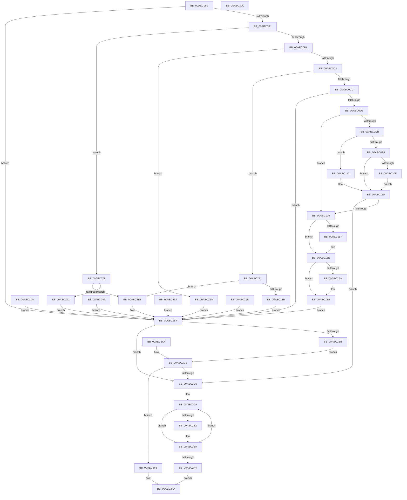

# PspUpdateCreateInfo

- RVA: `0x00AEC060`–`0x00AEC30D` (길이 `685` bytes)
- VA: `0x0000000140AEC060`
- 실행 섹션: `PAGE`
- PDB 이름 있음: `예`; PDB Function 태그: `아니요`
- unwind 정보 RVA: `0x000CEE34`
- 디코드: `188`개 명령, `685/685` bytes 표시
- 미해석 바이트: `0` (있으면 어셈블리에 `.byte`로 보존)

> 이 문서는 커널 이미지의 기계어와 PDB 기호를 분석해 생성했습니다. 4번과 5번은 함수 원형과 자료형을 바이너리 사용 방식에서 추정한 C 해석이며 원본 소스 복구 결과는 아닙니다.

## 1. Dependencies

- 직접 호출 지점: **7**; 고유 호출 대상: **4**
- 직접 호출자로 확인된 함수: **2**
- RIP 상대 이미지 참조: **1**

### Outgoing calls
- `0x00AEC0EA` → [PspPropagateHandle](../A6/PspPropagateHandle_function_00A63914.md) (function, `0x00A63914`)
- `0x00AEC104` → [PspPropagateHandle](../A6/PspPropagateHandle_function_00A63914.md) (function, `0x00A63914`)
- `0x00AEC14E` → [Feature_OutsideInProtection__private_IsEnabledDeviceUsageNoInline](../../text/5C/Feature_OutsideInProtection__private_IsEnabledDeviceUsageNoInline_function_005CD968.md) (function, `0x005CD968`)
- `0x00AEC15A` → [PspIsTamperProtectedProcess](../../text/5E/PspIsTamperProtectedProcess_function_005E36D4.md) (function, `0x005E36D4`)
- `0x00AEC230` → [PspPropagateHandle](../A6/PspPropagateHandle_function_00A63914.md) (function, `0x00A63914`)
- `0x00AEC287` → [PspPropagateHandle](../A6/PspPropagateHandle_function_00A63914.md) (function, `0x00A63914`)
- `0x00AEC2E5` → [ObCloseHandle](../8A/ObCloseHandle_function_008A1870.md) (function, `0x008A1870`)

### Direct callers
- [PspAllocateProcess](../A1/PspAllocateProcess_function_00A13B3C.md) at `0x00A1454D`
- [NtCreateUserProcess](NtCreateUserProcess_function_00AEA680.md) at `0x00AEAD37`
- [NtCreateUserProcess](NtCreateUserProcess_function_00AEA680.md) at `0x00AEB762`

### Static image references
- `0x00AEC182` → RVA `0x00FD9BB4` (`PAGEDATA`; read)

## 2. Other-region calls and transfers

- 다른 실행 섹션으로 향하는 call: **2**
  - `0x00AEC14E` → [Feature_OutsideInProtection__private_IsEnabledDeviceUsageNoInline](../../text/5C/Feature_OutsideInProtection__private_IsEnabledDeviceUsageNoInline_function_005CD968.md) (`PAGE` → `.text`)
  - `0x00AEC15A` → [PspIsTamperProtectedProcess](../../text/5E/PspIsTamperProtectedProcess_function_005E36D4.md) (`PAGE` → `.text`)
- 별도 외부 분기/꼬리 이동을 확인하지 못했습니다.

## 3. Assembly (complete function range)

```asm
00AEC060  48 89 5C 24 18                  mov qword ptr [rsp + 0x18], rbx
00AEC065  89 4C 24 08                     mov dword ptr [rsp + 8], ecx
00AEC069  56                              push rsi
00AEC06A  57                              push rdi
00AEC06B  41 55                           push r13
00AEC06D  41 56                           push r14
00AEC06F  41 57                           push r15
00AEC071  48 83 EC 30                     sub rsp, 0x30
00AEC075  4D 8B E8                        mov r13, r8
00AEC078  48 8B F2                        mov rsi, rdx
00AEC07B  33 FF                           xor edi, edi
00AEC07D  48 8B 5A 30                     mov rbx, qword ptr [rdx + 0x30]
00AEC081  48 89 5C 24 78                  mov qword ptr [rsp + 0x78], rbx
00AEC086  0F 57 C0                        xorps xmm0, xmm0
00AEC089  0F 11 44 24 20                  movups xmmword ptr [rsp + 0x20], xmm0
00AEC08E  65 48 8B 04 25 88 01 00 00      mov rax, qword ptr gs:[0x188]
00AEC097  44 8A B0 32 02 00 00            mov r14b, byte ptr [rax + 0x232]
00AEC09E  44 88 74 24 68                  mov byte ptr [rsp + 0x68], r14b
00AEC0A3  44 8D 7F 02                     lea r15d, [rdi + 2]
00AEC0A7  44 84 7A 10                     test byte ptr [rdx + 0x10], r15b
00AEC0AB  0F 84 06 02 00 00               je 0x140aec2b7
00AEC0B1  41 2B CF                        sub ecx, r15d
00AEC0B4  0F 84 BE 01 00 00               je 0x140aec278
00AEC0BA  83 E9 01                        sub ecx, 1
00AEC0BD  0F 84 97 01 00 00               je 0x140aec25a
00AEC0C3  41 2B CF                        sub ecx, r15d
00AEC0C6  0F 84 55 01 00 00               je 0x140aec221
00AEC0CC  83 F9 01                        cmp ecx, 1
00AEC0CF  0F 85 E2 01 00 00               jne 0x140aec2b7
00AEC0D5  F6 42 08 20                     test byte ptr [rdx + 8], 0x20
00AEC0D9  74 4A                           je 0x140aec125
00AEC0DB  48 81 C2 B0 00 00 00            add rdx, 0xb0
00AEC0E2  4C 8D 44 24 20                  lea r8, [rsp + 0x20]
00AEC0E7  41 8A CE                        mov cl, r14b
00AEC0EA  E8 25 78 F7 FF                  call 0x140a63914
00AEC0EF  8B F8                           mov edi, eax
00AEC0F1  85 C0                           test eax, eax
00AEC0F3  78 22                           js 0x140aec117
00AEC0F5  48 8D 96 C0 00 00 00            lea rdx, [rsi + 0xc0]
00AEC0FC  4C 8D 44 24 28                  lea r8, [rsp + 0x28]
00AEC101  41 8A CE                        mov cl, r14b
00AEC104  E8 0B 78 F7 FF                  call 0x140a63914
00AEC109  8B F8                           mov edi, eax
00AEC10B  85 C0                           test eax, eax
00AEC10D  79 0E                           jns 0x140aec11d
00AEC10F  48 83 64 24 28 00               and qword ptr [rsp + 0x28], 0
00AEC115  EB 06                           jmp 0x140aec11d
00AEC117  48 83 64 24 20 00               and qword ptr [rsp + 0x20], 0
00AEC11D  85 FF                           test edi, edi
00AEC11F  0F 88 B0 01 00 00               js 0x140aec2d5
00AEC125  83 63 10 00                     and dword ptr [rbx + 0x10], 0
00AEC129  41 F6 85 FA 05 00 00 07         test byte ptr [r13 + 0x5fa], 7
00AEC131  0F 97 C1                        seta cl
00AEC134  88 4B 10                        mov byte ptr [rbx + 0x10], cl
00AEC137  41 8A 85 FA 05 00 00            mov al, byte ptr [r13 + 0x5fa]
00AEC13E  24 07                           and al, 7
00AEC140  3C 01                           cmp al, 1
00AEC142  0F 95 C0                        setne al
00AEC145  FE C8                           dec al
00AEC147  24 10                           and al, 0x10
00AEC149  0A C1                           or al, cl
00AEC14B  88 43 10                        mov byte ptr [rbx + 0x10], al
00AEC14E  E8 15 18 AE FF                  call 0x1405cd968
00AEC153  85 C0                           test eax, eax
00AEC155  74 17                           je 0x140aec16e
00AEC157  49 8B CD                        mov rcx, r13
00AEC15A  E8 75 75 AF FF                  call 0x1405e36d4
00AEC15F  8A 4B 10                        mov cl, byte ptr [rbx + 0x10]
00AEC162  C0 E0 05                        shl al, 5
00AEC165  32 C1                           xor al, cl
00AEC167  24 20                           and al, 0x20
00AEC169  32 C1                           xor al, cl
00AEC16B  88 43 10                        mov byte ptr [rbx + 0x10], al
00AEC16E  41 8A 8D F6 01 00 00            mov cl, byte ptr [r13 + 0x1f6]
00AEC175  41 22 CF                        and cl, r15b
00AEC178  8A 43 10                        mov al, byte ptr [rbx + 0x10]
00AEC17B  24 FD                           and al, 0xfd
00AEC17D  0A C8                           or cl, al
00AEC17F  88 4B 10                        mov byte ptr [rbx + 0x10], cl
00AEC182  8B 05 2C DA 4E 00               mov eax, dword ptr [rip + 0x4eda2c]
00AEC188  24 01                           and al, 1
00AEC18A  C0 E0 02                        shl al, 2
00AEC18D  80 E1 FB                        and cl, 0xfb
00AEC190  0A C1                           or al, cl
00AEC192  88 43 10                        mov byte ptr [rbx + 0x10], al
00AEC195  8A 4E 10                        mov cl, byte ptr [rsi + 0x10]
00AEC198  C0 E9 02                        shr cl, 2
00AEC19B  32 C8                           xor cl, al
00AEC19D  80 E1 08                        and cl, 8
00AEC1A0  32 C8                           xor cl, al
00AEC1A2  88 4B 10                        mov byte ptr [rbx + 0x10], cl
00AEC1A5  F6 C1 08                        test cl, 8
00AEC1A8  74 14                           je 0x140aec1be
00AEC1AA  48 8B 86 30 01 00 00            mov rax, qword ptr [rsi + 0x130]
00AEC1B1  48 89 43 48                     mov qword ptr [rbx + 0x48], rax
00AEC1B5  8B 86 38 01 00 00               mov eax, dword ptr [rsi + 0x138]
00AEC1BB  89 43 50                        mov dword ptr [rbx + 0x50], eax
00AEC1BE  48 8B 44 24 20                  mov rax, qword ptr [rsp + 0x20]
00AEC1C3  48 89 43 18                     mov qword ptr [rbx + 0x18], rax
00AEC1C7  48 8B 44 24 28                  mov rax, qword ptr [rsp + 0x28]
00AEC1CC  48 89 43 20                     mov qword ptr [rbx + 0x20], rax
00AEC1D0  48 8B 86 E0 00 00 00            mov rax, qword ptr [rsi + 0xe0]
00AEC1D7  48 89 43 28                     mov qword ptr [rbx + 0x28], rax
00AEC1DB  8B 86 E8 00 00 00               mov eax, dword ptr [rsi + 0xe8]
00AEC1E1  89 43 30                        mov dword ptr [rbx + 0x30], eax
00AEC1E4  48 8B 86 D8 00 00 00            mov rax, qword ptr [rsi + 0xd8]
00AEC1EB  8B 48 08                        mov ecx, dword ptr [rax + 8]
00AEC1EE  89 4B 34                        mov dword ptr [rbx + 0x34], ecx
00AEC1F1  49 8B 85 E0 02 00 00            mov rax, qword ptr [r13 + 0x2e0]
00AEC1F8  48 89 43 38                     mov qword ptr [rbx + 0x38], rax
00AEC1FC  8B 86 EC 00 00 00               mov eax, dword ptr [rsi + 0xec]
00AEC202  89 43 40                        mov dword ptr [rbx + 0x40], eax
00AEC205  E9 AD 00 00 00                  jmp 0x140aec2b7
00AEC20A  8B F8                           mov edi, eax
00AEC20C  41 BF 02 00 00 00               mov r15d, 2
00AEC212  48 8B 5C 24 78                  mov rbx, qword ptr [rsp + 0x78]
00AEC217  44 8A 74 24 68                  mov r14b, byte ptr [rsp + 0x68]
00AEC21C  E9 96 00 00 00                  jmp 0x140aec2b7
00AEC221  48 81 C2 C8 00 00 00            add rdx, 0xc8
00AEC228  4C 8D 44 24 20                  lea r8, [rsp + 0x20]
00AEC22D  41 8A CE                        mov cl, r14b
00AEC230  E8 DF 76 F7 FF                  call 0x140a63914
00AEC235  8B F8                           mov edi, eax
00AEC237  85 C0                           test eax, eax
00AEC239  78 76                           js 0x140aec2b1
00AEC23B  48 8B 44 24 20                  mov rax, qword ptr [rsp + 0x20]
00AEC240  48 89 43 10                     mov qword ptr [rbx + 0x10], rax
00AEC244  EB 71                           jmp 0x140aec2b7
00AEC246  8B F8                           mov edi, eax
00AEC248  41 BF 02 00 00 00               mov r15d, 2
00AEC24E  48 8B 5C 24 78                  mov rbx, qword ptr [rsp + 0x78]
00AEC253  44 8A 74 24 68                  mov r14b, byte ptr [rsp + 0x68]
00AEC258  EB 5D                           jmp 0x140aec2b7
00AEC25A  0F B7 42 66                     movzx eax, word ptr [rdx + 0x66]
00AEC25E  66 89 43 10                     mov word ptr [rbx + 0x10], ax
00AEC262  EB 53                           jmp 0x140aec2b7
00AEC264  8B F8                           mov edi, eax
00AEC266  41 BF 02 00 00 00               mov r15d, 2
00AEC26C  48 8B 5C 24 78                  mov rbx, qword ptr [rsp + 0x78]
00AEC271  44 8A 74 24 68                  mov r14b, byte ptr [rsp + 0x68]
00AEC276  EB 3F                           jmp 0x140aec2b7
00AEC278  48 81 C2 B0 00 00 00            add rdx, 0xb0
00AEC27F  4C 8D 44 24 20                  lea r8, [rsp + 0x20]
00AEC284  41 8A CE                        mov cl, r14b
00AEC287  E8 88 76 F7 FF                  call 0x140a63914
00AEC28C  8B F8                           mov edi, eax
00AEC28E  85 C0                           test eax, eax
00AEC290  78 1F                           js 0x140aec2b1
00AEC292  48 8B 44 24 20                  mov rax, qword ptr [rsp + 0x20]
00AEC297  48 89 43 10                     mov qword ptr [rbx + 0x10], rax
00AEC29B  EB 1A                           jmp 0x140aec2b7
00AEC29D  8B F8                           mov edi, eax
00AEC29F  41 BF 02 00 00 00               mov r15d, 2
00AEC2A5  48 8B 5C 24 78                  mov rbx, qword ptr [rsp + 0x78]
00AEC2AA  44 8A 74 24 68                  mov r14b, byte ptr [rsp + 0x68]
00AEC2AF  EB 06                           jmp 0x140aec2b7
00AEC2B1  48 83 64 24 20 00               and qword ptr [rsp + 0x20], 0
00AEC2B7  85 FF                           test edi, edi
00AEC2B9  78 1A                           js 0x140aec2d5
00AEC2BB  8B 44 24 60                     mov eax, dword ptr [rsp + 0x60]
00AEC2BF  89 43 08                        mov dword ptr [rbx + 8], eax
00AEC2C2  EB 0D                           jmp 0x140aec2d1
00AEC2C4  8B F8                           mov edi, eax
00AEC2C6  41 BF 02 00 00 00               mov r15d, 2
00AEC2CC  44 8A 74 24 68                  mov r14b, byte ptr [rsp + 0x68]
00AEC2D1  85 FF                           test edi, edi
00AEC2D3  79 23                           jns 0x140aec2f8
00AEC2D5  48 8D 5C 24 20                  lea rbx, [rsp + 0x20]
00AEC2DA  48 8B 0B                        mov rcx, qword ptr [rbx]
00AEC2DD  48 85 C9                        test rcx, rcx
00AEC2E0  74 08                           je 0x140aec2ea
00AEC2E2  41 8A D6                        mov dl, r14b
00AEC2E5  E8 86 55 DB FF                  call 0x1408a1870
00AEC2EA  48 83 C3 08                     add rbx, 8
00AEC2EE  49 83 EF 01                     sub r15, 1
00AEC2F2  75 E6                           jne 0x140aec2da
00AEC2F4  8B C7                           mov eax, edi
00AEC2F6  EB 02                           jmp 0x140aec2fa
00AEC2F8  33 C0                           xor eax, eax
00AEC2FA  48 8B 5C 24 70                  mov rbx, qword ptr [rsp + 0x70]
00AEC2FF  48 83 C4 30                     add rsp, 0x30
00AEC303  41 5F                           pop r15
00AEC305  41 5E                           pop r14
00AEC307  41 5D                           pop r13
00AEC309  5F                              pop rdi
00AEC30A  5E                              pop rsi
00AEC30B  C3                              ret
00AEC30C  CC                              int3
```

## 4. C-style interpretation (structured pseudocode)

```c
__int64 __fastcall PspUpdateCreateInfo(int a1, __int64 a2, __int64 a3)
{
    __int64 result;
    __int64 v_r15;
    __int64 v_rbx;
    __int64 v_rdi;
    __int64 v_rsp;
    unsigned __int64 v_stack_m30;
    unsigned __int64 v_stack_m38;
    unsigned __int8 v_stack_p10;
    unsigned __int64 v_stack_p18;
    unsigned __int64 v_stack_p20;
    unsigned int v_stack_p8;

    v_stack_p18 = v_rbx;
    v_stack_p8 = a1;
    v_rsp = (v_rsp) - (48);
    v_rdi = 0;
    v_stack_p20 = *(unsigned __int64 *)(a2 + 48);
    v_stack_m38 = v_xmm0;
    v_stack_p10 = (unsigned __int8)(*(unsigned __int8 *)(*(unsigned __int64 *)(gs_base + (0 + 392)) + 562));
    if (((*(unsigned __int8 *)(a2 + 16)) & ((unsigned __int8)(v_rdi + 2))) == 0) goto loc_00AEC2B7;
    a1 = (unsigned int)((a1) - ((unsigned int)(v_rdi + 2)));
    if (condition_is_equal) goto loc_00AEC278;
    a1 = (unsigned int)((a1) - (1));
    if (condition_is_equal) goto loc_00AEC25A;
    a1 = (unsigned int)((a1) - ((unsigned int)(v_rdi + 2)));
    if (condition_is_equal) goto loc_00AEC221;
    if (a1 != 1) goto loc_00AEC2B7;
    if (((*(unsigned __int8 *)(a2 + 8)) & (32)) == 0) goto loc_00AEC125;
    a2 = (a2) + (176);
    result = PspPropagateHandle((unsigned __int8)(*(unsigned __int8 *)(*(unsigned __int64 *)(gs_base + (0 + 392)) + 562)), a2, v_stack_m38, a4);
    if (sign_flag) goto loc_00AEC117;
    result = PspPropagateHandle((unsigned __int8)(*(unsigned __int8 *)(*(unsigned __int64 *)(gs_base + (0 + 392)) + 562)), a2 + 192, v_stack_m30, a4);
    if (!sign_flag) goto loc_00AEC11D;
    goto loc_00AEC11D;
loc_00AEC117:
loc_00AEC11D:
    if (sign_flag) goto loc_00AEC2D5;
loc_00AEC125:
    a1 = (condition_is_above) ? 1 : 0;
    *(unsigned __int8 *)(*(unsigned __int64 *)(a2 + 48) + 16) = (unsigned __int8)(a1);
    result = (unsigned __int8)((*(unsigned __int8 *)(a3 + 1530)) & (7));
    result = (((unsigned __int8)(result)) != 1) ? 1 : 0;
    result = (unsigned __int8)((result) - 1);
    result = (unsigned __int8)((result) & (16));
    result = (unsigned __int8)((result) | ((unsigned __int8)(a1)));
    *(unsigned __int8 *)(*(unsigned __int64 *)(a2 + 48) + 16) = (unsigned __int8)(result);
    result = Feature_OutsideInProtection__private_IsEnabledDeviceUsageNoInline(a1, a2 + 192, v_stack_m30, a4);
    if ((unsigned int)(result) != 0) {
        a1 = a3;
        result = PspIsTamperProtectedProcess(a1, a2 + 192, v_stack_m30, a4);
        a1 = *(unsigned __int8 *)(*(unsigned __int64 *)(a2 + 48) + 16);
        result = (unsigned __int8)((result) << (5));
        result = (unsigned __int8)((result) ^ ((unsigned __int8)(a1)));
        result = (unsigned __int8)((result) & (32));
        result = (unsigned __int8)((result) ^ ((unsigned __int8)(a1)));
        *(unsigned __int8 *)(*(unsigned __int64 *)(a2 + 48) + 16) = (unsigned __int8)(result);
    }
    a1 = (unsigned __int8)((*(unsigned __int8 *)(a3 + 502)) & ((unsigned __int8)(v_rdi + 2)));
    result = (unsigned __int8)((*(unsigned __int8 *)(*(unsigned __int64 *)(a2 + 48) + 16)) & (253));
    a1 = (unsigned __int8)((a1) | ((unsigned __int8)(result)));
    *(unsigned __int8 *)(*(unsigned __int64 *)(a2 + 48) + 16) = (unsigned __int8)(a1);
    result = (unsigned __int8)(((unsigned int)(*(unsigned int *)(v_rip + 5167660))) & (1));
    result = (unsigned __int8)((result) << (2));
    a1 = (unsigned __int8)((a1) & (251));
    result = (unsigned __int8)((result) | ((unsigned __int8)(a1)));
    *(unsigned __int8 *)(*(unsigned __int64 *)(a2 + 48) + 16) = (unsigned __int8)(result);
    a1 = (unsigned __int8)((*(unsigned __int8 *)(a2 + 16)) >> (2));
    a1 = (unsigned __int8)((a1) ^ ((unsigned __int8)(result)));
    a1 = (unsigned __int8)((a1) & (8));
    a1 = (unsigned __int8)((a1) ^ ((unsigned __int8)(result)));
    *(unsigned __int8 *)(*(unsigned __int64 *)(a2 + 48) + 16) = (unsigned __int8)(a1);
    if ((((unsigned __int8)(a1)) & (8)) != 0) {
        result = *(unsigned __int64 *)(a2 + 304);
        *(unsigned __int64 *)(*(unsigned __int64 *)(a2 + 48) + 72) = result;
        result = *(unsigned int *)(a2 + 312);
        *(unsigned int *)(*(unsigned __int64 *)(a2 + 48) + 80) = (unsigned int)(result);
    }
    *(unsigned __int64 *)(*(unsigned __int64 *)(a2 + 48) + 24) = v_stack_m38;
    *(unsigned __int64 *)(*(unsigned __int64 *)(a2 + 48) + 32) = v_stack_m30;
    *(unsigned __int64 *)(*(unsigned __int64 *)(a2 + 48) + 40) = *(unsigned __int64 *)(a2 + 224);
    *(unsigned int *)(*(unsigned __int64 *)(a2 + 48) + 48) = (unsigned int)((unsigned int)(*(unsigned int *)(a2 + 232)));
    *(unsigned int *)(*(unsigned __int64 *)(a2 + 48) + 52) = (unsigned int)((unsigned int)(*(unsigned int *)(*(unsigned __int64 *)(a2 + 216) + 8)));
    *(unsigned __int64 *)(*(unsigned __int64 *)(a2 + 48) + 56) = *(unsigned __int64 *)(a3 + 736);
    *(unsigned int *)(*(unsigned __int64 *)(a2 + 48) + 64) = (unsigned int)((unsigned int)(*(unsigned int *)(a2 + 236)));
    goto loc_00AEC2B7;
loc_00AEC221:
    a2 = (a2 + 192) + (200);
    result = PspPropagateHandle((unsigned __int8)(*(unsigned __int8 *)(*(unsigned __int64 *)(gs_base + (0 + 392)) + 562)), a2, v_stack_m38, a4);
    if (sign_flag) goto loc_00AEC2B1;
    *(unsigned __int64 *)(*(unsigned __int64 *)(a2 + 48) + 16) = v_stack_m38;
    goto loc_00AEC2B7;
loc_00AEC25A:
    *(unsigned __int16 *)(*(unsigned __int64 *)(a2 + 48) + 16) = (unsigned __int16)(*(unsigned __int16 *)(a2 + 102));
    goto loc_00AEC2B7;
loc_00AEC278:
    a2 = (a2) + (176);
    result = PspPropagateHandle((unsigned __int8)(*(unsigned __int8 *)(*(unsigned __int64 *)(gs_base + (0 + 392)) + 562)), a2, v_stack_m38, a4);
    if (sign_flag) goto loc_00AEC2B1;
    *(unsigned __int64 *)(*(unsigned __int64 *)(a2 + 48) + 16) = v_stack_m38;
    goto loc_00AEC2B7;
loc_00AEC2B1:
loc_00AEC2B7:
    if (sign_flag) goto loc_00AEC2D5;
    *(unsigned int *)(*(unsigned __int64 *)(a2 + 48) + 8) = (unsigned int)((unsigned int)(v_stack_p8));
    goto loc_00AEC2D1;
loc_00AEC2D1:
    if (!sign_flag) goto loc_00AEC2F8;
loc_00AEC2D5:
loc_00AEC2DA:
    result = (unsigned int)(v_stack_p8);
    if (*(unsigned __int64 *)(v_stack_m38) != 0) {
        a2 = (unsigned __int8)(*(unsigned __int8 *)(*(unsigned __int64 *)(gs_base + (0 + 392)) + 562));
        result = ObCloseHandle(*(unsigned __int64 *)(v_stack_m38), a2, v_stack_m38, a4);
    }
    v_rbx = (v_stack_m38) + (8);
    v_r15 = (v_rdi + 2) - (1);
    if (condition_is_not_equal) goto loc_00AEC2DA;
    goto loc_00AEC2FA;
loc_00AEC2F8:
    result = 0;
loc_00AEC2FA:
    v_rsp = (v_rsp) + (48);
    return result;
}
```

## 5. (Beta) C Style

```c
int64_t PspUpdateCreateInfo(int32_t Arg1, void *Arg2, void *Arg3)
{
    uint8_t *arg2 = (uint8_t *)Arg2;
    uint8_t *arg3 = (uint8_t *)Arg3;

    int64_t result;
    int64_t local_r15;
    int64_t local_rbx;
    int64_t local_rdi;
    int64_t local_rsp;
    uint64_t v_stack_m30;
    uint64_t v_stack_m38;
    uint8_t v_stack_p10;
    uint64_t v_stack_p18;
    uint64_t v_stack_p20;
    uint32_t v_stack_p8;

    v_stack_p18 = local_rbx;
    v_stack_p8 = Arg1;
    local_rsp = (local_rsp) - (48);
    local_rdi = 0;
    v_stack_p20 = *(uint64_t *)(arg2 + 0x30);
    v_stack_m38 = v_xmm0;
    v_stack_p10 = (uint8_t)(*(uint8_t *)(*(uint64_t *)(gs_base + (0 + 0x188)) + 0x232));
    if (((*(uint8_t *)(arg2 + 0x10)) & ((uint8_t)(local_rdi + 2))) == 0) goto loc_00AEC2B7;
    Arg1 = (uint32_t)((Arg1) - ((uint32_t)(local_rdi + 2)));
    if (condition_is_equal) goto loc_00AEC278;
    Arg1 = (uint32_t)((Arg1) - (1));
    if (condition_is_equal) goto loc_00AEC25A;
    Arg1 = (uint32_t)((Arg1) - ((uint32_t)(local_rdi + 2)));
    if (condition_is_equal) goto loc_00AEC221;
    if (Arg1 != 1) goto loc_00AEC2B7;
    if (((*(uint8_t *)(arg2 + 0x8)) & (32)) == 0) goto loc_00AEC125;
    Arg2 = (Arg2) + (176);
    result = PspPropagateHandle((uint8_t)(*(uint8_t *)(*(uint64_t *)(gs_base + (0 + 0x188)) + 0x232)), Arg2, v_stack_m38, a4);
    if (sign_flag) goto loc_00AEC117;
    result = PspPropagateHandle((uint8_t)(*(uint8_t *)(*(uint64_t *)(gs_base + (0 + 0x188)) + 0x232)), Arg2 + 192, v_stack_m30, a4);
    if (!sign_flag) goto loc_00AEC11D;
    goto loc_00AEC11D;
loc_00AEC117:
loc_00AEC11D:
    if (sign_flag) goto loc_00AEC2D5;
loc_00AEC125:
    Arg1 = (condition_is_above) ? 1 : 0;
    *(uint8_t *)(*(uint64_t *)(arg2 + 0x30) + 0x10) = (uint8_t)(Arg1);
    result = (uint8_t)((*(uint8_t *)(arg3 + 0x5FA)) & (7));
    result = (((uint8_t)(result)) != 1) ? 1 : 0;
    result = (uint8_t)((result) - 1);
    result = (uint8_t)((result) & (16));
    result = (uint8_t)((result) | ((uint8_t)(Arg1)));
    *(uint8_t *)(*(uint64_t *)(arg2 + 0x30) + 0x10) = (uint8_t)(result);
    result = Feature_OutsideInProtection__private_IsEnabledDeviceUsageNoInline(Arg1, Arg2 + 192, v_stack_m30, a4);
    if ((uint32_t)(result) != 0) {
        Arg1 = Arg3;
        result = PspIsTamperProtectedProcess(Arg1, Arg2 + 192, v_stack_m30, a4);
        Arg1 = *(uint8_t *)(*(uint64_t *)(arg2 + 0x30) + 0x10);
        result = (uint8_t)((result) << (5));
        result = (uint8_t)((result) ^ ((uint8_t)(Arg1)));
        result = (uint8_t)((result) & (32));
        result = (uint8_t)((result) ^ ((uint8_t)(Arg1)));
        *(uint8_t *)(*(uint64_t *)(arg2 + 0x30) + 0x10) = (uint8_t)(result);
    }
    Arg1 = (uint8_t)((*(uint8_t *)(arg3 + 0x1F6)) & ((uint8_t)(local_rdi + 2)));
    result = (uint8_t)((*(uint8_t *)(*(uint64_t *)(arg2 + 0x30) + 0x10)) & (253));
    Arg1 = (uint8_t)((Arg1) | ((uint8_t)(result)));
    *(uint8_t *)(*(uint64_t *)(arg2 + 0x30) + 0x10) = (uint8_t)(Arg1);
    result = (uint8_t)(((uint32_t)(*(uint32_t *)(v_rip + 0x4EDA2C))) & (1));
    result = (uint8_t)((result) << (2));
    Arg1 = (uint8_t)((Arg1) & (251));
    result = (uint8_t)((result) | ((uint8_t)(Arg1)));
    *(uint8_t *)(*(uint64_t *)(arg2 + 0x30) + 0x10) = (uint8_t)(result);
    Arg1 = (uint8_t)((*(uint8_t *)(arg2 + 0x10)) >> (2));
    Arg1 = (uint8_t)((Arg1) ^ ((uint8_t)(result)));
    Arg1 = (uint8_t)((Arg1) & (8));
    Arg1 = (uint8_t)((Arg1) ^ ((uint8_t)(result)));
    *(uint8_t *)(*(uint64_t *)(arg2 + 0x30) + 0x10) = (uint8_t)(Arg1);
    if ((((uint8_t)(Arg1)) & (8)) != 0) {
        result = *(uint64_t *)(arg2 + 0x130);
        *(uint64_t *)(*(uint64_t *)(arg2 + 0x30) + 0x48) = result;
        result = *(uint32_t *)(arg2 + 0x138);
        *(uint32_t *)(*(uint64_t *)(arg2 + 0x30) + 0x50) = (uint32_t)(result);
    }
    *(uint64_t *)(*(uint64_t *)(arg2 + 0x30) + 0x18) = v_stack_m38;
    *(uint64_t *)(*(uint64_t *)(arg2 + 0x30) + 0x20) = v_stack_m30;
    *(uint64_t *)(*(uint64_t *)(arg2 + 0x30) + 0x28) = *(uint64_t *)(arg2 + 0xE0);
    *(uint32_t *)(*(uint64_t *)(arg2 + 0x30) + 0x30) = (uint32_t)((uint32_t)(*(uint32_t *)(arg2 + 0xE8)));
    *(uint32_t *)(*(uint64_t *)(arg2 + 0x30) + 0x34) = (uint32_t)((uint32_t)(*(uint32_t *)(*(uint64_t *)(arg2 + 0xD8) + 0x8)));
    *(uint64_t *)(*(uint64_t *)(arg2 + 0x30) + 0x38) = *(uint64_t *)(arg3 + 0x2E0);
    *(uint32_t *)(*(uint64_t *)(arg2 + 0x30) + 0x40) = (uint32_t)((uint32_t)(*(uint32_t *)(arg2 + 0xEC)));
    goto loc_00AEC2B7;
loc_00AEC221:
    Arg2 = (Arg2 + 192) + (200);
    result = PspPropagateHandle((uint8_t)(*(uint8_t *)(*(uint64_t *)(gs_base + (0 + 0x188)) + 0x232)), Arg2, v_stack_m38, a4);
    if (sign_flag) goto loc_00AEC2B1;
    *(uint64_t *)(*(uint64_t *)(arg2 + 0x30) + 0x10) = v_stack_m38;
    goto loc_00AEC2B7;
loc_00AEC25A:
    *(uint16_t *)(*(uint64_t *)(arg2 + 0x30) + 0x10) = (uint16_t)(*(uint16_t *)(arg2 + 0x66));
    goto loc_00AEC2B7;
loc_00AEC278:
    Arg2 = (Arg2) + (176);
    result = PspPropagateHandle((uint8_t)(*(uint8_t *)(*(uint64_t *)(gs_base + (0 + 0x188)) + 0x232)), Arg2, v_stack_m38, a4);
    if (sign_flag) goto loc_00AEC2B1;
    *(uint64_t *)(*(uint64_t *)(arg2 + 0x30) + 0x10) = v_stack_m38;
    goto loc_00AEC2B7;
loc_00AEC2B1:
loc_00AEC2B7:
    if (sign_flag) goto loc_00AEC2D5;
    *(uint32_t *)(*(uint64_t *)(arg2 + 0x30) + 0x8) = (uint32_t)((uint32_t)(v_stack_p8));
    goto loc_00AEC2D1;
loc_00AEC2D1:
    if (!sign_flag) goto loc_00AEC2F8;
loc_00AEC2D5:
loc_00AEC2DA:
    result = (uint32_t)(v_stack_p8);
    if (*(uint64_t *)(v_stack_m38) != 0) {
        Arg2 = (uint8_t)(*(uint8_t *)(*(uint64_t *)(gs_base + (0 + 0x188)) + 0x232));
        result = ObCloseHandle(*(uint64_t *)(v_stack_m38), Arg2, v_stack_m38, a4);
    }
    local_rbx = (v_stack_m38) + (8);
    local_r15 = (local_rdi + 2) - (1);
    if (condition_is_not_equal) goto loc_00AEC2DA;
    goto loc_00AEC2FA;
loc_00AEC2F8:
    result = 0;
loc_00AEC2FA:
    local_rsp = (local_rsp) + (48);
    return result;
}
```

### 관측된 메모리 오프셋

구조체 형식이 확인되지 않은 접근은 인자 기준의 오프셋으로만 기록했습니다.

| 기준 인자 | 오프셋 표현 | 폭 (bit) | 접근 |
|---|---:|---:|---|
| `Arg2` | `+ 0x8` | `8` | `R` |
| `Arg2` | `+ 0x10` | `8` | `R` |
| `Arg2` | `+ 0x30` | `64` | `R` |
| `Arg2` | `+ 0x66` | `16` | `R` |
| `Arg2` | `+ 0xC0` | `64` | `R` |
| `Arg2` | `+ 0xD8` | `64` | `R` |
| `Arg2` | `+ 0xE0` | `64` | `R` |
| `Arg2` | `+ 0xE8` | `32` | `R` |
| `Arg2` | `+ 0xEC` | `32` | `R` |
| `Arg2` | `+ 0x130` | `64` | `R` |
| `Arg2` | `+ 0x138` | `32` | `R` |
| `Arg3` | `+ 0x1F6` | `8` | `R` |
| `Arg3` | `+ 0x2E0` | `64` | `R` |
| `Arg3` | `+ 0x5FA` | `8` | `R` |

## 6. Execution-region graph

[열기: 2D/3D 그래프와 함수 탐색 컨트롤 패널](../../../control-panel.html?section=page&rva=0x00AEC060&view=graph)

- 2D 그래프는 위에서 아래로 흐르고, 3D 그래프는 빈 공간을 드래그해 회전합니다. Shift+드래그는 이동, 휠은 확대·축소, 함수 노드 선택은 대상 보고서 이동입니다.

### Static fallback


