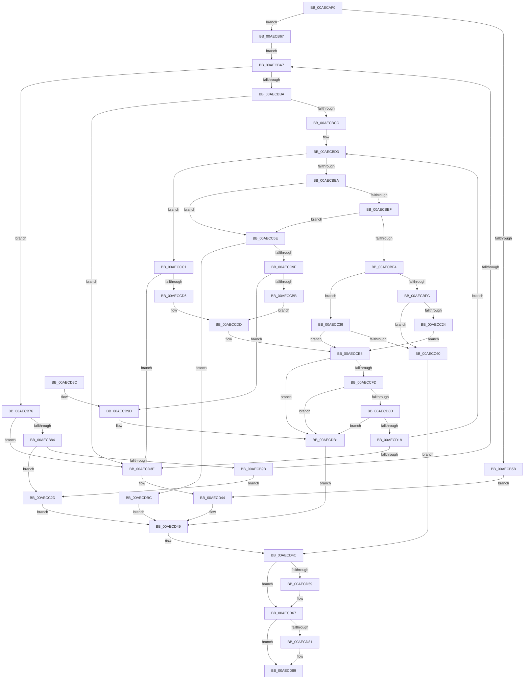

# RtlDecompressFragmentLZNT1

- RVA: `0x00AECAF0`–`0x00AECDC7` (길이 `727` bytes)
- VA: `0x0000000140AECAF0`
- 실행 섹션: `PAGE`
- PDB 이름 있음: `예`; PDB Function 태그: `아니요`
- unwind 정보 RVA: `0x000D0208`
- 디코드: `213`개 명령, `727/727` bytes 표시
- 미해석 바이트: `0` (있으면 어셈블리에 `.byte`로 보존)

> 이 문서는 커널 이미지의 기계어와 PDB 기호를 분석해 생성했습니다. 4번과 5번은 함수 원형과 자료형을 바이너리 사용 방식에서 추정한 C 해석이며 원본 소스 복구 결과는 아닙니다.

## 1. Dependencies

- 직접 호출 지점: **8**; 고유 호출 대상: **6**
- 직접 호출자로 확인된 함수: **0**
- RIP 상대 이미지 참조: **0**

### Outgoing calls
- `0x00AECB4D` → [KeInitializeEvent](../../text/40/KeInitializeEvent_function_0040DD10.md) (function, `0x0040DD10`)
- `0x00AECC19` → [LZNT1DecompressChunkNewThread](../../text/38/LZNT1DecompressChunkNewThread_function_0038F3F8.md) (function, `0x0038F3F8`)
- `0x00AECC51` → [LZNT1DecompressChunk](../../text/6B/LZNT1DecompressChunk_function_006BB050.md) (function, `0x006BB050`)
- `0x00AECC90` → [LZNT1DecompressChunk](../../text/6B/LZNT1DecompressChunk_function_006BB050.md) (function, `0x006BB050`)
- `0x00AECCE0` → [memcpy](../../text/6C/memcpy_function_006C6840.md) (function, `0x006C6840`)
- `0x00AECD62` → [KeSetEvent](../../text/33/KeSetEvent_function_0033F310.md) (function, `0x0033F310`)
- `0x00AECD78` → [KeWaitForSingleObject](../../text/20/KeWaitForSingleObject_function_0020E6B0.md) (function, `0x0020E6B0`)
- `0x00AECDA3` → [memcpy](../../text/6C/memcpy_function_006C6840.md) (function, `0x006C6840`)

### Direct callers
- 이 함수 시작 RVA로 연결되는 직접 call은 확인되지 않았습니다. 간접 호출은 완전히 역산할 수 없습니다.

### Static image references
- 디코드된 RIP-relative 메모리 참조가 없습니다.

## 2. Other-region calls and transfers

- 다른 실행 섹션으로 향하는 call: **8**
  - `0x00AECB4D` → [KeInitializeEvent](../../text/40/KeInitializeEvent_function_0040DD10.md) (`PAGE` → `.text`)
  - `0x00AECC19` → [LZNT1DecompressChunkNewThread](../../text/38/LZNT1DecompressChunkNewThread_function_0038F3F8.md) (`PAGE` → `.text`)
  - `0x00AECC51` → [LZNT1DecompressChunk](../../text/6B/LZNT1DecompressChunk_function_006BB050.md) (`PAGE` → `.text`)
  - `0x00AECC90` → [LZNT1DecompressChunk](../../text/6B/LZNT1DecompressChunk_function_006BB050.md) (`PAGE` → `.text`)
  - `0x00AECCE0` → [memcpy](../../text/6C/memcpy_function_006C6840.md) (`PAGE` → `.text`)
  - `0x00AECD62` → [KeSetEvent](../../text/33/KeSetEvent_function_0033F310.md) (`PAGE` → `.text`)
  - `0x00AECD78` → [KeWaitForSingleObject](../../text/20/KeWaitForSingleObject_function_0020E6B0.md) (`PAGE` → `.text`)
  - `0x00AECDA3` → [memcpy](../../text/6C/memcpy_function_006C6840.md) (`PAGE` → `.text`)
- 별도 외부 분기/꼬리 이동을 확인하지 못했습니다.

## 3. Assembly (complete function range)

```asm
00AECAF0  89 54 24 10                     mov dword ptr [rsp + 0x10], edx
00AECAF4  48 89 4C 24 08                  mov qword ptr [rsp + 8], rcx
00AECAF9  55                              push rbp
00AECAFA  53                              push rbx
00AECAFB  56                              push rsi
00AECAFC  57                              push rdi
00AECAFD  41 54                           push r12
00AECAFF  41 55                           push r13
00AECB01  41 56                           push r14
00AECB03  41 57                           push r15
00AECB05  48 8B EC                        mov rbp, rsp
00AECB08  48 83 EC 68                     sub rsp, 0x68
00AECB0C  45 33 E4                        xor r12d, r12d
00AECB0F  8B C2                           mov eax, edx
00AECB11  48 03 C1                        add rax, rcx
00AECB14  45 8B E9                        mov r13d, r9d
00AECB17  49 8B F0                        mov rsi, r8
00AECB1A  41 8B D9                        mov ebx, r9d
00AECB1D  4C 8B F9                        mov r15, rcx
00AECB20  44 89 65 58                     mov dword ptr [rbp + 0x58], r12d
00AECB24  4D 03 E8                        add r13, r8
00AECB27  48 89 45 C8                     mov qword ptr [rbp - 0x38], rax
00AECB2B  0F 57 C0                        xorps xmm0, xmm0
00AECB2E  44 89 65 60                     mov dword ptr [rbp + 0x60], r12d
00AECB32  45 8D 74 24 01                  lea r14d, [r12 + 1]
00AECB37  4C 89 65 D0                     mov qword ptr [rbp - 0x30], r12
00AECB3B  41 8B D6                        mov edx, r14d
00AECB3E  48 8D 4D D0                     lea rcx, [rbp - 0x30]
00AECB42  45 33 C0                        xor r8d, r8d
00AECB45  41 8B FC                        mov edi, r12d
00AECB48  F3 0F 7F 45 D8                  movdqu xmmword ptr [rbp - 0x28], xmm0
00AECB4D  E8 BE 11 92 FF                  call 0x14040dd10
00AECB52  4C 89 75 E8                     mov qword ptr [rbp - 0x18], r14
00AECB56  83 FB 02                        cmp ebx, 2
00AECB59  73 0C                           jae 0x140aecb67
00AECB5B  48 8B 45 78                     mov rax, qword ptr [rbp + 0x78]
00AECB5F  44 89 20                        mov dword ptr [rax], r12d
00AECB62  E9 DD 01 00 00                  jmp 0x140aecd44
00AECB67  0F B7 0E                        movzx ecx, word ptr [rsi]
00AECB6A  41 B8 00 10 00 00               mov r8d, 0x1000
00AECB70  44 8B 75 68                     mov r14d, dword ptr [rbp + 0x68]
00AECB74  EB 31                           jmp 0x140aecba7
00AECB76  8B C8                           mov ecx, eax
00AECB78  48 03 CE                        add rcx, rsi
00AECB7B  49 3B CD                        cmp rcx, r13
00AECB7E  0F 87 BA 01 00 00               ja 0x140aecd3e
00AECB84  41 81 C6 00 F0 FF FF            add r14d, 0xfffff000
00AECB8B  49 8D 45 FE                     lea rax, [r13 - 2]
00AECB8F  48 8B F1                        mov rsi, rcx
00AECB92  48 3B C8                        cmp rcx, rax
00AECB95  0F 87 92 00 00 00               ja 0x140aecc2d
00AECB9B  0F B7 09                        movzx ecx, word ptr [rcx]
00AECB9E  66 85 C9                        test cx, cx
00AECBA1  0F 84 86 00 00 00               je 0x140aecc2d
00AECBA7  8B C1                           mov eax, ecx
00AECBA9  44 89 45 58                     mov dword ptr [rbp + 0x58], r8d
00AECBAD  25 FF 0F 00 00                  and eax, 0xfff
00AECBB2  83 C0 03                        add eax, 3
00AECBB5  45 3B F0                        cmp r14d, r8d
00AECBB8  73 BC                           jae 0x140aecb76
00AECBBA  49 8B DF                        mov rbx, r15
00AECBBD  44 8B F8                        mov r15d, eax
00AECBC0  48 03 C6                        add rax, rsi
00AECBC3  49 3B C5                        cmp rax, r13
00AECBC6  0F 87 72 01 00 00               ja 0x140aecd3e
00AECBCC  44 8B 65 70                     mov r12d, dword ptr [rbp + 0x70]
00AECBD0  8B 55 50                        mov edx, dword ptr [rbp + 0x50]
00AECBD3  41 8B C0                        mov eax, r8d
00AECBD6  41 2B C6                        sub eax, r14d
00AECBD9  3B C2                           cmp eax, edx
00AECBDB  0F 43 C2                        cmovae eax, edx
00AECBDE  89 45 60                        mov dword ptr [rbp + 0x60], eax
00AECBE1  66 85 C9                        test cx, cx
00AECBE4  0F 89 D7 00 00 00               jns 0x140aeccc1
00AECBEA  45 85 F6                        test r14d, r14d
00AECBED  75 7F                           jne 0x140aecc6e
00AECBEF  41 3B C0                        cmp eax, r8d
00AECBF2  75 7A                           jne 0x140aecc6e
00AECBF4  45 33 F6                        xor r14d, r14d
00AECBF7  45 85 E4                        test r12d, r12d
00AECBFA  74 3D                           je 0x140aecc39
00AECBFC  4C 8B 45 C8                     mov r8, qword ptr [rbp - 0x38]
00AECC00  49 8D 04 37                     lea rax, [r15 + rsi]
00AECC04  4C 8D 4E 02                     lea r9, [rsi + 2]
00AECC08  44 89 64 24 28                  mov dword ptr [rsp + 0x28], r12d
00AECC0D  48 8B D3                        mov rdx, rbx
00AECC10  48 89 44 24 20                  mov qword ptr [rsp + 0x20], rax
00AECC15  48 8D 4D D0                     lea rcx, [rbp - 0x30]
00AECC19  E8 DA 27 8A FF                  call 0x14038f3f8
00AECC1E  8B F8                           mov edi, eax
00AECC20  85 C0                           test eax, eax
00AECC22  78 3C                           js 0x140aecc60
00AECC24  44 89 65 60                     mov dword ptr [rbp + 0x60], r12d
00AECC28  E9 BB 00 00 00                  jmp 0x140aecce8
00AECC2D  48 8B 45 78                     mov rax, qword ptr [rbp + 0x78]
00AECC31  44 89 20                        mov dword ptr [rax], r12d
00AECC34  E9 10 01 00 00                  jmp 0x140aecd49
00AECC39  48 8B 55 C8                     mov rdx, qword ptr [rbp - 0x38]
00AECC3D  48 8D 45 60                     lea rax, [rbp + 0x60]
00AECC41  4D 8D 0C 37                     lea r9, [r15 + rsi]
00AECC45  48 89 44 24 20                  mov qword ptr [rsp + 0x20], rax
00AECC4A  4C 8D 46 02                     lea r8, [rsi + 2]
00AECC4E  48 8B CB                        mov rcx, rbx
00AECC51  E8 FA E3 BC FF                  call 0x1406bb050
00AECC56  8B F8                           mov edi, eax
00AECC58  85 C0                           test eax, eax
00AECC5A  0F 89 88 00 00 00               jns 0x140aecce8
00AECC60  48 8B 4D 78                     mov rcx, qword ptr [rbp + 0x78]
00AECC64  8B 45 60                        mov eax, dword ptr [rbp + 0x60]
00AECC67  89 01                           mov dword ptr [rcx], eax
00AECC69  E9 DE 00 00 00                  jmp 0x140aecd4c
00AECC6E  48 8B 85 80 00 00 00            mov rax, qword ptr [rbp + 0x80]
00AECC75  48 8D 4D 58                     lea rcx, [rbp + 0x58]
00AECC79  48 89 4C 24 20                  mov qword ptr [rsp + 0x20], rcx
00AECC7E  4D 8D 0C 37                     lea r9, [r15 + rsi]
00AECC82  4C 8D 46 02                     lea r8, [rsi + 2]
00AECC86  48 8B C8                        mov rcx, rax
00AECC89  48 8D 90 00 10 00 00            lea rdx, [rax + 0x1000]
00AECC90  E8 BB E3 BC FF                  call 0x1406bb050
00AECC95  8B F8                           mov edi, eax
00AECC97  85 C0                           test eax, eax
00AECC99  0F 88 1D 01 00 00               js 0x140aecdbc
00AECC9F  8B 4D 58                        mov ecx, dword ptr [rbp + 0x58]
00AECCA2  48 8B 95 80 00 00 00            mov rdx, qword ptr [rbp + 0x80]
00AECCA9  41 2B CE                        sub ecx, r14d
00AECCAC  41 8B C6                        mov eax, r14d
00AECCAF  48 03 D0                        add rdx, rax
00AECCB2  3B 4D 60                        cmp ecx, dword ptr [rbp + 0x60]
00AECCB5  0F 82 E2 00 00 00               jb 0x140aecd9d
00AECCBB  44 8B 45 60                     mov r8d, dword ptr [rbp + 0x60]
00AECCBF  EB 1C                           jmp 0x140aeccdd
00AECCC1  41 8B D6                        mov edx, r14d
00AECCC4  48 8D 48 02                     lea rcx, [rax + 2]
00AECCC8  48 03 CA                        add rcx, rdx
00AECCCB  44 8B C0                        mov r8d, eax
00AECCCE  48 03 CE                        add rcx, rsi
00AECCD1  49 3B CD                        cmp rcx, r13
00AECCD4  77 68                           ja 0x140aecd3e
00AECCD6  48 83 C2 02                     add rdx, 2
00AECCDA  48 03 D6                        add rdx, rsi
00AECCDD  48 8B CB                        mov rcx, rbx
00AECCE0  E8 5B 9B BD FF                  call 0x1406c6840
00AECCE5  45 33 F6                        xor r14d, r14d
00AECCE8  8B 55 50                        mov edx, dword ptr [rbp + 0x50]
00AECCEB  8B 45 60                        mov eax, dword ptr [rbp + 0x60]
00AECCEE  48 03 D8                        add rbx, rax
00AECCF1  2B 55 60                        sub edx, dword ptr [rbp + 0x60]
00AECCF4  89 55 50                        mov dword ptr [rbp + 0x50], edx
00AECCF7  0F 84 B4 00 00 00               je 0x140aecdb1
00AECCFD  49 03 F7                        add rsi, r15
00AECD00  49 8D 45 FE                     lea rax, [r13 - 2]
00AECD04  48 3B F0                        cmp rsi, rax
00AECD07  0F 87 A4 00 00 00               ja 0x140aecdb1
00AECD0D  0F B7 0E                        movzx ecx, word ptr [rsi]
00AECD10  66 85 C9                        test cx, cx
00AECD13  0F 84 98 00 00 00               je 0x140aecdb1
00AECD19  44 8B F9                        mov r15d, ecx
00AECD1C  41 B8 00 10 00 00               mov r8d, 0x1000
00AECD22  41 81 E7 FF 0F 00 00            and r15d, 0xfff
00AECD29  44 89 45 58                     mov dword ptr [rbp + 0x58], r8d
00AECD2D  49 83 C7 03                     add r15, 3
00AECD31  49 8D 04 37                     lea rax, [r15 + rsi]
00AECD35  49 3B C5                        cmp rax, r13
00AECD38  0F 86 95 FE FF FF               jbe 0x140aecbd3
00AECD3E  48 8B 45 78                     mov rax, qword ptr [rbp + 0x78]
00AECD42  89 30                           mov dword ptr [rax], esi
00AECD44  BF 42 02 00 C0                  mov edi, 0xc0000242
00AECD49  45 33 F6                        xor r14d, r14d
00AECD4C  83 C8 FF                        or eax, 0xffffffff
00AECD4F  F0 0F C1 45 E8                  lock xadd dword ptr [rbp - 0x18], eax
00AECD54  83 F8 01                        cmp eax, 1
00AECD57  75 0E                           jne 0x140aecd67
00AECD59  45 33 C0                        xor r8d, r8d
00AECD5C  48 8D 4D D0                     lea rcx, [rbp - 0x30]
00AECD60  33 D2                           xor edx, edx
00AECD62  E8 A9 25 85 FF                  call 0x14033f310
00AECD67  45 33 C9                        xor r9d, r9d
00AECD6A  4C 89 74 24 20                  mov qword ptr [rsp + 0x20], r14
00AECD6F  45 33 C0                        xor r8d, r8d
00AECD72  48 8D 4D D0                     lea rcx, [rbp - 0x30]
00AECD76  33 D2                           xor edx, edx
00AECD78  E8 33 19 72 FF                  call 0x14020e6b0
00AECD7D  85 FF                           test edi, edi
00AECD7F  78 08                           js 0x140aecd89
00AECD81  8B 45 EC                        mov eax, dword ptr [rbp - 0x14]
00AECD84  85 C0                           test eax, eax
00AECD86  0F 48 F8                        cmovs edi, eax
00AECD89  8B C7                           mov eax, edi
00AECD8B  48 83 C4 68                     add rsp, 0x68
00AECD8F  41 5F                           pop r15
00AECD91  41 5E                           pop r14
00AECD93  41 5D                           pop r13
00AECD95  41 5C                           pop r12
00AECD97  5F                              pop rdi
00AECD98  5E                              pop rsi
00AECD99  5B                              pop rbx
00AECD9A  5D                              pop rbp
00AECD9B  C3                              ret
00AECD9C  CC                              int3
00AECD9D  44 8B C1                        mov r8d, ecx
00AECDA0  48 8B CB                        mov rcx, rbx
00AECDA3  E8 98 9A BD FF                  call 0x1406c6840
00AECDA8  8B 45 58                        mov eax, dword ptr [rbp + 0x58]
00AECDAB  41 2B C6                        sub eax, r14d
00AECDAE  48 03 D8                        add rbx, rax
00AECDB1  48 8B 45 78                     mov rax, qword ptr [rbp + 0x78]
00AECDB5  2B 5D 48                        sub ebx, dword ptr [rbp + 0x48]
00AECDB8  89 18                           mov dword ptr [rax], ebx
00AECDBA  EB 8D                           jmp 0x140aecd49
00AECDBC  48 8B 4D 78                     mov rcx, qword ptr [rbp + 0x78]
00AECDC0  8B 45 58                        mov eax, dword ptr [rbp + 0x58]
00AECDC3  89 01                           mov dword ptr [rcx], eax
00AECDC5  EB 82                           jmp 0x140aecd49
```

## 4. C-style interpretation (structured pseudocode)

```c
__int64 __fastcall RtlDecompressFragmentLZNT1(__int64 a1, int a2, __int64 a3, int a4, unsigned int a5, unsigned int a6, __int64 a7, __int64 a8)
{
    __int64 result;
    __int64 v_r12;
    __int64 v_r13;
    __int64 v_r14;
    __int64 v_r15;
    __int64 v_rbx;
    __int64 v_rdi;
    __int64 v_rsi;
    __int64 v_rsp;
    unsigned int v_stack_m54;
    unsigned __int64 v_stack_m58;
    unsigned __int64 v_stack_m68;
    unsigned __int64 v_stack_m70;
    unsigned __int64 v_stack_m78;
    unsigned int v_stack_m80;
    unsigned __int64 v_stack_m88;
    unsigned int v_stack_p10;
    unsigned int v_stack_p18;
    unsigned int v_stack_p20;
    unsigned __int64 v_stack_p8;

    v_stack_p10 = a2;
    v_stack_p8 = a1;
    v_rsp = (v_rsp) - (104);
    v_r12 = 0;
    result = ((unsigned int)(a2)) + (a1);
    v_stack_p18 = 0;
    v_r13 = ((unsigned int)(a4)) + (a3);
    v_stack_m78 = result;
    v_stack_p20 = 0;
    v_stack_m70 = 0;
    a3 = 0;
    v_stack_m68 = v_xmm0;
    result = KeInitializeEvent(v_stack_m70, (unsigned int)((unsigned int)(v_r12 + 1)), a3, a4);
    v_stack_m58 = v_r12 + 1;
    if (((unsigned int)((unsigned int)(a4))) >= 2) goto loc_00AECB67;
    *(unsigned int *)(a7) = 0;
    goto loc_00AECD44;
loc_00AECB67:
    goto loc_00AECBA7;
loc_00AECB76:
    a1 = ((unsigned int)((unsigned int)(a7))) + (0);
    if (a1 > v_r13) goto loc_00AECD3E;
    v_r14 = (unsigned int)(((unsigned int)(a5)) + (0xFFFFF000ULL));
    if (a1 > (v_r13 - 2)) goto loc_00AECC2D;
    if ((unsigned __int16)(*(unsigned __int16 *)(a1)) == 0) goto loc_00AECC2D;
loc_00AECBA7:
    v_stack_p18 = (unsigned int)((unsigned int)(0x1000ULL));
    result = (unsigned int)(((unsigned int)((unsigned int)(*(unsigned __int16 *)(a1)))) & (0xFFFULL));
    result = (unsigned int)((result) + (3));
    if (((unsigned int)(v_r14)) >= ((unsigned int)((unsigned int)(0x1000ULL)))) goto loc_00AECB76;
    result = (result) + (a1);
    if (result > v_r13) goto loc_00AECD3E;
loc_00AECBD3:
    result = (unsigned int)(((unsigned int)((unsigned int)((unsigned int)(0x1000ULL)))) - ((unsigned int)(v_r14)));
    if (((unsigned int)(result)) >= ((unsigned int)((unsigned int)(v_stack_p10)))) { result = (unsigned int)((unsigned int)(v_stack_p10)); }
    v_stack_p20 = (unsigned int)(result);
    if (!sign_flag) goto loc_00AECCC1;
    if ((unsigned int)(v_r14) != 0) goto loc_00AECC6E;
    if (((unsigned int)(result)) != ((unsigned int)((unsigned int)(0x1000ULL)))) goto loc_00AECC6E;
    v_r14 = 0;
    if ((unsigned int)((unsigned int)(a6)) == 0) goto loc_00AECC39;
    v_stack_m80 = (unsigned int)((unsigned int)(a6));
    v_stack_m88 = (unsigned int)((unsigned int)(result)) + a1 * 1;
    result = LZNT1DecompressChunkNewThread(v_stack_m70, a1, v_stack_m78, a1 + 2);
    if (sign_flag) goto loc_00AECC60;
    v_stack_p20 = (unsigned int)((unsigned int)(a6));
    goto loc_00AECCE8;
loc_00AECC2D:
    *(unsigned int *)(a7) = (unsigned int)((unsigned int)(a6));
    goto loc_00AECD49;
loc_00AECC39:
    v_stack_m88 = v_stack_p20;
    result = LZNT1DecompressChunk(a1, v_stack_m78, a1 + 2, (unsigned int)((unsigned int)(result)) + a1 * 1);
    if (!sign_flag) goto loc_00AECCE8;
loc_00AECC60:
    *(unsigned int *)(a7) = (unsigned int)((unsigned int)(v_stack_p20));
    goto loc_00AECD4C;
loc_00AECC6E:
    v_stack_m88 = v_stack_p18;
    result = LZNT1DecompressChunk(a8, a8 + 4096, a1 + 2, (unsigned int)((unsigned int)(result)) + a1 * 1);
    if (sign_flag) goto loc_00AECDBC;
    a1 = (unsigned int)(((unsigned int)(v_stack_p18)) - (0));
    a2 = (a8) + (0);
    if (((unsigned int)(a1)) < v_stack_p20) goto loc_00AECD9D;
    goto loc_00AECCDD;
loc_00AECCC1:
    a1 = (0 + 2) + (0);
    a1 = (a1) + (a1);
    if (a1 > v_r13) goto loc_00AECD3E;
    a2 = (0) + (2);
    a2 = (a2) + (a1);
loc_00AECCDD:
    result = memcpy(a1, a2, 0, (unsigned int)((unsigned int)(result)) + a1 * 1);
    v_r14 = 0;
loc_00AECCE8:
    v_rbx = (a1) + ((unsigned int)(v_stack_p20));
    a2 = (unsigned int)(((unsigned int)(v_stack_p10)) - (v_stack_p20));
    v_stack_p10 = a2;
    if (condition_is_equal) goto loc_00AECDB1;
    v_rsi = (a1) + ((unsigned int)((unsigned int)(result)));
    if (v_rsi > (v_r13 - 2)) goto loc_00AECDB1;
    if ((unsigned __int16)(*(unsigned __int16 *)(v_rsi)) == 0) goto loc_00AECDB1;
    v_r15 = (unsigned int)(((unsigned int)((unsigned int)(*(unsigned __int16 *)(v_rsi)))) & (0xFFFULL));
    v_stack_p18 = (unsigned int)((unsigned int)(0x1000ULL));
    v_r15 = (v_r15) + (3);
    if ((v_r15 + v_rsi * 1) <= v_r13) goto loc_00AECBD3;
loc_00AECD3E:
    *(unsigned int *)(a7) = (unsigned int)(v_rsi);
loc_00AECD44:
loc_00AECD49:
    v_r14 = 0;
loc_00AECD4C:
    result = (unsigned int)((a7) | (0xFFFFFFFFULL));
    if (((unsigned int)(result)) == 1) {
        a3 = 0;
        a1 = v_stack_m70;
        a2 = 0;
        result = KeSetEvent(a1, a2, a3, (unsigned int)((unsigned int)(result)) + a1 * 1);
    }
    a4 = 0;
    v_stack_m88 = 0;
    a3 = 0;
    a2 = 0;
    result = KeWaitForSingleObject(v_stack_m70, a2, a3, a4);
    v_rdi = (unsigned int)(0xC0000242ULL);
    if (!(sign_flag)) {
        result = v_stack_m54;
        v_rdi = (unsigned int)(0xC0000242ULL);
        if (sign_flag) { v_rdi = (unsigned int)(result); }
    }
    v_rsp = (v_rsp) + (104);
    return (unsigned int)((unsigned int)(v_rdi));
loc_00AECD9D:
    result = memcpy(v_rbx, a2, (unsigned int)((unsigned int)(v_stack_m70)), a4);
    result = (unsigned int)(((unsigned int)(v_stack_p18)) - (0));
    v_rbx = (v_rbx) + (result);
loc_00AECDB1:
    v_rbx = (unsigned int)((v_rbx) - (v_stack_p8));
    *(unsigned int *)(a7) = (unsigned int)(v_rbx);
    goto loc_00AECD49;
loc_00AECDBC:
    *(unsigned int *)(a7) = (unsigned int)((unsigned int)(v_stack_p18));
    goto loc_00AECD49;
}
```

## 5. (Beta) C Style

```c
int64_t RtlDecompressFragmentLZNT1(int64_t Arg1, int32_t Arg2, void *Arg3, void *Arg4, uint32_t Arg5, uint32_t Arg6, void *Arg7, void *Arg8)
{
    uint8_t *arg3 = (uint8_t *)Arg3;
    uint8_t *arg4 = (uint8_t *)Arg4;
    uint8_t *arg7 = (uint8_t *)Arg7;
    uint8_t *arg8 = (uint8_t *)Arg8;

    int64_t result;
    int64_t local_r12;
    int64_t local_r13;
    int64_t local_r14;
    int64_t local_r15;
    int64_t local_rbx;
    int64_t local_rdi;
    int64_t local_rsi;
    int64_t local_rsp;
    uint32_t v_stack_m54;
    uint64_t v_stack_m58;
    uint64_t v_stack_m68;
    uint64_t v_stack_m70;
    uint64_t v_stack_m78;
    uint32_t v_stack_m80;
    uint64_t v_stack_m88;
    uint32_t v_stack_p10;
    uint32_t v_stack_p18;
    uint32_t v_stack_p20;
    uint64_t v_stack_p8;

    v_stack_p10 = Arg2;
    v_stack_p8 = Arg1;
    local_rsp = (local_rsp) - (104);
    local_r12 = 0;
    result = ((uint32_t)(Arg2)) + (Arg1);
    v_stack_p18 = 0;
    local_r13 = ((uint32_t)(Arg4)) + (Arg3);
    v_stack_m78 = result;
    v_stack_p20 = 0;
    v_stack_m70 = 0;
    Arg3 = 0;
    v_stack_m68 = v_xmm0;
    result = KeInitializeEvent(v_stack_m70, (uint32_t)((uint32_t)(local_r12 + 1)), Arg3, Arg4);
    v_stack_m58 = local_r12 + 1;
    if (((uint32_t)((uint32_t)(Arg4))) >= 2) goto loc_00AECB67;
    *(uint32_t *)(arg7) = 0;
    goto loc_00AECD44;
loc_00AECB67:
    goto loc_00AECBA7;
loc_00AECB76:
    Arg1 = ((uint32_t)((uint32_t)(Arg7))) + (0);
    if (Arg1 > local_r13) goto loc_00AECD3E;
    local_r14 = (uint32_t)(((uint32_t)(Arg5)) + (0xFFFFF000ULL));
    if (Arg1 > (local_r13 - 2)) goto loc_00AECC2D;
    if ((uint16_t)(*(uint16_t *)(Arg1)) == 0) goto loc_00AECC2D;
loc_00AECBA7:
    v_stack_p18 = (uint32_t)((uint32_t)(0x1000ULL));
    result = (uint32_t)(((uint32_t)((uint32_t)(*(uint16_t *)(Arg1)))) & (0xFFFULL));
    result = (uint32_t)((result) + (3));
    if (((uint32_t)(local_r14)) >= ((uint32_t)((uint32_t)(0x1000ULL)))) goto loc_00AECB76;
    result = (result) + (Arg1);
    if (result > local_r13) goto loc_00AECD3E;
loc_00AECBD3:
    result = (uint32_t)(((uint32_t)((uint32_t)((uint32_t)(0x1000ULL)))) - ((uint32_t)(local_r14)));
    if (((uint32_t)(result)) >= ((uint32_t)((uint32_t)(v_stack_p10)))) { result = (uint32_t)((uint32_t)(v_stack_p10)); }
    v_stack_p20 = (uint32_t)(result);
    if (!sign_flag) goto loc_00AECCC1;
    if ((uint32_t)(local_r14) != 0) goto loc_00AECC6E;
    if (((uint32_t)(result)) != ((uint32_t)((uint32_t)(0x1000ULL)))) goto loc_00AECC6E;
    local_r14 = 0;
    if ((uint32_t)((uint32_t)(Arg6)) == 0) goto loc_00AECC39;
    v_stack_m80 = (uint32_t)((uint32_t)(Arg6));
    v_stack_m88 = (uint32_t)((uint32_t)(result)) + Arg1 * 1;
    result = LZNT1DecompressChunkNewThread(v_stack_m70, Arg1, v_stack_m78, Arg1 + 2);
    if (sign_flag) goto loc_00AECC60;
    v_stack_p20 = (uint32_t)((uint32_t)(Arg6));
    goto loc_00AECCE8;
loc_00AECC2D:
    *(uint32_t *)(arg7) = (uint32_t)((uint32_t)(Arg6));
    goto loc_00AECD49;
loc_00AECC39:
    v_stack_m88 = v_stack_p20;
    result = LZNT1DecompressChunk(Arg1, v_stack_m78, Arg1 + 2, (uint32_t)((uint32_t)(result)) + Arg1 * 1);
    if (!sign_flag) goto loc_00AECCE8;
loc_00AECC60:
    *(uint32_t *)(arg7) = (uint32_t)((uint32_t)(v_stack_p20));
    goto loc_00AECD4C;
loc_00AECC6E:
    v_stack_m88 = v_stack_p18;
    result = LZNT1DecompressChunk(Arg8, Arg8 + 4096, Arg1 + 2, (uint32_t)((uint32_t)(result)) + Arg1 * 1);
    if (sign_flag) goto loc_00AECDBC;
    Arg1 = (uint32_t)(((uint32_t)(v_stack_p18)) - (0));
    Arg2 = (Arg8) + (0);
    if (((uint32_t)(Arg1)) < v_stack_p20) goto loc_00AECD9D;
    goto loc_00AECCDD;
loc_00AECCC1:
    Arg1 = (0 + 2) + (0);
    Arg1 = (Arg1) + (Arg1);
    if (Arg1 > local_r13) goto loc_00AECD3E;
    Arg2 = (0) + (2);
    Arg2 = (Arg2) + (Arg1);
loc_00AECCDD:
    result = memcpy(Arg1, Arg2, 0, (uint32_t)((uint32_t)(result)) + Arg1 * 1);
    local_r14 = 0;
loc_00AECCE8:
    local_rbx = (Arg1) + ((uint32_t)(v_stack_p20));
    Arg2 = (uint32_t)(((uint32_t)(v_stack_p10)) - (v_stack_p20));
    v_stack_p10 = Arg2;
    if (condition_is_equal) goto loc_00AECDB1;
    local_rsi = (Arg1) + ((uint32_t)((uint32_t)(result)));
    if (local_rsi > (local_r13 - 2)) goto loc_00AECDB1;
    if ((uint16_t)(*(uint16_t *)(local_rsi)) == 0) goto loc_00AECDB1;
    local_r15 = (uint32_t)(((uint32_t)((uint32_t)(*(uint16_t *)(local_rsi)))) & (0xFFFULL));
    v_stack_p18 = (uint32_t)((uint32_t)(0x1000ULL));
    local_r15 = (local_r15) + (3);
    if ((local_r15 + local_rsi * 1) <= local_r13) goto loc_00AECBD3;
loc_00AECD3E:
    *(uint32_t *)(arg7) = (uint32_t)(local_rsi);
loc_00AECD44:
loc_00AECD49:
    local_r14 = 0;
loc_00AECD4C:
    result = (uint32_t)((Arg7) | (0xFFFFFFFFULL));
    if (((uint32_t)(result)) == 1) {
        Arg3 = 0;
        Arg1 = v_stack_m70;
        Arg2 = 0;
        result = KeSetEvent(Arg1, Arg2, Arg3, (uint32_t)((uint32_t)(result)) + Arg1 * 1);
    }
    Arg4 = 0;
    v_stack_m88 = 0;
    Arg3 = 0;
    Arg2 = 0;
    result = KeWaitForSingleObject(v_stack_m70, Arg2, Arg3, Arg4);
    local_rdi = (uint32_t)(0xC0000242ULL);
    if (!(sign_flag)) {
        result = v_stack_m54;
        local_rdi = (uint32_t)(0xC0000242ULL);
        if (sign_flag) { local_rdi = (uint32_t)(result); }
    }
    local_rsp = (local_rsp) + (104);
    return (uint32_t)((uint32_t)(local_rdi));
loc_00AECD9D:
    result = memcpy(local_rbx, Arg2, (uint32_t)((uint32_t)(v_stack_m70)), Arg4);
    result = (uint32_t)(((uint32_t)(v_stack_p18)) - (0));
    local_rbx = (local_rbx) + (result);
loc_00AECDB1:
    local_rbx = (uint32_t)((local_rbx) - (v_stack_p8));
    *(uint32_t *)(arg7) = (uint32_t)(local_rbx);
    goto loc_00AECD49;
loc_00AECDBC:
    *(uint32_t *)(arg7) = (uint32_t)((uint32_t)(v_stack_p18));
    goto loc_00AECD49;
}
```

### 관측된 메모리 오프셋

구조체 형식이 확인되지 않은 접근은 인자 기준의 오프셋으로만 기록했습니다.

| 기준 인자 | 오프셋 표현 | 폭 (bit) | 접근 |
|---|---:|---:|---|
| `Arg3` | `+ 0x0` | `16` | `R` |
| `Arg4` | `- 0x2` | `64` | `R` |
| `Arg7` | `+ 0x0` | `32` | `W` |
| `Arg8` | `+ 0x1000` | `64` | `R` |

## 6. Execution-region graph

[열기: 2D/3D 그래프와 함수 탐색 컨트롤 패널](../../../control-panel.html?section=page&rva=0x00AECAF0&view=graph)

- 2D 그래프는 위에서 아래로 흐르고, 3D 그래프는 빈 공간을 드래그해 회전합니다. Shift+드래그는 이동, 휠은 확대·축소, 함수 노드 선택은 대상 보고서 이동입니다.

### Static fallback


