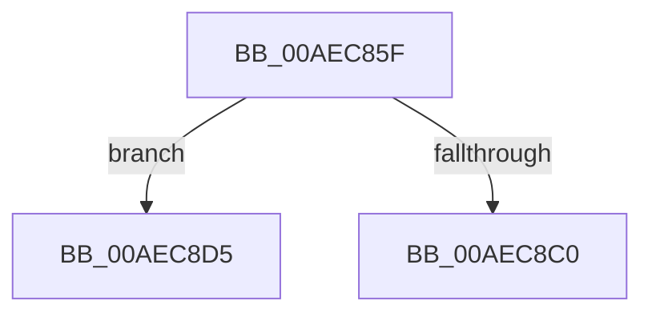

# sub_00AEC85F

- RVA: `0x00AEC85F`–`0x00AEC8DA` (길이 `123` bytes)
- VA: `0x0000000140AEC85F`
- 실행 섹션: `PAGE`
- PDB 이름 있음: `아니요`; PDB Function 태그: `아니요`
- unwind 정보 RVA: `0x000D022C`
- 디코드: `32`개 명령, `123/123` bytes 표시
- 미해석 바이트: `0` (있으면 어셈블리에 `.byte`로 보존)

> 이 문서는 커널 이미지의 기계어와 PDB 기호를 분석해 생성했습니다. 4번과 5번은 함수 원형과 자료형을 바이너리 사용 방식에서 추정한 C 해석이며 원본 소스 복구 결과는 아닙니다.

## 1. Dependencies

- 직접 호출 지점: **1**; 고유 호출 대상: **1**
- 직접 호출자로 확인된 함수: **0**
- RIP 상대 이미지 참조: **0**

### Outgoing calls
- `0x00AEC8AD` → [KeInitializeEvent](../../text/40/KeInitializeEvent_function_0040DD10.md) (function, `0x0040DD10`)

### Direct callers
- 이 함수 시작 RVA로 연결되는 직접 call은 확인되지 않았습니다. 간접 호출은 완전히 역산할 수 없습니다.

### Static image references
- 디코드된 RIP-relative 메모리 참조가 없습니다.

## 2. Other-region calls and transfers

- 다른 실행 섹션으로 향하는 call: **1**
  - `0x00AEC8AD` → [KeInitializeEvent](../../text/40/KeInitializeEvent_function_0040DD10.md) (`PAGE` → `.text`)
- call이 아닌 외부 분기/꼬리 이동: **1**
  - `0x00AEC8D0` → [sub_00AECA57](Unknown_function_00AECA57.md) (`tail-transfer`)

## 3. Assembly (complete function range)

```asm
00AEC85F  48 89 58 18                     mov qword ptr [rax + 0x18], rbx
00AEC863  0F 57 C0                        xorps xmm0, xmm0
00AEC866  48 89 68 F0                     mov qword ptr [rax - 0x10], rbp
00AEC86A  48 8B E9                        mov rbp, rcx
00AEC86D  48 89 78 E8                     mov qword ptr [rax - 0x18], rdi
00AEC871  49 8B F8                        mov rdi, r8
00AEC874  4C 89 68 D8                     mov qword ptr [rax - 0x28], r13
00AEC878  4C 89 70 D0                     mov qword ptr [rax - 0x30], r14
00AEC87C  45 33 F6                        xor r14d, r14d
00AEC87F  4C 89 78 C8                     mov qword ptr [rax - 0x38], r15
00AEC883  41 8B F6                        mov esi, r14d
00AEC886  44 8B FA                        mov r15d, edx
00AEC889  45 8B E9                        mov r13d, r9d
00AEC88C  4C 03 F9                        add r15, rcx
00AEC88F  4D 03 E8                        add r13, r8
00AEC892  41 8B D9                        mov ebx, r9d
00AEC895  41 8D 56 01                     lea edx, [r14 + 1]
00AEC899  44 89 70 10                     mov dword ptr [rax + 0x10], r14d
00AEC89D  45 33 C0                        xor r8d, r8d
00AEC8A0  4C 89 70 A8                     mov qword ptr [rax - 0x58], r14
00AEC8A4  48 8D 48 A8                     lea rcx, [rax - 0x58]
00AEC8A8  F3 0F 7F 40 B0                  movdqu xmmword ptr [rax - 0x50], xmm0
00AEC8AD  E8 5E 14 92 FF                  call 0x14040dd10
00AEC8B2  48 C7 44 24 48 01 00 00 00      mov qword ptr [rsp + 0x48], 1
00AEC8BB  83 FB 02                        cmp ebx, 2
00AEC8BE  73 15                           jae 0x140aec8d5
00AEC8C0  48 8B 84 24 B8 00 00 00         mov rax, qword ptr [rsp + 0xb8]
00AEC8C8  BE 42 02 00 C0                  mov esi, 0xc0000242
00AEC8CD  44 89 30                        mov dword ptr [rax], r14d
00AEC8D0  E9 82 01 00 00                  jmp 0x140aeca57
00AEC8D5  0F B7 1F                        movzx ebx, word ptr [rdi]
00AEC8D8  8B CB                           mov ecx, ebx
```

## 4. C-style interpretation (structured pseudocode)

```c
__int64 __fastcall sub_00AEC85F(__int64 a1, int a2, __int64 a3, int a4, __int64 a5, __int64 a6, __int64 a7, __int64 a8, __int64 a9, __int64 a10, __int64 a11, __int64 a12, __int64 a13, __int64 a14, __int64 a15, __int64 a16, __int64 a17, __int64 a18, __int64 a19, __int64 a20, __int64 a21, __int64 a22, __int64 a23)
{
    __int64 result;
    __int64 v_r13;
    __int64 v_r14;
    __int64 v_r15;
    unsigned __int64 v_stack_p48;

    *(unsigned __int64 *)(result + 24) = v_rbx;
    *(unsigned __int64 *)(result - 16) = v_rbp;
    *(unsigned __int64 *)(result - 24) = v_rdi;
    *(unsigned __int64 *)(result - 40) = v_r13;
    *(unsigned __int64 *)(result - 48) = v_r14;
    v_r14 = 0;
    *(unsigned __int64 *)(result - 56) = v_r15;
    v_r15 = ((unsigned int)(a2)) + (a1);
    v_r13 = ((unsigned int)(a4)) + (a3);
    *(unsigned int *)(result + 16) = 0;
    a3 = 0;
    *(unsigned __int64 *)(result - 88) = 0;
    *(unsigned __int64 *)(result - 80) = v_xmm0;
    result = KeInitializeEvent(result - 88, v_r14 + 1, a3, a4);
    v_stack_p48 = 1;
    if (((unsigned int)((unsigned int)(a4))) >= 2) goto loc_00AEC8D5;
    *(unsigned int *)(a23) = 0;
loc_00AEC8D5:
    return a23;
}
```

## 5. (Beta) C Style

```c
void *sub_00AEC85F(int64_t Arg1, int32_t Arg2, void *Arg3, int32_t Arg4, uint64_t Arg5, uint64_t Arg6, uint64_t Arg7, uint64_t Arg8, uint64_t Arg9, uint64_t Arg10, uint64_t Arg11, uint64_t Arg12, uint64_t Arg13, uint64_t Arg14, uint64_t Arg15, uint64_t Arg16, uint64_t Arg17, uint64_t Arg18, uint64_t Arg19, uint64_t Arg20, uint64_t Arg21, uint64_t Arg22, void *Arg23)
{
    uint8_t *arg3 = (uint8_t *)Arg3;
    uint8_t *arg23 = (uint8_t *)Arg23;

    int64_t result;
    int64_t local_r13;
    int64_t local_r14;
    int64_t local_r15;
    uint64_t v_stack_p48;

    *(uint64_t *)(result + 0x18) = local_rbx;
    *(uint64_t *)(result - 0x10) = local_rbp;
    *(uint64_t *)(result - 0x18) = local_rdi;
    *(uint64_t *)(result - 0x28) = local_r13;
    *(uint64_t *)(result - 0x30) = local_r14;
    local_r14 = 0;
    *(uint64_t *)(result - 0x38) = local_r15;
    local_r15 = ((uint32_t)(Arg2)) + (Arg1);
    local_r13 = ((uint32_t)(Arg4)) + (Arg3);
    *(uint32_t *)(result + 0x10) = 0;
    Arg3 = 0;
    *(uint64_t *)(result - 0x58) = 0;
    *(uint64_t *)(result - 0x50) = v_xmm0;
    result = KeInitializeEvent(result - 88, local_r14 + 1, Arg3, Arg4);
    v_stack_p48 = 1;
    if (((uint32_t)((uint32_t)(Arg4))) >= 2) goto loc_00AEC8D5;
    *(uint32_t *)(arg23) = 0;
loc_00AEC8D5:
    return Arg23;
}
```

### 관측된 메모리 오프셋

구조체 형식이 확인되지 않은 접근은 인자 기준의 오프셋으로만 기록했습니다.

| 기준 인자 | 오프셋 표현 | 폭 (bit) | 접근 |
|---|---:|---:|---|
| `Arg3` | `+ 0x0` | `16` | `R` |
| `Arg23` | `+ 0x0` | `32` | `W` |

## 6. Execution-region graph

[열기: 2D/3D 그래프와 함수 탐색 컨트롤 패널](../../../control-panel.html?section=page&rva=0x00AEC85F&view=graph)

- 2D 그래프는 위에서 아래로 흐르고, 3D 그래프는 빈 공간을 드래그해 회전합니다. Shift+드래그는 이동, 휠은 확대·축소, 함수 노드 선택은 대상 보고서 이동입니다.

### Static fallback


