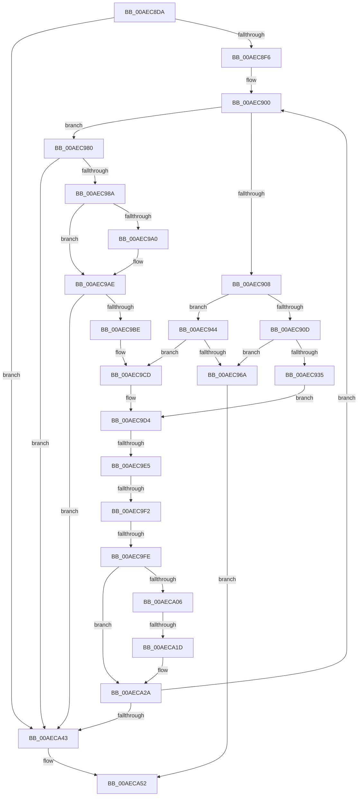

# sub_00AEC8DA

- RVA: `0x00AEC8DA`–`0x00AECA57` (길이 `381` bytes)
- VA: `0x0000000140AEC8DA`
- 실행 섹션: `PAGE`
- PDB 이름 있음: `아니요`; PDB Function 태그: `아니요`
- unwind 정보 RVA: `0x000D0254`
- 디코드: `98`개 명령, `381/381` bytes 표시
- 미해석 바이트: `0` (있으면 어셈블리에 `.byte`로 보존)

> 이 문서는 커널 이미지의 기계어와 PDB 기호를 분석해 생성했습니다. 4번과 5번은 함수 원형과 자료형을 바이너리 사용 방식에서 추정한 C 해석이며 원본 소스 복구 결과는 아닙니다.

## 1. Dependencies

- 직접 호출 지점: **4**; 고유 호출 대상: **4**
- 직접 호출자로 확인된 함수: **0**
- RIP 상대 이미지 참조: **0**

### Outgoing calls
- `0x00AEC92A` → [LZNT1DecompressChunkNewThread](../../text/38/LZNT1DecompressChunkNewThread_function_0038F3F8.md) (function, `0x0038F3F8`)
- `0x00AEC95F` → [LZNT1DecompressChunk](../../text/6B/LZNT1DecompressChunk_function_006BB050.md) (function, `0x006BB050`)
- `0x00AEC9C8` → [memcpy](../../text/6C/memcpy_function_006C6840.md) (function, `0x006C6840`)
- `0x00AECA22` → [memset](../../text/6C/memset_function_006C6C40.md) (function, `0x006C6C40`)

### Direct callers
- 이 함수 시작 RVA로 연결되는 직접 call은 확인되지 않았습니다. 간접 호출은 완전히 역산할 수 없습니다.

### Static image references
- 디코드된 RIP-relative 메모리 참조가 없습니다.

## 2. Other-region calls and transfers

- 다른 실행 섹션으로 향하는 call: **4**
  - `0x00AEC92A` → [LZNT1DecompressChunkNewThread](../../text/38/LZNT1DecompressChunkNewThread_function_0038F3F8.md) (`PAGE` → `.text`)
  - `0x00AEC95F` → [LZNT1DecompressChunk](../../text/6B/LZNT1DecompressChunk_function_006BB050.md) (`PAGE` → `.text`)
  - `0x00AEC9C8` → [memcpy](../../text/6C/memcpy_function_006C6840.md) (`PAGE` → `.text`)
  - `0x00AECA22` → [memset](../../text/6C/memset_function_006C6C40.md) (`PAGE` → `.text`)
- call이 아닌 외부 분기/꼬리 이동: **4**
  - `0x00AEC9DF` → [sub_00AECACB](Unknown_function_00AECACB.md) (`tail-transfer`)
  - `0x00AEC9EC` → [sub_00AECACB](Unknown_function_00AECACB.md) (`tail-transfer`)
  - `0x00AEC9F8` → [sub_00AECACB](Unknown_function_00AECACB.md) (`tail-transfer`)
  - `0x00AECA17` → [sub_00AECACB](Unknown_function_00AECACB.md) (`tail-transfer`)

## 3. Assembly (complete function range)

```asm
00AEC8DA  4C 89 64 24 68                  mov qword ptr [rsp + 0x68], r12
00AEC8DF  81 E1 FF 0F 00 00               and ecx, 0xfff
00AEC8E5  83 C1 03                        add ecx, 3
00AEC8E8  8B C1                           mov eax, ecx
00AEC8EA  48 03 C7                        add rax, rdi
00AEC8ED  49 3B C5                        cmp rax, r13
00AEC8F0  0F 87 4D 01 00 00               ja 0x140aeca43
00AEC8F6  44 8B A4 24 B0 00 00 00         mov r12d, dword ptr [rsp + 0xb0]
00AEC8FE  66 90                           nop
00AEC900  44 8B F1                        mov r14d, ecx
00AEC903  66 85 DB                        test bx, bx
00AEC906  79 78                           jns 0x140aec980
00AEC908  45 85 E4                        test r12d, r12d
00AEC90B  74 37                           je 0x140aec944
00AEC90D  48 8D 04 39                     lea rax, [rcx + rdi]
00AEC911  44 89 64 24 28                  mov dword ptr [rsp + 0x28], r12d
00AEC916  48 8D 4C 24 30                  lea rcx, [rsp + 0x30]
00AEC91B  48 89 44 24 20                  mov qword ptr [rsp + 0x20], rax
00AEC920  4C 8D 4F 02                     lea r9, [rdi + 2]
00AEC924  4D 8B C7                        mov r8, r15
00AEC927  48 8B D5                        mov rdx, rbp
00AEC92A  E8 C9 2A 8A FF                  call 0x14038f3f8
00AEC92F  8B F0                           mov esi, eax
00AEC931  85 C0                           test eax, eax
00AEC933  78 35                           js 0x140aec96a
00AEC935  41 8B CC                        mov ecx, r12d
00AEC938  89 8C 24 98 00 00 00            mov dword ptr [rsp + 0x98], ecx
00AEC93F  E9 90 00 00 00                  jmp 0x140aec9d4
00AEC944  4C 8D 0C 39                     lea r9, [rcx + rdi]
00AEC948  49 8B D7                        mov rdx, r15
00AEC94B  48 8D 84 24 98 00 00 00         lea rax, [rsp + 0x98]
00AEC953  48 8B CD                        mov rcx, rbp
00AEC956  4C 8D 47 02                     lea r8, [rdi + 2]
00AEC95A  48 89 44 24 20                  mov qword ptr [rsp + 0x20], rax
00AEC95F  E8 EC E6 BC FF                  call 0x1406bb050
00AEC964  8B F0                           mov esi, eax
00AEC966  85 C0                           test eax, eax
00AEC968  79 63                           jns 0x140aec9cd
00AEC96A  48 8B 8C 24 B8 00 00 00         mov rcx, qword ptr [rsp + 0xb8]
00AEC972  8B 84 24 98 00 00 00            mov eax, dword ptr [rsp + 0x98]
00AEC979  89 01                           mov dword ptr [rcx], eax
00AEC97B  E9 D2 00 00 00                  jmp 0x140aeca52
00AEC980  49 83 FE 02                     cmp r14, 2
00AEC984  0F 82 B9 00 00 00               jb 0x140aeca43
00AEC98A  83 C1 FE                        add ecx, -2
00AEC98D  8B C1                           mov eax, ecx
00AEC98F  8B D1                           mov edx, ecx
00AEC991  48 03 C5                        add rax, rbp
00AEC994  89 8C 24 98 00 00 00            mov dword ptr [rsp + 0x98], ecx
00AEC99B  49 3B C7                        cmp rax, r15
00AEC99E  76 0E                           jbe 0x140aec9ae
00AEC9A0  41 8B CF                        mov ecx, r15d
00AEC9A3  2B CD                           sub ecx, ebp
00AEC9A5  89 8C 24 98 00 00 00            mov dword ptr [rsp + 0x98], ecx
00AEC9AC  8B D1                           mov edx, ecx
00AEC9AE  48 83 C1 02                     add rcx, 2
00AEC9B2  48 03 CF                        add rcx, rdi
00AEC9B5  49 3B CD                        cmp rcx, r13
00AEC9B8  0F 87 85 00 00 00               ja 0x140aeca43
00AEC9BE  44 8B C2                        mov r8d, edx
00AEC9C1  48 8B CD                        mov rcx, rbp
00AEC9C4  48 8D 57 02                     lea rdx, [rdi + 2]
00AEC9C8  E8 73 9E BD FF                  call 0x1406c6840
00AEC9CD  8B 8C 24 98 00 00 00            mov ecx, dword ptr [rsp + 0x98]
00AEC9D4  8B C1                           mov eax, ecx
00AEC9D6  49 03 FE                        add rdi, r14
00AEC9D9  48 03 E8                        add rbp, rax
00AEC9DC  49 3B EF                        cmp rbp, r15
00AEC9DF  0F 84 E6 00 00 00               je 0x140aecacb
00AEC9E5  49 8D 45 FE                     lea rax, [r13 - 2]
00AEC9E9  48 3B F8                        cmp rdi, rax
00AEC9EC  0F 87 D9 00 00 00               ja 0x140aecacb
00AEC9F2  0F B7 1F                        movzx ebx, word ptr [rdi]
00AEC9F5  66 85 DB                        test bx, bx
00AEC9F8  0F 84 CD 00 00 00               je 0x140aecacb
00AEC9FE  81 F9 00 10 00 00               cmp ecx, 0x1000
00AECA04  73 24                           jae 0x140aeca2a
00AECA06  B8 00 10 00 00                  mov eax, 0x1000
00AECA0B  2B C1                           sub eax, ecx
00AECA0D  4C 63 C0                        movsxd r8, eax
00AECA10  4D 8D 34 28                     lea r14, [r8 + rbp]
00AECA14  4D 3B F7                        cmp r14, r15
00AECA17  0F 83 AE 00 00 00               jae 0x140aecacb
00AECA1D  33 D2                           xor edx, edx
00AECA1F  48 8B CD                        mov rcx, rbp
00AECA22  E8 19 A2 BD FF                  call 0x1406c6c40
00AECA27  49 8B EE                        mov rbp, r14
00AECA2A  8B CB                           mov ecx, ebx
00AECA2C  81 E1 FF 0F 00 00               and ecx, 0xfff
00AECA32  83 C1 03                        add ecx, 3
00AECA35  8B C1                           mov eax, ecx
00AECA37  48 03 C7                        add rax, rdi
00AECA3A  49 3B C5                        cmp rax, r13
00AECA3D  0F 86 BD FE FF FF               jbe 0x140aec900
00AECA43  48 8B 84 24 B8 00 00 00         mov rax, qword ptr [rsp + 0xb8]
00AECA4B  BE 42 02 00 C0                  mov esi, 0xc0000242
00AECA50  89 38                           mov dword ptr [rax], edi
00AECA52  4C 8B 64 24 68                  mov r12, qword ptr [rsp + 0x68]
```

## 4. C-style interpretation (structured pseudocode)

```c
__int64 __fastcall sub_00AEC8DA(int a1, __int64 a2, __int64 a3, __int64 a4, __int64 a5, __int64 a6, __int64 a7, __int64 a8, __int64 a9, __int64 a10, __int64 a11, __int64 a12, __int64 a13, __int64 a14, __int64 a15, __int64 a16, __int64 a17, __int64 a18, unsigned int a19, __int64 a20, __int64 a21, unsigned int a22, __int64 a23)
{
    __int64 result;
    __int64 v_rbp;
    __int64 v_rdi;
    unsigned __int64 v_stack_p20;
    unsigned int v_stack_p28;
    unsigned __int64 v_stack_p68;
    unsigned int v_stack_p98;

    v_stack_p68 = v_r12;
    a1 = (unsigned int)((a1) & (0xFFFULL));
    a1 = (unsigned int)((a1) + (3));
    result = ((unsigned int)(a1)) + (v_rdi);
    if (result > v_r13) goto loc_00AECA43;
loc_00AEC900:
    if (!sign_flag) goto loc_00AEC980;
    if ((unsigned int)((unsigned int)(a22)) == 0) goto loc_00AEC944;
    v_stack_p28 = (unsigned int)((unsigned int)(a22));
    v_stack_p20 = a1 + v_rdi * 1;
    result = LZNT1DecompressChunkNewThread(a6, v_rbp, v_r15, v_rdi + 2);
    if (sign_flag) goto loc_00AEC96A;
    v_stack_p98 = (unsigned int)((unsigned int)((unsigned int)((unsigned int)(a22))));
    goto loc_00AEC9D4;
loc_00AEC944:
    v_stack_p20 = a19;
    result = LZNT1DecompressChunk(v_rbp, v_r15, v_rdi + 2, (unsigned int)((unsigned int)((unsigned int)(a22))) + v_rdi * 1);
    if (!sign_flag) goto loc_00AEC9CD;
loc_00AEC96A:
    *(unsigned int *)(a23) = (unsigned int)((unsigned int)(a19));
    goto loc_00AECA52;
loc_00AEC980:
    if (((unsigned int)(a1)) < 2) goto loc_00AECA43;
    a1 = (unsigned int)((a23) + (-2));
    result = ((unsigned int)(a1)) + (v_rbp);
    v_stack_p98 = a1;
    if (result >= = v_r15) {
        a1 = (unsigned int)(v_r15);
        a1 = (unsigned int)((a1) - ((unsigned int)(v_rbp)));
        v_stack_p98 = a1;
        a2 = a1;
    }
    a1 = (a1) + (2);
    a1 = (a1) + (v_rdi);
    if (a1 > v_r13) goto loc_00AECA43;
    result = memcpy(v_rbp, v_rdi + 2, (unsigned int)((unsigned int)(a2)), (unsigned int)((unsigned int)((unsigned int)(a22))) + v_rdi * 1);
loc_00AEC9CD:
loc_00AEC9D4:
    v_rdi = (v_rdi) + ((unsigned int)(a1));
    v_rbp = (v_rbp) + ((unsigned int)((unsigned int)((unsigned int)(a19))));
    if (((unsigned int)((unsigned int)(a19))) >= 0x1000ULL) goto loc_00AECA2A;
    result = (unsigned int)(((unsigned int)(0x1000ULL)) - ((unsigned int)((unsigned int)(a19))));
    a2 = 0;
    result = memset(v_rbp, a2, (int)((unsigned int)(result)), (unsigned int)((unsigned int)((unsigned int)(a22))) + v_rdi * 1);
loc_00AECA2A:
    a1 = (unsigned int)(((unsigned int)((unsigned int)(*(unsigned __int16 *)(v_rdi)))) & (0xFFFULL));
    a1 = (unsigned int)((a1) + (3));
    result = ((unsigned int)(a1)) + (v_rdi);
    if (result <= v_r13) goto loc_00AEC900;
loc_00AECA43:
    *(unsigned int *)(a23) = (unsigned int)(v_rdi);
loc_00AECA52:
    return a23;
}
```

## 5. (Beta) C Style

```c
void *sub_00AEC8DA(int32_t Arg1, int64_t Arg2, int64_t Arg3, int64_t Arg4, uint64_t Arg5, int64_t Arg6, uint64_t Arg7, uint64_t Arg8, uint64_t Arg9, uint64_t Arg10, uint64_t Arg11, uint64_t Arg12, int64_t Arg13, uint64_t Arg14, uint64_t Arg15, uint64_t Arg16, uint64_t Arg17, uint64_t Arg18, uint32_t Arg19, uint64_t Arg20, uint64_t Arg21, uint32_t Arg22, void *Arg23)
{
    uint8_t *arg23 = (uint8_t *)Arg23;

    int64_t result;
    int64_t local_rbp;
    int64_t local_rdi;
    uint64_t v_stack_p20;
    uint32_t v_stack_p28;
    uint64_t v_stack_p68;
    uint32_t v_stack_p98;

    v_stack_p68 = local_r12;
    Arg1 = (uint32_t)((Arg1) & (0xFFFULL));
    Arg1 = (uint32_t)((Arg1) + (3));
    result = ((uint32_t)(Arg1)) + (local_rdi);
    if (result > local_r13) goto loc_00AECA43;
loc_00AEC900:
    if (!sign_flag) goto loc_00AEC980;
    if ((uint32_t)((uint32_t)(Arg22)) == 0) goto loc_00AEC944;
    v_stack_p28 = (uint32_t)((uint32_t)(Arg22));
    v_stack_p20 = Arg1 + local_rdi * 1;
    result = LZNT1DecompressChunkNewThread(Arg6, local_rbp, local_r15, local_rdi + 2);
    if (sign_flag) goto loc_00AEC96A;
    v_stack_p98 = (uint32_t)((uint32_t)((uint32_t)((uint32_t)(Arg22))));
    goto loc_00AEC9D4;
loc_00AEC944:
    v_stack_p20 = Arg19;
    result = LZNT1DecompressChunk(local_rbp, local_r15, local_rdi + 2, (uint32_t)((uint32_t)((uint32_t)(Arg22))) + local_rdi * 1);
    if (!sign_flag) goto loc_00AEC9CD;
loc_00AEC96A:
    *(uint32_t *)(arg23) = (uint32_t)((uint32_t)(Arg19));
    goto loc_00AECA52;
loc_00AEC980:
    if (((uint32_t)(Arg1)) < 2) goto loc_00AECA43;
    Arg1 = (uint32_t)((Arg23) + (-2));
    result = ((uint32_t)(Arg1)) + (local_rbp);
    v_stack_p98 = Arg1;
    if (result >= = local_r15) {
        Arg1 = (uint32_t)(local_r15);
        Arg1 = (uint32_t)((Arg1) - ((uint32_t)(local_rbp)));
        v_stack_p98 = Arg1;
        Arg2 = Arg1;
    }
    Arg1 = (Arg1) + (2);
    Arg1 = (Arg1) + (local_rdi);
    if (Arg1 > local_r13) goto loc_00AECA43;
    result = memcpy(local_rbp, local_rdi + 2, (uint32_t)((uint32_t)(Arg2)), (uint32_t)((uint32_t)((uint32_t)(Arg22))) + local_rdi * 1);
loc_00AEC9CD:
loc_00AEC9D4:
    local_rdi = (local_rdi) + ((uint32_t)(Arg1));
    local_rbp = (local_rbp) + ((uint32_t)((uint32_t)((uint32_t)(Arg19))));
    if (((uint32_t)((uint32_t)(Arg19))) >= 0x1000ULL) goto loc_00AECA2A;
    result = (uint32_t)(((uint32_t)(0x1000ULL)) - ((uint32_t)((uint32_t)(Arg19))));
    Arg2 = 0;
    result = memset(local_rbp, Arg2, (int32_t)((uint32_t)(result)), (uint32_t)((uint32_t)((uint32_t)(Arg22))) + local_rdi * 1);
loc_00AECA2A:
    Arg1 = (uint32_t)(((uint32_t)((uint32_t)(*(uint16_t *)(local_rdi)))) & (0xFFFULL));
    Arg1 = (uint32_t)((Arg1) + (3));
    result = ((uint32_t)(Arg1)) + (local_rdi);
    if (result <= local_r13) goto loc_00AEC900;
loc_00AECA43:
    *(uint32_t *)(arg23) = (uint32_t)(local_rdi);
loc_00AECA52:
    return Arg23;
}
```

### 관측된 메모리 오프셋

구조체 형식이 확인되지 않은 접근은 인자 기준의 오프셋으로만 기록했습니다.

| 기준 인자 | 오프셋 표현 | 폭 (bit) | 접근 |
|---|---:|---:|---|
| `Arg23` | `+ 0x0` | `32` | `W` |

## 6. Execution-region graph

[열기: 2D/3D 그래프와 함수 탐색 컨트롤 패널](../../../control-panel.html?section=page&rva=0x00AEC8DA&view=graph)

- 2D 그래프는 위에서 아래로 흐르고, 3D 그래프는 빈 공간을 드래그해 회전합니다. Shift+드래그는 이동, 휠은 확대·축소, 함수 노드 선택은 대상 보고서 이동입니다.

### Static fallback


