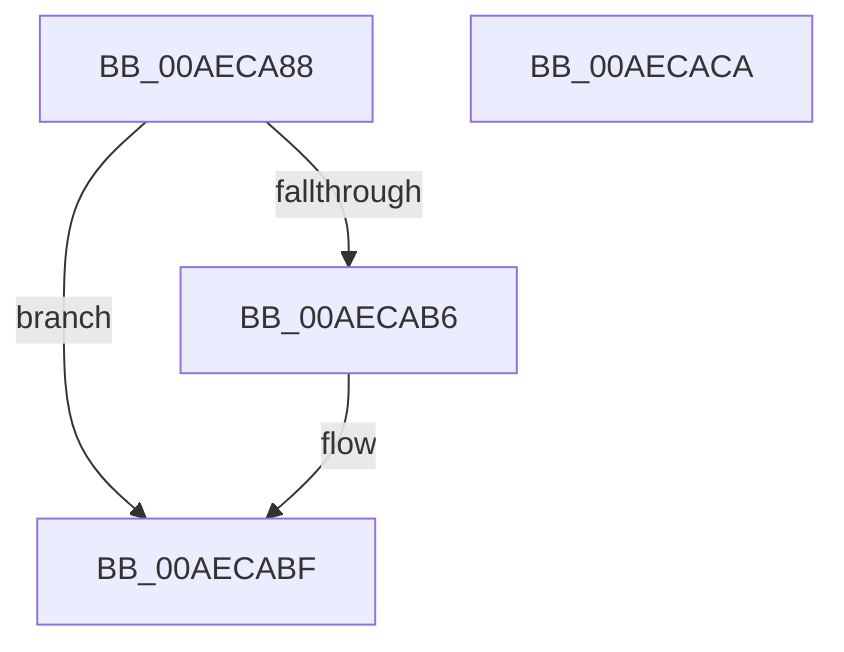

# sub_00AECA88

- RVA: `0x00AECA88`–`0x00AECACB` (길이 `67` bytes)
- VA: `0x0000000140AECA88`
- 실행 섹션: `PAGE`
- PDB 이름 있음: `아니요`; PDB Function 태그: `아니요`
- unwind 정보 RVA: `0x000D0278`
- 디코드: `20`개 명령, `67/67` bytes 표시
- 미해석 바이트: `0` (있으면 어셈블리에 `.byte`로 보존)

> 이 문서는 커널 이미지의 기계어와 PDB 기호를 분석해 생성했습니다. 4번과 5번은 함수 원형과 자료형을 바이너리 사용 방식에서 추정한 C 해석이며 원본 소스 복구 결과는 아닙니다.

## 1. Dependencies

- 직접 호출 지점: **2**; 고유 호출 대상: **2**
- 직접 호출자로 확인된 함수: **0**
- RIP 상대 이미지 참조: **0**

### Outgoing calls
- `0x00AECA92` → [KeSetEvent](../../text/33/KeSetEvent_function_0033F310.md) (function, `0x0033F310`)
- `0x00AECAAD` → [KeWaitForSingleObject](../../text/20/KeWaitForSingleObject_function_0020E6B0.md) (function, `0x0020E6B0`)

### Direct callers
- 이 함수 시작 RVA로 연결되는 직접 call은 확인되지 않았습니다. 간접 호출은 완전히 역산할 수 없습니다.

### Static image references
- 디코드된 RIP-relative 메모리 참조가 없습니다.

## 2. Other-region calls and transfers

- 다른 실행 섹션으로 향하는 call: **2**
  - `0x00AECA92` → [KeSetEvent](../../text/33/KeSetEvent_function_0033F310.md) (`PAGE` → `.text`)
  - `0x00AECAAD` → [KeWaitForSingleObject](../../text/20/KeWaitForSingleObject_function_0020E6B0.md) (`PAGE` → `.text`)
- 별도 외부 분기/꼬리 이동을 확인하지 못했습니다.

## 3. Assembly (complete function range)

```asm
00AECA88  45 33 C0                        xor r8d, r8d
00AECA8B  48 8D 4C 24 30                  lea rcx, [rsp + 0x30]
00AECA90  33 D2                           xor edx, edx
00AECA92  E8 79 28 85 FF                  call 0x14033f310
00AECA97  45 33 C9                        xor r9d, r9d
00AECA9A  48 C7 44 24 20 00 00 00 00      mov qword ptr [rsp + 0x20], 0
00AECAA3  45 33 C0                        xor r8d, r8d
00AECAA6  48 8D 4C 24 30                  lea rcx, [rsp + 0x30]
00AECAAB  33 D2                           xor edx, edx
00AECAAD  E8 FE 1B 72 FF                  call 0x14020e6b0
00AECAB2  85 F6                           test esi, esi
00AECAB4  78 09                           js 0x140aecabf
00AECAB6  8B 4C 24 4C                     mov ecx, dword ptr [rsp + 0x4c]
00AECABA  85 C9                           test ecx, ecx
00AECABC  0F 48 F1                        cmovs esi, ecx
00AECABF  8B C6                           mov eax, esi
00AECAC1  48 81 C4 80 00 00 00            add rsp, 0x80
00AECAC8  5E                              pop rsi
00AECAC9  C3                              ret
00AECACA  CC                              int3
```

## 4. C-style interpretation (structured pseudocode)

```c
__int64 __fastcall sub_00AECA88(__int64 a1, int a2, int a3, int a4, __int64 a5, __int64 a6)
{
    __int64 result;
    __int64 v_rsi;
    __int64 v_rsp;
    unsigned __int64 v_stack_p20;
    unsigned int v_stack_p4C;

    a3 = 0;
    a2 = 0;
    result = KeSetEvent(a6, a2, a3, a4);
    a4 = 0;
    v_stack_p20 = 0;
    a3 = 0;
    a2 = 0;
    result = KeWaitForSingleObject(a6, a2, a3, a4);
    if (!(sign_flag)) {
        a1 = v_stack_p4C;
        if (sign_flag) { v_rsi = (unsigned int)(a1); }
    }
    v_rsp = (v_rsp) + (128);
    return (unsigned int)((unsigned int)(v_rsi));
}
```

## 5. (Beta) C Style

```c
int64_t sub_00AECA88(int64_t Arg1, int32_t Arg2, int32_t Arg3, int32_t Arg4, uint64_t Arg5, int64_t Arg6)
{
    int64_t result;
    int64_t local_rsi;
    int64_t local_rsp;
    uint64_t v_stack_p20;
    uint32_t v_stack_p4C;

    Arg3 = 0;
    Arg2 = 0;
    result = KeSetEvent(Arg6, Arg2, Arg3, Arg4);
    Arg4 = 0;
    v_stack_p20 = 0;
    Arg3 = 0;
    Arg2 = 0;
    result = KeWaitForSingleObject(Arg6, Arg2, Arg3, Arg4);
    if (!(sign_flag)) {
        Arg1 = v_stack_p4C;
        if (sign_flag) { local_rsi = (uint32_t)(Arg1); }
    }
    local_rsp = (local_rsp) + (128);
    return (uint32_t)((uint32_t)(local_rsi));
}
```

## 6. Execution-region graph

[열기: 2D/3D 그래프와 함수 탐색 컨트롤 패널](../../../control-panel.html?section=page&rva=0x00AECA88&view=graph)

- 2D 그래프는 위에서 아래로 흐르고, 3D 그래프는 빈 공간을 드래그해 회전합니다. Shift+드래그는 이동, 휠은 확대·축소, 함수 노드 선택은 대상 보고서 이동입니다.

### Static fallback


