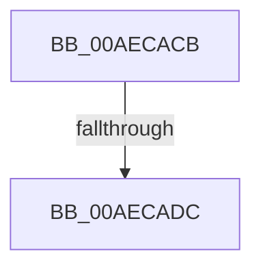

# sub_00AECACB

- RVA: `0x00AECACB`–`0x00AECAEA` (길이 `31` bytes)
- VA: `0x0000000140AECACB`
- 실행 섹션: `PAGE`
- PDB 이름 있음: `아니요`; PDB Function 태그: `아니요`
- unwind 정보 RVA: `0x000D028C`
- 디코드: `6`개 명령, `31/31` bytes 표시
- 미해석 바이트: `0` (있으면 어셈블리에 `.byte`로 보존)

> 이 문서는 커널 이미지의 기계어와 PDB 기호를 분석해 생성했습니다. 4번과 5번은 함수 원형과 자료형을 바이너리 사용 방식에서 추정한 C 해석이며 원본 소스 복구 결과는 아닙니다.

## 1. Dependencies

- 직접 호출 지점: **0**; 고유 호출 대상: **0**
- 직접 호출자로 확인된 함수: **0**
- RIP 상대 이미지 참조: **0**

### Outgoing calls
- 직접 디코드된 call 명령이 없습니다.

### Direct callers
- 이 함수 시작 RVA로 연결되는 직접 call은 확인되지 않았습니다. 간접 호출은 완전히 역산할 수 없습니다.

### Static image references
- 디코드된 RIP-relative 메모리 참조가 없습니다.

## 2. Other-region calls and transfers

- 다른 실행 섹션으로 향하는 call: **0**
- call이 아닌 외부 분기/꼬리 이동: **2**
  - `0x00AECAD6` → [sub_00AEC8DA + 0x171](Unknown_function_00AEC8DA.md) (`tail-transfer`)
  - `0x00AECAE5` → [sub_00AEC8DA + 0x178](Unknown_function_00AEC8DA.md) (`tail-transfer`)

## 3. Assembly (complete function range)

```asm
00AECACB  48 8B 84 24 B8 00 00 00         mov rax, qword ptr [rsp + 0xb8]
00AECAD3  49 3B FD                        cmp rdi, r13
00AECAD6  0F 87 6F FF FF FF               ja 0x140aeca4b
00AECADC  2B AC 24 90 00 00 00            sub ebp, dword ptr [rsp + 0x90]
00AECAE3  89 28                           mov dword ptr [rax], ebp
00AECAE5  E9 68 FF FF FF                  jmp 0x140aeca52
```

## 4. C-style interpretation (structured pseudocode)

```c
__int64 __fastcall sub_00AECACB(__int64 a1, __int64 a2, __int64 a3, __int64 a4, __int64 a5, __int64 a6, __int64 a7, __int64 a8, __int64 a9, __int64 a10, __int64 a11, __int64 a12, __int64 a13, __int64 a14, __int64 a15, __int64 a16, __int64 a17, unsigned int a18, __int64 a19, __int64 a20, __int64 a21, __int64 a22, __int64 a23)
{
    __int64 v_rbp;

    v_rbp = (unsigned int)((v_rbp) - (a18));
    *(unsigned int *)(a23) = (unsigned int)(v_rbp);
}
```

## 5. (Beta) C Style

```c
int64_t sub_00AECACB(int64_t Arg1, int64_t Arg2, int64_t Arg3, int64_t Arg4, uint64_t Arg5, uint64_t Arg6, uint64_t Arg7, uint64_t Arg8, uint64_t Arg9, uint64_t Arg10, uint64_t Arg11, uint64_t Arg12, uint64_t Arg13, uint64_t Arg14, uint64_t Arg15, uint64_t Arg16, uint64_t Arg17, uint32_t Arg18, uint64_t Arg19, uint64_t Arg20, uint64_t Arg21, uint64_t Arg22, void *Arg23)
{
    uint8_t *arg23 = (uint8_t *)Arg23;

    int64_t local_rbp;

    local_rbp = (uint32_t)((local_rbp) - (Arg18));
    *(uint32_t *)(arg23) = (uint32_t)(local_rbp);
}
```

### 관측된 메모리 오프셋

구조체 형식이 확인되지 않은 접근은 인자 기준의 오프셋으로만 기록했습니다.

| 기준 인자 | 오프셋 표현 | 폭 (bit) | 접근 |
|---|---:|---:|---|
| `Arg23` | `+ 0x0` | `32` | `W` |

## 6. Execution-region graph

[열기: 2D/3D 그래프와 함수 탐색 컨트롤 패널](../../../control-panel.html?section=page&rva=0x00AECACB&view=graph)

- 2D 그래프는 위에서 아래로 흐르고, 3D 그래프는 빈 공간을 드래그해 회전합니다. Shift+드래그는 이동, 휠은 확대·축소, 함수 노드 선택은 대상 보고서 이동입니다.

### Static fallback


