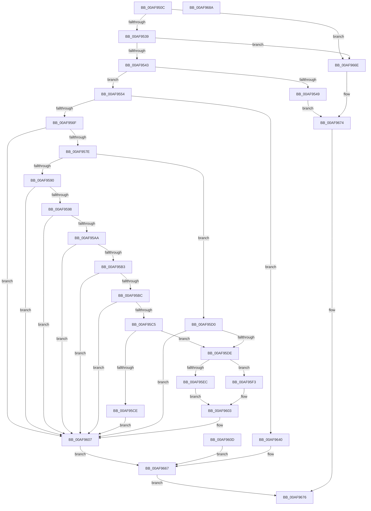

# AslpFileMappingGetFileKind

- RVA: `0x00AF950C`–`0x00AF968B` (길이 `383` bytes)
- VA: `0x0000000140AF950C`
- 실행 섹션: `PAGE`
- PDB 이름 있음: `예`; PDB Function 태그: `아니요`
- unwind 정보 RVA: `0x000D9CA4`
- 디코드: `102`개 명령, `383/383` bytes 표시
- 미해석 바이트: `0` (있으면 어셈블리에 `.byte`로 보존)

> 이 문서는 커널 이미지의 기계어와 PDB 기호를 분석해 생성했습니다. 4번과 5번은 함수 원형과 자료형을 바이너리 사용 방식에서 추정한 C 해석이며 원본 소스 복구 결과는 아닙니다.

## 1. Dependencies

- 직접 호출 지점: **3**; 고유 호출 대상: **2**
- 직접 호출자로 확인된 함수: **5**
- RIP 상대 이미지 참조: **3**

### Outgoing calls
- `0x00AF9587` → [Feature_Servicing_MSRC131691__private_IsEnabledDeviceUsageNoInline](../../text/69/Feature_Servicing_MSRC131691__private_IsEnabledDeviceUsageNoInline_function_0069CFF4.md) (function, `0x0069CFF4`)
- `0x00AF9630` → [AslLogCallPrintf](../95/AslLogCallPrintf_function_0095E4EC.md) (function, `0x0095E4EC`)
- `0x00AF9662` → [AslLogCallPrintf](../95/AslLogCallPrintf_function_0095E4EC.md) (function, `0x0095E4EC`)

### Direct callers
- [AslFileMappingCreateFromImageView](../81/AslFileMappingCreateFromImageView_function_0081A49C.md) at `0x0081A583`
- [AslFileMappingEnsure](../81/AslFileMappingEnsure_function_0081A5EC.md) at `0x0081A662`
- [AslFileMappingEnsureMappedAs](../81/AslFileMappingEnsureMappedAs_function_0081A6BC.md) at `0x0081A731`
- [AslpFileLargeEnsureLargeFileMapping](../82/AslpFileLargeEnsureLargeFileMapping_function_00821538.md) at `0x008216AF`
- [sub_00B26AF0](../B2/Unknown_function_00B26AF0.md) at `0x00B26B9D`

### Static image references
- `0x00AF9617` → RVA `0x0003EF20` (`.rdata`; read)
- `0x00AF9624` → RVA `0x0003EF60` (`.rdata`; read)
- `0x00AF9649` → RVA `0x0003EF40` (`.rdata`; read)

## 2. Other-region calls and transfers

- 다른 실행 섹션으로 향하는 call: **1**
  - `0x00AF9587` → [Feature_Servicing_MSRC131691__private_IsEnabledDeviceUsageNoInline](../../text/69/Feature_Servicing_MSRC131691__private_IsEnabledDeviceUsageNoInline_function_0069CFF4.md) (`PAGE` → `.text`)
- 별도 외부 분기/꼬리 이동을 확인하지 못했습니다.

## 3. Assembly (complete function range)

```asm
00AF950C  48 89 5C 24 18                  mov qword ptr [rsp + 0x18], rbx
00AF9511  48 89 74 24 20                  mov qword ptr [rsp + 0x20], rsi
00AF9516  48 89 54 24 10                  mov qword ptr [rsp + 0x10], rdx
00AF951B  57                              push rdi
00AF951C  41 56                           push r14
00AF951E  41 57                           push r15
00AF9520  48 83 EC 40                     sub rsp, 0x40
00AF9524  4C 8B F2                        mov r14, rdx
00AF9527  48 8B F1                        mov rsi, rcx
00AF952A  48 8B 41 10                     mov rax, qword ptr [rcx + 0x10]
00AF952E  33 DB                           xor ebx, ebx
00AF9530  48 85 C0                        test rax, rax
00AF9533  0F 84 35 01 00 00               je 0x140af966e
00AF9539  48 39 59 20                     cmp qword ptr [rcx + 0x20], rbx
00AF953D  0F 84 2B 01 00 00               je 0x140af966e
00AF9543  48 83 F8 40                     cmp rax, 0x40
00AF9547  73 0B                           jae 0x140af9554
00AF9549  C7 02 03 00 00 00               mov dword ptr [rdx], 3
00AF954F  E9 20 01 00 00                  jmp 0x140af9674
00AF9554  4C 8B 79 18                     mov r15, qword ptr [rcx + 0x18]
00AF9558  BF 03 00 00 00                  mov edi, 3
00AF955D  89 7C 24 34                     mov dword ptr [rsp + 0x34], edi
00AF9561  49 8D 47 FF                     lea rax, [r15 - 1]
00AF9565  48 83 F8 FD                     cmp rax, -3
00AF9569  0F 87 D1 00 00 00               ja 0x140af9640
00AF956F  B8 4D 5A 00 00                  mov eax, 0x5a4d
00AF9574  66 41 39 07                     cmp word ptr [r15], ax
00AF9578  0F 85 89 00 00 00               jne 0x140af9607
00AF957E  BF 04 00 00 00                  mov edi, 4
00AF9583  89 7C 24 34                     mov dword ptr [rsp + 0x34], edi
00AF9587  E8 68 3A BA FF                  call 0x14069cff4
00AF958C  85 C0                           test eax, eax
00AF958E  74 40                           je 0x140af95d0
00AF9590  49 63 47 3C                     movsxd rax, dword ptr [r15 + 0x3c]
00AF9594  85 C0                           test eax, eax
00AF9596  7E 6F                           jle 0x140af9607
00AF9598  48 8B C8                        mov rcx, rax
00AF959B  48 89 44 24 60                  mov qword ptr [rsp + 0x60], rax
00AF95A0  B8 FF FF FF FF                  mov eax, 0xffffffff
00AF95A5  48 3B C8                        cmp rcx, rax
00AF95A8  77 5D                           ja 0x140af9607
00AF95AA  48 8B 46 20                     mov rax, qword ptr [rsi + 0x20]
00AF95AE  48 3B C7                        cmp rax, rdi
00AF95B1  72 54                           jb 0x140af9607
00AF95B3  48 83 C0 FC                     add rax, -4
00AF95B7  48 3B C8                        cmp rcx, rax
00AF95BA  77 4B                           ja 0x140af9607
00AF95BC  48 8B 46 10                     mov rax, qword ptr [rsi + 0x10]
00AF95C0  48 3B C7                        cmp rax, rdi
00AF95C3  72 42                           jb 0x140af9607
00AF95C5  48 83 C0 FC                     add rax, -4
00AF95C9  48 3B C8                        cmp rcx, rax
00AF95CC  76 10                           jbe 0x140af95de
00AF95CE  EB 37                           jmp 0x140af9607
00AF95D0  41 8B 4F 3C                     mov ecx, dword ptr [r15 + 0x3c]
00AF95D4  48 8D 04 0F                     lea rax, [rdi + rcx]
00AF95D8  48 39 46 10                     cmp qword ptr [rsi + 0x10], rax
00AF95DC  72 29                           jb 0x140af9607
00AF95DE  8B C1                           mov eax, ecx
00AF95E0  48 03 46 18                     add rax, qword ptr [rsi + 0x18]
00AF95E4  81 38 50 45 00 00               cmp dword ptr [rax], 0x4550
00AF95EA  75 07                           jne 0x140af95f3
00AF95EC  BF 06 00 00 00                  mov edi, 6
00AF95F1  EB 10                           jmp 0x140af9603
00AF95F3  BA 05 00 00 00                  mov edx, 5
00AF95F8  B9 4E 45 00 00                  mov ecx, 0x454e
00AF95FD  66 39 08                        cmp word ptr [rax], cx
00AF9600  0F 44 FA                        cmove edi, edx
00AF9603  89 7C 24 34                     mov dword ptr [rsp + 0x34], edi
00AF9607  89 5C 24 30                     mov dword ptr [rsp + 0x30], ebx
00AF960B  EB 5A                           jmp 0x140af9667
00AF960D  8B D8                           mov ebx, eax
00AF960F  89 44 24 30                     mov dword ptr [rsp + 0x30], eax
00AF9613  89 44 24 20                     mov dword ptr [rsp + 0x20], eax
00AF9617  4C 8D 0D 02 59 54 FF            lea r9, [rip - 0xaba6fe]
00AF961E  41 B8 3F 05 00 00               mov r8d, 0x53f
00AF9624  48 8D 15 35 59 54 FF            lea rdx, [rip - 0xaba6cb]
00AF962B  B9 01 00 00 00                  mov ecx, 1
00AF9630  E8 B7 4E E6 FF                  call 0x14095e4ec
00AF9635  4C 8B 74 24 68                  mov r14, qword ptr [rsp + 0x68]
00AF963A  8B 7C 24 34                     mov edi, dword ptr [rsp + 0x34]
00AF963E  EB 27                           jmp 0x140af9667
00AF9640  BB 0D 00 00 C0                  mov ebx, 0xc000000d
00AF9645  89 5C 24 20                     mov dword ptr [rsp + 0x20], ebx
00AF9649  4C 8D 0D F0 58 54 FF            lea r9, [rip - 0xaba710]
00AF9650  41 B8 ED 04 00 00               mov r8d, 0x4ed
00AF9656  48 8D 15 03 59 54 FF            lea rdx, [rip - 0xaba6fd]
00AF965D  B9 01 00 00 00                  mov ecx, 1
00AF9662  E8 85 4E E6 FF                  call 0x14095e4ec
00AF9667  41 89 3E                        mov dword ptr [r14], edi
00AF966A  8B C3                           mov eax, ebx
00AF966C  EB 08                           jmp 0x140af9676
00AF966E  C7 02 01 00 00 00               mov dword ptr [rdx], 1
00AF9674  33 C0                           xor eax, eax
00AF9676  48 8B 5C 24 70                  mov rbx, qword ptr [rsp + 0x70]
00AF967B  48 8B 74 24 78                  mov rsi, qword ptr [rsp + 0x78]
00AF9680  48 83 C4 40                     add rsp, 0x40
00AF9684  41 5F                           pop r15
00AF9686  41 5E                           pop r14
00AF9688  5F                              pop rdi
00AF9689  C3                              ret
00AF968A  CC                              int3
```

## 4. C-style interpretation (structured pseudocode)

```c
__int64 __fastcall AslpFileMappingGetFileKind(__int64 a1, __int64 a2)
{
    __int64 result;
    __int64 v_rbx;
    __int64 v_rdi;
    __int64 v_rsp;
    unsigned int v_stack_m24;
    unsigned int v_stack_m28;
    unsigned int v_stack_m38;
    unsigned __int64 v_stack_p10;
    unsigned __int64 v_stack_p18;
    unsigned __int64 v_stack_p20;
    unsigned __int64 v_stack_p8;

    v_stack_p18 = v_rbx;
    v_stack_p20 = v_rsi;
    v_stack_p10 = a2;
    v_rsp = (v_rsp) - (64);
    v_rbx = 0;
    if (*(unsigned __int64 *)(a1 + 16) == 0) goto loc_00AF966E;
    if ((*(unsigned __int64 *)(a1 + 32)) == 0) goto loc_00AF966E;
    if ((*(unsigned __int64 *)(a1 + 16)) >= 64) goto loc_00AF9554;
    *(unsigned int *)(a2) = 3;
    goto loc_00AF9674;
loc_00AF9554:
    v_stack_m24 = 3;
    if ((*(unsigned __int64 *)(a1 + 24) - 1) > -3) goto loc_00AF9640;
    if ((*(unsigned __int16 *)(*(unsigned __int64 *)(a1 + 24))) != ((unsigned __int16)((unsigned int)(0x5A4DULL)))) goto loc_00AF9607;
    v_stack_m24 = 4;
    result = Feature_Servicing_MSRC131691__private_IsEnabledDeviceUsageNoInline(a1, a2, a3, a4);
    if ((unsigned int)(result) == 0) goto loc_00AF95D0;
    if (condition_is_less_or_equal) goto loc_00AF9607;
    v_stack_p8 = (int)(*(unsigned int *)(*(unsigned __int64 *)(a1 + 24) + 60));
    if (((int)(*(unsigned int *)(*(unsigned __int64 *)(a1 + 24) + 60))) > ((unsigned int)(0xFFFFFFFFULL))) goto loc_00AF9607;
    if ((*(unsigned __int64 *)(a1 + 32)) < 4) goto loc_00AF9607;
    result = (*(unsigned __int64 *)(a1 + 32)) + (-4);
    if (((int)(*(unsigned int *)(*(unsigned __int64 *)(a1 + 24) + 60))) > result) goto loc_00AF9607;
    if ((*(unsigned __int64 *)(a1 + 16)) < 4) goto loc_00AF9607;
    result = (*(unsigned __int64 *)(a1 + 16)) + (-4);
    if (((int)(*(unsigned int *)(*(unsigned __int64 *)(a1 + 24) + 60))) <= result) goto loc_00AF95DE;
    goto loc_00AF9607;
loc_00AF95D0:
    if ((*(unsigned __int64 *)(a1 + 16)) < (4 + (unsigned int)(*(unsigned int *)(*(unsigned __int64 *)(a1 + 24) + 60)) * 1)) goto loc_00AF9607;
loc_00AF95DE:
    result = ((unsigned int)((unsigned int)((unsigned int)(*(unsigned int *)(*(unsigned __int64 *)(a1 + 24) + 60))))) + (*(unsigned __int64 *)(a1 + 24));
    if ((*(unsigned int *)(result)) != 0x4550ULL) goto loc_00AF95F3;
    goto loc_00AF9603;
loc_00AF95F3:
    v_rdi = 6;
    if ((*(unsigned __int16 *)(result)) == ((unsigned __int16)((unsigned int)(0x454EULL)))) { v_rdi = 5; }
loc_00AF9603:
    v_stack_m24 = (unsigned int)(v_rdi);
loc_00AF9607:
    v_stack_m28 = 0;
    goto loc_00AF9667;
loc_00AF9640:
    v_stack_m38 = (unsigned int)((unsigned int)(0xC000000DULL));
    result = AslLogCallPrintf(1, v_rip - 11249405, (unsigned int)(0x4EDULL), v_rip - 11249424);
loc_00AF9667:
    *(unsigned int *)(a2) = (unsigned int)(v_rdi);
    goto loc_00AF9676;
loc_00AF966E:
    *(unsigned int *)(v_rip - 11249405) = 1;
loc_00AF9674:
    result = 0;
loc_00AF9676:
    v_rsp = (v_rsp) + (64);
    return result;
}
```

## 5. (Beta) C Style

```c
int64_t AslpFileMappingGetFileKind(void *Arg1, void *Arg2)
{
    uint8_t *arg1 = (uint8_t *)Arg1;
    uint8_t *arg2 = (uint8_t *)Arg2;

    int64_t result;
    int64_t local_rbx;
    int64_t local_rdi;
    int64_t local_rsp;
    uint32_t v_stack_m24;
    uint32_t v_stack_m28;
    uint32_t v_stack_m38;
    uint64_t v_stack_p10;
    uint64_t v_stack_p18;
    uint64_t v_stack_p20;
    uint64_t v_stack_p8;

    v_stack_p18 = local_rbx;
    v_stack_p20 = local_rsi;
    v_stack_p10 = Arg2;
    local_rsp = (local_rsp) - (64);
    local_rbx = 0;
    if (*(uint64_t *)(arg1 + 0x10) == 0) goto loc_00AF966E;
    if ((*(uint64_t *)(arg1 + 0x20)) == 0) goto loc_00AF966E;
    if ((*(uint64_t *)(arg1 + 0x10)) >= 64) goto loc_00AF9554;
    *(uint32_t *)(arg2) = 3;
    goto loc_00AF9674;
loc_00AF9554:
    v_stack_m24 = 3;
    if ((*(uint64_t *)(arg1 + 0x18) - 1) > -3) goto loc_00AF9640;
    if ((*(uint16_t *)(*(uint64_t *)(arg1 + 0x18))) != ((uint16_t)((uint32_t)(0x5A4DULL)))) goto loc_00AF9607;
    v_stack_m24 = 4;
    result = Feature_Servicing_MSRC131691__private_IsEnabledDeviceUsageNoInline(Arg1, Arg2, a3, a4);
    if ((uint32_t)(result) == 0) goto loc_00AF95D0;
    if (condition_is_less_or_equal) goto loc_00AF9607;
    v_stack_p8 = (int32_t)(*(uint32_t *)(*(uint64_t *)(arg1 + 0x18) + 0x3C));
    if (((int32_t)(*(uint32_t *)(*(uint64_t *)(arg1 + 0x18) + 0x3C))) > ((uint32_t)(0xFFFFFFFFULL))) goto loc_00AF9607;
    if ((*(uint64_t *)(arg1 + 0x20)) < 4) goto loc_00AF9607;
    result = (*(uint64_t *)(arg1 + 0x20)) + (-4);
    if (((int32_t)(*(uint32_t *)(*(uint64_t *)(arg1 + 0x18) + 0x3C))) > result) goto loc_00AF9607;
    if ((*(uint64_t *)(arg1 + 0x10)) < 4) goto loc_00AF9607;
    result = (*(uint64_t *)(arg1 + 0x10)) + (-4);
    if (((int32_t)(*(uint32_t *)(*(uint64_t *)(arg1 + 0x18) + 0x3C))) <= result) goto loc_00AF95DE;
    goto loc_00AF9607;
loc_00AF95D0:
    if ((*(uint64_t *)(arg1 + 0x10)) < (4 + (uint32_t)(*(uint32_t *)(*(uint64_t *)(arg1 + 0x18) + 0x3C)) * 1)) goto loc_00AF9607;
loc_00AF95DE:
    result = ((uint32_t)((uint32_t)((uint32_t)(*(uint32_t *)(*(uint64_t *)(arg1 + 0x18) + 0x3C))))) + (*(uint64_t *)(arg1 + 0x18));
    if ((*(uint32_t *)(result)) != 0x4550ULL) goto loc_00AF95F3;
    goto loc_00AF9603;
loc_00AF95F3:
    local_rdi = 6;
    if ((*(uint16_t *)(result)) == ((uint16_t)((uint32_t)(0x454EULL)))) { local_rdi = 5; }
loc_00AF9603:
    v_stack_m24 = (uint32_t)(local_rdi);
loc_00AF9607:
    v_stack_m28 = 0;
    goto loc_00AF9667;
loc_00AF9640:
    v_stack_m38 = (uint32_t)((uint32_t)(0xC000000DULL));
    result = AslLogCallPrintf(1, v_rip - 11249405, (uint32_t)(0x4EDULL), v_rip - 11249424);
loc_00AF9667:
    *(uint32_t *)(arg2) = (uint32_t)(local_rdi);
    goto loc_00AF9676;
loc_00AF966E:
    *(uint32_t *)(v_rip - 0xABA6FD) = 1;
loc_00AF9674:
    result = 0;
loc_00AF9676:
    local_rsp = (local_rsp) + (64);
    return result;
}
```

### 관측된 메모리 오프셋

구조체 형식이 확인되지 않은 접근은 인자 기준의 오프셋으로만 기록했습니다.

| 기준 인자 | 오프셋 표현 | 폭 (bit) | 접근 |
|---|---:|---:|---|
| `Arg1` | `+ 0x10` | `64` | `R` |
| `Arg1` | `+ 0x18` | `64` | `R` |
| `Arg1` | `+ 0x20` | `64` | `R` |
| `Arg2` | `+ 0x0` | `32` | `W` |

## 6. Execution-region graph

[열기: 2D/3D 그래프와 함수 탐색 컨트롤 패널](../../../control-panel.html?section=page&rva=0x00AF950C&view=graph)

- 2D 그래프는 위에서 아래로 흐르고, 3D 그래프는 빈 공간을 드래그해 회전합니다. Shift+드래그는 이동, 휠은 확대·축소, 함수 노드 선택은 대상 보고서 이동입니다.

### Static fallback


