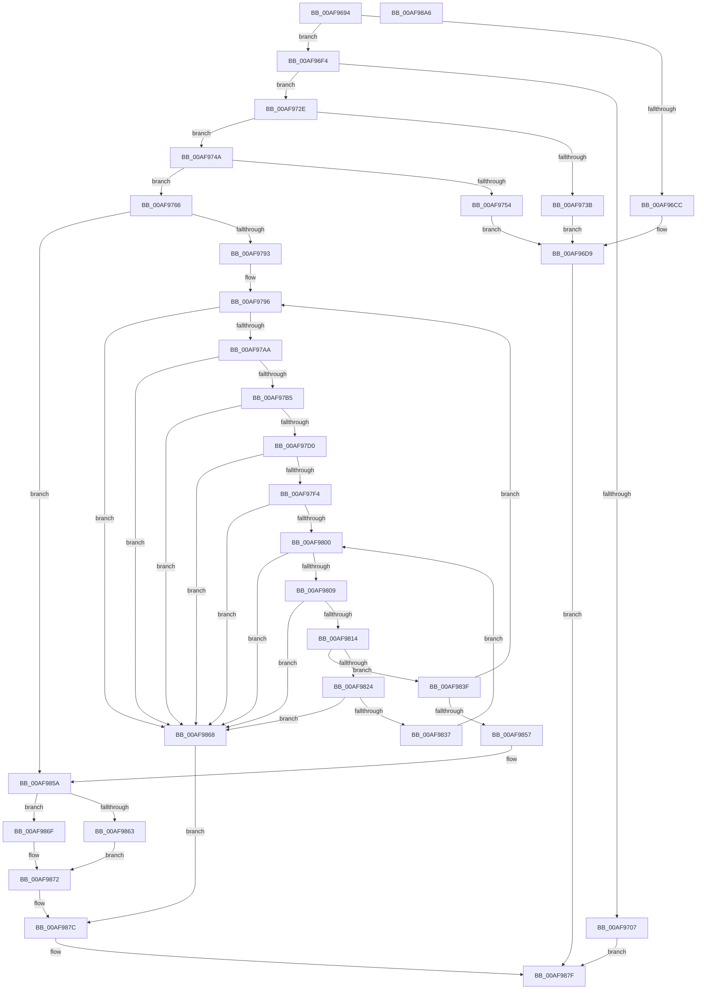

# AslpFileVerQueryBlock

- RVA: `0x00AF9694`–`0x00AF98A7` (길이 `531` bytes)
- VA: `0x0000000140AF9694`
- 실행 섹션: `PAGE`
- PDB 이름 있음: `예`; PDB Function 태그: `아니요`
- unwind 정보 RVA: `0x000D6588`
- 디코드: `142`개 명령, `531/531` bytes 표시
- 미해석 바이트: `0` (있으면 어셈블리에 `.byte`로 보존)

> 이 문서는 커널 이미지의 기계어와 PDB 기호를 분석해 생성했습니다. 4번과 5번은 함수 원형과 자료형을 바이너리 사용 방식에서 추정한 C 해석이며 원본 소스 복구 결과는 아닙니다.

## 1. Dependencies

- 직접 호출 지점: **9**; 고유 호출 대상: **7**
- 직접 호출자로 확인된 함수: **2**
- RIP 상대 이미지 참조: **5**

### Outgoing calls
- `0x00AF96EA` → [AslLogCallPrintf](../95/AslLogCallPrintf_function_0095E4EC.md) (function, `0x0095E4EC`)
- `0x00AF96FC` → [AslStringDuplicate](../95/AslStringDuplicate_function_00958604.md) (function, `0x00958604`)
- `0x00AF9724` → [AslLogCallPrintf](../95/AslLogCallPrintf_function_0095E4EC.md) (function, `0x0095E4EC`)
- `0x00AF9782` → [AslpFileStringTokenize](../../text/4A/AslpFileStringTokenize_function_004AA868.md) (function, `0x004AA868`)
- `0x00AF97C3` → [AslpFileVerBlockGetValueOffset](../../text/4B/AslpFileVerBlockGetValueOffset_function_004B47D8.md) (function, `0x004B47D8`)
- `0x00AF981B` → [wcsicmp](../../text/50/wcsicmp_function_00500080.md) (function, `0x00500080`)
- `0x00AF9846` → [AslpFileStringTokenize](../../text/4A/AslpFileStringTokenize_function_004AA868.md) (function, `0x004AA868`)
- `0x00AF985A` → [Feature_261863737__private_IsEnabledDeviceUsageNoInline](../../text/69/Feature_261863737__private_IsEnabledDeviceUsageNoInline_function_0069D46C.md) (function, `0x0069D46C`)
- `0x00AF9887` → [AslFree](../95/AslFree_function_0095B674.md) (function, `0x0095B674`)

### Direct callers
- [AslpFileMakeStringVersionAttributes](../82/AslpFileMakeStringVersionAttributes_function_00820964.md) at `0x008209EB`
- [AslpFileQueryVersionString](../82/AslpFileQueryVersionString_function_0082113C.md) at `0x008211F8`
- [AslpFileQueryVersionString](../82/AslpFileQueryVersionString_function_0082113C.md) at `0x008212A5`

### Static image references
- `0x00AF96CC` → RVA `0x000401F8` (`.rdata`; read)
- `0x00AF96D9` → RVA `0x0003FDC8` (`.rdata`; read)
- `0x00AF9707` → RVA `0x0003DB80` (`.rdata`; read)
- `0x00AF973B` → RVA `0x0003FDE0` (`.rdata`; read)
- `0x00AF9754` → RVA `0x0003FE00` (`.rdata`; read)

## 2. Other-region calls and transfers

- 다른 실행 섹션으로 향하는 call: **5**
  - `0x00AF9782` → [AslpFileStringTokenize](../../text/4A/AslpFileStringTokenize_function_004AA868.md) (`PAGE` → `.text`)
  - `0x00AF97C3` → [AslpFileVerBlockGetValueOffset](../../text/4B/AslpFileVerBlockGetValueOffset_function_004B47D8.md) (`PAGE` → `.text`)
  - `0x00AF981B` → [wcsicmp](../../text/50/wcsicmp_function_00500080.md) (`PAGE` → `.text`)
  - `0x00AF9846` → [AslpFileStringTokenize](../../text/4A/AslpFileStringTokenize_function_004AA868.md) (`PAGE` → `.text`)
  - `0x00AF985A` → [Feature_261863737__private_IsEnabledDeviceUsageNoInline](../../text/69/Feature_261863737__private_IsEnabledDeviceUsageNoInline_function_0069D46C.md) (`PAGE` → `.text`)
- 별도 외부 분기/꼬리 이동을 확인하지 못했습니다.

## 3. Assembly (complete function range)

```asm
00AF9694  48 8B C4                        mov rax, rsp
00AF9697  48 89 58 10                     mov qword ptr [rax + 0x10], rbx
00AF969B  55                              push rbp
00AF969C  56                              push rsi
00AF969D  57                              push rdi
00AF969E  41 54                           push r12
00AF96A0  41 55                           push r13
00AF96A2  41 56                           push r14
00AF96A4  41 57                           push r15
00AF96A6  48 83 EC 40                     sub rsp, 0x40
00AF96AA  45 33 E4                        xor r12d, r12d
00AF96AD  4D 8B F9                        mov r15, r9
00AF96B0  4D 8B E8                        mov r13, r8
00AF96B3  48 8B F9                        mov rdi, rcx
00AF96B6  4C 89 60 20                     mov qword ptr [rax + 0x20], r12
00AF96BA  4C 89 60 B8                     mov qword ptr [rax - 0x48], r12
00AF96BE  4C 89 60 08                     mov qword ptr [rax + 8], r12
00AF96C2  4D 89 21                        mov qword ptr [r9], r12
00AF96C5  66 44 39 61 04                  cmp word ptr [rcx + 4], r12w
00AF96CA  74 28                           je 0x140af96f4
00AF96CC  4C 8D 0D 25 6B 54 FF            lea r9, [rip - 0xab94db]
00AF96D3  41 B8 92 0B 00 00               mov r8d, 0xb92
00AF96D9  48 8D 15 E8 66 54 FF            lea rdx, [rip - 0xab9918]
00AF96E0  B9 01 00 00 00                  mov ecx, 1
00AF96E5  BB 0D 00 00 C0                  mov ebx, 0xc000000d
00AF96EA  E8 FD 4D E6 FF                  call 0x14095e4ec
00AF96EF  E9 8B 01 00 00                  jmp 0x140af987f
00AF96F4  48 8D 8C 24 98 00 00 00         lea rcx, [rsp + 0x98]
00AF96FC  E8 03 EF E5 FF                  call 0x140958604
00AF9701  8B D8                           mov ebx, eax
00AF9703  85 C0                           test eax, eax
00AF9705  79 27                           jns 0x140af972e
00AF9707  4C 8D 0D 72 44 54 FF            lea r9, [rip - 0xabbb8e]
00AF970E  89 44 24 20                     mov dword ptr [rsp + 0x20], eax
00AF9712  41 B8 98 0B 00 00               mov r8d, 0xb98
00AF9718  48 8D 15 A9 66 54 FF            lea rdx, [rip - 0xab9957]
00AF971F  B9 01 00 00 00                  mov ecx, 1
00AF9724  E8 C3 4D E6 FF                  call 0x14095e4ec
00AF9729  E9 51 01 00 00                  jmp 0x140af987f
00AF972E  0F B7 07                        movzx eax, word ptr [rdi]
00AF9731  B9 FF 7F 00 00                  mov ecx, 0x7fff
00AF9736  66 3B C1                        cmp ax, cx
00AF9739  76 0F                           jbe 0x140af974a
00AF973B  4C 8D 0D 9E 66 54 FF            lea r9, [rip - 0xab9962]
00AF9742  41 B8 A4 0B 00 00               mov r8d, 0xba4
00AF9748  EB 8F                           jmp 0x140af96d9
00AF974A  B9 08 00 00 00                  mov ecx, 8
00AF974F  66 3B C1                        cmp ax, cx
00AF9752  73 12                           jae 0x140af9766
00AF9754  4C 8D 0D A5 66 54 FF            lea r9, [rip - 0xab995b]
00AF975B  41 B8 A9 0B 00 00               mov r8d, 0xba9
00AF9761  E9 73 FF FF FF                  jmp 0x140af96d9
00AF9766  48 8B 8C 24 98 00 00 00         mov rcx, qword ptr [rsp + 0x98]
00AF976E  48 8D 1C 07                     lea rbx, [rdi + rax]
00AF9772  48 8D 73 FE                     lea rsi, [rbx - 2]
00AF9776  0F B7 2E                        movzx ebp, word ptr [rsi]
00AF9779  4C 8D 44 24 30                  lea r8, [rsp + 0x30]
00AF977E  66 44 89 26                     mov word ptr [rsi], r12w
00AF9782  E8 E1 10 9B FF                  call 0x1404aa868
00AF9787  4C 8B F0                        mov r14, rax
00AF978A  48 85 C0                        test rax, rax
00AF978D  0F 84 C7 00 00 00               je 0x140af985a
00AF9793  44 8B E3                        mov r12d, ebx
00AF9796  41 8B CC                        mov ecx, r12d
00AF9799  41 BB 08 00 00 00               mov r11d, 8
00AF979F  2B CF                           sub ecx, edi
00AF97A1  41 3B CB                        cmp ecx, r11d
00AF97A4  0F 82 BE 00 00 00               jb 0x140af9868
00AF97AA  0F B7 07                        movzx eax, word ptr [rdi]
00AF97AD  3B C1                           cmp eax, ecx
00AF97AF  0F 87 B3 00 00 00               ja 0x140af9868
00AF97B5  44 8B C1                        mov r8d, ecx
00AF97B8  48 8B D7                        mov rdx, rdi
00AF97BB  48 8D 8C 24 80 00 00 00         lea rcx, [rsp + 0x80]
00AF97C3  E8 10 B0 9B FF                  call 0x1404b47d8
00AF97C8  85 C0                           test eax, eax
00AF97CA  0F 88 98 00 00 00               js 0x140af9868
00AF97D0  0F B7 57 02                     movzx edx, word ptr [rdi + 2]
00AF97D4  0F B7 07                        movzx eax, word ptr [rdi]
00AF97D7  48 83 C2 03                     add rdx, 3
00AF97DB  48 83 E2 FC                     and rdx, 0xfffffffffffffffc
00AF97DF  48 03 94 24 80 00 00 00         add rdx, qword ptr [rsp + 0x80]
00AF97E7  48 89 94 24 80 00 00 00         mov qword ptr [rsp + 0x80], rdx
00AF97EF  48 3B D0                        cmp rdx, rax
00AF97F2  77 74                           ja 0x140af9868
00AF97F4  48 8D 1C 38                     lea rbx, [rax + rdi]
00AF97F8  48 03 FA                        add rdi, rdx
00AF97FB  48 3B FB                        cmp rdi, rbx
00AF97FE  73 68                           jae 0x140af9868
00AF9800  0F B7 07                        movzx eax, word ptr [rdi]
00AF9803  66 41 3B C3                     cmp ax, r11w
00AF9807  76 5F                           jbe 0x140af9868
00AF9809  48 8B CB                        mov rcx, rbx
00AF980C  48 2B CF                        sub rcx, rdi
00AF980F  48 3B C1                        cmp rax, rcx
00AF9812  77 54                           ja 0x140af9868
00AF9814  48 8D 57 06                     lea rdx, [rdi + 6]
00AF9818  49 8B CE                        mov rcx, r14
00AF981B  E8 60 68 A0 FF                  call 0x140500080
00AF9820  85 C0                           test eax, eax
00AF9822  74 1B                           je 0x140af983f
00AF9824  0F B7 07                        movzx eax, word ptr [rdi]
00AF9827  48 83 C0 03                     add rax, 3
00AF982B  48 83 E0 FC                     and rax, 0xfffffffffffffffc
00AF982F  48 03 F8                        add rdi, rax
00AF9832  48 3B FB                        cmp rdi, rbx
00AF9835  73 31                           jae 0x140af9868
00AF9837  41 BB 08 00 00 00               mov r11d, 8
00AF983D  EB C1                           jmp 0x140af9800
00AF983F  4C 8D 44 24 30                  lea r8, [rsp + 0x30]
00AF9844  33 C9                           xor ecx, ecx
00AF9846  E8 1D 10 9B FF                  call 0x1404aa868
00AF984B  4C 8B F0                        mov r14, rax
00AF984E  48 85 C0                        test rax, rax
00AF9851  0F 85 3F FF FF FF               jne 0x140af9796
00AF9857  45 33 E4                        xor r12d, r12d
00AF985A  E8 0D 3C BA FF                  call 0x14069d46c
00AF985F  85 C0                           test eax, eax
00AF9861  75 0C                           jne 0x140af986f
00AF9863  48 2B DF                        sub rbx, rdi
00AF9866  EB 0A                           jmp 0x140af9872
00AF9868  BB 25 02 00 C0                  mov ebx, 0xc0000225
00AF986D  EB 0D                           jmp 0x140af987c
00AF986F  0F B7 1F                        movzx ebx, word ptr [rdi]
00AF9872  49 89 1F                        mov qword ptr [r15], rbx
00AF9875  41 8B DC                        mov ebx, r12d
00AF9878  49 89 7D 00                     mov qword ptr [r13], rdi
00AF987C  66 89 2E                        mov word ptr [rsi], bp
00AF987F  48 8B 94 24 98 00 00 00         mov rdx, qword ptr [rsp + 0x98]
00AF9887  E8 E8 1D E6 FF                  call 0x14095b674
00AF988C  8B C3                           mov eax, ebx
00AF988E  48 8B 9C 24 88 00 00 00         mov rbx, qword ptr [rsp + 0x88]
00AF9896  48 83 C4 40                     add rsp, 0x40
00AF989A  41 5F                           pop r15
00AF989C  41 5E                           pop r14
00AF989E  41 5D                           pop r13
00AF98A0  41 5C                           pop r12
00AF98A2  5F                              pop rdi
00AF98A3  5E                              pop rsi
00AF98A4  5D                              pop rbp
00AF98A5  C3                              ret
00AF98A6  CC                              int3
```

## 4. C-style interpretation (structured pseudocode)

```c
__int64 __fastcall AslpFileVerQueryBlock(__int64 a1, __int64 a2, __int64 a3, __int64 a4)
{
    __int64 result;
    __int64 v_r12;
    __int64 v_rbx;
    __int64 v_rdi;
    __int64 v_rsp;
    unsigned __int64 v_stack_m48;
    unsigned int v_stack_m58;
    unsigned __int64 v_stack_p10;
    unsigned __int64 v_stack_p20;
    unsigned __int64 v_stack_p8;

    *(unsigned __int64 *)(v_rsp + 16) = v_rbx;
    v_rsp = (v_rsp) - (64);
    v_r12 = 0;
    *(unsigned __int64 *)(v_rsp + 32) = 0;
    *(unsigned __int64 *)(v_rsp - 72) = 0;
    *(unsigned __int64 *)(v_rsp + 8) = 0;
    *(unsigned __int64 *)(a4) = 0;
    if ((*(unsigned __int16 *)(a1 + 4)) == 0) goto loc_00AF96F4;
loc_00AF96D9:
    result = AslLogCallPrintf(1, v_rip - 11245848, (unsigned int)(0xB92ULL), v_rip - 11244763);
    goto loc_00AF987F;
loc_00AF96F4:
    result = AslStringDuplicate(v_stack_p20, v_rip - 11245848, (unsigned int)(0xB92ULL), v_rip - 11244763);
    if (!sign_flag) goto loc_00AF972E;
    v_stack_m58 = (unsigned int)(result);
    result = AslLogCallPrintf(1, v_rip - 11245911, (unsigned int)(0xB98ULL), v_rip - 11254670);
    goto loc_00AF987F;
loc_00AF972E:
    if (((unsigned __int16)(*(unsigned __int16 *)(a1))) <= ((unsigned __int16)((unsigned int)(0x7FFFULL)))) goto loc_00AF974A;
    goto loc_00AF96D9;
loc_00AF974A:
    if (((unsigned __int16)(*(unsigned __int16 *)(a1))) >= 8) goto loc_00AF9766;
    goto loc_00AF96D9;
loc_00AF9766:
    *(unsigned __int16 *)(a1 + *(unsigned __int16 *)(a1) * 1 - 2) = 0;
    result = AslpFileStringTokenize(v_stack_p20, v_rip - 11245911, v_stack_m48, v_rip - 11245915);
    if (result == 0) goto loc_00AF985A;
loc_00AF9796:
    a1 = (unsigned int)(((unsigned int)((unsigned int)((unsigned int)((unsigned int)(a1 + *(unsigned __int16 *)(a1) * 1))))) - ((unsigned int)(a1)));
    if (((unsigned int)(a1)) < 8) goto loc_00AF9868;
    if (((unsigned int)(*(unsigned __int16 *)(a1))) > ((unsigned int)(a1))) goto loc_00AF9868;
    result = AslpFileVerBlockGetValueOffset(v_stack_p8, a1, (unsigned int)((unsigned int)(a1)), v_rip - 11245915);
    if (sign_flag) goto loc_00AF9868;
    a2 = (*(unsigned __int16 *)(a1 + 2)) + (3);
    a2 = (a2) & (-4);
    a2 = (a2) + (v_stack_p8);
    v_stack_p8 = a2;
    if (a2 > (*(unsigned __int16 *)(a1))) goto loc_00AF9868;
    v_rdi = (a1) + (a2);
    if (v_rdi >= (*(unsigned __int16 *)(a1) + a1 * 1)) goto loc_00AF9868;
loc_00AF9800:
    if (((unsigned __int16)(*(unsigned __int16 *)(v_rdi))) <= 8) goto loc_00AF9868;
    a1 = (*(unsigned __int16 *)(a1) + a1 * 1) - (v_rdi);
    if ((*(unsigned __int16 *)(v_rdi)) > a1) goto loc_00AF9868;
    result = wcsicmp(result, v_rdi + 6, (unsigned int)((unsigned int)(a1)), v_rip - 11245915);
    if ((unsigned int)(result) == 0) goto loc_00AF983F;
    result = (*(unsigned __int16 *)(v_rdi)) + (3);
    result = (result) & (-4);
    v_rdi = (v_rdi) + (result);
    if (v_rdi >= (*(unsigned __int16 *)(a1) + a1 * 1)) goto loc_00AF9868;
    goto loc_00AF9800;
loc_00AF983F:
    a1 = 0;
    result = AslpFileStringTokenize(a1, v_rdi + 6, v_stack_m48, v_rip - 11245915);
    if (result != 0) goto loc_00AF9796;
    v_r12 = 0;
loc_00AF985A:
    result = Feature_261863737__private_IsEnabledDeviceUsageNoInline(a1, v_rdi + 6, v_stack_m48, v_rip - 11245915);
    if ((unsigned int)(result) != 0) goto loc_00AF986F;
    v_rbx = (*(unsigned __int16 *)(a1) + a1 * 1) - (v_rdi);
    goto loc_00AF9872;
loc_00AF9868:
    goto loc_00AF987C;
loc_00AF986F:
loc_00AF9872:
    *(unsigned __int64 *)(a4) = *(unsigned __int16 *)(v_rdi);
    *(unsigned __int64 *)(a3) = v_rdi;
loc_00AF987C:
    *(unsigned __int16 *)(a1 + *(unsigned __int16 *)(a1) * 1 - 2) = (unsigned __int16)(*(unsigned __int16 *)(a1 + *(unsigned __int16 *)(a1) * 1 - 2));
loc_00AF987F:
    result = AslFree(a1, v_stack_p20, v_stack_m48, v_rip - 11245915);
    v_rsp = (v_rsp) + (64);
    return 0;
}
```

## 5. (Beta) C Style

```c
int64_t AslpFileVerQueryBlock(void *Arg1, int64_t Arg2, void *Arg3, void *Arg4)
{
    uint8_t *arg1 = (uint8_t *)Arg1;
    uint8_t *arg3 = (uint8_t *)Arg3;
    uint8_t *arg4 = (uint8_t *)Arg4;

    int64_t result;
    int64_t local_r12;
    int64_t local_rbx;
    int64_t local_rdi;
    int64_t local_rsp;
    uint64_t v_stack_m48;
    uint32_t v_stack_m58;
    uint64_t v_stack_p10;
    uint64_t v_stack_p20;
    uint64_t v_stack_p8;

    *(uint64_t *)(local_rsp + 0x10) = local_rbx;
    local_rsp = (local_rsp) - (64);
    local_r12 = 0;
    *(uint64_t *)(local_rsp + 0x20) = 0;
    *(uint64_t *)(local_rsp - 0x48) = 0;
    *(uint64_t *)(local_rsp + 0x8) = 0;
    *(uint64_t *)(arg4) = 0;
    if ((*(uint16_t *)(arg1 + 0x4)) == 0) goto loc_00AF96F4;
loc_00AF96D9:
    result = AslLogCallPrintf(1, v_rip - 11245848, (uint32_t)(0xB92ULL), v_rip - 11244763);
    goto loc_00AF987F;
loc_00AF96F4:
    result = AslStringDuplicate(v_stack_p20, v_rip - 11245848, (uint32_t)(0xB92ULL), v_rip - 11244763);
    if (!sign_flag) goto loc_00AF972E;
    v_stack_m58 = (uint32_t)(result);
    result = AslLogCallPrintf(1, v_rip - 11245911, (uint32_t)(0xB98ULL), v_rip - 11254670);
    goto loc_00AF987F;
loc_00AF972E:
    if (((uint16_t)(*(uint16_t *)(arg1))) <= ((uint16_t)((uint32_t)(0x7FFFULL)))) goto loc_00AF974A;
    goto loc_00AF96D9;
loc_00AF974A:
    if (((uint16_t)(*(uint16_t *)(arg1))) >= 8) goto loc_00AF9766;
    goto loc_00AF96D9;
loc_00AF9766:
    *(uint16_t *)(arg1 + *(uint16_t *)(arg1) * 1 - 0x2) = 0;
    result = AslpFileStringTokenize(v_stack_p20, v_rip - 11245911, v_stack_m48, v_rip - 11245915);
    if (result == 0) goto loc_00AF985A;
loc_00AF9796:
    Arg1 = (uint32_t)(((uint32_t)((uint32_t)((uint32_t)((uint32_t)(Arg1 + *(uint16_t *)(arg1) * 1))))) - ((uint32_t)(Arg1)));
    if (((uint32_t)(Arg1)) < 8) goto loc_00AF9868;
    if (((uint32_t)(*(uint16_t *)(arg1))) > ((uint32_t)(Arg1))) goto loc_00AF9868;
    result = AslpFileVerBlockGetValueOffset(v_stack_p8, Arg1, (uint32_t)((uint32_t)(Arg1)), v_rip - 11245915);
    if (sign_flag) goto loc_00AF9868;
    Arg2 = (*(uint16_t *)(arg1 + 0x2)) + (3);
    Arg2 = (Arg2) & (-4);
    Arg2 = (Arg2) + (v_stack_p8);
    v_stack_p8 = Arg2;
    if (Arg2 > (*(uint16_t *)(arg1))) goto loc_00AF9868;
    local_rdi = (Arg1) + (Arg2);
    if (local_rdi >= (*(uint16_t *)(arg1) + Arg1 * 1)) goto loc_00AF9868;
loc_00AF9800:
    if (((uint16_t)(*(uint16_t *)(local_rdi))) <= 8) goto loc_00AF9868;
    Arg1 = (*(uint16_t *)(arg1) + Arg1 * 1) - (local_rdi);
    if ((*(uint16_t *)(local_rdi)) > Arg1) goto loc_00AF9868;
    result = wcsicmp(result, local_rdi + 6, (uint32_t)((uint32_t)(Arg1)), v_rip - 11245915);
    if ((uint32_t)(result) == 0) goto loc_00AF983F;
    result = (*(uint16_t *)(local_rdi)) + (3);
    result = (result) & (-4);
    local_rdi = (local_rdi) + (result);
    if (local_rdi >= (*(uint16_t *)(arg1) + Arg1 * 1)) goto loc_00AF9868;
    goto loc_00AF9800;
loc_00AF983F:
    Arg1 = 0;
    result = AslpFileStringTokenize(Arg1, local_rdi + 6, v_stack_m48, v_rip - 11245915);
    if (result != 0) goto loc_00AF9796;
    local_r12 = 0;
loc_00AF985A:
    result = Feature_261863737__private_IsEnabledDeviceUsageNoInline(Arg1, local_rdi + 6, v_stack_m48, v_rip - 11245915);
    if ((uint32_t)(result) != 0) goto loc_00AF986F;
    local_rbx = (*(uint16_t *)(arg1) + Arg1 * 1) - (local_rdi);
    goto loc_00AF9872;
loc_00AF9868:
    goto loc_00AF987C;
loc_00AF986F:
loc_00AF9872:
    *(uint64_t *)(arg4) = *(uint16_t *)(local_rdi);
    *(uint64_t *)(arg3) = local_rdi;
loc_00AF987C:
    *(uint16_t *)(arg1 + *(uint16_t *)(arg1) * 1 - 0x2) = (uint16_t)(*(uint16_t *)(arg1 + *(uint16_t *)(arg1) * 1 - 0x2));
loc_00AF987F:
    result = AslFree(Arg1, v_stack_p20, v_stack_m48, v_rip - 11245915);
    local_rsp = (local_rsp) + (64);
    return 0;
}
```

### 관측된 메모리 오프셋

구조체 형식이 확인되지 않은 접근은 인자 기준의 오프셋으로만 기록했습니다.

| 기준 인자 | 오프셋 표현 | 폭 (bit) | 접근 |
|---|---:|---:|---|
| `Arg1` | `- 0x2` | `64` | `R` |
| `Arg1` | `+ 0x0` | `16` | `R` |
| `Arg1` | `+ 0x0` | `16` | `W` |
| `Arg1` | `+ 0x0 + rax*1` | `64` | `R` |
| `Arg1` | `+ 0x4` | `16` | `R` |
| `Arg3` | `+ 0x0` | `64` | `W` |
| `Arg4` | `+ 0x0` | `64` | `W` |

## 6. Execution-region graph

[열기: 2D/3D 그래프와 함수 탐색 컨트롤 패널](../../../control-panel.html?section=page&rva=0x00AF9694&view=graph)

- 2D 그래프는 위에서 아래로 흐르고, 3D 그래프는 빈 공간을 드래그해 회전합니다. Shift+드래그는 이동, 휠은 확대·축소, 함수 노드 선택은 대상 보고서 이동입니다.

### Static fallback


