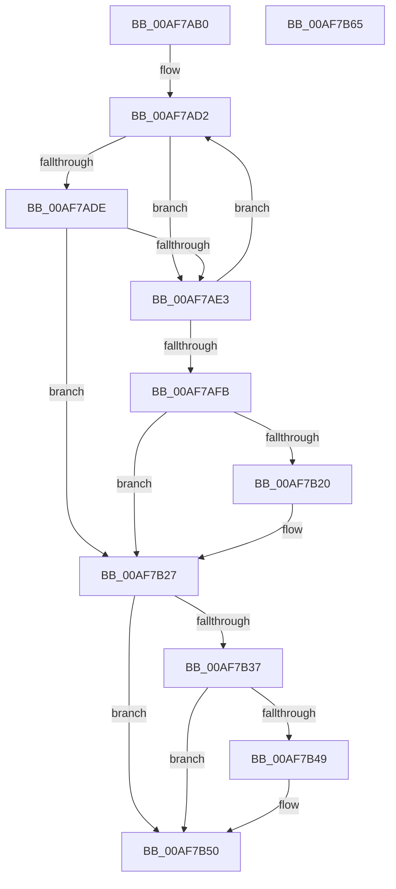

# CmFcpFeatureUsageProviderSubscriptionWrapper

- RVA: `0x00AF7AB0`–`0x00AF7B66` (길이 `182` bytes)
- VA: `0x0000000140AF7AB0`
- 실행 섹션: `PAGE`
- PDB 이름 있음: `예`; PDB Function 태그: `아니요`
- unwind 정보 RVA: `0x0005C954`
- 디코드: `53`개 명령, `182/182` bytes 표시
- 미해석 바이트: `0` (있으면 어셈블리에 `.byte`로 보존)

> 이 문서는 커널 이미지의 기계어와 PDB 기호를 분석해 생성했습니다. 4번과 5번은 함수 원형과 자료형을 바이너리 사용 방식에서 추정한 C 해석이며 원본 소스 복구 결과는 아닙니다.

## 1. Dependencies

- 직접 호출 지점: **4**; 고유 호출 대상: **3**
- 직접 호출자로 확인된 함수: **0**
- RIP 상대 이미지 참조: **0**

### Outgoing calls
- `0x00AF7AD5` → [Feature_Servicing_FixWarmRebootIssueOnLowCoreCPUs__private_IsEnabledDeviceUsageNoInline](../../text/66/Feature_Servicing_FixWarmRebootIssueOnLowCoreCPUs__private_IsEnabledDeviceUsageNoInline_function_0066B68C.md) (function, `0x0066B68C`)
- `0x00AF7B07` → [guard_dispatch_icall](../../text/6B/guard_dispatch_icall_function_006BAAD0.md) (function, `0x006BAAD0`)
- `0x00AF7B22` → [ExfUnblockPushLock](../../text/2A/ExfUnblockPushLock_function_002A3FE0.md) (function, `0x002A3FE0`)
- `0x00AF7B4B` → [ExfUnblockPushLock](../../text/2A/ExfUnblockPushLock_function_002A3FE0.md) (function, `0x002A3FE0`)

### Direct callers
- 이 함수 시작 RVA로 연결되는 직접 call은 확인되지 않았습니다. 간접 호출은 완전히 역산할 수 없습니다.

### Static image references
- 디코드된 RIP-relative 메모리 참조가 없습니다.

## 2. Other-region calls and transfers

- 다른 실행 섹션으로 향하는 call: **4**
  - `0x00AF7AD5` → [Feature_Servicing_FixWarmRebootIssueOnLowCoreCPUs__private_IsEnabledDeviceUsageNoInline](../../text/66/Feature_Servicing_FixWarmRebootIssueOnLowCoreCPUs__private_IsEnabledDeviceUsageNoInline_function_0066B68C.md) (`PAGE` → `.text`)
  - `0x00AF7B07` → [guard_dispatch_icall](../../text/6B/guard_dispatch_icall_function_006BAAD0.md) (`PAGE` → `.text`)
  - `0x00AF7B22` → [ExfUnblockPushLock](../../text/2A/ExfUnblockPushLock_function_002A3FE0.md) (`PAGE` → `.text`)
  - `0x00AF7B4B` → [ExfUnblockPushLock](../../text/2A/ExfUnblockPushLock_function_002A3FE0.md) (`PAGE` → `.text`)
- 별도 외부 분기/꼬리 이동을 확인하지 못했습니다.

## 3. Assembly (complete function range)

```asm
00AF7AB0  48 89 5C 24 08                  mov qword ptr [rsp + 8], rbx
00AF7AB5  48 89 6C 24 10                  mov qword ptr [rsp + 0x10], rbp
00AF7ABA  48 89 74 24 18                  mov qword ptr [rsp + 0x18], rsi
00AF7ABF  57                              push rdi
00AF7AC0  48 83 EC 20                     sub rsp, 0x20
00AF7AC4  48 8B 71 48                     mov rsi, qword ptr [rcx + 0x48]
00AF7AC8  48 8B EA                        mov rbp, rdx
00AF7ACB  48 8B F9                        mov rdi, rcx
00AF7ACE  0F 0D 49 54                     prefetchw byte ptr [rcx + 0x54]
00AF7AD2  8B 5F 54                        mov ebx, dword ptr [rdi + 0x54]
00AF7AD5  E8 B2 3B B7 FF                  call 0x14066b68c
00AF7ADA  85 C0                           test eax, eax
00AF7ADC  74 05                           je 0x140af7ae3
00AF7ADE  F6 C3 04                        test bl, 4
00AF7AE1  75 44                           jne 0x140af7b27
00AF7AE3  8B CB                           mov ecx, ebx
00AF7AE5  8B C3                           mov eax, ebx
00AF7AE7  83 E1 F8                        and ecx, 0xfffffff8
00AF7AEA  83 E0 04                        and eax, 4
00AF7AED  83 C1 08                        add ecx, 8
00AF7AF0  0B C8                           or ecx, eax
00AF7AF2  8B C3                           mov eax, ebx
00AF7AF4  F0 0F B1 4F 54                  lock cmpxchg dword ptr [rdi + 0x54], ecx
00AF7AF9  75 D7                           jne 0x140af7ad2
00AF7AFB  48 8B 47 40                     mov rax, qword ptr [rdi + 0x40]
00AF7AFF  33 D2                           xor edx, edx
00AF7B01  4C 8B C5                        mov r8, rbp
00AF7B04  8D 4A 01                        lea ecx, [rdx + 1]
00AF7B07  E8 C4 2F BC FF                  call 0x1406baad0
00AF7B0C  F0 83 47 54 08                  lock add dword ptr [rdi + 0x54], 8
00AF7B11  48 8D 4F 58                     lea rcx, [rdi + 0x58]
00AF7B15  F0 83 0C 24 00                  lock or dword ptr [rsp], 0
00AF7B1A  48 83 39 00                     cmp qword ptr [rcx], 0
00AF7B1E  74 07                           je 0x140af7b27
00AF7B20  33 D2                           xor edx, edx
00AF7B22  E8 B9 C4 7A FF                  call 0x1402a3fe0
00AF7B27  83 C8 FF                        or eax, 0xffffffff
00AF7B2A  F0 0F C1 86 5C 07 00 00         lock xadd dword ptr [rsi + 0x75c], eax
00AF7B32  83 F8 01                        cmp eax, 1
00AF7B35  75 19                           jne 0x140af7b50
00AF7B37  48 8D 8E C0 05 00 00            lea rcx, [rsi + 0x5c0]
00AF7B3E  F0 83 0C 24 00                  lock or dword ptr [rsp], 0
00AF7B43  48 83 39 00                     cmp qword ptr [rcx], 0
00AF7B47  74 07                           je 0x140af7b50
00AF7B49  33 D2                           xor edx, edx
00AF7B4B  E8 90 C4 7A FF                  call 0x1402a3fe0
00AF7B50  48 8B 5C 24 30                  mov rbx, qword ptr [rsp + 0x30]
00AF7B55  48 8B 6C 24 38                  mov rbp, qword ptr [rsp + 0x38]
00AF7B5A  48 8B 74 24 40                  mov rsi, qword ptr [rsp + 0x40]
00AF7B5F  48 83 C4 20                     add rsp, 0x20
00AF7B63  5F                              pop rdi
00AF7B64  C3                              ret
00AF7B65  CC                              int3
```

## 4. C-style interpretation (structured pseudocode)

```c
__int64 __fastcall CmFcpFeatureUsageProviderSubscriptionWrapper(__int64 a1, __int64 a2)
{
    __int64 result;
    __int64 v_rsp;
    unsigned int v_stack_m28;
    unsigned __int64 v_stack_p10;
    unsigned __int64 v_stack_p18;
    unsigned __int64 v_stack_p8;

    v_stack_p8 = v_rbx;
    v_stack_p10 = v_rbp;
    v_stack_p18 = v_rsi;
    v_rsp = (v_rsp) - (32);
loc_00AF7AD2:
    result = Feature_Servicing_FixWarmRebootIssueOnLowCoreCPUs__private_IsEnabledDeviceUsageNoInline(a1, a2, a3, a4);
    if ((unsigned int)(result) == 0) goto loc_00AF7AE3;
    if ((((unsigned __int8)((unsigned int)(*(unsigned int *)(a1 + 84)))) & (4)) != 0) goto loc_00AF7B27;
loc_00AF7AE3:
    a1 = (unsigned int)(((unsigned int)((unsigned int)((unsigned int)(*(unsigned int *)(a1 + 84))))) & (0xFFFFFFF8ULL));
    result = (unsigned int)(((unsigned int)((unsigned int)((unsigned int)(*(unsigned int *)(a1 + 84))))) & (4));
    a1 = (unsigned int)((a1) + (8));
    a1 = (unsigned int)((a1) | ((unsigned int)(result)));
    if (condition_is_not_equal) goto loc_00AF7AD2;
    a2 = 0;
    result = guard_dispatch_icall(a2 + 1, a2, 0, a4);
    if ((*(unsigned __int64 *)(a1 + 88)) != 0) {
        a2 = 0;
        result = ExfUnblockPushLock(a1 + 88, a2, 0, a4);
    }
    result = (unsigned int)((result) | (0xFFFFFFFFULL));
    if (((unsigned int)(result)) != 1) goto loc_00AF7B50;
    if ((*(unsigned __int64 *)(*(unsigned __int64 *)(a1 + 72) + 1472)) != 0) {
        a2 = 0;
        result = ExfUnblockPushLock(*(unsigned __int64 *)(a1 + 72) + 1472, a2, 0, a4);
    }
    v_rsp = (v_rsp) + (32);
    return result;
}
```

## 5. (Beta) C Style

```c
int64_t CmFcpFeatureUsageProviderSubscriptionWrapper(void *Arg1, int64_t Arg2)
{
    uint8_t *arg1 = (uint8_t *)Arg1;

    int64_t result;
    int64_t local_rsp;
    uint32_t v_stack_m28;
    uint64_t v_stack_p10;
    uint64_t v_stack_p18;
    uint64_t v_stack_p8;

    v_stack_p8 = local_rbx;
    v_stack_p10 = local_rbp;
    v_stack_p18 = local_rsi;
    local_rsp = (local_rsp) - (32);
loc_00AF7AD2:
    result = Feature_Servicing_FixWarmRebootIssueOnLowCoreCPUs__private_IsEnabledDeviceUsageNoInline(Arg1, Arg2, a3, a4);
    if ((uint32_t)(result) == 0) goto loc_00AF7AE3;
    if ((((uint8_t)((uint32_t)(*(uint32_t *)(arg1 + 0x54)))) & (4)) != 0) goto loc_00AF7B27;
loc_00AF7AE3:
    Arg1 = (uint32_t)(((uint32_t)((uint32_t)((uint32_t)(*(uint32_t *)(arg1 + 0x54))))) & (0xFFFFFFF8ULL));
    result = (uint32_t)(((uint32_t)((uint32_t)((uint32_t)(*(uint32_t *)(arg1 + 0x54))))) & (4));
    Arg1 = (uint32_t)((Arg1) + (8));
    Arg1 = (uint32_t)((Arg1) | ((uint32_t)(result)));
    if (condition_is_not_equal) goto loc_00AF7AD2;
    Arg2 = 0;
    result = guard_dispatch_icall(Arg2 + 1, Arg2, 0, a4);
    if ((*(uint64_t *)(arg1 + 0x58)) != 0) {
        Arg2 = 0;
        result = ExfUnblockPushLock(Arg1 + 88, Arg2, 0, a4);
    }
    result = (uint32_t)((result) | (0xFFFFFFFFULL));
    if (((uint32_t)(result)) != 1) goto loc_00AF7B50;
    if ((*(uint64_t *)(*(uint64_t *)(arg1 + 0x48) + 0x5C0)) != 0) {
        Arg2 = 0;
        result = ExfUnblockPushLock(*(uint64_t *)(arg1 + 0x48) + 1472, Arg2, 0, a4);
    }
    local_rsp = (local_rsp) + (32);
    return result;
}
```

### 관측된 메모리 오프셋

구조체 형식이 확인되지 않은 접근은 인자 기준의 오프셋으로만 기록했습니다.

| 기준 인자 | 오프셋 표현 | 폭 (bit) | 접근 |
|---|---:|---:|---|
| `Arg1` | `+ 0x0` | `64` | `R` |
| `Arg1` | `+ 0x40` | `64` | `R` |
| `Arg1` | `+ 0x48` | `64` | `R` |
| `Arg1` | `+ 0x54` | `8` | `R` |
| `Arg1` | `+ 0x54` | `32` | `R` |
| `Arg1` | `+ 0x54` | `32` | `R/W` |
| `Arg1` | `+ 0x58` | `64` | `R` |

## 6. Execution-region graph

[열기: 2D/3D 그래프와 함수 탐색 컨트롤 패널](../../../control-panel.html?section=page&rva=0x00AF7AB0&view=graph)

- 2D 그래프는 위에서 아래로 흐르고, 3D 그래프는 빈 공간을 드래그해 회전합니다. Shift+드래그는 이동, 휠은 확대·축소, 함수 노드 선택은 대상 보고서 이동입니다.

### Static fallback


