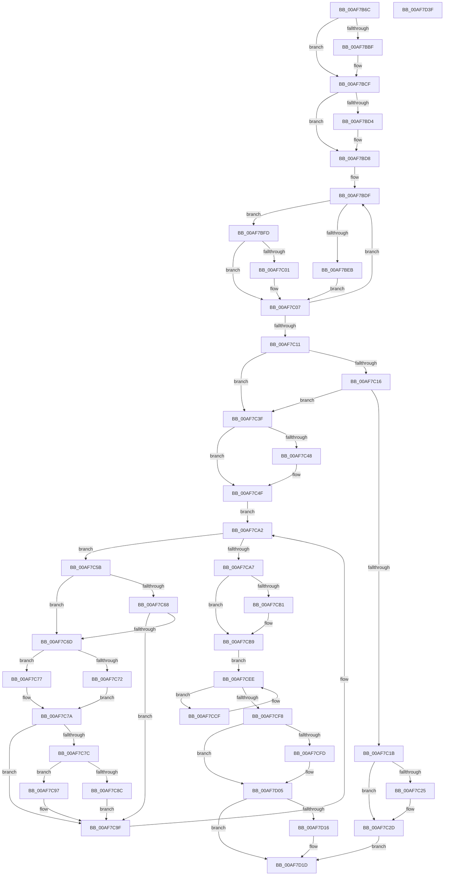

# CmFcpManagerProcessUsageDataProviders

- RVA: `0x00AF7B6C`–`0x00AF7D40` (길이 `468` bytes)
- VA: `0x0000000140AF7B6C`
- 실행 섹션: `PAGE`
- PDB 이름 있음: `예`; PDB Function 태그: `아니요`
- unwind 정보 RVA: `0x00060284`
- 디코드: `138`개 명령, `468/468` bytes 표시
- 미해석 바이트: `0` (있으면 어셈블리에 `.byte`로 보존)

> 이 문서는 커널 이미지의 기계어와 PDB 기호를 분석해 생성했습니다. 4번과 5번은 함수 원형과 자료형을 바이너리 사용 방식에서 추정한 C 해석이며 원본 소스 복구 결과는 아닙니다.

## 1. Dependencies

- 직접 호출 지점: **16**; 고유 호출 대상: **11**
- 직접 호출자로 확인된 함수: **1**
- RIP 상대 이미지 참조: **0**

### Outgoing calls
- `0x00AF7BA9` → [KeAbPreAcquire](../../text/21/KeAbPreAcquire_function_00210230.md) (function, `0x00210230`)
- `0x00AF7BCA` → [ExfAcquirePushLockSharedEx](../../text/21/ExfAcquirePushLockSharedEx_function_0021044C.md) (function, `0x0021044C`)
- `0x00AF7C28` → [ExfReleasePushLockShared](../../text/26/ExfReleasePushLockShared_function_00263440.md) (function, `0x00263440`)
- `0x00AF7C30` → [KeAbPostRelease](../../text/2E/KeAbPostRelease_function_002E1600.md) (function, `0x002E1600`)
- `0x00AF7C35` → [KeLeaveCriticalRegion](../../text/25/KeLeaveCriticalRegion_function_0025D8B0.md) (function, `0x0025D8B0`)
- `0x00AF7C3F` → [Feature_Servicing_FixWarmRebootIssueOnLowCoreCPUs__private_IsEnabledDeviceUsageNoInline](../../text/66/Feature_Servicing_FixWarmRebootIssueOnLowCoreCPUs__private_IsEnabledDeviceUsageNoInline_function_0066B68C.md) (function, `0x0066B68C`)
- `0x00AF7C5F` → [Feature_Servicing_FixWarmRebootIssueOnLowCoreCPUs__private_IsEnabledDeviceUsageNoInline](../../text/66/Feature_Servicing_FixWarmRebootIssueOnLowCoreCPUs__private_IsEnabledDeviceUsageNoInline_function_0066B68C.md) (function, `0x0066B68C`)
- `0x00AF7C83` → [Feature_Servicing_FixWarmRebootIssueOnLowCoreCPUs__private_IsEnabledDeviceUsageNoInline](../../text/66/Feature_Servicing_FixWarmRebootIssueOnLowCoreCPUs__private_IsEnabledDeviceUsageNoInline_function_0066B68C.md) (function, `0x0066B68C`)
- `0x00AF7C90` → [CmpWorkItemQueueWork](../../text/37/CmpWorkItemQueueWork_function_00378D4C.md) (function, `0x00378D4C`)
- `0x00AF7C9A` → [CmFcpUsageProviderQueueWork](../../text/66/CmFcpUsageProviderQueueWork_function_0066B46C.md) (function, `0x0066B46C`)
- `0x00AF7CB4` → [ExfReleasePushLockShared](../../text/26/ExfReleasePushLockShared_function_00263440.md) (function, `0x00263440`)
- `0x00AF7CBC` → [KeAbPostRelease](../../text/2E/KeAbPostRelease_function_002E1600.md) (function, `0x002E1600`)
- `0x00AF7CC1` → [KeLeaveCriticalRegion](../../text/25/KeLeaveCriticalRegion_function_0025D8B0.md) (function, `0x0025D8B0`)
- `0x00AF7CE9` → [ExBlockOnAddressPushLock](../../text/2A/ExBlockOnAddressPushLock_function_002A43A0.md) (function, `0x002A43A0`)
- `0x00AF7D18` → [ExfUnblockPushLock](../../text/2A/ExfUnblockPushLock_function_002A3FE0.md) (function, `0x002A3FE0`)
- `0x00AF7D22` → [CmFcpManagerPublishFeatureUsageData](../AB/CmFcpManagerPublishFeatureUsageData_function_00ABC468.md) (function, `0x00ABC468`)

### Direct callers
- [CmFcpManagerFlushFeatureUsageDataWorker](../7F/CmFcpManagerFlushFeatureUsageDataWorker_function_007F5510.md) at `0x007F5517`

### Static image references
- 디코드된 RIP-relative 메모리 참조가 없습니다.

## 2. Other-region calls and transfers

- 다른 실행 섹션으로 향하는 call: **15**
  - `0x00AF7BA9` → [KeAbPreAcquire](../../text/21/KeAbPreAcquire_function_00210230.md) (`PAGE` → `.text`)
  - `0x00AF7BCA` → [ExfAcquirePushLockSharedEx](../../text/21/ExfAcquirePushLockSharedEx_function_0021044C.md) (`PAGE` → `.text`)
  - `0x00AF7C28` → [ExfReleasePushLockShared](../../text/26/ExfReleasePushLockShared_function_00263440.md) (`PAGE` → `.text`)
  - `0x00AF7C30` → [KeAbPostRelease](../../text/2E/KeAbPostRelease_function_002E1600.md) (`PAGE` → `.text`)
  - `0x00AF7C35` → [KeLeaveCriticalRegion](../../text/25/KeLeaveCriticalRegion_function_0025D8B0.md) (`PAGE` → `.text`)
  - `0x00AF7C3F` → [Feature_Servicing_FixWarmRebootIssueOnLowCoreCPUs__private_IsEnabledDeviceUsageNoInline](../../text/66/Feature_Servicing_FixWarmRebootIssueOnLowCoreCPUs__private_IsEnabledDeviceUsageNoInline_function_0066B68C.md) (`PAGE` → `.text`)
  - `0x00AF7C5F` → [Feature_Servicing_FixWarmRebootIssueOnLowCoreCPUs__private_IsEnabledDeviceUsageNoInline](../../text/66/Feature_Servicing_FixWarmRebootIssueOnLowCoreCPUs__private_IsEnabledDeviceUsageNoInline_function_0066B68C.md) (`PAGE` → `.text`)
  - `0x00AF7C83` → [Feature_Servicing_FixWarmRebootIssueOnLowCoreCPUs__private_IsEnabledDeviceUsageNoInline](../../text/66/Feature_Servicing_FixWarmRebootIssueOnLowCoreCPUs__private_IsEnabledDeviceUsageNoInline_function_0066B68C.md) (`PAGE` → `.text`)
  - `0x00AF7C90` → [CmpWorkItemQueueWork](../../text/37/CmpWorkItemQueueWork_function_00378D4C.md) (`PAGE` → `.text`)
  - `0x00AF7C9A` → [CmFcpUsageProviderQueueWork](../../text/66/CmFcpUsageProviderQueueWork_function_0066B46C.md) (`PAGE` → `.text`)
  - `0x00AF7CB4` → [ExfReleasePushLockShared](../../text/26/ExfReleasePushLockShared_function_00263440.md) (`PAGE` → `.text`)
  - `0x00AF7CBC` → [KeAbPostRelease](../../text/2E/KeAbPostRelease_function_002E1600.md) (`PAGE` → `.text`)
  - `0x00AF7CC1` → [KeLeaveCriticalRegion](../../text/25/KeLeaveCriticalRegion_function_0025D8B0.md) (`PAGE` → `.text`)
  - `0x00AF7CE9` → [ExBlockOnAddressPushLock](../../text/2A/ExBlockOnAddressPushLock_function_002A43A0.md) (`PAGE` → `.text`)
  - `0x00AF7D18` → [ExfUnblockPushLock](../../text/2A/ExfUnblockPushLock_function_002A3FE0.md) (`PAGE` → `.text`)
- 별도 외부 분기/꼬리 이동을 확인하지 못했습니다.

## 3. Assembly (complete function range)

```asm
00AF7B6C  48 89 5C 24 18                  mov qword ptr [rsp + 0x18], rbx
00AF7B71  55                              push rbp
00AF7B72  56                              push rsi
00AF7B73  57                              push rdi
00AF7B74  41 54                           push r12
00AF7B76  41 55                           push r13
00AF7B78  41 56                           push r14
00AF7B7A  41 57                           push r15
00AF7B7C  48 83 EC 30                     sub rsp, 0x30
00AF7B80  65 48 8B 04 25 88 01 00 00      mov rax, qword ptr gs:[0x188]
00AF7B89  48 8D B1 C8 03 00 00            lea rsi, [rcx + 0x3c8]
00AF7B90  48 8B F9                        mov rdi, rcx
00AF7B93  45 33 E4                        xor r12d, r12d
00AF7B96  45 33 C0                        xor r8d, r8d
00AF7B99  33 D2                           xor edx, edx
00AF7B9B  48 8B CE                        mov rcx, rsi
00AF7B9E  41 8A EC                        mov bpl, r12b
00AF7BA1  66 FF 88 E4 01 00 00            dec word ptr [rax + 0x1e4]
00AF7BA8  90                              nop
00AF7BA9  E8 82 86 71 FF                  call 0x140210230
00AF7BAE  48 8B D8                        mov rbx, rax
00AF7BB1  45 8D 6C 24 11                  lea r13d, [r12 + 0x11]
00AF7BB6  33 C0                           xor eax, eax
00AF7BB8  F0 4C 0F B1 2E                  lock cmpxchg qword ptr [rsi], r13
00AF7BBD  74 10                           je 0x140af7bcf
00AF7BBF  4C 8B CE                        mov r9, rsi
00AF7BC2  4C 8B C3                        mov r8, rbx
00AF7BC5  33 D2                           xor edx, edx
00AF7BC7  48 8B CE                        mov rcx, rsi
00AF7BCA  E8 7D 88 71 FF                  call 0x14021044c
00AF7BCF  48 85 DB                        test rbx, rbx
00AF7BD2  74 04                           je 0x140af7bd8
00AF7BD4  C6 43 0A 01                     mov byte ptr [rbx + 0xa], 1
00AF7BD8  0F 0D 8F 30 07 00 00            prefetchw byte ptr [rdi + 0x730]
00AF7BDF  8B 87 30 07 00 00               mov eax, dword ptr [rdi + 0x730]
00AF7BE5  8B C8                           mov ecx, eax
00AF7BE7  A8 10                           test al, 0x10
00AF7BE9  74 12                           je 0x140af7bfd
00AF7BEB  83 E1 E0                        and ecx, 0xffffffe0
00AF7BEE  8B D0                           mov edx, eax
00AF7BF0  83 C1 20                        add ecx, 0x20
00AF7BF3  83 E2 06                        and edx, 6
00AF7BF6  0B CA                           or ecx, edx
00AF7BF8  41 8A EC                        mov bpl, r12b
00AF7BFB  EB 0A                           jmp 0x140af7c07
00AF7BFD  A8 08                           test al, 8
00AF7BFF  74 06                           je 0x140af7c07
00AF7C01  83 E1 F7                        and ecx, 0xfffffff7
00AF7C04  40 B5 01                        mov bpl, 1
00AF7C07  F0 0F B1 8F 30 07 00 00         lock cmpxchg dword ptr [rdi + 0x730], ecx
00AF7C0F  75 CE                           jne 0x140af7bdf
00AF7C11  40 84 ED                        test bpl, bpl
00AF7C14  75 29                           jne 0x140af7c3f
00AF7C16  F6 C1 20                        test cl, 0x20
00AF7C19  75 24                           jne 0x140af7c3f
00AF7C1B  49 8B C5                        mov rax, r13
00AF7C1E  F0 4C 0F B1 26                  lock cmpxchg qword ptr [rsi], r12
00AF7C23  74 08                           je 0x140af7c2d
00AF7C25  48 8B CE                        mov rcx, rsi
00AF7C28  E8 13 B8 76 FF                  call 0x140263440
00AF7C2D  48 8B CE                        mov rcx, rsi
00AF7C30  E8 CB 99 7E FF                  call 0x1402e1600
00AF7C35  E8 76 5C 76 FF                  call 0x14025d8b0
00AF7C3A  E9 DE 00 00 00                  jmp 0x140af7d1d
00AF7C3F  E8 48 3A B7 FF                  call 0x14066b68c
00AF7C44  85 C0                           test eax, eax
00AF7C46  75 07                           jne 0x140af7c4f
00AF7C48  44 89 A7 5C 07 00 00            mov dword ptr [rdi + 0x75c], r12d
00AF7C4F  4C 8D BF A0 05 00 00            lea r15, [rdi + 0x5a0]
00AF7C56  4D 8B 37                        mov r14, qword ptr [r15]
00AF7C59  EB 47                           jmp 0x140af7ca2
00AF7C5B  41 8B 5E 64                     mov ebx, dword ptr [r14 + 0x64]
00AF7C5F  E8 28 3A B7 FF                  call 0x14066b68c
00AF7C64  85 C0                           test eax, eax
00AF7C66  74 05                           je 0x140af7c6d
00AF7C68  F6 C3 04                        test bl, 4
00AF7C6B  75 32                           jne 0x140af7c9f
00AF7C6D  40 84 ED                        test bpl, bpl
00AF7C70  74 05                           je 0x140af7c77
00AF7C72  F6 C3 02                        test bl, 2
00AF7C75  EB 03                           jmp 0x140af7c7a
00AF7C77  F6 C3 01                        test bl, 1
00AF7C7A  74 23                           je 0x140af7c9f
00AF7C7C  F0 FF 87 5C 07 00 00            lock inc dword ptr [rdi + 0x75c]
00AF7C83  E8 04 3A B7 FF                  call 0x14066b68c
00AF7C88  85 C0                           test eax, eax
00AF7C8A  75 0B                           jne 0x140af7c97
00AF7C8C  49 8D 4E 10                     lea rcx, [r14 + 0x10]
00AF7C90  E8 B7 10 88 FF                  call 0x140378d4c
00AF7C95  EB 08                           jmp 0x140af7c9f
00AF7C97  49 8B CE                        mov rcx, r14
00AF7C9A  E8 CD 37 B7 FF                  call 0x14066b46c
00AF7C9F  4D 8B 36                        mov r14, qword ptr [r14]
00AF7CA2  4D 3B F7                        cmp r14, r15
00AF7CA5  75 B4                           jne 0x140af7c5b
00AF7CA7  49 8B C5                        mov rax, r13
00AF7CAA  F0 4C 0F B1 26                  lock cmpxchg qword ptr [rsi], r12
00AF7CAF  74 08                           je 0x140af7cb9
00AF7CB1  48 8B CE                        mov rcx, rsi
00AF7CB4  E8 87 B7 76 FF                  call 0x140263440
00AF7CB9  48 8B CE                        mov rcx, rsi
00AF7CBC  E8 3F 99 7E FF                  call 0x1402e1600
00AF7CC1  E8 EA 5B 76 FF                  call 0x14025d8b0
00AF7CC6  48 8D 9F 5C 07 00 00            lea rbx, [rdi + 0x75c]
00AF7CCD  EB 1F                           jmp 0x140af7cee
00AF7CCF  41 B9 04 00 00 00               mov r9d, 4
00AF7CD5  4C 89 64 24 20                  mov qword ptr [rsp + 0x20], r12
00AF7CDA  4C 8D 44 24 70                  lea r8, [rsp + 0x70]
00AF7CDF  48 8B D3                        mov rdx, rbx
00AF7CE2  48 8D 8F C0 05 00 00            lea rcx, [rdi + 0x5c0]
00AF7CE9  E8 B2 C6 7A FF                  call 0x1402a43a0
00AF7CEE  8B 03                           mov eax, dword ptr [rbx]
00AF7CF0  89 44 24 70                     mov dword ptr [rsp + 0x70], eax
00AF7CF4  85 C0                           test eax, eax
00AF7CF6  75 D7                           jne 0x140af7ccf
00AF7CF8  40 84 ED                        test bpl, bpl
00AF7CFB  75 08                           jne 0x140af7d05
00AF7CFD  F0 83 87 30 07 00 00 20         lock add dword ptr [rdi + 0x730], 0x20
00AF7D05  48 8D 8F C8 05 00 00            lea rcx, [rdi + 0x5c8]
00AF7D0C  F0 44 09 24 24                  lock or dword ptr [rsp], r12d
00AF7D11  4C 39 21                        cmp qword ptr [rcx], r12
00AF7D14  74 07                           je 0x140af7d1d
00AF7D16  33 D2                           xor edx, edx
00AF7D18  E8 C3 C2 7A FF                  call 0x1402a3fe0
00AF7D1D  33 D2                           xor edx, edx
00AF7D1F  48 8B CF                        mov rcx, rdi
00AF7D22  E8 41 47 FC FF                  call 0x140abc468
00AF7D27  48 8B 9C 24 80 00 00 00         mov rbx, qword ptr [rsp + 0x80]
00AF7D2F  48 83 C4 30                     add rsp, 0x30
00AF7D33  41 5F                           pop r15
00AF7D35  41 5E                           pop r14
00AF7D37  41 5D                           pop r13
00AF7D39  41 5C                           pop r12
00AF7D3B  5F                              pop rdi
00AF7D3C  5E                              pop rsi
00AF7D3D  5D                              pop rbp
00AF7D3E  C3                              ret
00AF7D3F  CC                              int3
```

## 4. C-style interpretation (structured pseudocode)

```c
__int64 __fastcall CmFcpManagerProcessUsageDataProviders(__int64 a1, int a2, int a3)
{
    __int64 result;
    __int64 v_r12;
    __int64 v_rbp;
    __int64 v_rsp;
    unsigned __int64 v_stack_m48;
    unsigned int v_stack_m68;
    unsigned __int64 v_stack_p18;
    unsigned __int64 v_stack_p8;

    v_stack_p18 = v_rbx;
    v_rsp = (v_rsp) - (48);
    v_r12 = 0;
    a3 = 0;
    a2 = 0;
    result = KeAbPreAcquire(a1 + 968, a2, a3, a4);
    result = 0;
    if (!(condition_is_equal)) {
        a4 = a1 + 968;
        a3 = 0;
        a2 = 0;
        a1 = a1 + 968;
        result = ExfAcquirePushLockSharedEx(a1, a2, a3, a4);
    }
    if (result != 0) {
        *(unsigned __int8 *)(result + 10) = 1;
    }
loc_00AF7BDF:
    if ((((unsigned __int8)((unsigned int)(*(unsigned int *)(a1 + 1840)))) & (16)) == 0) goto loc_00AF7BFD;
    a1 = (unsigned int)(((unsigned int)((unsigned int)((unsigned int)(*(unsigned int *)(a1 + 1840))))) & (0xFFFFFFE0ULL));
    a1 = (unsigned int)((a1) + (32));
    a2 = (unsigned int)(((unsigned int)((unsigned int)((unsigned int)(*(unsigned int *)(a1 + 1840))))) & (6));
    a1 = (unsigned int)((a1) | (a2));
    goto loc_00AF7C07;
loc_00AF7BFD:
    v_rbp = 0;
    if ((((unsigned __int8)((unsigned int)(*(unsigned int *)(a1 + 1840)))) & (8)) != 0) {
        a1 = (unsigned int)((a1) & (0xFFFFFFF7ULL));
        v_rbp = 1;
    }
    if (condition_is_not_equal) goto loc_00AF7BDF;
    if ((unsigned __int8)(v_rbp) != 0) goto loc_00AF7C3F;
    if ((((unsigned __int8)(a1)) & (32)) != 0) goto loc_00AF7C3F;
    result = v_r12 + 17;
    if ((((unsigned __int8)(a1)) & (32)) != 0) {
        a1 = a1 + 968;
        result = ExfReleasePushLockShared(a1, a2, a3, a4);
    }
    result = KeAbPostRelease(a1 + 968, a2, a3, a4);
    result = KeLeaveCriticalRegion(a1 + 968, a2, a3, a4);
    goto loc_00AF7D1D;
loc_00AF7C3F:
    result = Feature_Servicing_FixWarmRebootIssueOnLowCoreCPUs__private_IsEnabledDeviceUsageNoInline(a1 + 968, a2, a3, a4);
    if ((unsigned int)(result) == 0) {
        *(unsigned int *)(a1 + 1884) = 0;
    }
    goto loc_00AF7CA2;
loc_00AF7C5B:
    result = Feature_Servicing_FixWarmRebootIssueOnLowCoreCPUs__private_IsEnabledDeviceUsageNoInline(a1 + 968, a2, a3, a4);
    if ((unsigned int)(result) == 0) goto loc_00AF7C6D;
    if ((((unsigned __int8)((unsigned int)(*(unsigned int *)(*(unsigned __int64 *)(a1 + 1440) + 100)))) & (4)) != 0) goto loc_00AF7C9F;
loc_00AF7C6D:
    if ((unsigned __int8)(v_rbp) == 0) goto loc_00AF7C77;
    goto loc_00AF7C7A;
loc_00AF7C77:
loc_00AF7C7A:
    if ((((unsigned __int8)((unsigned int)(*(unsigned int *)(*(unsigned __int64 *)(a1 + 1440) + 100)))) & (1)) == 0) goto loc_00AF7C9F;
    result = Feature_Servicing_FixWarmRebootIssueOnLowCoreCPUs__private_IsEnabledDeviceUsageNoInline(a1 + 968, a2, a3, a4);
    if ((unsigned int)(result) != 0) goto loc_00AF7C97;
    result = CmpWorkItemQueueWork(*(unsigned __int64 *)(a1 + 1440) + 16, a2, a3, a4);
    goto loc_00AF7C9F;
loc_00AF7C97:
    result = CmFcpUsageProviderQueueWork(*(unsigned __int64 *)(a1 + 1440), a2, a3, a4);
loc_00AF7C9F:
loc_00AF7CA2:
    if ((*(unsigned __int64 *)(*(unsigned __int64 *)(a1 + 1440))) != (a1 + 1440)) goto loc_00AF7C5B;
    result = v_r12 + 17;
    if ((*(unsigned __int64 *)(*(unsigned __int64 *)(a1 + 1440))) != (a1 + 1440)) {
        a1 = a1 + 968;
        result = ExfReleasePushLockShared(a1, a2, a3, a4);
    }
    result = KeAbPostRelease(a1 + 968, a2, a3, a4);
    result = KeLeaveCriticalRegion(a1 + 968, a2, a3, a4);
    goto loc_00AF7CEE;
loc_00AF7CCF:
    v_stack_m48 = 0;
    result = ExBlockOnAddressPushLock(a1 + 1472, a1 + 1884, v_stack_p8, 4);
loc_00AF7CEE:
    v_stack_p8 = (unsigned int)((unsigned int)(*(unsigned int *)(a1 + 1884)));
    if ((unsigned int)((unsigned int)(*(unsigned int *)(a1 + 1884))) != 0) goto loc_00AF7CCF;
    if ((unsigned __int8)(v_rbp) == 0) {
    }
    result = (unsigned int)(*(unsigned int *)(a1 + 1884));
    if ((*(unsigned __int64 *)(a1 + 1480)) != 0) {
        a2 = 0;
        result = ExfUnblockPushLock(a1 + 1480, a2, v_stack_p8, 4);
    }
    a2 = 0;
    result = CmFcpManagerPublishFeatureUsageData(a1, a2, v_stack_p8, 4);
    v_rsp = (v_rsp) + (48);
    return result;
}
```

## 5. (Beta) C Style

```c
int64_t CmFcpManagerProcessUsageDataProviders(void *Arg1, int32_t Arg2, int32_t Arg3)
{
    uint8_t *arg1 = (uint8_t *)Arg1;

    int64_t result;
    int64_t local_r12;
    int64_t local_rbp;
    int64_t local_rsp;
    uint64_t v_stack_m48;
    uint32_t v_stack_m68;
    uint64_t v_stack_p18;
    uint64_t v_stack_p8;

    v_stack_p18 = local_rbx;
    local_rsp = (local_rsp) - (48);
    local_r12 = 0;
    Arg3 = 0;
    Arg2 = 0;
    result = KeAbPreAcquire(Arg1 + 968, Arg2, Arg3, a4);
    result = 0;
    if (!(condition_is_equal)) {
        a4 = Arg1 + 968;
        Arg3 = 0;
        Arg2 = 0;
        Arg1 = Arg1 + 968;
        result = ExfAcquirePushLockSharedEx(Arg1, Arg2, Arg3, a4);
    }
    if (result != 0) {
        *(uint8_t *)(result + 0xA) = 1;
    }
loc_00AF7BDF:
    if ((((uint8_t)((uint32_t)(*(uint32_t *)(arg1 + 0x730)))) & (16)) == 0) goto loc_00AF7BFD;
    Arg1 = (uint32_t)(((uint32_t)((uint32_t)((uint32_t)(*(uint32_t *)(arg1 + 0x730))))) & (0xFFFFFFE0ULL));
    Arg1 = (uint32_t)((Arg1) + (32));
    Arg2 = (uint32_t)(((uint32_t)((uint32_t)((uint32_t)(*(uint32_t *)(arg1 + 0x730))))) & (6));
    Arg1 = (uint32_t)((Arg1) | (Arg2));
    goto loc_00AF7C07;
loc_00AF7BFD:
    local_rbp = 0;
    if ((((uint8_t)((uint32_t)(*(uint32_t *)(arg1 + 0x730)))) & (8)) != 0) {
        Arg1 = (uint32_t)((Arg1) & (0xFFFFFFF7ULL));
        local_rbp = 1;
    }
    if (condition_is_not_equal) goto loc_00AF7BDF;
    if ((uint8_t)(local_rbp) != 0) goto loc_00AF7C3F;
    if ((((uint8_t)(Arg1)) & (32)) != 0) goto loc_00AF7C3F;
    result = local_r12 + 17;
    if ((((uint8_t)(Arg1)) & (32)) != 0) {
        Arg1 = Arg1 + 968;
        result = ExfReleasePushLockShared(Arg1, Arg2, Arg3, a4);
    }
    result = KeAbPostRelease(Arg1 + 968, Arg2, Arg3, a4);
    result = KeLeaveCriticalRegion(Arg1 + 968, Arg2, Arg3, a4);
    goto loc_00AF7D1D;
loc_00AF7C3F:
    result = Feature_Servicing_FixWarmRebootIssueOnLowCoreCPUs__private_IsEnabledDeviceUsageNoInline(Arg1 + 968, Arg2, Arg3, a4);
    if ((uint32_t)(result) == 0) {
        *(uint32_t *)(arg1 + 0x75C) = 0;
    }
    goto loc_00AF7CA2;
loc_00AF7C5B:
    result = Feature_Servicing_FixWarmRebootIssueOnLowCoreCPUs__private_IsEnabledDeviceUsageNoInline(Arg1 + 968, Arg2, Arg3, a4);
    if ((uint32_t)(result) == 0) goto loc_00AF7C6D;
    if ((((uint8_t)((uint32_t)(*(uint32_t *)(*(uint64_t *)(arg1 + 0x5A0) + 0x64)))) & (4)) != 0) goto loc_00AF7C9F;
loc_00AF7C6D:
    if ((uint8_t)(local_rbp) == 0) goto loc_00AF7C77;
    goto loc_00AF7C7A;
loc_00AF7C77:
loc_00AF7C7A:
    if ((((uint8_t)((uint32_t)(*(uint32_t *)(*(uint64_t *)(arg1 + 0x5A0) + 0x64)))) & (1)) == 0) goto loc_00AF7C9F;
    result = Feature_Servicing_FixWarmRebootIssueOnLowCoreCPUs__private_IsEnabledDeviceUsageNoInline(Arg1 + 968, Arg2, Arg3, a4);
    if ((uint32_t)(result) != 0) goto loc_00AF7C97;
    result = CmpWorkItemQueueWork(*(uint64_t *)(arg1 + 0x5A0) + 16, Arg2, Arg3, a4);
    goto loc_00AF7C9F;
loc_00AF7C97:
    result = CmFcpUsageProviderQueueWork(*(uint64_t *)(arg1 + 0x5A0), Arg2, Arg3, a4);
loc_00AF7C9F:
loc_00AF7CA2:
    if ((*(uint64_t *)(*(uint64_t *)(arg1 + 0x5A0))) != (Arg1 + 1440)) goto loc_00AF7C5B;
    result = local_r12 + 17;
    if ((*(uint64_t *)(*(uint64_t *)(arg1 + 0x5A0))) != (Arg1 + 1440)) {
        Arg1 = Arg1 + 968;
        result = ExfReleasePushLockShared(Arg1, Arg2, Arg3, a4);
    }
    result = KeAbPostRelease(Arg1 + 968, Arg2, Arg3, a4);
    result = KeLeaveCriticalRegion(Arg1 + 968, Arg2, Arg3, a4);
    goto loc_00AF7CEE;
loc_00AF7CCF:
    v_stack_m48 = 0;
    result = ExBlockOnAddressPushLock(Arg1 + 1472, Arg1 + 1884, v_stack_p8, 4);
loc_00AF7CEE:
    v_stack_p8 = (uint32_t)((uint32_t)(*(uint32_t *)(arg1 + 0x75C)));
    if ((uint32_t)((uint32_t)(*(uint32_t *)(arg1 + 0x75C))) != 0) goto loc_00AF7CCF;
    if ((uint8_t)(local_rbp) == 0) {
    }
    result = (uint32_t)(*(uint32_t *)(arg1 + 0x75C));
    if ((*(uint64_t *)(arg1 + 0x5C8)) != 0) {
        Arg2 = 0;
        result = ExfUnblockPushLock(Arg1 + 1480, Arg2, v_stack_p8, 4);
    }
    Arg2 = 0;
    result = CmFcpManagerPublishFeatureUsageData(Arg1, Arg2, v_stack_p8, 4);
    local_rsp = (local_rsp) + (48);
    return result;
}
```

### 관측된 메모리 오프셋

구조체 형식이 확인되지 않은 접근은 인자 기준의 오프셋으로만 기록했습니다.

| 기준 인자 | 오프셋 표현 | 폭 (bit) | 접근 |
|---|---:|---:|---|
| `Arg1` | `+ 0x0` | `32` | `R` |
| `Arg1` | `+ 0x0` | `64` | `R` |
| `Arg1` | `+ 0x3C8` | `64` | `R` |
| `Arg1` | `+ 0x5A0` | `64` | `R` |
| `Arg1` | `+ 0x5C0` | `64` | `R` |
| `Arg1` | `+ 0x5C8` | `64` | `R` |
| `Arg1` | `+ 0x730` | `8` | `R` |
| `Arg1` | `+ 0x730` | `32` | `R` |
| `Arg1` | `+ 0x730` | `32` | `R/W` |
| `Arg1` | `+ 0x75C` | `32` | `R/W` |
| `Arg1` | `+ 0x75C` | `32` | `W` |
| `Arg1` | `+ 0x75C` | `64` | `R` |

## 6. Execution-region graph

[열기: 2D/3D 그래프와 함수 탐색 컨트롤 패널](../../../control-panel.html?section=page&rva=0x00AF7B6C&view=graph)

- 2D 그래프는 위에서 아래로 흐르고, 3D 그래프는 빈 공간을 드래그해 회전합니다. Shift+드래그는 이동, 휠은 확대·축소, 함수 노드 선택은 대상 보고서 이동입니다.

### Static fallback


