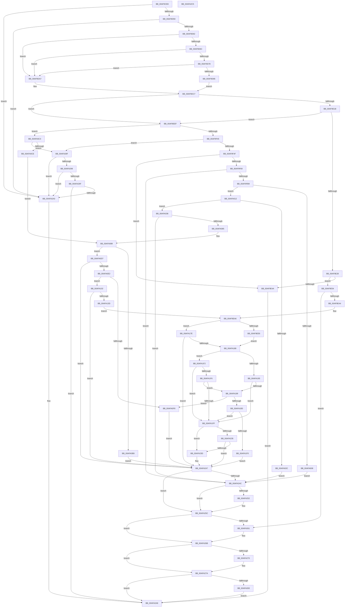

# CmGetDeviceCompoundFiltersWorker

- RVA: `0x00AF9CE8`–`0x00AFA2C6` (길이 `1,502` bytes)
- VA: `0x0000000140AF9CE8`
- 실행 섹션: `PAGE`
- PDB 이름 있음: `예`; PDB Function 태그: `아니요`
- unwind 정보 RVA: `0x000DAA70`
- 디코드: `383`개 명령, `1,502/1,502` bytes 표시
- 미해석 바이트: `0` (있으면 어셈블리에 `.byte`로 보존)

> 이 문서는 커널 이미지의 기계어와 PDB 기호를 분석해 생성했습니다. 4번과 5번은 함수 원형과 자료형을 바이너리 사용 방식에서 추정한 C 해석이며 원본 소스 복구 결과는 아닙니다.

## 1. Dependencies

- 직접 호출 지점: **23**; 고유 호출 대상: **9**
- 직접 호출자로 확인된 함수: **1**
- RIP 상대 이미지 참조: **10**

### Outgoing calls
- `0x00AF9D4C` → [PnpCtxRegQueryInfoKey](../99/PnpCtxRegQueryInfoKey_function_009945FC.md) (function, `0x009945FC`)
- `0x00AF9E0B` → [PnpGetObjectProperty](../8E/PnpGetObjectProperty_function_008E2180.md) (function, `0x008E2180`)
- `0x00AF9E3D` → [ExAllocatePool2](../../poolcode/B8/ExAllocatePool2_function_00B820F0.md) (function, `0x00B820F0`)
- `0x00AF9E95` → [PnpGetObjectProperty](../8E/PnpGetObjectProperty_function_008E2180.md) (function, `0x008E2180`)
- `0x00AF9ED4` → [CmGetDeviceMappedPropertyFromRegProp](../9D/CmGetDeviceMappedPropertyFromRegProp_function_009D2A60.md) (function, `0x009D2A60`)
- `0x00AF9F27` → [PnpGetObjectProperty](../8E/PnpGetObjectProperty_function_008E2180.md) (function, `0x008E2180`)
- `0x00AF9F58` → [ExAllocatePool2](../../poolcode/B8/ExAllocatePool2_function_00B820F0.md) (function, `0x00B820F0`)
- `0x00AF9FAA` → [PnpGetObjectProperty](../8E/PnpGetObjectProperty_function_008E2180.md) (function, `0x008E2180`)
- `0x00AF9FFC` → [PnpGetObjectProperty](../8E/PnpGetObjectProperty_function_008E2180.md) (function, `0x008E2180`)
- `0x00AFA01B` → [ExAllocatePool2](../../poolcode/B8/ExAllocatePool2_function_00B820F0.md) (function, `0x00B820F0`)
- `0x00AFA076` → [PnpGetObjectProperty](../8E/PnpGetObjectProperty_function_008E2180.md) (function, `0x008E2180`)
- `0x00AFA0AE` → [CmGetDeclarativeFilterList](../82/CmGetDeclarativeFilterList_function_0082FE7C.md) (function, `0x0082FE7C`)
- `0x00AFA0EB` → [ExAllocatePool2](../../poolcode/B8/ExAllocatePool2_function_00B820F0.md) (function, `0x00B820F0`)
- `0x00AFA12E` → [CmGetDeclarativeFilterList](../82/CmGetDeclarativeFilterList_function_0082FE7C.md) (function, `0x0082FE7C`)
- `0x00AFA174` → [PnpSetObjectProperty](../8F/PnpSetObjectProperty_function_008F66E8.md) (function, `0x008F66E8`)
- `0x00AFA189` → [Feature_KernelPnP_FilterListMerging__private_IsEnabledDeviceUsageNoInline](../../text/6A/Feature_KernelPnP_FilterListMerging__private_IsEnabledDeviceUsageNoInline_function_006A2DE8.md) (function, `0x006A2DE8`)
- `0x00AFA1A2` → [ExAllocatePool2](../../poolcode/B8/ExAllocatePool2_function_00B820F0.md) (function, `0x00B820F0`)
- `0x00AFA1E5` → [CmGetDeviceMappedPropertyFromRegProp](../9D/CmGetDeviceMappedPropertyFromRegProp_function_009D2A60.md) (function, `0x009D2A60`)
- `0x00AFA223` → [CmMergeFilterLists](CmMergeFilterLists_function_00AFA2CC.md) (function, `0x00AFA2CC`)
- `0x00AFA257` → [ExFreePoolWithTag](../../poolcode/B8/ExFreePoolWithTag_function_00B82870.md) (function, `0x00B82870`)
- `0x00AFA266` → [ExFreePoolWithTag](../../poolcode/B8/ExFreePoolWithTag_function_00B82870.md) (function, `0x00B82870`)
- `0x00AFA275` → [ExFreePoolWithTag](../../poolcode/B8/ExFreePoolWithTag_function_00B82870.md) (function, `0x00B82870`)
- `0x00AFA288` → [ExFreePoolWithTag](../../poolcode/B8/ExFreePoolWithTag_function_00B82870.md) (function, `0x00B82870`)

### Direct callers
- [sub_00B2F5B8](../B2/Unknown_function_00B2F5B8.md) at `0x00B2F5FC`

### Static image references
- `0x00AF9D6F` → RVA `0x000140C8` (`.rdata`; read)
- `0x00AF9D7C` → RVA `0x000140D0` (`.rdata`; read)
- `0x00AF9D85` → RVA `0x00022AC8` (`.rdata`; read)
- `0x00AF9D90` → RVA `0x00022FE8` (`.rdata`; read)
- `0x00AF9D97` → RVA `0x00B0D960` (` ?? ::NNGAKEGL::`string'`; read)
- `0x00AF9D9E` → RVA `0x00022F98` (`.rdata`; read)
- `0x00AF9DA7` → RVA `0x00022080` (`.rdata`; read)
- `0x00AF9DB2` → RVA `0x00023578` (`.rdata`; read)
- `0x00AF9DB9` → RVA `0x00B0D970` (` ?? ::NNGAKEGL::`string'`; read)
- `0x00AF9DC0` → RVA `0x000219D8` (`.rdata`; read)

## 2. Other-region calls and transfers

- 다른 실행 섹션으로 향하는 call: **10**
  - `0x00AF9E3D` → [ExAllocatePool2](../../poolcode/B8/ExAllocatePool2_function_00B820F0.md) (`PAGE` → `POOLCODE`)
  - `0x00AF9F58` → [ExAllocatePool2](../../poolcode/B8/ExAllocatePool2_function_00B820F0.md) (`PAGE` → `POOLCODE`)
  - `0x00AFA01B` → [ExAllocatePool2](../../poolcode/B8/ExAllocatePool2_function_00B820F0.md) (`PAGE` → `POOLCODE`)
  - `0x00AFA0EB` → [ExAllocatePool2](../../poolcode/B8/ExAllocatePool2_function_00B820F0.md) (`PAGE` → `POOLCODE`)
  - `0x00AFA189` → [Feature_KernelPnP_FilterListMerging__private_IsEnabledDeviceUsageNoInline](../../text/6A/Feature_KernelPnP_FilterListMerging__private_IsEnabledDeviceUsageNoInline_function_006A2DE8.md) (`PAGE` → `.text`)
  - `0x00AFA1A2` → [ExAllocatePool2](../../poolcode/B8/ExAllocatePool2_function_00B820F0.md) (`PAGE` → `POOLCODE`)
  - `0x00AFA257` → [ExFreePoolWithTag](../../poolcode/B8/ExFreePoolWithTag_function_00B82870.md) (`PAGE` → `POOLCODE`)
  - `0x00AFA266` → [ExFreePoolWithTag](../../poolcode/B8/ExFreePoolWithTag_function_00B82870.md) (`PAGE` → `POOLCODE`)
  - `0x00AFA275` → [ExFreePoolWithTag](../../poolcode/B8/ExFreePoolWithTag_function_00B82870.md) (`PAGE` → `POOLCODE`)
  - `0x00AFA288` → [ExFreePoolWithTag](../../poolcode/B8/ExFreePoolWithTag_function_00B82870.md) (`PAGE` → `POOLCODE`)
- 별도 외부 분기/꼬리 이동을 확인하지 못했습니다.

## 3. Assembly (complete function range)

```asm
00AF9CE8  48 8B C4                        mov rax, rsp
00AF9CEB  48 89 58 08                     mov qword ptr [rax + 8], rbx
00AF9CEF  4C 89 48 20                     mov qword ptr [rax + 0x20], r9
00AF9CF3  4C 89 40 18                     mov qword ptr [rax + 0x18], r8
00AF9CF7  48 89 50 10                     mov qword ptr [rax + 0x10], rdx
00AF9CFB  55                              push rbp
00AF9CFC  56                              push rsi
00AF9CFD  57                              push rdi
00AF9CFE  41 54                           push r12
00AF9D00  41 55                           push r13
00AF9D02  41 56                           push r14
00AF9D04  41 57                           push r15
00AF9D06  48 8D 68 C1                     lea rbp, [rax - 0x3f]
00AF9D0A  48 81 EC 90 00 00 00            sub rsp, 0x90
00AF9D11  33 DB                           xor ebx, ebx
00AF9D13  49 8B C1                        mov rax, r9
00AF9D16  48 89 5C 24 30                  mov qword ptr [rsp + 0x30], rbx
00AF9D1B  4D 8B E0                        mov r12, r8
00AF9D1E  4C 8B EA                        mov r13, rdx
00AF9D21  48 89 5C 24 28                  mov qword ptr [rsp + 0x28], rbx
00AF9D26  45 33 C9                        xor r9d, r9d
00AF9D29  48 89 5C 24 20                  mov qword ptr [rsp + 0x20], rbx
00AF9D2E  4C 8D 45 DF                     lea r8, [rbp - 0x21]
00AF9D32  89 5D DB                        mov dword ptr [rbp - 0x25], ebx
00AF9D35  48 8B D0                        mov rdx, rax
00AF9D38  89 5D DF                        mov dword ptr [rbp - 0x21], ebx
00AF9D3B  4C 8B F9                        mov r15, rcx
00AF9D3E  48 89 5D E7                     mov qword ptr [rbp - 0x19], rbx
00AF9D42  8B F3                           mov esi, ebx
00AF9D44  89 5D D7                        mov dword ptr [rbp - 0x29], ebx
00AF9D47  8B FB                           mov edi, ebx
00AF9D49  44 8B F3                        mov r14d, ebx
00AF9D4C  E8 AB A8 E9 FF                  call 0x1409945fc
00AF9D51  85 C0                           test eax, eax
00AF9D53  0F 88 4A 05 00 00               js 0x140afa2a3
00AF9D59  39 5D DF                        cmp dword ptr [rbp - 0x21], ebx
00AF9D5C  0F 84 41 05 00 00               je 0x140afa2a3
00AF9D62  48 8B 4D 67                     mov rcx, qword ptr [rbp + 0x67]
00AF9D66  83 79 10 16                     cmp dword ptr [rcx + 0x10], 0x16
00AF9D6A  75 3B                           jne 0x140af9da7
00AF9D6C  48 8B 01                        mov rax, qword ptr [rcx]
00AF9D6F  48 3B 05 52 A3 51 FF            cmp rax, qword ptr [rip - 0xae5cae]
00AF9D76  75 2F                           jne 0x140af9da7
00AF9D78  48 8B 41 08                     mov rax, qword ptr [rcx + 8]
00AF9D7C  48 3B 05 4D A3 51 FF            cmp rax, qword ptr [rip - 0xae5cb3]
00AF9D83  75 22                           jne 0x140af9da7
00AF9D85  48 8D 05 3C 8D 52 FF            lea rax, [rip - 0xad72c4]
00AF9D8C  48 89 45 EF                     mov qword ptr [rbp - 0x11], rax
00AF9D90  48 8D 0D 51 92 52 FF            lea rcx, [rip - 0xad6daf]
00AF9D97  48 8D 05 C2 3B 01 00            lea rax, [rip + 0x13bc2]
00AF9D9E  48 8D 1D F3 91 52 FF            lea rbx, [rip - 0xad6e0d]
00AF9DA5  EB 20                           jmp 0x140af9dc7
00AF9DA7  48 8D 05 D2 82 52 FF            lea rax, [rip - 0xad7d2e]
00AF9DAE  48 89 45 EF                     mov qword ptr [rbp - 0x11], rax
00AF9DB2  48 8D 0D BF 97 52 FF            lea rcx, [rip - 0xad6841]
00AF9DB9  48 8D 05 B0 3B 01 00            lea rax, [rip + 0x13bb0]
00AF9DC0  48 8D 1D 11 7C 52 FF            lea rbx, [rip - 0xad83ef]
00AF9DC7  33 D2                           xor edx, edx
00AF9DC9  48 89 45 DF                     mov qword ptr [rbp - 0x21], rax
00AF9DCD  89 54 24 50                     mov dword ptr [rsp + 0x50], edx
00AF9DD1  48 8D 45 D7                     lea rax, [rbp - 0x29]
00AF9DD5  48 89 44 24 48                  mov qword ptr [rsp + 0x48], rax
00AF9DDA  4D 8B CC                        mov r9, r12
00AF9DDD  89 54 24 40                     mov dword ptr [rsp + 0x40], edx
00AF9DE1  48 8D 45 DB                     lea rax, [rbp - 0x25]
00AF9DE5  48 89 54 24 38                  mov qword ptr [rsp + 0x38], rdx
00AF9DEA  44 8D 42 01                     lea r8d, [rdx + 1]
00AF9DEE  48 89 44 24 30                  mov qword ptr [rsp + 0x30], rax
00AF9DF3  48 89 4C 24 28                  mov qword ptr [rsp + 0x28], rcx
00AF9DF8  48 89 54 24 20                  mov qword ptr [rsp + 0x20], rdx
00AF9DFD  49 8B D5                        mov rdx, r13
00AF9E00  48 89 4D F7                     mov qword ptr [rbp - 9], rcx
00AF9E04  49 8B CF                        mov rcx, r15
00AF9E07  48 89 5D FF                     mov qword ptr [rbp - 1], rbx
00AF9E0B  E8 70 83 DE FF                  call 0x1408e2180
00AF9E10  3D 23 00 00 C0                  cmp eax, 0xc0000023
00AF9E15  0F 85 D4 00 00 00               jne 0x140af9eef
00AF9E1B  81 7D DB 12 20 00 00            cmp dword ptr [rbp - 0x25], 0x2012
00AF9E22  0F 85 C7 00 00 00               jne 0x140af9eef
00AF9E28  8B 55 D7                        mov edx, dword ptr [rbp - 0x29]
00AF9E2B  41 BC 50 4E 50 52               mov r12d, 0x52504e50
00AF9E31  41 BD 00 01 00 00               mov r13d, 0x100
00AF9E37  45 8B C4                        mov r8d, r12d
00AF9E3A  41 8B CD                        mov ecx, r13d
00AF9E3D  E8 AE 82 08 00                  call 0x140b820f0
00AF9E42  48 8B F8                        mov rdi, rax
00AF9E45  48 85 C0                        test rax, rax
00AF9E48  75 0A                           jne 0x140af9e54
00AF9E4A  BB 17 00 00 C0                  mov ebx, 0xc0000017
00AF9E4F  E9 54 04 00 00                  jmp 0x140afa2a8
00AF9E54  21 74 24 50                     and dword ptr [rsp + 0x50], esi
00AF9E58  48 8D 45 D7                     lea rax, [rbp - 0x29]
00AF9E5C  4C 8B 4D 57                     mov r9, qword ptr [rbp + 0x57]
00AF9E60  41 B8 01 00 00 00               mov r8d, 1
00AF9E66  48 8B 55 4F                     mov rdx, qword ptr [rbp + 0x4f]
00AF9E6A  49 8B CF                        mov rcx, r15
00AF9E6D  48 89 44 24 48                  mov qword ptr [rsp + 0x48], rax
00AF9E72  8B 45 D7                        mov eax, dword ptr [rbp - 0x29]
00AF9E75  89 44 24 40                     mov dword ptr [rsp + 0x40], eax
00AF9E79  48 8D 45 DB                     lea rax, [rbp - 0x25]
00AF9E7D  48 89 7C 24 38                  mov qword ptr [rsp + 0x38], rdi
00AF9E82  48 89 44 24 30                  mov qword ptr [rsp + 0x30], rax
00AF9E87  48 8B 45 F7                     mov rax, qword ptr [rbp - 9]
00AF9E8B  48 89 44 24 28                  mov qword ptr [rsp + 0x28], rax
00AF9E90  48 21 74 24 20                  and qword ptr [rsp + 0x20], rsi
00AF9E95  E8 E6 82 DE FF                  call 0x1408e2180
00AF9E9A  8B D8                           mov ebx, eax
00AF9E9C  85 C0                           test eax, eax
00AF9E9E  0F 88 BD 03 00 00               js 0x140afa261
00AF9EA4  33 DB                           xor ebx, ebx
00AF9EA6  4C 8B 4D 6F                     mov r9, qword ptr [rbp + 0x6f]
00AF9EAA  48 8D 45 D7                     lea rax, [rbp - 0x29]
00AF9EAE  4C 8B 45 57                     mov r8, qword ptr [rbp + 0x57]
00AF9EB2  49 8B CF                        mov rcx, r15
00AF9EB5  48 8B 55 4F                     mov rdx, qword ptr [rbp + 0x4f]
00AF9EB9  89 5C 24 40                     mov dword ptr [rsp + 0x40], ebx
00AF9EBD  48 89 44 24 38                  mov qword ptr [rsp + 0x38], rax
00AF9EC2  48 8D 45 DB                     lea rax, [rbp - 0x25]
00AF9EC6  89 5C 24 30                     mov dword ptr [rsp + 0x30], ebx
00AF9ECA  48 89 5C 24 28                  mov qword ptr [rsp + 0x28], rbx
00AF9ECF  48 89 44 24 20                  mov qword ptr [rsp + 0x20], rax
00AF9ED4  E8 87 8B ED FF                  call 0x1409d2a60
00AF9ED9  8B D8                           mov ebx, eax
00AF9EDB  3D 25 02 00 C0                  cmp eax, 0xc0000225
00AF9EE0  0F 85 98 02 00 00               jne 0x140afa17e
00AF9EE6  44 21 75 D7                     and dword ptr [rbp - 0x29], r14d
00AF9EEA  E9 9A 02 00 00                  jmp 0x140afa189
00AF9EEF  89 74 24 50                     mov dword ptr [rsp + 0x50], esi
00AF9EF3  48 8D 45 D7                     lea rax, [rbp - 0x29]
00AF9EF7  48 89 44 24 48                  mov qword ptr [rsp + 0x48], rax
00AF9EFC  4D 8B CC                        mov r9, r12
00AF9EFF  89 74 24 40                     mov dword ptr [rsp + 0x40], esi
00AF9F03  48 8D 45 DB                     lea rax, [rbp - 0x25]
00AF9F07  48 89 74 24 38                  mov qword ptr [rsp + 0x38], rsi
00AF9F0C  41 B8 01 00 00 00               mov r8d, 1
00AF9F12  48 89 44 24 30                  mov qword ptr [rsp + 0x30], rax
00AF9F17  49 8B D5                        mov rdx, r13
00AF9F1A  48 89 5C 24 28                  mov qword ptr [rsp + 0x28], rbx
00AF9F1F  49 8B CF                        mov rcx, r15
00AF9F22  48 89 74 24 20                  mov qword ptr [rsp + 0x20], rsi
00AF9F27  E8 54 82 DE FF                  call 0x1408e2180
00AF9F2C  8B D8                           mov ebx, eax
00AF9F2E  41 BC 50 4E 50 52               mov r12d, 0x52504e50
00AF9F34  41 BD 00 01 00 00               mov r13d, 0x100
00AF9F3A  3D 23 00 00 C0                  cmp eax, 0xc0000023
00AF9F3F  0F 85 7E 01 00 00               jne 0x140afa0c3
00AF9F45  83 7D DB 12                     cmp dword ptr [rbp - 0x25], 0x12
00AF9F49  0F 85 40 03 00 00               jne 0x140afa28f
00AF9F4F  8B 55 D7                        mov edx, dword ptr [rbp - 0x29]
00AF9F52  45 8B C4                        mov r8d, r12d
00AF9F55  41 8B CD                        mov ecx, r13d
00AF9F58  E8 93 81 08 00                  call 0x140b820f0
00AF9F5D  48 8B F0                        mov rsi, rax
00AF9F60  48 85 C0                        test rax, rax
00AF9F63  0F 84 E1 FE FF FF               je 0x140af9e4a
00AF9F69  21 7C 24 50                     and dword ptr [rsp + 0x50], edi
00AF9F6D  48 8D 45 D7                     lea rax, [rbp - 0x29]
00AF9F71  4C 8B 4D 57                     mov r9, qword ptr [rbp + 0x57]
00AF9F75  41 B8 01 00 00 00               mov r8d, 1
00AF9F7B  48 8B 55 4F                     mov rdx, qword ptr [rbp + 0x4f]
00AF9F7F  49 8B CF                        mov rcx, r15
00AF9F82  48 89 44 24 48                  mov qword ptr [rsp + 0x48], rax
00AF9F87  8B 45 D7                        mov eax, dword ptr [rbp - 0x29]
00AF9F8A  89 44 24 40                     mov dword ptr [rsp + 0x40], eax
00AF9F8E  48 8D 45 DB                     lea rax, [rbp - 0x25]
00AF9F92  48 89 74 24 38                  mov qword ptr [rsp + 0x38], rsi
00AF9F97  48 89 44 24 30                  mov qword ptr [rsp + 0x30], rax
00AF9F9C  48 8B 45 FF                     mov rax, qword ptr [rbp - 1]
00AF9FA0  48 89 44 24 28                  mov qword ptr [rsp + 0x28], rax
00AF9FA5  48 21 7C 24 20                  and qword ptr [rsp + 0x20], rdi
00AF9FAA  E8 D1 81 DE FF                  call 0x1408e2180
00AF9FAF  8B D8                           mov ebx, eax
00AF9FB1  85 C0                           test eax, eax
00AF9FB3  0F 88 93 02 00 00               js 0x140afa24c
00AF9FB9  48 8B 55 4F                     mov rdx, qword ptr [rbp + 0x4f]
00AF9FBD  48 8D 45 D7                     lea rax, [rbp - 0x29]
00AF9FC1  33 DB                           xor ebx, ebx
00AF9FC3  41 B8 01 00 00 00               mov r8d, 1
00AF9FC9  89 5C 24 50                     mov dword ptr [rsp + 0x50], ebx
00AF9FCD  49 8B CF                        mov rcx, r15
00AF9FD0  48 89 44 24 48                  mov qword ptr [rsp + 0x48], rax
00AF9FD5  48 8D 45 DB                     lea rax, [rbp - 0x25]
00AF9FD9  89 5C 24 40                     mov dword ptr [rsp + 0x40], ebx
00AF9FDD  48 89 5C 24 38                  mov qword ptr [rsp + 0x38], rbx
00AF9FE2  48 89 44 24 30                  mov qword ptr [rsp + 0x30], rax
00AF9FE7  48 8B 45 EF                     mov rax, qword ptr [rbp - 0x11]
00AF9FEB  48 89 44 24 28                  mov qword ptr [rsp + 0x28], rax
00AF9FF0  48 89 5C 24 20                  mov qword ptr [rsp + 0x20], rbx
00AF9FF5  48 8B 5D 57                     mov rbx, qword ptr [rbp + 0x57]
00AF9FF9  4C 8B CB                        mov r9, rbx
00AF9FFC  E8 7F 81 DE FF                  call 0x1408e2180
00AFA001  3D 23 00 00 C0                  cmp eax, 0xc0000023
00AFA006  74 0A                           je 0x140afa012
00AFA008  BB 25 02 00 C0                  mov ebx, 0xc0000225
00AFA00D  E9 3A 02 00 00                  jmp 0x140afa24c
00AFA012  8B 55 D7                        mov edx, dword ptr [rbp - 0x29]
00AFA015  45 8B C4                        mov r8d, r12d
00AFA018  49 8B CD                        mov rcx, r13
00AFA01B  E8 D0 80 08 00                  call 0x140b820f0
00AFA020  48 89 45 E7                     mov qword ptr [rbp - 0x19], rax
00AFA024  48 8B C8                        mov rcx, rax
00AFA027  48 85 C0                        test rax, rax
00AFA02A  75 0A                           jne 0x140afa036
00AFA02C  BB 17 00 00 C0                  mov ebx, 0xc0000017
00AFA031  E9 16 02 00 00                  jmp 0x140afa24c
00AFA036  21 7C 24 50                     and dword ptr [rsp + 0x50], edi
00AFA03A  48 8D 45 D7                     lea rax, [rbp - 0x29]
00AFA03E  48 8B 55 4F                     mov rdx, qword ptr [rbp + 0x4f]
00AFA042  4C 8B CB                        mov r9, rbx
00AFA045  48 89 44 24 48                  mov qword ptr [rsp + 0x48], rax
00AFA04A  41 B8 01 00 00 00               mov r8d, 1
00AFA050  8B 45 D7                        mov eax, dword ptr [rbp - 0x29]
00AFA053  89 44 24 40                     mov dword ptr [rsp + 0x40], eax
00AFA057  48 8D 45 DB                     lea rax, [rbp - 0x25]
00AFA05B  48 89 4C 24 38                  mov qword ptr [rsp + 0x38], rcx
00AFA060  49 8B CF                        mov rcx, r15
00AFA063  48 89 44 24 30                  mov qword ptr [rsp + 0x30], rax
00AFA068  48 8B 45 EF                     mov rax, qword ptr [rbp - 0x11]
00AFA06C  48 89 44 24 28                  mov qword ptr [rsp + 0x28], rax
00AFA071  48 21 7C 24 20                  and qword ptr [rsp + 0x20], rdi
00AFA076  E8 05 81 DE FF                  call 0x1408e2180
00AFA07B  8B D8                           mov ebx, eax
00AFA07D  85 C0                           test eax, eax
00AFA07F  0F 88 C7 01 00 00               js 0x140afa24c
00AFA085  48 8B 45 DF                     mov rax, qword ptr [rbp - 0x21]
00AFA089  4C 8B 45 E7                     mov r8, qword ptr [rbp - 0x19]
00AFA08D  48 8D 4D D7                     lea rcx, [rbp - 0x29]
00AFA091  48 8B 55 5F                     mov rdx, qword ptr [rbp + 0x5f]
00AFA095  4C 8B CE                        mov r9, rsi
00AFA098  48 89 4C 24 38                  mov qword ptr [rsp + 0x38], rcx
00AFA09D  49 8B CF                        mov rcx, r15
00AFA0A0  21 7C 24 30                     and dword ptr [rsp + 0x30], edi
00AFA0A4  48 21 7C 24 28                  and qword ptr [rsp + 0x28], rdi
00AFA0A9  48 89 44 24 20                  mov qword ptr [rsp + 0x20], rax
00AFA0AE  E8 C9 5D D3 FF                  call 0x14082fe7c
00AFA0B3  8B D8                           mov ebx, eax
00AFA0B5  85 C0                           test eax, eax
00AFA0B7  75 1E                           jne 0x140afa0d7
00AFA0B9  BB 3E 00 00 C0                  mov ebx, 0xc000003e
00AFA0BE  E9 84 01 00 00                  jmp 0x140afa247
00AFA0C3  3D 25 02 00 C0                  cmp eax, 0xc0000225
00AFA0C8  0F 85 C1 01 00 00               jne 0x140afa28f
00AFA0CE  48 8B 45 DF                     mov rax, qword ptr [rbp - 0x21]
00AFA0D2  48 8B F0                        mov rsi, rax
00AFA0D5  EB B2                           jmp 0x140afa089
00AFA0D7  3D 23 00 00 C0                  cmp eax, 0xc0000023
00AFA0DC  0F 85 65 01 00 00               jne 0x140afa247
00AFA0E2  8B 55 D7                        mov edx, dword ptr [rbp - 0x29]
00AFA0E5  45 8B C4                        mov r8d, r12d
00AFA0E8  49 8B CD                        mov rcx, r13
00AFA0EB  E8 00 80 08 00                  call 0x140b820f0
00AFA0F0  48 8B F8                        mov rdi, rax
00AFA0F3  48 85 C0                        test rax, rax
00AFA0F6  75 0A                           jne 0x140afa102
00AFA0F8  BB 17 00 00 C0                  mov ebx, 0xc0000017
00AFA0FD  E9 45 01 00 00                  jmp 0x140afa247
00AFA102  4C 8B 45 E7                     mov r8, qword ptr [rbp - 0x19]
00AFA106  48 8D 45 D7                     lea rax, [rbp - 0x29]
00AFA10A  48 8B 55 5F                     mov rdx, qword ptr [rbp + 0x5f]
00AFA10E  4C 8B CE                        mov r9, rsi
00AFA111  48 89 44 24 38                  mov qword ptr [rsp + 0x38], rax
00AFA116  49 8B CF                        mov rcx, r15
00AFA119  8B 45 D7                        mov eax, dword ptr [rbp - 0x29]
00AFA11C  89 44 24 30                     mov dword ptr [rsp + 0x30], eax
00AFA120  48 8B 45 DF                     mov rax, qword ptr [rbp - 0x21]
00AFA124  48 89 7C 24 28                  mov qword ptr [rsp + 0x28], rdi
00AFA129  48 89 44 24 20                  mov qword ptr [rsp + 0x20], rax
00AFA12E  E8 49 5D D3 FF                  call 0x14082fe7c
00AFA133  8B D8                           mov ebx, eax
00AFA135  85 C0                           test eax, eax
00AFA137  0F 88 0A 01 00 00               js 0x140afa247
00AFA13D  8B 45 D7                        mov eax, dword ptr [rbp - 0x29]
00AFA140  33 DB                           xor ebx, ebx
00AFA142  4C 8B 4D 57                     mov r9, qword ptr [rbp + 0x57]
00AFA146  49 8B CF                        mov rcx, r15
00AFA149  48 8B 55 4F                     mov rdx, qword ptr [rbp + 0x4f]
00AFA14D  89 5C 24 48                     mov dword ptr [rsp + 0x48], ebx
00AFA151  89 44 24 40                     mov dword ptr [rsp + 0x40], eax
00AFA155  44 8D 43 01                     lea r8d, [rbx + 1]
00AFA159  48 8B 45 F7                     mov rax, qword ptr [rbp - 9]
00AFA15D  48 89 7C 24 38                  mov qword ptr [rsp + 0x38], rdi
00AFA162  C7 44 24 30 12 20 00 00         mov dword ptr [rsp + 0x30], 0x2012
00AFA16A  48 89 44 24 28                  mov qword ptr [rsp + 0x28], rax
00AFA16F  48 89 5C 24 20                  mov qword ptr [rsp + 0x20], rbx
00AFA174  E8 6F C5 DF FF                  call 0x1408f66e8
00AFA179  E9 28 FD FF FF                  jmp 0x140af9ea6
00AFA17E  3D 23 00 00 C0                  cmp eax, 0xc0000023
00AFA183  0F 85 BE 00 00 00               jne 0x140afa247
00AFA189  E8 5A 8C BA FF                  call 0x1406a2de8
00AFA18E  85 C0                           test eax, eax
00AFA190  8B 45 D7                        mov eax, dword ptr [rbp - 0x29]
00AFA193  74 5D                           je 0x140afa1f2
00AFA195  85 C0                           test eax, eax
00AFA197  74 66                           je 0x140afa1ff
00AFA199  45 8B C4                        mov r8d, r12d
00AFA19C  48 8B D0                        mov rdx, rax
00AFA19F  49 8B CD                        mov rcx, r13
00AFA1A2  E8 49 7F 08 00                  call 0x140b820f0
00AFA1A7  4C 8B F0                        mov r14, rax
00AFA1AA  48 85 C0                        test rax, rax
00AFA1AD  0F 84 45 FF FF FF               je 0x140afa0f8
00AFA1B3  83 64 24 40 00                  and dword ptr [rsp + 0x40], 0
00AFA1B8  48 8D 45 D7                     lea rax, [rbp - 0x29]
00AFA1BC  4C 8B 4D 6F                     mov r9, qword ptr [rbp + 0x6f]
00AFA1C0  49 8B CF                        mov rcx, r15
00AFA1C3  4C 8B 45 57                     mov r8, qword ptr [rbp + 0x57]
00AFA1C7  48 8B 55 4F                     mov rdx, qword ptr [rbp + 0x4f]
00AFA1CB  48 89 44 24 38                  mov qword ptr [rsp + 0x38], rax
00AFA1D0  8B 45 D7                        mov eax, dword ptr [rbp - 0x29]
00AFA1D3  89 44 24 30                     mov dword ptr [rsp + 0x30], eax
00AFA1D7  48 8D 45 DB                     lea rax, [rbp - 0x25]
00AFA1DB  4C 89 74 24 28                  mov qword ptr [rsp + 0x28], r14
00AFA1E0  48 89 44 24 20                  mov qword ptr [rsp + 0x20], rax
00AFA1E5  E8 76 88 ED FF                  call 0x1409d2a60
00AFA1EA  8B D8                           mov ebx, eax
00AFA1EC  85 C0                           test eax, eax
00AFA1EE  79 0F                           jns 0x140afa1ff
00AFA1F0  EB 55                           jmp 0x140afa247
00AFA1F2  85 C0                           test eax, eax
00AFA1F4  74 09                           je 0x140afa1ff
00AFA1F6  44 39 B5 87 00 00 00            cmp dword ptr [rbp + 0x87], r14d
00AFA1FD  77 9A                           ja 0x140afa199
00AFA1FF  48 8B 85 8F 00 00 00            mov rax, qword ptr [rbp + 0x8f]
00AFA206  49 8B D6                        mov rdx, r14
00AFA209  4C 8B 4D 7F                     mov r9, qword ptr [rbp + 0x7f]
00AFA20D  48 8B CF                        mov rcx, rdi
00AFA210  4C 8B 45 DF                     mov r8, qword ptr [rbp - 0x21]
00AFA214  48 89 44 24 28                  mov qword ptr [rsp + 0x28], rax
00AFA219  8B 85 87 00 00 00               mov eax, dword ptr [rbp + 0x87]
00AFA21F  89 44 24 20                     mov dword ptr [rsp + 0x20], eax
00AFA223  E8 A4 00 00 00                  call 0x140afa2cc
00AFA228  B9 00 00 00 80                  mov ecx, 0x80000000
00AFA22D  8B D8                           mov ebx, eax
00AFA22F  03 C1                           add eax, ecx
00AFA231  85 C1                           test ecx, eax
00AFA233  75 08                           jne 0x140afa23d
00AFA235  81 FB 23 00 00 C0               cmp ebx, 0xc0000023
00AFA23B  75 0A                           jne 0x140afa247
00AFA23D  48 8B 45 77                     mov rax, qword ptr [rbp + 0x77]
00AFA241  C7 00 12 20 00 00               mov dword ptr [rax], 0x2012
00AFA247  48 85 F6                        test rsi, rsi
00AFA24A  74 10                           je 0x140afa25c
00AFA24C  48 3B 75 DF                     cmp rsi, qword ptr [rbp - 0x21]
00AFA250  74 0A                           je 0x140afa25c
00AFA252  33 D2                           xor edx, edx
00AFA254  48 8B CE                        mov rcx, rsi
00AFA257  E8 14 86 08 00                  call 0x140b82870
00AFA25C  48 85 FF                        test rdi, rdi
00AFA25F  74 0A                           je 0x140afa26b
00AFA261  33 D2                           xor edx, edx
00AFA263  48 8B CF                        mov rcx, rdi
00AFA266  E8 05 86 08 00                  call 0x140b82870
00AFA26B  4D 85 F6                        test r14, r14
00AFA26E  74 0A                           je 0x140afa27a
00AFA270  33 D2                           xor edx, edx
00AFA272  49 8B CE                        mov rcx, r14
00AFA275  E8 F6 85 08 00                  call 0x140b82870
00AFA27A  48 8B 45 E7                     mov rax, qword ptr [rbp - 0x19]
00AFA27E  48 85 C0                        test rax, rax
00AFA281  74 25                           je 0x140afa2a8
00AFA283  33 D2                           xor edx, edx
00AFA285  48 8B C8                        mov rcx, rax
00AFA288  E8 E3 85 08 00                  call 0x140b82870
00AFA28D  EB 19                           jmp 0x140afa2a8
00AFA28F  81 7D DB 12 20 00 00            cmp dword ptr [rbp - 0x25], 0x2012
00AFA296  75 0B                           jne 0x140afa2a3
00AFA298  3D 0B 09 00 C0                  cmp eax, 0xc000090b
00AFA29D  74 04                           je 0x140afa2a3
00AFA29F  85 C0                           test eax, eax
00AFA2A1  75 05                           jne 0x140afa2a8
00AFA2A3  BB 25 02 00 C0                  mov ebx, 0xc0000225
00AFA2A8  8B C3                           mov eax, ebx
00AFA2AA  48 8B 9C 24 D0 00 00 00         mov rbx, qword ptr [rsp + 0xd0]
00AFA2B2  48 81 C4 90 00 00 00            add rsp, 0x90
00AFA2B9  41 5F                           pop r15
00AFA2BB  41 5E                           pop r14
00AFA2BD  41 5D                           pop r13
00AFA2BF  41 5C                           pop r12
00AFA2C1  5F                              pop rdi
00AFA2C2  5E                              pop rsi
00AFA2C3  5D                              pop rbp
00AFA2C4  C3                              ret
00AFA2C5  CC                              int3
```

## 4. C-style interpretation (structured pseudocode)

```c
__int64 __fastcall CmGetDeviceCompoundFiltersWorker(__int64 a1, __int64 a2, __int64 a3, __int64 a4)
{
    __int64 result;
    __int64 v_rbx;
    __int64 v_rsp;
    unsigned int v_stack_m78;
    unsigned __int64 v_stack_m80;
    unsigned int v_stack_m88;
    unsigned __int64 v_stack_m90;
    unsigned __int64 v_stack_m98;
    unsigned __int64 v_stack_mA0;
    unsigned __int64 v_stack_mA8;
    unsigned __int64 v_stack_p8;

    *(unsigned __int64 *)(v_rsp + 8) = v_rbx;
    *(unsigned __int64 *)(v_rsp + 32) = a4;
    *(unsigned __int64 *)(v_rsp + 24) = a3;
    *(unsigned __int64 *)(v_rsp + 16) = a2;
    v_rsp = (v_rsp) - (144);
    v_rbx = 0;
    v_stack_m98 = 0;
    v_stack_mA0 = 0;
    a4 = 0;
    v_stack_mA8 = 0;
    *(unsigned int *)(v_rsp - 63 - 37) = 0;
    *(unsigned int *)(v_rsp - 63 - 33) = 0;
    *(unsigned __int64 *)(v_rsp - 63 - 25) = 0;
    *(unsigned int *)(v_rsp - 63 - 41) = 0;
    result = PnpCtxRegQueryInfoKey(a1, 0, v_rsp - 63 - 33, a4);
    if (sign_flag) goto loc_00AFA2A3;
    if ((*(unsigned int *)(v_rsp - 63 - 33)) == 0) goto loc_00AFA2A3;
    if ((*(unsigned int *)(*(unsigned __int64 *)(v_rsp - 63 + 103) + 16)) != 22) goto loc_00AF9DA7;
    if ((*(unsigned __int64 *)(*(unsigned __int64 *)(v_rsp - 63 + 103))) != (*(unsigned __int64 *)(v_rip - 11426990))) goto loc_00AF9DA7;
    if ((*(unsigned __int64 *)(*(unsigned __int64 *)(v_rsp - 63 + 103) + 8)) != (*(unsigned __int64 *)(v_rip - 11426995))) goto loc_00AF9DA7;
    *(unsigned __int64 *)(v_rsp - 63 - 17) = v_rip - 11367108;
    goto loc_00AF9DC7;
loc_00AF9DA7:
    *(unsigned __int64 *)(v_rsp - 63 - 17) = v_rip - 11369774;
loc_00AF9DC7:
    a2 = 0;
    *(unsigned __int64 *)(v_rsp - 63 - 33) = v_rip + 80816;
    v_stack_m78 = 0;
    v_stack_m80 = v_rsp - 63 - 41;
    v_stack_m88 = 0;
    v_stack_m90 = 0;
    v_stack_m98 = v_rsp - 63 - 37;
    v_stack_mA0 = v_rip - 11364417;
    v_stack_mA8 = 0;
    *(unsigned __int64 *)(v_rsp - 63 - 9) = v_rip - 11364417;
    *(unsigned __int64 *)(v_rsp - 63 - 1) = v_rip - 11371503;
    result = PnpGetObjectProperty(a1, 0, a2 + 1, a3);
    if (((unsigned int)(result)) != 0xC0000023ULL) goto loc_00AF9EEF;
    if ((*(unsigned int *)(v_rsp - 63 - 37)) != 0x2012ULL) goto loc_00AF9EEF;
    result = ExAllocatePool2(256, (unsigned int)(*(unsigned int *)(v_rsp - 63 - 41)), (unsigned int)((unsigned int)((unsigned int)(0x52504E50ULL))), a3);
    if (result != 0) goto loc_00AF9E54;
loc_00AF9E4A:
    goto loc_00AFA2A8;
loc_00AF9E54:
    v_stack_m80 = v_rsp - 63 - 41;
    v_stack_m88 = (unsigned int)((unsigned int)(*(unsigned int *)(v_rsp - 63 - 41)));
    v_stack_m90 = result;
    v_stack_m98 = v_rsp - 63 - 37;
    v_stack_mA0 = *(unsigned __int64 *)(v_rsp - 63 - 9);
    result = PnpGetObjectProperty(a1, *(unsigned __int64 *)(v_rsp - 63 + 79), 1, *(unsigned __int64 *)(v_rsp - 63 + 87));
    if (sign_flag) goto loc_00AFA261;
    v_rbx = 0;
loc_00AF9EA6:
    v_stack_m88 = 0;
    v_stack_m90 = v_rsp - 63 - 41;
    v_stack_m98 = 0;
    v_stack_mA0 = 0;
    v_stack_mA8 = v_rsp - 63 - 37;
    result = CmGetDeviceMappedPropertyFromRegProp(a1, *(unsigned __int64 *)(v_rsp - 63 + 79), *(unsigned __int64 *)(v_rsp - 63 + 87), *(unsigned __int64 *)(v_rsp - 63 + 111));
    if (((unsigned int)(result)) != 0xC0000225ULL) goto loc_00AFA17E;
    goto loc_00AFA189;
loc_00AF9EEF:
    v_stack_m78 = 0;
    v_stack_m80 = v_rsp - 63 - 41;
    v_stack_m88 = 0;
    v_stack_m90 = 0;
    v_stack_m98 = v_rsp - 63 - 37;
    v_stack_mA0 = (unsigned int)((unsigned int)(result));
    v_stack_mA8 = 0;
    result = PnpGetObjectProperty(a1, 256, 1, (unsigned int)(0x52504E50ULL));
    if (((unsigned int)(result)) != 0xC0000023ULL) goto loc_00AFA0C3;
    if ((*(unsigned int *)(v_rsp - 63 - 37)) != 18) goto loc_00AFA28F;
    result = ExAllocatePool2(256, (unsigned int)(*(unsigned int *)(v_rsp - 63 - 41)), (unsigned int)((unsigned int)((unsigned int)(0x52504E50ULL))), (unsigned int)(0x52504E50ULL));
    if (result == 0) goto loc_00AF9E4A;
    v_stack_m80 = v_rsp - 63 - 41;
    v_stack_m88 = (unsigned int)((unsigned int)(*(unsigned int *)(v_rsp - 63 - 41)));
    v_stack_m90 = result;
    v_stack_m98 = v_rsp - 63 - 37;
    v_stack_mA0 = *(unsigned __int64 *)(v_rsp - 63 - 1);
    result = PnpGetObjectProperty(a1, *(unsigned __int64 *)(v_rsp - 63 + 79), 1, *(unsigned __int64 *)(v_rsp - 63 + 87));
    if (sign_flag) goto loc_00AFA24C;
    v_rbx = 0;
    v_stack_m78 = 0;
    v_stack_m80 = v_rsp - 63 - 41;
    v_stack_m88 = 0;
    v_stack_m90 = 0;
    v_stack_m98 = v_rsp - 63 - 37;
    v_stack_mA0 = *(unsigned __int64 *)(v_rsp - 63 - 17);
    v_stack_mA8 = 0;
    result = PnpGetObjectProperty(a1, *(unsigned __int64 *)(v_rsp - 63 + 79), 1, *(unsigned __int64 *)(v_rsp - 63 + 87));
    if (((unsigned int)(result)) == 0xC0000023ULL) goto loc_00AFA012;
    goto loc_00AFA24C;
loc_00AFA012:
    result = ExAllocatePool2(256, (unsigned int)(*(unsigned int *)(v_rsp - 63 - 41)), (unsigned int)((unsigned int)((unsigned int)(0x52504E50ULL))), *(unsigned __int64 *)(v_rsp - 63 + 87));
    *(unsigned __int64 *)(v_rsp - 63 - 25) = result;
    if (result != 0) goto loc_00AFA036;
    goto loc_00AFA24C;
loc_00AFA036:
    v_stack_m80 = v_rsp - 63 - 41;
    v_stack_m88 = (unsigned int)((unsigned int)(*(unsigned int *)(v_rsp - 63 - 41)));
    v_stack_m90 = result;
    v_stack_m98 = v_rsp - 63 - 37;
    v_stack_mA0 = *(unsigned __int64 *)(v_rsp - 63 - 17);
    result = PnpGetObjectProperty(a1, *(unsigned __int64 *)(v_rsp - 63 + 79), 1, (unsigned int)(0xC0000017ULL));
    if (sign_flag) goto loc_00AFA24C;
loc_00AFA089:
    v_stack_m90 = v_rsp - 63 - 41;
    v_stack_mA8 = *(unsigned __int64 *)(v_rsp - 63 - 33);
    result = CmGetDeclarativeFilterList(a1, *(unsigned __int64 *)(v_rsp - 63 + 95), *(unsigned __int64 *)(v_rsp - 63 - 25), result);
    if ((unsigned int)(result) != 0) goto loc_00AFA0D7;
    goto loc_00AFA247;
loc_00AFA0C3:
    if (((unsigned int)(result)) != 0xC0000225ULL) goto loc_00AFA28F;
    goto loc_00AFA089;
loc_00AFA0D7:
    if (((unsigned int)(*(unsigned __int64 *)(v_rsp - 63 - 33))) != 0xC0000023ULL) goto loc_00AFA247;
    result = ExAllocatePool2(256, (unsigned int)(*(unsigned int *)(v_rsp - 63 - 41)), (unsigned int)((unsigned int)((unsigned int)(0x52504E50ULL))), result);
    if (result != 0) goto loc_00AFA102;
loc_00AFA0F8:
    goto loc_00AFA247;
loc_00AFA102:
    v_stack_m90 = v_rsp - 63 - 41;
    v_stack_m98 = (unsigned int)((unsigned int)(*(unsigned int *)(v_rsp - 63 - 41)));
    v_stack_mA0 = result;
    v_stack_mA8 = *(unsigned __int64 *)(v_rsp - 63 - 33);
    result = CmGetDeclarativeFilterList(a1, *(unsigned __int64 *)(v_rsp - 63 + 95), *(unsigned __int64 *)(v_rsp - 63 - 25), *(unsigned __int64 *)(v_rsp - 63 - 33));
    if (sign_flag) goto loc_00AFA247;
    v_rbx = 0;
    v_stack_m80 = 0;
    v_stack_m88 = (unsigned int)((unsigned int)(*(unsigned int *)(v_rsp - 63 - 41)));
    v_stack_m90 = result;
    v_stack_m98 = 0x2012ULL;
    v_stack_mA0 = *(unsigned __int64 *)(v_rsp - 63 - 9);
    v_stack_mA8 = 0;
    result = PnpSetObjectProperty(a1, *(unsigned __int64 *)(v_rsp - 63 + 79), v_rbx + 1, *(unsigned __int64 *)(v_rsp - 63 + 87));
    goto loc_00AF9EA6;
loc_00AFA17E:
    if (((unsigned int)(result)) != 0xC0000023ULL) goto loc_00AFA247;
loc_00AFA189:
    result = Feature_KernelPnP_FilterListMerging__private_IsEnabledDeviceUsageNoInline(a1, *(unsigned __int64 *)(v_rsp - 63 + 79), v_rbx + 1, *(unsigned __int64 *)(v_rsp - 63 + 87));
    if ((unsigned int)(result) == 0) goto loc_00AFA1F2;
    if ((unsigned int)((unsigned int)(*(unsigned int *)(v_rsp - 63 - 41))) == 0) goto loc_00AFA1FF;
loc_00AFA199:
    result = ExAllocatePool2(256, (unsigned int)(*(unsigned int *)(v_rsp - 63 - 41)), (unsigned int)((unsigned int)((unsigned int)(0x52504E50ULL))), *(unsigned __int64 *)(v_rsp - 63 + 87));
    if (result == 0) goto loc_00AFA0F8;
    v_stack_m90 = v_rsp - 63 - 41;
    v_stack_m98 = (unsigned int)((unsigned int)(*(unsigned int *)(v_rsp - 63 - 41)));
    v_stack_mA0 = result;
    v_stack_mA8 = v_rsp - 63 - 37;
    result = CmGetDeviceMappedPropertyFromRegProp(a1, *(unsigned __int64 *)(v_rsp - 63 + 79), *(unsigned __int64 *)(v_rsp - 63 + 87), *(unsigned __int64 *)(v_rsp - 63 + 111));
    if (!sign_flag) goto loc_00AFA1FF;
    goto loc_00AFA247;
loc_00AFA1F2:
    if ((unsigned int)(result) == 0) goto loc_00AFA1FF;
    if ((*(unsigned int *)(v_rsp - 63 + 135)) > ((unsigned int)(result))) goto loc_00AFA199;
loc_00AFA1FF:
    v_stack_mA0 = *(unsigned __int64 *)(v_rsp - 63 + 143);
    v_stack_mA8 = (unsigned int)((unsigned int)(*(unsigned int *)(v_rsp - 63 + 135)));
    result = CmMergeFilterLists(result, result, *(unsigned __int64 *)(v_rsp - 63 - 33), *(unsigned __int64 *)(v_rsp - 63 + 127));
    result = (unsigned int)((result) + ((unsigned int)((unsigned int)(0x80000000ULL))));
    if ((((unsigned int)((unsigned int)(0x80000000ULL))) & ((unsigned int)(result))) != 0) goto loc_00AFA23D;
    if (((unsigned int)((unsigned int)((unsigned int)(result)))) == 0xC0000023ULL) {
        result = *(unsigned __int64 *)(v_rsp - 63 + 119);
        *(unsigned int *)(result) = 0x2012ULL;
    }
    if (*(unsigned __int64 *)(v_rsp - 63 - 33) == 0) goto loc_00AFA25C;
loc_00AFA24C:
    if ((*(unsigned __int64 *)(v_rsp - 63 - 33)) != (*(unsigned __int64 *)(v_rsp - 63 - 33))) {
        a2 = 0;
        a1 = *(unsigned __int64 *)(v_rsp - 63 - 33);
        result = ExFreePoolWithTag(a1, a2, *(unsigned __int64 *)(v_rsp - 63 - 33), *(unsigned __int64 *)(v_rsp - 63 + 127));
    }
    if (result != 0) {
        a2 = 0;
        a1 = result;
        result = ExFreePoolWithTag(a1, a2, *(unsigned __int64 *)(v_rsp - 63 - 33), *(unsigned __int64 *)(v_rsp - 63 + 127));
    }
    if (result != 0) {
        a2 = 0;
        a1 = result;
        result = ExFreePoolWithTag(a1, a2, *(unsigned __int64 *)(v_rsp - 63 - 33), *(unsigned __int64 *)(v_rsp - 63 + 127));
    }
    if (*(unsigned __int64 *)(v_rsp - 63 - 25) == 0) goto loc_00AFA2A8;
    a2 = 0;
    result = ExFreePoolWithTag(*(unsigned __int64 *)(v_rsp - 63 - 25), a2, *(unsigned __int64 *)(v_rsp - 63 - 33), *(unsigned __int64 *)(v_rsp - 63 + 127));
    goto loc_00AFA2A8;
loc_00AFA28F:
    if ((*(unsigned int *)(v_rsp - 63 - 37)) != 0x2012ULL) goto loc_00AFA2A3;
    if (((unsigned int)(result)) == 0xC000090BULL) goto loc_00AFA2A3;
    v_rbx = (unsigned int)((unsigned int)(result));
    if ((unsigned int)(result) == 0) {
        v_rbx = 0xC0000225ULL;
    }
    v_rsp = (v_rsp) + (144);
    return (unsigned int)((unsigned int)(v_rbx));
}
```

## 5. (Beta) C Style

```c
int64_t CmGetDeviceCompoundFiltersWorker(int64_t Arg1, int64_t Arg2, int64_t Arg3, int64_t Arg4)
{
    int64_t result;
    int64_t local_rbx;
    int64_t local_rsp;
    uint32_t v_stack_m78;
    uint64_t v_stack_m80;
    uint32_t v_stack_m88;
    uint64_t v_stack_m90;
    uint64_t v_stack_m98;
    uint64_t v_stack_mA0;
    uint64_t v_stack_mA8;
    uint64_t v_stack_p8;

    *(uint64_t *)(local_rsp + 0x8) = local_rbx;
    *(uint64_t *)(local_rsp + 0x20) = Arg4;
    *(uint64_t *)(local_rsp + 0x18) = Arg3;
    *(uint64_t *)(local_rsp + 0x10) = Arg2;
    local_rsp = (local_rsp) - (144);
    local_rbx = 0;
    v_stack_m98 = 0;
    v_stack_mA0 = 0;
    Arg4 = 0;
    v_stack_mA8 = 0;
    *(uint32_t *)(local_rsp - 0x3F - 0x25) = 0;
    *(uint32_t *)(local_rsp - 0x3F - 0x21) = 0;
    *(uint64_t *)(local_rsp - 0x3F - 0x19) = 0;
    *(uint32_t *)(local_rsp - 0x3F - 0x29) = 0;
    result = PnpCtxRegQueryInfoKey(Arg1, 0, local_rsp - 63 - 33, Arg4);
    if (sign_flag) goto loc_00AFA2A3;
    if ((*(uint32_t *)(local_rsp - 0x3F - 0x21)) == 0) goto loc_00AFA2A3;
    if ((*(uint32_t *)(*(uint64_t *)(local_rsp - 0x3F + 0x67) + 0x10)) != 22) goto loc_00AF9DA7;
    if ((*(uint64_t *)(*(uint64_t *)(local_rsp - 0x3F + 0x67))) != (*(uint64_t *)(v_rip - 0xAE5CAE))) goto loc_00AF9DA7;
    if ((*(uint64_t *)(*(uint64_t *)(local_rsp - 0x3F + 0x67) + 0x8)) != (*(uint64_t *)(v_rip - 0xAE5CB3))) goto loc_00AF9DA7;
    *(uint64_t *)(local_rsp - 0x3F - 0x11) = v_rip - 11367108;
    goto loc_00AF9DC7;
loc_00AF9DA7:
    *(uint64_t *)(local_rsp - 0x3F - 0x11) = v_rip - 11369774;
loc_00AF9DC7:
    Arg2 = 0;
    *(uint64_t *)(local_rsp - 0x3F - 0x21) = v_rip + 80816;
    v_stack_m78 = 0;
    v_stack_m80 = local_rsp - 63 - 41;
    v_stack_m88 = 0;
    v_stack_m90 = 0;
    v_stack_m98 = local_rsp - 63 - 37;
    v_stack_mA0 = v_rip - 11364417;
    v_stack_mA8 = 0;
    *(uint64_t *)(local_rsp - 0x3F - 0x9) = v_rip - 11364417;
    *(uint64_t *)(local_rsp - 0x3F - 0x1) = v_rip - 11371503;
    result = PnpGetObjectProperty(Arg1, 0, Arg2 + 1, Arg3);
    if (((uint32_t)(result)) != 0xC0000023ULL) goto loc_00AF9EEF;
    if ((*(uint32_t *)(local_rsp - 0x3F - 0x25)) != 0x2012ULL) goto loc_00AF9EEF;
    result = ExAllocatePool2(256, (uint32_t)(*(uint32_t *)(local_rsp - 0x3F - 0x29)), (uint32_t)((uint32_t)((uint32_t)(0x52504E50ULL))), Arg3);
    if (result != 0) goto loc_00AF9E54;
loc_00AF9E4A:
    goto loc_00AFA2A8;
loc_00AF9E54:
    v_stack_m80 = local_rsp - 63 - 41;
    v_stack_m88 = (uint32_t)((uint32_t)(*(uint32_t *)(local_rsp - 0x3F - 0x29)));
    v_stack_m90 = result;
    v_stack_m98 = local_rsp - 63 - 37;
    v_stack_mA0 = *(uint64_t *)(local_rsp - 0x3F - 0x9);
    result = PnpGetObjectProperty(Arg1, *(uint64_t *)(local_rsp - 0x3F + 0x4F), 1, *(uint64_t *)(local_rsp - 0x3F + 0x57));
    if (sign_flag) goto loc_00AFA261;
    local_rbx = 0;
loc_00AF9EA6:
    v_stack_m88 = 0;
    v_stack_m90 = local_rsp - 63 - 41;
    v_stack_m98 = 0;
    v_stack_mA0 = 0;
    v_stack_mA8 = local_rsp - 63 - 37;
    result = CmGetDeviceMappedPropertyFromRegProp(Arg1, *(uint64_t *)(local_rsp - 0x3F + 0x4F), *(uint64_t *)(local_rsp - 0x3F + 0x57), *(uint64_t *)(local_rsp - 0x3F + 0x6F));
    if (((uint32_t)(result)) != 0xC0000225ULL) goto loc_00AFA17E;
    goto loc_00AFA189;
loc_00AF9EEF:
    v_stack_m78 = 0;
    v_stack_m80 = local_rsp - 63 - 41;
    v_stack_m88 = 0;
    v_stack_m90 = 0;
    v_stack_m98 = local_rsp - 63 - 37;
    v_stack_mA0 = (uint32_t)((uint32_t)(result));
    v_stack_mA8 = 0;
    result = PnpGetObjectProperty(Arg1, 256, 1, (uint32_t)(0x52504E50ULL));
    if (((uint32_t)(result)) != 0xC0000023ULL) goto loc_00AFA0C3;
    if ((*(uint32_t *)(local_rsp - 0x3F - 0x25)) != 18) goto loc_00AFA28F;
    result = ExAllocatePool2(256, (uint32_t)(*(uint32_t *)(local_rsp - 0x3F - 0x29)), (uint32_t)((uint32_t)((uint32_t)(0x52504E50ULL))), (uint32_t)(0x52504E50ULL));
    if (result == 0) goto loc_00AF9E4A;
    v_stack_m80 = local_rsp - 63 - 41;
    v_stack_m88 = (uint32_t)((uint32_t)(*(uint32_t *)(local_rsp - 0x3F - 0x29)));
    v_stack_m90 = result;
    v_stack_m98 = local_rsp - 63 - 37;
    v_stack_mA0 = *(uint64_t *)(local_rsp - 0x3F - 0x1);
    result = PnpGetObjectProperty(Arg1, *(uint64_t *)(local_rsp - 0x3F + 0x4F), 1, *(uint64_t *)(local_rsp - 0x3F + 0x57));
    if (sign_flag) goto loc_00AFA24C;
    local_rbx = 0;
    v_stack_m78 = 0;
    v_stack_m80 = local_rsp - 63 - 41;
    v_stack_m88 = 0;
    v_stack_m90 = 0;
    v_stack_m98 = local_rsp - 63 - 37;
    v_stack_mA0 = *(uint64_t *)(local_rsp - 0x3F - 0x11);
    v_stack_mA8 = 0;
    result = PnpGetObjectProperty(Arg1, *(uint64_t *)(local_rsp - 0x3F + 0x4F), 1, *(uint64_t *)(local_rsp - 0x3F + 0x57));
    if (((uint32_t)(result)) == 0xC0000023ULL) goto loc_00AFA012;
    goto loc_00AFA24C;
loc_00AFA012:
    result = ExAllocatePool2(256, (uint32_t)(*(uint32_t *)(local_rsp - 0x3F - 0x29)), (uint32_t)((uint32_t)((uint32_t)(0x52504E50ULL))), *(uint64_t *)(local_rsp - 0x3F + 0x57));
    *(uint64_t *)(local_rsp - 0x3F - 0x19) = result;
    if (result != 0) goto loc_00AFA036;
    goto loc_00AFA24C;
loc_00AFA036:
    v_stack_m80 = local_rsp - 63 - 41;
    v_stack_m88 = (uint32_t)((uint32_t)(*(uint32_t *)(local_rsp - 0x3F - 0x29)));
    v_stack_m90 = result;
    v_stack_m98 = local_rsp - 63 - 37;
    v_stack_mA0 = *(uint64_t *)(local_rsp - 0x3F - 0x11);
    result = PnpGetObjectProperty(Arg1, *(uint64_t *)(local_rsp - 0x3F + 0x4F), 1, (uint32_t)(0xC0000017ULL));
    if (sign_flag) goto loc_00AFA24C;
loc_00AFA089:
    v_stack_m90 = local_rsp - 63 - 41;
    v_stack_mA8 = *(uint64_t *)(local_rsp - 0x3F - 0x21);
    result = CmGetDeclarativeFilterList(Arg1, *(uint64_t *)(local_rsp - 0x3F + 0x5F), *(uint64_t *)(local_rsp - 0x3F - 0x19), result);
    if ((uint32_t)(result) != 0) goto loc_00AFA0D7;
    goto loc_00AFA247;
loc_00AFA0C3:
    if (((uint32_t)(result)) != 0xC0000225ULL) goto loc_00AFA28F;
    goto loc_00AFA089;
loc_00AFA0D7:
    if (((uint32_t)(*(uint64_t *)(local_rsp - 0x3F - 0x21))) != 0xC0000023ULL) goto loc_00AFA247;
    result = ExAllocatePool2(256, (uint32_t)(*(uint32_t *)(local_rsp - 0x3F - 0x29)), (uint32_t)((uint32_t)((uint32_t)(0x52504E50ULL))), result);
    if (result != 0) goto loc_00AFA102;
loc_00AFA0F8:
    goto loc_00AFA247;
loc_00AFA102:
    v_stack_m90 = local_rsp - 63 - 41;
    v_stack_m98 = (uint32_t)((uint32_t)(*(uint32_t *)(local_rsp - 0x3F - 0x29)));
    v_stack_mA0 = result;
    v_stack_mA8 = *(uint64_t *)(local_rsp - 0x3F - 0x21);
    result = CmGetDeclarativeFilterList(Arg1, *(uint64_t *)(local_rsp - 0x3F + 0x5F), *(uint64_t *)(local_rsp - 0x3F - 0x19), *(uint64_t *)(local_rsp - 0x3F - 0x21));
    if (sign_flag) goto loc_00AFA247;
    local_rbx = 0;
    v_stack_m80 = 0;
    v_stack_m88 = (uint32_t)((uint32_t)(*(uint32_t *)(local_rsp - 0x3F - 0x29)));
    v_stack_m90 = result;
    v_stack_m98 = 0x2012ULL;
    v_stack_mA0 = *(uint64_t *)(local_rsp - 0x3F - 0x9);
    v_stack_mA8 = 0;
    result = PnpSetObjectProperty(Arg1, *(uint64_t *)(local_rsp - 0x3F + 0x4F), local_rbx + 1, *(uint64_t *)(local_rsp - 0x3F + 0x57));
    goto loc_00AF9EA6;
loc_00AFA17E:
    if (((uint32_t)(result)) != 0xC0000023ULL) goto loc_00AFA247;
loc_00AFA189:
    result = Feature_KernelPnP_FilterListMerging__private_IsEnabledDeviceUsageNoInline(Arg1, *(uint64_t *)(local_rsp - 0x3F + 0x4F), local_rbx + 1, *(uint64_t *)(local_rsp - 0x3F + 0x57));
    if ((uint32_t)(result) == 0) goto loc_00AFA1F2;
    if ((uint32_t)((uint32_t)(*(uint32_t *)(local_rsp - 0x3F - 0x29))) == 0) goto loc_00AFA1FF;
loc_00AFA199:
    result = ExAllocatePool2(256, (uint32_t)(*(uint32_t *)(local_rsp - 0x3F - 0x29)), (uint32_t)((uint32_t)((uint32_t)(0x52504E50ULL))), *(uint64_t *)(local_rsp - 0x3F + 0x57));
    if (result == 0) goto loc_00AFA0F8;
    v_stack_m90 = local_rsp - 63 - 41;
    v_stack_m98 = (uint32_t)((uint32_t)(*(uint32_t *)(local_rsp - 0x3F - 0x29)));
    v_stack_mA0 = result;
    v_stack_mA8 = local_rsp - 63 - 37;
    result = CmGetDeviceMappedPropertyFromRegProp(Arg1, *(uint64_t *)(local_rsp - 0x3F + 0x4F), *(uint64_t *)(local_rsp - 0x3F + 0x57), *(uint64_t *)(local_rsp - 0x3F + 0x6F));
    if (!sign_flag) goto loc_00AFA1FF;
    goto loc_00AFA247;
loc_00AFA1F2:
    if ((uint32_t)(result) == 0) goto loc_00AFA1FF;
    if ((*(uint32_t *)(local_rsp - 0x3F + 0x87)) > ((uint32_t)(result))) goto loc_00AFA199;
loc_00AFA1FF:
    v_stack_mA0 = *(uint64_t *)(local_rsp - 0x3F + 0x8F);
    v_stack_mA8 = (uint32_t)((uint32_t)(*(uint32_t *)(local_rsp - 0x3F + 0x87)));
    result = CmMergeFilterLists(result, result, *(uint64_t *)(local_rsp - 0x3F - 0x21), *(uint64_t *)(local_rsp - 0x3F + 0x7F));
    result = (uint32_t)((result) + ((uint32_t)((uint32_t)(0x80000000ULL))));
    if ((((uint32_t)((uint32_t)(0x80000000ULL))) & ((uint32_t)(result))) != 0) goto loc_00AFA23D;
    if (((uint32_t)((uint32_t)((uint32_t)(result)))) == 0xC0000023ULL) {
        result = *(uint64_t *)(local_rsp - 0x3F + 0x77);
        *(uint32_t *)(result) = 0x2012ULL;
    }
    if (*(uint64_t *)(local_rsp - 0x3F - 0x21) == 0) goto loc_00AFA25C;
loc_00AFA24C:
    if ((*(uint64_t *)(local_rsp - 0x3F - 0x21)) != (*(uint64_t *)(local_rsp - 0x3F - 0x21))) {
        Arg2 = 0;
        Arg1 = *(uint64_t *)(local_rsp - 0x3F - 0x21);
        result = ExFreePoolWithTag(Arg1, Arg2, *(uint64_t *)(local_rsp - 0x3F - 0x21), *(uint64_t *)(local_rsp - 0x3F + 0x7F));
    }
    if (result != 0) {
        Arg2 = 0;
        Arg1 = result;
        result = ExFreePoolWithTag(Arg1, Arg2, *(uint64_t *)(local_rsp - 0x3F - 0x21), *(uint64_t *)(local_rsp - 0x3F + 0x7F));
    }
    if (result != 0) {
        Arg2 = 0;
        Arg1 = result;
        result = ExFreePoolWithTag(Arg1, Arg2, *(uint64_t *)(local_rsp - 0x3F - 0x21), *(uint64_t *)(local_rsp - 0x3F + 0x7F));
    }
    if (*(uint64_t *)(local_rsp - 0x3F - 0x19) == 0) goto loc_00AFA2A8;
    Arg2 = 0;
    result = ExFreePoolWithTag(*(uint64_t *)(local_rsp - 0x3F - 0x19), Arg2, *(uint64_t *)(local_rsp - 0x3F - 0x21), *(uint64_t *)(local_rsp - 0x3F + 0x7F));
    goto loc_00AFA2A8;
loc_00AFA28F:
    if ((*(uint32_t *)(local_rsp - 0x3F - 0x25)) != 0x2012ULL) goto loc_00AFA2A3;
    if (((uint32_t)(result)) == 0xC000090BULL) goto loc_00AFA2A3;
    local_rbx = (uint32_t)((uint32_t)(result));
    if ((uint32_t)(result) == 0) {
        local_rbx = 0xC0000225ULL;
    }
    local_rsp = (local_rsp) + (144);
    return (uint32_t)((uint32_t)(local_rbx));
}
```

## 6. Execution-region graph

[열기: 2D/3D 그래프와 함수 탐색 컨트롤 패널](../../../control-panel.html?section=page&rva=0x00AF9CE8&view=graph)

- 2D 그래프는 위에서 아래로 흐르고, 3D 그래프는 빈 공간을 드래그해 회전합니다. Shift+드래그는 이동, 휠은 확대·축소, 함수 노드 선택은 대상 보고서 이동입니다.

### Static fallback


