# CmpPostApc

- RVA: `0x00AF78F0`–`0x00AF7AA6` (길이 `438` bytes)
- VA: `0x0000000140AF78F0`
- 실행 섹션: `PAGE`
- PDB 이름 있음: `예`; PDB Function 태그: `아니요`
- unwind 정보 RVA: `0x000D6978`
- 디코드: `119`개 명령, `438/438` bytes 표시
- 미해석 바이트: `0` (있으면 어셈블리에 `.byte`로 보존)

> 이 문서는 커널 이미지의 기계어와 PDB 기호를 분석해 생성했습니다. 4번과 5번은 함수 원형과 자료형을 바이너리 사용 방식에서 추정한 C 해석이며 원본 소스 복구 결과는 아닙니다.

## 1. Dependencies

- 직접 호출 지점: **8**; 고유 호출 대상: **6**
- 직접 호출자로 확인된 함수: **0**
- RIP 상대 이미지 참조: **3**

### Outgoing calls
- `0x00AF7928` → [DbgPrint](../../text/35/DbgPrint_function_00358CB0.md) (function, `0x00358CB0`)
- `0x00AF79D0` → [DbgPrint](../../text/35/DbgPrint_function_00358CB0.md) (function, `0x00358CB0`)
- `0x00AF7A18` → [DbgPrint](../../text/35/DbgPrint_function_00358CB0.md) (function, `0x00358CB0`)
- `0x00AF7A42` → [KeSetEvent](../../text/33/KeSetEvent_function_0033F310.md) (function, `0x0033F310`)
- `0x00AF7A4F` → [ObfDereferenceObject](../../text/2F/ObfDereferenceObject_function_002F9350.md) (function, `0x002F9350`)
- `0x00AF7A74` → [CmpFreeSubordinatePost](../90/CmpFreeSubordinatePost_function_00906CA0.md) (function, `0x00906CA0`)
- `0x00AF7A7C` → [CmpFreePostBlock](../84/CmpFreePostBlock_function_00848560.md) (function, `0x00848560`)
- `0x00AF7A81` → [Feature_2045482299__private_IsEnabledDeviceUsageNoInline](../../text/66/Feature_2045482299__private_IsEnabledDeviceUsageNoInline_function_0066A534.md) (function, `0x0066A534`)

### Direct callers
- 이 함수 시작 RVA로 연결되는 직접 call은 확인되지 않았습니다. 간접 호출은 완전히 역산할 수 없습니다.

### Static image references
- `0x00AF7921` → RVA `0x00B090F0` (` ?? ::NNGAKEGL::`string'`; read)
- `0x00AF792D` → RVA `0x00F475F8` (`.data`; read)
- `0x00AF7936` → RVA `0x00F475DC` (`.data`; read)

## 2. Other-region calls and transfers

- 다른 실행 섹션으로 향하는 call: **6**
  - `0x00AF7928` → [DbgPrint](../../text/35/DbgPrint_function_00358CB0.md) (`PAGE` → `.text`)
  - `0x00AF79D0` → [DbgPrint](../../text/35/DbgPrint_function_00358CB0.md) (`PAGE` → `.text`)
  - `0x00AF7A18` → [DbgPrint](../../text/35/DbgPrint_function_00358CB0.md) (`PAGE` → `.text`)
  - `0x00AF7A42` → [KeSetEvent](../../text/33/KeSetEvent_function_0033F310.md) (`PAGE` → `.text`)
  - `0x00AF7A4F` → [ObfDereferenceObject](../../text/2F/ObfDereferenceObject_function_002F9350.md) (`PAGE` → `.text`)
  - `0x00AF7A81` → [Feature_2045482299__private_IsEnabledDeviceUsageNoInline](../../text/66/Feature_2045482299__private_IsEnabledDeviceUsageNoInline_function_0066A534.md) (`PAGE` → `.text`)
- 별도 외부 분기/꼬리 이동을 확인하지 못했습니다.

## 3. Assembly (complete function range)

```asm
00AF78F0  48 89 5C 24 08                  mov qword ptr [rsp + 8], rbx
00AF78F5  48 89 74 24 10                  mov qword ptr [rsp + 0x10], rsi
00AF78FA  4C 89 4C 24 20                  mov qword ptr [rsp + 0x20], r9
00AF78FF  57                              push rdi
00AF7900  48 83 EC 30                     sub rsp, 0x30
00AF7904  49 8B F9                        mov rdi, r9
00AF7907  48 8B 74 24 60                  mov rsi, qword ptr [rsp + 0x60]
00AF790C  48 8B 1E                        mov rbx, qword ptr [rsi]
00AF790F  48 89 5C 24 28                  mov qword ptr [rsp + 0x28], rbx
00AF7914  48 8B 53 40                     mov rdx, qword ptr [rbx + 0x40]
00AF7918  48 8D 42 68                     lea rax, [rdx + 0x68]
00AF791C  48 39 00                        cmp qword ptr [rax], rax
00AF791F  75 1F                           jne 0x140af7940
00AF7921  48 8D 0D C8 17 01 00            lea rcx, [rip + 0x117c8]
00AF7928  E8 83 13 86 FF                  call 0x140358cb0
00AF792D  80 3D C4 FC 44 00 00            cmp byte ptr [rip + 0x44fcc4], 0
00AF7934  74 0A                           je 0x140af7940
00AF7936  80 3D 9F FC 44 00 00            cmp byte ptr [rip + 0x44fc9f], 0
00AF793D  75 01                           jne 0x140af7940
00AF793F  CC                              int3
00AF7940  65 48 8B 04 25 88 01 00 00      mov rax, qword ptr gs:[0x188]
00AF7949  48 8B 88 B8 00 00 00            mov rcx, qword ptr [rax + 0xb8]
00AF7950  48 83 B9 10 03 00 00 00         cmp qword ptr [rcx + 0x310], 0
00AF7958  74 38                           je 0x140af7992
00AF795A  0F B7 81 EC 06 00 00            movzx eax, word ptr [rcx + 0x6ec]
00AF7961  B9 4C 01 00 00                  mov ecx, 0x14c
00AF7966  66 3B C1                        cmp ax, cx
00AF7969  74 15                           je 0x140af7980
00AF796B  B9 C4 01 00 00                  mov ecx, 0x1c4
00AF7970  66 3B C1                        cmp ax, cx
00AF7973  74 0B                           je 0x140af7980
00AF7975  C6 44 24 20 00                  mov byte ptr [rsp + 0x20], 0
00AF797A  32 C0                           xor al, al
00AF797C  B1 01                           mov cl, 1
00AF797E  EB 08                           jmp 0x140af7988
00AF7980  B1 01                           mov cl, 1
00AF7982  88 4C 24 20                     mov byte ptr [rsp + 0x20], cl
00AF7986  8A C1                           mov al, cl
00AF7988  84 C0                           test al, al
00AF798A  74 06                           je 0x140af7992
00AF798C  88 4C 24 21                     mov byte ptr [rsp + 0x21], cl
00AF7990  EB 07                           jmp 0x140af7999
00AF7992  C6 44 24 21 00                  mov byte ptr [rsp + 0x21], 0
00AF7997  32 C9                           xor cl, cl
00AF7999  48 8B 43 40                     mov rax, qword ptr [rbx + 0x40]
00AF799D  48 8B 50 68                     mov rdx, qword ptr [rax + 0x68]
00AF79A1  8B 07                           mov eax, dword ptr [rdi]
00AF79A3  89 02                           mov dword ptr [rdx], eax
00AF79A5  48 8B 43 40                     mov rax, qword ptr [rbx + 0x40]
00AF79A9  84 C9                           test cl, cl
00AF79AB  48 8B 48 68                     mov rcx, qword ptr [rax + 0x68]
00AF79AF  74 06                           je 0x140af79b7
00AF79B1  83 61 04 00                     and dword ptr [rcx + 4], 0
00AF79B5  EB 05                           jmp 0x140af79bc
00AF79B7  48 83 61 08 00                  and qword ptr [rcx + 8], 0
00AF79BC  48 8B 53 40                     mov rdx, qword ptr [rbx + 0x40]
00AF79C0  48 8D 42 68                     lea rax, [rdx + 0x68]
00AF79C4  48 39 00                        cmp qword ptr [rax], rax
00AF79C7  75 1F                           jne 0x140af79e8
00AF79C9  48 8D 0D 20 17 01 00            lea rcx, [rip + 0x11720]
00AF79D0  E8 DB 12 86 FF                  call 0x140358cb0
00AF79D5  80 3D 1C FC 44 00 00            cmp byte ptr [rip + 0x44fc1c], 0
00AF79DC  74 0A                           je 0x140af79e8
00AF79DE  80 3D F7 FB 44 00 00            cmp byte ptr [rip + 0x44fbf7], 0
00AF79E5  75 01                           jne 0x140af79e8
00AF79E7  CC                              int3
00AF79E8  EB 0F                           jmp 0x140af79f9
00AF79EA  48 8B 74 24 60                  mov rsi, qword ptr [rsp + 0x60]
00AF79EF  48 8B 7C 24 58                  mov rdi, qword ptr [rsp + 0x58]
00AF79F4  48 8B 5C 24 28                  mov rbx, qword ptr [rsp + 0x28]
00AF79F9  48 8B 43 40                     mov rax, qword ptr [rbx + 0x40]
00AF79FD  48 8B 48 68                     mov rcx, qword ptr [rax + 0x68]
00AF7A01  48 89 0F                        mov qword ptr [rdi], rcx
00AF7A04  48 8B 53 40                     mov rdx, qword ptr [rbx + 0x40]
00AF7A08  48 8D 42 68                     lea rax, [rdx + 0x68]
00AF7A0C  48 39 00                        cmp qword ptr [rax], rax
00AF7A0F  75 1F                           jne 0x140af7a30
00AF7A11  48 8D 0D D8 16 01 00            lea rcx, [rip + 0x116d8]
00AF7A18  E8 93 12 86 FF                  call 0x140358cb0
00AF7A1D  80 3D D4 FB 44 00 00            cmp byte ptr [rip + 0x44fbd4], 0
00AF7A24  74 0A                           je 0x140af7a30
00AF7A26  80 3D AF FB 44 00 00            cmp byte ptr [rip + 0x44fbaf], 0
00AF7A2D  75 01                           jne 0x140af7a30
00AF7A2F  CC                              int3
00AF7A30  48 8B 43 40                     mov rax, qword ptr [rbx + 0x40]
00AF7A34  48 8B 48 08                     mov rcx, qword ptr [rax + 8]
00AF7A38  48 85 C9                        test rcx, rcx
00AF7A3B  74 17                           je 0x140af7a54
00AF7A3D  45 33 C0                        xor r8d, r8d
00AF7A40  33 D2                           xor edx, edx
00AF7A42  E8 C9 78 84 FF                  call 0x14033f310
00AF7A47  48 8B 4B 40                     mov rcx, qword ptr [rbx + 0x40]
00AF7A4B  48 8B 49 08                     mov rcx, qword ptr [rcx + 8]
00AF7A4F  E8 FC 18 80 FF                  call 0x1402f9350
00AF7A54  48 8D 43 10                     lea rax, [rbx + 0x10]
00AF7A58  4C 8B 00                        mov r8, qword ptr [rax]
00AF7A5B  48 8B 50 08                     mov rdx, qword ptr [rax + 8]
00AF7A5F  49 39 40 08                     cmp qword ptr [r8 + 8], rax
00AF7A63  75 3A                           jne 0x140af7a9f
00AF7A65  48 39 02                        cmp qword ptr [rdx], rax
00AF7A68  75 35                           jne 0x140af7a9f
00AF7A6A  4C 89 02                        mov qword ptr [rdx], r8
00AF7A6D  49 89 50 08                     mov qword ptr [r8 + 8], rdx
00AF7A71  48 8B CB                        mov rcx, rbx
00AF7A74  E8 27 F2 E0 FF                  call 0x140906ca0
00AF7A79  48 8B CB                        mov rcx, rbx
00AF7A7C  E8 DF 0A D5 FF                  call 0x140848560
00AF7A81  E8 AE 2A B7 FF                  call 0x14066a534
00AF7A86  85 C0                           test eax, eax
00AF7A88  74 04                           je 0x140af7a8e
00AF7A8A  48 83 26 00                     and qword ptr [rsi], 0
00AF7A8E  48 8B 5C 24 40                  mov rbx, qword ptr [rsp + 0x40]
00AF7A93  48 8B 74 24 48                  mov rsi, qword ptr [rsp + 0x48]
00AF7A98  48 83 C4 30                     add rsp, 0x30
00AF7A9C  5F                              pop rdi
00AF7A9D  C3                              ret
00AF7A9E  CC                              int3
00AF7A9F  B9 03 00 00 00                  mov ecx, 3
00AF7AA4  CD 29                           int 0x29
```

## 4. C-style interpretation (structured pseudocode)

```c
__int64 __fastcall CmpPostApc(__int64 a1, __int64 a2, int a3, __int64 a4, __int64 a5)
{
    __int64 result;
    __int64 v_rsp;
    unsigned __int64 v_stack_m10;
    unsigned __int8 v_stack_m17;
    unsigned __int8 v_stack_m18;
    unsigned __int64 v_stack_p10;
    unsigned __int64 v_stack_p20;
    unsigned __int64 v_stack_p28;
    unsigned __int64 v_stack_p8;

    v_stack_p8 = v_rbx;
    v_stack_p10 = v_rsi;
    v_stack_p20 = a4;
    v_rsp = (v_rsp) - (48);
    v_stack_m10 = *(unsigned __int64 *)(a5);
    if ((*(unsigned __int64 *)(*(unsigned __int64 *)(*(unsigned __int64 *)(a5) + 64) + 104)) != (*(unsigned __int64 *)(*(unsigned __int64 *)(a5) + 64) + 104)) goto loc_00AF7940;
    result = DbgPrint(v_rip + 71624, *(unsigned __int64 *)(*(unsigned __int64 *)(a5) + 64), a3, a4);
    if ((*(unsigned __int8 *)(v_rip + 4521156)) == 0) goto loc_00AF7940;
    if ((*(unsigned __int8 *)(v_rip + 4521119)) == 0) {
    }
    if ((*(unsigned __int64 *)(*(unsigned __int64 *)(*(unsigned __int64 *)(gs_base + (0 + 392)) + 184) + 784)) == 0) goto loc_00AF7992;
    if (((unsigned __int16)(*(unsigned __int16 *)(*(unsigned __int64 *)(*(unsigned __int64 *)(gs_base + (0 + 392)) + 184) + 1772))) == 332) goto loc_00AF7980;
    if (((unsigned __int16)(*(unsigned __int16 *)(*(unsigned __int64 *)(*(unsigned __int64 *)(gs_base + (0 + 392)) + 184) + 1772))) == 452) goto loc_00AF7980;
    v_stack_m18 = 0;
    result = 0;
    goto loc_00AF7988;
loc_00AF7980:
    v_stack_m18 = 1;
loc_00AF7988:
    if (1 == 0) goto loc_00AF7992;
    v_stack_m17 = 1;
    goto loc_00AF7999;
loc_00AF7992:
    v_stack_m17 = 0;
    a1 = 0;
loc_00AF7999:
    *(unsigned int *)(*(unsigned __int64 *)(*(unsigned __int64 *)(*(unsigned __int64 *)(a5) + 64) + 104)) = (unsigned int)((unsigned int)(*(unsigned int *)(a4)));
    if (0 == 0) goto loc_00AF79B7;
    goto loc_00AF79BC;
loc_00AF79B7:
loc_00AF79BC:
    if ((*(unsigned __int64 *)(*(unsigned __int64 *)(*(unsigned __int64 *)(a5) + 64) + 104)) != (*(unsigned __int64 *)(*(unsigned __int64 *)(a5) + 64) + 104)) goto loc_00AF79E8;
    result = DbgPrint(v_rip + 71456, *(unsigned __int64 *)(*(unsigned __int64 *)(a5) + 64), a3, a4);
    if ((*(unsigned __int8 *)(v_rip + 4520988)) == 0) goto loc_00AF79E8;
    if ((*(unsigned __int8 *)(v_rip + 4520951)) == 0) {
    }
    goto loc_00AF79F9;
loc_00AF79F9:
    *(unsigned __int64 *)(a4) = *(unsigned __int64 *)(*(unsigned __int64 *)(*(unsigned __int64 *)(a5) + 64) + 104);
    if ((*(unsigned __int64 *)(*(unsigned __int64 *)(*(unsigned __int64 *)(a5) + 64) + 104)) != (*(unsigned __int64 *)(*(unsigned __int64 *)(a5) + 64) + 104)) goto loc_00AF7A30;
    result = DbgPrint(v_rip + 71384, *(unsigned __int64 *)(*(unsigned __int64 *)(a5) + 64), a3, a4);
    if ((*(unsigned __int8 *)(v_rip + 4520916)) == 0) goto loc_00AF7A30;
    if ((*(unsigned __int8 *)(v_rip + 4520879)) == 0) {
    }
    result = *(unsigned __int64 *)(*(unsigned __int64 *)(a5) + 64);
    if (*(unsigned __int64 *)(*(unsigned __int64 *)(*(unsigned __int64 *)(a5) + 64) + 8) != 0) {
        a3 = 0;
        a2 = 0;
        result = KeSetEvent(*(unsigned __int64 *)(*(unsigned __int64 *)(*(unsigned __int64 *)(a5) + 64) + 8), a2, a3, a4);
        a1 = *(unsigned __int64 *)(*(unsigned __int64 *)(a5) + 64);
        a1 = *(unsigned __int64 *)(a1 + 8);
        result = ObfDereferenceObject(a1, a2, a3, a4);
    }
    if ((*(unsigned __int64 *)(*(unsigned __int64 *)(*(unsigned __int64 *)(a5) + 16) + 8)) != (*(unsigned __int64 *)(a5) + 16)) goto loc_00AF7A9F;
    if ((*(unsigned __int64 *)(*(unsigned __int64 *)(*(unsigned __int64 *)(a5) + 16 + 8))) != (*(unsigned __int64 *)(a5) + 16)) goto loc_00AF7A9F;
    *(unsigned __int64 *)(*(unsigned __int64 *)(*(unsigned __int64 *)(a5) + 16 + 8)) = *(unsigned __int64 *)(*(unsigned __int64 *)(a5) + 16);
    *(unsigned __int64 *)(*(unsigned __int64 *)(*(unsigned __int64 *)(a5) + 16) + 8) = *(unsigned __int64 *)(*(unsigned __int64 *)(a5) + 16 + 8);
    result = CmpFreeSubordinatePost(*(unsigned __int64 *)(a5), *(unsigned __int64 *)(*(unsigned __int64 *)(a5) + 16 + 8), *(unsigned __int64 *)(*(unsigned __int64 *)(a5) + 16), a4);
    result = CmpFreePostBlock(*(unsigned __int64 *)(a5), *(unsigned __int64 *)(*(unsigned __int64 *)(a5) + 16 + 8), *(unsigned __int64 *)(*(unsigned __int64 *)(a5) + 16), a4);
    result = Feature_2045482299__private_IsEnabledDeviceUsageNoInline(*(unsigned __int64 *)(a5), *(unsigned __int64 *)(*(unsigned __int64 *)(a5) + 16 + 8), *(unsigned __int64 *)(*(unsigned __int64 *)(a5) + 16), a4);
    if ((unsigned int)(result) != 0) {
    }
    v_rsp = (v_rsp) + (48);
    return result;
loc_00AF7A9F:
    return result;
}
```

## 5. (Beta) C Style

```c
int64_t CmpPostApc(int64_t Arg1, int64_t Arg2, int32_t Arg3, void *Arg4, void *Arg5)
{
    uint8_t *arg4 = (uint8_t *)Arg4;
    uint8_t *arg5 = (uint8_t *)Arg5;

    int64_t result;
    int64_t local_rsp;
    uint64_t v_stack_m10;
    uint8_t v_stack_m17;
    uint8_t v_stack_m18;
    uint64_t v_stack_p10;
    uint64_t v_stack_p20;
    uint64_t v_stack_p28;
    uint64_t v_stack_p8;

    v_stack_p8 = local_rbx;
    v_stack_p10 = local_rsi;
    v_stack_p20 = Arg4;
    local_rsp = (local_rsp) - (48);
    v_stack_m10 = *(uint64_t *)(arg5);
    if ((*(uint64_t *)(*(uint64_t *)(*(uint64_t *)(arg5) + 0x40) + 0x68)) != (*(uint64_t *)(*(uint64_t *)(arg5) + 0x40) + 104)) goto loc_00AF7940;
    result = DbgPrint(v_rip + 71624, *(uint64_t *)(*(uint64_t *)(arg5) + 0x40), Arg3, Arg4);
    if ((*(uint8_t *)(v_rip + 0x44FCC4)) == 0) goto loc_00AF7940;
    if ((*(uint8_t *)(v_rip + 0x44FC9F)) == 0) {
    }
    if ((*(uint64_t *)(*(uint64_t *)(*(uint64_t *)(gs_base + (0 + 0x188)) + 0xB8) + 0x310)) == 0) goto loc_00AF7992;
    if (((uint16_t)(*(uint16_t *)(*(uint64_t *)(*(uint64_t *)(gs_base + (0 + 0x188)) + 0xB8) + 0x6EC))) == 332) goto loc_00AF7980;
    if (((uint16_t)(*(uint16_t *)(*(uint64_t *)(*(uint64_t *)(gs_base + (0 + 0x188)) + 0xB8) + 0x6EC))) == 452) goto loc_00AF7980;
    v_stack_m18 = 0;
    result = 0;
    goto loc_00AF7988;
loc_00AF7980:
    v_stack_m18 = 1;
loc_00AF7988:
    if (1 == 0) goto loc_00AF7992;
    v_stack_m17 = 1;
    goto loc_00AF7999;
loc_00AF7992:
    v_stack_m17 = 0;
    Arg1 = 0;
loc_00AF7999:
    *(uint32_t *)(*(uint64_t *)(*(uint64_t *)(*(uint64_t *)(arg5) + 0x40) + 0x68)) = (uint32_t)((uint32_t)(*(uint32_t *)(arg4)));
    if (0 == 0) goto loc_00AF79B7;
    goto loc_00AF79BC;
loc_00AF79B7:
loc_00AF79BC:
    if ((*(uint64_t *)(*(uint64_t *)(*(uint64_t *)(arg5) + 0x40) + 0x68)) != (*(uint64_t *)(*(uint64_t *)(arg5) + 0x40) + 104)) goto loc_00AF79E8;
    result = DbgPrint(v_rip + 71456, *(uint64_t *)(*(uint64_t *)(arg5) + 0x40), Arg3, Arg4);
    if ((*(uint8_t *)(v_rip + 0x44FC1C)) == 0) goto loc_00AF79E8;
    if ((*(uint8_t *)(v_rip + 0x44FBF7)) == 0) {
    }
    goto loc_00AF79F9;
loc_00AF79F9:
    *(uint64_t *)(arg4) = *(uint64_t *)(*(uint64_t *)(*(uint64_t *)(arg5) + 0x40) + 0x68);
    if ((*(uint64_t *)(*(uint64_t *)(*(uint64_t *)(arg5) + 0x40) + 0x68)) != (*(uint64_t *)(*(uint64_t *)(arg5) + 0x40) + 104)) goto loc_00AF7A30;
    result = DbgPrint(v_rip + 71384, *(uint64_t *)(*(uint64_t *)(arg5) + 0x40), Arg3, Arg4);
    if ((*(uint8_t *)(v_rip + 0x44FBD4)) == 0) goto loc_00AF7A30;
    if ((*(uint8_t *)(v_rip + 0x44FBAF)) == 0) {
    }
    result = *(uint64_t *)(*(uint64_t *)(arg5) + 0x40);
    if (*(uint64_t *)(*(uint64_t *)(*(uint64_t *)(arg5) + 0x40) + 0x8) != 0) {
        Arg3 = 0;
        Arg2 = 0;
        result = KeSetEvent(*(uint64_t *)(*(uint64_t *)(*(uint64_t *)(arg5) + 0x40) + 0x8), Arg2, Arg3, Arg4);
        Arg1 = *(uint64_t *)(*(uint64_t *)(arg5) + 0x40);
        Arg1 = *(uint64_t *)(Arg1 + 0x8);
        result = ObfDereferenceObject(Arg1, Arg2, Arg3, Arg4);
    }
    if ((*(uint64_t *)(*(uint64_t *)(*(uint64_t *)(arg5) + 0x10) + 0x8)) != (*(uint64_t *)(arg5) + 16)) goto loc_00AF7A9F;
    if ((*(uint64_t *)(*(uint64_t *)(*(uint64_t *)(arg5) + 0x10 + 0x8))) != (*(uint64_t *)(arg5) + 16)) goto loc_00AF7A9F;
    *(uint64_t *)(*(uint64_t *)(*(uint64_t *)(arg5) + 0x10 + 0x8)) = *(uint64_t *)(*(uint64_t *)(arg5) + 0x10);
    *(uint64_t *)(*(uint64_t *)(*(uint64_t *)(arg5) + 0x10) + 0x8) = *(uint64_t *)(*(uint64_t *)(arg5) + 0x10 + 0x8);
    result = CmpFreeSubordinatePost(*(uint64_t *)(arg5), *(uint64_t *)(*(uint64_t *)(arg5) + 0x10 + 0x8), *(uint64_t *)(*(uint64_t *)(arg5) + 0x10), Arg4);
    result = CmpFreePostBlock(*(uint64_t *)(arg5), *(uint64_t *)(*(uint64_t *)(arg5) + 0x10 + 0x8), *(uint64_t *)(*(uint64_t *)(arg5) + 0x10), Arg4);
    result = Feature_2045482299__private_IsEnabledDeviceUsageNoInline(*(uint64_t *)(arg5), *(uint64_t *)(*(uint64_t *)(arg5) + 0x10 + 0x8), *(uint64_t *)(*(uint64_t *)(arg5) + 0x10), Arg4);
    if ((uint32_t)(result) != 0) {
    }
    local_rsp = (local_rsp) + (48);
    return result;
loc_00AF7A9F:
    return result;
}
```

### 관측된 메모리 오프셋

구조체 형식이 확인되지 않은 접근은 인자 기준의 오프셋으로만 기록했습니다.

| 기준 인자 | 오프셋 표현 | 폭 (bit) | 접근 |
|---|---:|---:|---|
| `Arg4` | `+ 0x0` | `32` | `R` |
| `Arg4` | `+ 0x0` | `64` | `W` |
| `Arg5` | `+ 0x0` | `64` | `R` |
| `Arg5` | `+ 0x0` | `64` | `R/W` |

## 6. Execution-region graph

[열기: 2D/3D 그래프와 함수 탐색 컨트롤 패널](../../../control-panel.html?section=page&rva=0x00AF78F0&view=graph)

- 2D 그래프는 위에서 아래로 흐르고, 3D 그래프는 빈 공간을 드래그해 회전합니다. Shift+드래그는 이동, 휠은 확대·축소, 함수 노드 선택은 대상 보고서 이동입니다.

### Static fallback

```mermaid
flowchart TD
  bb_00AF78F0[BB_00AF78F0]
  bb_00AF7921[BB_00AF7921]
  bb_00AF7936[BB_00AF7936]
  bb_00AF793F[BB_00AF793F]
  bb_00AF7940[BB_00AF7940]
  bb_00AF795A[BB_00AF795A]
  bb_00AF796B[BB_00AF796B]
  bb_00AF7975[BB_00AF7975]
  bb_00AF7980[BB_00AF7980]
  bb_00AF7988[BB_00AF7988]
  bb_00AF798C[BB_00AF798C]
  bb_00AF7992[BB_00AF7992]
  bb_00AF7999[BB_00AF7999]
  bb_00AF79B1[BB_00AF79B1]
  bb_00AF79B7[BB_00AF79B7]
  bb_00AF79BC[BB_00AF79BC]
  bb_00AF79C9[BB_00AF79C9]
  bb_00AF79DE[BB_00AF79DE]
  bb_00AF79E7[BB_00AF79E7]
  bb_00AF79E8[BB_00AF79E8]
  bb_00AF79EA[BB_00AF79EA]
  bb_00AF79F9[BB_00AF79F9]
  bb_00AF7A11[BB_00AF7A11]
  bb_00AF7A26[BB_00AF7A26]
  bb_00AF7A2F[BB_00AF7A2F]
  bb_00AF7A30[BB_00AF7A30]
  bb_00AF7A3D[BB_00AF7A3D]
  bb_00AF7A54[BB_00AF7A54]
  bb_00AF7A65[BB_00AF7A65]
  bb_00AF7A6A[BB_00AF7A6A]
  bb_00AF7A8A[BB_00AF7A8A]
  bb_00AF7A8E[BB_00AF7A8E]
  bb_00AF7A9E[BB_00AF7A9E]
  bb_00AF7A9F[BB_00AF7A9F]
  bb_00AF78F0 -->|branch| bb_00AF7940
  bb_00AF78F0 -->|fallthrough| bb_00AF7921
  bb_00AF7921 -->|branch| bb_00AF7940
  bb_00AF7921 -->|fallthrough| bb_00AF7936
  bb_00AF7936 -->|branch| bb_00AF7940
  bb_00AF7936 -->|fallthrough| bb_00AF793F
  bb_00AF793F -->|flow| bb_00AF7940
  bb_00AF7940 -->|branch| bb_00AF7992
  bb_00AF7940 -->|fallthrough| bb_00AF795A
  bb_00AF795A -->|branch| bb_00AF7980
  bb_00AF795A -->|fallthrough| bb_00AF796B
  bb_00AF796B -->|branch| bb_00AF7980
  bb_00AF796B -->|fallthrough| bb_00AF7975
  bb_00AF7975 -->|branch| bb_00AF7988
  bb_00AF7980 -->|flow| bb_00AF7988
  bb_00AF7988 -->|branch| bb_00AF7992
  bb_00AF7988 -->|fallthrough| bb_00AF798C
  bb_00AF798C -->|branch| bb_00AF7999
  bb_00AF7992 -->|flow| bb_00AF7999
  bb_00AF7999 -->|branch| bb_00AF79B7
  bb_00AF7999 -->|fallthrough| bb_00AF79B1
  bb_00AF79B1 -->|branch| bb_00AF79BC
  bb_00AF79B7 -->|flow| bb_00AF79BC
  bb_00AF79BC -->|branch| bb_00AF79E8
  bb_00AF79BC -->|fallthrough| bb_00AF79C9
  bb_00AF79C9 -->|branch| bb_00AF79E8
  bb_00AF79C9 -->|fallthrough| bb_00AF79DE
  bb_00AF79DE -->|branch| bb_00AF79E8
  bb_00AF79DE -->|fallthrough| bb_00AF79E7
  bb_00AF79E7 -->|flow| bb_00AF79E8
  bb_00AF79E8 -->|branch| bb_00AF79F9
  bb_00AF79EA -->|flow| bb_00AF79F9
  bb_00AF79F9 -->|branch| bb_00AF7A30
  bb_00AF79F9 -->|fallthrough| bb_00AF7A11
  bb_00AF7A11 -->|branch| bb_00AF7A30
  bb_00AF7A11 -->|fallthrough| bb_00AF7A26
  bb_00AF7A26 -->|branch| bb_00AF7A30
  bb_00AF7A26 -->|fallthrough| bb_00AF7A2F
  bb_00AF7A2F -->|flow| bb_00AF7A30
  bb_00AF7A30 -->|branch| bb_00AF7A54
  bb_00AF7A30 -->|fallthrough| bb_00AF7A3D
  bb_00AF7A3D -->|flow| bb_00AF7A54
  bb_00AF7A54 -->|branch| bb_00AF7A9F
  bb_00AF7A54 -->|fallthrough| bb_00AF7A65
  bb_00AF7A65 -->|branch| bb_00AF7A9F
  bb_00AF7A65 -->|fallthrough| bb_00AF7A6A
  bb_00AF7A6A -->|branch| bb_00AF7A8E
  bb_00AF7A6A -->|fallthrough| bb_00AF7A8A
  bb_00AF7A8A -->|flow| bb_00AF7A8E
  bb_00AF7A9E -->|flow| bb_00AF7A9F
```


