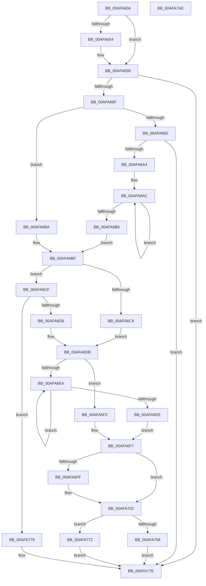

# ConvertDevpropcompkeyToString

- RVA: `0x00AFA604`–`0x00AFA7AF` (길이 `427` bytes)
- VA: `0x0000000140AFA604`
- 실행 섹션: `PAGE`
- PDB 이름 있음: `예`; PDB Function 태그: `아니요`
- unwind 정보 RVA: `0x000D298C`
- 디코드: `120`개 명령, `427/427` bytes 표시
- 미해석 바이트: `0` (있으면 어셈블리에 `.byte`로 보존)

> 이 문서는 커널 이미지의 기계어와 PDB 기호를 분석해 생성했습니다. 4번과 5번은 함수 원형과 자료형을 바이너리 사용 방식에서 추정한 C 해석이며 원본 소스 복구 결과는 아닙니다.

## 1. Dependencies

- 직접 호출 지점: **6**; 고유 호출 대상: **6**
- 직접 호출자로 확인된 함수: **2**
- RIP 상대 이미지 참조: **6**

### Outgoing calls
- `0x00AFA660` → [RtlStringFromGUIDEx](../91/RtlStringFromGUIDEx_function_00915450.md) (function, `0x00915450`)
- `0x00AFA675` → [Feature_KernelPnP_DevfilterLogging__private_IsEnabledDeviceUsageNoInline](../../text/6A/Feature_KernelPnP_DevfilterLogging__private_IsEnabledDeviceUsageNoInline_function_006A3150.md) (function, `0x006A3150`)
- `0x00AFA695` → [RtlStringCchPrintfW](../../text/48/RtlStringCchPrintfW_function_00482D5C.md) (function, `0x00482D5C`)
- `0x00AFA769` → [RtlStringCbPrintfExW](../../text/46/RtlStringCbPrintfExW_function_00461AD4.md) (function, `0x00461AD4`)
- `0x00AFA783` → [RtlFreeAnsiString](../9C/RtlFreeAnsiString_function_009C0800.md) (function, `0x009C0800`)
- `0x00AFA795` → [_security_check_cookie](../../text/6A/_security_check_cookie_function_006AC640.md) (function, `0x006AC640`)

### Direct callers
- [PnpConvertDevpropcompkeyArrayToString](../72/PnpConvertDevpropcompkeyArrayToString_function_0072C5F8.md) at `0x0072C667`
- [ConvertDevpropertyToString](ConvertDevpropertyToString_function_00AFA7B8.md) at `0x00AFA808`

### Static image references
- `0x00AFA618` → RVA `0x00E0A740` (`.data`; read)
- `0x00AFA686` → RVA `0x00B0DA60` (` ?? ::NNGAKEGL::`string'`; read)
- `0x00AFA70A` → RVA `0x00B0DA80` (` ?? ::NNGAKEGL::`string'`; read)
- `0x00AFA714` → RVA `0x00B0DA70` (` ?? ::NNGAKEGL::`string'`; read)
- `0x00AFA71B` → RVA `0x00AFC8A0` (` ?? ::NNGAKEGL::`string'`; read)
- `0x00AFA755` → RVA `0x00B0DC70` (` ?? ::NNGAKEGL::`string'`; read)

## 2. Other-region calls and transfers

- 다른 실행 섹션으로 향하는 call: **4**
  - `0x00AFA675` → [Feature_KernelPnP_DevfilterLogging__private_IsEnabledDeviceUsageNoInline](../../text/6A/Feature_KernelPnP_DevfilterLogging__private_IsEnabledDeviceUsageNoInline_function_006A3150.md) (`PAGE` → `.text`)
  - `0x00AFA695` → [RtlStringCchPrintfW](../../text/48/RtlStringCchPrintfW_function_00482D5C.md) (`PAGE` → `.text`)
  - `0x00AFA769` → [RtlStringCbPrintfExW](../../text/46/RtlStringCbPrintfExW_function_00461AD4.md) (`PAGE` → `.text`)
  - `0x00AFA795` → [_security_check_cookie](../../text/6A/_security_check_cookie_function_006AC640.md) (`PAGE` → `.text`)
- 별도 외부 분기/꼬리 이동을 확인하지 못했습니다.

## 3. Assembly (complete function range)

```asm
00AFA604  40 53                           push rbx
00AFA606  55                              push rbp
00AFA607  56                              push rsi
00AFA608  57                              push rdi
00AFA609  41 54                           push r12
00AFA60B  41 55                           push r13
00AFA60D  41 56                           push r14
00AFA60F  41 57                           push r15
00AFA611  48 81 EC 98 00 00 00            sub rsp, 0x98
00AFA618  48 8B 05 21 01 31 00            mov rax, qword ptr [rip + 0x310121]
00AFA61F  48 33 C4                        xor rax, rsp
00AFA622  48 89 84 24 80 00 00 00         mov qword ptr [rsp + 0x80], rax
00AFA62A  0F 57 C9                        xorps xmm1, xmm1
00AFA62D  41 8B E8                        mov ebp, r8d
00AFA630  45 33 ED                        xor r13d, r13d
00AFA633  0F 57 C0                        xorps xmm0, xmm0
00AFA636  4D 8B F9                        mov r15, r9
00AFA639  4C 8B E2                        mov r12, rdx
00AFA63C  48 8B F1                        mov rsi, rcx
00AFA63F  0F 11 44 24 50                  movups xmmword ptr [rsp + 0x50], xmm0
00AFA644  0F 11 4C 24 60                  movups xmmword ptr [rsp + 0x60], xmm1
00AFA649  0F 11 4C 24 70                  movups xmmword ptr [rsp + 0x70], xmm1
00AFA64E  41 83 F8 02                     cmp r8d, 2
00AFA652  72 04                           jb 0x140afa658
00AFA654  66 44 89 2A                     mov word ptr [rdx], r13w
00AFA658  41 B0 01                        mov r8b, 1
00AFA65B  48 8D 54 24 50                  lea rdx, [rsp + 0x50]
00AFA660  E8 EB AD E1 FF                  call 0x140915450
00AFA665  8B D8                           mov ebx, eax
00AFA667  85 C0                           test eax, eax
00AFA669  0F 88 0F 01 00 00               js 0x140afa77e
00AFA66F  44 0F B7 74 24 50               movzx r14d, word ptr [rsp + 0x50]
00AFA675  E8 D6 8A BA FF                  call 0x1406a3150
00AFA67A  48 83 CF FF                     or rdi, 0xffffffffffffffff
00AFA67E  85 C0                           test eax, eax
00AFA680  74 38                           je 0x140afa6ba
00AFA682  44 8B 4E 10                     mov r9d, dword ptr [rsi + 0x10]
00AFA686  4C 8D 05 D3 33 01 00            lea r8, [rip + 0x133d3]
00AFA68D  8D 57 11                        lea edx, [rdi + 0x11]
00AFA690  48 8D 4C 24 60                  lea rcx, [rsp + 0x60]
00AFA695  E8 C2 86 98 FF                  call 0x140482d5c
00AFA69A  8B D8                           mov ebx, eax
00AFA69C  85 C0                           test eax, eax
00AFA69E  0F 88 DA 00 00 00               js 0x140afa77e
00AFA6A4  48 8D 4C 24 60                  lea rcx, [rsp + 0x60]
00AFA6A9  48 8B C7                        mov rax, rdi
00AFA6AC  48 FF C0                        inc rax
00AFA6AF  66 44 39 2C 41                  cmp word ptr [rcx + rax*2], r13w
00AFA6B4  75 F6                           jne 0x140afa6ac
00AFA6B6  03 C0                           add eax, eax
00AFA6B8  EB 05                           jmp 0x140afa6bf
00AFA6BA  B8 14 00 00 00                  mov eax, 0x14
00AFA6BF  41 8D 0C 06                     lea ecx, [r14 + rax]
00AFA6C3  8B 46 14                        mov eax, dword ptr [rsi + 0x14]
00AFA6C6  85 C0                           test eax, eax
00AFA6C8  75 05                           jne 0x140afa6cf
00AFA6CA  83 C1 1C                        add ecx, 0x1c
00AFA6CD  EB 0C                           jmp 0x140afa6db
00AFA6CF  83 F8 01                        cmp eax, 1
00AFA6D2  0F 85 A1 00 00 00               jne 0x140afa779
00AFA6D8  83 C1 18                        add ecx, 0x18
00AFA6DB  48 8B 46 18                     mov rax, qword ptr [rsi + 0x18]
00AFA6DF  48 85 C0                        test rax, rax
00AFA6E2  74 0E                           je 0x140afa6f2
00AFA6E4  48 FF C7                        inc rdi
00AFA6E7  66 44 39 2C 78                  cmp word ptr [rax + rdi*2], r13w
00AFA6EC  75 F6                           jne 0x140afa6e4
00AFA6EE  03 FF                           add edi, edi
00AFA6F0  EB 05                           jmp 0x140afa6f7
00AFA6F2  BF 0C 00 00 00                  mov edi, 0xc
00AFA6F7  8D 04 39                        lea eax, [rcx + rdi]
00AFA6FA  4D 85 FF                        test r15, r15
00AFA6FD  74 03                           je 0x140afa702
00AFA6FF  41 89 07                        mov dword ptr [r15], eax
00AFA702  3B C5                           cmp eax, ebp
00AFA704  77 6C                           ja 0x140afa772
00AFA706  48 8B 46 18                     mov rax, qword ptr [rsi + 0x18]
00AFA70A  48 8D 0D 6F 33 01 00            lea rcx, [rip + 0x1336f]
00AFA711  48 85 C0                        test rax, rax
00AFA714  4C 8D 0D 55 33 01 00            lea r9, [rip + 0x13355]
00AFA71B  4C 8D 05 7E 21 00 00            lea r8, [rip + 0x217e]
00AFA722  48 8B D5                        mov rdx, rbp
00AFA725  4C 0F 45 C8                     cmovne r9, rax
00AFA729  8B 46 10                        mov eax, dword ptr [rsi + 0x10]
00AFA72C  44 39 6E 14                     cmp dword ptr [rsi + 0x14], r13d
00AFA730  4C 89 4C 24 48                  mov qword ptr [rsp + 0x48], r9
00AFA735  4C 0F 45 C1                     cmovne r8, rcx
00AFA739  45 33 C9                        xor r9d, r9d
00AFA73C  4C 89 44 24 40                  mov qword ptr [rsp + 0x40], r8
00AFA741  49 8B CC                        mov rcx, r12
00AFA744  89 44 24 38                     mov dword ptr [rsp + 0x38], eax
00AFA748  45 33 C0                        xor r8d, r8d
00AFA74B  48 8B 44 24 58                  mov rax, qword ptr [rsp + 0x58]
00AFA750  48 89 44 24 30                  mov qword ptr [rsp + 0x30], rax
00AFA755  48 8D 05 14 35 01 00            lea rax, [rip + 0x13514]
00AFA75C  48 89 44 24 28                  mov qword ptr [rsp + 0x28], rax
00AFA761  C7 44 24 20 00 08 00 00         mov dword ptr [rsp + 0x20], 0x800
00AFA769  E8 66 73 96 FF                  call 0x140461ad4
00AFA76E  8B D8                           mov ebx, eax
00AFA770  EB 0C                           jmp 0x140afa77e
00AFA772  BB 23 00 00 C0                  mov ebx, 0xc0000023
00AFA777  EB 05                           jmp 0x140afa77e
00AFA779  BB 0D 00 00 C0                  mov ebx, 0xc000000d
00AFA77E  48 8D 4C 24 50                  lea rcx, [rsp + 0x50]
00AFA783  E8 78 60 EC FF                  call 0x1409c0800
00AFA788  8B C3                           mov eax, ebx
00AFA78A  48 8B 8C 24 80 00 00 00         mov rcx, qword ptr [rsp + 0x80]
00AFA792  48 33 CC                        xor rcx, rsp
00AFA795  E8 A6 1E BB FF                  call 0x1406ac640
00AFA79A  48 81 C4 98 00 00 00            add rsp, 0x98
00AFA7A1  41 5F                           pop r15
00AFA7A3  41 5E                           pop r14
00AFA7A5  41 5D                           pop r13
00AFA7A7  41 5C                           pop r12
00AFA7A9  5F                              pop rdi
00AFA7AA  5E                              pop rsi
00AFA7AB  5D                              pop rbp
00AFA7AC  5B                              pop rbx
00AFA7AD  C3                              ret
00AFA7AE  CC                              int3
```

## 4. C-style interpretation (structured pseudocode)

```c
__int64 __fastcall ConvertDevpropcompkeyToString(__int64 a1, __int64 a2, int a3, __int64 a4)
{
    __int64 result;
    __int64 v_r13;
    __int64 v_rdi;
    __int64 v_rsp;
    unsigned __int64 v_stack_m58;
    unsigned __int64 v_stack_m68;
    unsigned __int64 v_stack_m78;
    unsigned __int64 v_stack_m80;
    unsigned __int64 v_stack_m88;
    unsigned __int64 v_stack_m90;
    unsigned __int64 v_stack_m98;
    unsigned int v_stack_mA0;
    unsigned __int64 v_stack_mA8;
    unsigned __int64 v_stack_mB0;
    unsigned int v_stack_mB8;

    v_rsp = (v_rsp) - (152);
    result = (*(unsigned __int64 *)(v_rip + 3211553)) ^ (v_rsp);
    v_stack_m58 = result;
    v_r13 = 0;
    v_stack_m88 = v_xmm0;
    v_stack_m78 = v_xmm1;
    v_stack_m68 = v_xmm1;
    if (a3 >= 2) {
        *(unsigned __int16 *)(a2) = 0;
    }
    result = RtlStringFromGUIDEx(a1, v_stack_m88, 1, a4);
    if (sign_flag) goto loc_00AFA77E;
    result = Feature_KernelPnP_DevfilterLogging__private_IsEnabledDeviceUsageNoInline(a1, v_stack_m88, 1, a4);
    v_rdi = (v_rdi) | (-1);
    if ((unsigned int)(result) == 0) goto loc_00AFA6BA;
    result = RtlStringCchPrintfW(v_stack_m78, v_rdi + 17, v_rip + 78803, (unsigned int)(*(unsigned int *)(a1 + 16)));
    if (sign_flag) goto loc_00AFA77E;
loc_00AFA6AC:
    result = (v_rdi) + 1;
    if ((*(unsigned __int16 *)(v_stack_m78 + result * 2)) != 0) goto loc_00AFA6AC;
    result = (unsigned int)((result) + ((unsigned int)(result)));
    goto loc_00AFA6BF;
loc_00AFA6BA:
loc_00AFA6BF:
    if ((unsigned int)((unsigned int)(*(unsigned int *)(a1 + 20))) != 0) goto loc_00AFA6CF;
    a1 = (unsigned int)((v_stack_m88 + 20 * 1) + (28));
    goto loc_00AFA6DB;
loc_00AFA6CF:
    if (((unsigned int)((unsigned int)(*(unsigned int *)(a1 + 20)))) != 1) goto loc_00AFA779;
    a1 = (unsigned int)((a1) + (24));
loc_00AFA6DB:
    if (*(unsigned __int64 *)(a1 + 24) == 0) goto loc_00AFA6F2;
loc_00AFA6E4:
    v_rdi = (v_rdi) + 1;
    if ((*(unsigned __int16 *)(*(unsigned __int64 *)(a1 + 24) + v_rdi * 2)) != 0) goto loc_00AFA6E4;
    v_rdi = (unsigned int)((v_rdi) + ((unsigned int)(v_rdi)));
    goto loc_00AFA6F7;
loc_00AFA6F2:
loc_00AFA6F7:
    if (a4 != 0) {
        *(unsigned int *)(a4) = (unsigned int)(a1 + 12 * 1);
    }
    if (((unsigned int)(a1 + 12 * 1)) > ((unsigned int)((unsigned int)(a3)))) goto loc_00AFA772;
    a4 = v_rip + 78677;
    if (*(unsigned __int64 *)(a1 + 24) != 0) { a4 = *(unsigned __int64 *)(a1 + 24); }
    v_stack_m90 = a4;
    a3 = v_rip + 8574;
    if ((*(unsigned int *)(a1 + 20)) != 0) { a3 = v_rip + 78703; }
    a4 = 0;
    v_stack_m98 = a3;
    v_stack_mA0 = (unsigned int)((unsigned int)(*(unsigned int *)(a1 + 16)));
    a3 = 0;
    v_stack_mA8 = v_stack_m80;
    v_stack_mB0 = v_rip + 79124;
    v_stack_mB8 = 0x800ULL;
    result = RtlStringCbPrintfExW(a2, (unsigned int)(a3), a3, a4);
    goto loc_00AFA77E;
loc_00AFA772:
    goto loc_00AFA77E;
loc_00AFA779:
loc_00AFA77E:
    result = RtlFreeAnsiString(v_stack_m88, (unsigned int)(a3), a3, a4);
    a1 = (v_stack_m58) ^ (v_rsp);
    result = _security_check_cookie(a1, (unsigned int)(a3), a3, a4);
    v_rsp = (v_rsp) + (152);
    return result;
}
```

## 5. (Beta) C Style

```c
int64_t ConvertDevpropcompkeyToString(void *Arg1, void *Arg2, int32_t Arg3, int64_t Arg4)
{
    uint8_t *arg1 = (uint8_t *)Arg1;
    uint8_t *arg2 = (uint8_t *)Arg2;

    int64_t result;
    int64_t local_r13;
    int64_t local_rdi;
    int64_t local_rsp;
    uint64_t v_stack_m58;
    uint64_t v_stack_m68;
    uint64_t v_stack_m78;
    uint64_t v_stack_m80;
    uint64_t v_stack_m88;
    uint64_t v_stack_m90;
    uint64_t v_stack_m98;
    uint32_t v_stack_mA0;
    uint64_t v_stack_mA8;
    uint64_t v_stack_mB0;
    uint32_t v_stack_mB8;

    local_rsp = (local_rsp) - (152);
    result = (*(uint64_t *)(v_rip + 0x310121)) ^ (local_rsp);
    v_stack_m58 = result;
    local_r13 = 0;
    v_stack_m88 = v_xmm0;
    v_stack_m78 = v_xmm1;
    v_stack_m68 = v_xmm1;
    if (Arg3 >= 2) {
        *(uint16_t *)(arg2) = 0;
    }
    result = RtlStringFromGUIDEx(Arg1, v_stack_m88, 1, Arg4);
    if (sign_flag) goto loc_00AFA77E;
    result = Feature_KernelPnP_DevfilterLogging__private_IsEnabledDeviceUsageNoInline(Arg1, v_stack_m88, 1, Arg4);
    local_rdi = (local_rdi) | (-1);
    if ((uint32_t)(result) == 0) goto loc_00AFA6BA;
    result = RtlStringCchPrintfW(v_stack_m78, local_rdi + 17, v_rip + 78803, (uint32_t)(*(uint32_t *)(arg1 + 0x10)));
    if (sign_flag) goto loc_00AFA77E;
loc_00AFA6AC:
    result = (local_rdi) + 1;
    if ((*(uint16_t *)(v_stack_m78 + result * 2)) != 0) goto loc_00AFA6AC;
    result = (uint32_t)((result) + ((uint32_t)(result)));
    goto loc_00AFA6BF;
loc_00AFA6BA:
loc_00AFA6BF:
    if ((uint32_t)((uint32_t)(*(uint32_t *)(arg1 + 0x14))) != 0) goto loc_00AFA6CF;
    Arg1 = (uint32_t)((v_stack_m88 + 20 * 1) + (28));
    goto loc_00AFA6DB;
loc_00AFA6CF:
    if (((uint32_t)((uint32_t)(*(uint32_t *)(arg1 + 0x14)))) != 1) goto loc_00AFA779;
    Arg1 = (uint32_t)((Arg1) + (24));
loc_00AFA6DB:
    if (*(uint64_t *)(arg1 + 0x18) == 0) goto loc_00AFA6F2;
loc_00AFA6E4:
    local_rdi = (local_rdi) + 1;
    if ((*(uint16_t *)(*(uint64_t *)(arg1 + 0x18) + local_rdi * 2)) != 0) goto loc_00AFA6E4;
    local_rdi = (uint32_t)((local_rdi) + ((uint32_t)(local_rdi)));
    goto loc_00AFA6F7;
loc_00AFA6F2:
loc_00AFA6F7:
    if (Arg4 != 0) {
        *(uint32_t *)(Arg4) = (uint32_t)(Arg1 + 12 * 1);
    }
    if (((uint32_t)(Arg1 + 12 * 1)) > ((uint32_t)((uint32_t)(Arg3)))) goto loc_00AFA772;
    Arg4 = v_rip + 78677;
    if (*(uint64_t *)(arg1 + 0x18) != 0) { Arg4 = *(uint64_t *)(arg1 + 0x18); }
    v_stack_m90 = Arg4;
    Arg3 = v_rip + 8574;
    if ((*(uint32_t *)(arg1 + 0x14)) != 0) { Arg3 = v_rip + 78703; }
    Arg4 = 0;
    v_stack_m98 = Arg3;
    v_stack_mA0 = (uint32_t)((uint32_t)(*(uint32_t *)(arg1 + 0x10)));
    Arg3 = 0;
    v_stack_mA8 = v_stack_m80;
    v_stack_mB0 = v_rip + 79124;
    v_stack_mB8 = 0x800ULL;
    result = RtlStringCbPrintfExW(Arg2, (uint32_t)(Arg3), Arg3, Arg4);
    goto loc_00AFA77E;
loc_00AFA772:
    goto loc_00AFA77E;
loc_00AFA779:
loc_00AFA77E:
    result = RtlFreeAnsiString(v_stack_m88, (uint32_t)(Arg3), Arg3, Arg4);
    Arg1 = (v_stack_m58) ^ (local_rsp);
    result = _security_check_cookie(Arg1, (uint32_t)(Arg3), Arg3, Arg4);
    local_rsp = (local_rsp) + (152);
    return result;
}
```

### 관측된 메모리 오프셋

구조체 형식이 확인되지 않은 접근은 인자 기준의 오프셋으로만 기록했습니다.

| 기준 인자 | 오프셋 표현 | 폭 (bit) | 접근 |
|---|---:|---:|---|
| `Arg1` | `+ 0x10` | `32` | `R` |
| `Arg1` | `+ 0x14` | `32` | `R` |
| `Arg1` | `+ 0x18` | `64` | `R` |
| `Arg2` | `+ 0x0` | `16` | `W` |

## 6. Execution-region graph

[열기: 2D/3D 그래프와 함수 탐색 컨트롤 패널](../../../control-panel.html?section=page&rva=0x00AFA604&view=graph)

- 2D 그래프는 위에서 아래로 흐르고, 3D 그래프는 빈 공간을 드래그해 회전합니다. Shift+드래그는 이동, 휠은 확대·축소, 함수 노드 선택은 대상 보고서 이동입니다.

### Static fallback


