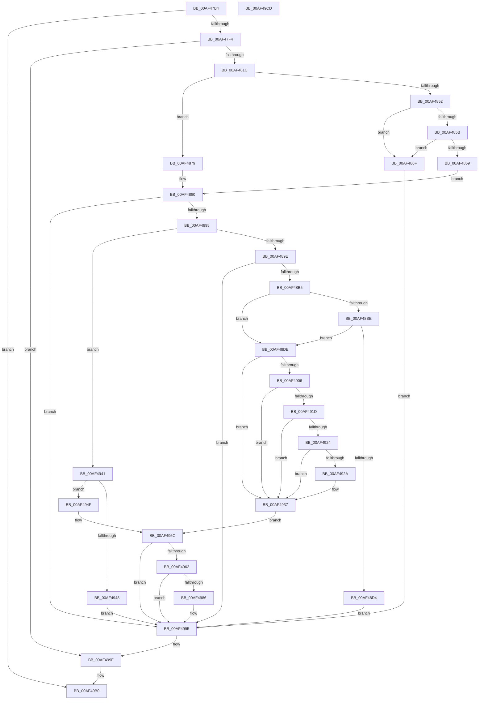

# EtwpFlushTrace

- RVA: `0x00AF47B4`–`0x00AF49CE` (길이 `538` bytes)
- VA: `0x0000000140AF47B4`
- 실행 섹션: `PAGE`
- PDB 이름 있음: `예`; PDB Function 태그: `아니요`
- unwind 정보 RVA: `0x000CD76C`
- 디코드: `141`개 명령, `538/538` bytes 표시
- 미해석 바이트: `0` (있으면 어셈블리에 `.byte`로 보존)

> 이 문서는 커널 이미지의 기계어와 PDB 기호를 분석해 생성했습니다. 4번과 5번은 함수 원형과 자료형을 바이너리 사용 방식에서 추정한 C 해석이며 원본 소스 복구 결과는 아닙니다.

## 1. Dependencies

- 직접 호출 지점: **14**; 고유 호출 대상: **14**
- 직접 호출자로 확인된 함수: **1**
- RIP 상대 이미지 참조: **2**

### Outgoing calls
- `0x00AF47E7` → [EtwpValidateLoggerInfo](../8B/EtwpValidateLoggerInfo_function_008BF9B0.md) (function, `0x008BF9B0`)
- `0x00AF480D` → [EtwpAcquireLoggerContext](../93/EtwpAcquireLoggerContext_function_009326AC.md) (function, `0x009326AC`)
- `0x00AF4886` → [EtwpCheckLoggerControlAccess](../8C/EtwpCheckLoggerControlAccess_function_008C0AE0.md) (function, `0x008C0AE0`)
- `0x00AF48A6` → [EtwpCaptureString](../9B/EtwpCaptureString_function_009BD754.md) (function, `0x009BD754`)
- `0x00AF48B5` → [Feature_1899207995__private_IsEnabledDeviceUsageNoInline](../../text/64/Feature_1899207995__private_IsEnabledDeviceUsageNoInline_function_0064F398.md) (function, `0x0064F398`)
- `0x00AF4932` → [EtwpCCSwapStop](../7C/EtwpCCSwapStop_function_007C307C.md) (function, `0x007C307C`)
- `0x00AF493A` → [EtwpBufferingModeFlush](../9B/EtwpBufferingModeFlush_function_009BD8F4.md) (function, `0x009BD8F4`)
- `0x00AF4957` → [EtwpSynchronizeWithLogger](../A6/EtwpSynchronizeWithLogger_function_00A66250.md) (function, `0x00A66250`)
- `0x00AF4968` → [EtwpGetLoggerInfoFromContext](../8B/EtwpGetLoggerInfoFromContext_function_008BEF90.md) (function, `0x008BEF90`)
- `0x00AF497D` → [EtwEventEnabled](../../text/39/EtwEventEnabled_function_00392450.md) (function, `0x00392450`)
- `0x00AF4990` → [EtwpEventWriteTemplateSession](../9B/EtwpEventWriteTemplateSession_function_009BD120.md) (function, `0x009BD120`)
- `0x00AF499A` → [EtwpReleaseLoggerContext](../A0/EtwpReleaseLoggerContext_function_00A04160.md) (function, `0x00A04160`)
- `0x00AF49A4` → [RtlFreeAnsiString](../9C/RtlFreeAnsiString_function_009C0800.md) (function, `0x009C0800`)
- `0x00AF49A9` → [KeLeaveCriticalRegion](../../text/25/KeLeaveCriticalRegion_function_0025D8B0.md) (function, `0x0025D8B0`)

### Direct callers
- [NtTraceControl](../A9/NtTraceControl_function_00A9ED40.md) at `0x00A9F08F`

### Static image references
- `0x00AF496D` → RVA `0x00EFF840` (`.data`; read)
- `0x00AF4974` → RVA `0x00022E20` (`.rdata`; read)

## 2. Other-region calls and transfers

- 다른 실행 섹션으로 향하는 call: **3**
  - `0x00AF48B5` → [Feature_1899207995__private_IsEnabledDeviceUsageNoInline](../../text/64/Feature_1899207995__private_IsEnabledDeviceUsageNoInline_function_0064F398.md) (`PAGE` → `.text`)
  - `0x00AF497D` → [EtwEventEnabled](../../text/39/EtwEventEnabled_function_00392450.md) (`PAGE` → `.text`)
  - `0x00AF49A9` → [KeLeaveCriticalRegion](../../text/25/KeLeaveCriticalRegion_function_0025D8B0.md) (`PAGE` → `.text`)
- 별도 외부 분기/꼬리 이동을 확인하지 못했습니다.

## 3. Assembly (complete function range)

```asm
00AF47B4  48 8B C4                        mov rax, rsp
00AF47B7  48 89 58 08                     mov qword ptr [rax + 8], rbx
00AF47BB  48 89 68 10                     mov qword ptr [rax + 0x10], rbp
00AF47BF  48 89 70 20                     mov qword ptr [rax + 0x20], rsi
00AF47C3  57                              push rdi
00AF47C4  41 54                           push r12
00AF47C6  41 55                           push r13
00AF47C8  41 56                           push r14
00AF47CA  41 57                           push r15
00AF47CC  48 83 EC 30                     sub rsp, 0x30
00AF47D0  4C 8B F1                        mov r14, rcx
00AF47D3  45 33 ED                        xor r13d, r13d
00AF47D6  0F 57 C0                        xorps xmm0, xmm0
00AF47D9  4C 89 68 18                     mov qword ptr [rax + 0x18], r13
00AF47DD  48 8B CA                        mov rcx, rdx
00AF47E0  48 8B F2                        mov rsi, rdx
00AF47E3  0F 11 40 C8                     movups xmmword ptr [rax - 0x38], xmm0
00AF47E7  E8 C4 B1 DC FF                  call 0x1408bf9b0
00AF47EC  85 C0                           test eax, eax
00AF47EE  0F 88 BC 01 00 00               js 0x140af49b0
00AF47F4  65 48 8B 04 25 88 01 00 00      mov rax, qword ptr gs:[0x188]
00AF47FD  4C 8D 44 24 70                  lea r8, [rsp + 0x70]
00AF4802  49 8B CE                        mov rcx, r14
00AF4805  66 FF 88 E4 01 00 00            dec word ptr [rax + 0x1e4]
00AF480C  90                              nop
00AF480D  E8 9A DE E3 FF                  call 0x1409326ac
00AF4812  8B D8                           mov ebx, eax
00AF4814  85 C0                           test eax, eax
00AF4816  0F 88 83 01 00 00               js 0x140af499f
00AF481C  48 8B 7C 24 70                  mov rdi, qword ptr [rsp + 0x70]
00AF4821  BA 00 04 00 00                  mov edx, 0x400
00AF4826  44 8B 7F 0C                     mov r15d, dword ptr [rdi + 0xc]
00AF482A  41 8B CF                        mov ecx, r15d
00AF482D  81 E1 00 01 00 00               and ecx, 0x100
00AF4833  45 8B E7                        mov r12d, r15d
00AF4836  0B CA                           or ecx, edx
00AF4838  C1 E9 03                        shr ecx, 3
00AF483B  44 8B C1                        mov r8d, ecx
00AF483E  41 83 C8 40                     or r8d, 0x40
00AF4842  4C 39 AF 20 03 00 00            cmp qword ptr [rdi + 0x320], r13
00AF4849  44 0F 44 C1                     cmove r8d, ecx
00AF484D  44 23 E2                        and r12d, edx
00AF4850  74 27                           je 0x140af4879
00AF4852  4C 39 AE 88 00 00 00            cmp qword ptr [rsi + 0x88], r13
00AF4859  74 14                           je 0x140af486f
00AF485B  48 8D AE 80 00 00 00            lea rbp, [rsi + 0x80]
00AF4862  66 44 39 6D 00                  cmp word ptr [rbp], r13w
00AF4867  74 06                           je 0x140af486f
00AF4869  41 83 C8 40                     or r8d, 0x40
00AF486D  EB 11                           jmp 0x140af4880
00AF486F  BB 0F 00 00 C0                  mov ebx, 0xc000000f
00AF4874  E9 1C 01 00 00                  jmp 0x140af4995
00AF4879  48 8D AE 80 00 00 00            lea rbp, [rsi + 0x80]
00AF4880  48 8B D7                        mov rdx, rdi
00AF4883  41 8B C8                        mov ecx, r8d
00AF4886  E8 55 C2 DC FF                  call 0x1408c0ae0
00AF488B  8B D8                           mov ebx, eax
00AF488D  85 C0                           test eax, eax
00AF488F  0F 88 00 01 00 00               js 0x140af4995
00AF4895  45 85 E4                        test r12d, r12d
00AF4898  0F 84 A3 00 00 00               je 0x140af4941
00AF489E  48 8D 54 24 20                  lea rdx, [rsp + 0x20]
00AF48A3  48 8B CD                        mov rcx, rbp
00AF48A6  E8 A9 8E EC FF                  call 0x1409bd754
00AF48AB  8B D8                           mov ebx, eax
00AF48AD  85 C0                           test eax, eax
00AF48AF  0F 88 E0 00 00 00               js 0x140af4995
00AF48B5  E8 DE AA B5 FF                  call 0x14064f398
00AF48BA  85 C0                           test eax, eax
00AF48BC  74 20                           je 0x140af48de
00AF48BE  0F B7 8F 88 00 00 00            movzx ecx, word ptr [rdi + 0x88]
00AF48C5  0F B7 44 24 20                  movzx eax, word ptr [rsp + 0x20]
00AF48CA  03 C8                           add ecx, eax
00AF48CC  81 F9 FF 7F 00 00               cmp ecx, 0x7fff
00AF48D2  76 0A                           jbe 0x140af48de
00AF48D4  BB 0D 00 00 C0                  mov ebx, 0xc000000d
00AF48D9  E9 B7 00 00 00                  jmp 0x140af4995
00AF48DE  0F 10 44 24 20                  movups xmm0, xmmword ptr [rsp + 0x20]
00AF48E3  4C 89 6C 24 28                  mov qword ptr [rsp + 0x28], r13
00AF48E8  F3 0F 7F 87 B8 00 00 00         movdqu xmmword ptr [rdi + 0xb8], xmm0
00AF48F0  F0 83 8F 38 03 00 00 01         lock or dword ptr [rdi + 0x338], 1
00AF48F8  8B 47 0C                        mov eax, dword ptr [rdi + 0xc]
00AF48FB  48 8B 7C 24 70                  mov rdi, qword ptr [rsp + 0x70]
00AF4900  0F BA E0 19                     bt eax, 0x19
00AF4904  73 31                           jae 0x140af4937
00AF4906  0F B6 8F 32 03 00 00            movzx ecx, byte ptr [rdi + 0x332]
00AF490D  48 C1 E1 05                     shl rcx, 5
00AF4911  48 81 C1 CC 11 00 00            add rcx, 0x11cc
00AF4918  49 03 CE                        add rcx, r14
00AF491B  74 1A                           je 0x140af4937
00AF491D  8B 41 04                        mov eax, dword ptr [rcx + 4]
00AF4920  A8 04                           test al, 4
00AF4922  74 13                           je 0x140af4937
00AF4924  0F BA E0 08                     bt eax, 8
00AF4928  73 0D                           jae 0x140af4937
00AF492A  8B 8F C8 00 00 00               mov ecx, dword ptr [rdi + 0xc8]
00AF4930  33 D2                           xor edx, edx
00AF4932  E8 45 E7 CC FF                  call 0x1407c307c
00AF4937  48 8B CF                        mov rcx, rdi
00AF493A  E8 B5 8F EC FF                  call 0x1409bd8f4
00AF493F  EB 1B                           jmp 0x140af495c
00AF4941  41 0F BA E7 12                  bt r15d, 0x12
00AF4946  73 07                           jae 0x140af494f
00AF4948  BB BB 00 00 C0                  mov ebx, 0xc00000bb
00AF494D  EB 46                           jmp 0x140af4995
00AF494F  BA 04 00 00 00                  mov edx, 4
00AF4954  48 8B CF                        mov rcx, rdi
00AF4957  E8 F4 18 F7 FF                  call 0x140a66250
00AF495C  8B D8                           mov ebx, eax
00AF495E  85 C0                           test eax, eax
00AF4960  78 33                           js 0x140af4995
00AF4962  48 8B D7                        mov rdx, rdi
00AF4965  48 8B CE                        mov rcx, rsi
00AF4968  E8 23 A6 DC FF                  call 0x1408bef90
00AF496D  48 8B 0D CC AE 40 00            mov rcx, qword ptr [rip + 0x40aecc]
00AF4974  48 8D 15 A5 E4 52 FF            lea rdx, [rip - 0xad1b5b]
00AF497B  8B D8                           mov ebx, eax
00AF497D  E8 CE DA 89 FF                  call 0x140392450
00AF4982  84 C0                           test al, al
00AF4984  74 0F                           je 0x140af4995
00AF4986  4C 8B C7                        mov r8, rdi
00AF4989  48 8D 15 90 E4 52 FF            lea rdx, [rip - 0xad1b70]
00AF4990  E8 8B 87 EC FF                  call 0x1409bd120
00AF4995  B2 01                           mov dl, 1
00AF4997  48 8B CF                        mov rcx, rdi
00AF499A  E8 C1 F7 F0 FF                  call 0x140a04160
00AF499F  48 8D 4C 24 20                  lea rcx, [rsp + 0x20]
00AF49A4  E8 57 BE EC FF                  call 0x1409c0800
00AF49A9  E8 02 8F 76 FF                  call 0x14025d8b0
00AF49AE  8B C3                           mov eax, ebx
00AF49B0  48 8B 5C 24 60                  mov rbx, qword ptr [rsp + 0x60]
00AF49B5  48 8B 6C 24 68                  mov rbp, qword ptr [rsp + 0x68]
00AF49BA  48 8B 74 24 78                  mov rsi, qword ptr [rsp + 0x78]
00AF49BF  48 83 C4 30                     add rsp, 0x30
00AF49C3  41 5F                           pop r15
00AF49C5  41 5E                           pop r14
00AF49C7  41 5D                           pop r13
00AF49C9  41 5C                           pop r12
00AF49CB  5F                              pop rdi
00AF49CC  C3                              ret
00AF49CD  CC                              int3
```

## 4. C-style interpretation (structured pseudocode)

```c
__int64 __fastcall EtwpFlushTrace(__int64 a1, __int64 a2)
{
    __int64 result;
    __int64 v_r12;
    __int64 v_r13;
    __int64 v_rsp;
    unsigned __int64 v_stack_m30;
    unsigned __int64 v_stack_m38;
    unsigned __int64 v_stack_p10;
    unsigned __int64 v_stack_p18;
    unsigned __int64 v_stack_p20;
    unsigned __int64 v_stack_p8;

    *(unsigned __int64 *)(v_rsp + 8) = v_rbx;
    *(unsigned __int64 *)(v_rsp + 16) = v_rbp;
    *(unsigned __int64 *)(v_rsp + 32) = v_rsi;
    v_rsp = (v_rsp) - (48);
    v_r13 = 0;
    *(unsigned __int64 *)(v_rsp + 24) = 0;
    *(unsigned __int64 *)(v_rsp - 56) = v_xmm0;
    result = EtwpValidateLoggerInfo(a2, a2, a3, a4);
    if (sign_flag) goto loc_00AF49B0;
    result = EtwpAcquireLoggerContext(a1, a2, v_stack_p18, a4);
    if (sign_flag) goto loc_00AF499F;
    a1 = (unsigned int)(((unsigned int)((unsigned int)((unsigned int)(*(unsigned int *)(v_stack_p18 + 12))))) & (256));
    a1 = (unsigned int)((a1) | ((unsigned int)((unsigned int)(0x400ULL))));
    a1 = (unsigned int)((a1) >> (3));
    a3 = (unsigned int)(((unsigned int)((unsigned int)(a1))) | (64));
    if ((*(unsigned __int64 *)(v_stack_p18 + 800)) == 0) { a3 = (unsigned int)(a1); }
    v_r12 = (unsigned int)(((unsigned int)((unsigned int)((unsigned int)(*(unsigned int *)(v_stack_p18 + 12))))) & ((unsigned int)((unsigned int)(0x400ULL))));
    if (condition_is_equal) goto loc_00AF4879;
    if ((*(unsigned __int64 *)(a2 + 136)) == 0) goto loc_00AF486F;
    if ((*(unsigned __int16 *)(a2 + 128)) == 0) goto loc_00AF486F;
    a3 = (unsigned int)((a3) | (64));
    goto loc_00AF4880;
loc_00AF486F:
    goto loc_00AF4995;
loc_00AF4879:
loc_00AF4880:
    result = EtwpCheckLoggerControlAccess((unsigned int)((unsigned int)(a3)), v_stack_p18, a3, a4);
    if (sign_flag) goto loc_00AF4995;
    if ((unsigned int)(v_r12) == 0) goto loc_00AF4941;
    result = EtwpCaptureString(a2 + 128, v_stack_m38, a3, a4);
    if (sign_flag) goto loc_00AF4995;
    result = Feature_1899207995__private_IsEnabledDeviceUsageNoInline(a2 + 128, v_stack_m38, a3, a4);
    if ((unsigned int)(result) == 0) goto loc_00AF48DE;
    a1 = (unsigned int)((*(unsigned __int16 *)(v_stack_p18 + 136)) + ((unsigned int)(v_stack_m38)));
    if (((unsigned int)(a1)) <= 0x7FFFULL) goto loc_00AF48DE;
    goto loc_00AF4995;
loc_00AF48DE:
    v_stack_m30 = 0;
    *(unsigned __int64 *)(v_stack_p18 + 184) = v_xmm0;
    if (((unsigned int)(a1)) >= 0x7FFFULL) goto loc_00AF4937;
    a1 = (*(unsigned __int8 *)(v_stack_p18 + 818)) << (5);
    a1 = (a1) + (0x11CCULL);
    a1 = (a1) + (a1);
    if (condition_is_equal) goto loc_00AF4937;
    if ((((unsigned __int8)((unsigned int)(*(unsigned int *)(a1 + 4)))) & (4)) == 0) goto loc_00AF4937;
    result = (unsigned int)(*(unsigned int *)(a1 + 4));
    if (!(condition_is_above_or_equal)) {
        a1 = *(unsigned int *)(v_stack_p18 + 200);
        a2 = 0;
        result = EtwpCCSwapStop(a1, a2, a3, a4);
    }
    result = EtwpBufferingModeFlush(v_stack_p18, a2, a3, a4);
    goto loc_00AF495C;
loc_00AF4941:
    if (condition_is_above_or_equal) goto loc_00AF494F;
    goto loc_00AF4995;
loc_00AF494F:
    result = EtwpSynchronizeWithLogger(v_stack_p18, 4, a3, a4);
loc_00AF495C:
    if (sign_flag) goto loc_00AF4995;
    result = EtwpGetLoggerInfoFromContext(0, v_stack_p18, a3, a4);
    result = EtwEventEnabled(*(unsigned __int64 *)(v_rip + 4239052), v_rip - 11344731, a3, a4);
    if ((unsigned __int8)(result) != 0) {
        a3 = v_stack_p18;
        a2 = v_rip - 11344752;
        result = EtwpEventWriteTemplateSession(*(unsigned __int64 *)(v_rip + 4239052), a2, a3, a4);
    }
    result = EtwpReleaseLoggerContext(v_stack_p18, 1, a3, a4);
loc_00AF499F:
    result = RtlFreeAnsiString(v_stack_m38, 1, a3, a4);
    result = KeLeaveCriticalRegion(v_stack_m38, 1, a3, a4);
loc_00AF49B0:
    v_rsp = (v_rsp) + (48);
    return (unsigned int)((unsigned int)((unsigned int)((unsigned int)(result))));
}
```

## 5. (Beta) C Style

```c
int64_t EtwpFlushTrace(int64_t Arg1, void *Arg2)
{
    uint8_t *arg2 = (uint8_t *)Arg2;

    int64_t result;
    int64_t local_r12;
    int64_t local_r13;
    int64_t local_rsp;
    uint64_t v_stack_m30;
    uint64_t v_stack_m38;
    uint64_t v_stack_p10;
    uint64_t v_stack_p18;
    uint64_t v_stack_p20;
    uint64_t v_stack_p8;

    *(uint64_t *)(local_rsp + 0x8) = local_rbx;
    *(uint64_t *)(local_rsp + 0x10) = local_rbp;
    *(uint64_t *)(local_rsp + 0x20) = local_rsi;
    local_rsp = (local_rsp) - (48);
    local_r13 = 0;
    *(uint64_t *)(local_rsp + 0x18) = 0;
    *(uint64_t *)(local_rsp - 0x38) = v_xmm0;
    result = EtwpValidateLoggerInfo(Arg2, Arg2, a3, a4);
    if (sign_flag) goto loc_00AF49B0;
    result = EtwpAcquireLoggerContext(Arg1, Arg2, v_stack_p18, a4);
    if (sign_flag) goto loc_00AF499F;
    Arg1 = (uint32_t)(((uint32_t)((uint32_t)((uint32_t)(*(uint32_t *)(v_stack_p18 + 0xC))))) & (256));
    Arg1 = (uint32_t)((Arg1) | ((uint32_t)((uint32_t)(0x400ULL))));
    Arg1 = (uint32_t)((Arg1) >> (3));
    a3 = (uint32_t)(((uint32_t)((uint32_t)(Arg1))) | (64));
    if ((*(uint64_t *)(v_stack_p18 + 0x320)) == 0) { a3 = (uint32_t)(Arg1); }
    local_r12 = (uint32_t)(((uint32_t)((uint32_t)((uint32_t)(*(uint32_t *)(v_stack_p18 + 0xC))))) & ((uint32_t)((uint32_t)(0x400ULL))));
    if (condition_is_equal) goto loc_00AF4879;
    if ((*(uint64_t *)(arg2 + 0x88)) == 0) goto loc_00AF486F;
    if ((*(uint16_t *)(arg2 + 0x80)) == 0) goto loc_00AF486F;
    a3 = (uint32_t)((a3) | (64));
    goto loc_00AF4880;
loc_00AF486F:
    goto loc_00AF4995;
loc_00AF4879:
loc_00AF4880:
    result = EtwpCheckLoggerControlAccess((uint32_t)((uint32_t)(a3)), v_stack_p18, a3, a4);
    if (sign_flag) goto loc_00AF4995;
    if ((uint32_t)(local_r12) == 0) goto loc_00AF4941;
    result = EtwpCaptureString(Arg2 + 128, v_stack_m38, a3, a4);
    if (sign_flag) goto loc_00AF4995;
    result = Feature_1899207995__private_IsEnabledDeviceUsageNoInline(Arg2 + 128, v_stack_m38, a3, a4);
    if ((uint32_t)(result) == 0) goto loc_00AF48DE;
    Arg1 = (uint32_t)((*(uint16_t *)(v_stack_p18 + 0x88)) + ((uint32_t)(v_stack_m38)));
    if (((uint32_t)(Arg1)) <= 0x7FFFULL) goto loc_00AF48DE;
    goto loc_00AF4995;
loc_00AF48DE:
    v_stack_m30 = 0;
    *(uint64_t *)(v_stack_p18 + 0xB8) = v_xmm0;
    if (((uint32_t)(Arg1)) >= 0x7FFFULL) goto loc_00AF4937;
    Arg1 = (*(uint8_t *)(v_stack_p18 + 0x332)) << (5);
    Arg1 = (Arg1) + (0x11CCULL);
    Arg1 = (Arg1) + (Arg1);
    if (condition_is_equal) goto loc_00AF4937;
    if ((((uint8_t)((uint32_t)(*(uint32_t *)(Arg1 + 0x4)))) & (4)) == 0) goto loc_00AF4937;
    result = (uint32_t)(*(uint32_t *)(Arg1 + 0x4));
    if (!(condition_is_above_or_equal)) {
        Arg1 = *(uint32_t *)(v_stack_p18 + 0xC8);
        Arg2 = 0;
        result = EtwpCCSwapStop(Arg1, Arg2, a3, a4);
    }
    result = EtwpBufferingModeFlush(v_stack_p18, Arg2, a3, a4);
    goto loc_00AF495C;
loc_00AF4941:
    if (condition_is_above_or_equal) goto loc_00AF494F;
    goto loc_00AF4995;
loc_00AF494F:
    result = EtwpSynchronizeWithLogger(v_stack_p18, 4, a3, a4);
loc_00AF495C:
    if (sign_flag) goto loc_00AF4995;
    result = EtwpGetLoggerInfoFromContext(0, v_stack_p18, a3, a4);
    result = EtwEventEnabled(*(uint64_t *)(v_rip + 0x40AECC), v_rip - 11344731, a3, a4);
    if ((uint8_t)(result) != 0) {
        a3 = v_stack_p18;
        Arg2 = v_rip - 11344752;
        result = EtwpEventWriteTemplateSession(*(uint64_t *)(v_rip + 0x40AECC), Arg2, a3, a4);
    }
    result = EtwpReleaseLoggerContext(v_stack_p18, 1, a3, a4);
loc_00AF499F:
    result = RtlFreeAnsiString(v_stack_m38, 1, a3, a4);
    result = KeLeaveCriticalRegion(v_stack_m38, 1, a3, a4);
loc_00AF49B0:
    local_rsp = (local_rsp) + (48);
    return (uint32_t)((uint32_t)((uint32_t)((uint32_t)(result))));
}
```

### 관측된 메모리 오프셋

구조체 형식이 확인되지 않은 접근은 인자 기준의 오프셋으로만 기록했습니다.

| 기준 인자 | 오프셋 표현 | 폭 (bit) | 접근 |
|---|---:|---:|---|
| `Arg2` | `+ 0x0` | `16` | `R` |
| `Arg2` | `+ 0x80` | `64` | `R` |
| `Arg2` | `+ 0x88` | `64` | `R` |

## 6. Execution-region graph

[열기: 2D/3D 그래프와 함수 탐색 컨트롤 패널](../../../control-panel.html?section=page&rva=0x00AF47B4&view=graph)

- 2D 그래프는 위에서 아래로 흐르고, 3D 그래프는 빈 공간을 드래그해 회전합니다. Shift+드래그는 이동, 휠은 확대·축소, 함수 노드 선택은 대상 보고서 이동입니다.

### Static fallback


