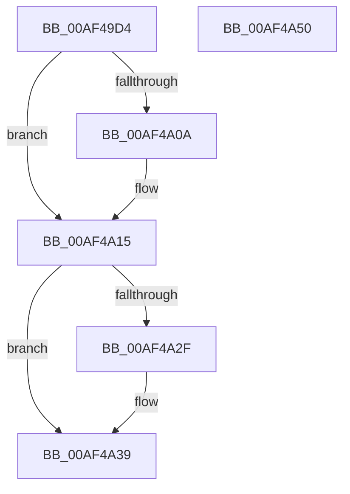

# ExpInitializeSessionDriver

- RVA: `0x00AF49D4`–`0x00AF4A51` (길이 `125` bytes)
- VA: `0x0000000140AF49D4`
- 실행 섹션: `PAGE`
- PDB 이름 있음: `예`; PDB Function 태그: `아니요`
- unwind 정보 RVA: `0x000D423C`
- 디코드: `36`개 명령, `125/125` bytes 표시
- 미해석 바이트: `0` (있으면 어셈블리에 `.byte`로 보존)

> 이 문서는 커널 이미지의 기계어와 PDB 기호를 분석해 생성했습니다. 4번과 5번은 함수 원형과 자료형을 바이너리 사용 방식에서 추정한 C 해석이며 원본 소스 복구 결과는 아닙니다.

## 1. Dependencies

- 직접 호출 지점: **4**; 고유 호출 대상: **4**
- 직접 호출자로 확인된 함수: **1**
- RIP 상대 이미지 참조: **0**

### Outgoing calls
- `0x00AF49FC` → [memset](../../text/6C/memset_function_006C6C40.md) (function, `0x006C6C40`)
- `0x00AF4A01` → [Feature_UtilitySession__private_IsEnabledDeviceUsageNoInline](../../text/65/Feature_UtilitySession__private_IsEnabledDeviceUsageNoInline_function_00654634.md) (function, `0x00654634`)
- `0x00AF4A24` → [guard_dispatch_icall](../../text/6B/guard_dispatch_icall_function_006BAAD0.md) (function, `0x006BAAD0`)
- `0x00AF4A34` → [PsSessionSetUnloadAddress](../AA/PsSessionSetUnloadAddress_function_00AABECC.md) (function, `0x00AABECC`)

### Direct callers
- [NtSetSystemInformation](NtSetSystemInformation_function_00AF4A60.md) at `0x00AF500E`

### Static image references
- 디코드된 RIP-relative 메모리 참조가 없습니다.

## 2. Other-region calls and transfers

- 다른 실행 섹션으로 향하는 call: **3**
  - `0x00AF49FC` → [memset](../../text/6C/memset_function_006C6C40.md) (`PAGE` → `.text`)
  - `0x00AF4A01` → [Feature_UtilitySession__private_IsEnabledDeviceUsageNoInline](../../text/65/Feature_UtilitySession__private_IsEnabledDeviceUsageNoInline_function_00654634.md) (`PAGE` → `.text`)
  - `0x00AF4A24` → [guard_dispatch_icall](../../text/6B/guard_dispatch_icall_function_006BAAD0.md) (`PAGE` → `.text`)
- 별도 외부 분기/꼬리 이동을 확인하지 못했습니다.

## 3. Assembly (complete function range)

```asm
00AF49D4  48 89 5C 24 08                  mov qword ptr [rsp + 8], rbx
00AF49D9  48 89 74 24 10                  mov qword ptr [rsp + 0x10], rsi
00AF49DE  57                              push rdi
00AF49DF  48 81 EC 70 01 00 00            sub rsp, 0x170
00AF49E6  41 8A D8                        mov bl, r8b
00AF49E9  48 8B FA                        mov rdi, rdx
00AF49EC  48 8B F1                        mov rsi, rcx
00AF49EF  33 D2                           xor edx, edx
00AF49F1  41 B8 50 01 00 00               mov r8d, 0x150
00AF49F7  48 8D 4C 24 20                  lea rcx, [rsp + 0x20]
00AF49FC  E8 3F 22 BD FF                  call 0x1406c6c40
00AF4A01  E8 2E FC B5 FF                  call 0x140654634
00AF4A06  85 C0                           test eax, eax
00AF4A08  74 0B                           je 0x140af4a15
00AF4A0A  33 C0                           xor eax, eax
00AF4A0C  84 DB                           test bl, bl
00AF4A0E  0F 95 C0                        setne al
00AF4A11  89 44 24 30                     mov dword ptr [rsp + 0x30], eax
00AF4A15  33 D2                           xor edx, edx
00AF4A17  48 89 7C 24 38                  mov qword ptr [rsp + 0x38], rdi
00AF4A1C  48 8D 4C 24 20                  lea rcx, [rsp + 0x20]
00AF4A21  48 8B C6                        mov rax, rsi
00AF4A24  E8 A7 60 BC FF                  call 0x1406baad0
00AF4A29  8B D8                           mov ebx, eax
00AF4A2B  85 C0                           test eax, eax
00AF4A2D  78 0A                           js 0x140af4a39
00AF4A2F  48 8D 4C 24 20                  lea rcx, [rsp + 0x20]
00AF4A34  E8 93 74 FB FF                  call 0x140aabecc
00AF4A39  4C 8D 9C 24 70 01 00 00         lea r11, [rsp + 0x170]
00AF4A41  8B C3                           mov eax, ebx
00AF4A43  49 8B 5B 10                     mov rbx, qword ptr [r11 + 0x10]
00AF4A47  49 8B 73 18                     mov rsi, qword ptr [r11 + 0x18]
00AF4A4B  49 8B E3                        mov rsp, r11
00AF4A4E  5F                              pop rdi
00AF4A4F  C3                              ret
00AF4A50  CC                              int3
```

## 4. C-style interpretation (structured pseudocode)

```c
__int64 __fastcall ExpInitializeSessionDriver(__int64 a1, __int64 a2, unsigned __int8 a3)
{
    __int64 result;
    __int64 v_rsp;
    unsigned __int64 v_stack_m140;
    unsigned int v_stack_m148;
    unsigned __int64 v_stack_m158;
    unsigned __int64 v_stack_m8;
    unsigned __int64 v_stack_p10;
    unsigned __int64 v_stack_p8;

    v_stack_p8 = v_rbx;
    v_stack_p10 = v_rsi;
    v_rsp = (v_rsp) - (368);
    a2 = 0;
    result = memset(v_stack_m158, a2, 336, a4);
    result = Feature_UtilitySession__private_IsEnabledDeviceUsageNoInline(v_stack_m158, a2, 336, a4);
    if ((unsigned int)(result) != 0) {
        result = 0;
        result = (a3 != 0) ? 1 : 0;
        v_stack_m148 = (unsigned int)(result);
    }
    a2 = 0;
    v_stack_m140 = 0;
    result = guard_dispatch_icall(v_stack_m158, a2, 336, a4);
    if (!(sign_flag)) {
        a1 = v_stack_m158;
        result = PsSessionSetUnloadAddress(a1, a2, 336, a4);
    }
    return (unsigned int)((unsigned int)((unsigned int)((unsigned int)(result))));
}
```

## 5. (Beta) C Style

```c
int64_t ExpInitializeSessionDriver(int64_t Arg1, int64_t Arg2, uint8_t Arg3)
{
    int64_t result;
    int64_t local_rsp;
    uint64_t v_stack_m140;
    uint32_t v_stack_m148;
    uint64_t v_stack_m158;
    uint64_t v_stack_m8;
    uint64_t v_stack_p10;
    uint64_t v_stack_p8;

    v_stack_p8 = local_rbx;
    v_stack_p10 = local_rsi;
    local_rsp = (local_rsp) - (368);
    Arg2 = 0;
    result = memset(v_stack_m158, Arg2, 336, a4);
    result = Feature_UtilitySession__private_IsEnabledDeviceUsageNoInline(v_stack_m158, Arg2, 336, a4);
    if ((uint32_t)(result) != 0) {
        result = 0;
        result = (Arg3 != 0) ? 1 : 0;
        v_stack_m148 = (uint32_t)(result);
    }
    Arg2 = 0;
    v_stack_m140 = 0;
    result = guard_dispatch_icall(v_stack_m158, Arg2, 336, a4);
    if (!(sign_flag)) {
        Arg1 = v_stack_m158;
        result = PsSessionSetUnloadAddress(Arg1, Arg2, 336, a4);
    }
    return (uint32_t)((uint32_t)((uint32_t)((uint32_t)(result))));
}
```

## 6. Execution-region graph

[열기: 2D/3D 그래프와 함수 탐색 컨트롤 패널](../../../control-panel.html?section=page&rva=0x00AF49D4&view=graph)

- 2D 그래프는 위에서 아래로 흐르고, 3D 그래프는 빈 공간을 드래그해 회전합니다. Shift+드래그는 이동, 휠은 확대·축소, 함수 노드 선택은 대상 보고서 이동입니다.

### Static fallback


