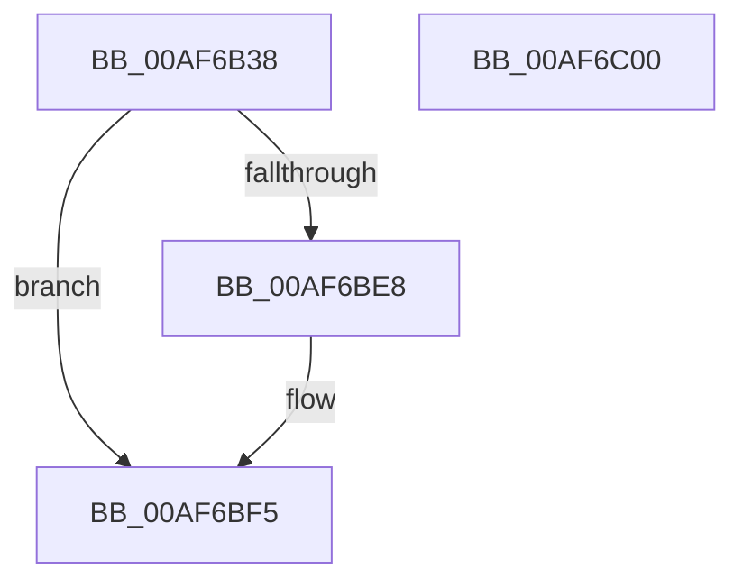

# ExpPartitionCreatePoolDelayed

- RVA: `0x00AF6B38`–`0x00AF6C01` (길이 `201` bytes)
- VA: `0x0000000140AF6B38`
- 실행 섹션: `PAGE`
- PDB 이름 있음: `예`; PDB Function 태그: `아니요`
- unwind 정보 RVA: `0x000BED58`
- 디코드: `50`개 명령, `201/201` bytes 표시
- 미해석 바이트: `0` (있으면 어셈블리에 `.byte`로 보존)

> 이 문서는 커널 이미지의 기계어와 PDB 기호를 분석해 생성했습니다. 4번과 5번은 함수 원형과 자료형을 바이너리 사용 방식에서 추정한 C 해석이며 원본 소스 복구 결과는 아닙니다.

## 1. Dependencies

- 직접 호출 지점: **1**; 고유 호출 대상: **1**
- 직접 호출자로 확인된 함수: **1**
- RIP 상대 이미지 참조: **3**

### Outgoing calls
- `0x00AF6BDF` → [ExpPartitionCreatePoolInternal](ExpPartitionCreatePoolInternal_function_00AF6C08.md) (function, `0x00AF6C08`)

### Direct callers
- [ExpWorkQueueManagerThread](ExpWorkQueueManagerThread_function_00AF6D60.md) at `0x00AF709D`

### Static image references
- `0x00AF6B51` → RVA `0x00FCF6C0` (`CACHEALI`; read)
- `0x00AF6B60` → RVA `0x00EFAA0C` (`.data`; read)
- `0x00AF6B83` → RVA `0x00FDAEC0` (`PAGEDATA`; read)

## 2. Other-region calls and transfers

- 다른 실행 섹션으로 향하는 call: **0**
- 별도 외부 분기/꼬리 이동을 확인하지 못했습니다.

## 3. Assembly (complete function range)

```asm
00AF6B38  48 89 5C 24 10                  mov qword ptr [rsp + 0x10], rbx
00AF6B3D  57                              push rdi
00AF6B3E  48 83 EC 40                     sub rsp, 0x40
00AF6B42  0F B7 02                        movzx eax, word ptr [rdx]
00AF6B45  48 8B D9                        mov rbx, rcx
00AF6B48  48 83 64 24 50 00               and qword ptr [rsp + 0x50], 0
00AF6B4E  4C 8B DA                        mov r11, rdx
00AF6B51  48 8D 15 68 8B 4D 00            lea rdx, [rip + 0x4d8b68]
00AF6B58  45 8D 14 C0                     lea r10d, [r8 + rax*8]
00AF6B5C  48 8B 41 08                     mov rax, qword ptr [rcx + 8]
00AF6B60  44 0F AF 15 A4 3E 40 00         imul r10d, dword ptr [rip + 0x403ea4]
00AF6B68  45 03 D1                        add r10d, r9d
00AF6B6B  41 8B FA                        mov edi, r10d
00AF6B6E  4A 8B 04 D0                     mov rax, qword ptr [rax + r10*8]
00AF6B72  48 D1 E8                        shr rax, 1
00AF6B75  83 E0 7F                        and eax, 0x7f
00AF6B78  48 69 C8 38 03 00 00            imul rcx, rax, 0x338
00AF6B7F  48 8B 14 C2                     mov rdx, qword ptr [rdx + rax*8]
00AF6B83  48 8D 05 36 43 4E 00            lea rax, [rip + 0x4e4336]
00AF6B8A  48 03 C8                        add rcx, rax
00AF6B8D  33 C0                           xor eax, eax
00AF6B8F  48 3B D1                        cmp rdx, rcx
00AF6B92  48 0F 45 C2                     cmovne rax, rdx
00AF6B96  BA 00 00 00 00                  mov edx, 0
00AF6B9B  0F B7 00                        movzx eax, word ptr [rax]
00AF6B9E  41 8D 0C C0                     lea ecx, [r8 + rax*8]
00AF6BA2  48 8B 43 08                     mov rax, qword ptr [rbx + 8]
00AF6BA6  0F AF 0D 5F 3E 40 00            imul ecx, dword ptr [rip + 0x403e5f]
00AF6BAD  48 8B 0C C8                     mov rcx, qword ptr [rax + rcx*8]
00AF6BB1  48 8D 44 24 50                  lea rax, [rsp + 0x50]
00AF6BB6  F6 C1 01                        test cl, 1
00AF6BB9  48 89 44 24 30                  mov qword ptr [rsp + 0x30], rax
00AF6BBE  44 89 4C 24 28                  mov dword ptr [rsp + 0x28], r9d
00AF6BC3  4D 8B CB                        mov r9, r11
00AF6BC6  48 0F 44 D1                     cmove rdx, rcx
00AF6BCA  44 89 44 24 20                  mov dword ptr [rsp + 0x20], r8d
00AF6BCF  48 8B CB                        mov rcx, rbx
00AF6BD2  44 8B 82 D4 02 00 00            mov r8d, dword ptr [rdx + 0x2d4]
00AF6BD9  8B 92 CC 02 00 00               mov edx, dword ptr [rdx + 0x2cc]
00AF6BDF  E8 24 00 00 00                  call 0x140af6c08
00AF6BE4  85 C0                           test eax, eax
00AF6BE6  78 0D                           js 0x140af6bf5
00AF6BE8  48 8B 53 08                     mov rdx, qword ptr [rbx + 8]
00AF6BEC  48 8B 4C 24 50                  mov rcx, qword ptr [rsp + 0x50]
00AF6BF1  48 89 0C FA                     mov qword ptr [rdx + rdi*8], rcx
00AF6BF5  48 8B 5C 24 58                  mov rbx, qword ptr [rsp + 0x58]
00AF6BFA  48 83 C4 40                     add rsp, 0x40
00AF6BFE  5F                              pop rdi
00AF6BFF  C3                              ret
00AF6C00  CC                              int3
```

## 4. C-style interpretation (structured pseudocode)

```c
__int64 __fastcall ExpPartitionCreatePoolDelayed(__int64 a1, __int64 a2, __int64 a3, int a4)
{
    __int64 result;
    __int64 v_r10;
    __int64 v_rsp;
    unsigned __int64 v_stack_m18;
    unsigned int v_stack_m20;
    unsigned int v_stack_m28;
    unsigned __int64 v_stack_p10;
    unsigned __int64 v_stack_p8;

    v_stack_p10 = v_rbx;
    v_rsp = (v_rsp) - (64);
    v_r10 = (unsigned int)((a3 + *(unsigned __int16 *)(a2) * 8) * (*(unsigned int *)(v_rip + 4210340)));
    v_r10 = (unsigned int)((v_r10) + (a4));
    result = (*(unsigned __int64 *)(*(unsigned __int64 *)(a1 + 8) + v_r10 * 8)) >> (1);
    result = (unsigned int)((result) & (127));
    a1 = (a1) * (result);
    a1 = (a1) + (v_rip + 5129014);
    result = 0;
    if ((*(unsigned __int64 *)(v_rip + 5081960 + result * 8)) != a1) { result = *(unsigned __int64 *)(v_rip + 5081960 + result * 8); }
    a1 = (unsigned int)((a3 + *(unsigned __int16 *)(result) * 8) * (*(unsigned int *)(v_rip + 4210271)));
    v_stack_m18 = v_stack_p8;
    v_stack_m20 = a4;
    a2 = 0;
    if ((((unsigned __int8)(*(unsigned __int64 *)(*(unsigned __int64 *)(a1 + 8) + a1 * 8))) & (1)) == 0) { a2 = *(unsigned __int64 *)(*(unsigned __int64 *)(a1 + 8) + a1 * 8); }
    v_stack_m28 = (unsigned int)(a3);
    result = ExpPartitionCreatePoolInternal(a1, (unsigned int)(*(unsigned int *)(a2 + 716)), (unsigned int)(*(unsigned int *)(a2 + 724)), a2);
    if (!(sign_flag)) {
        a2 = *(unsigned __int64 *)(a1 + 8);
        a1 = v_stack_p8;
        *(unsigned __int64 *)(a2 + (unsigned int)((unsigned int)(v_r10)) * 8) = a1;
    }
    v_rsp = (v_rsp) + (64);
    return result;
}
```

## 5. (Beta) C Style

```c
int64_t ExpPartitionCreatePoolDelayed(void *Arg1, void *Arg2, void *Arg3, int32_t Arg4)
{
    uint8_t *arg1 = (uint8_t *)Arg1;
    uint8_t *arg2 = (uint8_t *)Arg2;
    uint8_t *arg3 = (uint8_t *)Arg3;

    int64_t result;
    int64_t local_r10;
    int64_t local_rsp;
    uint64_t v_stack_m18;
    uint32_t v_stack_m20;
    uint32_t v_stack_m28;
    uint64_t v_stack_p10;
    uint64_t v_stack_p8;

    v_stack_p10 = local_rbx;
    local_rsp = (local_rsp) - (64);
    local_r10 = (uint32_t)((Arg3 + *(uint16_t *)(arg2) * 8) * (*(uint32_t *)(v_rip + 0x403EA4)));
    local_r10 = (uint32_t)((local_r10) + (Arg4));
    result = (*(uint64_t *)(*(uint64_t *)(arg1 + 0x8) + local_r10 * 8)) >> (1);
    result = (uint32_t)((result) & (127));
    Arg1 = (Arg1) * (result);
    Arg1 = (Arg1) + (v_rip + 5129014);
    result = 0;
    if ((*(uint64_t *)(v_rip + 0x4D8B68 + result * 8)) != Arg1) { result = *(uint64_t *)(v_rip + 0x4D8B68 + result * 8); }
    Arg1 = (uint32_t)((Arg3 + *(uint16_t *)(result) * 8) * (*(uint32_t *)(v_rip + 0x403E5F)));
    v_stack_m18 = v_stack_p8;
    v_stack_m20 = Arg4;
    Arg2 = 0;
    if ((((uint8_t)(*(uint64_t *)(*(uint64_t *)(arg1 + 0x8) + arg1 * 8))) & (1)) == 0) { Arg2 = *(uint64_t *)(*(uint64_t *)(arg1 + 0x8) + arg1 * 8); }
    v_stack_m28 = (uint32_t)(Arg3);
    result = ExpPartitionCreatePoolInternal(Arg1, (uint32_t)(*(uint32_t *)(arg2 + 0x2CC)), (uint32_t)(*(uint32_t *)(arg2 + 0x2D4)), Arg2);
    if (!(sign_flag)) {
        Arg2 = *(uint64_t *)(arg1 + 0x8);
        Arg1 = v_stack_p8;
        *(void **)(arg2 + (uint32_t)((uint32_t)(local_r10)) * 8) = Arg1;
    }
    local_rsp = (local_rsp) + (64);
    return result;
}
```

### 관측된 메모리 오프셋

구조체 형식이 확인되지 않은 접근은 인자 기준의 오프셋으로만 기록했습니다.

| 기준 인자 | 오프셋 표현 | 폭 (bit) | 접근 |
|---|---:|---:|---|
| `Arg1` | `+ 0x8` | `64` | `R` |
| `Arg2` | `+ 0x0` | `16` | `R` |
| `Arg3` | `+ 0x0 + rax*8` | `32` | `R` |

## 6. Execution-region graph

[열기: 2D/3D 그래프와 함수 탐색 컨트롤 패널](../../../control-panel.html?section=page&rva=0x00AF6B38&view=graph)

- 2D 그래프는 위에서 아래로 흐르고, 3D 그래프는 빈 공간을 드래그해 회전합니다. Shift+드래그는 이동, 휠은 확대·축소, 함수 노드 선택은 대상 보고서 이동입니다.

### Static fallback


