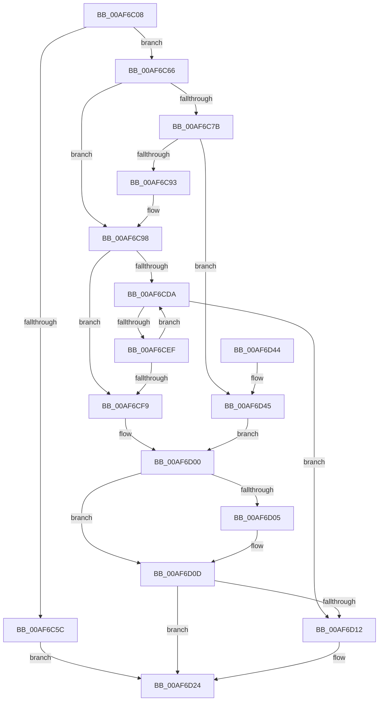

# ExpPartitionCreatePoolInternal

- RVA: `0x00AF6C08`–`0x00AF6D4C` (길이 `324` bytes)
- VA: `0x0000000140AF6C08`
- 실행 섹션: `PAGE`
- PDB 이름 있음: `예`; PDB Function 태그: `아니요`
- unwind 정보 RVA: `0x000D54E8`
- 디코드: `95`개 명령, `324/324` bytes 표시
- 미해석 바이트: `0` (있으면 어셈블리에 `.byte`로 보존)

> 이 문서는 커널 이미지의 기계어와 PDB 기호를 분석해 생성했습니다. 4번과 5번은 함수 원형과 자료형을 바이너리 사용 방식에서 추정한 C 해석이며 원본 소스 복구 결과는 아닙니다.

## 1. Dependencies

- 직접 호출 지점: **8**; 고유 호출 대상: **8**
- 직접 호출자로 확인된 함수: **3**
- RIP 상대 이미지 참조: **0**

### Outgoing calls
- `0x00AF6C4F` → [ExAllocatePool2](../../poolcode/B8/ExAllocatePool2_function_00B820F0.md) (function, `0x00B820F0`)
- `0x00AF6C72` → [ExpWorkQueueHealthMetricsEnabled](../../text/65/ExpWorkQueueHealthMetricsEnabled_function_0065A7AC.md) (function, `0x0065A7AC`)
- `0x00AF6C84` → [ExpWorkQueueHealthMetricsAllocate](../7C/ExpWorkQueueHealthMetricsAllocate_function_007CFF1C.md) (function, `0x007CFF1C`)
- `0x00AF6CBD` → [ExpWorkQueueInitialize](../7D/ExpWorkQueueInitialize_function_007D004C.md) (function, `0x007D004C`)
- `0x00AF6CE4` → [ExpCreateWorkerThread](../9E/ExpCreateWorkerThread_function_009ECEFC.md) (function, `0x009ECEFC`)
- `0x00AF6D08` → [ExpWorkQueueHealthMetricsFree](../7D/ExpWorkQueueHealthMetricsFree_function_007D000C.md) (function, `0x007D000C`)
- `0x00AF6D15` → [ExpWorkQueueDestroy](../7C/ExpWorkQueueDestroy_function_007CFE70.md) (function, `0x007CFE70`)
- `0x00AF6D1F` → [ExFreePoolWithTag](../../poolcode/B8/ExFreePoolWithTag_function_00B82870.md) (function, `0x00B82870`)

### Direct callers
- [ExpPartitionInitialize](../7C/ExpPartitionInitialize_function_007CFB9C.md) at `0x007CFCE0`
- [ExpPartitionInitialize](../7C/ExpPartitionInitialize_function_007CFB9C.md) at `0x007CFD30`
- [ExpPartitionCreatePool](ExpPartitionCreatePool_function_00AF68A8.md) at `0x00AF6985`
- [ExpPartitionCreatePoolDelayed](ExpPartitionCreatePoolDelayed_function_00AF6B38.md) at `0x00AF6BDF`

### Static image references
- 디코드된 RIP-relative 메모리 참조가 없습니다.

## 2. Other-region calls and transfers

- 다른 실행 섹션으로 향하는 call: **3**
  - `0x00AF6C4F` → [ExAllocatePool2](../../poolcode/B8/ExAllocatePool2_function_00B820F0.md) (`PAGE` → `POOLCODE`)
  - `0x00AF6C72` → [ExpWorkQueueHealthMetricsEnabled](../../text/65/ExpWorkQueueHealthMetricsEnabled_function_0065A7AC.md) (`PAGE` → `.text`)
  - `0x00AF6D1F` → [ExFreePoolWithTag](../../poolcode/B8/ExFreePoolWithTag_function_00B82870.md) (`PAGE` → `POOLCODE`)
- 별도 외부 분기/꼬리 이동을 확인하지 못했습니다.

## 3. Assembly (complete function range)

```asm
00AF6C08  48 8B C4                        mov rax, rsp
00AF6C0B  48 89 58 08                     mov qword ptr [rax + 8], rbx
00AF6C0F  48 89 68 10                     mov qword ptr [rax + 0x10], rbp
00AF6C13  48 89 70 18                     mov qword ptr [rax + 0x18], rsi
00AF6C17  57                              push rdi
00AF6C18  41 54                           push r12
00AF6C1A  41 55                           push r13
00AF6C1C  41 56                           push r14
00AF6C1E  41 57                           push r15
00AF6C20  48 83 EC 50                     sub rsp, 0x50
00AF6C24  4C 8B BC 24 B0 00 00 00         mov r15, qword ptr [rsp + 0xb0]
00AF6C2C  33 FF                           xor edi, edi
00AF6C2E  45 8B E0                        mov r12d, r8d
00AF6C31  48 89 78 C8                     mov qword ptr [rax - 0x38], rdi
00AF6C35  44 8B EA                        mov r13d, edx
00AF6C38  48 8B E9                        mov rbp, rcx
00AF6C3B  BA F0 02 00 00                  mov edx, 0x2f0
00AF6C40  41 B8 45 78 57 6C               mov r8d, 0x6c577845
00AF6C46  49 21 3F                        and qword ptr [r15], rdi
00AF6C49  8D 4F 40                        lea ecx, [rdi + 0x40]
00AF6C4C  4D 8B F1                        mov r14, r9
00AF6C4F  E8 9C B4 08 00                  call 0x140b820f0
00AF6C54  48 8B D8                        mov rbx, rax
00AF6C57  48 85 C0                        test rax, rax
00AF6C5A  75 0A                           jne 0x140af6c66
00AF6C5C  BF 17 00 00 C0                  mov edi, 0xc0000017
00AF6C61  E9 BE 00 00 00                  jmp 0x140af6d24
00AF6C66  8B B4 24 A0 00 00 00            mov esi, dword ptr [rsp + 0xa0]
00AF6C6D  48 8B CD                        mov rcx, rbp
00AF6C70  8B D6                           mov edx, esi
00AF6C72  E8 35 3B B6 FF                  call 0x14065a7ac
00AF6C77  84 C0                           test al, al
00AF6C79  74 1D                           je 0x140af6c98
00AF6C7B  41 0F B7 16                     movzx edx, word ptr [r14]
00AF6C7F  48 8D 4C 24 40                  lea rcx, [rsp + 0x40]
00AF6C84  E8 93 92 CD FF                  call 0x1407cff1c
00AF6C89  8B F8                           mov edi, eax
00AF6C8B  85 C0                           test eax, eax
00AF6C8D  0F 88 B2 00 00 00               js 0x140af6d45
00AF6C93  48 8B 7C 24 40                  mov rdi, qword ptr [rsp + 0x40]
00AF6C98  8B 84 24 A8 00 00 00            mov eax, dword ptr [rsp + 0xa8]
00AF6C9F  4C 8B CD                        mov r9, rbp
00AF6CA2  48 89 7C 24 38                  mov qword ptr [rsp + 0x38], rdi
00AF6CA7  45 8B C4                        mov r8d, r12d
00AF6CAA  89 44 24 30                     mov dword ptr [rsp + 0x30], eax
00AF6CAE  41 8B D5                        mov edx, r13d
00AF6CB1  89 74 24 28                     mov dword ptr [rsp + 0x28], esi
00AF6CB5  48 8B CB                        mov rcx, rbx
00AF6CB8  4C 89 74 24 20                  mov qword ptr [rsp + 0x20], r14
00AF6CBD  E8 8A 93 CD FF                  call 0x1407d004c
00AF6CC2  48 8B 45 10                     mov rax, qword ptr [rbp + 0x10]
00AF6CC6  33 F6                           xor esi, esi
00AF6CC8  41 0F B7 0E                     movzx ecx, word ptr [r14]
00AF6CCC  33 ED                           xor ebp, ebp
00AF6CCE  4C 8B 34 C8                     mov r14, qword ptr [rax + rcx*8]
00AF6CD2  39 B3 CC 02 00 00               cmp dword ptr [rbx + 0x2cc], esi
00AF6CD8  7E 1F                           jle 0x140af6cf9
00AF6CDA  49 8D 96 14 01 00 00            lea rdx, [r14 + 0x114]
00AF6CE1  48 8B CB                        mov rcx, rbx
00AF6CE4  E8 13 62 EF FF                  call 0x1409ecefc
00AF6CE9  8B F8                           mov edi, eax
00AF6CEB  85 C0                           test eax, eax
00AF6CED  78 23                           js 0x140af6d12
00AF6CEF  FF C5                           inc ebp
00AF6CF1  3B AB CC 02 00 00               cmp ebp, dword ptr [rbx + 0x2cc]
00AF6CF7  7C E1                           jl 0x140af6cda
00AF6CF9  49 89 1F                        mov qword ptr [r15], rbx
00AF6CFC  33 DB                           xor ebx, ebx
00AF6CFE  33 FF                           xor edi, edi
00AF6D00  48 85 F6                        test rsi, rsi
00AF6D03  74 08                           je 0x140af6d0d
00AF6D05  48 8B CE                        mov rcx, rsi
00AF6D08  E8 FF 92 CD FF                  call 0x1407d000c
00AF6D0D  48 85 DB                        test rbx, rbx
00AF6D10  74 12                           je 0x140af6d24
00AF6D12  48 8B CB                        mov rcx, rbx
00AF6D15  E8 56 91 CD FF                  call 0x1407cfe70
00AF6D1A  33 D2                           xor edx, edx
00AF6D1C  48 8B CB                        mov rcx, rbx
00AF6D1F  E8 4C BB 08 00                  call 0x140b82870
00AF6D24  4C 8D 5C 24 50                  lea r11, [rsp + 0x50]
00AF6D29  8B C7                           mov eax, edi
00AF6D2B  49 8B 5B 30                     mov rbx, qword ptr [r11 + 0x30]
00AF6D2F  49 8B 6B 38                     mov rbp, qword ptr [r11 + 0x38]
00AF6D33  49 8B 73 40                     mov rsi, qword ptr [r11 + 0x40]
00AF6D37  49 8B E3                        mov rsp, r11
00AF6D3A  41 5F                           pop r15
00AF6D3C  41 5E                           pop r14
00AF6D3E  41 5D                           pop r13
00AF6D40  41 5C                           pop r12
00AF6D42  5F                              pop rdi
00AF6D43  C3                              ret
00AF6D44  CC                              int3
00AF6D45  48 8B 74 24 40                  mov rsi, qword ptr [rsp + 0x40]
00AF6D4A  EB B4                           jmp 0x140af6d00
```

## 4. C-style interpretation (structured pseudocode)

```c
__int64 __fastcall ExpPartitionCreatePoolInternal(__int64 a1, int a2, int a3, __int64 a4, unsigned int a5, unsigned int a6, __int64 a7)
{
    __int64 result;
    __int64 v_rbp;
    __int64 v_rbx;
    __int64 v_rdi;
    __int64 v_rsi;
    __int64 v_rsp;
    unsigned __int64 v_stack_m10;
    unsigned __int64 v_stack_m28;
    unsigned __int64 v_stack_m38;
    unsigned __int64 v_stack_m40;
    unsigned int v_stack_m48;
    unsigned int v_stack_m50;
    unsigned __int64 v_stack_m58;

    *(unsigned __int64 *)(v_rsp + 8) = v_rbx;
    *(unsigned __int64 *)(v_rsp + 16) = v_rbp;
    *(unsigned __int64 *)(v_rsp + 24) = v_rsi;
    v_rsp = (v_rsp) - (80);
    v_rdi = 0;
    *(unsigned __int64 *)(v_rsp - 56) = 0;
    result = ExAllocatePool2(v_rdi + 64, 752, (unsigned int)(0x6C577845ULL), a4);
    if (result != 0) goto loc_00AF6C66;
    goto loc_00AF6D24;
loc_00AF6C66:
    result = ExpWorkQueueHealthMetricsEnabled(a1, (unsigned int)((unsigned int)((unsigned int)(a5))), (unsigned int)(0x6C577845ULL), a4);
    if ((unsigned __int8)(result) == 0) goto loc_00AF6C98;
    result = ExpWorkQueueHealthMetricsAllocate(v_stack_m38, *(unsigned __int16 *)(a4), (unsigned int)(0x6C577845ULL), a4);
    if (sign_flag) goto loc_00AF6D45;
loc_00AF6C98:
    v_stack_m40 = v_stack_m38;
    v_stack_m48 = (unsigned int)((unsigned int)(a6));
    v_stack_m50 = (unsigned int)((unsigned int)(a5));
    v_stack_m58 = a4;
    result = ExpWorkQueueInitialize(result, (unsigned int)((unsigned int)((unsigned int)(a2))), (unsigned int)((unsigned int)((unsigned int)(a3))), a1);
    v_rsi = 0;
    v_rbp = 0;
    if ((*(unsigned int *)(result + 716)) <= 0) goto loc_00AF6CF9;
loc_00AF6CDA:
    result = ExpCreateWorkerThread(result, *(unsigned __int64 *)(*(unsigned __int64 *)(a1 + 16) + *(unsigned __int16 *)(a4) * 8) + 276, (unsigned int)((unsigned int)((unsigned int)(a3))), a1);
    if (sign_flag) goto loc_00AF6D12;
    v_rbp = (unsigned int)((v_rbp) + 1);
    if (((unsigned int)(v_rbp)) < (*(unsigned int *)(result + 716))) goto loc_00AF6CDA;
loc_00AF6CF9:
    *(unsigned __int64 *)(a7) = result;
    v_rbx = 0;
    v_rdi = 0;
loc_00AF6D00:
    if (0 != 0) {
        a1 = 0;
        result = ExpWorkQueueHealthMetricsFree(a1, *(unsigned __int64 *)(*(unsigned __int64 *)(a1 + 16) + *(unsigned __int16 *)(a4) * 8) + 276, (unsigned int)((unsigned int)((unsigned int)(a3))), a1);
    }
    if (0 != 0) {
        a1 = 0;
        result = ExpWorkQueueDestroy(a1, *(unsigned __int64 *)(*(unsigned __int64 *)(a1 + 16) + *(unsigned __int16 *)(a4) * 8) + 276, (unsigned int)((unsigned int)((unsigned int)(a3))), a1);
        a2 = 0;
        a1 = 0;
        result = ExFreePoolWithTag(a1, a2, (unsigned int)((unsigned int)((unsigned int)(a3))), a1);
    }
    return 0;
loc_00AF6D45:
    goto loc_00AF6D00;
}
```

## 5. (Beta) C Style

```c
int64_t ExpPartitionCreatePoolInternal(void *Arg1, int32_t Arg2, int32_t Arg3, void *Arg4, uint32_t Arg5, uint32_t Arg6, void *Arg7)
{
    uint8_t *arg1 = (uint8_t *)Arg1;
    uint8_t *arg4 = (uint8_t *)Arg4;
    uint8_t *arg7 = (uint8_t *)Arg7;

    int64_t result;
    int64_t local_rbp;
    int64_t local_rbx;
    int64_t local_rdi;
    int64_t local_rsi;
    int64_t local_rsp;
    uint64_t v_stack_m10;
    uint64_t v_stack_m28;
    uint64_t v_stack_m38;
    uint64_t v_stack_m40;
    uint32_t v_stack_m48;
    uint32_t v_stack_m50;
    uint64_t v_stack_m58;

    *(uint64_t *)(local_rsp + 0x8) = local_rbx;
    *(uint64_t *)(local_rsp + 0x10) = local_rbp;
    *(uint64_t *)(local_rsp + 0x18) = local_rsi;
    local_rsp = (local_rsp) - (80);
    local_rdi = 0;
    *(uint64_t *)(local_rsp - 0x38) = 0;
    result = ExAllocatePool2(local_rdi + 64, 752, (uint32_t)(0x6C577845ULL), Arg4);
    if (result != 0) goto loc_00AF6C66;
    goto loc_00AF6D24;
loc_00AF6C66:
    result = ExpWorkQueueHealthMetricsEnabled(Arg1, (uint32_t)((uint32_t)((uint32_t)(Arg5))), (uint32_t)(0x6C577845ULL), Arg4);
    if ((uint8_t)(result) == 0) goto loc_00AF6C98;
    result = ExpWorkQueueHealthMetricsAllocate(v_stack_m38, *(uint16_t *)(arg4), (uint32_t)(0x6C577845ULL), Arg4);
    if (sign_flag) goto loc_00AF6D45;
loc_00AF6C98:
    v_stack_m40 = v_stack_m38;
    v_stack_m48 = (uint32_t)((uint32_t)(Arg6));
    v_stack_m50 = (uint32_t)((uint32_t)(Arg5));
    v_stack_m58 = Arg4;
    result = ExpWorkQueueInitialize(result, (uint32_t)((uint32_t)((uint32_t)(Arg2))), (uint32_t)((uint32_t)((uint32_t)(Arg3))), Arg1);
    local_rsi = 0;
    local_rbp = 0;
    if ((*(uint32_t *)(result + 0x2CC)) <= 0) goto loc_00AF6CF9;
loc_00AF6CDA:
    result = ExpCreateWorkerThread(result, *(uint64_t *)(*(uint64_t *)(arg1 + 0x10) + *(uint16_t *)(arg4) * 8) + 276, (uint32_t)((uint32_t)((uint32_t)(Arg3))), Arg1);
    if (sign_flag) goto loc_00AF6D12;
    local_rbp = (uint32_t)((local_rbp) + 1);
    if (((uint32_t)(local_rbp)) < (*(uint32_t *)(result + 0x2CC))) goto loc_00AF6CDA;
loc_00AF6CF9:
    *(uint64_t *)(arg7) = result;
    local_rbx = 0;
    local_rdi = 0;
loc_00AF6D00:
    if (0 != 0) {
        Arg1 = 0;
        result = ExpWorkQueueHealthMetricsFree(Arg1, *(uint64_t *)(*(uint64_t *)(arg1 + 0x10) + *(uint16_t *)(arg4) * 8) + 276, (uint32_t)((uint32_t)((uint32_t)(Arg3))), Arg1);
    }
    if (0 != 0) {
        Arg1 = 0;
        result = ExpWorkQueueDestroy(Arg1, *(uint64_t *)(*(uint64_t *)(arg1 + 0x10) + *(uint16_t *)(arg4) * 8) + 276, (uint32_t)((uint32_t)((uint32_t)(Arg3))), Arg1);
        Arg2 = 0;
        Arg1 = 0;
        result = ExFreePoolWithTag(Arg1, Arg2, (uint32_t)((uint32_t)((uint32_t)(Arg3))), Arg1);
    }
    return 0;
loc_00AF6D45:
    goto loc_00AF6D00;
}
```

### 관측된 메모리 오프셋

구조체 형식이 확인되지 않은 접근은 인자 기준의 오프셋으로만 기록했습니다.

| 기준 인자 | 오프셋 표현 | 폭 (bit) | 접근 |
|---|---:|---:|---|
| `Arg1` | `+ 0x10` | `64` | `R` |
| `Arg4` | `+ 0x0` | `16` | `R` |
| `Arg7` | `+ 0x0` | `64` | `R/W` |
| `Arg7` | `+ 0x0` | `64` | `W` |

## 6. Execution-region graph

[열기: 2D/3D 그래프와 함수 탐색 컨트롤 패널](../../../control-panel.html?section=page&rva=0x00AF6C08&view=graph)

- 2D 그래프는 위에서 아래로 흐르고, 3D 그래프는 빈 공간을 드래그해 회전합니다. Shift+드래그는 이동, 휠은 확대·축소, 함수 노드 선택은 대상 보고서 이동입니다.

### Static fallback


