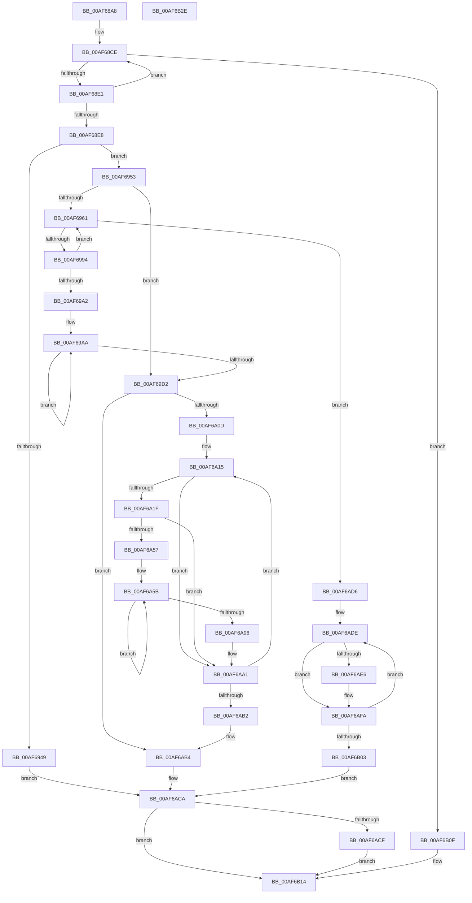

# ExpPartitionCreatePool

- RVA: `0x00AF68A8`–`0x00AF6B2F` (길이 `647` bytes)
- VA: `0x0000000140AF68A8`
- 실행 섹션: `PAGE`
- PDB 이름 있음: `예`; PDB Function 태그: `아니요`
- unwind 정보 RVA: `0x000A8820`
- 디코드: `167`개 명령, `647/647` bytes 표시
- 미해석 바이트: `0` (있으면 어셈블리에 `.byte`로 보존)

> 이 문서는 커널 이미지의 기계어와 PDB 기호를 분석해 생성했습니다. 4번과 5번은 함수 원형과 자료형을 바이너리 사용 방식에서 추정한 C 해석이며 원본 소스 복구 결과는 아닙니다.

## 1. Dependencies

- 직접 호출 지점: **8**; 고유 호출 대상: **6**
- 직접 호출자로 확인된 함수: **1**
- RIP 상대 이미지 참조: **4**

### Outgoing calls
- `0x00AF68E8` → [KeGetCurrentNode](../../text/5B/KeGetCurrentNode_function_005BBCD0.md) (function, `0x005BBCD0`)
- `0x00AF6935` → [ExAllocatePool2](../../poolcode/B8/ExAllocatePool2_function_00B820F0.md) (function, `0x00B820F0`)
- `0x00AF6985` → [ExpPartitionCreatePoolInternal](ExpPartitionCreatePoolInternal_function_00AF6C08.md) (function, `0x00AF6C08`)
- `0x00AF69D7` → [ExFreePoolWithTag](../../poolcode/B8/ExFreePoolWithTag_function_00B82870.md) (function, `0x00B82870`)
- `0x00AF6A85` → [KeSetEvent](../../text/33/KeSetEvent_function_0033F310.md) (function, `0x0033F310`)
- `0x00AF6AE6` → [ExpWorkQueueDestroy](../7C/ExpWorkQueueDestroy_function_007CFE70.md) (function, `0x007CFE70`)
- `0x00AF6AF0` → [ExFreePoolWithTag](../../poolcode/B8/ExFreePoolWithTag_function_00B82870.md) (function, `0x00B82870`)
- `0x00AF6B08` → [ExFreePoolWithTag](../../poolcode/B8/ExFreePoolWithTag_function_00B82870.md) (function, `0x00B82870`)

### Direct callers
- [ExAllocatePrivateWorkerPool](../70/ExAllocatePrivateWorkerPool_function_00705208.md) at `0x00705213`

### Static image references
- `0x00AF68F9` → RVA `0x00FDAEC0` (`PAGEDATA`; read)
- `0x00AF690A` → RVA `0x00FCF6C0` (`CACHEALI`; read)
- `0x00AF69BC` → RVA `0x00EFAA0C` (`.data`; read)
- `0x00AF69F9` → RVA `0x00FC5000` (`ALMOSTRO`; read)

## 2. Other-region calls and transfers

- 다른 실행 섹션으로 향하는 call: **6**
  - `0x00AF68E8` → [KeGetCurrentNode](../../text/5B/KeGetCurrentNode_function_005BBCD0.md) (`PAGE` → `.text`)
  - `0x00AF6935` → [ExAllocatePool2](../../poolcode/B8/ExAllocatePool2_function_00B820F0.md) (`PAGE` → `POOLCODE`)
  - `0x00AF69D7` → [ExFreePoolWithTag](../../poolcode/B8/ExFreePoolWithTag_function_00B82870.md) (`PAGE` → `POOLCODE`)
  - `0x00AF6A85` → [KeSetEvent](../../text/33/KeSetEvent_function_0033F310.md) (`PAGE` → `.text`)
  - `0x00AF6AF0` → [ExFreePoolWithTag](../../poolcode/B8/ExFreePoolWithTag_function_00B82870.md) (`PAGE` → `POOLCODE`)
  - `0x00AF6B08` → [ExFreePoolWithTag](../../poolcode/B8/ExFreePoolWithTag_function_00B82870.md) (`PAGE` → `POOLCODE`)
- 별도 외부 분기/꼬리 이동을 확인하지 못했습니다.

## 3. Assembly (complete function range)

```asm
00AF68A8  48 8B C4                        mov rax, rsp
00AF68AB  48 89 58 10                     mov qword ptr [rax + 0x10], rbx
00AF68AF  4C 89 48 20                     mov qword ptr [rax + 0x20], r9
00AF68B3  44 89 40 18                     mov dword ptr [rax + 0x18], r8d
00AF68B7  55                              push rbp
00AF68B8  56                              push rsi
00AF68B9  57                              push rdi
00AF68BA  41 54                           push r12
00AF68BC  41 55                           push r13
00AF68BE  41 56                           push r14
00AF68C0  41 57                           push r15
00AF68C2  48 83 EC 50                     sub rsp, 0x50
00AF68C6  33 DB                           xor ebx, ebx
00AF68C8  48 8B E9                        mov rbp, rcx
00AF68CB  89 58 18                        mov dword ptr [rax + 0x18], ebx
00AF68CE  8B 45 18                        mov eax, dword ptr [rbp + 0x18]
00AF68D1  0F BC C8                        bsf ecx, eax
00AF68D4  89 8C 24 A0 00 00 00            mov dword ptr [rsp + 0xa0], ecx
00AF68DB  0F 84 2E 02 00 00               je 0x140af6b0f
00AF68E1  F0 0F B3 4D 18                  lock btr dword ptr [rbp + 0x18], ecx
00AF68E6  73 E6                           jae 0x140af68ce
00AF68E8  E8 E3 53 AC FF                  call 0x1405bbcd0
00AF68ED  4C 8B F8                        mov r15, rax
00AF68F0  41 B8 45 78 57 6C               mov r8d, 0x6c577845
00AF68F6  0F B7 10                        movzx edx, word ptr [rax]
00AF68F9  48 8D 05 C0 45 4E 00            lea rax, [rip + 0x4e45c0]
00AF6900  48 69 CA 38 03 00 00            imul rcx, rdx, 0x338
00AF6907  48 03 C8                        add rcx, rax
00AF690A  48 8D 05 AF 8D 4D 00            lea rax, [rip + 0x4d8daf]
00AF6911  48 39 0C D0                     cmp qword ptr [rax + rdx*8], rcx
00AF6915  B9 00 01 00 00                  mov ecx, 0x100
00AF691A  4C 0F 44 FB                     cmove r15, rbx
00AF691E  4C 89 7C 24 40                  mov qword ptr [rsp + 0x40], r15
00AF6923  45 8B A7 58 03 00 00            mov r12d, dword ptr [r15 + 0x358]
00AF692A  45 8B EC                        mov r13d, r12d
00AF692D  4A 8D 14 E5 00 00 00 00         lea rdx, [r12*8]
00AF6935  E8 B6 B7 08 00                  call 0x140b820f0
00AF693A  8B BC 24 A0 00 00 00            mov edi, dword ptr [rsp + 0xa0]
00AF6941  48 8B F0                        mov rsi, rax
00AF6944  48 85 C0                        test rax, rax
00AF6947  75 0A                           jne 0x140af6953
00AF6949  BB 17 00 00 C0                  mov ebx, 0xc0000017
00AF694E  E9 77 01 00 00                  jmp 0x140af6aca
00AF6953  44 8B F3                        mov r14d, ebx
00AF6956  41 BA 01 00 00 00               mov r10d, 1
00AF695C  45 85 E4                        test r12d, r12d
00AF695F  74 71                           je 0x140af69d2
00AF6961  41 8B C6                        mov eax, r14d
00AF6964  4D 8B CF                        mov r9, r15
00AF6967  41 B8 10 00 00 00               mov r8d, 0x10
00AF696D  41 8B D2                        mov edx, r10d
00AF6970  48 8D 0C C6                     lea rcx, [rsi + rax*8]
00AF6974  48 89 4C 24 30                  mov qword ptr [rsp + 0x30], rcx
00AF6979  48 8B CD                        mov rcx, rbp
00AF697C  44 89 74 24 28                  mov dword ptr [rsp + 0x28], r14d
00AF6981  89 7C 24 20                     mov dword ptr [rsp + 0x20], edi
00AF6985  E8 7E 02 00 00                  call 0x140af6c08
00AF698A  8B D8                           mov ebx, eax
00AF698C  85 C0                           test eax, eax
00AF698E  0F 88 42 01 00 00               js 0x140af6ad6
00AF6994  41 BA 01 00 00 00               mov r10d, 1
00AF699A  45 03 F2                        add r14d, r10d
00AF699D  45 3B F4                        cmp r14d, r12d
00AF69A0  72 BF                           jb 0x140af6961
00AF69A2  33 DB                           xor ebx, ebx
00AF69A4  4C 8B CE                        mov r9, rsi
00AF69A7  44 8B C3                        mov r8d, ebx
00AF69AA  41 0F B7 07                     movzx eax, word ptr [r15]
00AF69AE  49 8B 11                        mov rdx, qword ptr [r9]
00AF69B1  4D 8D 49 08                     lea r9, [r9 + 8]
00AF69B5  8D 0C C7                        lea ecx, [rdi + rax*8]
00AF69B8  48 8B 45 08                     mov rax, qword ptr [rbp + 8]
00AF69BC  0F AF 0D 49 40 40 00            imul ecx, dword ptr [rip + 0x404049]
00AF69C3  41 03 C8                        add ecx, r8d
00AF69C6  45 03 C2                        add r8d, r10d
00AF69C9  48 89 14 C8                     mov qword ptr [rax + rcx*8], rdx
00AF69CD  45 3B C4                        cmp r8d, r12d
00AF69D0  72 D8                           jb 0x140af69aa
00AF69D2  33 D2                           xor edx, edx
00AF69D4  48 8B CE                        mov rcx, rsi
00AF69D7  E8 94 BE 08 00                  call 0x140b82870
00AF69DC  41 0F B7 07                     movzx eax, word ptr [r15]
00AF69E0  41 B8 01 00 00 00               mov r8d, 1
00AF69E6  83 E0 7F                        and eax, 0x7f
00AF69E9  48 89 9C 24 90 00 00 00         mov qword ptr [rsp + 0x90], rbx
00AF69F1  03 C0                           add eax, eax
00AF69F3  0F B7 F3                        movzx esi, bx
00AF69F6  41 0B C0                        or eax, r8d
00AF69F9  66 3B 1D 00 E6 4C 00            cmp bx, word ptr [rip + 0x4ce600]
00AF6A00  89 84 24 90 00 00 00            mov dword ptr [rsp + 0x90], eax
00AF6A07  0F 83 A7 00 00 00               jae 0x140af6ab4
00AF6A0D  48 8B 9C 24 90 00 00 00         mov rbx, qword ptr [rsp + 0x90]
00AF6A15  66 41 3B 37                     cmp si, word ptr [r15]
00AF6A19  0F 84 82 00 00 00               je 0x140af6aa1
00AF6A1F  44 0F B7 E6                     movzx r12d, si
00AF6A23  48 8D 05 96 8C 4D 00            lea rax, [rip + 0x4d8c96]
00AF6A2A  48 8D 15 8F 44 4E 00            lea rdx, [rip + 0x4e448f]
00AF6A31  4A 8B 0C E0                     mov rcx, qword ptr [rax + r12*8]
00AF6A35  49 69 C4 38 03 00 00            imul rax, r12, 0x338
00AF6A3C  48 03 C2                        add rax, rdx
00AF6A3F  33 D2                           xor edx, edx
00AF6A41  48 3B C8                        cmp rcx, rax
00AF6A44  44 8B F2                        mov r14d, edx
00AF6A47  44 8B EA                        mov r13d, edx
00AF6A4A  4C 0F 45 F1                     cmovne r14, rcx
00AF6A4E  41 39 96 58 03 00 00            cmp dword ptr [r14 + 0x358], edx
00AF6A55  76 4A                           jbe 0x140af6aa1
00AF6A57  44 8D 7A 01                     lea r15d, [rdx + 1]
00AF6A5B  41 0F B7 06                     movzx eax, word ptr [r14]
00AF6A5F  45 33 C0                        xor r8d, r8d
00AF6A62  33 D2                           xor edx, edx
00AF6A64  8D 0C C7                        lea ecx, [rdi + rax*8]
00AF6A67  48 8B 45 08                     mov rax, qword ptr [rbp + 8]
00AF6A6B  0F AF 0D 9A 3F 40 00            imul ecx, dword ptr [rip + 0x403f9a]
00AF6A72  41 03 CD                        add ecx, r13d
00AF6A75  48 89 1C C8                     mov qword ptr [rax + rcx*8], rbx
00AF6A79  48 8B 45 10                     mov rax, qword ptr [rbp + 0x10]
00AF6A7D  4A 8B 0C E0                     mov rcx, qword ptr [rax + r12*8]
00AF6A81  48 83 C1 10                     add rcx, 0x10
00AF6A85  E8 86 88 84 FF                  call 0x14033f310
00AF6A8A  45 03 EF                        add r13d, r15d
00AF6A8D  45 3B AE 58 03 00 00            cmp r13d, dword ptr [r14 + 0x358]
00AF6A94  72 C5                           jb 0x140af6a5b
00AF6A96  4C 8B 7C 24 40                  mov r15, qword ptr [rsp + 0x40]
00AF6A9B  41 B8 01 00 00 00               mov r8d, 1
00AF6AA1  66 41 03 F0                     add si, r8w
00AF6AA5  66 3B 35 54 E5 4C 00            cmp si, word ptr [rip + 0x4ce554]
00AF6AAC  0F 82 63 FF FF FF               jb 0x140af6a15
00AF6AB2  33 DB                           xor ebx, ebx
00AF6AB4  48 8B 84 24 A8 00 00 00         mov rax, qword ptr [rsp + 0xa8]
00AF6ABC  89 38                           mov dword ptr [rax], edi
00AF6ABE  BF 08 00 00 00                  mov edi, 8
00AF6AC3  89 BC 24 A0 00 00 00            mov dword ptr [rsp + 0xa0], edi
00AF6ACA  83 FF 08                        cmp edi, 8
00AF6ACD  74 45                           je 0x140af6b14
00AF6ACF  F0 0F AB 7D 18                  lock bts dword ptr [rbp + 0x18], edi
00AF6AD4  EB 3E                           jmp 0x140af6b14
00AF6AD6  4C 8B F6                        mov r14, rsi
00AF6AD9  B8 01 00 00 00                  mov eax, 1
00AF6ADE  48 8B 0E                        mov rcx, qword ptr [rsi]
00AF6AE1  48 85 C9                        test rcx, rcx
00AF6AE4  74 14                           je 0x140af6afa
00AF6AE6  E8 85 93 CD FF                  call 0x1407cfe70
00AF6AEB  48 8B 0E                        mov rcx, qword ptr [rsi]
00AF6AEE  33 D2                           xor edx, edx
00AF6AF0  E8 7B BD 08 00                  call 0x140b82870
00AF6AF5  B8 01 00 00 00                  mov eax, 1
00AF6AFA  48 83 C6 08                     add rsi, 8
00AF6AFE  4C 2B E8                        sub r13, rax
00AF6B01  75 DB                           jne 0x140af6ade
00AF6B03  33 D2                           xor edx, edx
00AF6B05  49 8B CE                        mov rcx, r14
00AF6B08  E8 63 BD 08 00                  call 0x140b82870
00AF6B0D  EB BB                           jmp 0x140af6aca
00AF6B0F  BB 17 00 00 C0                  mov ebx, 0xc0000017
00AF6B14  8B C3                           mov eax, ebx
00AF6B16  48 8B 9C 24 98 00 00 00         mov rbx, qword ptr [rsp + 0x98]
00AF6B1E  48 83 C4 50                     add rsp, 0x50
00AF6B22  41 5F                           pop r15
00AF6B24  41 5E                           pop r14
00AF6B26  41 5D                           pop r13
00AF6B28  41 5C                           pop r12
00AF6B2A  5F                              pop rdi
00AF6B2B  5E                              pop rsi
00AF6B2C  5D                              pop rbp
00AF6B2D  C3                              ret
00AF6B2E  CC                              int3
```

## 4. C-style interpretation (structured pseudocode)

```c
__int64 __fastcall ExpPartitionCreatePool(__int64 a1, __int64 a2, int a3, __int64 a4)
{
    __int64 result;
    __int64 v_r13;
    __int64 v_r14;
    __int64 v_r15;
    __int64 v_rbx;
    __int64 v_rsi;
    __int64 v_rsp;
    unsigned __int64 v_stack_m48;
    unsigned __int64 v_stack_m58;
    unsigned int v_stack_m60;
    unsigned int v_stack_m68;
    unsigned __int64 v_stack_p10;
    unsigned int v_stack_p18;
    unsigned __int64 v_stack_p20;
    unsigned __int64 v_stack_p8;

    *(unsigned __int64 *)(v_rsp + 16) = v_rbx;
    *(unsigned __int64 *)(v_rsp + 32) = a4;
    *(unsigned int *)(v_rsp + 24) = a3;
    v_rsp = (v_rsp) - (80);
    v_rbx = 0;
    *(unsigned int *)(v_rsp + 24) = 0;
loc_00AF68CE:
    v_stack_p18 = (unsigned int)(a1);
    if (condition_is_equal) goto loc_00AF6B0F;
    if (condition_is_above_or_equal) goto loc_00AF68CE;
    result = KeGetCurrentNode(a1, a2, a3, a4);
    a1 = (a1) * (*(unsigned __int16 *)(result));
    a1 = (a1) + (v_rip + 5129664);
    v_r15 = result;
    if ((*(unsigned __int64 *)(v_rip + 5082543 + *(unsigned __int16 *)(result) * 8)) == a1) { v_r15 = 0; }
    v_stack_m48 = v_r15;
    result = ExAllocatePool2(256, (unsigned int)(*(unsigned int *)(v_r15 + 856)) * 8, (unsigned int)(0x6C577845ULL), a4);
    if (result != 0) goto loc_00AF6953;
    goto loc_00AF6ACA;
loc_00AF6953:
    if ((unsigned int)((unsigned int)(*(unsigned int *)(v_r15 + 856))) == 0) goto loc_00AF69D2;
loc_00AF6961:
    v_stack_m58 = result + (unsigned int)((unsigned int)((unsigned int)((unsigned int)((unsigned int)(0xC0000017ULL))))) * 8;
    v_stack_m60 = (unsigned int)((unsigned int)((unsigned int)((unsigned int)(0xC0000017ULL))));
    v_stack_m68 = (unsigned int)((unsigned int)(v_stack_p18));
    result = ExpPartitionCreatePoolInternal(a1, 1, 16, v_r15);
    if (sign_flag) goto loc_00AF6AD6;
    v_r14 = (unsigned int)(((unsigned int)((unsigned int)((unsigned int)(0xC0000017ULL)))) + (1));
    if (((unsigned int)(v_r14)) < ((unsigned int)((unsigned int)(*(unsigned int *)(v_r15 + 856))))) goto loc_00AF6961;
    v_rbx = 0;
loc_00AF69AA:
    a1 = (unsigned int)(((unsigned int)(v_stack_p18) + *(unsigned __int16 *)(v_r15) * 8) * (*(unsigned int *)(v_rip + 4210761)));
    a1 = (unsigned int)((a1) + (0));
    a3 = (unsigned int)((0) + (1));
    *(unsigned __int64 *)(*(unsigned __int64 *)(a1 + 8) + a1 * 8) = *(unsigned __int64 *)(result);
    if (a3 < ((unsigned int)((unsigned int)(*(unsigned int *)(v_r15 + 856))))) goto loc_00AF69AA;
loc_00AF69D2:
    a2 = 0;
    result = ExFreePoolWithTag(result, a2, a3, result + 8);
    result = (unsigned int)((*(unsigned __int16 *)(v_r15)) & (127));
    v_stack_p8 = 0;
    result = (unsigned int)((result) + ((unsigned int)(result)));
    result = (unsigned int)((result) | (1));
    v_stack_p8 = (unsigned int)(result);
    if (0 >= (*(unsigned __int16 *)(v_rip + 5039616))) goto loc_00AF6AB4;
loc_00AF6A15:
    if (0 == (*(unsigned __int16 *)(v_r15))) goto loc_00AF6AA1;
    result = (v_rip + 5082262) * (0);
    result = (result) + (v_rip + 5129359);
    a2 = 0;
    v_r14 = 0;
    if ((*(unsigned __int64 *)(v_rip + 5082262 + 0 * 8)) != result) { v_r14 = *(unsigned __int64 *)(v_rip + 5082262 + 0 * 8); }
    if ((*(unsigned int *)(v_r14 + 856)) <= 0) goto loc_00AF6AA1;
loc_00AF6A5B:
    a3 = 0;
    a2 = 0;
    a1 = (unsigned int)(((unsigned int)(v_stack_p18) + *(unsigned __int16 *)(v_r14) * 8) * (*(unsigned int *)(v_rip + 4210586)));
    a1 = (unsigned int)((a1) + (0));
    *(unsigned __int64 *)(*(unsigned __int64 *)(a1 + 8) + a1 * 8) = v_stack_p8;
    a1 = (*(unsigned __int64 *)(*(unsigned __int64 *)(a1 + 16) + 0 * 8)) + (16);
    result = KeSetEvent(a1, a2, a3, result + 8);
    v_r13 = (unsigned int)((0) + ((unsigned int)(a2 + 1)));
    if (((unsigned int)(v_r13)) < (*(unsigned int *)(v_r14 + 856))) goto loc_00AF6A5B;
loc_00AF6AA1:
    v_rsi = (unsigned __int16)((0) + (1));
    if (((unsigned __int16)(v_rsi)) < (*(unsigned __int16 *)(v_rip + 5039444))) goto loc_00AF6A15;
    v_rbx = 0;
loc_00AF6AB4:
    *(unsigned int *)(v_stack_p20) = (unsigned int)((unsigned int)(v_stack_p18));
    v_stack_p18 = 8;
loc_00AF6ACA:
    if (8 == 8) goto loc_00AF6B14;
    goto loc_00AF6B14;
loc_00AF6AD6:
loc_00AF6ADE:
    result = 1;
    if (*(unsigned __int64 *)(v_rsi) != 0) {
        result = ExpWorkQueueDestroy(*(unsigned __int64 *)(v_rsi), a2, 1, result + 8);
        a1 = *(unsigned __int64 *)(v_rsi);
        a2 = 0;
        result = ExFreePoolWithTag(a1, a2, 1, result + 8);
        result = 1;
    }
    v_rsi = (v_rsi) + (8);
    v_r13 = (v_r13) - (result);
    if (condition_is_not_equal) goto loc_00AF6ADE;
    a2 = 0;
    result = ExFreePoolWithTag(v_rsi, a2, 1, result + 8);
    goto loc_00AF6ACA;
loc_00AF6B0F:
loc_00AF6B14:
    v_rsp = (v_rsp) + (80);
    return (unsigned int)((unsigned int)((unsigned int)(0xC0000017ULL)));
}
```

## 5. (Beta) C Style

```c
int64_t ExpPartitionCreatePool(void *Arg1, int64_t Arg2, int32_t Arg3, int64_t Arg4)
{
    uint8_t *arg1 = (uint8_t *)Arg1;

    int64_t result;
    int64_t local_r13;
    int64_t local_r14;
    int64_t local_r15;
    int64_t local_rbx;
    int64_t local_rsi;
    int64_t local_rsp;
    uint64_t v_stack_m48;
    uint64_t v_stack_m58;
    uint32_t v_stack_m60;
    uint32_t v_stack_m68;
    uint64_t v_stack_p10;
    uint32_t v_stack_p18;
    uint64_t v_stack_p20;
    uint64_t v_stack_p8;

    *(uint64_t *)(local_rsp + 0x10) = local_rbx;
    *(uint64_t *)(local_rsp + 0x20) = Arg4;
    *(uint32_t *)(local_rsp + 0x18) = Arg3;
    local_rsp = (local_rsp) - (80);
    local_rbx = 0;
    *(uint32_t *)(local_rsp + 0x18) = 0;
loc_00AF68CE:
    v_stack_p18 = (uint32_t)(Arg1);
    if (condition_is_equal) goto loc_00AF6B0F;
    if (condition_is_above_or_equal) goto loc_00AF68CE;
    result = KeGetCurrentNode(Arg1, Arg2, Arg3, Arg4);
    Arg1 = (Arg1) * (*(uint16_t *)(result));
    Arg1 = (Arg1) + (v_rip + 5129664);
    local_r15 = result;
    if ((*(uint64_t *)(v_rip + 0x4D8DAF + *(uint16_t *)(result) * 8)) == Arg1) { local_r15 = 0; }
    v_stack_m48 = local_r15;
    result = ExAllocatePool2(256, (uint32_t)(*(uint32_t *)(local_r15 + 0x358)) * 8, (uint32_t)(0x6C577845ULL), Arg4);
    if (result != 0) goto loc_00AF6953;
    goto loc_00AF6ACA;
loc_00AF6953:
    if ((uint32_t)((uint32_t)(*(uint32_t *)(local_r15 + 0x358))) == 0) goto loc_00AF69D2;
loc_00AF6961:
    v_stack_m58 = result + (uint32_t)((uint32_t)((uint32_t)((uint32_t)((uint32_t)(0xC0000017ULL))))) * 8;
    v_stack_m60 = (uint32_t)((uint32_t)((uint32_t)((uint32_t)(0xC0000017ULL))));
    v_stack_m68 = (uint32_t)((uint32_t)(v_stack_p18));
    result = ExpPartitionCreatePoolInternal(Arg1, 1, 16, local_r15);
    if (sign_flag) goto loc_00AF6AD6;
    local_r14 = (uint32_t)(((uint32_t)((uint32_t)((uint32_t)(0xC0000017ULL)))) + (1));
    if (((uint32_t)(local_r14)) < ((uint32_t)((uint32_t)(*(uint32_t *)(local_r15 + 0x358))))) goto loc_00AF6961;
    local_rbx = 0;
loc_00AF69AA:
    Arg1 = (uint32_t)(((uint32_t)(v_stack_p18) + *(uint16_t *)(local_r15) * 8) * (*(uint32_t *)(v_rip + 0x404049)));
    Arg1 = (uint32_t)((Arg1) + (0));
    Arg3 = (uint32_t)((0) + (1));
    *(uint64_t *)(*(uint64_t *)(arg1 + 0x8) + arg1 * 8) = *(uint64_t *)(result);
    if (Arg3 < ((uint32_t)((uint32_t)(*(uint32_t *)(local_r15 + 0x358))))) goto loc_00AF69AA;
loc_00AF69D2:
    Arg2 = 0;
    result = ExFreePoolWithTag(result, Arg2, Arg3, result + 8);
    result = (uint32_t)((*(uint16_t *)(local_r15)) & (127));
    v_stack_p8 = 0;
    result = (uint32_t)((result) + ((uint32_t)(result)));
    result = (uint32_t)((result) | (1));
    v_stack_p8 = (uint32_t)(result);
    if (0 >= (*(uint16_t *)(v_rip + 0x4CE600))) goto loc_00AF6AB4;
loc_00AF6A15:
    if (0 == (*(uint16_t *)(local_r15))) goto loc_00AF6AA1;
    result = (v_rip + 5082262) * (0);
    result = (result) + (v_rip + 5129359);
    Arg2 = 0;
    local_r14 = 0;
    if ((*(uint64_t *)(v_rip + 0x4D8C96 + 0x0 * 8)) != result) { local_r14 = *(uint64_t *)(v_rip + 0x4D8C96 + 0x0 * 8); }
    if ((*(uint32_t *)(local_r14 + 0x358)) <= 0) goto loc_00AF6AA1;
loc_00AF6A5B:
    Arg3 = 0;
    Arg2 = 0;
    Arg1 = (uint32_t)(((uint32_t)(v_stack_p18) + *(uint16_t *)(local_r14) * 8) * (*(uint32_t *)(v_rip + 0x403F9A)));
    Arg1 = (uint32_t)((Arg1) + (0));
    *(uint64_t *)(*(uint64_t *)(arg1 + 0x8) + arg1 * 8) = v_stack_p8;
    Arg1 = (*(uint64_t *)(*(uint64_t *)(arg1 + 0x10) + 0x0 * 8)) + (16);
    result = KeSetEvent(Arg1, Arg2, Arg3, result + 8);
    local_r13 = (uint32_t)((0) + ((uint32_t)(Arg2 + 1)));
    if (((uint32_t)(local_r13)) < (*(uint32_t *)(local_r14 + 0x358))) goto loc_00AF6A5B;
loc_00AF6AA1:
    local_rsi = (uint16_t)((0) + (1));
    if (((uint16_t)(local_rsi)) < (*(uint16_t *)(v_rip + 0x4CE554))) goto loc_00AF6A15;
    local_rbx = 0;
loc_00AF6AB4:
    *(uint32_t *)(v_stack_p20) = (uint32_t)((uint32_t)(v_stack_p18));
    v_stack_p18 = 8;
loc_00AF6ACA:
    if (8 == 8) goto loc_00AF6B14;
    goto loc_00AF6B14;
loc_00AF6AD6:
loc_00AF6ADE:
    result = 1;
    if (*(uint64_t *)(local_rsi) != 0) {
        result = ExpWorkQueueDestroy(*(uint64_t *)(local_rsi), Arg2, 1, result + 8);
        Arg1 = *(uint64_t *)(local_rsi);
        Arg2 = 0;
        result = ExFreePoolWithTag(Arg1, Arg2, 1, result + 8);
        result = 1;
    }
    local_rsi = (local_rsi) + (8);
    local_r13 = (local_r13) - (result);
    if (condition_is_not_equal) goto loc_00AF6ADE;
    Arg2 = 0;
    result = ExFreePoolWithTag(local_rsi, Arg2, 1, result + 8);
    goto loc_00AF6ACA;
loc_00AF6B0F:
loc_00AF6B14:
    local_rsp = (local_rsp) + (80);
    return (uint32_t)((uint32_t)((uint32_t)(0xC0000017ULL)));
}
```

### 관측된 메모리 오프셋

구조체 형식이 확인되지 않은 접근은 인자 기준의 오프셋으로만 기록했습니다.

| 기준 인자 | 오프셋 표현 | 폭 (bit) | 접근 |
|---|---:|---:|---|
| `Arg1` | `+ 0x8` | `64` | `R` |
| `Arg1` | `+ 0x10` | `64` | `R` |
| `Arg1` | `+ 0x18` | `32` | `R` |
| `Arg1` | `+ 0x18` | `32` | `R/W` |

## 6. Execution-region graph

[열기: 2D/3D 그래프와 함수 탐색 컨트롤 패널](../../../control-panel.html?section=page&rva=0x00AF68A8&view=graph)

- 2D 그래프는 위에서 아래로 흐르고, 3D 그래프는 빈 공간을 드래그해 회전합니다. Shift+드래그는 이동, 휠은 확대·축소, 함수 노드 선택은 대상 보고서 이동입니다.

### Static fallback


