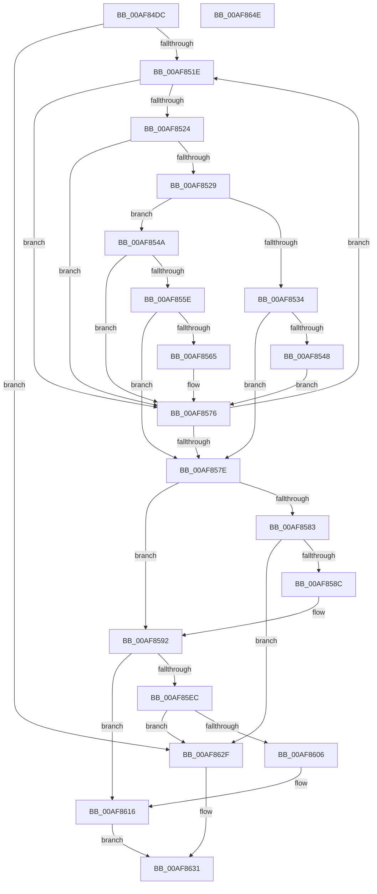

# MiReserveExistingDriverPtes

- RVA: `0x00AF84DC`–`0x00AF864F` (길이 `371` bytes)
- VA: `0x0000000140AF84DC`
- 실행 섹션: `PAGE`
- PDB 이름 있음: `예`; PDB Function 태그: `아니요`
- unwind 정보 RVA: `0x000B0E24`
- 디코드: `114`개 명령, `371/371` bytes 표시
- 미해석 바이트: `0` (있으면 어셈블리에 `.byte`로 보존)

> 이 문서는 커널 이미지의 기계어와 PDB 기호를 분석해 생성했습니다. 4번과 5번은 함수 원형과 자료형을 바이너리 사용 방식에서 추정한 C 해석이며 원본 소스 복구 결과는 아닙니다.

## 1. Dependencies

- 직접 호출 지점: **10**; 고유 호출 대상: **7**
- 직접 호출자로 확인된 함수: **1**
- RIP 상대 이미지 참조: **1**

### Outgoing calls
- `0x00AF8529` → [Feature_ARM64_ASLR_AddressSpace_128MB__private_IsEnabledDeviceUsageNoInline](../../text/67/Feature_ARM64_ASLR_AddressSpace_128MB__private_IsEnabledDeviceUsageNoInline_function_00671374.md) (function, `0x00671374`)
- `0x00AF853C` → [RtlFindClearBits](../../text/40/RtlFindClearBits_function_0040E680.md) (function, `0x0040E680`)
- `0x00AF8552` → [MiReserveBestDriverRange](../7F/MiReserveBestDriverRange_function_007F92E0.md) (function, `0x007F92E0`)
- `0x00AF85AB` → [MiGetPteAddress](../../text/43/MiGetPteAddress_function_0043E130.md) (function, `0x0043E130`)
- `0x00AF85B6` → [MiGetPteAddress](../../text/43/MiGetPteAddress_function_0043E130.md) (function, `0x0043E130`)
- `0x00AF85C9` → [MiGetPteAddress](../../text/43/MiGetPteAddress_function_0043E130.md) (function, `0x0043E130`)
- `0x00AF85E3` → [RtlAreBitsSet](../../text/45/RtlAreBitsSet_function_00450EF0.md) (function, `0x00450EF0`)
- `0x00AF85FD` → [MiMakeZeroedPageTables](../../text/3B/MiMakeZeroedPageTables_function_003B4F6C.md) (function, `0x003B4F6C`)
- `0x00AF8611` → [RtlSetBits](../../text/3E/RtlSetBits_function_003E1610.md) (function, `0x003E1610`)
- `0x00AF861F` → [RtlSetBits](../../text/3E/RtlSetBits_function_003E1610.md) (function, `0x003E1610`)

### Direct callers
- [MiReserveDriverPtes](../A7/MiReserveDriverPtes_function_00A75150.md) at `0x00A75198`

### Static image references
- `0x00AF84F8` → RVA `0x00E2D960` (`.data`; read)

## 2. Other-region calls and transfers

- 다른 실행 섹션으로 향하는 call: **9**
  - `0x00AF8529` → [Feature_ARM64_ASLR_AddressSpace_128MB__private_IsEnabledDeviceUsageNoInline](../../text/67/Feature_ARM64_ASLR_AddressSpace_128MB__private_IsEnabledDeviceUsageNoInline_function_00671374.md) (`PAGE` → `.text`)
  - `0x00AF853C` → [RtlFindClearBits](../../text/40/RtlFindClearBits_function_0040E680.md) (`PAGE` → `.text`)
  - `0x00AF85AB` → [MiGetPteAddress](../../text/43/MiGetPteAddress_function_0043E130.md) (`PAGE` → `.text`)
  - `0x00AF85B6` → [MiGetPteAddress](../../text/43/MiGetPteAddress_function_0043E130.md) (`PAGE` → `.text`)
  - `0x00AF85C9` → [MiGetPteAddress](../../text/43/MiGetPteAddress_function_0043E130.md) (`PAGE` → `.text`)
  - `0x00AF85E3` → [RtlAreBitsSet](../../text/45/RtlAreBitsSet_function_00450EF0.md) (`PAGE` → `.text`)
  - `0x00AF85FD` → [MiMakeZeroedPageTables](../../text/3B/MiMakeZeroedPageTables_function_003B4F6C.md) (`PAGE` → `.text`)
  - `0x00AF8611` → [RtlSetBits](../../text/3E/RtlSetBits_function_003E1610.md) (`PAGE` → `.text`)
  - `0x00AF861F` → [RtlSetBits](../../text/3E/RtlSetBits_function_003E1610.md) (`PAGE` → `.text`)
- 별도 외부 분기/꼬리 이동을 확인하지 못했습니다.

## 3. Assembly (complete function range)

```asm
00AF84DC  48 8B C4                        mov rax, rsp
00AF84DF  48 89 58 08                     mov qword ptr [rax + 8], rbx
00AF84E3  48 89 68 18                     mov qword ptr [rax + 0x18], rbp
00AF84E7  48 89 70 20                     mov qword ptr [rax + 0x20], rsi
00AF84EB  57                              push rdi
00AF84EC  41 54                           push r12
00AF84EE  41 55                           push r13
00AF84F0  41 56                           push r14
00AF84F2  41 57                           push r15
00AF84F4  48 83 EC 20                     sub rsp, 0x20
00AF84F8  48 8B 1D 61 54 33 00            mov rbx, qword ptr [rip + 0x335461]
00AF84FF  45 33 E4                        xor r12d, r12d
00AF8502  41 83 CD FF                     or r13d, 0xffffffff
00AF8506  44 89 60 10                     mov dword ptr [rax + 0x10], r12d
00AF850A  8B E9                           mov ebp, ecx
00AF850C  41 8B F4                        mov esi, r12d
00AF850F  45 8B F4                        mov r14d, r12d
00AF8512  41 8B FD                        mov edi, r13d
00AF8515  48 85 DB                        test rbx, rbx
00AF8518  0F 84 11 01 00 00               je 0x140af862f
00AF851E  4C 39 63 30                     cmp qword ptr [rbx + 0x30], r12
00AF8522  74 52                           je 0x140af8576
00AF8524  39 6B 10                        cmp dword ptr [rbx + 0x10], ebp
00AF8527  72 4D                           jb 0x140af8576
00AF8529  E8 46 8E B7 FF                  call 0x140671374
00AF852E  8B D5                           mov edx, ebp
00AF8530  85 C0                           test eax, eax
00AF8532  75 16                           jne 0x140af854a
00AF8534  44 8B 43 20                     mov r8d, dword ptr [rbx + 0x20]
00AF8538  48 8D 4B 10                     lea rcx, [rbx + 0x10]
00AF853C  E8 3F 61 91 FF                  call 0x14040e680
00AF8541  8B F8                           mov edi, eax
00AF8543  41 3B C5                        cmp eax, r13d
00AF8546  75 36                           jne 0x140af857e
00AF8548  EB 2C                           jmp 0x140af8576
00AF854A  4C 8D 44 24 58                  lea r8, [rsp + 0x58]
00AF854F  48 8B CB                        mov rcx, rbx
00AF8552  E8 89 0D D0 FF                  call 0x1407f92e0
00AF8557  8B F8                           mov edi, eax
00AF8559  41 3B C5                        cmp eax, r13d
00AF855C  74 18                           je 0x140af8576
00AF855E  44 39 64 24 58                  cmp dword ptr [rsp + 0x58], r12d
00AF8563  75 19                           jne 0x140af857e
00AF8565  48 85 F6                        test rsi, rsi
00AF8568  44 0F 44 F0                     cmove r14d, eax
00AF856C  48 8B C3                        mov rax, rbx
00AF856F  48 0F 45 C6                     cmovne rax, rsi
00AF8573  48 8B F0                        mov rsi, rax
00AF8576  48 8B 1B                        mov rbx, qword ptr [rbx]
00AF8579  48 85 DB                        test rbx, rbx
00AF857C  75 A0                           jne 0x140af851e
00AF857E  48 85 DB                        test rbx, rbx
00AF8581  75 0F                           jne 0x140af8592
00AF8583  48 85 F6                        test rsi, rsi
00AF8586  0F 84 A3 00 00 00               je 0x140af862f
00AF858C  48 8B DE                        mov rbx, rsi
00AF858F  41 8B FE                        mov edi, r14d
00AF8592  4C 8B 43 08                     mov r8, qword ptr [rbx + 8]
00AF8596  8B C5                           mov eax, ebp
00AF8598  C1 E0 04                        shl eax, 4
00AF859B  8B F7                           mov esi, edi
00AF859D  48 C1 E6 07                     shl rsi, 7
00AF85A1  49 03 F0                        add rsi, r8
00AF85A4  48 8B CE                        mov rcx, rsi
00AF85A7  4C 8D 2C C6                     lea r13, [rsi + rax*8]
00AF85AB  E8 80 5B 94 FF                  call 0x14043e130
00AF85B0  49 8B C8                        mov rcx, r8
00AF85B3  48 8B D0                        mov rdx, rax
00AF85B6  E8 75 5B 94 FF                  call 0x14043e130
00AF85BB  4C 8B FA                        mov r15, rdx
00AF85BE  49 8D 4D F8                     lea rcx, [r13 - 8]
00AF85C2  4C 2B F8                        sub r15, rax
00AF85C5  49 C1 FF 03                     sar r15, 3
00AF85C9  E8 62 5B 94 FF                  call 0x14043e130
00AF85CE  4C 8B F0                        mov r14, rax
00AF85D1  48 8D 4B 28                     lea rcx, [rbx + 0x28]
00AF85D5  4C 2B F2                        sub r14, rdx
00AF85D8  41 8B D7                        mov edx, r15d
00AF85DB  49 C1 FE 03                     sar r14, 3
00AF85DF  45 8D 46 01                     lea r8d, [r14 + 1]
00AF85E3  E8 08 89 95 FF                  call 0x140450ef0
00AF85E8  84 C0                           test al, al
00AF85EA  75 2A                           jne 0x140af8616
00AF85EC  41 B9 0B 00 00 00               mov r9d, 0xb
00AF85F2  49 8D 55 F8                     lea rdx, [r13 - 8]
00AF85F6  48 8B CE                        mov rcx, rsi
00AF85F9  45 8D 41 F6                     lea r8d, [r9 - 0xa]
00AF85FD  E8 6A C9 8B FF                  call 0x1403b4f6c
00AF8602  85 C0                           test eax, eax
00AF8604  74 29                           je 0x140af862f
00AF8606  45 8D 46 01                     lea r8d, [r14 + 1]
00AF860A  41 8B D7                        mov edx, r15d
00AF860D  48 8D 4B 28                     lea rcx, [rbx + 0x28]
00AF8611  E8 FA 8F 8E FF                  call 0x1403e1610
00AF8616  48 8D 4B 10                     lea rcx, [rbx + 0x10]
00AF861A  44 8B C5                        mov r8d, ebp
00AF861D  8B D7                           mov edx, edi
00AF861F  E8 EC 8F 8E FF                  call 0x1403e1610
00AF8624  8D 0C 2F                        lea ecx, [rdi + rbp]
00AF8627  48 8B C6                        mov rax, rsi
00AF862A  89 4B 20                        mov dword ptr [rbx + 0x20], ecx
00AF862D  EB 02                           jmp 0x140af8631
00AF862F  33 C0                           xor eax, eax
00AF8631  48 8B 5C 24 50                  mov rbx, qword ptr [rsp + 0x50]
00AF8636  48 8B 6C 24 60                  mov rbp, qword ptr [rsp + 0x60]
00AF863B  48 8B 74 24 68                  mov rsi, qword ptr [rsp + 0x68]
00AF8640  48 83 C4 20                     add rsp, 0x20
00AF8644  41 5F                           pop r15
00AF8646  41 5E                           pop r14
00AF8648  41 5D                           pop r13
00AF864A  41 5C                           pop r12
00AF864C  5F                              pop rdi
00AF864D  C3                              ret
00AF864E  CC                              int3
```

## 4. C-style interpretation (structured pseudocode)

```c
__int64 __fastcall MiReserveExistingDriverPtes(int a1)
{
    __int64 result;
    __int64 v_r12;
    __int64 v_r13;
    __int64 v_r14;
    __int64 v_r15;
    __int64 v_rsi;
    __int64 v_rsp;
    unsigned __int64 v_stack_p10;
    unsigned __int64 v_stack_p18;
    unsigned __int64 v_stack_p20;
    unsigned __int64 v_stack_p8;

    *(unsigned __int64 *)(v_rsp + 8) = v_rbx;
    *(unsigned __int64 *)(v_rsp + 24) = v_rbp;
    *(unsigned __int64 *)(v_rsp + 32) = v_rsi;
    v_rsp = (v_rsp) - (32);
    v_r12 = 0;
    v_r13 = (unsigned int)((v_r13) | (0xFFFFFFFFULL));
    *(unsigned int *)(v_rsp + 16) = 0;
    if (*(unsigned __int64 *)(v_rip + 3363937) == 0) goto loc_00AF862F;
loc_00AF851E:
    if ((*(unsigned __int64 *)(*(unsigned __int64 *)(v_rip + 3363937) + 48)) == 0) goto loc_00AF8576;
    if ((*(unsigned int *)(*(unsigned __int64 *)(v_rip + 3363937) + 16)) < ((unsigned int)((unsigned int)(a1)))) goto loc_00AF8576;
    result = Feature_ARM64_ASLR_AddressSpace_128MB__private_IsEnabledDeviceUsageNoInline(a1, a2, a3, a4);
    if ((unsigned int)(result) != 0) goto loc_00AF854A;
    result = RtlFindClearBits(*(unsigned __int64 *)(v_rip + 3363937) + 16, (unsigned int)((unsigned int)((unsigned int)(a1))), (unsigned int)(*(unsigned int *)(*(unsigned __int64 *)(v_rip + 3363937) + 32)), a4);
    if (((unsigned int)(result)) != ((unsigned int)(v_r13))) goto loc_00AF857E;
    goto loc_00AF8576;
loc_00AF854A:
    result = MiReserveBestDriverRange(*(unsigned __int64 *)(v_rip + 3363937), (unsigned int)((unsigned int)((unsigned int)(a1))), v_stack_p10, a4);
    if (((unsigned int)(result)) == ((unsigned int)(v_r13))) goto loc_00AF8576;
    if (v_stack_p10 != 0) goto loc_00AF857E;
    v_r14 = 0;
    if (0 == 0) { v_r14 = (unsigned int)(result); }
    result = *(unsigned __int64 *)(v_rip + 3363937);
    if (0 != 0) { result = 0; }
loc_00AF8576:
    if (*(unsigned __int64 *)(*(unsigned __int64 *)(v_rip + 3363937)) != 0) goto loc_00AF851E;
loc_00AF857E:
    if (*(unsigned __int64 *)(*(unsigned __int64 *)(v_rip + 3363937)) != 0) goto loc_00AF8592;
    if (result == 0) goto loc_00AF862F;
loc_00AF8592:
    result = (unsigned int)(((unsigned int)((unsigned int)((unsigned int)(a1)))) << (4));
    v_rsi = ((unsigned int)((unsigned int)((unsigned int)((unsigned int)(v_r14))))) << (7);
    v_rsi = (v_rsi) + (*(unsigned __int64 *)(result + 8));
    result = MiGetPteAddress(v_rsi, (unsigned int)((unsigned int)((unsigned int)(a1))), *(unsigned __int64 *)(result + 8), a4);
    result = MiGetPteAddress(*(unsigned __int64 *)(result + 8), result, *(unsigned __int64 *)(result + 8), a4);
    v_r15 = (result) - (result);
    v_r15 = (v_r15) >> (3);
    result = MiGetPteAddress(v_rsi + result * 8 - 8, result, *(unsigned __int64 *)(result + 8), a4);
    v_r14 = (result) - (result);
    v_r14 = (v_r14) >> (3);
    result = RtlAreBitsSet(result + 40, (unsigned int)((unsigned int)(v_r15)), v_r14 + 1, a4);
    if ((unsigned __int8)(result) != 0) goto loc_00AF8616;
    result = MiMakeZeroedPageTables(v_rsi, v_rsi + result * 8 - 8, 11 - 10, 11);
    if ((unsigned int)(result) == 0) goto loc_00AF862F;
    result = RtlSetBits(result + 40, (unsigned int)((unsigned int)(v_r15)), v_r14 + 1, 11);
loc_00AF8616:
    result = RtlSetBits(result + 16, (unsigned int)((unsigned int)((unsigned int)((unsigned int)(v_r14)))), (unsigned int)((unsigned int)((unsigned int)(a1))), 11);
    *(unsigned int *)(result + 32) = (unsigned int)((unsigned int)((unsigned int)(v_r14)) + (unsigned int)(a1) * 1);
    goto loc_00AF8631;
loc_00AF862F:
    result = 0;
loc_00AF8631:
    v_rsp = (v_rsp) + (32);
    return result;
}
```

## 5. (Beta) C Style

```c
int64_t MiReserveExistingDriverPtes(int32_t Arg1)
{
    int64_t result;
    int64_t local_r12;
    int64_t local_r13;
    int64_t local_r14;
    int64_t local_r15;
    int64_t local_rsi;
    int64_t local_rsp;
    uint64_t v_stack_p10;
    uint64_t v_stack_p18;
    uint64_t v_stack_p20;
    uint64_t v_stack_p8;

    *(uint64_t *)(local_rsp + 0x8) = local_rbx;
    *(uint64_t *)(local_rsp + 0x18) = local_rbp;
    *(uint64_t *)(local_rsp + 0x20) = local_rsi;
    local_rsp = (local_rsp) - (32);
    local_r12 = 0;
    local_r13 = (uint32_t)((local_r13) | (0xFFFFFFFFULL));
    *(uint32_t *)(local_rsp + 0x10) = 0;
    if (*(uint64_t *)(v_rip + 0x335461) == 0) goto loc_00AF862F;
loc_00AF851E:
    if ((*(uint64_t *)(*(uint64_t *)(v_rip + 0x335461) + 0x30)) == 0) goto loc_00AF8576;
    if ((*(uint32_t *)(*(uint64_t *)(v_rip + 0x335461) + 0x10)) < ((uint32_t)((uint32_t)(Arg1)))) goto loc_00AF8576;
    result = Feature_ARM64_ASLR_AddressSpace_128MB__private_IsEnabledDeviceUsageNoInline(Arg1, a2, a3, a4);
    if ((uint32_t)(result) != 0) goto loc_00AF854A;
    result = RtlFindClearBits(*(uint64_t *)(v_rip + 0x335461) + 16, (uint32_t)((uint32_t)((uint32_t)(Arg1))), (uint32_t)(*(uint32_t *)(*(uint64_t *)(v_rip + 0x335461) + 0x20)), a4);
    if (((uint32_t)(result)) != ((uint32_t)(local_r13))) goto loc_00AF857E;
    goto loc_00AF8576;
loc_00AF854A:
    result = MiReserveBestDriverRange(*(uint64_t *)(v_rip + 0x335461), (uint32_t)((uint32_t)((uint32_t)(Arg1))), v_stack_p10, a4);
    if (((uint32_t)(result)) == ((uint32_t)(local_r13))) goto loc_00AF8576;
    if (v_stack_p10 != 0) goto loc_00AF857E;
    local_r14 = 0;
    if (0 == 0) { local_r14 = (uint32_t)(result); }
    result = *(uint64_t *)(v_rip + 0x335461);
    if (0 != 0) { result = 0; }
loc_00AF8576:
    if (*(uint64_t *)(*(uint64_t *)(v_rip + 0x335461)) != 0) goto loc_00AF851E;
loc_00AF857E:
    if (*(uint64_t *)(*(uint64_t *)(v_rip + 0x335461)) != 0) goto loc_00AF8592;
    if (result == 0) goto loc_00AF862F;
loc_00AF8592:
    result = (uint32_t)(((uint32_t)((uint32_t)((uint32_t)(Arg1)))) << (4));
    local_rsi = ((uint32_t)((uint32_t)((uint32_t)((uint32_t)(local_r14))))) << (7);
    local_rsi = (local_rsi) + (*(uint64_t *)(result + 0x8));
    result = MiGetPteAddress(local_rsi, (uint32_t)((uint32_t)((uint32_t)(Arg1))), *(uint64_t *)(result + 0x8), a4);
    result = MiGetPteAddress(*(uint64_t *)(result + 0x8), result, *(uint64_t *)(result + 0x8), a4);
    local_r15 = (result) - (result);
    local_r15 = (local_r15) >> (3);
    result = MiGetPteAddress(local_rsi + result * 8 - 8, result, *(uint64_t *)(result + 0x8), a4);
    local_r14 = (result) - (result);
    local_r14 = (local_r14) >> (3);
    result = RtlAreBitsSet(result + 40, (uint32_t)((uint32_t)(local_r15)), local_r14 + 1, a4);
    if ((uint8_t)(result) != 0) goto loc_00AF8616;
    result = MiMakeZeroedPageTables(local_rsi, local_rsi + result * 8 - 8, 11 - 10, 11);
    if ((uint32_t)(result) == 0) goto loc_00AF862F;
    result = RtlSetBits(result + 40, (uint32_t)((uint32_t)(local_r15)), local_r14 + 1, 11);
loc_00AF8616:
    result = RtlSetBits(result + 16, (uint32_t)((uint32_t)((uint32_t)((uint32_t)(local_r14)))), (uint32_t)((uint32_t)((uint32_t)(Arg1))), 11);
    *(uint32_t *)(result + 0x20) = (uint32_t)((uint32_t)((uint32_t)(local_r14)) + (uint32_t)(Arg1) * 1);
    goto loc_00AF8631;
loc_00AF862F:
    result = 0;
loc_00AF8631:
    local_rsp = (local_rsp) + (32);
    return result;
}
```

## 6. Execution-region graph

[열기: 2D/3D 그래프와 함수 탐색 컨트롤 패널](../../../control-panel.html?section=page&rva=0x00AF84DC&view=graph)

- 2D 그래프는 위에서 아래로 흐르고, 3D 그래프는 빈 공간을 드래그해 회전합니다. Shift+드래그는 이동, 휠은 확대·축소, 함수 노드 선택은 대상 보고서 이동입니다.

### Static fallback


