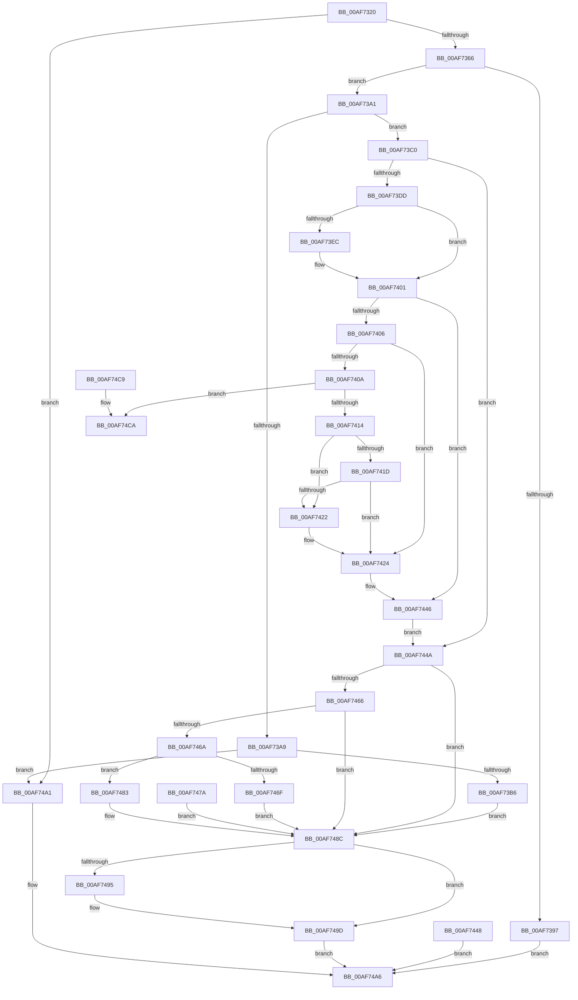

# NtAddAtomEx

- RVA: `0x00AF7320`–`0x00AF74D1` (길이 `433` bytes)
- VA: `0x0000000140AF7320`
- 실행 섹션: `PAGE`
- PDB 이름 있음: `예`; PDB Function 태그: `아니요`
- unwind 정보 RVA: `0x000D57A8`
- 디코드: `122`개 명령, `433/433` bytes 표시
- 미해석 바이트: `0` (있으면 어셈블리에 `.byte`로 보존)

> 이 문서는 커널 이미지의 기계어와 PDB 기호를 분석해 생성했습니다. 4번과 5번은 함수 원형과 자료형을 바이너리 사용 방식에서 추정한 C 해석이며 원본 소스 복구 결과는 아닙니다.

## 1. Dependencies

- 직접 호출 지점: **8**; 고유 호출 대상: **7**
- 직접 호출자로 확인된 함수: **1**
- RIP 상대 이미지 참조: **1**

### Outgoing calls
- `0x00AF7383` → [PsInvokeWin32Callout](../91/PsInvokeWin32Callout_function_009133C0.md) (function, `0x009133C0`)
- `0x00AF73A9` → [Feature_829055289__private_IsEnabledDeviceUsageNoInline](../../text/60/Feature_829055289__private_IsEnabledDeviceUsageNoInline_function_0060954C.md) (function, `0x0060954C`)
- `0x00AF7439` → [memcpy](../../text/6C/memcpy_function_006C6840.md) (function, `0x006C6840`)
- `0x00AF745A` → [RtlAddAtomToAtomTableEx](../../text/43/RtlAddAtomToAtomTableEx_function_00438550.md) (function, `0x00438550`)
- `0x00AF748C` → [Feature_829055289__private_IsEnabledDeviceUsageNoInline](../../text/60/Feature_829055289__private_IsEnabledDeviceUsageNoInline_function_0060954C.md) (function, `0x0060954C`)
- `0x00AF7498` → [RtlDereferenceAtomTable](../../text/5E/RtlDereferenceAtomTable_function_005E6EE0.md) (function, `0x005E6EE0`)
- `0x00AF74B1` → [_security_check_cookie](../../text/6A/_security_check_cookie_function_006AC640.md) (function, `0x006AC640`)
- `0x00AF74CA` → [ExRaiseDatatypeMisalignment](../89/ExRaiseDatatypeMisalignment_function_00899FD0.md) (function, `0x00899FD0`)

### Direct callers
- [NtAddAtom](../7D/NtAddAtom_function_007D1270.md) at `0x007D1277`

### Static image references
- `0x00AF7333` → RVA `0x00E0A740` (`.data`; read)

## 2. Other-region calls and transfers

- 다른 실행 섹션으로 향하는 call: **6**
  - `0x00AF73A9` → [Feature_829055289__private_IsEnabledDeviceUsageNoInline](../../text/60/Feature_829055289__private_IsEnabledDeviceUsageNoInline_function_0060954C.md) (`PAGE` → `.text`)
  - `0x00AF7439` → [memcpy](../../text/6C/memcpy_function_006C6840.md) (`PAGE` → `.text`)
  - `0x00AF745A` → [RtlAddAtomToAtomTableEx](../../text/43/RtlAddAtomToAtomTableEx_function_00438550.md) (`PAGE` → `.text`)
  - `0x00AF748C` → [Feature_829055289__private_IsEnabledDeviceUsageNoInline](../../text/60/Feature_829055289__private_IsEnabledDeviceUsageNoInline_function_0060954C.md) (`PAGE` → `.text`)
  - `0x00AF7498` → [RtlDereferenceAtomTable](../../text/5E/RtlDereferenceAtomTable_function_005E6EE0.md) (`PAGE` → `.text`)
  - `0x00AF74B1` → [_security_check_cookie](../../text/6A/_security_check_cookie_function_006AC640.md) (`PAGE` → `.text`)
- 별도 외부 분기/꼬리 이동을 확인하지 못했습니다.

## 3. Assembly (complete function range)

```asm
00AF7320  40 53                           push rbx
00AF7322  56                              push rsi
00AF7323  57                              push rdi
00AF7324  41 54                           push r12
00AF7326  41 55                           push r13
00AF7328  41 56                           push r14
00AF732A  41 57                           push r15
00AF732C  48 81 EC 60 02 00 00            sub rsp, 0x260
00AF7333  48 8B 05 06 34 31 00            mov rax, qword ptr [rip + 0x313406]
00AF733A  48 33 C4                        xor rax, rsp
00AF733D  48 89 84 24 50 02 00 00         mov qword ptr [rsp + 0x250], rax
00AF7345  44 89 4C 24 24                  mov dword ptr [rsp + 0x24], r9d
00AF734A  4D 8B F0                        mov r14, r8
00AF734D  8B DA                           mov ebx, edx
00AF734F  48 8B F1                        mov rsi, rcx
00AF7352  33 FF                           xor edi, edi
00AF7354  66 89 7C 24 20                  mov word ptr [rsp + 0x20], di
00AF7359  41 F7 C1 FD FF FF FF            test r9d, 0xfffffffd
00AF7360  0F 85 3B 01 00 00               jne 0x140af74a1
00AF7366  0F 57 C0                        xorps xmm0, xmm0
00AF7369  33 C0                           xor eax, eax
00AF736B  0F 11 44 24 38                  movups xmmword ptr [rsp + 0x38], xmm0
00AF7370  48 89 44 24 48                  mov qword ptr [rsp + 0x48], rax
00AF7375  45 33 C9                        xor r9d, r9d
00AF7378  45 33 C0                        xor r8d, r8d
00AF737B  48 8D 54 24 38                  lea rdx, [rsp + 0x38]
00AF7380  8D 4F 02                        lea ecx, [rdi + 2]
00AF7383  E8 38 C0 E1 FF                  call 0x1409133c0
00AF7388  4C 8B 64 24 48                  mov r12, qword ptr [rsp + 0x48]
00AF738D  4C 89 64 24 30                  mov qword ptr [rsp + 0x30], r12
00AF7392  4D 85 E4                        test r12, r12
00AF7395  75 0A                           jne 0x140af73a1
00AF7397  B8 22 00 00 C0                  mov eax, 0xc0000022
00AF739C  E9 05 01 00 00                  jmp 0x140af74a6
00AF73A1  81 FB FE 01 00 00               cmp ebx, 0x1fe
00AF73A7  76 17                           jbe 0x140af73c0
00AF73A9  E8 9E 21 B1 FF                  call 0x14060954c
00AF73AE  85 C0                           test eax, eax
00AF73B0  0F 84 EB 00 00 00               je 0x140af74a1
00AF73B6  BB 0D 00 00 C0                  mov ebx, 0xc000000d
00AF73BB  E9 CC 00 00 00                  jmp 0x140af748c
00AF73C0  65 48 8B 04 25 88 01 00 00      mov rax, qword ptr gs:[0x188]
00AF73C9  44 8A A8 32 02 00 00            mov r13b, byte ptr [rax + 0x232]
00AF73D0  4C 8B FE                        mov r15, rsi
00AF73D3  48 89 74 24 28                  mov qword ptr [rsp + 0x28], rsi
00AF73D8  45 84 ED                        test r13b, r13b
00AF73DB  74 6D                           je 0x140af744a
00AF73DD  48 BA 00 00 FF FF FF 7F 00 00   movabs rdx, 0x7fffffff0000
00AF73E7  4D 85 F6                        test r14, r14
00AF73EA  74 15                           je 0x140af7401
00AF73EC  48 8B CA                        mov rcx, rdx
00AF73EF  4C 3B F2                        cmp r14, rdx
00AF73F2  49 0F 42 CE                     cmovb rcx, r14
00AF73F6  0F B7 01                        movzx eax, word ptr [rcx]
00AF73F9  66 89 01                        mov word ptr [rcx], ax
00AF73FC  4C 8B 7C 24 28                  mov r15, qword ptr [rsp + 0x28]
00AF7401  48 85 F6                        test rsi, rsi
00AF7404  74 40                           je 0x140af7446
00AF7406  85 DB                           test ebx, ebx
00AF7408  74 1A                           je 0x140af7424
00AF740A  40 F6 C6 01                     test sil, 1
00AF740E  0F 85 B6 00 00 00               jne 0x140af74ca
00AF7414  48 8D 0C 1E                     lea rcx, [rsi + rbx]
00AF7418  48 3B CA                        cmp rcx, rdx
00AF741B  77 05                           ja 0x140af7422
00AF741D  48 3B CE                        cmp rcx, rsi
00AF7420  73 02                           jae 0x140af7424
00AF7422  8A 02                           mov al, byte ptr [rdx]
00AF7424  4C 8D 7C 24 50                  lea r15, [rsp + 0x50]
00AF7429  4C 89 7C 24 28                  mov qword ptr [rsp + 0x28], r15
00AF742E  4C 8B C3                        mov r8, rbx
00AF7431  48 8B D6                        mov rdx, rsi
00AF7434  48 8D 4C 24 50                  lea rcx, [rsp + 0x50]
00AF7439  E8 02 F4 BC FF                  call 0x1406c6840
00AF743E  48 D1 EB                        shr rbx, 1
00AF7441  66 89 7C 5C 50                  mov word ptr [rsp + rbx*2 + 0x50], di
00AF7446  EB 02                           jmp 0x140af744a
00AF7448  EB 5C                           jmp 0x140af74a6
00AF744A  44 8B 4C 24 24                  mov r9d, dword ptr [rsp + 0x24]
00AF744F  4C 8D 44 24 20                  lea r8, [rsp + 0x20]
00AF7454  49 8B D7                        mov rdx, r15
00AF7457  49 8B CC                        mov rcx, r12
00AF745A  E8 F1 10 94 FF                  call 0x140438550
00AF745F  8B D8                           mov ebx, eax
00AF7461  4D 85 F6                        test r14, r14
00AF7464  74 26                           je 0x140af748c
00AF7466  85 C0                           test eax, eax
00AF7468  78 22                           js 0x140af748c
00AF746A  45 84 ED                        test r13b, r13b
00AF746D  74 14                           je 0x140af7483
00AF746F  0F B7 44 24 20                  movzx eax, word ptr [rsp + 0x20]
00AF7474  66 41 89 06                     mov word ptr [r14], ax
00AF7478  EB 12                           jmp 0x140af748c
00AF747A  8B D8                           mov ebx, eax
00AF747C  4C 8B 64 24 30                  mov r12, qword ptr [rsp + 0x30]
00AF7481  EB 09                           jmp 0x140af748c
00AF7483  0F B7 44 24 20                  movzx eax, word ptr [rsp + 0x20]
00AF7488  66 41 89 06                     mov word ptr [r14], ax
00AF748C  E8 BB 20 B1 FF                  call 0x14060954c
00AF7491  85 C0                           test eax, eax
00AF7493  74 08                           je 0x140af749d
00AF7495  49 8B CC                        mov rcx, r12
00AF7498  E8 43 FA AE FF                  call 0x1405e6ee0
00AF749D  8B C3                           mov eax, ebx
00AF749F  EB 05                           jmp 0x140af74a6
00AF74A1  B8 0D 00 00 C0                  mov eax, 0xc000000d
00AF74A6  48 8B 8C 24 50 02 00 00         mov rcx, qword ptr [rsp + 0x250]
00AF74AE  48 33 CC                        xor rcx, rsp
00AF74B1  E8 8A 51 BB FF                  call 0x1406ac640
00AF74B6  48 81 C4 60 02 00 00            add rsp, 0x260
00AF74BD  41 5F                           pop r15
00AF74BF  41 5E                           pop r14
00AF74C1  41 5D                           pop r13
00AF74C3  41 5C                           pop r12
00AF74C5  5F                              pop rdi
00AF74C6  5E                              pop rsi
00AF74C7  5B                              pop rbx
00AF74C8  C3                              ret
00AF74C9  CC                              int3
00AF74CA  E8 01 2B DA FF                  call 0x140899fd0
00AF74CF  90                              nop
00AF74D0  CC                              int3
```

## 4. C-style interpretation (structured pseudocode)

```c
__int64 __fastcall NtAddAtomEx(__int64 a1, int a2, __int64 a3, int a4)
{
    __int64 result;
    __int64 v_r15;
    __int64 v_rbx;
    __int64 v_rdi;
    __int64 v_rsp;
    unsigned __int64 v_stack_m248;
    unsigned __int64 v_stack_m250;
    unsigned __int64 v_stack_m260;
    unsigned __int64 v_stack_m268;
    unsigned __int64 v_stack_m270;
    unsigned int v_stack_m274;
    unsigned __int16 v_stack_m278;
    unsigned __int64 v_stack_m48;

    v_rsp = (v_rsp) - (608);
    result = (*(unsigned __int64 *)(v_rip + 3224582)) ^ (v_rsp);
    v_stack_m48 = result;
    v_stack_m274 = a4;
    v_rdi = 0;
    v_stack_m278 = 0;
    if (((a4) & (0xFFFFFFFDULL)) != 0) goto loc_00AF74A1;
    result = 0;
    v_stack_m260 = v_xmm0;
    v_stack_m250 = 0;
    a4 = 0;
    a3 = 0;
    result = PsInvokeWin32Callout(v_rdi + 2, v_stack_m260, a3, a4);
    v_stack_m268 = v_stack_m250;
    if (v_stack_m250 != 0) goto loc_00AF73A1;
    goto loc_00AF74A6;
loc_00AF73A1:
    if (((unsigned int)((unsigned int)(a2))) <= 510) goto loc_00AF73C0;
    result = Feature_829055289__private_IsEnabledDeviceUsageNoInline(v_rdi + 2, v_stack_m260, a3, a4);
    if ((unsigned int)(result) == 0) goto loc_00AF74A1;
    goto loc_00AF748C;
loc_00AF73C0:
    v_stack_m270 = a1;
    if ((unsigned __int8)(*(unsigned __int8 *)(*(unsigned __int64 *)(gs_base + (0 + 392)) + 562)) == 0) goto loc_00AF744A;
    result = *(unsigned __int64 *)(gs_base + (0 + 392));
    v_r15 = a1;
    if (0 != 0) {
        a1 = v_stack_m260;
        if (0 < v_stack_m260) { a1 = 0; }
        result = *(unsigned __int16 *)(a1);
        *(unsigned __int16 *)(a1) = (unsigned __int16)(result);
        v_r15 = v_stack_m270;
    }
    if (a1 == 0) goto loc_00AF7446;
    if ((unsigned int)((unsigned int)(0xC000000DULL)) == 0) goto loc_00AF7424;
    if ((((unsigned __int8)(a1)) & (1)) != 0) goto loc_00AF74CA;
    if ((a1 + (unsigned int)(0xC000000DULL) * 1) > v_stack_m260) goto loc_00AF7422;
    if ((a1 + (unsigned int)(0xC000000DULL) * 1) < a1) {
        result = *(unsigned __int8 *)(v_stack_m260);
    }
    v_stack_m270 = v_stack_m248;
    result = memcpy(v_stack_m248, a1, (unsigned int)(0xC000000DULL), a4);
    v_rbx = ((unsigned int)(0xC000000DULL)) >> (1);
    *(unsigned __int16 *)(v_rsp + v_rbx * 2 + 80) = 0;
loc_00AF7446:
    goto loc_00AF744A;
loc_00AF744A:
    result = RtlAddAtomToAtomTableEx(v_stack_m250, v_stack_m248, v_stack_m278, (unsigned int)(v_stack_m274));
    if (0 == 0) goto loc_00AF748C;
    if (sign_flag) goto loc_00AF748C;
    if ((unsigned __int8)(*(unsigned __int8 *)(*(unsigned __int64 *)(gs_base + (0 + 392)) + 562)) == 0) goto loc_00AF7483;
    *(unsigned __int16 *)(a3) = (unsigned __int16)(v_stack_m278);
    goto loc_00AF748C;
loc_00AF7483:
    *(unsigned __int16 *)(a3) = (unsigned __int16)(v_stack_m278);
loc_00AF748C:
    result = Feature_829055289__private_IsEnabledDeviceUsageNoInline(v_stack_m250, v_stack_m248, v_stack_m278, (unsigned int)(v_stack_m274));
    if ((unsigned int)(result) != 0) {
        a1 = v_stack_m250;
        result = RtlDereferenceAtomTable(a1, v_stack_m248, v_stack_m278, (unsigned int)(v_stack_m274));
    }
    goto loc_00AF74A6;
loc_00AF74A1:
loc_00AF74A6:
    a1 = (v_stack_m48) ^ (v_rsp);
    result = _security_check_cookie(a1, v_stack_m248, v_stack_m278, (unsigned int)(v_stack_m274));
    v_rsp = (v_rsp) + (608);
    return result;
loc_00AF74CA:
    result = ExRaiseDatatypeMisalignment(a1, v_stack_m248, v_stack_m278, (unsigned int)(v_stack_m274));
    return result;
}
```

## 5. (Beta) C Style

```c
int64_t NtAddAtomEx(int64_t Arg1, int32_t Arg2, int64_t Arg3, int32_t Arg4)
{
    int64_t result;
    int64_t local_r15;
    int64_t local_rbx;
    int64_t local_rdi;
    int64_t local_rsp;
    uint64_t v_stack_m248;
    uint64_t v_stack_m250;
    uint64_t v_stack_m260;
    uint64_t v_stack_m268;
    uint64_t v_stack_m270;
    uint32_t v_stack_m274;
    uint16_t v_stack_m278;
    uint64_t v_stack_m48;

    local_rsp = (local_rsp) - (608);
    result = (*(uint64_t *)(v_rip + 0x313406)) ^ (local_rsp);
    v_stack_m48 = result;
    v_stack_m274 = Arg4;
    local_rdi = 0;
    v_stack_m278 = 0;
    if (((Arg4) & (0xFFFFFFFDULL)) != 0) goto loc_00AF74A1;
    result = 0;
    v_stack_m260 = v_xmm0;
    v_stack_m250 = 0;
    Arg4 = 0;
    Arg3 = 0;
    result = PsInvokeWin32Callout(local_rdi + 2, v_stack_m260, Arg3, Arg4);
    v_stack_m268 = v_stack_m250;
    if (v_stack_m250 != 0) goto loc_00AF73A1;
    goto loc_00AF74A6;
loc_00AF73A1:
    if (((uint32_t)((uint32_t)(Arg2))) <= 510) goto loc_00AF73C0;
    result = Feature_829055289__private_IsEnabledDeviceUsageNoInline(local_rdi + 2, v_stack_m260, Arg3, Arg4);
    if ((uint32_t)(result) == 0) goto loc_00AF74A1;
    goto loc_00AF748C;
loc_00AF73C0:
    v_stack_m270 = Arg1;
    if ((uint8_t)(*(uint8_t *)(*(uint64_t *)(gs_base + (0 + 0x188)) + 0x232)) == 0) goto loc_00AF744A;
    result = *(uint64_t *)(gs_base + (0 + 0x188));
    local_r15 = Arg1;
    if (0 != 0) {
        Arg1 = v_stack_m260;
        if (0 < v_stack_m260) { Arg1 = 0; }
        result = *(uint16_t *)(Arg1);
        *(uint16_t *)(Arg1) = (uint16_t)(result);
        local_r15 = v_stack_m270;
    }
    if (Arg1 == 0) goto loc_00AF7446;
    if ((uint32_t)((uint32_t)(0xC000000DULL)) == 0) goto loc_00AF7424;
    if ((((uint8_t)(Arg1)) & (1)) != 0) goto loc_00AF74CA;
    if ((Arg1 + (uint32_t)(0xC000000DULL) * 1) > v_stack_m260) goto loc_00AF7422;
    if ((Arg1 + (uint32_t)(0xC000000DULL) * 1) < Arg1) {
        result = *(uint8_t *)(v_stack_m260);
    }
    v_stack_m270 = v_stack_m248;
    result = memcpy(v_stack_m248, Arg1, (uint32_t)(0xC000000DULL), Arg4);
    local_rbx = ((uint32_t)(0xC000000DULL)) >> (1);
    *(uint16_t *)(local_rsp + local_rbx * 2 + 0x50) = 0;
loc_00AF7446:
    goto loc_00AF744A;
loc_00AF744A:
    result = RtlAddAtomToAtomTableEx(v_stack_m250, v_stack_m248, v_stack_m278, (uint32_t)(v_stack_m274));
    if (0 == 0) goto loc_00AF748C;
    if (sign_flag) goto loc_00AF748C;
    if ((uint8_t)(*(uint8_t *)(*(uint64_t *)(gs_base + (0 + 0x188)) + 0x232)) == 0) goto loc_00AF7483;
    *(uint16_t *)(Arg3) = (uint16_t)(v_stack_m278);
    goto loc_00AF748C;
loc_00AF7483:
    *(uint16_t *)(Arg3) = (uint16_t)(v_stack_m278);
loc_00AF748C:
    result = Feature_829055289__private_IsEnabledDeviceUsageNoInline(v_stack_m250, v_stack_m248, v_stack_m278, (uint32_t)(v_stack_m274));
    if ((uint32_t)(result) != 0) {
        Arg1 = v_stack_m250;
        result = RtlDereferenceAtomTable(Arg1, v_stack_m248, v_stack_m278, (uint32_t)(v_stack_m274));
    }
    goto loc_00AF74A6;
loc_00AF74A1:
loc_00AF74A6:
    Arg1 = (v_stack_m48) ^ (local_rsp);
    result = _security_check_cookie(Arg1, v_stack_m248, v_stack_m278, (uint32_t)(v_stack_m274));
    local_rsp = (local_rsp) + (608);
    return result;
loc_00AF74CA:
    result = ExRaiseDatatypeMisalignment(Arg1, v_stack_m248, v_stack_m278, (uint32_t)(v_stack_m274));
    return result;
}
```

## 6. Execution-region graph

[열기: 2D/3D 그래프와 함수 탐색 컨트롤 패널](../../../control-panel.html?section=page&rva=0x00AF7320&view=graph)

- 2D 그래프는 위에서 아래로 흐르고, 3D 그래프는 빈 공간을 드래그해 회전합니다. Shift+드래그는 이동, 휠은 확대·축소, 함수 노드 선택은 대상 보고서 이동입니다.

### Static fallback


