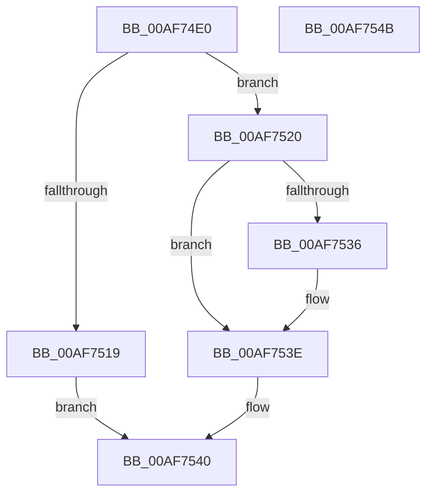

# NtDeleteAtom

- RVA: `0x00AF74E0`–`0x00AF754C` (길이 `108` bytes)
- VA: `0x0000000140AF74E0`
- 실행 섹션: `PAGE`
- PDB 이름 있음: `예`; PDB Function 태그: `아니요`
- unwind 정보 RVA: `0x00065960`
- 디코드: `33`개 명령, `108/108` bytes 표시
- 미해석 바이트: `0` (있으면 어셈블리에 `.byte`로 보존)

> 이 문서는 커널 이미지의 기계어와 PDB 기호를 분석해 생성했습니다. 4번과 5번은 함수 원형과 자료형을 바이너리 사용 방식에서 추정한 C 해석이며 원본 소스 복구 결과는 아닙니다.

## 1. Dependencies

- 직접 호출 지점: **4**; 고유 호출 대상: **4**
- 직접 호출자로 확인된 함수: **0**
- RIP 상대 이미지 참조: **0**

### Outgoing calls
- `0x00AF750A` → [PsInvokeWin32Callout](../91/PsInvokeWin32Callout_function_009133C0.md) (function, `0x009133C0`)
- `0x00AF7526` → [RtlDeleteAtomFromAtomTable](../9C/RtlDeleteAtomFromAtomTable_function_009C45C0.md) (function, `0x009C45C0`)
- `0x00AF752D` → [Feature_829055289__private_IsEnabledDeviceUsageNoInline](../../text/60/Feature_829055289__private_IsEnabledDeviceUsageNoInline_function_0060954C.md) (function, `0x0060954C`)
- `0x00AF7539` → [RtlDereferenceAtomTable](../../text/5E/RtlDereferenceAtomTable_function_005E6EE0.md) (function, `0x005E6EE0`)

### Direct callers
- 이 함수 시작 RVA로 연결되는 직접 call은 확인되지 않았습니다. 간접 호출은 완전히 역산할 수 없습니다.

### Static image references
- 디코드된 RIP-relative 메모리 참조가 없습니다.

## 2. Other-region calls and transfers

- 다른 실행 섹션으로 향하는 call: **2**
  - `0x00AF752D` → [Feature_829055289__private_IsEnabledDeviceUsageNoInline](../../text/60/Feature_829055289__private_IsEnabledDeviceUsageNoInline_function_0060954C.md) (`PAGE` → `.text`)
  - `0x00AF7539` → [RtlDereferenceAtomTable](../../text/5E/RtlDereferenceAtomTable_function_005E6EE0.md) (`PAGE` → `.text`)
- 별도 외부 분기/꼬리 이동을 확인하지 못했습니다.

## 3. Assembly (complete function range)

```asm
00AF74E0  48 89 5C 24 08                  mov qword ptr [rsp + 8], rbx
00AF74E5  57                              push rdi
00AF74E6  48 83 EC 40                     sub rsp, 0x40
00AF74EA  33 C0                           xor eax, eax
00AF74EC  48 8D 54 24 20                  lea rdx, [rsp + 0x20]
00AF74F1  0F B7 F9                        movzx edi, cx
00AF74F4  48 89 44 24 30                  mov qword ptr [rsp + 0x30], rax
00AF74F9  0F 57 C0                        xorps xmm0, xmm0
00AF74FC  45 33 C9                        xor r9d, r9d
00AF74FF  45 33 C0                        xor r8d, r8d
00AF7502  8D 48 02                        lea ecx, [rax + 2]
00AF7505  0F 11 44 24 20                  movups xmmword ptr [rsp + 0x20], xmm0
00AF750A  E8 B1 BE E1 FF                  call 0x1409133c0
00AF750F  48 8B 5C 24 30                  mov rbx, qword ptr [rsp + 0x30]
00AF7514  48 85 DB                        test rbx, rbx
00AF7517  75 07                           jne 0x140af7520
00AF7519  B8 22 00 00 C0                  mov eax, 0xc0000022
00AF751E  EB 20                           jmp 0x140af7540
00AF7520  0F B7 D7                        movzx edx, di
00AF7523  48 8B CB                        mov rcx, rbx
00AF7526  E8 95 D0 EC FF                  call 0x1409c45c0
00AF752B  8B F8                           mov edi, eax
00AF752D  E8 1A 20 B1 FF                  call 0x14060954c
00AF7532  85 C0                           test eax, eax
00AF7534  74 08                           je 0x140af753e
00AF7536  48 8B CB                        mov rcx, rbx
00AF7539  E8 A2 F9 AE FF                  call 0x1405e6ee0
00AF753E  8B C7                           mov eax, edi
00AF7540  48 8B 5C 24 50                  mov rbx, qword ptr [rsp + 0x50]
00AF7545  48 83 C4 40                     add rsp, 0x40
00AF7549  5F                              pop rdi
00AF754A  C3                              ret
00AF754B  CC                              int3
```

## 4. C-style interpretation (structured pseudocode)

```c
__int64 __fastcall NtDeleteAtom(unsigned __int16 a1, __int64 a2, int a3, int a4)
{
    __int64 result;
    __int64 v_rsp;
    unsigned __int64 v_stack_m18;
    unsigned __int64 v_stack_m28;
    unsigned __int64 v_stack_p8;

    v_stack_p8 = v_rbx;
    v_rsp = (v_rsp) - (64);
    result = 0;
    v_stack_m18 = 0;
    a4 = 0;
    a3 = 0;
    v_stack_m28 = v_xmm0;
    result = PsInvokeWin32Callout(result + 2, v_stack_m28, a3, a4);
    if (v_stack_m18 != 0) goto loc_00AF7520;
    goto loc_00AF7540;
loc_00AF7520:
    result = RtlDeleteAtomFromAtomTable(v_stack_m18, a1, a3, a4);
    result = Feature_829055289__private_IsEnabledDeviceUsageNoInline(v_stack_m18, a1, a3, a4);
    if ((unsigned int)(result) != 0) {
        a1 = v_stack_m18;
        result = RtlDereferenceAtomTable(a1, a1, a3, a4);
    }
loc_00AF7540:
    v_rsp = (v_rsp) + (64);
    return (unsigned int)((unsigned int)((unsigned int)((unsigned int)(result))));
}
```

## 5. (Beta) C Style

```c
int64_t NtDeleteAtom(uint16_t Arg1, int64_t Arg2, int32_t Arg3, int32_t Arg4)
{
    int64_t result;
    int64_t local_rsp;
    uint64_t v_stack_m18;
    uint64_t v_stack_m28;
    uint64_t v_stack_p8;

    v_stack_p8 = local_rbx;
    local_rsp = (local_rsp) - (64);
    result = 0;
    v_stack_m18 = 0;
    Arg4 = 0;
    Arg3 = 0;
    v_stack_m28 = v_xmm0;
    result = PsInvokeWin32Callout(result + 2, v_stack_m28, Arg3, Arg4);
    if (v_stack_m18 != 0) goto loc_00AF7520;
    goto loc_00AF7540;
loc_00AF7520:
    result = RtlDeleteAtomFromAtomTable(v_stack_m18, Arg1, Arg3, Arg4);
    result = Feature_829055289__private_IsEnabledDeviceUsageNoInline(v_stack_m18, Arg1, Arg3, Arg4);
    if ((uint32_t)(result) != 0) {
        Arg1 = v_stack_m18;
        result = RtlDereferenceAtomTable(Arg1, Arg1, Arg3, Arg4);
    }
loc_00AF7540:
    local_rsp = (local_rsp) + (64);
    return (uint32_t)((uint32_t)((uint32_t)((uint32_t)(result))));
}
```

## 6. Execution-region graph

[열기: 2D/3D 그래프와 함수 탐색 컨트롤 패널](../../../control-panel.html?section=page&rva=0x00AF74E0&view=graph)

- 2D 그래프는 위에서 아래로 흐르고, 3D 그래프는 빈 공간을 드래그해 회전합니다. Shift+드래그는 이동, 휠은 확대·축소, 함수 노드 선택은 대상 보고서 이동입니다.

### Static fallback


