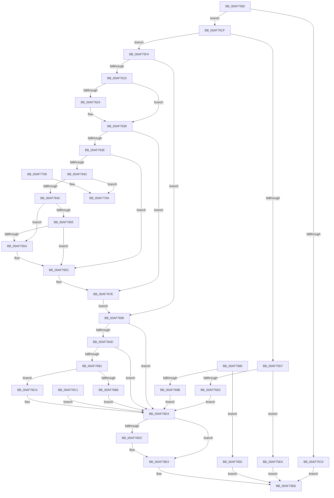

# NtFindAtom

- RVA: `0x00AF7560`–`0x00AF7711` (길이 `433` bytes)
- VA: `0x0000000140AF7560`
- 실행 섹션: `PAGE`
- PDB 이름 있음: `예`; PDB Function 태그: `아니요`
- unwind 정보 RVA: `0x000D571C`
- 디코드: `125`개 명령, `433/433` bytes 표시
- 미해석 바이트: `0` (있으면 어셈블리에 `.byte`로 보존)

> 이 문서는 커널 이미지의 기계어와 PDB 기호를 분석해 생성했습니다. 4번과 5번은 함수 원형과 자료형을 바이너리 사용 방식에서 추정한 C 해석이며 원본 소스 복구 결과는 아닙니다.

## 1. Dependencies

- 직접 호출 지점: **9**; 고유 호출 대상: **7**
- 직접 호출자로 확인된 함수: **0**
- RIP 상대 이미지 참조: **1**

### Outgoing calls
- `0x00AF75B1` → [PsInvokeWin32Callout](../91/PsInvokeWin32Callout_function_009133C0.md) (function, `0x009133C0`)
- `0x00AF75D7` → [Feature_829055289__private_IsEnabledDeviceUsageNoInline](../../text/60/Feature_829055289__private_IsEnabledDeviceUsageNoInline_function_0060954C.md) (function, `0x0060954C`)
- `0x00AF7671` → [memcpy](../../text/6C/memcpy_function_006C6840.md) (function, `0x006C6840`)
- `0x00AF7682` → [Feature_829055289__private_IsEnabledDeviceUsageNoInline](../../text/60/Feature_829055289__private_IsEnabledDeviceUsageNoInline_function_0060954C.md) (function, `0x0060954C`)
- `0x00AF76A1` → [RtlLookupAtomInAtomTable](../99/RtlLookupAtomInAtomTable_function_00992DF0.md) (function, `0x00992DF0`)
- `0x00AF76D3` → [Feature_829055289__private_IsEnabledDeviceUsageNoInline](../../text/60/Feature_829055289__private_IsEnabledDeviceUsageNoInline_function_0060954C.md) (function, `0x0060954C`)
- `0x00AF76DF` → [RtlDereferenceAtomTable](../../text/5E/RtlDereferenceAtomTable_function_005E6EE0.md) (function, `0x005E6EE0`)
- `0x00AF76F1` → [_security_check_cookie](../../text/6A/_security_check_cookie_function_006AC640.md) (function, `0x006AC640`)
- `0x00AF770A` → [ExRaiseDatatypeMisalignment](../89/ExRaiseDatatypeMisalignment_function_00899FD0.md) (function, `0x00899FD0`)

### Direct callers
- 이 함수 시작 RVA로 연결되는 직접 call은 확인되지 않았습니다. 간접 호출은 완전히 역산할 수 없습니다.

### Static image references
- `0x00AF7573` → RVA `0x00E0A740` (`.data`; read)

## 2. Other-region calls and transfers

- 다른 실행 섹션으로 향하는 call: **6**
  - `0x00AF75D7` → [Feature_829055289__private_IsEnabledDeviceUsageNoInline](../../text/60/Feature_829055289__private_IsEnabledDeviceUsageNoInline_function_0060954C.md) (`PAGE` → `.text`)
  - `0x00AF7671` → [memcpy](../../text/6C/memcpy_function_006C6840.md) (`PAGE` → `.text`)
  - `0x00AF7682` → [Feature_829055289__private_IsEnabledDeviceUsageNoInline](../../text/60/Feature_829055289__private_IsEnabledDeviceUsageNoInline_function_0060954C.md) (`PAGE` → `.text`)
  - `0x00AF76D3` → [Feature_829055289__private_IsEnabledDeviceUsageNoInline](../../text/60/Feature_829055289__private_IsEnabledDeviceUsageNoInline_function_0060954C.md) (`PAGE` → `.text`)
  - `0x00AF76DF` → [RtlDereferenceAtomTable](../../text/5E/RtlDereferenceAtomTable_function_005E6EE0.md) (`PAGE` → `.text`)
  - `0x00AF76F1` → [_security_check_cookie](../../text/6A/_security_check_cookie_function_006AC640.md) (`PAGE` → `.text`)
- 별도 외부 분기/꼬리 이동을 확인하지 못했습니다.

## 3. Assembly (complete function range)

```asm
00AF7560  40 53                           push rbx
00AF7562  56                              push rsi
00AF7563  57                              push rdi
00AF7564  41 54                           push r12
00AF7566  41 55                           push r13
00AF7568  41 56                           push r14
00AF756A  41 57                           push r15
00AF756C  48 81 EC 60 02 00 00            sub rsp, 0x260
00AF7573  48 8B 05 C6 31 31 00            mov rax, qword ptr [rip + 0x3131c6]
00AF757A  48 33 C4                        xor rax, rsp
00AF757D  48 89 84 24 50 02 00 00         mov qword ptr [rsp + 0x250], rax
00AF7585  4D 8B F0                        mov r14, r8
00AF7588  8B DA                           mov ebx, edx
00AF758A  48 8B F1                        mov rsi, rcx
00AF758D  33 FF                           xor edi, edi
00AF758F  66 89 7C 24 20                  mov word ptr [rsp + 0x20], di
00AF7594  0F 57 C0                        xorps xmm0, xmm0
00AF7597  33 C0                           xor eax, eax
00AF7599  0F 11 44 24 38                  movups xmmword ptr [rsp + 0x38], xmm0
00AF759E  48 89 44 24 48                  mov qword ptr [rsp + 0x48], rax
00AF75A3  45 33 C9                        xor r9d, r9d
00AF75A6  45 33 C0                        xor r8d, r8d
00AF75A9  48 8D 54 24 38                  lea rdx, [rsp + 0x38]
00AF75AE  8D 4F 02                        lea ecx, [rdi + 2]
00AF75B1  E8 0A BE E1 FF                  call 0x1409133c0
00AF75B6  4C 8B 64 24 48                  mov r12, qword ptr [rsp + 0x48]
00AF75BB  4C 89 64 24 30                  mov qword ptr [rsp + 0x30], r12
00AF75C0  4D 85 E4                        test r12, r12
00AF75C3  75 0A                           jne 0x140af75cf
00AF75C5  B8 22 00 00 C0                  mov eax, 0xc0000022
00AF75CA  E9 17 01 00 00                  jmp 0x140af76e6
00AF75CF  81 FB FE 01 00 00               cmp ebx, 0x1fe
00AF75D5  76 1D                           jbe 0x140af75f4
00AF75D7  E8 70 1F B1 FF                  call 0x14060954c
00AF75DC  85 C0                           test eax, eax
00AF75DE  74 0A                           je 0x140af75ea
00AF75E0  BB 0D 00 00 C0                  mov ebx, 0xc000000d
00AF75E5  E9 E9 00 00 00                  jmp 0x140af76d3
00AF75EA  B8 0D 00 00 C0                  mov eax, 0xc000000d
00AF75EF  E9 F2 00 00 00                  jmp 0x140af76e6
00AF75F4  65 48 8B 04 25 88 01 00 00      mov rax, qword ptr gs:[0x188]
00AF75FD  44 8A A8 32 02 00 00            mov r13b, byte ptr [rax + 0x232]
00AF7604  4C 8B FE                        mov r15, rsi
00AF7607  48 89 74 24 28                  mov qword ptr [rsp + 0x28], rsi
00AF760C  45 84 ED                        test r13b, r13b
00AF760F  0F 84 81 00 00 00               je 0x140af7696
00AF7615  48 BA 00 00 FF FF FF 7F 00 00   movabs rdx, 0x7fffffff0000
00AF761F  4D 85 F6                        test r14, r14
00AF7622  74 15                           je 0x140af7639
00AF7624  48 8B CA                        mov rcx, rdx
00AF7627  4C 3B F2                        cmp r14, rdx
00AF762A  49 0F 42 CE                     cmovb rcx, r14
00AF762E  0F B7 01                        movzx eax, word ptr [rcx]
00AF7631  66 89 01                        mov word ptr [rcx], ax
00AF7634  4C 8B 7C 24 28                  mov r15, qword ptr [rsp + 0x28]
00AF7639  48 85 F6                        test rsi, rsi
00AF763C  74 40                           je 0x140af767e
00AF763E  85 DB                           test ebx, ebx
00AF7640  74 1A                           je 0x140af765c
00AF7642  40 F6 C6 01                     test sil, 1
00AF7646  0F 85 BE 00 00 00               jne 0x140af770a
00AF764C  48 8D 0C 1E                     lea rcx, [rsi + rbx]
00AF7650  48 3B CA                        cmp rcx, rdx
00AF7653  77 05                           ja 0x140af765a
00AF7655  48 3B CE                        cmp rcx, rsi
00AF7658  73 02                           jae 0x140af765c
00AF765A  8A 02                           mov al, byte ptr [rdx]
00AF765C  4C 8D 7C 24 50                  lea r15, [rsp + 0x50]
00AF7661  4C 89 7C 24 28                  mov qword ptr [rsp + 0x28], r15
00AF7666  4C 8B C3                        mov r8, rbx
00AF7669  48 8B D6                        mov rdx, rsi
00AF766C  48 8D 4C 24 50                  lea rcx, [rsp + 0x50]
00AF7671  E8 CA F1 BC FF                  call 0x1406c6840
00AF7676  48 D1 EB                        shr rbx, 1
00AF7679  66 89 7C 5C 50                  mov word ptr [rsp + rbx*2 + 0x50], di
00AF767E  EB 16                           jmp 0x140af7696
00AF7680  8B D8                           mov ebx, eax
00AF7682  E8 C5 1E B1 FF                  call 0x14060954c
00AF7687  85 C0                           test eax, eax
00AF7689  74 07                           je 0x140af7692
00AF768B  4C 8B 64 24 30                  mov r12, qword ptr [rsp + 0x30]
00AF7690  EB 41                           jmp 0x140af76d3
00AF7692  8B C3                           mov eax, ebx
00AF7694  EB 50                           jmp 0x140af76e6
00AF7696  4C 8D 44 24 20                  lea r8, [rsp + 0x20]
00AF769B  49 8B D7                        mov rdx, r15
00AF769E  49 8B CC                        mov rcx, r12
00AF76A1  E8 4A B7 E9 FF                  call 0x140992df0
00AF76A6  8B D8                           mov ebx, eax
00AF76A8  4D 85 F6                        test r14, r14
00AF76AB  74 26                           je 0x140af76d3
00AF76AD  85 C0                           test eax, eax
00AF76AF  78 22                           js 0x140af76d3
00AF76B1  45 84 ED                        test r13b, r13b
00AF76B4  74 14                           je 0x140af76ca
00AF76B6  0F B7 44 24 20                  movzx eax, word ptr [rsp + 0x20]
00AF76BB  66 41 89 06                     mov word ptr [r14], ax
00AF76BF  EB 12                           jmp 0x140af76d3
00AF76C1  8B D8                           mov ebx, eax
00AF76C3  4C 8B 64 24 30                  mov r12, qword ptr [rsp + 0x30]
00AF76C8  EB 09                           jmp 0x140af76d3
00AF76CA  0F B7 44 24 20                  movzx eax, word ptr [rsp + 0x20]
00AF76CF  66 41 89 06                     mov word ptr [r14], ax
00AF76D3  E8 74 1E B1 FF                  call 0x14060954c
00AF76D8  85 C0                           test eax, eax
00AF76DA  74 08                           je 0x140af76e4
00AF76DC  49 8B CC                        mov rcx, r12
00AF76DF  E8 FC F7 AE FF                  call 0x1405e6ee0
00AF76E4  8B C3                           mov eax, ebx
00AF76E6  48 8B 8C 24 50 02 00 00         mov rcx, qword ptr [rsp + 0x250]
00AF76EE  48 33 CC                        xor rcx, rsp
00AF76F1  E8 4A 4F BB FF                  call 0x1406ac640
00AF76F6  48 81 C4 60 02 00 00            add rsp, 0x260
00AF76FD  41 5F                           pop r15
00AF76FF  41 5E                           pop r14
00AF7701  41 5D                           pop r13
00AF7703  41 5C                           pop r12
00AF7705  5F                              pop rdi
00AF7706  5E                              pop rsi
00AF7707  5B                              pop rbx
00AF7708  C3                              ret
00AF7709  CC                              int3
00AF770A  E8 C1 28 DA FF                  call 0x140899fd0
00AF770F  90                              nop
00AF7710  CC                              int3
```

## 4. C-style interpretation (structured pseudocode)

```c
__int64 __fastcall NtFindAtom(__int64 a1, int a2, __int64 a3, int a4)
{
    __int64 result;
    __int64 v_r15;
    __int64 v_rbx;
    __int64 v_rdi;
    __int64 v_rsp;
    unsigned __int64 v_stack_m248;
    unsigned __int64 v_stack_m250;
    unsigned __int64 v_stack_m260;
    unsigned __int64 v_stack_m268;
    unsigned __int64 v_stack_m270;
    unsigned __int16 v_stack_m278;
    unsigned __int64 v_stack_m48;

    v_rsp = (v_rsp) - (608);
    result = (*(unsigned __int64 *)(v_rip + 3224006)) ^ (v_rsp);
    v_stack_m48 = result;
    v_rdi = 0;
    v_stack_m278 = 0;
    result = 0;
    v_stack_m260 = v_xmm0;
    v_stack_m250 = 0;
    a4 = 0;
    a3 = 0;
    result = PsInvokeWin32Callout(v_rdi + 2, v_stack_m260, a3, a4);
    v_stack_m268 = v_stack_m250;
    if (v_stack_m250 != 0) goto loc_00AF75CF;
    goto loc_00AF76E6;
loc_00AF75CF:
    if (((unsigned int)((unsigned int)(a2))) <= 510) goto loc_00AF75F4;
    result = Feature_829055289__private_IsEnabledDeviceUsageNoInline(v_rdi + 2, v_stack_m260, a3, a4);
    if ((unsigned int)(result) == 0) goto loc_00AF75EA;
    goto loc_00AF76D3;
loc_00AF75EA:
    goto loc_00AF76E6;
loc_00AF75F4:
    v_stack_m270 = a1;
    if ((unsigned __int8)(*(unsigned __int8 *)(*(unsigned __int64 *)(gs_base + (0 + 392)) + 562)) == 0) goto loc_00AF7696;
    result = *(unsigned __int64 *)(gs_base + (0 + 392));
    v_r15 = a1;
    if (0 != 0) {
        a1 = v_stack_m260;
        if (0 < v_stack_m260) { a1 = 0; }
        result = *(unsigned __int16 *)(a1);
        *(unsigned __int16 *)(a1) = (unsigned __int16)(result);
        v_r15 = v_stack_m270;
    }
    if (a1 == 0) goto loc_00AF767E;
    if ((unsigned int)((unsigned int)(0xC000000DULL)) == 0) goto loc_00AF765C;
    if ((((unsigned __int8)(a1)) & (1)) != 0) goto loc_00AF770A;
    if ((a1 + (unsigned int)(0xC000000DULL) * 1) > v_stack_m260) goto loc_00AF765A;
    if ((a1 + (unsigned int)(0xC000000DULL) * 1) < a1) {
        result = *(unsigned __int8 *)(v_stack_m260);
    }
    v_stack_m270 = v_stack_m248;
    result = memcpy(v_stack_m248, a1, (unsigned int)(0xC000000DULL), a4);
    v_rbx = ((unsigned int)(0xC000000DULL)) >> (1);
    *(unsigned __int16 *)(v_rsp + v_rbx * 2 + 80) = 0;
loc_00AF767E:
    goto loc_00AF7696;
loc_00AF7696:
    result = RtlLookupAtomInAtomTable(v_stack_m250, v_stack_m248, v_stack_m278, a4);
    if (0 == 0) goto loc_00AF76D3;
    if (sign_flag) goto loc_00AF76D3;
    if ((unsigned __int8)(*(unsigned __int8 *)(*(unsigned __int64 *)(gs_base + (0 + 392)) + 562)) == 0) goto loc_00AF76CA;
    *(unsigned __int16 *)(a3) = (unsigned __int16)(v_stack_m278);
    goto loc_00AF76D3;
loc_00AF76CA:
    *(unsigned __int16 *)(a3) = (unsigned __int16)(v_stack_m278);
loc_00AF76D3:
    result = Feature_829055289__private_IsEnabledDeviceUsageNoInline(v_stack_m250, v_stack_m248, v_stack_m278, a4);
    if ((unsigned int)(result) != 0) {
        a1 = v_stack_m250;
        result = RtlDereferenceAtomTable(a1, v_stack_m248, v_stack_m278, a4);
    }
loc_00AF76E6:
    a1 = (v_stack_m48) ^ (v_rsp);
    result = _security_check_cookie(a1, v_stack_m248, v_stack_m278, a4);
    v_rsp = (v_rsp) + (608);
    return result;
loc_00AF770A:
    result = ExRaiseDatatypeMisalignment(a1, v_stack_m248, v_stack_m278, a4);
    return result;
}
```

## 5. (Beta) C Style

```c
int64_t NtFindAtom(int64_t Arg1, int32_t Arg2, int64_t Arg3, int32_t Arg4)
{
    int64_t result;
    int64_t local_r15;
    int64_t local_rbx;
    int64_t local_rdi;
    int64_t local_rsp;
    uint64_t v_stack_m248;
    uint64_t v_stack_m250;
    uint64_t v_stack_m260;
    uint64_t v_stack_m268;
    uint64_t v_stack_m270;
    uint16_t v_stack_m278;
    uint64_t v_stack_m48;

    local_rsp = (local_rsp) - (608);
    result = (*(uint64_t *)(v_rip + 0x3131C6)) ^ (local_rsp);
    v_stack_m48 = result;
    local_rdi = 0;
    v_stack_m278 = 0;
    result = 0;
    v_stack_m260 = v_xmm0;
    v_stack_m250 = 0;
    Arg4 = 0;
    Arg3 = 0;
    result = PsInvokeWin32Callout(local_rdi + 2, v_stack_m260, Arg3, Arg4);
    v_stack_m268 = v_stack_m250;
    if (v_stack_m250 != 0) goto loc_00AF75CF;
    goto loc_00AF76E6;
loc_00AF75CF:
    if (((uint32_t)((uint32_t)(Arg2))) <= 510) goto loc_00AF75F4;
    result = Feature_829055289__private_IsEnabledDeviceUsageNoInline(local_rdi + 2, v_stack_m260, Arg3, Arg4);
    if ((uint32_t)(result) == 0) goto loc_00AF75EA;
    goto loc_00AF76D3;
loc_00AF75EA:
    goto loc_00AF76E6;
loc_00AF75F4:
    v_stack_m270 = Arg1;
    if ((uint8_t)(*(uint8_t *)(*(uint64_t *)(gs_base + (0 + 0x188)) + 0x232)) == 0) goto loc_00AF7696;
    result = *(uint64_t *)(gs_base + (0 + 0x188));
    local_r15 = Arg1;
    if (0 != 0) {
        Arg1 = v_stack_m260;
        if (0 < v_stack_m260) { Arg1 = 0; }
        result = *(uint16_t *)(Arg1);
        *(uint16_t *)(Arg1) = (uint16_t)(result);
        local_r15 = v_stack_m270;
    }
    if (Arg1 == 0) goto loc_00AF767E;
    if ((uint32_t)((uint32_t)(0xC000000DULL)) == 0) goto loc_00AF765C;
    if ((((uint8_t)(Arg1)) & (1)) != 0) goto loc_00AF770A;
    if ((Arg1 + (uint32_t)(0xC000000DULL) * 1) > v_stack_m260) goto loc_00AF765A;
    if ((Arg1 + (uint32_t)(0xC000000DULL) * 1) < Arg1) {
        result = *(uint8_t *)(v_stack_m260);
    }
    v_stack_m270 = v_stack_m248;
    result = memcpy(v_stack_m248, Arg1, (uint32_t)(0xC000000DULL), Arg4);
    local_rbx = ((uint32_t)(0xC000000DULL)) >> (1);
    *(uint16_t *)(local_rsp + local_rbx * 2 + 0x50) = 0;
loc_00AF767E:
    goto loc_00AF7696;
loc_00AF7696:
    result = RtlLookupAtomInAtomTable(v_stack_m250, v_stack_m248, v_stack_m278, Arg4);
    if (0 == 0) goto loc_00AF76D3;
    if (sign_flag) goto loc_00AF76D3;
    if ((uint8_t)(*(uint8_t *)(*(uint64_t *)(gs_base + (0 + 0x188)) + 0x232)) == 0) goto loc_00AF76CA;
    *(uint16_t *)(Arg3) = (uint16_t)(v_stack_m278);
    goto loc_00AF76D3;
loc_00AF76CA:
    *(uint16_t *)(Arg3) = (uint16_t)(v_stack_m278);
loc_00AF76D3:
    result = Feature_829055289__private_IsEnabledDeviceUsageNoInline(v_stack_m250, v_stack_m248, v_stack_m278, Arg4);
    if ((uint32_t)(result) != 0) {
        Arg1 = v_stack_m250;
        result = RtlDereferenceAtomTable(Arg1, v_stack_m248, v_stack_m278, Arg4);
    }
loc_00AF76E6:
    Arg1 = (v_stack_m48) ^ (local_rsp);
    result = _security_check_cookie(Arg1, v_stack_m248, v_stack_m278, Arg4);
    local_rsp = (local_rsp) + (608);
    return result;
loc_00AF770A:
    result = ExRaiseDatatypeMisalignment(Arg1, v_stack_m248, v_stack_m278, Arg4);
    return result;
}
```

## 6. Execution-region graph

[열기: 2D/3D 그래프와 함수 탐색 컨트롤 패널](../../../control-panel.html?section=page&rva=0x00AF7560&view=graph)

- 2D 그래프는 위에서 아래로 흐르고, 3D 그래프는 빈 공간을 드래그해 회전합니다. Shift+드래그는 이동, 휠은 확대·축소, 함수 노드 선택은 대상 보고서 이동입니다.

### Static fallback


