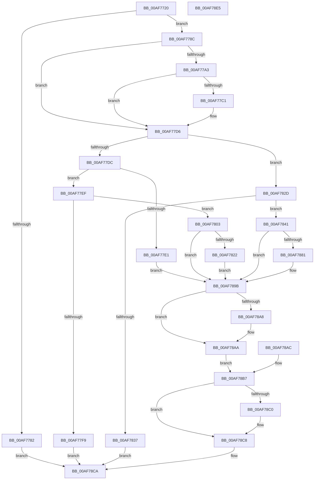

# NtQueryInformationAtom

- RVA: `0x00AF7720`–`0x00AF78E6` (길이 `454` bytes)
- VA: `0x0000000140AF7720`
- 실행 섹션: `PAGE`
- PDB 이름 있음: `예`; PDB Function 태그: `아니요`
- unwind 정보 RVA: `0x000D5774`
- 디코드: `125`개 명령, `454/454` bytes 표시
- 미해석 바이트: `0` (있으면 어셈블리에 `.byte`로 보존)

> 이 문서는 커널 이미지의 기계어와 PDB 기호를 분석해 생성했습니다. 4번과 5번은 함수 원형과 자료형을 바이너리 사용 방식에서 추정한 C 해석이며 원본 소스 복구 결과는 아닙니다.

## 1. Dependencies

- 직접 호출 지점: **6**; 고유 호출 대상: **6**
- 직접 호출자로 확인된 함수: **0**
- RIP 상대 이미지 참조: **0**

### Outgoing calls
- `0x00AF776E` → [PsInvokeWin32Callout](../91/PsInvokeWin32Callout_function_009133C0.md) (function, `0x009133C0`)
- `0x00AF77AF` → [ProbeForWrite](../8E/ProbeForWrite_function_008E91C0.md) (function, `0x008E91C0`)
- `0x00AF7813` → [RtlQueryAtomsInAtomTable](../78/RtlQueryAtomsInAtomTable_function_0078E298.md) (function, `0x0078E298`)
- `0x00AF7872` → [RtlQueryAtomInAtomTable](../9C/RtlQueryAtomInAtomTable_function_009C4690.md) (function, `0x009C4690`)
- `0x00AF78B7` → [Feature_829055289__private_IsEnabledDeviceUsageNoInline](../../text/60/Feature_829055289__private_IsEnabledDeviceUsageNoInline_function_0060954C.md) (function, `0x0060954C`)
- `0x00AF78C3` → [RtlDereferenceAtomTable](../../text/5E/RtlDereferenceAtomTable_function_005E6EE0.md) (function, `0x005E6EE0`)

### Direct callers
- 이 함수 시작 RVA로 연결되는 직접 call은 확인되지 않았습니다. 간접 호출은 완전히 역산할 수 없습니다.

### Static image references
- 디코드된 RIP-relative 메모리 참조가 없습니다.

## 2. Other-region calls and transfers

- 다른 실행 섹션으로 향하는 call: **2**
  - `0x00AF78B7` → [Feature_829055289__private_IsEnabledDeviceUsageNoInline](../../text/60/Feature_829055289__private_IsEnabledDeviceUsageNoInline_function_0060954C.md) (`PAGE` → `.text`)
  - `0x00AF78C3` → [RtlDereferenceAtomTable](../../text/5E/RtlDereferenceAtomTable_function_005E6EE0.md) (`PAGE` → `.text`)
- 별도 외부 분기/꼬리 이동을 확인하지 못했습니다.

## 3. Assembly (complete function range)

```asm
00AF7720  48 8B C4                        mov rax, rsp
00AF7723  48 89 58 08                     mov qword ptr [rax + 8], rbx
00AF7727  48 89 70 10                     mov qword ptr [rax + 0x10], rsi
00AF772B  48 89 78 18                     mov qword ptr [rax + 0x18], rdi
00AF772F  41 54                           push r12
00AF7731  41 56                           push r14
00AF7733  41 57                           push r15
00AF7735  48 83 EC 70                     sub rsp, 0x70
00AF7739  45 8B F1                        mov r14d, r9d
00AF773C  49 8B F0                        mov rsi, r8
00AF773F  8B DA                           mov ebx, edx
00AF7741  44 0F B7 E1                     movzx r12d, cx
00AF7745  83 60 B8 00                     and dword ptr [rax - 0x48], 0
00AF7749  83 60 B0 00                     and dword ptr [rax - 0x50], 0
00AF774D  83 60 AC 00                     and dword ptr [rax - 0x54], 0
00AF7751  0F 57 C0                        xorps xmm0, xmm0
00AF7754  33 C0                           xor eax, eax
00AF7756  0F 11 44 24 50                  movups xmmword ptr [rsp + 0x50], xmm0
00AF775B  48 89 44 24 60                  mov qword ptr [rsp + 0x60], rax
00AF7760  45 33 C9                        xor r9d, r9d
00AF7763  45 33 C0                        xor r8d, r8d
00AF7766  48 8D 54 24 50                  lea rdx, [rsp + 0x50]
00AF776B  8D 48 02                        lea ecx, [rax + 2]
00AF776E  E8 4D BC E1 FF                  call 0x1409133c0
00AF7773  4C 8B 7C 24 60                  mov r15, qword ptr [rsp + 0x60]
00AF7778  4C 89 7C 24 48                  mov qword ptr [rsp + 0x48], r15
00AF777D  4D 85 FF                        test r15, r15
00AF7780  75 0A                           jne 0x140af778c
00AF7782  B8 22 00 00 C0                  mov eax, 0xc0000022
00AF7787  E9 3E 01 00 00                  jmp 0x140af78ca
00AF778C  65 48 8B 04 25 88 01 00 00      mov rax, qword ptr gs:[0x188]
00AF7795  8A 88 32 02 00 00               mov cl, byte ptr [rax + 0x232]
00AF779B  88 4C 24 30                     mov byte ptr [rsp + 0x30], cl
00AF779F  84 C9                           test cl, cl
00AF77A1  74 33                           je 0x140af77d6
00AF77A3  49 8B D6                        mov rdx, r14
00AF77A6  41 B8 04 00 00 00               mov r8d, 4
00AF77AC  48 8B CE                        mov rcx, rsi
00AF77AF  E8 0C 1A DF FF                  call 0x1408e91c0
00AF77B4  48 8B 84 24 B0 00 00 00         mov rax, qword ptr [rsp + 0xb0]
00AF77BC  48 85 C0                        test rax, rax
00AF77BF  74 15                           je 0x140af77d6
00AF77C1  48 B9 00 00 FF FF FF 7F 00 00   movabs rcx, 0x7fffffff0000
00AF77CB  48 3B C1                        cmp rax, rcx
00AF77CE  48 0F 42 C8                     cmovb rcx, rax
00AF77D2  8B 01                           mov eax, dword ptr [rcx]
00AF77D4  89 01                           mov dword ptr [rcx], eax
00AF77D6  33 FF                           xor edi, edi
00AF77D8  85 DB                           test ebx, ebx
00AF77DA  74 51                           je 0x140af782d
00AF77DC  83 FB 01                        cmp ebx, 1
00AF77DF  74 0E                           je 0x140af77ef
00AF77E1  BB 03 00 00 C0                  mov ebx, 0xc0000003
00AF77E6  89 5C 24 3C                     mov dword ptr [rsp + 0x3c], ebx
00AF77EA  E9 AC 00 00 00                  jmp 0x140af789b
00AF77EF  BF 04 00 00 00                  mov edi, 4
00AF77F4  44 3B F7                        cmp r14d, edi
00AF77F7  73 0A                           jae 0x140af7803
00AF77F9  B8 04 00 00 C0                  mov eax, 0xc0000004
00AF77FE  E9 C7 00 00 00                  jmp 0x140af78ca
00AF7803  4C 8D 4E 04                     lea r9, [rsi + 4]
00AF7807  41 8D 56 FC                     lea edx, [r14 - 4]
00AF780B  D1 EA                           shr edx, 1
00AF780D  4C 8B C6                        mov r8, rsi
00AF7810  49 8B CF                        mov rcx, r15
00AF7813  E8 80 6A C9 FF                  call 0x14078e298
00AF7818  8B D8                           mov ebx, eax
00AF781A  89 44 24 3C                     mov dword ptr [rsp + 0x3c], eax
00AF781E  85 C0                           test eax, eax
00AF7820  78 79                           js 0x140af789b
00AF7822  8B 0E                           mov ecx, dword ptr [rsi]
00AF7824  8D 3C 4D 04 00 00 00            lea edi, [rcx*2 + 4]
00AF782B  EB 6E                           jmp 0x140af789b
00AF782D  BF 06 00 00 00                  mov edi, 6
00AF7832  44 3B F7                        cmp r14d, edi
00AF7835  73 0A                           jae 0x140af7841
00AF7837  B8 04 00 00 C0                  mov eax, 0xc0000004
00AF783C  E9 89 00 00 00                  jmp 0x140af78ca
00AF7841  83 64 24 34 00                  and dword ptr [rsp + 0x34], 0
00AF7846  41 8D 46 FA                     lea eax, [r14 - 6]
00AF784A  89 44 24 38                     mov dword ptr [rsp + 0x38], eax
00AF784E  48 8D 46 06                     lea rax, [rsi + 6]
00AF7852  48 8D 4C 24 38                  lea rcx, [rsp + 0x38]
00AF7857  48 89 4C 24 28                  mov qword ptr [rsp + 0x28], rcx
00AF785C  48 89 44 24 20                  mov qword ptr [rsp + 0x20], rax
00AF7861  4C 8D 4C 24 40                  lea r9, [rsp + 0x40]
00AF7866  4C 8D 44 24 34                  lea r8, [rsp + 0x34]
00AF786B  41 0F B7 D4                     movzx edx, r12w
00AF786F  49 8B CF                        mov rcx, r15
00AF7872  E8 19 CE EC FF                  call 0x1409c4690
00AF7877  8B D8                           mov ebx, eax
00AF7879  89 44 24 3C                     mov dword ptr [rsp + 0x3c], eax
00AF787D  85 C0                           test eax, eax
00AF787F  78 1A                           js 0x140af789b
00AF7881  8B 44 24 34                     mov eax, dword ptr [rsp + 0x34]
00AF7885  66 89 06                        mov word ptr [rsi], ax
00AF7888  8B 44 24 40                     mov eax, dword ptr [rsp + 0x40]
00AF788C  66 89 46 02                     mov word ptr [rsi + 2], ax
00AF7890  8B 44 24 38                     mov eax, dword ptr [rsp + 0x38]
00AF7894  66 89 46 04                     mov word ptr [rsi + 4], ax
00AF7898  8D 78 08                        lea edi, [rax + 8]
00AF789B  48 8B 84 24 B0 00 00 00         mov rax, qword ptr [rsp + 0xb0]
00AF78A3  48 85 C0                        test rax, rax
00AF78A6  74 02                           je 0x140af78aa
00AF78A8  89 38                           mov dword ptr [rax], edi
00AF78AA  EB 0B                           jmp 0x140af78b7
00AF78AC  8B D8                           mov ebx, eax
00AF78AE  89 44 24 3C                     mov dword ptr [rsp + 0x3c], eax
00AF78B2  4C 8B 7C 24 48                  mov r15, qword ptr [rsp + 0x48]
00AF78B7  E8 90 1C B1 FF                  call 0x14060954c
00AF78BC  85 C0                           test eax, eax
00AF78BE  74 08                           je 0x140af78c8
00AF78C0  49 8B CF                        mov rcx, r15
00AF78C3  E8 18 F6 AE FF                  call 0x1405e6ee0
00AF78C8  8B C3                           mov eax, ebx
00AF78CA  4C 8D 5C 24 70                  lea r11, [rsp + 0x70]
00AF78CF  49 8B 5B 20                     mov rbx, qword ptr [r11 + 0x20]
00AF78D3  49 8B 73 28                     mov rsi, qword ptr [r11 + 0x28]
00AF78D7  49 8B 7B 30                     mov rdi, qword ptr [r11 + 0x30]
00AF78DB  49 8B E3                        mov rsp, r11
00AF78DE  41 5F                           pop r15
00AF78E0  41 5E                           pop r14
00AF78E2  41 5C                           pop r12
00AF78E4  C3                              ret
00AF78E5  CC                              int3
```

## 4. C-style interpretation (structured pseudocode)

```c
__int64 __fastcall NtQueryInformationAtom(unsigned __int16 a1, int a2, __int64 a3, int a4, __int64 a5)
{
    __int64 result;
    __int64 v_rdi;
    __int64 v_rsp;
    unsigned __int64 v_stack_m18;
    unsigned __int64 v_stack_m28;
    unsigned __int64 v_stack_m38;
    unsigned __int64 v_stack_m40;
    unsigned __int64 v_stack_m48;
    unsigned int v_stack_m4C;
    unsigned int v_stack_m50;
    unsigned int v_stack_m54;
    unsigned __int8 v_stack_m58;
    unsigned __int64 v_stack_m60;
    unsigned __int64 v_stack_m68;

    *(unsigned __int64 *)(v_rsp + 8) = v_rbx;
    *(unsigned __int64 *)(v_rsp + 16) = v_rsi;
    *(unsigned __int64 *)(v_rsp + 24) = v_rdi;
    v_rsp = (v_rsp) - (112);
    result = 0;
    v_stack_m38 = v_xmm0;
    v_stack_m28 = 0;
    a4 = 0;
    a3 = 0;
    result = PsInvokeWin32Callout(result + 2, v_stack_m38, a3, a4);
    v_stack_m40 = v_stack_m28;
    if (v_stack_m28 != 0) goto loc_00AF778C;
    goto loc_00AF78CA;
loc_00AF778C:
    v_stack_m58 = (unsigned __int8)(*(unsigned __int8 *)(*(unsigned __int64 *)(gs_base + (0 + 392)) + 562));
    if ((unsigned __int8)(*(unsigned __int8 *)(*(unsigned __int64 *)(gs_base + (0 + 392)) + 562)) == 0) goto loc_00AF77D6;
    result = ProbeForWrite(0, (unsigned int)(a4), 4, a4);
    result = a5;
    if (a5 != 0) {
        a1 = 0;
        if (a5 < 0) { a1 = a5; }
        result = *(unsigned int *)(a1);
        *(unsigned int *)(a1) = (unsigned int)(result);
    }
    v_rdi = 0;
    if ((unsigned int)((unsigned int)(a2)) == 0) goto loc_00AF782D;
    if (((unsigned int)((unsigned int)(a2))) == 1) goto loc_00AF77EF;
    v_stack_m4C = (unsigned int)((unsigned int)(0xC0000003ULL));
    goto loc_00AF789B;
loc_00AF77EF:
    if (((unsigned int)((unsigned int)(a4))) >= 4) goto loc_00AF7803;
    goto loc_00AF78CA;
loc_00AF7803:
    a2 = (unsigned int)(((unsigned int)(a4) - 4) >> (1));
    result = RtlQueryAtomsInAtomTable(v_stack_m28, a2, 0, a3 + 4);
    v_stack_m4C = (unsigned int)(result);
    if (sign_flag) goto loc_00AF789B;
    goto loc_00AF789B;
loc_00AF782D:
    if (((unsigned int)((unsigned int)(a4))) >= 6) goto loc_00AF7841;
    goto loc_00AF78CA;
loc_00AF7841:
    v_stack_m50 = (unsigned int)((unsigned int)(a4) - 6);
    v_stack_m60 = v_stack_m50;
    v_stack_m68 = a3 + 6;
    result = RtlQueryAtomInAtomTable(v_stack_m28, a1, v_stack_m54, v_stack_m48);
    v_stack_m4C = (unsigned int)(result);
    v_rdi = 6;
    if (!(sign_flag)) {
        result = v_stack_m54;
        *(unsigned __int16 *)(a3) = (unsigned __int16)(result);
        result = v_stack_m48;
        *(unsigned __int16 *)(a3 + 2) = (unsigned __int16)(result);
        result = v_stack_m50;
        *(unsigned __int16 *)(a3 + 4) = (unsigned __int16)(result);
        v_rdi = result + 8;
    }
    if (a5 != 0) {
        *(unsigned int *)(a5) = (unsigned int)(v_rdi);
    }
    goto loc_00AF78B7;
loc_00AF78B7:
    result = Feature_829055289__private_IsEnabledDeviceUsageNoInline(v_stack_m28, a1, v_stack_m54, v_stack_m48);
    if ((unsigned int)(result) != 0) {
        a1 = v_stack_m28;
        result = RtlDereferenceAtomTable(a1, a1, v_stack_m54, v_stack_m48);
    }
loc_00AF78CA:
    return (unsigned int)((unsigned int)((unsigned int)((unsigned int)(result))));
}
```

## 5. (Beta) C Style

```c
int64_t NtQueryInformationAtom(uint16_t Arg1, int32_t Arg2, void *Arg3, int32_t Arg4, int64_t Arg5)
{
    uint8_t *arg3 = (uint8_t *)Arg3;

    int64_t result;
    int64_t local_rdi;
    int64_t local_rsp;
    uint64_t v_stack_m18;
    uint64_t v_stack_m28;
    uint64_t v_stack_m38;
    uint64_t v_stack_m40;
    uint64_t v_stack_m48;
    uint32_t v_stack_m4C;
    uint32_t v_stack_m50;
    uint32_t v_stack_m54;
    uint8_t v_stack_m58;
    uint64_t v_stack_m60;
    uint64_t v_stack_m68;

    *(uint64_t *)(local_rsp + 0x8) = local_rbx;
    *(uint64_t *)(local_rsp + 0x10) = local_rsi;
    *(uint64_t *)(local_rsp + 0x18) = local_rdi;
    local_rsp = (local_rsp) - (112);
    result = 0;
    v_stack_m38 = v_xmm0;
    v_stack_m28 = 0;
    Arg4 = 0;
    Arg3 = 0;
    result = PsInvokeWin32Callout(result + 2, v_stack_m38, Arg3, Arg4);
    v_stack_m40 = v_stack_m28;
    if (v_stack_m28 != 0) goto loc_00AF778C;
    goto loc_00AF78CA;
loc_00AF778C:
    v_stack_m58 = (uint8_t)(*(uint8_t *)(*(uint64_t *)(gs_base + (0 + 0x188)) + 0x232));
    if ((uint8_t)(*(uint8_t *)(*(uint64_t *)(gs_base + (0 + 0x188)) + 0x232)) == 0) goto loc_00AF77D6;
    result = ProbeForWrite(0, (uint32_t)(Arg4), 4, Arg4);
    result = Arg5;
    if (Arg5 != 0) {
        Arg1 = 0;
        if (Arg5 < 0) { Arg1 = Arg5; }
        result = *(uint32_t *)(Arg1);
        *(uint32_t *)(Arg1) = (uint32_t)(result);
    }
    local_rdi = 0;
    if ((uint32_t)((uint32_t)(Arg2)) == 0) goto loc_00AF782D;
    if (((uint32_t)((uint32_t)(Arg2))) == 1) goto loc_00AF77EF;
    v_stack_m4C = (uint32_t)((uint32_t)(0xC0000003ULL));
    goto loc_00AF789B;
loc_00AF77EF:
    if (((uint32_t)((uint32_t)(Arg4))) >= 4) goto loc_00AF7803;
    goto loc_00AF78CA;
loc_00AF7803:
    Arg2 = (uint32_t)(((uint32_t)(Arg4) - 4) >> (1));
    result = RtlQueryAtomsInAtomTable(v_stack_m28, Arg2, 0, Arg3 + 4);
    v_stack_m4C = (uint32_t)(result);
    if (sign_flag) goto loc_00AF789B;
    goto loc_00AF789B;
loc_00AF782D:
    if (((uint32_t)((uint32_t)(Arg4))) >= 6) goto loc_00AF7841;
    goto loc_00AF78CA;
loc_00AF7841:
    v_stack_m50 = (uint32_t)((uint32_t)(Arg4) - 6);
    v_stack_m60 = v_stack_m50;
    v_stack_m68 = Arg3 + 6;
    result = RtlQueryAtomInAtomTable(v_stack_m28, Arg1, v_stack_m54, v_stack_m48);
    v_stack_m4C = (uint32_t)(result);
    local_rdi = 6;
    if (!(sign_flag)) {
        result = v_stack_m54;
        *(uint16_t *)(arg3) = (uint16_t)(result);
        result = v_stack_m48;
        *(uint16_t *)(arg3 + 0x2) = (uint16_t)(result);
        result = v_stack_m50;
        *(uint16_t *)(arg3 + 0x4) = (uint16_t)(result);
        local_rdi = result + 8;
    }
    if (Arg5 != 0) {
        *(uint32_t *)(Arg5) = (uint32_t)(local_rdi);
    }
    goto loc_00AF78B7;
loc_00AF78B7:
    result = Feature_829055289__private_IsEnabledDeviceUsageNoInline(v_stack_m28, Arg1, v_stack_m54, v_stack_m48);
    if ((uint32_t)(result) != 0) {
        Arg1 = v_stack_m28;
        result = RtlDereferenceAtomTable(Arg1, Arg1, v_stack_m54, v_stack_m48);
    }
loc_00AF78CA:
    return (uint32_t)((uint32_t)((uint32_t)((uint32_t)(result))));
}
```

### 관측된 메모리 오프셋

구조체 형식이 확인되지 않은 접근은 인자 기준의 오프셋으로만 기록했습니다.

| 기준 인자 | 오프셋 표현 | 폭 (bit) | 접근 |
|---|---:|---:|---|
| `Arg3` | `+ 0x0` | `16` | `W` |
| `Arg3` | `+ 0x0` | `32` | `R` |
| `Arg3` | `+ 0x2` | `16` | `W` |
| `Arg3` | `+ 0x4` | `16` | `W` |
| `Arg3` | `+ 0x4` | `64` | `R` |
| `Arg3` | `+ 0x6` | `64` | `R` |

## 6. Execution-region graph

[열기: 2D/3D 그래프와 함수 탐색 컨트롤 패널](../../../control-panel.html?section=page&rva=0x00AF7720&view=graph)

- 2D 그래프는 위에서 아래로 흐르고, 3D 그래프는 빈 공간을 드래그해 회전합니다. Shift+드래그는 이동, 휠은 확대·축소, 함수 노드 선택은 대상 보고서 이동입니다.

### Static fallback


