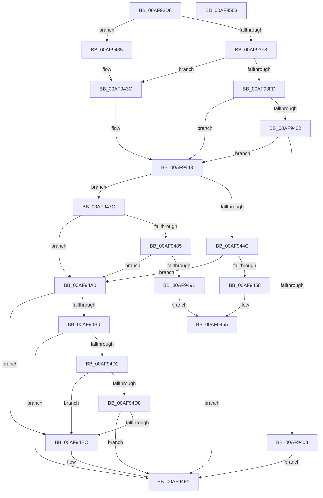

# SdbpValidateAndApplyCompatFlags

- RVA: `0x00AF93D8`–`0x00AF9504` (길이 `300` bytes)
- VA: `0x0000000140AF93D8`
- 실행 섹션: `PAGE`
- PDB 이름 있음: `예`; PDB Function 태그: `아니요`
- unwind 정보 RVA: `0x000CC43C`
- 디코드: `79`개 명령, `300/300` bytes 표시
- 미해석 바이트: `0` (있으면 어셈블리에 `.byte`로 보존)

> 이 문서는 커널 이미지의 기계어와 PDB 기호를 분석해 생성했습니다. 4번과 5번은 함수 원형과 자료형을 바이너리 사용 방식에서 추정한 C 해석이며 원본 소스 복구 결과는 아닙니다.

## 1. Dependencies

- 직접 호출 지점: **9**; 고유 호출 대상: **7**
- 직접 호출자로 확인된 함수: **2**
- RIP 상대 이미지 참조: **5**

### Outgoing calls
- `0x00AF942B` → [AslLogCallPrintf](../95/AslLogCallPrintf_function_0095E4EC.md) (function, `0x0095E4EC`)
- `0x00AF9443` → [Feature_4095108409__private_IsEnabledDeviceUsageNoInline](../../text/69/Feature_4095108409__private_IsEnabledDeviceUsageNoInline_function_0069BFF0.md) (function, `0x0069BFF0`)
- `0x00AF944F` → [SdbpValidateSdbSizeWithRootTags](../81/SdbpValidateSdbSizeWithRootTags_function_0081336C.md) (function, `0x0081336C`)
- `0x00AF9475` → [AslLogCallPrintf](../95/AslLogCallPrintf_function_0095E4EC.md) (function, `0x0095E4EC`)
- `0x00AF947C` → [Feature_SdbValidateRootTagsOnOpen__private_IsEnabledDeviceUsageNoInline](../../text/49/Feature_SdbValidateRootTagsOnOpen__private_IsEnabledDeviceUsageNoInline_function_00494B18.md) (function, `0x00494B18`)
- `0x00AF9488` → [SdbpValidateRootTagSizes](../AC/SdbpValidateRootTagSizes_function_00AC5280.md) (function, `0x00AC5280`)
- `0x00AF94A7` → [SdbGetDatabaseID](../A7/SdbGetDatabaseID_function_00A7EB20.md) (function, `0x00A7EB20`)
- `0x00AF94C7` → [AslLogCallPrintf](../95/AslLogCallPrintf_function_0095E4EC.md) (function, `0x0095E4EC`)
- `0x00AF94E3` → [SdbFindFirstTag](../95/SdbFindFirstTag_function_0095E34C.md) (function, `0x0095E34C`)

### Direct callers
- [SdbOpenDatabaseEx](../81/SdbOpenDatabaseEx_function_00812284.md) at `0x00812504`
- [SdbpOpenDatabaseInMemory](../95/SdbpOpenDatabaseInMemory_function_0095A574.md) at `0x0095A679`

### Static image references
- `0x00AF9410` → RVA `0x0003B3B8` (`.rdata`; read)
- `0x00AF941B` → RVA `0x0003B398` (`.rdata`; read)
- `0x00AF9458` → RVA `0x0003B358` (`.rdata`; read)
- `0x00AF9491` → RVA `0x0003B320` (`.rdata`; read)
- `0x00AF94B0` → RVA `0x0003B300` (`.rdata`; read)

## 2. Other-region calls and transfers

- 다른 실행 섹션으로 향하는 call: **2**
  - `0x00AF9443` → [Feature_4095108409__private_IsEnabledDeviceUsageNoInline](../../text/69/Feature_4095108409__private_IsEnabledDeviceUsageNoInline_function_0069BFF0.md) (`PAGE` → `.text`)
  - `0x00AF947C` → [Feature_SdbValidateRootTagsOnOpen__private_IsEnabledDeviceUsageNoInline](../../text/49/Feature_SdbValidateRootTagsOnOpen__private_IsEnabledDeviceUsageNoInline_function_00494B18.md) (`PAGE` → `.text`)
- 별도 외부 분기/꼬리 이동을 확인하지 못했습니다.

## 3. Assembly (complete function range)

```asm
00AF93D8  48 89 5C 24 08                  mov qword ptr [rsp + 8], rbx
00AF93DD  48 89 6C 24 10                  mov qword ptr [rsp + 0x10], rbp
00AF93E2  57                              push rdi
00AF93E3  48 83 EC 30                     sub rsp, 0x30
00AF93E7  48 8B F9                        mov rdi, rcx
00AF93EA  33 DB                           xor ebx, ebx
00AF93EC  8B 0A                           mov ecx, dword ptr [rdx]
00AF93EE  41 8B E8                        mov ebp, r8d
00AF93F1  8B C1                           mov eax, ecx
00AF93F3  83 E8 01                        sub eax, 1
00AF93F6  74 3D                           je 0x140af9435
00AF93F8  83 E8 01                        sub eax, 1
00AF93FB  74 3F                           je 0x140af943c
00AF93FD  83 F8 01                        cmp eax, 1
00AF9400  74 41                           je 0x140af9443
00AF9402  40 F6 C5 01                     test bpl, 1
00AF9406  75 3B                           jne 0x140af9443
00AF9408  C7 44 24 28 03 00 00 00         mov dword ptr [rsp + 0x28], 3
00AF9410  4C 8D 0D A1 1F 54 FF            lea r9, [rip - 0xabe05f]
00AF9417  89 4C 24 20                     mov dword ptr [rsp + 0x20], ecx
00AF941B  48 8D 15 76 1F 54 FF            lea rdx, [rip - 0xabe08a]
00AF9422  8D 4B 01                        lea ecx, [rbx + 1]
00AF9425  41 B8 AB 03 00 00               mov r8d, 0x3ab
00AF942B  E8 BC 50 E6 FF                  call 0x14095e4ec
00AF9430  E9 BC 00 00 00                  jmp 0x140af94f1
00AF9435  83 8F 30 0A 00 00 01            or dword ptr [rdi + 0xa30], 1
00AF943C  83 8F 30 0A 00 00 02            or dword ptr [rdi + 0xa30], 2
00AF9443  E8 A8 2B BA FF                  call 0x14069bff0
00AF9448  85 C0                           test eax, eax
00AF944A  74 30                           je 0x140af947c
00AF944C  48 8B CF                        mov rcx, rdi
00AF944F  E8 18 9F D1 FF                  call 0x14081336c
00AF9454  85 C0                           test eax, eax
00AF9456  79 48                           jns 0x140af94a0
00AF9458  4C 8D 0D F9 1E 54 FF            lea r9, [rip - 0xabe107]
00AF945F  41 B8 B6 03 00 00               mov r8d, 0x3b6
00AF9465  48 8D 15 2C 1F 54 FF            lea rdx, [rip - 0xabe0d4]
00AF946C  89 44 24 20                     mov dword ptr [rsp + 0x20], eax
00AF9470  B9 01 00 00 00                  mov ecx, 1
00AF9475  E8 72 50 E6 FF                  call 0x14095e4ec
00AF947A  EB 75                           jmp 0x140af94f1
00AF947C  E8 97 B6 99 FF                  call 0x140494b18
00AF9481  85 C0                           test eax, eax
00AF9483  74 1B                           je 0x140af94a0
00AF9485  48 8B CF                        mov rcx, rdi
00AF9488  E8 F3 BD FC FF                  call 0x140ac5280
00AF948D  85 C0                           test eax, eax
00AF948F  79 0F                           jns 0x140af94a0
00AF9491  4C 8D 0D 88 1E 54 FF            lea r9, [rip - 0xabe178]
00AF9498  41 B8 C0 03 00 00               mov r8d, 0x3c0
00AF949E  EB C5                           jmp 0x140af9465
00AF94A0  48 8D 57 1C                     lea rdx, [rdi + 0x1c]
00AF94A4  48 8B CF                        mov rcx, rdi
00AF94A7  E8 74 56 F8 FF                  call 0x140a7eb20
00AF94AC  85 C0                           test eax, eax
00AF94AE  75 3C                           jne 0x140af94ec
00AF94B0  4C 8D 0D 49 1E 54 FF            lea r9, [rip - 0xabe1b7]
00AF94B7  41 B8 CE 03 00 00               mov r8d, 0x3ce
00AF94BD  48 8D 15 D4 1E 54 FF            lea rdx, [rip - 0xabe12c]
00AF94C4  8D 48 01                        lea ecx, [rax + 1]
00AF94C7  E8 20 50 E6 FF                  call 0x14095e4ec
00AF94CC  40 F6 C5 08                     test bpl, 8
00AF94D0  75 1F                           jne 0x140af94f1
00AF94D2  40 F6 C5 04                     test bpl, 4
00AF94D6  74 14                           je 0x140af94ec
00AF94D8  33 D2                           xor edx, edx
00AF94DA  41 B8 01 70 00 00               mov r8d, 0x7001
00AF94E0  48 8B CF                        mov rcx, rdi
00AF94E3  E8 64 4E E6 FF                  call 0x14095e34c
00AF94E8  85 C0                           test eax, eax
00AF94EA  74 05                           je 0x140af94f1
00AF94EC  BB 01 00 00 00                  mov ebx, 1
00AF94F1  48 8B 6C 24 48                  mov rbp, qword ptr [rsp + 0x48]
00AF94F6  8B C3                           mov eax, ebx
00AF94F8  48 8B 5C 24 40                  mov rbx, qword ptr [rsp + 0x40]
00AF94FD  48 83 C4 30                     add rsp, 0x30
00AF9501  5F                              pop rdi
00AF9502  C3                              ret
00AF9503  CC                              int3
```

## 4. C-style interpretation (structured pseudocode)

```c
__int64 __fastcall SdbpValidateAndApplyCompatFlags(__int64 a1, __int64 a2, int a3)
{
    __int64 result;
    __int64 v_rbx;
    __int64 v_rsp;
    unsigned int v_stack_m10;
    unsigned int v_stack_m18;
    unsigned __int64 v_stack_p10;
    unsigned __int64 v_stack_p8;

    v_stack_p8 = v_rbx;
    v_stack_p10 = v_rbp;
    v_rsp = (v_rsp) - (48);
    v_rbx = 0;
    result = (unsigned int)(((unsigned int)((unsigned int)((unsigned int)(*(unsigned int *)(a2))))) - (1));
    if (condition_is_equal) goto loc_00AF9435;
    result = (unsigned int)((result) - (1));
    if (condition_is_equal) goto loc_00AF943C;
    if (((unsigned int)(result)) == 1) goto loc_00AF9443;
    if ((((unsigned __int8)((unsigned int)(a3))) & (1)) != 0) goto loc_00AF9443;
    v_stack_m10 = 3;
    v_stack_m18 = (unsigned int)((unsigned int)(*(unsigned int *)(a2)));
    result = AslLogCallPrintf(v_rbx + 1, v_rip - 11264138, 939, v_rip - 11264095);
    goto loc_00AF94F1;
loc_00AF9435:
loc_00AF943C:
loc_00AF9443:
    result = Feature_4095108409__private_IsEnabledDeviceUsageNoInline(v_rbx + 1, v_rip - 11264138, 939, v_rip - 11264095);
    if ((unsigned int)(result) == 0) goto loc_00AF947C;
    result = SdbpValidateSdbSizeWithRootTags(a1, v_rip - 11264138, 939, v_rip - 11264095);
    if (!sign_flag) goto loc_00AF94A0;
loc_00AF9465:
    v_stack_m18 = (unsigned int)(result);
    result = AslLogCallPrintf(1, v_rip - 11264212, 950, v_rip - 11264263);
    goto loc_00AF94F1;
loc_00AF947C:
    result = Feature_SdbValidateRootTagsOnOpen__private_IsEnabledDeviceUsageNoInline(1, v_rip - 11264212, 950, v_rip - 11264263);
    if ((unsigned int)(result) == 0) goto loc_00AF94A0;
    result = SdbpValidateRootTagSizes(a1, v_rip - 11264212, 950, v_rip - 11264263);
    if (!sign_flag) goto loc_00AF94A0;
    goto loc_00AF9465;
loc_00AF94A0:
    result = SdbGetDatabaseID(a1, a1 + 28, 960, v_rip - 11264376);
    if ((unsigned int)(result) != 0) goto loc_00AF94EC;
    result = AslLogCallPrintf(result + 1, v_rip - 11264300, 974, v_rip - 11264439);
    if ((((unsigned __int8)((unsigned int)(a3))) & (8)) != 0) goto loc_00AF94F1;
    if ((((unsigned __int8)((unsigned int)(a3))) & (4)) == 0) goto loc_00AF94EC;
    a2 = 0;
    result = SdbFindFirstTag(a1, a2, (unsigned int)(0x7001ULL), v_rip - 11264439);
    if ((unsigned int)(result) != 0) {
        v_rbx = 1;
    }
    v_rsp = (v_rsp) + (48);
    return (unsigned int)((unsigned int)(v_rbx));
}
```

## 5. (Beta) C Style

```c
int64_t SdbpValidateAndApplyCompatFlags(void *Arg1, void *Arg2, int32_t Arg3)
{
    uint8_t *arg1 = (uint8_t *)Arg1;
    uint8_t *arg2 = (uint8_t *)Arg2;

    int64_t result;
    int64_t local_rbx;
    int64_t local_rsp;
    uint32_t v_stack_m10;
    uint32_t v_stack_m18;
    uint64_t v_stack_p10;
    uint64_t v_stack_p8;

    v_stack_p8 = local_rbx;
    v_stack_p10 = local_rbp;
    local_rsp = (local_rsp) - (48);
    local_rbx = 0;
    result = (uint32_t)(((uint32_t)((uint32_t)((uint32_t)(*(uint32_t *)(arg2))))) - (1));
    if (condition_is_equal) goto loc_00AF9435;
    result = (uint32_t)((result) - (1));
    if (condition_is_equal) goto loc_00AF943C;
    if (((uint32_t)(result)) == 1) goto loc_00AF9443;
    if ((((uint8_t)((uint32_t)(Arg3))) & (1)) != 0) goto loc_00AF9443;
    v_stack_m10 = 3;
    v_stack_m18 = (uint32_t)((uint32_t)(*(uint32_t *)(arg2)));
    result = AslLogCallPrintf(local_rbx + 1, v_rip - 11264138, 939, v_rip - 11264095);
    goto loc_00AF94F1;
loc_00AF9435:
loc_00AF943C:
loc_00AF9443:
    result = Feature_4095108409__private_IsEnabledDeviceUsageNoInline(local_rbx + 1, v_rip - 11264138, 939, v_rip - 11264095);
    if ((uint32_t)(result) == 0) goto loc_00AF947C;
    result = SdbpValidateSdbSizeWithRootTags(Arg1, v_rip - 11264138, 939, v_rip - 11264095);
    if (!sign_flag) goto loc_00AF94A0;
loc_00AF9465:
    v_stack_m18 = (uint32_t)(result);
    result = AslLogCallPrintf(1, v_rip - 11264212, 950, v_rip - 11264263);
    goto loc_00AF94F1;
loc_00AF947C:
    result = Feature_SdbValidateRootTagsOnOpen__private_IsEnabledDeviceUsageNoInline(1, v_rip - 11264212, 950, v_rip - 11264263);
    if ((uint32_t)(result) == 0) goto loc_00AF94A0;
    result = SdbpValidateRootTagSizes(Arg1, v_rip - 11264212, 950, v_rip - 11264263);
    if (!sign_flag) goto loc_00AF94A0;
    goto loc_00AF9465;
loc_00AF94A0:
    result = SdbGetDatabaseID(Arg1, Arg1 + 28, 960, v_rip - 11264376);
    if ((uint32_t)(result) != 0) goto loc_00AF94EC;
    result = AslLogCallPrintf(result + 1, v_rip - 11264300, 974, v_rip - 11264439);
    if ((((uint8_t)((uint32_t)(Arg3))) & (8)) != 0) goto loc_00AF94F1;
    if ((((uint8_t)((uint32_t)(Arg3))) & (4)) == 0) goto loc_00AF94EC;
    Arg2 = 0;
    result = SdbFindFirstTag(Arg1, Arg2, (uint32_t)(0x7001ULL), v_rip - 11264439);
    if ((uint32_t)(result) != 0) {
        local_rbx = 1;
    }
    local_rsp = (local_rsp) + (48);
    return (uint32_t)((uint32_t)(local_rbx));
}
```

### 관측된 메모리 오프셋

구조체 형식이 확인되지 않은 접근은 인자 기준의 오프셋으로만 기록했습니다.

| 기준 인자 | 오프셋 표현 | 폭 (bit) | 접근 |
|---|---:|---:|---|
| `Arg1` | `+ 0x1C` | `64` | `R` |
| `Arg1` | `+ 0xA30` | `32` | `R/W` |
| `Arg2` | `+ 0x0` | `32` | `R` |

## 6. Execution-region graph

[열기: 2D/3D 그래프와 함수 탐색 컨트롤 패널](../../../control-panel.html?section=page&rva=0x00AF93D8&view=graph)

- 2D 그래프는 위에서 아래로 흐르고, 3D 그래프는 빈 공간을 드래그해 회전합니다. Shift+드래그는 이동, 휠은 확대·축소, 함수 노드 선택은 대상 보고서 이동입니다.

### Static fallback


