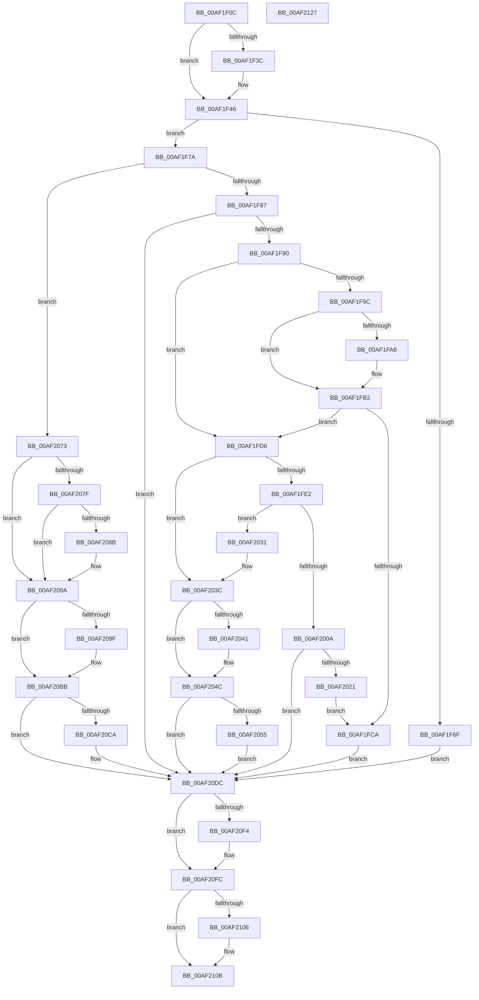

# SeSetSessionIdToken

- RVA: `0x00AF1F0C`–`0x00AF2128` (길이 `540` bytes)
- VA: `0x0000000140AF1F0C`
- 실행 섹션: `PAGE`
- PDB 이름 있음: `예`; PDB Function 태그: `아니요`
- unwind 정보 RVA: `0x000D0D78`
- 디코드: `137`개 명령, `540/540` bytes 표시
- 미해석 바이트: `0` (있으면 어셈블리에 `.byte`로 보존)

> 이 문서는 커널 이미지의 기계어와 PDB 기호를 분석해 생성했습니다. 4번과 5번은 함수 원형과 자료형을 바이너리 사용 방식에서 추정한 C 해석이며 원본 소스 복구 결과는 아닙니다.

## 1. Dependencies

- 직접 호출 지점: **16**; 고유 호출 대상: **12**
- 직접 호출자로 확인된 함수: **5**
- RIP 상대 이미지 참조: **1**

### Outgoing calls
- `0x00AF1F3E` → [PsGetSessionObjectById](../../text/22/PsGetSessionObjectById_function_002250C0.md) (function, `0x002250C0`)
- `0x00AF1F5D` → [ExAcquireResourceExclusiveLite](../../text/21/ExAcquireResourceExclusiveLite_function_00214E20.md) (function, `0x00214E20`)
- `0x00AF1F7A` → [Feature_OutsideInProtection__private_IsEnabledDeviceUsageNoInline](../../text/5C/Feature_OutsideInProtection__private_IsEnabledDeviceUsageNoInline_function_005CD968.md) (function, `0x005CD968`)
- `0x00AF1FBE` → [SepSetTokenLowboxNumberEntry](../../text/60/SepSetTokenLowboxNumberEntry_function_0060B594.md) (function, `0x0060B594`)
- `0x00AF1FFE` → [SepSetTokenAntiTamperEntry](../../text/60/SepSetTokenAntiTamperEntry_function_0060B28C.md) (function, `0x0060B28C`)
- `0x00AF202A` → [SepDereferenceLowBoxNumberEntry](../A5/SepDereferenceLowBoxNumberEntry_function_00A55DBC.md) (function, `0x00A55DBC`)
- `0x00AF2037` → [SepDereferenceAntiTamperEntry](../7A/SepDereferenceAntiTamperEntry_function_007A2E50.md) (function, `0x007A2E50`)
- `0x00AF2047` → [SepDereferenceLowBoxNumberEntry](../A5/SepDereferenceLowBoxNumberEntry_function_00A55DBC.md) (function, `0x00A55DBC`)
- `0x00AF206A` → [SepSetTokenSessionById](../A0/SepSetTokenSessionById_function_00A0DAE4.md) (function, `0x00A0DAE4`)
- `0x00AF208E` → [SepDereferenceLowBoxNumberEntry](../A5/SepDereferenceLowBoxNumberEntry_function_00A55DBC.md) (function, `0x00A55DBC`)
- `0x00AF20B4` → [SepSetTokenSessionById](../A0/SepSetTokenSessionById_function_00A0DAE4.md) (function, `0x00A0DAE4`)
- `0x00AF20D4` → [SepSetTokenLowboxNumber](../A6/SepSetTokenLowboxNumber_function_00A64D6C.md) (function, `0x00A64D6C`)
- `0x00AF20E5` → [ExReleaseResourceLite](../../text/25/ExReleaseResourceLite_function_0025FA10.md) (function, `0x0025FA10`)
- `0x00AF20EA` → [KeLeaveCriticalRegion](../../text/25/KeLeaveCriticalRegion_function_0025D8B0.md) (function, `0x0025D8B0`)
- `0x00AF20F7` → [ObfDereferenceObject](../../text/2F/ObfDereferenceObject_function_002F9350.md) (function, `0x002F9350`)
- `0x00AF2106` → [ObfDereferenceObject](../../text/2F/ObfDereferenceObject_function_002F9350.md) (function, `0x002F9350`)

### Direct callers
- [SepCopyClientTokenAndSetSilo](../79/SepCopyClientTokenAndSetSilo_function_0079CE34.md) at `0x0079CE71`
- [SeSetSessionIdTokenWithLinked](../79/SeSetSessionIdTokenWithLinked_function_0079CF90.md) at `0x0079D096`
- [SeSetSessionIdTokenWithLinked](../79/SeSetSessionIdTokenWithLinked_function_0079CF90.md) at `0x0079D0AC`
- [SepCopyAnonymousTokenAndSetSilo](../A3/SepCopyAnonymousTokenAndSetSilo_function_00A3A510.md) at `0x00A3A65C`
- [NtQueryInformationToken](../AE/NtQueryInformationToken_function_00AECDD0.md) at `0x00AED69F`
- [NtQueryInformationToken](../AE/NtQueryInformationToken_function_00AECDD0.md) at `0x00AEE6CD`
- [NtSetInformationToken](NtSetInformationToken_function_00AF0530.md) at `0x00AF070F`

### Static image references
- `0x00AF1F2F` → RVA `0x00FD80D8` (`PAGEDATA`; read)

## 2. Other-region calls and transfers

- 다른 실행 섹션으로 향하는 call: **9**
  - `0x00AF1F3E` → [PsGetSessionObjectById](../../text/22/PsGetSessionObjectById_function_002250C0.md) (`PAGE` → `.text`)
  - `0x00AF1F5D` → [ExAcquireResourceExclusiveLite](../../text/21/ExAcquireResourceExclusiveLite_function_00214E20.md) (`PAGE` → `.text`)
  - `0x00AF1F7A` → [Feature_OutsideInProtection__private_IsEnabledDeviceUsageNoInline](../../text/5C/Feature_OutsideInProtection__private_IsEnabledDeviceUsageNoInline_function_005CD968.md) (`PAGE` → `.text`)
  - `0x00AF1FBE` → [SepSetTokenLowboxNumberEntry](../../text/60/SepSetTokenLowboxNumberEntry_function_0060B594.md) (`PAGE` → `.text`)
  - `0x00AF1FFE` → [SepSetTokenAntiTamperEntry](../../text/60/SepSetTokenAntiTamperEntry_function_0060B28C.md) (`PAGE` → `.text`)
  - `0x00AF20E5` → [ExReleaseResourceLite](../../text/25/ExReleaseResourceLite_function_0025FA10.md) (`PAGE` → `.text`)
  - `0x00AF20EA` → [KeLeaveCriticalRegion](../../text/25/KeLeaveCriticalRegion_function_0025D8B0.md) (`PAGE` → `.text`)
  - `0x00AF20F7` → [ObfDereferenceObject](../../text/2F/ObfDereferenceObject_function_002F9350.md) (`PAGE` → `.text`)
  - `0x00AF2106` → [ObfDereferenceObject](../../text/2F/ObfDereferenceObject_function_002F9350.md) (`PAGE` → `.text`)
- 별도 외부 분기/꼬리 이동을 확인하지 못했습니다.

## 3. Assembly (complete function range)

```asm
00AF1F0C  48 8B C4                        mov rax, rsp
00AF1F0F  48 89 58 10                     mov qword ptr [rax + 0x10], rbx
00AF1F13  48 89 68 18                     mov qword ptr [rax + 0x18], rbp
00AF1F17  48 89 70 20                     mov qword ptr [rax + 0x20], rsi
00AF1F1B  57                              push rdi
00AF1F1C  41 55                           push r13
00AF1F1E  41 56                           push r14
00AF1F20  48 83 EC 30                     sub rsp, 0x30
00AF1F24  33 F6                           xor esi, esi
00AF1F26  45 33 F6                        xor r14d, r14d
00AF1F29  48 21 70 08                     and qword ptr [rax + 8], rsi
00AF1F2D  33 ED                           xor ebp, ebp
00AF1F2F  39 35 A3 61 4E 00               cmp dword ptr [rip + 0x4e61a3], esi
00AF1F35  8B FA                           mov edi, edx
00AF1F37  48 8B D9                        mov rbx, rcx
00AF1F3A  75 0A                           jne 0x140af1f46
00AF1F3C  8B CA                           mov ecx, edx
00AF1F3E  E8 7D 31 73 FF                  call 0x1402250c0
00AF1F43  48 8B F0                        mov rsi, rax
00AF1F46  65 48 8B 04 25 88 01 00 00      mov rax, qword ptr gs:[0x188]
00AF1F4F  B2 01                           mov dl, 1
00AF1F51  66 FF 88 E4 01 00 00            dec word ptr [rax + 0x1e4]
00AF1F58  90                              nop
00AF1F59  48 8B 4B 30                     mov rcx, qword ptr [rbx + 0x30]
00AF1F5D  E8 BE 2E 72 FF                  call 0x140214e20
00AF1F62  F0 09 2C 24                     lock or dword ptr [rsp], ebp
00AF1F66  40 38 AB CC 00 00 00            cmp byte ptr [rbx + 0xcc], bpl
00AF1F6D  74 0B                           je 0x140af1f7a
00AF1F6F  41 BE 2B 01 00 C0               mov r14d, 0xc000012b
00AF1F75  E9 62 01 00 00                  jmp 0x140af20dc
00AF1F7A  E8 E9 B9 AD FF                  call 0x1405cd968
00AF1F7F  85 C0                           test eax, eax
00AF1F81  0F 84 EC 00 00 00               je 0x140af2073
00AF1F87  39 7B 78                        cmp dword ptr [rbx + 0x78], edi
00AF1F8A  0F 84 4C 01 00 00               je 0x140af20dc
00AF1F90  F7 83 C8 00 00 00 00 40 00 00   test dword ptr [rbx + 0xc8], 0x4000
00AF1F9A  74 3A                           je 0x140af1fd6
00AF1F9C  48 8B 83 38 04 00 00            mov rax, qword ptr [rbx + 0x438]
00AF1FA3  48 85 C0                        test rax, rax
00AF1FA6  74 0A                           je 0x140af1fb2
00AF1FA8  4C 21 B3 38 04 00 00            and qword ptr [rbx + 0x438], r14
00AF1FAF  48 8B E8                        mov rbp, rax
00AF1FB2  4C 8B 83 10 03 00 00            mov r8, qword ptr [rbx + 0x310]
00AF1FB9  8B D7                           mov edx, edi
00AF1FBB  48 8B CB                        mov rcx, rbx
00AF1FBE  E8 D1 95 B1 FF                  call 0x14060b594
00AF1FC3  44 8B F0                        mov r14d, eax
00AF1FC6  85 C0                           test eax, eax
00AF1FC8  79 0C                           jns 0x140af1fd6
00AF1FCA  48 89 AB 38 04 00 00            mov qword ptr [rbx + 0x438], rbp
00AF1FD1  E9 06 01 00 00                  jmp 0x140af20dc
00AF1FD6  4C 8B AB B8 05 00 00            mov r13, qword ptr [rbx + 0x5b8]
00AF1FDD  4D 85 ED                        test r13, r13
00AF1FE0  74 5A                           je 0x140af203c
00AF1FE2  48 83 A3 B8 05 00 00 00         and qword ptr [rbx + 0x5b8], 0
00AF1FEA  8B D7                           mov edx, edi
00AF1FEC  4C 8B 83 98 04 00 00            mov r8, qword ptr [rbx + 0x498]
00AF1FF3  48 8B CB                        mov rcx, rbx
00AF1FF6  4D 8B 4D 30                     mov r9, qword ptr [r13 + 0x30]
00AF1FFA  4D 8B 40 10                     mov r8, qword ptr [r8 + 0x10]
00AF1FFE  E8 89 92 B1 FF                  call 0x14060b28c
00AF2003  44 8B F0                        mov r14d, eax
00AF2006  85 C0                           test eax, eax
00AF2008  79 27                           jns 0x140af2031
00AF200A  F7 83 C8 00 00 00 00 40 00 00   test dword ptr [rbx + 0xc8], 0x4000
00AF2014  4C 89 AB B8 05 00 00            mov qword ptr [rbx + 0x5b8], r13
00AF201B  0F 84 BB 00 00 00               je 0x140af20dc
00AF2021  48 8B 93 38 04 00 00            mov rdx, qword ptr [rbx + 0x438]
00AF2028  8B CF                           mov ecx, edi
00AF202A  E8 8D 3D F6 FF                  call 0x140a55dbc
00AF202F  EB 99                           jmp 0x140af1fca
00AF2031  8B 4B 78                        mov ecx, dword ptr [rbx + 0x78]
00AF2034  49 8B D5                        mov rdx, r13
00AF2037  E8 14 0E CB FF                  call 0x1407a2e50
00AF203C  48 85 ED                        test rbp, rbp
00AF203F  74 0B                           je 0x140af204c
00AF2041  8B 4B 78                        mov ecx, dword ptr [rbx + 0x78]
00AF2044  48 8B D5                        mov rdx, rbp
00AF2047  E8 70 3D F6 FF                  call 0x140a55dbc
00AF204C  39 7B 78                        cmp dword ptr [rbx + 0x78], edi
00AF204F  0F 84 87 00 00 00               je 0x140af20dc
00AF2055  48 8D 44 24 50                  lea rax, [rsp + 0x50]
00AF205A  4C 8B CE                        mov r9, rsi
00AF205D  41 B0 01                        mov r8b, 1
00AF2060  48 89 44 24 20                  mov qword ptr [rsp + 0x20], rax
00AF2065  8B D7                           mov edx, edi
00AF2067  48 8B CB                        mov rcx, rbx
00AF206A  E8 75 BA F1 FF                  call 0x140a0dae4
00AF206F  33 F6                           xor esi, esi
00AF2071  EB 69                           jmp 0x140af20dc
00AF2073  F7 83 C8 00 00 00 00 40 00 00   test dword ptr [rbx + 0xc8], 0x4000
00AF207D  74 1B                           je 0x140af209a
00AF207F  48 8B 93 38 04 00 00            mov rdx, qword ptr [rbx + 0x438]
00AF2086  48 85 D2                        test rdx, rdx
00AF2089  74 0F                           je 0x140af209a
00AF208B  8B 4B 78                        mov ecx, dword ptr [rbx + 0x78]
00AF208E  E8 29 3D F6 FF                  call 0x140a55dbc
00AF2093  48 21 AB 38 04 00 00            and qword ptr [rbx + 0x438], rbp
00AF209A  39 7B 78                        cmp dword ptr [rbx + 0x78], edi
00AF209D  74 1C                           je 0x140af20bb
00AF209F  48 8D 44 24 50                  lea rax, [rsp + 0x50]
00AF20A4  4C 8B CE                        mov r9, rsi
00AF20A7  41 B0 01                        mov r8b, 1
00AF20AA  48 89 44 24 20                  mov qword ptr [rsp + 0x20], rax
00AF20AF  8B D7                           mov edx, edi
00AF20B1  48 8B CB                        mov rcx, rbx
00AF20B4  E8 2B BA F1 FF                  call 0x140a0dae4
00AF20B9  33 F6                           xor esi, esi
00AF20BB  F7 83 C8 00 00 00 00 40 00 00   test dword ptr [rbx + 0xc8], 0x4000
00AF20C5  89 7B 78                        mov dword ptr [rbx + 0x78], edi
00AF20C8  74 12                           je 0x140af20dc
00AF20CA  48 8B 93 10 03 00 00            mov rdx, qword ptr [rbx + 0x310]
00AF20D1  48 8B CB                        mov rcx, rbx
00AF20D4  E8 93 2C F7 FF                  call 0x140a64d6c
00AF20D9  44 8B F0                        mov r14d, eax
00AF20DC  F0 83 0C 24 00                  lock or dword ptr [rsp], 0
00AF20E1  48 8B 4B 30                     mov rcx, qword ptr [rbx + 0x30]
00AF20E5  E8 26 D9 76 FF                  call 0x14025fa10
00AF20EA  E8 C1 B7 76 FF                  call 0x14025d8b0
00AF20EF  48 85 F6                        test rsi, rsi
00AF20F2  74 08                           je 0x140af20fc
00AF20F4  48 8B CE                        mov rcx, rsi
00AF20F7  E8 54 72 80 FF                  call 0x1402f9350
00AF20FC  48 8B 4C 24 50                  mov rcx, qword ptr [rsp + 0x50]
00AF2101  48 85 C9                        test rcx, rcx
00AF2104  74 05                           je 0x140af210b
00AF2106  E8 45 72 80 FF                  call 0x1402f9350
00AF210B  48 8B 5C 24 58                  mov rbx, qword ptr [rsp + 0x58]
00AF2110  41 8B C6                        mov eax, r14d
00AF2113  48 8B 6C 24 60                  mov rbp, qword ptr [rsp + 0x60]
00AF2118  48 8B 74 24 68                  mov rsi, qword ptr [rsp + 0x68]
00AF211D  48 83 C4 30                     add rsp, 0x30
00AF2121  41 5E                           pop r14
00AF2123  41 5D                           pop r13
00AF2125  5F                              pop rdi
00AF2126  C3                              ret
00AF2127  CC                              int3
```

## 4. C-style interpretation (structured pseudocode)

```c
__int64 __fastcall SeSetSessionIdToken(__int64 a1, int a2)
{
    __int64 result;
    __int64 v_r14;
    __int64 v_rbp;
    __int64 v_rsi;
    __int64 v_rsp;
    unsigned __int64 v_stack_m28;
    unsigned int v_stack_m48;
    unsigned __int64 v_stack_p10;
    unsigned __int64 v_stack_p18;
    unsigned __int64 v_stack_p20;
    unsigned __int64 v_stack_p8;

    *(unsigned __int64 *)(v_rsp + 16) = v_rbx;
    *(unsigned __int64 *)(v_rsp + 24) = v_rbp;
    *(unsigned __int64 *)(v_rsp + 32) = v_rsi;
    v_rsp = (v_rsp) - (48);
    v_rsi = 0;
    v_r14 = 0;
    v_rbp = 0;
    result = v_rsp;
    if ((*(unsigned int *)(v_rip + 5136803)) == 0) {
        a1 = a2;
        result = PsGetSessionObjectById(a1, a2, a3, a4);
        v_rsi = result;
    }
    result = ExAcquireResourceExclusiveLite(*(unsigned __int64 *)(a1 + 48), 1, a3, a4);
    if ((*(unsigned __int8 *)(a1 + 204)) == 0) goto loc_00AF1F7A;
    goto loc_00AF20DC;
loc_00AF1F7A:
    result = Feature_OutsideInProtection__private_IsEnabledDeviceUsageNoInline(*(unsigned __int64 *)(a1 + 48), 1, a3, a4);
    if ((unsigned int)(result) == 0) goto loc_00AF2073;
    if ((*(unsigned int *)(a1 + 120)) == ((unsigned int)((unsigned int)(a2)))) goto loc_00AF20DC;
    if (((*(unsigned int *)(a1 + 200)) & (0x4000ULL)) == 0) goto loc_00AF1FD6;
    if (*(unsigned __int64 *)(a1 + 1080) != 0) {
        v_rbp = *(unsigned __int64 *)(a1 + 1080);
    }
    result = SepSetTokenLowboxNumberEntry(a1, (unsigned int)((unsigned int)((unsigned int)(a2))), *(unsigned __int64 *)(a1 + 784), a4);
    if (!sign_flag) goto loc_00AF1FD6;
loc_00AF1FCA:
    *(unsigned __int64 *)(a1 + 1080) = v_rbp;
    goto loc_00AF20DC;
loc_00AF1FD6:
    if (*(unsigned __int64 *)(a1 + 1464) == 0) goto loc_00AF203C;
    result = SepSetTokenAntiTamperEntry(a1, (unsigned int)((unsigned int)((unsigned int)(a2))), *(unsigned __int64 *)(*(unsigned __int64 *)(a1 + 1176) + 16), *(unsigned __int64 *)(*(unsigned __int64 *)(a1 + 1464) + 48));
    if (!sign_flag) goto loc_00AF2031;
    *(unsigned __int64 *)(a1 + 1464) = *(unsigned __int64 *)(a1 + 1464);
    if (((*(unsigned int *)(a1 + 200)) & (0x4000ULL)) == 0) goto loc_00AF20DC;
    result = SepDereferenceLowBoxNumberEntry((unsigned int)((unsigned int)((unsigned int)(a2))), *(unsigned __int64 *)(a1 + 1080), *(unsigned __int64 *)(*(unsigned __int64 *)(a1 + 1176) + 16), *(unsigned __int64 *)(*(unsigned __int64 *)(a1 + 1464) + 48));
    goto loc_00AF1FCA;
loc_00AF2031:
    result = SepDereferenceAntiTamperEntry((unsigned int)(*(unsigned int *)(a1 + 120)), *(unsigned __int64 *)(a1 + 1464), *(unsigned __int64 *)(*(unsigned __int64 *)(a1 + 1176) + 16), *(unsigned __int64 *)(*(unsigned __int64 *)(a1 + 1464) + 48));
loc_00AF203C:
    if (v_rbp != 0) {
        a1 = *(unsigned int *)(a1 + 120);
        a2 = v_rbp;
        result = SepDereferenceLowBoxNumberEntry(a1, a2, *(unsigned __int64 *)(*(unsigned __int64 *)(a1 + 1176) + 16), *(unsigned __int64 *)(*(unsigned __int64 *)(a1 + 1464) + 48));
    }
    if ((*(unsigned int *)(a1 + 120)) == ((unsigned int)((unsigned int)(a2)))) goto loc_00AF20DC;
    v_stack_m28 = v_stack_p8;
    result = SepSetTokenSessionById(a1, (unsigned int)((unsigned int)((unsigned int)(a2))), 1, v_rsi);
    v_rsi = 0;
    goto loc_00AF20DC;
loc_00AF2073:
    if (((*(unsigned int *)(a1 + 200)) & (0x4000ULL)) == 0) goto loc_00AF209A;
    if (*(unsigned __int64 *)(a1 + 1080) != 0) {
        a1 = *(unsigned int *)(a1 + 120);
        result = SepDereferenceLowBoxNumberEntry(a1, *(unsigned __int64 *)(a1 + 1080), 1, v_rsi);
    }
    if ((*(unsigned int *)(a1 + 120)) != ((unsigned int)((unsigned int)(a2)))) {
        result = v_stack_p8;
        a4 = 0;
        a3 = 1;
        v_stack_m28 = result;
        a2 = (unsigned int)((unsigned int)(a2));
        a1 = a1;
        result = SepSetTokenSessionById(a1, a2, a3, a4);
        v_rsi = 0;
    }
    *(unsigned int *)(a1 + 120) = (unsigned int)((unsigned int)(a2));
    v_r14 = (unsigned int)((unsigned int)(result));
    if (((*(unsigned int *)(a1 + 200)) & (0x4000ULL)) != 0) {
        a2 = *(unsigned __int64 *)(a1 + 784);
        a1 = a1;
        result = SepSetTokenLowboxNumber(a1, a2, a3, a4);
        v_r14 = (unsigned int)(result);
    }
    result = ExReleaseResourceLite(*(unsigned __int64 *)(a1 + 48), a2, a3, a4);
    result = KeLeaveCriticalRegion(*(unsigned __int64 *)(a1 + 48), a2, a3, a4);
    if (0 != 0) {
        a1 = 0;
        result = ObfDereferenceObject(a1, a2, a3, a4);
    }
    if (v_stack_p8 != 0) {
        result = ObfDereferenceObject(v_stack_p8, a2, a3, a4);
    }
    v_rsp = (v_rsp) + (48);
    return (unsigned int)((unsigned int)(v_r14));
}
```

## 5. (Beta) C Style

```c
int64_t SeSetSessionIdToken(void *Arg1, int32_t Arg2)
{
    uint8_t *arg1 = (uint8_t *)Arg1;

    int64_t result;
    int64_t local_r14;
    int64_t local_rbp;
    int64_t local_rsi;
    int64_t local_rsp;
    uint64_t v_stack_m28;
    uint32_t v_stack_m48;
    uint64_t v_stack_p10;
    uint64_t v_stack_p18;
    uint64_t v_stack_p20;
    uint64_t v_stack_p8;

    *(uint64_t *)(local_rsp + 0x10) = local_rbx;
    *(uint64_t *)(local_rsp + 0x18) = local_rbp;
    *(uint64_t *)(local_rsp + 0x20) = local_rsi;
    local_rsp = (local_rsp) - (48);
    local_rsi = 0;
    local_r14 = 0;
    local_rbp = 0;
    result = local_rsp;
    if ((*(uint32_t *)(v_rip + 0x4E61A3)) == 0) {
        Arg1 = Arg2;
        result = PsGetSessionObjectById(Arg1, Arg2, a3, a4);
        local_rsi = result;
    }
    result = ExAcquireResourceExclusiveLite(*(uint64_t *)(arg1 + 0x30), 1, a3, a4);
    if ((*(uint8_t *)(arg1 + 0xCC)) == 0) goto loc_00AF1F7A;
    goto loc_00AF20DC;
loc_00AF1F7A:
    result = Feature_OutsideInProtection__private_IsEnabledDeviceUsageNoInline(*(uint64_t *)(arg1 + 0x30), 1, a3, a4);
    if ((uint32_t)(result) == 0) goto loc_00AF2073;
    if ((*(uint32_t *)(arg1 + 0x78)) == ((uint32_t)((uint32_t)(Arg2)))) goto loc_00AF20DC;
    if (((*(uint32_t *)(arg1 + 0xC8)) & (0x4000ULL)) == 0) goto loc_00AF1FD6;
    if (*(uint64_t *)(arg1 + 0x438) != 0) {
        local_rbp = *(uint64_t *)(arg1 + 0x438);
    }
    result = SepSetTokenLowboxNumberEntry(Arg1, (uint32_t)((uint32_t)((uint32_t)(Arg2))), *(uint64_t *)(arg1 + 0x310), a4);
    if (!sign_flag) goto loc_00AF1FD6;
loc_00AF1FCA:
    *(uint64_t *)(arg1 + 0x438) = local_rbp;
    goto loc_00AF20DC;
loc_00AF1FD6:
    if (*(uint64_t *)(arg1 + 0x5B8) == 0) goto loc_00AF203C;
    result = SepSetTokenAntiTamperEntry(Arg1, (uint32_t)((uint32_t)((uint32_t)(Arg2))), *(uint64_t *)(*(uint64_t *)(arg1 + 0x498) + 0x10), *(uint64_t *)(*(uint64_t *)(arg1 + 0x5B8) + 0x30));
    if (!sign_flag) goto loc_00AF2031;
    *(uint64_t *)(arg1 + 0x5B8) = *(uint64_t *)(arg1 + 0x5B8);
    if (((*(uint32_t *)(arg1 + 0xC8)) & (0x4000ULL)) == 0) goto loc_00AF20DC;
    result = SepDereferenceLowBoxNumberEntry((uint32_t)((uint32_t)((uint32_t)(Arg2))), *(uint64_t *)(arg1 + 0x438), *(uint64_t *)(*(uint64_t *)(arg1 + 0x498) + 0x10), *(uint64_t *)(*(uint64_t *)(arg1 + 0x5B8) + 0x30));
    goto loc_00AF1FCA;
loc_00AF2031:
    result = SepDereferenceAntiTamperEntry((uint32_t)(*(uint32_t *)(arg1 + 0x78)), *(uint64_t *)(arg1 + 0x5B8), *(uint64_t *)(*(uint64_t *)(arg1 + 0x498) + 0x10), *(uint64_t *)(*(uint64_t *)(arg1 + 0x5B8) + 0x30));
loc_00AF203C:
    if (local_rbp != 0) {
        Arg1 = *(uint32_t *)(arg1 + 0x78);
        Arg2 = local_rbp;
        result = SepDereferenceLowBoxNumberEntry(Arg1, Arg2, *(uint64_t *)(*(uint64_t *)(arg1 + 0x498) + 0x10), *(uint64_t *)(*(uint64_t *)(arg1 + 0x5B8) + 0x30));
    }
    if ((*(uint32_t *)(arg1 + 0x78)) == ((uint32_t)((uint32_t)(Arg2)))) goto loc_00AF20DC;
    v_stack_m28 = v_stack_p8;
    result = SepSetTokenSessionById(Arg1, (uint32_t)((uint32_t)((uint32_t)(Arg2))), 1, local_rsi);
    local_rsi = 0;
    goto loc_00AF20DC;
loc_00AF2073:
    if (((*(uint32_t *)(arg1 + 0xC8)) & (0x4000ULL)) == 0) goto loc_00AF209A;
    if (*(uint64_t *)(arg1 + 0x438) != 0) {
        Arg1 = *(uint32_t *)(arg1 + 0x78);
        result = SepDereferenceLowBoxNumberEntry(Arg1, *(uint64_t *)(arg1 + 0x438), 1, local_rsi);
    }
    if ((*(uint32_t *)(arg1 + 0x78)) != ((uint32_t)((uint32_t)(Arg2)))) {
        result = v_stack_p8;
        a4 = 0;
        a3 = 1;
        v_stack_m28 = result;
        Arg2 = (uint32_t)((uint32_t)(Arg2));
        Arg1 = Arg1;
        result = SepSetTokenSessionById(Arg1, Arg2, a3, a4);
        local_rsi = 0;
    }
    *(uint32_t *)(arg1 + 0x78) = (uint32_t)((uint32_t)(Arg2));
    local_r14 = (uint32_t)((uint32_t)(result));
    if (((*(uint32_t *)(arg1 + 0xC8)) & (0x4000ULL)) != 0) {
        Arg2 = *(uint64_t *)(arg1 + 0x310);
        Arg1 = Arg1;
        result = SepSetTokenLowboxNumber(Arg1, Arg2, a3, a4);
        local_r14 = (uint32_t)(result);
    }
    result = ExReleaseResourceLite(*(uint64_t *)(arg1 + 0x30), Arg2, a3, a4);
    result = KeLeaveCriticalRegion(*(uint64_t *)(arg1 + 0x30), Arg2, a3, a4);
    if (0 != 0) {
        Arg1 = 0;
        result = ObfDereferenceObject(Arg1, Arg2, a3, a4);
    }
    if (v_stack_p8 != 0) {
        result = ObfDereferenceObject(v_stack_p8, Arg2, a3, a4);
    }
    local_rsp = (local_rsp) + (48);
    return (uint32_t)((uint32_t)(local_r14));
}
```

### 관측된 메모리 오프셋

구조체 형식이 확인되지 않은 접근은 인자 기준의 오프셋으로만 기록했습니다.

| 기준 인자 | 오프셋 표현 | 폭 (bit) | 접근 |
|---|---:|---:|---|
| `Arg1` | `+ 0x30` | `64` | `R` |
| `Arg1` | `+ 0x78` | `32` | `R` |
| `Arg1` | `+ 0x78` | `32` | `W` |
| `Arg1` | `+ 0xC8` | `32` | `R` |
| `Arg1` | `+ 0xCC` | `8` | `R` |
| `Arg1` | `+ 0x310` | `64` | `R` |
| `Arg1` | `+ 0x438` | `64` | `R` |
| `Arg1` | `+ 0x438` | `64` | `R/W` |
| `Arg1` | `+ 0x438` | `64` | `W` |
| `Arg1` | `+ 0x498` | `64` | `R` |
| `Arg1` | `+ 0x5B8` | `64` | `R` |
| `Arg1` | `+ 0x5B8` | `64` | `R/W` |
| `Arg1` | `+ 0x5B8` | `64` | `W` |

## 6. Execution-region graph

[열기: 2D/3D 그래프와 함수 탐색 컨트롤 패널](../../../control-panel.html?section=page&rva=0x00AF1F0C&view=graph)

- 2D 그래프는 위에서 아래로 흐르고, 3D 그래프는 빈 공간을 드래그해 회전합니다. Shift+드래그는 이동, 휠은 확대·축소, 함수 노드 선택은 대상 보고서 이동입니다.

### Static fallback


