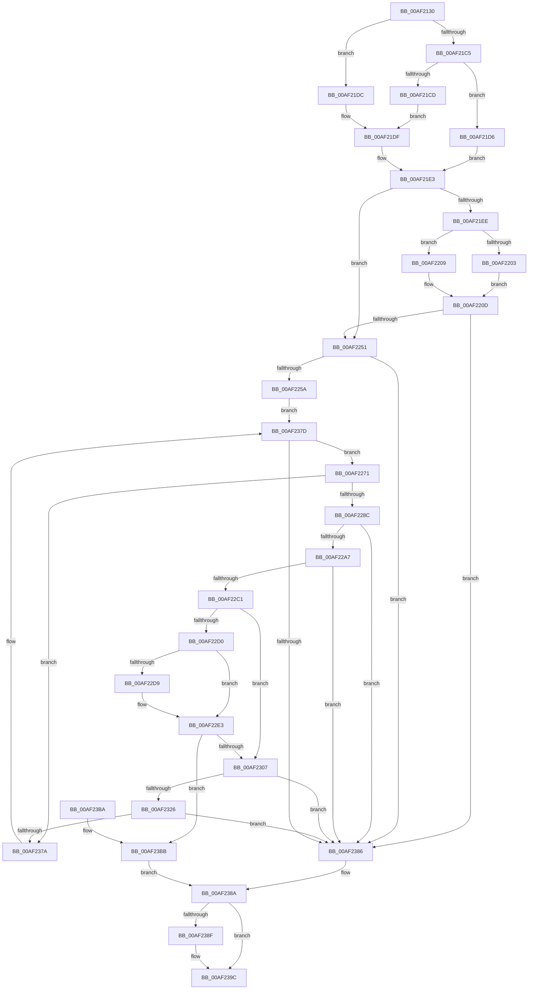

# SepAddTokenOriginClaim

- RVA: `0x00AF2130`–`0x00AF23C2` (길이 `658` bytes)
- VA: `0x0000000140AF2130`
- 실행 섹션: `PAGE`
- PDB 이름 있음: `예`; PDB Function 태그: `아니요`
- unwind 정보 RVA: `0x000D142C`
- 디코드: `164`개 명령, `658/658` bytes 표시
- 미해석 바이트: `0` (있으면 어셈블리에 `.byte`로 보존)

> 이 문서는 커널 이미지의 기계어와 PDB 기호를 분석해 생성했습니다. 4번과 5번은 함수 원형과 자료형을 바이너리 사용 방식에서 추정한 C 해석이며 원본 소스 복구 결과는 아닙니다.

## 1. Dependencies

- 직접 호출 지점: **11**; 고유 호출 대상: **8**
- 직접 호출자로 확인된 함수: **3**
- RIP 상대 이미지 참조: **4**

### Outgoing calls
- `0x00AF2242` → [AuthzBasepSetSecurityAttributesToken](../../text/3A/AuthzBasepSetSecurityAttributesToken_function_003A8D1C.md) (function, `0x003A8D1C`)
- `0x00AF2267` → [RtlInitUnicodeString](../../text/42/RtlInitUnicodeString_function_0042A780.md) (function, `0x0042A780`)
- `0x00AF227F` → [RtlEqualUnicodeString](../93/RtlEqualUnicodeString_function_00932A20.md) (function, `0x00932A20`)
- `0x00AF2298` → [RtlUShortAdd](../../text/47/RtlUShortAdd_function_00474F70.md) (function, `0x00474F70`)
- `0x00AF22B2` → [RtlUShortAdd](../../text/47/RtlUShortAdd_function_00474F70.md) (function, `0x00474F70`)
- `0x00AF22DE` → [ExFreePoolWithTag](../../poolcode/B8/ExFreePoolWithTag_function_00B82870.md) (function, `0x00B82870`)
- `0x00AF22F5` → [ExAllocatePool2](../../poolcode/B8/ExAllocatePool2_function_00B820F0.md) (function, `0x00B820F0`)
- `0x00AF230F` → [RtlCopyUnicodeString](../../text/3F/RtlCopyUnicodeString_function_003FEF30.md) (function, `0x003FEF30`)
- `0x00AF231B` → [RtlAppendUnicodeStringToString](../../text/40/RtlAppendUnicodeStringToString_function_0040FA50.md) (function, `0x0040FA50`)
- `0x00AF236F` → [AuthzBasepSetSecurityAttributesToken](../../text/3A/AuthzBasepSetSecurityAttributesToken_function_003A8D1C.md) (function, `0x003A8D1C`)
- `0x00AF2397` → [ExFreePoolWithTag](../../poolcode/B8/ExFreePoolWithTag_function_00B82870.md) (function, `0x00B82870`)

### Direct callers
- [SeDuplicateTokenWithPredictedClaims](../6F/SeDuplicateTokenWithPredictedClaims_function_006FD084.md) at `0x006FD1CA`
- [SeSubProcessToken](../AA/SeSubProcessToken_function_00AAD570.md) at `0x00AADC40`
- [SeDuplicateTokenAndAddOriginClaim](../AC/SeDuplicateTokenAndAddOriginClaim_function_00AC6DF4.md) at `0x00AC6E89`

### Static image references
- `0x00AF2161` → RVA `0x00B05EF0` (` ?? ::NNGAKEGL::`string'`; read)
- `0x00AF216C` → RVA `0x00B05F10` (` ?? ::NNGAKEGL::`string'`; read)
- `0x00AF2177` → RVA `0x00B05F30` (` ?? ::NNGAKEGL::`string'`; read)
- `0x00AF218D` → RVA `0x00B05E50` (` ?? ::NNGAKEGL::`string'`; read)

## 2. Other-region calls and transfers

- 다른 실행 섹션으로 향하는 call: **10**
  - `0x00AF2242` → [AuthzBasepSetSecurityAttributesToken](../../text/3A/AuthzBasepSetSecurityAttributesToken_function_003A8D1C.md) (`PAGE` → `.text`)
  - `0x00AF2267` → [RtlInitUnicodeString](../../text/42/RtlInitUnicodeString_function_0042A780.md) (`PAGE` → `.text`)
  - `0x00AF2298` → [RtlUShortAdd](../../text/47/RtlUShortAdd_function_00474F70.md) (`PAGE` → `.text`)
  - `0x00AF22B2` → [RtlUShortAdd](../../text/47/RtlUShortAdd_function_00474F70.md) (`PAGE` → `.text`)
  - `0x00AF22DE` → [ExFreePoolWithTag](../../poolcode/B8/ExFreePoolWithTag_function_00B82870.md) (`PAGE` → `POOLCODE`)
  - `0x00AF22F5` → [ExAllocatePool2](../../poolcode/B8/ExAllocatePool2_function_00B820F0.md) (`PAGE` → `POOLCODE`)
  - `0x00AF230F` → [RtlCopyUnicodeString](../../text/3F/RtlCopyUnicodeString_function_003FEF30.md) (`PAGE` → `.text`)
  - `0x00AF231B` → [RtlAppendUnicodeStringToString](../../text/40/RtlAppendUnicodeStringToString_function_0040FA50.md) (`PAGE` → `.text`)
  - `0x00AF236F` → [AuthzBasepSetSecurityAttributesToken](../../text/3A/AuthzBasepSetSecurityAttributesToken_function_003A8D1C.md) (`PAGE` → `.text`)
  - `0x00AF2397` → [ExFreePoolWithTag](../../poolcode/B8/ExFreePoolWithTag_function_00B82870.md) (`PAGE` → `POOLCODE`)
- 별도 외부 분기/꼬리 이동을 확인하지 못했습니다.

## 3. Assembly (complete function range)

```asm
00AF2130  48 89 5C 24 08                  mov qword ptr [rsp + 8], rbx
00AF2135  48 89 74 24 20                  mov qword ptr [rsp + 0x20], rsi
00AF213A  55                              push rbp
00AF213B  57                              push rdi
00AF213C  41 54                           push r12
00AF213E  41 56                           push r14
00AF2140  41 57                           push r15
00AF2142  48 8D 6C 24 C9                  lea rbp, [rsp - 0x37]
00AF2147  48 81 EC C0 00 00 00            sub rsp, 0xc0
00AF214E  45 33 FF                        xor r15d, r15d
00AF2151  48 C7 45 1F 1C 00 1E 00         mov qword ptr [rbp + 0x1f], 0x1e001c
00AF2159  48 C7 45 0F 14 00 16 00         mov qword ptr [rbp + 0xf], 0x160014
00AF2161  48 8D 05 88 3D 01 00            lea rax, [rip + 0x13d88]
00AF2168  48 89 45 27                     mov qword ptr [rbp + 0x27], rax
00AF216C  48 8D 05 9D 3D 01 00            lea rax, [rip + 0x13d9d]
00AF2173  48 89 45 17                     mov qword ptr [rbp + 0x17], rax
00AF2177  48 8D 05 B2 3D 01 00            lea rax, [rip + 0x13db2]
00AF217E  48 89 45 07                     mov qword ptr [rbp + 7], rax
00AF2182  0F 57 C0                        xorps xmm0, xmm0
00AF2185  48 C7 45 FF 48 00 4A 00         mov qword ptr [rbp - 1], 0x4a0048
00AF218D  48 8D 05 BC 3C 01 00            lea rax, [rip + 0x13cbc]
00AF2194  48 89 45 F7                     mov qword ptr [rbp - 9], rax
00AF2198  0F 57 C9                        xorps xmm1, xmm1
00AF219B  48 C7 45 EF 60 00 62 00         mov qword ptr [rbp - 0x11], 0x620060
00AF21A3  4D 8B F0                        mov r14, r8
00AF21A6  66 44 89 7D 6F                  mov word ptr [rbp + 0x6f], r15w
00AF21AB  41 8B DF                        mov ebx, r15d
00AF21AE  41 8B FF                        mov edi, r15d
00AF21B1  0F 11 45 A7                     movups xmmword ptr [rbp - 0x59], xmm0
00AF21B5  0F 11 45 97                     movups xmmword ptr [rbp - 0x69], xmm0
00AF21B9  0F 11 4D B7                     movups xmmword ptr [rbp - 0x49], xmm1
00AF21BD  81 FA 18 02 00 00               cmp edx, 0x218
00AF21C3  75 17                           jne 0x140af21dc
00AF21C5  48 8B F9                        mov rdi, rcx
00AF21C8  44 39 39                        cmp dword ptr [rcx], r15d
00AF21CB  74 09                           je 0x140af21d6
00AF21CD  C7 45 BF 0C 02 00 00            mov dword ptr [rbp - 0x41], 0x20c
00AF21D4  EB 09                           jmp 0x140af21df
00AF21D6  48 8B 4D B7                     mov rcx, qword ptr [rbp - 0x49]
00AF21DA  EB 07                           jmp 0x140af21e3
00AF21DC  89 55 BF                        mov dword ptr [rbp - 0x41], edx
00AF21DF  48 89 4D B7                     mov qword ptr [rbp - 0x49], rcx
00AF21E3  41 BC 01 00 00 00               mov r12d, 1
00AF21E9  48 85 C9                        test rcx, rcx
00AF21EC  74 63                           je 0x140af2251
00AF21EE  44 89 65 97                     mov dword ptr [rbp - 0x69], r12d
00AF21F2  48 8D 45 C7                     lea rax, [rbp - 0x39]
00AF21F6  48 89 45 9F                     mov qword ptr [rbp - 0x61], rax
00AF21FA  44 89 65 9B                     mov dword ptr [rbp - 0x65], r12d
00AF21FE  45 84 C9                        test r9b, r9b
00AF2201  74 06                           je 0x140af2209
00AF2203  0F 10 45 EF                     movups xmm0, xmmword ptr [rbp - 0x11]
00AF2207  EB 04                           jmp 0x140af220d
00AF2209  0F 10 45 FF                     movups xmm0, xmmword ptr [rbp - 1]
00AF220D  49 8B 8E 08 03 00 00            mov rcx, qword ptr [r14 + 0x308]
00AF2214  48 8D 45 B7                     lea rax, [rbp - 0x49]
00AF2218  4C 8D 45 97                     lea r8, [rbp - 0x69]
00AF221C  48 89 45 E7                     mov qword ptr [rbp - 0x19], rax
00AF2220  48 8D 55 77                     lea rdx, [rbp + 0x77]
00AF2224  C7 45 D7 10 00 00 00            mov dword ptr [rbp - 0x29], 0x10
00AF222B  F3 0F 7F 45 C7                  movdqu xmmword ptr [rbp - 0x39], xmm0
00AF2230  44 89 65 DF                     mov dword ptr [rbp - 0x21], r12d
00AF2234  C7 45 DB 41 00 00 00            mov dword ptr [rbp - 0x25], 0x41
00AF223B  C7 45 77 04 00 00 00            mov dword ptr [rbp + 0x77], 4
00AF2242  E8 D5 6A 8B FF                  call 0x1403a8d1c
00AF2247  8B D8                           mov ebx, eax
00AF2249  85 C0                           test eax, eax
00AF224B  0F 88 35 01 00 00               js 0x140af2386
00AF2251  48 85 FF                        test rdi, rdi
00AF2254  0F 84 2C 01 00 00               je 0x140af2386
00AF225A  48 8B BF 10 02 00 00            mov rdi, qword ptr [rdi + 0x210]
00AF2261  48 8D 4D A7                     lea rcx, [rbp - 0x59]
00AF2265  33 D2                           xor edx, edx
00AF2267  E8 14 85 93 FF                  call 0x14042a780
00AF226C  E9 0C 01 00 00                  jmp 0x140af237d
00AF2271  48 8D 77 E0                     lea rsi, [rdi - 0x20]
00AF2275  45 8A C4                        mov r8b, r12b
00AF2278  48 8B CE                        mov rcx, rsi
00AF227B  48 8D 55 0F                     lea rdx, [rbp + 0xf]
00AF227F  E8 9C 07 E4 FF                  call 0x140932a20
00AF2284  84 C0                           test al, al
00AF2286  0F 85 EE 00 00 00               jne 0x140af237a
00AF228C  0F B7 16                        movzx edx, word ptr [rsi]
00AF228F  4C 8D 45 6F                     lea r8, [rbp + 0x6f]
00AF2293  B9 1C 00 00 00                  mov ecx, 0x1c
00AF2298  E8 D3 2C 98 FF                  call 0x140474f70
00AF229D  8B D8                           mov ebx, eax
00AF229F  85 C0                           test eax, eax
00AF22A1  0F 88 DF 00 00 00               js 0x140af2386
00AF22A7  8D 51 E6                        lea edx, [rcx - 0x1a]
00AF22AA  0F B7 4D 6F                     movzx ecx, word ptr [rbp + 0x6f]
00AF22AE  4C 8D 45 6F                     lea r8, [rbp + 0x6f]
00AF22B2  E8 B9 2C 98 FF                  call 0x140474f70
00AF22B7  8B D8                           mov ebx, eax
00AF22B9  85 C0                           test eax, eax
00AF22BB  0F 88 C5 00 00 00               js 0x140af2386
00AF22C1  0F B7 5D 6F                     movzx ebx, word ptr [rbp + 0x6f]
00AF22C5  66 44 89 7D A7                  mov word ptr [rbp - 0x59], r15w
00AF22CA  66 3B 5D A9                     cmp bx, word ptr [rbp - 0x57]
00AF22CE  76 37                           jbe 0x140af2307
00AF22D0  48 8B 4D AF                     mov rcx, qword ptr [rbp - 0x51]
00AF22D4  48 85 C9                        test rcx, rcx
00AF22D7  74 0A                           je 0x140af22e3
00AF22D9  BA 53 65 4F 43                  mov edx, 0x434f6553
00AF22DE  E8 8D 05 09 00                  call 0x140b82870
00AF22E3  48 8B D3                        mov rdx, rbx
00AF22E6  66 89 5D A9                     mov word ptr [rbp - 0x57], bx
00AF22EA  B9 02 01 00 00                  mov ecx, 0x102
00AF22EF  41 B8 53 65 4F 43               mov r8d, 0x434f6553
00AF22F5  E8 F6 FD 08 00                  call 0x140b820f0
00AF22FA  48 89 45 AF                     mov qword ptr [rbp - 0x51], rax
00AF22FE  48 85 C0                        test rax, rax
00AF2301  0F 84 B4 00 00 00               je 0x140af23bb
00AF2307  48 8D 55 1F                     lea rdx, [rbp + 0x1f]
00AF230B  48 8D 4D A7                     lea rcx, [rbp - 0x59]
00AF230F  E8 1C CC 90 FF                  call 0x1403fef30
00AF2314  48 8B D6                        mov rdx, rsi
00AF2317  48 8D 4D A7                     lea rcx, [rbp - 0x59]
00AF231B  E8 30 D7 91 FF                  call 0x14040fa50
00AF2320  8B D8                           mov ebx, eax
00AF2322  85 C0                           test eax, eax
00AF2324  78 60                           js 0x140af2386
00AF2326  0F 10 45 A7                     movups xmm0, xmmword ptr [rbp - 0x59]
00AF232A  49 8B 8E 08 03 00 00            mov rcx, qword ptr [r14 + 0x308]
00AF2331  48 8D 45 C7                     lea rax, [rbp - 0x39]
00AF2335  48 89 45 9F                     mov qword ptr [rbp - 0x61], rax
00AF2339  4C 8D 45 97                     lea r8, [rbp - 0x69]
00AF233D  48 8D 46 10                     lea rax, [rsi + 0x10]
00AF2341  44 89 65 97                     mov dword ptr [rbp - 0x69], r12d
00AF2345  48 8D 55 77                     lea rdx, [rbp + 0x77]
00AF2349  48 89 45 E7                     mov qword ptr [rbp - 0x19], rax
00AF234D  44 89 65 9B                     mov dword ptr [rbp - 0x65], r12d
00AF2351  F3 0F 7F 45 C7                  movdqu xmmword ptr [rbp - 0x39], xmm0
00AF2356  C7 45 D7 03 00 00 00            mov dword ptr [rbp - 0x29], 3
00AF235D  44 89 65 DF                     mov dword ptr [rbp - 0x21], r12d
00AF2361  C7 45 DB 41 00 00 00            mov dword ptr [rbp - 0x25], 0x41
00AF2368  C7 45 77 04 00 00 00            mov dword ptr [rbp + 0x77], 4
00AF236F  E8 A8 69 8B FF                  call 0x1403a8d1c
00AF2374  8B D8                           mov ebx, eax
00AF2376  85 C0                           test eax, eax
00AF2378  78 0C                           js 0x140af2386
00AF237A  48 8B 3F                        mov rdi, qword ptr [rdi]
00AF237D  48 85 FF                        test rdi, rdi
00AF2380  0F 85 EB FE FF FF               jne 0x140af2271
00AF2386  48 8B 45 AF                     mov rax, qword ptr [rbp - 0x51]
00AF238A  48 85 C0                        test rax, rax
00AF238D  74 0D                           je 0x140af239c
00AF238F  BA 53 65 4F 43                  mov edx, 0x434f6553
00AF2394  48 8B C8                        mov rcx, rax
00AF2397  E8 D4 04 09 00                  call 0x140b82870
00AF239C  4C 8D 9C 24 C0 00 00 00         lea r11, [rsp + 0xc0]
00AF23A4  8B C3                           mov eax, ebx
00AF23A6  49 8B 5B 30                     mov rbx, qword ptr [r11 + 0x30]
00AF23AA  49 8B 73 48                     mov rsi, qword ptr [r11 + 0x48]
00AF23AE  49 8B E3                        mov rsp, r11
00AF23B1  41 5F                           pop r15
00AF23B3  41 5E                           pop r14
00AF23B5  41 5C                           pop r12
00AF23B7  5F                              pop rdi
00AF23B8  5D                              pop rbp
00AF23B9  C3                              ret
00AF23BA  CC                              int3
00AF23BB  BB 9A 00 00 C0                  mov ebx, 0xc000009a
00AF23C0  EB C8                           jmp 0x140af238a
```

## 4. C-style interpretation (structured pseudocode)

```c
__int64 __fastcall SepAddTokenOriginClaim(__int64 a1, int a2, __int64 a3, unsigned __int8 a4)
{
    __int64 result;
    __int64 v_r15;
    __int64 v_rsp;
    unsigned __int64 v_stack_m28;
    unsigned __int64 v_stack_m38;
    unsigned __int64 v_stack_m40;
    unsigned __int64 v_stack_m48;
    unsigned __int64 v_stack_m50;
    unsigned __int64 v_stack_m58;
    unsigned __int64 v_stack_m5F;
    unsigned __int64 v_stack_m60;
    unsigned __int64 v_stack_m68;
    unsigned __int64 v_stack_m70;
    unsigned __int64 v_stack_m78;
    unsigned int v_stack_m80;
    unsigned int v_stack_m84;
    unsigned int v_stack_m88;
    unsigned __int64 v_stack_m98;
    unsigned int v_stack_mA0;
    unsigned __int64 v_stack_mA8;
    unsigned __int64 v_stack_mB0;
    unsigned __int16 v_stack_mB6;
    unsigned __int64 v_stack_mB8;
    unsigned __int64 v_stack_mC0;
    unsigned int v_stack_mC4;
    unsigned __int64 v_stack_mC8;
    unsigned __int16 v_stack_p10;
    unsigned __int64 v_stack_p18;
    unsigned __int64 v_stack_p20;
    unsigned __int64 v_stack_p8;

    v_stack_p8 = v_rbx;
    v_stack_p20 = v_rsi;
    v_rsp = (v_rsp) - (192);
    v_r15 = 0;
    v_stack_m40 = 0x1E001CULL;
    v_stack_m50 = 0x160014ULL;
    v_stack_m38 = v_rip + 81288;
    v_stack_m48 = v_rip + 81309;
    v_stack_m58 = v_rip + 81330;
    v_stack_m60 = 0x4A0048ULL;
    v_stack_m68 = v_rip + 81084;
    v_stack_m70 = 0x620060ULL;
    v_stack_p10 = 0;
    v_stack_mB8 = v_xmm0;
    v_stack_mC8 = v_xmm0;
    v_stack_mA8 = v_xmm1;
    if (a2 != 536) goto loc_00AF21DC;
    if ((*(unsigned int *)(a1)) == 0) goto loc_00AF21D6;
    v_stack_mA0 = 524;
    goto loc_00AF21DF;
loc_00AF21D6:
    goto loc_00AF21E3;
loc_00AF21DC:
    v_stack_mA0 = a2;
loc_00AF21DF:
    v_stack_mA8 = v_stack_mA8;
loc_00AF21E3:
    if (v_stack_mA8 == 0) goto loc_00AF2251;
    v_stack_mC8 = 1;
    v_stack_mC0 = v_stack_m98;
    v_stack_mC4 = 1;
    if (a4 == 0) goto loc_00AF2209;
    goto loc_00AF220D;
loc_00AF2209:
loc_00AF220D:
    v_stack_m78 = v_stack_mA8;
    v_stack_m88 = 16;
    v_stack_m98 = v_xmm0;
    v_stack_m80 = 1;
    v_stack_m84 = 65;
    v_stack_p18 = 4;
    result = AuthzBasepSetSecurityAttributesToken(*(unsigned __int64 *)(a3 + 776), v_stack_p18, v_stack_mC8, a4);
    if (sign_flag) goto loc_00AF2386;
loc_00AF2251:
    if (a1 == 0) goto loc_00AF2386;
    a2 = 0;
    result = RtlInitUnicodeString(v_stack_mB8, a2, v_stack_mC8, a4);
    goto loc_00AF237D;
loc_00AF2271:
    result = RtlEqualUnicodeString(*(unsigned __int64 *)(a1 + 528) - 32, v_stack_m50, 1, a4);
    if ((unsigned __int8)(result) != 0) goto loc_00AF237A;
    result = RtlUShortAdd(28, *(unsigned __int16 *)(*(unsigned __int64 *)(a1 + 528) - 32), v_stack_p10, a4);
    if (sign_flag) goto loc_00AF2386;
    result = RtlUShortAdd(v_stack_p10, 28 - 26, v_stack_p10, a4);
    if (sign_flag) goto loc_00AF2386;
    v_stack_mB8 = 0;
    if (((unsigned __int16)(v_stack_p10)) <= v_stack_mB6) goto loc_00AF2307;
    if (v_stack_mB0 != 0) {
        a2 = 0x434F6553ULL;
        result = ExFreePoolWithTag(v_stack_mB0, a2, v_stack_p10, a4);
    }
    v_stack_mB6 = (unsigned __int16)(v_stack_p10);
    result = ExAllocatePool2(258, v_stack_p10, (unsigned int)(0x434F6553ULL), a4);
    v_stack_mB0 = result;
    if (result == 0) goto loc_00AF23BB;
loc_00AF2307:
    result = RtlCopyUnicodeString(v_stack_mB8, v_stack_m40, (unsigned int)(0x434F6553ULL), a4);
    result = RtlAppendUnicodeStringToString(v_stack_mB8, *(unsigned __int64 *)(a1 + 528) - 32, (unsigned int)(0x434F6553ULL), a4);
    if (sign_flag) goto loc_00AF2386;
    v_stack_mC0 = v_stack_m98;
    v_stack_mC8 = 1;
    v_stack_m78 = *(unsigned __int64 *)(a1 + 528) - 32 + 16;
    v_stack_mC4 = 1;
    v_stack_m98 = v_xmm0;
    v_stack_m88 = 3;
    v_stack_m80 = 1;
    v_stack_m84 = 65;
    v_stack_p18 = 4;
    result = AuthzBasepSetSecurityAttributesToken(*(unsigned __int64 *)(a3 + 776), v_stack_p18, v_stack_mC8, a4);
    if (sign_flag) goto loc_00AF2386;
loc_00AF237A:
loc_00AF237D:
    if (*(unsigned __int64 *)(*(unsigned __int64 *)(a1 + 528)) != 0) goto loc_00AF2271;
loc_00AF2386:
loc_00AF238A:
    result = v_stack_mB0;
    if (v_stack_mB0 != 0) {
        a2 = 0x434F6553ULL;
        a1 = v_stack_mB0;
        result = ExFreePoolWithTag(a1, a2, v_stack_mC8, a4);
    }
    return (unsigned int)((unsigned int)((unsigned int)((unsigned int)(result))));
loc_00AF23BB:
    goto loc_00AF238A;
}
```

## 5. (Beta) C Style

```c
int64_t SepAddTokenOriginClaim(void *Arg1, int32_t Arg2, void *Arg3, uint8_t Arg4)
{
    uint8_t *arg1 = (uint8_t *)Arg1;
    uint8_t *arg3 = (uint8_t *)Arg3;

    int64_t result;
    int64_t local_r15;
    int64_t local_rsp;
    uint64_t v_stack_m28;
    uint64_t v_stack_m38;
    uint64_t v_stack_m40;
    uint64_t v_stack_m48;
    uint64_t v_stack_m50;
    uint64_t v_stack_m58;
    uint64_t v_stack_m5F;
    uint64_t v_stack_m60;
    uint64_t v_stack_m68;
    uint64_t v_stack_m70;
    uint64_t v_stack_m78;
    uint32_t v_stack_m80;
    uint32_t v_stack_m84;
    uint32_t v_stack_m88;
    uint64_t v_stack_m98;
    uint32_t v_stack_mA0;
    uint64_t v_stack_mA8;
    uint64_t v_stack_mB0;
    uint16_t v_stack_mB6;
    uint64_t v_stack_mB8;
    uint64_t v_stack_mC0;
    uint32_t v_stack_mC4;
    uint64_t v_stack_mC8;
    uint16_t v_stack_p10;
    uint64_t v_stack_p18;
    uint64_t v_stack_p20;
    uint64_t v_stack_p8;

    v_stack_p8 = local_rbx;
    v_stack_p20 = local_rsi;
    local_rsp = (local_rsp) - (192);
    local_r15 = 0;
    v_stack_m40 = 0x1E001CULL;
    v_stack_m50 = 0x160014ULL;
    v_stack_m38 = v_rip + 81288;
    v_stack_m48 = v_rip + 81309;
    v_stack_m58 = v_rip + 81330;
    v_stack_m60 = 0x4A0048ULL;
    v_stack_m68 = v_rip + 81084;
    v_stack_m70 = 0x620060ULL;
    v_stack_p10 = 0;
    v_stack_mB8 = v_xmm0;
    v_stack_mC8 = v_xmm0;
    v_stack_mA8 = v_xmm1;
    if (Arg2 != 536) goto loc_00AF21DC;
    if ((*(uint32_t *)(arg1)) == 0) goto loc_00AF21D6;
    v_stack_mA0 = 524;
    goto loc_00AF21DF;
loc_00AF21D6:
    goto loc_00AF21E3;
loc_00AF21DC:
    v_stack_mA0 = Arg2;
loc_00AF21DF:
    v_stack_mA8 = v_stack_mA8;
loc_00AF21E3:
    if (v_stack_mA8 == 0) goto loc_00AF2251;
    v_stack_mC8 = 1;
    v_stack_mC0 = v_stack_m98;
    v_stack_mC4 = 1;
    if (Arg4 == 0) goto loc_00AF2209;
    goto loc_00AF220D;
loc_00AF2209:
loc_00AF220D:
    v_stack_m78 = v_stack_mA8;
    v_stack_m88 = 16;
    v_stack_m98 = v_xmm0;
    v_stack_m80 = 1;
    v_stack_m84 = 65;
    v_stack_p18 = 4;
    result = AuthzBasepSetSecurityAttributesToken(*(uint64_t *)(arg3 + 0x308), v_stack_p18, v_stack_mC8, Arg4);
    if (sign_flag) goto loc_00AF2386;
loc_00AF2251:
    if (Arg1 == NULL) goto loc_00AF2386;
    Arg2 = 0;
    result = RtlInitUnicodeString(v_stack_mB8, Arg2, v_stack_mC8, Arg4);
    goto loc_00AF237D;
loc_00AF2271:
    result = RtlEqualUnicodeString(*(uint64_t *)(arg1 + 0x210) - 32, v_stack_m50, 1, Arg4);
    if ((uint8_t)(result) != 0) goto loc_00AF237A;
    result = RtlUShortAdd(28, *(uint16_t *)(*(uint64_t *)(arg1 + 0x210) - 0x20), v_stack_p10, Arg4);
    if (sign_flag) goto loc_00AF2386;
    result = RtlUShortAdd(v_stack_p10, 28 - 26, v_stack_p10, Arg4);
    if (sign_flag) goto loc_00AF2386;
    v_stack_mB8 = 0;
    if (((uint16_t)(v_stack_p10)) <= v_stack_mB6) goto loc_00AF2307;
    if (v_stack_mB0 != 0) {
        Arg2 = 0x434F6553ULL;
        result = ExFreePoolWithTag(v_stack_mB0, Arg2, v_stack_p10, Arg4);
    }
    v_stack_mB6 = (uint16_t)(v_stack_p10);
    result = ExAllocatePool2(258, v_stack_p10, (uint32_t)(0x434F6553ULL), Arg4);
    v_stack_mB0 = result;
    if (result == 0) goto loc_00AF23BB;
loc_00AF2307:
    result = RtlCopyUnicodeString(v_stack_mB8, v_stack_m40, (uint32_t)(0x434F6553ULL), Arg4);
    result = RtlAppendUnicodeStringToString(v_stack_mB8, *(uint64_t *)(arg1 + 0x210) - 32, (uint32_t)(0x434F6553ULL), Arg4);
    if (sign_flag) goto loc_00AF2386;
    v_stack_mC0 = v_stack_m98;
    v_stack_mC8 = 1;
    v_stack_m78 = *(uint64_t *)(arg1 + 0x210) - 32 + 16;
    v_stack_mC4 = 1;
    v_stack_m98 = v_xmm0;
    v_stack_m88 = 3;
    v_stack_m80 = 1;
    v_stack_m84 = 65;
    v_stack_p18 = 4;
    result = AuthzBasepSetSecurityAttributesToken(*(uint64_t *)(arg3 + 0x308), v_stack_p18, v_stack_mC8, Arg4);
    if (sign_flag) goto loc_00AF2386;
loc_00AF237A:
loc_00AF237D:
    if (*(uint64_t *)(*(uint64_t *)(arg1 + 0x210)) != 0) goto loc_00AF2271;
loc_00AF2386:
loc_00AF238A:
    result = v_stack_mB0;
    if (v_stack_mB0 != 0) {
        Arg2 = 0x434F6553ULL;
        Arg1 = v_stack_mB0;
        result = ExFreePoolWithTag(Arg1, Arg2, v_stack_mC8, Arg4);
    }
    return (uint32_t)((uint32_t)((uint32_t)((uint32_t)(result))));
loc_00AF23BB:
    goto loc_00AF238A;
}
```

### 관측된 메모리 오프셋

구조체 형식이 확인되지 않은 접근은 인자 기준의 오프셋으로만 기록했습니다.

| 기준 인자 | 오프셋 표현 | 폭 (bit) | 접근 |
|---|---:|---:|---|
| `Arg1` | `+ 0x0` | `32` | `R` |
| `Arg3` | `+ 0x308` | `64` | `R` |

## 6. Execution-region graph

[열기: 2D/3D 그래프와 함수 탐색 컨트롤 패널](../../../control-panel.html?section=page&rva=0x00AF2130&view=graph)

- 2D 그래프는 위에서 아래로 흐르고, 3D 그래프는 빈 공간을 드래그해 회전합니다. Shift+드래그는 이동, 휠은 확대·축소, 함수 노드 선택은 대상 보고서 이동입니다.

### Static fallback


