# SepDeReferenceLogonSession

- RVA: `0x00AF25EC`–`0x00AF289E` (길이 `690` bytes)
- VA: `0x0000000140AF25EC`
- 실행 섹션: `PAGE`
- PDB 이름 있음: `예`; PDB Function 태그: `아니요`
- unwind 정보 RVA: `0x000D1508`
- 디코드: `187`개 명령, `690/690` bytes 표시
- 미해석 바이트: `0` (있으면 어셈블리에 `.byte`로 보존)

> 이 문서는 커널 이미지의 기계어와 PDB 기호를 분석해 생성했습니다. 4번과 5번은 함수 원형과 자료형을 바이너리 사용 방식에서 추정한 C 해석이며 원본 소스 복구 결과는 아닙니다.

## 1. Dependencies

- 직접 호출 지점: **29**; 고유 호출 대상: **21**
- 직접 호출자로 확인된 함수: **3**
- RIP 상대 이미지 참조: **3**

### Outgoing calls
- `0x00AF2652` → [ExAcquireResourceExclusiveLite](../../text/21/ExAcquireResourceExclusiveLite_function_00214E20.md) (function, `0x00214E20`)
- `0x00AF26AC` → [ExReleaseResourceLite](../../text/25/ExReleaseResourceLite_function_0025FA10.md) (function, `0x0025FA10`)
- `0x00AF26B1` → [KeLeaveCriticalRegion](../../text/25/KeLeaveCriticalRegion_function_0025D8B0.md) (function, `0x0025D8B0`)
- `0x00AF26B6` → [Feature_ShadowAdmin__private_IsEnabledDeviceUsageNoInline](../../text/4C/Feature_ShadowAdmin__private_IsEnabledDeviceUsageNoInline_function_004C78E8.md) (function, `0x004C78E8`)
- `0x00AF26E9` → [ExAcquireResourceSharedLite](../../text/21/ExAcquireResourceSharedLite_function_00211BC0.md) (function, `0x00211BC0`)
- `0x00AF26FC` → [ExReleaseResourceLite](../../text/25/ExReleaseResourceLite_function_0025FA10.md) (function, `0x0025FA10`)
- `0x00AF2701` → [KeLeaveCriticalRegion](../../text/25/KeLeaveCriticalRegion_function_0025D8B0.md) (function, `0x0025D8B0`)
- `0x00AF270C` → [Feature_2045735225__private_IsEnabledDeviceUsageNoInline](../../text/4F/Feature_2045735225__private_IsEnabledDeviceUsageNoInline_function_004F0968.md) (function, `0x004F0968`)
- `0x00AF2741` → [SepDeReferenceLogonSession](SepDeReferenceLogonSession_function_00AF25EC.md) (function, `0x00AF25EC`)
- `0x00AF275C` → [SepDeReferenceLogonSession](SepDeReferenceLogonSession_function_00AF25EC.md) (function, `0x00AF25EC`)
- `0x00AF2786` → [SepDeReferenceLogonSession](SepDeReferenceLogonSession_function_00AF25EC.md) (function, `0x00AF25EC`)
- `0x00AF2794` → [ObfDereferenceObject](../../text/2F/ObfDereferenceObject_function_002F9350.md) (function, `0x002F9350`)
- `0x00AF27B0` → [SepCleanupLUIDDeviceMapDirectory](../A9/SepCleanupLUIDDeviceMapDirectory_function_00A98F24.md) (function, `0x00A98F24`)
- `0x00AF27BD` → [ObDereferenceDeviceMap](../96/ObDereferenceDeviceMap_function_0096D0E8.md) (function, `0x0096D0E8`)
- `0x00AF27CF` → [SepInformFileSystemsOfDeletedLogon](../7A/SepInformFileSystemsOfDeletedLogon_function_007A16F0.md) (function, `0x007A16F0`)
- `0x00AF27DF` → [ExFreePoolWithTag](../../poolcode/B8/ExFreePoolWithTag_function_00B82870.md) (function, `0x00B82870`)
- `0x00AF27E7` → [SepDeleteLogonSessionClaims](../AA/SepDeleteLogonSessionClaims_function_00AAC8A4.md) (function, `0x00AAC8A4`)
- `0x00AF27F8` → [SepDeleteLogonSessionSidValues](../7A/SepDeleteLogonSessionSidValues_function_007A0EC4.md) (function, `0x007A0EC4`)
- `0x00AF2804` → [ObDestroyHandleRevocationBlock](../A9/ObDestroyHandleRevocationBlock_function_00A924B8.md) (function, `0x00A924B8`)
- `0x00AF280D` → [SepDeleteCachedHandlesTable](../AC/SepDeleteCachedHandlesTable_function_00ACCE28.md) (function, `0x00ACCE28`)
- `0x00AF281F` → [SepInformLsaOfDeletedLogon](../AC/SepInformLsaOfDeletedLogon_function_00AC3274.md) (function, `0x00AC3274`)
- `0x00AF2824` → [SepDeleteSessionLowboxEntries](../../text/48/SepDeleteSessionLowboxEntries_function_0048C188.md) (function, `0x0048C188`)
- `0x00AF2829` → [Feature_OutsideInProtection__private_IsEnabledDeviceUsageNoInline](../../text/5C/Feature_OutsideInProtection__private_IsEnabledDeviceUsageNoInline_function_005CD968.md) (function, `0x005CD968`)
- `0x00AF2832` → [SepDeleteSessionAntiTamperEntries](../../text/60/SepDeleteSessionAntiTamperEntries_function_0060AAF8.md) (function, `0x0060AAF8`)
- `0x00AF285F` → [ExReleaseResourceLite](../../text/25/ExReleaseResourceLite_function_0025FA10.md) (function, `0x0025FA10`)
- `0x00AF2864` → [KeLeaveCriticalRegion](../../text/25/KeLeaveCriticalRegion_function_0025D8B0.md) (function, `0x0025D8B0`)
- `0x00AF287E` → [ExReleaseResourceLite](../../text/25/ExReleaseResourceLite_function_0025FA10.md) (function, `0x0025FA10`)
- `0x00AF2883` → [KeLeaveCriticalRegion](../../text/25/KeLeaveCriticalRegion_function_0025D8B0.md) (function, `0x0025D8B0`)
- `0x00AF2898` → [KeBugCheckEx](../../text/4F/KeBugCheckEx_function_004FD660.md) (function, `0x004FD660`)

### Direct callers
- [SepDeReferenceLogonSessionDirect](../../text/44/SepDeReferenceLogonSessionDirect_function_0044EDCC.md) at `0x0044EE09`
- [SepTokenDeleteMethod](SepTokenDeleteMethod_function_00AF23D0.md) at `0x00AF246E`
- [SepDeReferenceLogonSession](SepDeReferenceLogonSession_function_00AF25EC.md) at `0x00AF2741`
- [SepDeReferenceLogonSession](SepDeReferenceLogonSession_function_00AF25EC.md) at `0x00AF275C`
- [SepDeReferenceLogonSession](SepDeReferenceLogonSession_function_00AF25EC.md) at `0x00AF2786`

### Static image references
- `0x00AF2611` → RVA `0x00FD9AF0` (`PAGEDATA`; read)
- `0x00AF2618` → RVA `0x00E67F20` (`.data`; read)
- `0x00AF27EC` → RVA `0x00E67BF0` (`.data`; read)

## 2. Other-region calls and transfers

- 다른 실행 섹션으로 향하는 call: **18**
  - `0x00AF2652` → [ExAcquireResourceExclusiveLite](../../text/21/ExAcquireResourceExclusiveLite_function_00214E20.md) (`PAGE` → `.text`)
  - `0x00AF26AC` → [ExReleaseResourceLite](../../text/25/ExReleaseResourceLite_function_0025FA10.md) (`PAGE` → `.text`)
  - `0x00AF26B1` → [KeLeaveCriticalRegion](../../text/25/KeLeaveCriticalRegion_function_0025D8B0.md) (`PAGE` → `.text`)
  - `0x00AF26B6` → [Feature_ShadowAdmin__private_IsEnabledDeviceUsageNoInline](../../text/4C/Feature_ShadowAdmin__private_IsEnabledDeviceUsageNoInline_function_004C78E8.md) (`PAGE` → `.text`)
  - `0x00AF26E9` → [ExAcquireResourceSharedLite](../../text/21/ExAcquireResourceSharedLite_function_00211BC0.md) (`PAGE` → `.text`)
  - `0x00AF26FC` → [ExReleaseResourceLite](../../text/25/ExReleaseResourceLite_function_0025FA10.md) (`PAGE` → `.text`)
  - `0x00AF2701` → [KeLeaveCriticalRegion](../../text/25/KeLeaveCriticalRegion_function_0025D8B0.md) (`PAGE` → `.text`)
  - `0x00AF270C` → [Feature_2045735225__private_IsEnabledDeviceUsageNoInline](../../text/4F/Feature_2045735225__private_IsEnabledDeviceUsageNoInline_function_004F0968.md) (`PAGE` → `.text`)
  - `0x00AF2794` → [ObfDereferenceObject](../../text/2F/ObfDereferenceObject_function_002F9350.md) (`PAGE` → `.text`)
  - `0x00AF27DF` → [ExFreePoolWithTag](../../poolcode/B8/ExFreePoolWithTag_function_00B82870.md) (`PAGE` → `POOLCODE`)
  - `0x00AF2824` → [SepDeleteSessionLowboxEntries](../../text/48/SepDeleteSessionLowboxEntries_function_0048C188.md) (`PAGE` → `.text`)
  - `0x00AF2829` → [Feature_OutsideInProtection__private_IsEnabledDeviceUsageNoInline](../../text/5C/Feature_OutsideInProtection__private_IsEnabledDeviceUsageNoInline_function_005CD968.md) (`PAGE` → `.text`)
  - `0x00AF2832` → [SepDeleteSessionAntiTamperEntries](../../text/60/SepDeleteSessionAntiTamperEntries_function_0060AAF8.md) (`PAGE` → `.text`)
  - `0x00AF285F` → [ExReleaseResourceLite](../../text/25/ExReleaseResourceLite_function_0025FA10.md) (`PAGE` → `.text`)
  - `0x00AF2864` → [KeLeaveCriticalRegion](../../text/25/KeLeaveCriticalRegion_function_0025D8B0.md) (`PAGE` → `.text`)
  - `0x00AF287E` → [ExReleaseResourceLite](../../text/25/ExReleaseResourceLite_function_0025FA10.md) (`PAGE` → `.text`)
  - `0x00AF2883` → [KeLeaveCriticalRegion](../../text/25/KeLeaveCriticalRegion_function_0025D8B0.md) (`PAGE` → `.text`)
  - `0x00AF2898` → [KeBugCheckEx](../../text/4F/KeBugCheckEx_function_004FD660.md) (`PAGE` → `.text`)
- 별도 외부 분기/꼬리 이동을 확인하지 못했습니다.

## 3. Assembly (complete function range)

```asm
00AF25EC  48 89 5C 24 08                  mov qword ptr [rsp + 8], rbx
00AF25F1  48 89 6C 24 10                  mov qword ptr [rsp + 0x10], rbp
00AF25F6  48 89 74 24 18                  mov qword ptr [rsp + 0x18], rsi
00AF25FB  57                              push rdi
00AF25FC  41 54                           push r12
00AF25FE  41 55                           push r13
00AF2600  41 56                           push r14
00AF2602  41 57                           push r15
00AF2604  48 83 EC 30                     sub rsp, 0x30
00AF2608  69 29 24 0A 25 5B               imul ebp, dword ptr [rcx], 0x5b250a24
00AF260E  48 8B F1                        mov rsi, rcx
00AF2611  48 8B 05 D8 74 4E 00            mov rax, qword ptr [rip + 0x4e74d8]
00AF2618  48 8D 0D 01 59 37 00            lea rcx, [rip + 0x375901]
00AF261F  4C 8B FA                        mov r15, rdx
00AF2622  49 83 CD FF                     or r13, 0xffffffffffffffff
00AF2626  B2 01                           mov dl, 1
00AF2628  C1 ED 1C                        shr ebp, 0x1c
00AF262B  44 8B C5                        mov r8d, ebp
00AF262E  41 83 E0 03                     and r8d, 3
00AF2632  49 6B D8 68                     imul rbx, r8, 0x68
00AF2636  4C 8D 34 E8                     lea r14, [rax + rbp*8]
00AF263A  65 48 8B 04 25 88 01 00 00      mov rax, qword ptr gs:[0x188]
00AF2643  48 03 D9                        add rbx, rcx
00AF2646  48 8B CB                        mov rcx, rbx
00AF2649  66 44 01 A8 E4 01 00 00         add word ptr [rax + 0x1e4], r13w
00AF2651  90                              nop
00AF2652  E8 C9 27 72 FF                  call 0x140214e20
00AF2657  49 8B 3E                        mov rdi, qword ptr [r14]
00AF265A  45 33 E4                        xor r12d, r12d
00AF265D  EB 1E                           jmp 0x140af267d
00AF265F  4C 39 BF A8 00 00 00            cmp qword ptr [rdi + 0xa8], r15
00AF2666  75 0F                           jne 0x140af2677
00AF2668  8B 47 08                        mov eax, dword ptr [rdi + 8]
00AF266B  39 06                           cmp dword ptr [rsi], eax
00AF266D  75 08                           jne 0x140af2677
00AF266F  8B 47 0C                        mov eax, dword ptr [rdi + 0xc]
00AF2672  39 46 04                        cmp dword ptr [rsi + 4], eax
00AF2675  74 11                           je 0x140af2688
00AF2677  4C 8B F7                        mov r14, rdi
00AF267A  48 8B 3F                        mov rdi, qword ptr [rdi]
00AF267D  48 85 FF                        test rdi, rdi
00AF2680  0F 84 E5 01 00 00               je 0x140af286b
00AF2686  EB D7                           jmp 0x140af265f
00AF2688  49 8B C5                        mov rax, r13
00AF268B  F0 48 0F C1 47 20               lock xadd qword ptr [rdi + 0x20], rax
00AF2691  49 03 C5                        add rax, r13
00AF2694  48 85 C0                        test rax, rax
00AF2697  0F 8F BF 01 00 00               jg 0x140af285c
00AF269D  0F 85 B2 01 00 00               jne 0x140af2855
00AF26A3  48 8B 07                        mov rax, qword ptr [rdi]
00AF26A6  48 8B CB                        mov rcx, rbx
00AF26A9  49 89 06                        mov qword ptr [r14], rax
00AF26AC  E8 5F D3 76 FF                  call 0x14025fa10
00AF26B1  E8 FA B1 76 FF                  call 0x14025d8b0
00AF26B6  E8 2D 52 9D FF                  call 0x1404c78e8
00AF26BB  85 C0                           test eax, eax
00AF26BD  0F 84 A6 00 00 00               je 0x140af2769
00AF26C3  4C 39 67 38                     cmp qword ptr [rdi + 0x38], r12
00AF26C7  0F 84 9C 00 00 00               je 0x140af2769
00AF26CD  65 48 8B 04 25 88 01 00 00      mov rax, qword ptr gs:[0x188]
00AF26D6  B2 01                           mov dl, 1
00AF26D8  66 44 01 A8 E4 01 00 00         add word ptr [rax + 0x1e4], r13w
00AF26E0  90                              nop
00AF26E1  48 8B 4F 38                     mov rcx, qword ptr [rdi + 0x38]
00AF26E5  48 8B 49 30                     mov rcx, qword ptr [rcx + 0x30]
00AF26E9  E8 D2 F4 71 FF                  call 0x140211bc0
00AF26EE  48 8B 4F 38                     mov rcx, qword ptr [rdi + 0x38]
00AF26F2  8B 99 C8 00 00 00               mov ebx, dword ptr [rcx + 0xc8]
00AF26F8  48 8B 49 30                     mov rcx, qword ptr [rcx + 0x30]
00AF26FC  E8 0F D3 76 FF                  call 0x14025fa10
00AF2701  E8 AA B1 76 FF                  call 0x14025d8b0
00AF2706  0F BA E3 1B                     bt ebx, 0x1b
00AF270A  73 5D                           jae 0x140af2769
00AF270C  E8 57 E2 9F FF                  call 0x1404f0968
00AF2711  85 C0                           test eax, eax
00AF2713  75 0F                           jne 0x140af2724
00AF2715  48 8D 4F 10                     lea rcx, [rdi + 0x10]
00AF2719  44 39 21                        cmp dword ptr [rcx], r12d
00AF271C  75 37                           jne 0x140af2755
00AF271E  44 39 67 14                     cmp dword ptr [rdi + 0x14], r12d
00AF2722  EB 2F                           jmp 0x140af2753
00AF2724  8B 47 28                        mov eax, dword ptr [rdi + 0x28]
00AF2727  A8 02                           test al, 2
00AF2729  74 38                           je 0x140af2763
00AF272B  48 8D 4F 10                     lea rcx, [rdi + 0x10]
00AF272F  44 39 21                        cmp dword ptr [rcx], r12d
00AF2732  75 06                           jne 0x140af273a
00AF2734  44 39 67 14                     cmp dword ptr [rdi + 0x14], r12d
00AF2738  74 0C                           je 0x140af2746
00AF273A  48 8B 97 A8 00 00 00            mov rdx, qword ptr [rdi + 0xa8]
00AF2741  E8 A6 FE FF FF                  call 0x140af25ec
00AF2746  48 8D 4F 18                     lea rcx, [rdi + 0x18]
00AF274A  44 39 21                        cmp dword ptr [rcx], r12d
00AF274D  75 06                           jne 0x140af2755
00AF274F  44 39 67 1C                     cmp dword ptr [rdi + 0x1c], r12d
00AF2753  74 14                           je 0x140af2769
00AF2755  48 8B 97 A8 00 00 00            mov rdx, qword ptr [rdi + 0xa8]
00AF275C  E8 8B FE FF FF                  call 0x140af25ec
00AF2761  EB 06                           jmp 0x140af2769
00AF2763  83 E0 FB                        and eax, 0xfffffffb
00AF2766  89 47 28                        mov dword ptr [rdi + 0x28], eax
00AF2769  8B 47 28                        mov eax, dword ptr [rdi + 0x28]
00AF276C  A8 04                           test al, 4
00AF276E  74 1B                           je 0x140af278b
00AF2770  48 8D 4F 10                     lea rcx, [rdi + 0x10]
00AF2774  44 39 21                        cmp dword ptr [rcx], r12d
00AF2777  75 06                           jne 0x140af277f
00AF2779  44 39 67 14                     cmp dword ptr [rdi + 0x14], r12d
00AF277D  74 0C                           je 0x140af278b
00AF277F  48 8B 97 A8 00 00 00            mov rdx, qword ptr [rdi + 0xa8]
00AF2786  E8 61 FE FF FF                  call 0x140af25ec
00AF278B  48 8B 4F 38                     mov rcx, qword ptr [rdi + 0x38]
00AF278F  48 85 C9                        test rcx, rcx
00AF2792  74 09                           je 0x140af279d
00AF2794  E8 B7 6B 80 FF                  call 0x1402f9350
00AF2799  4C 89 67 38                     mov qword ptr [rdi + 0x38], r12
00AF279D  48 8B 5F 30                     mov rbx, qword ptr [rdi + 0x30]
00AF27A1  48 85 DB                        test rbx, rbx
00AF27A4  74 1C                           je 0x140af27c2
00AF27A6  49 8B D7                        mov rdx, r15
00AF27A9  4C 89 67 30                     mov qword ptr [rdi + 0x30], r12
00AF27AD  48 8B CE                        mov rcx, rsi
00AF27B0  E8 6F 67 FA FF                  call 0x140a98f24
00AF27B5  BA 01 00 00 00                  mov edx, 1
00AF27BA  48 8B CB                        mov rcx, rbx
00AF27BD  E8 26 A9 E7 FF                  call 0x14096d0e8
00AF27C2  8B 47 28                        mov eax, dword ptr [rdi + 0x28]
00AF27C5  A8 01                           test al, 1
00AF27C7  74 0B                           je 0x140af27d4
00AF27C9  49 8B D7                        mov rdx, r15
00AF27CC  48 8B CE                        mov rcx, rsi
00AF27CF  E8 1C EF CA FF                  call 0x1407a16f0
00AF27D4  48 8B 4F 48                     mov rcx, qword ptr [rdi + 0x48]
00AF27D8  48 85 C9                        test rcx, rcx
00AF27DB  74 07                           je 0x140af27e4
00AF27DD  33 D2                           xor edx, edx
00AF27DF  E8 8C 00 09 00                  call 0x140b82870
00AF27E4  48 8B CF                        mov rcx, rdi
00AF27E7  E8 B8 A0 FB FF                  call 0x140aac8a4
00AF27EC  44 38 25 FD 53 37 00            cmp byte ptr [rip + 0x3753fd], r12b
00AF27F3  74 08                           je 0x140af27fd
00AF27F5  48 8B CF                        mov rcx, rdi
00AF27F8  E8 C7 E6 CA FF                  call 0x1407a0ec4
00AF27FD  48 8D 8F 88 00 00 00            lea rcx, [rdi + 0x88]
00AF2804  E8 AF FC F9 FF                  call 0x140a924b8
00AF2809  48 8D 4F 60                     lea rcx, [rdi + 0x60]
00AF280D  E8 16 A6 FD FF                  call 0x140acce28
00AF2812  48 8B 97 A8 00 00 00            mov rdx, qword ptr [rdi + 0xa8]
00AF2819  4C 8B C7                        mov r8, rdi
00AF281C  48 8B CE                        mov rcx, rsi
00AF281F  E8 50 0A FD FF                  call 0x140ac3274
00AF2824  E8 5F 99 99 FF                  call 0x14048c188
00AF2829  E8 3A B1 AD FF                  call 0x1405cd968
00AF282E  85 C0                           test eax, eax
00AF2830  74 05                           je 0x140af2837
00AF2832  E8 C1 82 B1 FF                  call 0x14060aaf8
00AF2837  48 8B 5C 24 60                  mov rbx, qword ptr [rsp + 0x60]
00AF283C  48 8B 6C 24 68                  mov rbp, qword ptr [rsp + 0x68]
00AF2841  48 8B 74 24 70                  mov rsi, qword ptr [rsp + 0x70]
00AF2846  48 83 C4 30                     add rsp, 0x30
00AF284A  41 5F                           pop r15
00AF284C  41 5E                           pop r14
00AF284E  41 5D                           pop r13
00AF2850  41 5C                           pop r12
00AF2852  5F                              pop rdi
00AF2853  C3                              ret
00AF2854  CC                              int3
00AF2855  B9 0E 00 00 00                  mov ecx, 0xe
00AF285A  CD 29                           int 0x29
00AF285C  48 8B CB                        mov rcx, rbx
00AF285F  E8 AC D1 76 FF                  call 0x14025fa10
00AF2864  E8 47 B0 76 FF                  call 0x14025d8b0
00AF2869  EB CC                           jmp 0x140af2837
00AF286B  8B C5                           mov eax, ebp
00AF286D  83 E0 03                        and eax, 3
00AF2870  48 6B C8 68                     imul rcx, rax, 0x68
00AF2874  48 8D 05 A5 56 37 00            lea rax, [rip + 0x3756a5]
00AF287B  48 03 C8                        add rcx, rax
00AF287E  E8 8D D1 76 FF                  call 0x14025fa10
00AF2883  E8 28 B0 76 FF                  call 0x14025d8b0
00AF2888  33 D2                           xor edx, edx
00AF288A  4C 89 64 24 20                  mov qword ptr [rsp + 0x20], r12
00AF288F  45 33 C9                        xor r9d, r9d
00AF2892  45 33 C0                        xor r8d, r8d
00AF2895  8D 4A 46                        lea ecx, [rdx + 0x46]
00AF2898  E8 C3 AD A0 FF                  call 0x1404fd660
00AF289D  CC                              int3
```

## 4. C-style interpretation (structured pseudocode)

```c
__int64 __fastcall SepDeReferenceLogonSession(__int64 a1, __int64 a2, __int64 a3, int a4)
{
    __int64 result;
    __int64 v_r12;
    __int64 v_r13;
    __int64 v_rbp;
    __int64 v_rbx;
    __int64 v_rsp;
    unsigned __int64 v_stack_p10;
    unsigned __int64 v_stack_p18;
    unsigned __int64 v_stack_p20;
    unsigned __int64 v_stack_p8;

    v_stack_p8 = v_rbx;
    v_stack_p10 = v_rbp;
    v_stack_p18 = v_rsi;
    v_rsp = (v_rsp) - (48);
    v_rbp = (unsigned int)((v_rbp) * (*(unsigned int *)(a1)));
    v_r13 = (v_r13) | (-1);
    v_rbp = (unsigned int)((v_rbp) >> (28));
    a3 = (unsigned int)(((unsigned int)((unsigned int)(v_rbp))) & (3));
    v_rbx = (v_rbx) * (a3);
    v_rbx = (v_rbx) + (v_rip + 3627265);
    result = ExAcquireResourceExclusiveLite(v_rbx, 1, a3, a4);
    v_r12 = 0;
    goto loc_00AF267D;
loc_00AF265F:
    if ((*(unsigned __int64 *)(*(unsigned __int64 *)(*(unsigned __int64 *)(v_rip + 5141720) + v_rbp * 8) + 168)) != a2) goto loc_00AF2677;
    if ((*(unsigned int *)(a1)) != ((unsigned int)((unsigned int)(*(unsigned int *)(*(unsigned __int64 *)(*(unsigned __int64 *)(v_rip + 5141720) + v_rbp * 8) + 8))))) goto loc_00AF2677;
    if ((*(unsigned int *)(a1 + 4)) == ((unsigned int)((unsigned int)(*(unsigned int *)(*(unsigned __int64 *)(*(unsigned __int64 *)(v_rip + 5141720) + v_rbp * 8) + 12))))) goto loc_00AF2688;
loc_00AF2677:
loc_00AF267D:
    if (*(unsigned __int64 *)(*(unsigned __int64 *)(*(unsigned __int64 *)(v_rip + 5141720) + v_rbp * 8)) == 0) goto loc_00AF286B;
    goto loc_00AF265F;
loc_00AF2688:
    result = (v_r13) + (v_r13);
    if (condition_is_greater) goto loc_00AF285C;
    if (result != 0) goto loc_00AF2855;
    *(unsigned __int64 *)(*(unsigned __int64 *)(*(unsigned __int64 *)(v_rip + 5141720) + v_rbp * 8)) = *(unsigned __int64 *)(*(unsigned __int64 *)(*(unsigned __int64 *)(*(unsigned __int64 *)(v_rip + 5141720) + v_rbp * 8)));
    result = ExReleaseResourceLite(v_rbx, 1, a3, a4);
    result = KeLeaveCriticalRegion(v_rbx, 1, a3, a4);
    result = Feature_ShadowAdmin__private_IsEnabledDeviceUsageNoInline(v_rbx, 1, a3, a4);
    if ((unsigned int)(result) == 0) goto loc_00AF2769;
    if ((*(unsigned __int64 *)(*(unsigned __int64 *)(*(unsigned __int64 *)(*(unsigned __int64 *)(v_rip + 5141720) + v_rbp * 8)) + 56)) == 0) goto loc_00AF2769;
    result = ExAcquireResourceSharedLite(*(unsigned __int64 *)(*(unsigned __int64 *)(*(unsigned __int64 *)(*(unsigned __int64 *)(*(unsigned __int64 *)(v_rip + 5141720) + v_rbp * 8)) + 56) + 48), 1, a3, a4);
    result = ExReleaseResourceLite(*(unsigned __int64 *)(*(unsigned __int64 *)(*(unsigned __int64 *)(*(unsigned __int64 *)(*(unsigned __int64 *)(v_rip + 5141720) + v_rbp * 8)) + 56) + 48), 1, a3, a4);
    result = KeLeaveCriticalRegion(*(unsigned __int64 *)(*(unsigned __int64 *)(*(unsigned __int64 *)(*(unsigned __int64 *)(*(unsigned __int64 *)(v_rip + 5141720) + v_rbp * 8)) + 56) + 48), 1, a3, a4);
    if ((*(unsigned __int64 *)(*(unsigned __int64 *)(*(unsigned __int64 *)(*(unsigned __int64 *)(v_rip + 5141720) + v_rbp * 8)) + 56)) >= 0) goto loc_00AF2769;
    result = Feature_2045735225__private_IsEnabledDeviceUsageNoInline(*(unsigned __int64 *)(*(unsigned __int64 *)(*(unsigned __int64 *)(*(unsigned __int64 *)(*(unsigned __int64 *)(v_rip + 5141720) + v_rbp * 8)) + 56) + 48), 1, a3, a4);
    if ((unsigned int)(result) != 0) goto loc_00AF2724;
    if ((*(unsigned int *)(*(unsigned __int64 *)(*(unsigned __int64 *)(*(unsigned __int64 *)(v_rip + 5141720) + v_rbp * 8)) + 16)) != 0) goto loc_00AF2755;
    goto loc_00AF2753;
loc_00AF2724:
    if ((((unsigned __int8)((unsigned int)(*(unsigned int *)(*(unsigned __int64 *)(*(unsigned __int64 *)(*(unsigned __int64 *)(v_rip + 5141720) + v_rbp * 8)) + 40)))) & (2)) == 0) goto loc_00AF2763;
    if ((*(unsigned int *)(*(unsigned __int64 *)(*(unsigned __int64 *)(*(unsigned __int64 *)(v_rip + 5141720) + v_rbp * 8)) + 16)) != 0) goto loc_00AF273A;
    result = (unsigned int)(*(unsigned int *)(*(unsigned __int64 *)(*(unsigned __int64 *)(*(unsigned __int64 *)(v_rip + 5141720) + v_rbp * 8)) + 40));
    if ((*(unsigned int *)(*(unsigned __int64 *)(*(unsigned __int64 *)(*(unsigned __int64 *)(v_rip + 5141720) + v_rbp * 8)) + 20)) != 0) {
        a2 = *(unsigned __int64 *)(*(unsigned __int64 *)(*(unsigned __int64 *)(*(unsigned __int64 *)(v_rip + 5141720) + v_rbp * 8)) + 168);
        result = SepDeReferenceLogonSession(*(unsigned __int64 *)(*(unsigned __int64 *)(*(unsigned __int64 *)(v_rip + 5141720) + v_rbp * 8)) + 16, a2, a3, a4);
    }
    if ((*(unsigned int *)(*(unsigned __int64 *)(*(unsigned __int64 *)(*(unsigned __int64 *)(v_rip + 5141720) + v_rbp * 8)) + 24)) != 0) goto loc_00AF2755;
loc_00AF2753:
    if ((*(unsigned int *)(*(unsigned __int64 *)(*(unsigned __int64 *)(*(unsigned __int64 *)(v_rip + 5141720) + v_rbp * 8)) + 28)) == 0) goto loc_00AF2769;
loc_00AF2755:
    result = SepDeReferenceLogonSession(*(unsigned __int64 *)(*(unsigned __int64 *)(*(unsigned __int64 *)(v_rip + 5141720) + v_rbp * 8)) + 24, *(unsigned __int64 *)(*(unsigned __int64 *)(*(unsigned __int64 *)(*(unsigned __int64 *)(v_rip + 5141720) + v_rbp * 8)) + 168), a3, a4);
    goto loc_00AF2769;
loc_00AF2763:
    result = (unsigned int)((result) & (0xFFFFFFFBULL));
    *(unsigned int *)(*(unsigned __int64 *)(*(unsigned __int64 *)(*(unsigned __int64 *)(v_rip + 5141720) + v_rbp * 8)) + 40) = (unsigned int)(result);
loc_00AF2769:
    if ((((unsigned __int8)((unsigned int)(*(unsigned int *)(*(unsigned __int64 *)(*(unsigned __int64 *)(*(unsigned __int64 *)(v_rip + 5141720) + v_rbp * 8)) + 40)))) & (4)) == 0) goto loc_00AF278B;
    if ((*(unsigned int *)(*(unsigned __int64 *)(*(unsigned __int64 *)(*(unsigned __int64 *)(v_rip + 5141720) + v_rbp * 8)) + 16)) != 0) goto loc_00AF277F;
    result = (unsigned int)(*(unsigned int *)(*(unsigned __int64 *)(*(unsigned __int64 *)(*(unsigned __int64 *)(v_rip + 5141720) + v_rbp * 8)) + 40));
    if ((*(unsigned int *)(*(unsigned __int64 *)(*(unsigned __int64 *)(*(unsigned __int64 *)(v_rip + 5141720) + v_rbp * 8)) + 20)) != 0) {
        a2 = *(unsigned __int64 *)(*(unsigned __int64 *)(*(unsigned __int64 *)(*(unsigned __int64 *)(v_rip + 5141720) + v_rbp * 8)) + 168);
        result = SepDeReferenceLogonSession(*(unsigned __int64 *)(*(unsigned __int64 *)(*(unsigned __int64 *)(v_rip + 5141720) + v_rbp * 8)) + 16, a2, a3, a4);
    }
    if (*(unsigned __int64 *)(*(unsigned __int64 *)(*(unsigned __int64 *)(*(unsigned __int64 *)(v_rip + 5141720) + v_rbp * 8)) + 56) != 0) {
        result = ObfDereferenceObject(*(unsigned __int64 *)(*(unsigned __int64 *)(*(unsigned __int64 *)(*(unsigned __int64 *)(v_rip + 5141720) + v_rbp * 8)) + 56), a2, a3, a4);
        *(unsigned __int64 *)(*(unsigned __int64 *)(*(unsigned __int64 *)(*(unsigned __int64 *)(v_rip + 5141720) + v_rbp * 8)) + 56) = 0;
    }
    if (*(unsigned __int64 *)(*(unsigned __int64 *)(*(unsigned __int64 *)(*(unsigned __int64 *)(v_rip + 5141720) + v_rbp * 8)) + 48) != 0) {
        a2 = a2;
        *(unsigned __int64 *)(*(unsigned __int64 *)(*(unsigned __int64 *)(*(unsigned __int64 *)(v_rip + 5141720) + v_rbp * 8)) + 48) = 0;
        a1 = a1;
        result = SepCleanupLUIDDeviceMapDirectory(a1, a2, a3, a4);
        a2 = 1;
        a1 = *(unsigned __int64 *)(*(unsigned __int64 *)(*(unsigned __int64 *)(*(unsigned __int64 *)(v_rip + 5141720) + v_rbp * 8)) + 48);
        result = ObDereferenceDeviceMap(a1, a2, a3, a4);
    }
    result = (unsigned int)(*(unsigned int *)(*(unsigned __int64 *)(*(unsigned __int64 *)(*(unsigned __int64 *)(v_rip + 5141720) + v_rbp * 8)) + 40));
    if ((((unsigned __int8)((unsigned int)(*(unsigned int *)(*(unsigned __int64 *)(*(unsigned __int64 *)(*(unsigned __int64 *)(v_rip + 5141720) + v_rbp * 8)) + 40)))) & (1)) != 0) {
        a2 = a2;
        a1 = a1;
        result = SepInformFileSystemsOfDeletedLogon(a1, a2, a3, a4);
    }
    if (*(unsigned __int64 *)(*(unsigned __int64 *)(*(unsigned __int64 *)(*(unsigned __int64 *)(v_rip + 5141720) + v_rbp * 8)) + 72) != 0) {
        a2 = 0;
        result = ExFreePoolWithTag(*(unsigned __int64 *)(*(unsigned __int64 *)(*(unsigned __int64 *)(*(unsigned __int64 *)(v_rip + 5141720) + v_rbp * 8)) + 72), a2, a3, a4);
    }
    result = SepDeleteLogonSessionClaims(*(unsigned __int64 *)(*(unsigned __int64 *)(*(unsigned __int64 *)(v_rip + 5141720) + v_rbp * 8)), a2, a3, a4);
    if ((*(unsigned __int8 *)(v_rip + 3625981)) != 0) {
        a1 = *(unsigned __int64 *)(*(unsigned __int64 *)(*(unsigned __int64 *)(v_rip + 5141720) + v_rbp * 8));
        result = SepDeleteLogonSessionSidValues(a1, a2, a3, a4);
    }
    result = ObDestroyHandleRevocationBlock(*(unsigned __int64 *)(*(unsigned __int64 *)(*(unsigned __int64 *)(v_rip + 5141720) + v_rbp * 8)) + 136, a2, a3, a4);
    result = SepDeleteCachedHandlesTable(*(unsigned __int64 *)(*(unsigned __int64 *)(*(unsigned __int64 *)(v_rip + 5141720) + v_rbp * 8)) + 96, a2, a3, a4);
    result = SepInformLsaOfDeletedLogon(a1, *(unsigned __int64 *)(*(unsigned __int64 *)(*(unsigned __int64 *)(*(unsigned __int64 *)(v_rip + 5141720) + v_rbp * 8)) + 168), *(unsigned __int64 *)(*(unsigned __int64 *)(*(unsigned __int64 *)(v_rip + 5141720) + v_rbp * 8)), a4);
    result = SepDeleteSessionLowboxEntries(a1, *(unsigned __int64 *)(*(unsigned __int64 *)(*(unsigned __int64 *)(*(unsigned __int64 *)(v_rip + 5141720) + v_rbp * 8)) + 168), *(unsigned __int64 *)(*(unsigned __int64 *)(*(unsigned __int64 *)(v_rip + 5141720) + v_rbp * 8)), a4);
    result = Feature_OutsideInProtection__private_IsEnabledDeviceUsageNoInline(a1, *(unsigned __int64 *)(*(unsigned __int64 *)(*(unsigned __int64 *)(*(unsigned __int64 *)(v_rip + 5141720) + v_rbp * 8)) + 168), *(unsigned __int64 *)(*(unsigned __int64 *)(*(unsigned __int64 *)(v_rip + 5141720) + v_rbp * 8)), a4);
    if ((unsigned int)(result) != 0) {
        result = SepDeleteSessionAntiTamperEntries(a1, *(unsigned __int64 *)(*(unsigned __int64 *)(*(unsigned __int64 *)(*(unsigned __int64 *)(v_rip + 5141720) + v_rbp * 8)) + 168), *(unsigned __int64 *)(*(unsigned __int64 *)(*(unsigned __int64 *)(v_rip + 5141720) + v_rbp * 8)), a4);
    }
    v_rsp = (v_rsp) + (48);
    return result;
loc_00AF2855:
loc_00AF285C:
    result = ExReleaseResourceLite(v_stack_p8, *(unsigned __int64 *)(*(unsigned __int64 *)(*(unsigned __int64 *)(*(unsigned __int64 *)(v_rip + 5141720) + v_rbp * 8)) + 168), *(unsigned __int64 *)(*(unsigned __int64 *)(*(unsigned __int64 *)(v_rip + 5141720) + v_rbp * 8)), a4);
    result = KeLeaveCriticalRegion(v_stack_p8, *(unsigned __int64 *)(*(unsigned __int64 *)(*(unsigned __int64 *)(*(unsigned __int64 *)(v_rip + 5141720) + v_rbp * 8)) + 168), *(unsigned __int64 *)(*(unsigned __int64 *)(*(unsigned __int64 *)(v_rip + 5141720) + v_rbp * 8)), a4);
    goto loc_00AF2837;
loc_00AF286B:
    result = (unsigned int)(((unsigned int)((unsigned int)(v_stack_p10))) & (3));
    a1 = (v_stack_p8) * (result);
    a1 = (a1) + (v_rip + 3626661);
    result = ExReleaseResourceLite(a1, *(unsigned __int64 *)(*(unsigned __int64 *)(*(unsigned __int64 *)(*(unsigned __int64 *)(v_rip + 5141720) + v_rbp * 8)) + 168), *(unsigned __int64 *)(*(unsigned __int64 *)(*(unsigned __int64 *)(v_rip + 5141720) + v_rbp * 8)), a4);
    result = KeLeaveCriticalRegion(a1, *(unsigned __int64 *)(*(unsigned __int64 *)(*(unsigned __int64 *)(*(unsigned __int64 *)(v_rip + 5141720) + v_rbp * 8)) + 168), *(unsigned __int64 *)(*(unsigned __int64 *)(*(unsigned __int64 *)(v_rip + 5141720) + v_rbp * 8)), a4);
    a2 = 0;
    v_stack_p20 = 0;
    a4 = 0;
    a3 = 0;
    result = KeBugCheckEx(a2 + 70, a2, a3, a4);
    return result;
}
```

## 5. (Beta) C Style

```c
int64_t SepDeReferenceLogonSession(void *Arg1, int64_t Arg2, int64_t Arg3, int32_t Arg4)
{
    uint8_t *arg1 = (uint8_t *)Arg1;

    int64_t result;
    int64_t local_r12;
    int64_t local_r13;
    int64_t local_rbp;
    int64_t local_rbx;
    int64_t local_rsp;
    uint64_t v_stack_p10;
    uint64_t v_stack_p18;
    uint64_t v_stack_p20;
    uint64_t v_stack_p8;

    v_stack_p8 = local_rbx;
    v_stack_p10 = local_rbp;
    v_stack_p18 = local_rsi;
    local_rsp = (local_rsp) - (48);
    local_rbp = (uint32_t)((local_rbp) * (*(uint32_t *)(arg1)));
    local_r13 = (local_r13) | (-1);
    local_rbp = (uint32_t)((local_rbp) >> (28));
    Arg3 = (uint32_t)(((uint32_t)((uint32_t)(local_rbp))) & (3));
    local_rbx = (local_rbx) * (Arg3);
    local_rbx = (local_rbx) + (v_rip + 3627265);
    result = ExAcquireResourceExclusiveLite(local_rbx, 1, Arg3, Arg4);
    local_r12 = 0;
    goto loc_00AF267D;
loc_00AF265F:
    if ((*(uint64_t *)(*(uint64_t *)(*(uint64_t *)(v_rip + 0x4E74D8) + local_rbp * 8) + 0xA8)) != Arg2) goto loc_00AF2677;
    if ((*(uint32_t *)(arg1)) != ((uint32_t)((uint32_t)(*(uint32_t *)(*(uint64_t *)(*(uint64_t *)(v_rip + 0x4E74D8) + local_rbp * 8) + 0x8))))) goto loc_00AF2677;
    if ((*(uint32_t *)(arg1 + 0x4)) == ((uint32_t)((uint32_t)(*(uint32_t *)(*(uint64_t *)(*(uint64_t *)(v_rip + 0x4E74D8) + local_rbp * 8) + 0xC))))) goto loc_00AF2688;
loc_00AF2677:
loc_00AF267D:
    if (*(uint64_t *)(*(uint64_t *)(*(uint64_t *)(v_rip + 0x4E74D8) + local_rbp * 8)) == 0) goto loc_00AF286B;
    goto loc_00AF265F;
loc_00AF2688:
    result = (local_r13) + (local_r13);
    if (condition_is_greater) goto loc_00AF285C;
    if (result != 0) goto loc_00AF2855;
    *(uint64_t *)(*(uint64_t *)(*(uint64_t *)(v_rip + 0x4E74D8) + local_rbp * 8)) = *(uint64_t *)(*(uint64_t *)(*(uint64_t *)(*(uint64_t *)(v_rip + 0x4E74D8) + local_rbp * 8)));
    result = ExReleaseResourceLite(local_rbx, 1, Arg3, Arg4);
    result = KeLeaveCriticalRegion(local_rbx, 1, Arg3, Arg4);
    result = Feature_ShadowAdmin__private_IsEnabledDeviceUsageNoInline(local_rbx, 1, Arg3, Arg4);
    if ((uint32_t)(result) == 0) goto loc_00AF2769;
    if ((*(uint64_t *)(*(uint64_t *)(*(uint64_t *)(*(uint64_t *)(v_rip + 0x4E74D8) + local_rbp * 8)) + 0x38)) == 0) goto loc_00AF2769;
    result = ExAcquireResourceSharedLite(*(uint64_t *)(*(uint64_t *)(*(uint64_t *)(*(uint64_t *)(*(uint64_t *)(v_rip + 0x4E74D8) + local_rbp * 8)) + 0x38) + 0x30), 1, Arg3, Arg4);
    result = ExReleaseResourceLite(*(uint64_t *)(*(uint64_t *)(*(uint64_t *)(*(uint64_t *)(*(uint64_t *)(v_rip + 0x4E74D8) + local_rbp * 8)) + 0x38) + 0x30), 1, Arg3, Arg4);
    result = KeLeaveCriticalRegion(*(uint64_t *)(*(uint64_t *)(*(uint64_t *)(*(uint64_t *)(*(uint64_t *)(v_rip + 0x4E74D8) + local_rbp * 8)) + 0x38) + 0x30), 1, Arg3, Arg4);
    if ((*(uint64_t *)(*(uint64_t *)(*(uint64_t *)(*(uint64_t *)(v_rip + 0x4E74D8) + local_rbp * 8)) + 0x38)) >= 0) goto loc_00AF2769;
    result = Feature_2045735225__private_IsEnabledDeviceUsageNoInline(*(uint64_t *)(*(uint64_t *)(*(uint64_t *)(*(uint64_t *)(*(uint64_t *)(v_rip + 0x4E74D8) + local_rbp * 8)) + 0x38) + 0x30), 1, Arg3, Arg4);
    if ((uint32_t)(result) != 0) goto loc_00AF2724;
    if ((*(uint32_t *)(*(uint64_t *)(*(uint64_t *)(*(uint64_t *)(v_rip + 0x4E74D8) + local_rbp * 8)) + 0x10)) != 0) goto loc_00AF2755;
    goto loc_00AF2753;
loc_00AF2724:
    if ((((uint8_t)((uint32_t)(*(uint32_t *)(*(uint64_t *)(*(uint64_t *)(*(uint64_t *)(v_rip + 0x4E74D8) + local_rbp * 8)) + 0x28)))) & (2)) == 0) goto loc_00AF2763;
    if ((*(uint32_t *)(*(uint64_t *)(*(uint64_t *)(*(uint64_t *)(v_rip + 0x4E74D8) + local_rbp * 8)) + 0x10)) != 0) goto loc_00AF273A;
    result = (uint32_t)(*(uint32_t *)(*(uint64_t *)(*(uint64_t *)(*(uint64_t *)(v_rip + 0x4E74D8) + local_rbp * 8)) + 0x28));
    if ((*(uint32_t *)(*(uint64_t *)(*(uint64_t *)(*(uint64_t *)(v_rip + 0x4E74D8) + local_rbp * 8)) + 0x14)) != 0) {
        Arg2 = *(uint64_t *)(*(uint64_t *)(*(uint64_t *)(*(uint64_t *)(v_rip + 0x4E74D8) + local_rbp * 8)) + 0xA8);
        result = SepDeReferenceLogonSession(*(uint64_t *)(*(uint64_t *)(*(uint64_t *)(v_rip + 0x4E74D8) + local_rbp * 8)) + 16, Arg2, Arg3, Arg4);
    }
    if ((*(uint32_t *)(*(uint64_t *)(*(uint64_t *)(*(uint64_t *)(v_rip + 0x4E74D8) + local_rbp * 8)) + 0x18)) != 0) goto loc_00AF2755;
loc_00AF2753:
    if ((*(uint32_t *)(*(uint64_t *)(*(uint64_t *)(*(uint64_t *)(v_rip + 0x4E74D8) + local_rbp * 8)) + 0x1C)) == 0) goto loc_00AF2769;
loc_00AF2755:
    result = SepDeReferenceLogonSession(*(uint64_t *)(*(uint64_t *)(*(uint64_t *)(v_rip + 0x4E74D8) + local_rbp * 8)) + 24, *(uint64_t *)(*(uint64_t *)(*(uint64_t *)(*(uint64_t *)(v_rip + 0x4E74D8) + local_rbp * 8)) + 0xA8), Arg3, Arg4);
    goto loc_00AF2769;
loc_00AF2763:
    result = (uint32_t)((result) & (0xFFFFFFFBULL));
    *(uint32_t *)(*(uint64_t *)(*(uint64_t *)(*(uint64_t *)(v_rip + 0x4E74D8) + local_rbp * 8)) + 0x28) = (uint32_t)(result);
loc_00AF2769:
    if ((((uint8_t)((uint32_t)(*(uint32_t *)(*(uint64_t *)(*(uint64_t *)(*(uint64_t *)(v_rip + 0x4E74D8) + local_rbp * 8)) + 0x28)))) & (4)) == 0) goto loc_00AF278B;
    if ((*(uint32_t *)(*(uint64_t *)(*(uint64_t *)(*(uint64_t *)(v_rip + 0x4E74D8) + local_rbp * 8)) + 0x10)) != 0) goto loc_00AF277F;
    result = (uint32_t)(*(uint32_t *)(*(uint64_t *)(*(uint64_t *)(*(uint64_t *)(v_rip + 0x4E74D8) + local_rbp * 8)) + 0x28));
    if ((*(uint32_t *)(*(uint64_t *)(*(uint64_t *)(*(uint64_t *)(v_rip + 0x4E74D8) + local_rbp * 8)) + 0x14)) != 0) {
        Arg2 = *(uint64_t *)(*(uint64_t *)(*(uint64_t *)(*(uint64_t *)(v_rip + 0x4E74D8) + local_rbp * 8)) + 0xA8);
        result = SepDeReferenceLogonSession(*(uint64_t *)(*(uint64_t *)(*(uint64_t *)(v_rip + 0x4E74D8) + local_rbp * 8)) + 16, Arg2, Arg3, Arg4);
    }
    if (*(uint64_t *)(*(uint64_t *)(*(uint64_t *)(*(uint64_t *)(v_rip + 0x4E74D8) + local_rbp * 8)) + 0x38) != 0) {
        result = ObfDereferenceObject(*(uint64_t *)(*(uint64_t *)(*(uint64_t *)(*(uint64_t *)(v_rip + 0x4E74D8) + local_rbp * 8)) + 0x38), Arg2, Arg3, Arg4);
        *(uint64_t *)(*(uint64_t *)(*(uint64_t *)(*(uint64_t *)(v_rip + 0x4E74D8) + local_rbp * 8)) + 0x38) = 0;
    }
    if (*(uint64_t *)(*(uint64_t *)(*(uint64_t *)(*(uint64_t *)(v_rip + 0x4E74D8) + local_rbp * 8)) + 0x30) != 0) {
        Arg2 = Arg2;
        *(uint64_t *)(*(uint64_t *)(*(uint64_t *)(*(uint64_t *)(v_rip + 0x4E74D8) + local_rbp * 8)) + 0x30) = 0;
        Arg1 = Arg1;
        result = SepCleanupLUIDDeviceMapDirectory(Arg1, Arg2, Arg3, Arg4);
        Arg2 = 1;
        Arg1 = *(uint64_t *)(*(uint64_t *)(*(uint64_t *)(*(uint64_t *)(v_rip + 0x4E74D8) + local_rbp * 8)) + 0x30);
        result = ObDereferenceDeviceMap(Arg1, Arg2, Arg3, Arg4);
    }
    result = (uint32_t)(*(uint32_t *)(*(uint64_t *)(*(uint64_t *)(*(uint64_t *)(v_rip + 0x4E74D8) + local_rbp * 8)) + 0x28));
    if ((((uint8_t)((uint32_t)(*(uint32_t *)(*(uint64_t *)(*(uint64_t *)(*(uint64_t *)(v_rip + 0x4E74D8) + local_rbp * 8)) + 0x28)))) & (1)) != 0) {
        Arg2 = Arg2;
        Arg1 = Arg1;
        result = SepInformFileSystemsOfDeletedLogon(Arg1, Arg2, Arg3, Arg4);
    }
    if (*(uint64_t *)(*(uint64_t *)(*(uint64_t *)(*(uint64_t *)(v_rip + 0x4E74D8) + local_rbp * 8)) + 0x48) != 0) {
        Arg2 = 0;
        result = ExFreePoolWithTag(*(uint64_t *)(*(uint64_t *)(*(uint64_t *)(*(uint64_t *)(v_rip + 0x4E74D8) + local_rbp * 8)) + 0x48), Arg2, Arg3, Arg4);
    }
    result = SepDeleteLogonSessionClaims(*(uint64_t *)(*(uint64_t *)(*(uint64_t *)(v_rip + 0x4E74D8) + local_rbp * 8)), Arg2, Arg3, Arg4);
    if ((*(uint8_t *)(v_rip + 0x3753FD)) != 0) {
        Arg1 = *(uint64_t *)(*(uint64_t *)(*(uint64_t *)(v_rip + 0x4E74D8) + local_rbp * 8));
        result = SepDeleteLogonSessionSidValues(Arg1, Arg2, Arg3, Arg4);
    }
    result = ObDestroyHandleRevocationBlock(*(uint64_t *)(*(uint64_t *)(*(uint64_t *)(v_rip + 0x4E74D8) + local_rbp * 8)) + 136, Arg2, Arg3, Arg4);
    result = SepDeleteCachedHandlesTable(*(uint64_t *)(*(uint64_t *)(*(uint64_t *)(v_rip + 0x4E74D8) + local_rbp * 8)) + 96, Arg2, Arg3, Arg4);
    result = SepInformLsaOfDeletedLogon(Arg1, *(uint64_t *)(*(uint64_t *)(*(uint64_t *)(*(uint64_t *)(v_rip + 0x4E74D8) + local_rbp * 8)) + 0xA8), *(uint64_t *)(*(uint64_t *)(*(uint64_t *)(v_rip + 0x4E74D8) + local_rbp * 8)), Arg4);
    result = SepDeleteSessionLowboxEntries(Arg1, *(uint64_t *)(*(uint64_t *)(*(uint64_t *)(*(uint64_t *)(v_rip + 0x4E74D8) + local_rbp * 8)) + 0xA8), *(uint64_t *)(*(uint64_t *)(*(uint64_t *)(v_rip + 0x4E74D8) + local_rbp * 8)), Arg4);
    result = Feature_OutsideInProtection__private_IsEnabledDeviceUsageNoInline(Arg1, *(uint64_t *)(*(uint64_t *)(*(uint64_t *)(*(uint64_t *)(v_rip + 0x4E74D8) + local_rbp * 8)) + 0xA8), *(uint64_t *)(*(uint64_t *)(*(uint64_t *)(v_rip + 0x4E74D8) + local_rbp * 8)), Arg4);
    if ((uint32_t)(result) != 0) {
        result = SepDeleteSessionAntiTamperEntries(Arg1, *(uint64_t *)(*(uint64_t *)(*(uint64_t *)(*(uint64_t *)(v_rip + 0x4E74D8) + local_rbp * 8)) + 0xA8), *(uint64_t *)(*(uint64_t *)(*(uint64_t *)(v_rip + 0x4E74D8) + local_rbp * 8)), Arg4);
    }
    local_rsp = (local_rsp) + (48);
    return result;
loc_00AF2855:
loc_00AF285C:
    result = ExReleaseResourceLite(v_stack_p8, *(uint64_t *)(*(uint64_t *)(*(uint64_t *)(*(uint64_t *)(v_rip + 0x4E74D8) + local_rbp * 8)) + 0xA8), *(uint64_t *)(*(uint64_t *)(*(uint64_t *)(v_rip + 0x4E74D8) + local_rbp * 8)), Arg4);
    result = KeLeaveCriticalRegion(v_stack_p8, *(uint64_t *)(*(uint64_t *)(*(uint64_t *)(*(uint64_t *)(v_rip + 0x4E74D8) + local_rbp * 8)) + 0xA8), *(uint64_t *)(*(uint64_t *)(*(uint64_t *)(v_rip + 0x4E74D8) + local_rbp * 8)), Arg4);
    goto loc_00AF2837;
loc_00AF286B:
    result = (uint32_t)(((uint32_t)((uint32_t)(v_stack_p10))) & (3));
    Arg1 = (v_stack_p8) * (result);
    Arg1 = (Arg1) + (v_rip + 3626661);
    result = ExReleaseResourceLite(Arg1, *(uint64_t *)(*(uint64_t *)(*(uint64_t *)(*(uint64_t *)(v_rip + 0x4E74D8) + local_rbp * 8)) + 0xA8), *(uint64_t *)(*(uint64_t *)(*(uint64_t *)(v_rip + 0x4E74D8) + local_rbp * 8)), Arg4);
    result = KeLeaveCriticalRegion(Arg1, *(uint64_t *)(*(uint64_t *)(*(uint64_t *)(*(uint64_t *)(v_rip + 0x4E74D8) + local_rbp * 8)) + 0xA8), *(uint64_t *)(*(uint64_t *)(*(uint64_t *)(v_rip + 0x4E74D8) + local_rbp * 8)), Arg4);
    Arg2 = 0;
    v_stack_p20 = 0;
    Arg4 = 0;
    Arg3 = 0;
    result = KeBugCheckEx(Arg2 + 70, Arg2, Arg3, Arg4);
    return result;
}
```

### 관측된 메모리 오프셋

구조체 형식이 확인되지 않은 접근은 인자 기준의 오프셋으로만 기록했습니다.

| 기준 인자 | 오프셋 표현 | 폭 (bit) | 접근 |
|---|---:|---:|---|
| `Arg1` | `+ 0x0` | `32` | `R` |
| `Arg1` | `+ 0x4` | `32` | `R` |

## 6. Execution-region graph

[열기: 2D/3D 그래프와 함수 탐색 컨트롤 패널](../../../control-panel.html?section=page&rva=0x00AF25EC&view=graph)

- 2D 그래프는 위에서 아래로 흐르고, 3D 그래프는 빈 공간을 드래그해 회전합니다. Shift+드래그는 이동, 휠은 확대·축소, 함수 노드 선택은 대상 보고서 이동입니다.

### Static fallback

```mermaid
flowchart TD
  bb_00AF25EC[BB_00AF25EC]
  bb_00AF265F[BB_00AF265F]
  bb_00AF2668[BB_00AF2668]
  bb_00AF266F[BB_00AF266F]
  bb_00AF2677[BB_00AF2677]
  bb_00AF267D[BB_00AF267D]
  bb_00AF2686[BB_00AF2686]
  bb_00AF2688[BB_00AF2688]
  bb_00AF269D[BB_00AF269D]
  bb_00AF26A3[BB_00AF26A3]
  bb_00AF26C3[BB_00AF26C3]
  bb_00AF26CD[BB_00AF26CD]
  bb_00AF270C[BB_00AF270C]
  bb_00AF2715[BB_00AF2715]
  bb_00AF271E[BB_00AF271E]
  bb_00AF2724[BB_00AF2724]
  bb_00AF272B[BB_00AF272B]
  bb_00AF2734[BB_00AF2734]
  bb_00AF273A[BB_00AF273A]
  bb_00AF2746[BB_00AF2746]
  bb_00AF274F[BB_00AF274F]
  bb_00AF2753[BB_00AF2753]
  bb_00AF2755[BB_00AF2755]
  bb_00AF2763[BB_00AF2763]
  bb_00AF2769[BB_00AF2769]
  bb_00AF2770[BB_00AF2770]
  bb_00AF2779[BB_00AF2779]
  bb_00AF277F[BB_00AF277F]
  bb_00AF278B[BB_00AF278B]
  bb_00AF2794[BB_00AF2794]
  bb_00AF279D[BB_00AF279D]
  bb_00AF27A6[BB_00AF27A6]
  bb_00AF27C2[BB_00AF27C2]
  bb_00AF27C9[BB_00AF27C9]
  bb_00AF27D4[BB_00AF27D4]
  bb_00AF27DD[BB_00AF27DD]
  bb_00AF27E4[BB_00AF27E4]
  bb_00AF27F5[BB_00AF27F5]
  bb_00AF27FD[BB_00AF27FD]
  bb_00AF2832[BB_00AF2832]
  bb_00AF2837[BB_00AF2837]
  bb_00AF2854[BB_00AF2854]
  bb_00AF2855[BB_00AF2855]
  bb_00AF285C[BB_00AF285C]
  bb_00AF286B[BB_00AF286B]
  bb_00AF25EC -->|branch| bb_00AF267D
  bb_00AF265F -->|branch| bb_00AF2677
  bb_00AF265F -->|fallthrough| bb_00AF2668
  bb_00AF2668 -->|branch| bb_00AF2677
  bb_00AF2668 -->|fallthrough| bb_00AF266F
  bb_00AF266F -->|branch| bb_00AF2688
  bb_00AF266F -->|fallthrough| bb_00AF2677
  bb_00AF2677 -->|flow| bb_00AF267D
  bb_00AF267D -->|branch| bb_00AF286B
  bb_00AF267D -->|fallthrough| bb_00AF2686
  bb_00AF2686 -->|branch| bb_00AF265F
  bb_00AF2688 -->|branch| bb_00AF285C
  bb_00AF2688 -->|fallthrough| bb_00AF269D
  bb_00AF269D -->|branch| bb_00AF2855
  bb_00AF269D -->|fallthrough| bb_00AF26A3
  bb_00AF26A3 -->|branch| bb_00AF2769
  bb_00AF26A3 -->|fallthrough| bb_00AF26C3
  bb_00AF26C3 -->|branch| bb_00AF2769
  bb_00AF26C3 -->|fallthrough| bb_00AF26CD
  bb_00AF26CD -->|branch| bb_00AF2769
  bb_00AF26CD -->|fallthrough| bb_00AF270C
  bb_00AF270C -->|branch| bb_00AF2724
  bb_00AF270C -->|fallthrough| bb_00AF2715
  bb_00AF2715 -->|branch| bb_00AF2755
  bb_00AF2715 -->|fallthrough| bb_00AF271E
  bb_00AF271E -->|branch| bb_00AF2753
  bb_00AF2724 -->|branch| bb_00AF2763
  bb_00AF2724 -->|fallthrough| bb_00AF272B
  bb_00AF272B -->|branch| bb_00AF273A
  bb_00AF272B -->|fallthrough| bb_00AF2734
  bb_00AF2734 -->|branch| bb_00AF2746
  bb_00AF2734 -->|fallthrough| bb_00AF273A
  bb_00AF273A -->|flow| bb_00AF2746
  bb_00AF2746 -->|branch| bb_00AF2755
  bb_00AF2746 -->|fallthrough| bb_00AF274F
  bb_00AF274F -->|flow| bb_00AF2753
  bb_00AF2753 -->|branch| bb_00AF2769
  bb_00AF2753 -->|fallthrough| bb_00AF2755
  bb_00AF2755 -->|branch| bb_00AF2769
  bb_00AF2763 -->|flow| bb_00AF2769
  bb_00AF2769 -->|branch| bb_00AF278B
  bb_00AF2769 -->|fallthrough| bb_00AF2770
  bb_00AF2770 -->|branch| bb_00AF277F
  bb_00AF2770 -->|fallthrough| bb_00AF2779
  bb_00AF2779 -->|branch| bb_00AF278B
  bb_00AF2779 -->|fallthrough| bb_00AF277F
  bb_00AF277F -->|flow| bb_00AF278B
  bb_00AF278B -->|branch| bb_00AF279D
  bb_00AF278B -->|fallthrough| bb_00AF2794
  bb_00AF2794 -->|flow| bb_00AF279D
  bb_00AF279D -->|branch| bb_00AF27C2
  bb_00AF279D -->|fallthrough| bb_00AF27A6
  bb_00AF27A6 -->|flow| bb_00AF27C2
  bb_00AF27C2 -->|branch| bb_00AF27D4
  bb_00AF27C2 -->|fallthrough| bb_00AF27C9
  bb_00AF27C9 -->|flow| bb_00AF27D4
  bb_00AF27D4 -->|branch| bb_00AF27E4
  bb_00AF27D4 -->|fallthrough| bb_00AF27DD
  bb_00AF27DD -->|flow| bb_00AF27E4
  bb_00AF27E4 -->|branch| bb_00AF27FD
  bb_00AF27E4 -->|fallthrough| bb_00AF27F5
  bb_00AF27F5 -->|flow| bb_00AF27FD
  bb_00AF27FD -->|branch| bb_00AF2837
  bb_00AF27FD -->|fallthrough| bb_00AF2832
  bb_00AF2832 -->|flow| bb_00AF2837
  bb_00AF2854 -->|flow| bb_00AF2855
  bb_00AF2855 -->|flow| bb_00AF285C
  bb_00AF285C -->|branch| bb_00AF2837
```


