# SepTokenDeleteMethod

- RVA: `0x00AF23D0`–`0x00AF25E5` (길이 `533` bytes)
- VA: `0x0000000140AF23D0`
- 실행 섹션: `PAGE`
- PDB 이름 있음: `예`; PDB Function 태그: `아니요`
- unwind 정보 RVA: `0x0005CAAC`
- 디코드: `131`개 명령, `533/533` bytes 표시
- 미해석 바이트: `0` (있으면 어셈블리에 `.byte`로 보존)

> 이 문서는 커널 이미지의 기계어와 PDB 기호를 분석해 생성했습니다. 4번과 5번은 함수 원형과 자료형을 바이너리 사용 방식에서 추정한 C 해석이며 원본 소스 복구 결과는 아닙니다.

## 1. Dependencies

- 직접 호출 지점: **26**; 고유 호출 대상: **17**
- 직접 호출자로 확인된 함수: **1**
- RIP 상대 이미지 참조: **3**

### Outgoing calls
- `0x00AF23E6` → [SepRemoveTokenLogonSession](../7A/SepRemoveTokenLogonSession_function_007A19C8.md) (function, `0x007A19C8`)
- `0x00AF23F9` → [ExFreePoolWithTag](../../poolcode/B8/ExFreePoolWithTag_function_00B82870.md) (function, `0x00B82870`)
- `0x00AF2416` → [SepDeleteClaimAttributes](../A8/SepDeleteClaimAttributes_function_00A8F64C.md) (function, `0x00A8F64C`)
- `0x00AF242F` → [SepDeleteTokenUserAndGroups](../7A/SepDeleteTokenUserAndGroups_function_007A0EF8.md) (function, `0x007A0EF8`)
- `0x00AF2447` → [Feature_2045735225__private_IsEnabledDeviceUsageNoInline](../../text/4F/Feature_2045735225__private_IsEnabledDeviceUsageNoInline_function_004F0968.md) (function, `0x004F0968`)
- `0x00AF246E` → [SepDeReferenceLogonSession](SepDeReferenceLogonSession_function_00AF25EC.md) (function, `0x00AF25EC`)
- `0x00AF2490` → [SepDereferenceLowBoxNumberEntry](../A5/SepDereferenceLowBoxNumberEntry_function_00A55DBC.md) (function, `0x00A55DBC`)
- `0x00AF24B4` → [SepDereferenceCachedHandlesEntryInternal](../A1/SepDereferenceCachedHandlesEntryInternal_function_00A19424.md) (function, `0x00A19424`)
- `0x00AF24D1` → [SepDereferenceCachedHandlesEntryInternal](../A1/SepDereferenceCachedHandlesEntryInternal_function_00A19424.md) (function, `0x00A19424`)
- `0x00AF24D6` → [Feature_OutsideInProtection__private_IsEnabledDeviceUsageNoInline](../../text/5C/Feature_OutsideInProtection__private_IsEnabledDeviceUsageNoInline_function_005CD968.md) (function, `0x005CD968`)
- `0x00AF24EE` → [SepDereferenceAntiTamperEntry](../7A/SepDereferenceAntiTamperEntry_function_007A2E50.md) (function, `0x007A2E50`)
- `0x00AF24FD` → [SepDeReferenceLogonSessionDirect](../../text/44/SepDeReferenceLogonSessionDirect_function_0044EDCC.md) (function, `0x0044EDCC`)
- `0x00AF250E` → [ObfDereferenceObject](../../text/2F/ObfDereferenceObject_function_002F9350.md) (function, `0x002F9350`)
- `0x00AF251F` → [ObfDereferenceObject](../../text/2F/ObfDereferenceObject_function_002F9350.md) (function, `0x002F9350`)
- `0x00AF2530` → [SepModifyTokenPolicyCounter](../79/SepModifyTokenPolicyCounter_function_0079D1E0.md) (function, `0x0079D1E0`)
- `0x00AF253A` → [SepRefDerefLuidToIndexEntryIfNecessary](../9F/SepRefDerefLuidToIndexEntryIfNecessary_function_009FEFD8.md) (function, `0x009FEFD8`)
- `0x00AF2546` → [AuthzBasepFreeSecurityAttributesList](../../text/30/AuthzBasepFreeSecurityAttributesList_function_00301230.md) (function, `0x00301230`)
- `0x00AF2554` → [ExFreePoolWithTag](../../poolcode/B8/ExFreePoolWithTag_function_00B82870.md) (function, `0x00B82870`)
- `0x00AF2567` → [ExFreePoolWithTag](../../poolcode/B8/ExFreePoolWithTag_function_00B82870.md) (function, `0x00B82870`)
- `0x00AF2579` → [SepFreeTokenCapabilities](../../text/47/SepFreeTokenCapabilities_function_0047BB70.md) (function, `0x0047BB70`)
- `0x00AF258C` → [ExFreePoolWithTag](../../poolcode/B8/ExFreePoolWithTag_function_00B82870.md) (function, `0x00B82870`)
- `0x00AF2591` → [Feature_OutsideInProtection__private_IsEnabledDeviceUsageNoInline](../../text/5C/Feature_OutsideInProtection__private_IsEnabledDeviceUsageNoInline_function_005CD968.md) (function, `0x005CD968`)
- `0x00AF25A8` → [ExFreePoolWithTag](../../poolcode/B8/ExFreePoolWithTag_function_00B82870.md) (function, `0x00B82870`)
- `0x00AF25B6` → [ExDeleteResourceLite](../../text/38/ExDeleteResourceLite_function_0038BA60.md) (function, `0x0038BA60`)
- `0x00AF25C1` → [ExFreePoolWithTag](../../poolcode/B8/ExFreePoolWithTag_function_00B82870.md) (function, `0x00B82870`)
- `0x00AF25D4` → [ExFreePoolWithTag](../../poolcode/B8/ExFreePoolWithTag_function_00B82870.md) (function, `0x00B82870`)

### Direct callers
- [ObpRemoveObjectRoutine](../86/ObpRemoveObjectRoutine_function_00864A60.md) at `0x00864B6A`

### Static image references
- `0x00AF23DA` → RVA `0x00FD8010` (`PAGEDATA`; read)
- `0x00AF2423` → RVA `0x00E67BF0` (`.data`; read)
- `0x00AF2440` → RVA `0x00FD9AD8` (`PAGEDATA`; read/write)

## 2. Other-region calls and transfers

- 다른 실행 섹션으로 향하는 call: **16**
  - `0x00AF23F9` → [ExFreePoolWithTag](../../poolcode/B8/ExFreePoolWithTag_function_00B82870.md) (`PAGE` → `POOLCODE`)
  - `0x00AF2447` → [Feature_2045735225__private_IsEnabledDeviceUsageNoInline](../../text/4F/Feature_2045735225__private_IsEnabledDeviceUsageNoInline_function_004F0968.md) (`PAGE` → `.text`)
  - `0x00AF24D6` → [Feature_OutsideInProtection__private_IsEnabledDeviceUsageNoInline](../../text/5C/Feature_OutsideInProtection__private_IsEnabledDeviceUsageNoInline_function_005CD968.md) (`PAGE` → `.text`)
  - `0x00AF24FD` → [SepDeReferenceLogonSessionDirect](../../text/44/SepDeReferenceLogonSessionDirect_function_0044EDCC.md) (`PAGE` → `.text`)
  - `0x00AF250E` → [ObfDereferenceObject](../../text/2F/ObfDereferenceObject_function_002F9350.md) (`PAGE` → `.text`)
  - `0x00AF251F` → [ObfDereferenceObject](../../text/2F/ObfDereferenceObject_function_002F9350.md) (`PAGE` → `.text`)
  - `0x00AF2546` → [AuthzBasepFreeSecurityAttributesList](../../text/30/AuthzBasepFreeSecurityAttributesList_function_00301230.md) (`PAGE` → `.text`)
  - `0x00AF2554` → [ExFreePoolWithTag](../../poolcode/B8/ExFreePoolWithTag_function_00B82870.md) (`PAGE` → `POOLCODE`)
  - `0x00AF2567` → [ExFreePoolWithTag](../../poolcode/B8/ExFreePoolWithTag_function_00B82870.md) (`PAGE` → `POOLCODE`)
  - `0x00AF2579` → [SepFreeTokenCapabilities](../../text/47/SepFreeTokenCapabilities_function_0047BB70.md) (`PAGE` → `.text`)
  - `0x00AF258C` → [ExFreePoolWithTag](../../poolcode/B8/ExFreePoolWithTag_function_00B82870.md) (`PAGE` → `POOLCODE`)
  - `0x00AF2591` → [Feature_OutsideInProtection__private_IsEnabledDeviceUsageNoInline](../../text/5C/Feature_OutsideInProtection__private_IsEnabledDeviceUsageNoInline_function_005CD968.md) (`PAGE` → `.text`)
  - `0x00AF25A8` → [ExFreePoolWithTag](../../poolcode/B8/ExFreePoolWithTag_function_00B82870.md) (`PAGE` → `POOLCODE`)
  - `0x00AF25B6` → [ExDeleteResourceLite](../../text/38/ExDeleteResourceLite_function_0038BA60.md) (`PAGE` → `.text`)
  - `0x00AF25C1` → [ExFreePoolWithTag](../../poolcode/B8/ExFreePoolWithTag_function_00B82870.md) (`PAGE` → `POOLCODE`)
  - `0x00AF25D4` → [ExFreePoolWithTag](../../poolcode/B8/ExFreePoolWithTag_function_00B82870.md) (`PAGE` → `POOLCODE`)
- 별도 외부 분기/꼬리 이동을 확인하지 못했습니다.

## 3. Assembly (complete function range)

```asm
00AF23D0  48 89 5C 24 08                  mov qword ptr [rsp + 8], rbx
00AF23D5  57                              push rdi
00AF23D6  48 83 EC 20                     sub rsp, 0x20
00AF23DA  83 3D 2F 5C 4E 00 00            cmp dword ptr [rip + 0x4e5c2f], 0
00AF23E1  48 8B D9                        mov rbx, rcx
00AF23E4  74 18                           je 0x140af23fe
00AF23E6  E8 DD F5 CA FF                  call 0x1407a19c8
00AF23EB  48 8B 8B 78 04 00 00            mov rcx, qword ptr [rbx + 0x478]
00AF23F2  48 85 C9                        test rcx, rcx
00AF23F5  74 07                           je 0x140af23fe
00AF23F7  33 D2                           xor edx, edx
00AF23F9  E8 72 04 09 00                  call 0x140b82870
00AF23FE  48 8B 8B 48 04 00 00            mov rcx, qword ptr [rbx + 0x448]
00AF2405  48 85 C9                        test rcx, rcx
00AF2408  74 19                           je 0x140af2423
00AF240A  F7 83 C8 00 00 00 00 80 00 00   test dword ptr [rbx + 0xc8], 0x8000
00AF2414  74 05                           je 0x140af241b
00AF2416  E8 31 D2 F9 FF                  call 0x140a8f64c
00AF241B  48 83 A3 48 04 00 00 00         and qword ptr [rbx + 0x448], 0
00AF2423  80 3D C6 57 37 00 00            cmp byte ptr [rip + 0x3757c6], 0
00AF242A  74 08                           je 0x140af2434
00AF242C  48 8B CB                        mov rcx, rbx
00AF242F  E8 C4 EA CA FF                  call 0x1407a0ef8
00AF2434  F7 83 C8 00 00 00 00 00 00 01   test dword ptr [rbx + 0xc8], 0x1000000
00AF243E  74 07                           je 0x140af2447
00AF2440  F0 FF 0D 91 76 4E 00            lock dec dword ptr [rip + 0x4e7691]
00AF2447  E8 1C E5 9F FF                  call 0x1404f0968
00AF244C  85 C0                           test eax, eax
00AF244E  74 23                           je 0x140af2473
00AF2450  F7 83 C8 00 00 00 00 00 00 10   test dword ptr [rbx + 0xc8], 0x10000000
00AF245A  74 17                           je 0x140af2473
00AF245C  48 8B 93 D8 00 00 00            mov rdx, qword ptr [rbx + 0xd8]
00AF2463  48 8D 4A 10                     lea rcx, [rdx + 0x10]
00AF2467  48 8B 92 A8 00 00 00            mov rdx, qword ptr [rdx + 0xa8]
00AF246E  E8 79 01 00 00                  call 0x140af25ec
00AF2473  8B 83 C8 00 00 00               mov eax, dword ptr [rbx + 0xc8]
00AF2479  A8 20                           test al, 0x20
00AF247B  0F 85 81 00 00 00               jne 0x140af2502
00AF2481  48 8B 93 38 04 00 00            mov rdx, qword ptr [rbx + 0x438]
00AF2488  48 85 D2                        test rdx, rdx
00AF248B  74 08                           je 0x140af2495
00AF248D  8B 4B 78                        mov ecx, dword ptr [rbx + 0x78]
00AF2490  E8 27 39 F6 FF                  call 0x140a55dbc
00AF2495  4C 8B 83 40 04 00 00            mov r8, qword ptr [rbx + 0x440]
00AF249C  48 8D BB D8 00 00 00            lea rdi, [rbx + 0xd8]
00AF24A3  4D 85 C0                        test r8, r8
00AF24A6  74 11                           je 0x140af24b9
00AF24A8  48 8B 0F                        mov rcx, qword ptr [rdi]
00AF24AB  45 33 C9                        xor r9d, r9d
00AF24AE  48 83 C1 60                     add rcx, 0x60
00AF24B2  33 D2                           xor edx, edx
00AF24B4  E8 6B 6F F2 FF                  call 0x140a19424
00AF24B9  4C 8B 83 80 04 00 00            mov r8, qword ptr [rbx + 0x480]
00AF24C0  4D 85 C0                        test r8, r8
00AF24C3  74 11                           je 0x140af24d6
00AF24C5  48 8B 0F                        mov rcx, qword ptr [rdi]
00AF24C8  45 33 C9                        xor r9d, r9d
00AF24CB  48 83 C1 60                     add rcx, 0x60
00AF24CF  33 D2                           xor edx, edx
00AF24D1  E8 4E 6F F2 FF                  call 0x140a19424
00AF24D6  E8 8D B4 AD FF                  call 0x1405cd968
00AF24DB  85 C0                           test eax, eax
00AF24DD  74 1B                           je 0x140af24fa
00AF24DF  48 8B 93 B8 05 00 00            mov rdx, qword ptr [rbx + 0x5b8]
00AF24E6  48 85 D2                        test rdx, rdx
00AF24E9  74 0F                           je 0x140af24fa
00AF24EB  8B 4B 78                        mov ecx, dword ptr [rbx + 0x78]
00AF24EE  E8 5D 09 CB FF                  call 0x1407a2e50
00AF24F3  48 8D BB D8 00 00 00            lea rdi, [rbx + 0xd8]
00AF24FA  48 8B 0F                        mov rcx, qword ptr [rdi]
00AF24FD  E8 CA C8 95 FF                  call 0x14044edcc
00AF2502  48 8B 8B 88 04 00 00            mov rcx, qword ptr [rbx + 0x488]
00AF2509  48 85 C9                        test rcx, rcx
00AF250C  74 05                           je 0x140af2513
00AF250E  E8 3D 6E 80 FF                  call 0x1402f9350
00AF2513  48 8B 8B 58 04 00 00            mov rcx, qword ptr [rbx + 0x458]
00AF251A  48 85 C9                        test rcx, rcx
00AF251D  74 05                           je 0x140af2524
00AF251F  E8 2C 6E 80 FF                  call 0x1402f9350
00AF2524  80 7B 77 02                     cmp byte ptr [rbx + 0x77], 2
00AF2528  75 0B                           jne 0x140af2535
00AF252A  48 8D 4B 58                     lea rcx, [rbx + 0x58]
00AF252E  33 D2                           xor edx, edx
00AF2530  E8 AB AC CA FF                  call 0x14079d1e0
00AF2535  B2 01                           mov dl, 1
00AF2537  48 8B CB                        mov rcx, rbx
00AF253A  E8 99 CA F0 FF                  call 0x1409fefd8
00AF253F  48 8B 8B 08 03 00 00            mov rcx, qword ptr [rbx + 0x308]
00AF2546  E8 E5 EC 80 FF                  call 0x140301230
00AF254B  48 8B 8B 08 03 00 00            mov rcx, qword ptr [rbx + 0x308]
00AF2552  33 D2                           xor edx, edx
00AF2554  E8 17 03 09 00                  call 0x140b82870
00AF2559  48 8B 8B B0 00 00 00            mov rcx, qword ptr [rbx + 0xb0]
00AF2560  48 85 C9                        test rcx, rcx
00AF2563  74 07                           je 0x140af256c
00AF2565  33 D2                           xor edx, edx
00AF2567  E8 04 03 09 00                  call 0x140b82870
00AF256C  48 83 BB 18 03 00 00 00         cmp qword ptr [rbx + 0x318], 0
00AF2574  74 08                           je 0x140af257e
00AF2576  48 8B CB                        mov rcx, rbx
00AF2579  E8 F2 95 98 FF                  call 0x14047bb70
00AF257E  48 8B 8B 10 03 00 00            mov rcx, qword ptr [rbx + 0x310]
00AF2585  48 85 C9                        test rcx, rcx
00AF2588  74 07                           je 0x140af2591
00AF258A  33 D2                           xor edx, edx
00AF258C  E8 DF 02 09 00                  call 0x140b82870
00AF2591  E8 D2 B3 AD FF                  call 0x1405cd968
00AF2596  85 C0                           test eax, eax
00AF2598  74 13                           je 0x140af25ad
00AF259A  48 8B 8B 98 04 00 00            mov rcx, qword ptr [rbx + 0x498]
00AF25A1  48 85 C9                        test rcx, rcx
00AF25A4  74 07                           je 0x140af25ad
00AF25A6  33 D2                           xor edx, edx
00AF25A8  E8 C3 02 09 00                  call 0x140b82870
00AF25AD  48 8B 4B 30                     mov rcx, qword ptr [rbx + 0x30]
00AF25B1  48 85 C9                        test rcx, rcx
00AF25B4  74 10                           je 0x140af25c6
00AF25B6  E8 A5 94 89 FF                  call 0x14038ba60
00AF25BB  48 8B 4B 30                     mov rcx, qword ptr [rbx + 0x30]
00AF25BF  33 D2                           xor edx, edx
00AF25C1  E8 AA 02 09 00                  call 0x140b82870
00AF25C6  48 8B 8B 50 04 00 00            mov rcx, qword ptr [rbx + 0x450]
00AF25CD  48 85 C9                        test rcx, rcx
00AF25D0  74 07                           je 0x140af25d9
00AF25D2  33 D2                           xor edx, edx
00AF25D4  E8 97 02 09 00                  call 0x140b82870
00AF25D9  48 8B 5C 24 30                  mov rbx, qword ptr [rsp + 0x30]
00AF25DE  48 83 C4 20                     add rsp, 0x20
00AF25E2  5F                              pop rdi
00AF25E3  C3                              ret
00AF25E4  CC                              int3
```

## 4. C-style interpretation (structured pseudocode)

```c
__int64 __fastcall SepTokenDeleteMethod(__int64 a1, int a2, __int64 a3, int a4)
{
    __int64 result;
    __int64 v_rdi;
    __int64 v_rsp;
    unsigned __int64 v_stack_p8;

    v_stack_p8 = v_rbx;
    v_rsp = (v_rsp) - (32);
    if ((*(unsigned int *)(v_rip + 5135407)) == 0) goto loc_00AF23FE;
    result = SepRemoveTokenLogonSession(a1, a2, a3, a4);
    if (*(unsigned __int64 *)(a1 + 1144) != 0) {
        a2 = 0;
        result = ExFreePoolWithTag(*(unsigned __int64 *)(a1 + 1144), a2, a3, a4);
    }
    if (*(unsigned __int64 *)(a1 + 1096) == 0) goto loc_00AF2423;
    if (((*(unsigned int *)(a1 + 200)) & (0x8000ULL)) != 0) {
        result = SepDeleteClaimAttributes(*(unsigned __int64 *)(a1 + 1096), a2, a3, a4);
    }
loc_00AF2423:
    if ((*(unsigned __int8 *)(v_rip + 3626950)) != 0) {
        a1 = a1;
        result = SepDeleteTokenUserAndGroups(a1, a2, a3, a4);
    }
    if (((*(unsigned int *)(a1 + 200)) & (0x1000000ULL)) != 0) {
    }
    result = Feature_2045735225__private_IsEnabledDeviceUsageNoInline(a1, a2, a3, a4);
    if ((unsigned int)(result) == 0) goto loc_00AF2473;
    if (((*(unsigned int *)(a1 + 200)) & (0x10000000ULL)) != 0) {
        a2 = *(unsigned __int64 *)(a1 + 216);
        a1 = a2 + 16;
        a2 = *(unsigned __int64 *)(a2 + 168);
        result = SepDeReferenceLogonSession(a1, a2, a3, a4);
    }
    if ((((unsigned __int8)((unsigned int)(*(unsigned int *)(a1 + 200)))) & (32)) != 0) goto loc_00AF2502;
    result = (unsigned int)(*(unsigned int *)(a1 + 200));
    if (*(unsigned __int64 *)(a1 + 1080) != 0) {
        a1 = *(unsigned int *)(a1 + 120);
        result = SepDereferenceLowBoxNumberEntry(a1, *(unsigned __int64 *)(a1 + 1080), a3, a4);
    }
    if (*(unsigned __int64 *)(a1 + 1088) != 0) {
        a1 = *(unsigned __int64 *)(a1 + 216);
        a4 = 0;
        a1 = (a1) + (96);
        a2 = 0;
        result = SepDereferenceCachedHandlesEntryInternal(a1, a2, *(unsigned __int64 *)(a1 + 1088), a4);
    }
    if (*(unsigned __int64 *)(a1 + 1152) != 0) {
        a1 = *(unsigned __int64 *)(a1 + 216);
        a4 = 0;
        a1 = (a1) + (96);
        a2 = 0;
        result = SepDereferenceCachedHandlesEntryInternal(a1, a2, *(unsigned __int64 *)(a1 + 1152), a4);
    }
    result = Feature_OutsideInProtection__private_IsEnabledDeviceUsageNoInline(a1, a2, *(unsigned __int64 *)(a1 + 1152), a4);
    if ((unsigned int)(result) == 0) goto loc_00AF24FA;
    v_rdi = a1 + 216;
    if (*(unsigned __int64 *)(a1 + 1464) != 0) {
        a1 = *(unsigned int *)(a1 + 120);
        result = SepDereferenceAntiTamperEntry(a1, *(unsigned __int64 *)(a1 + 1464), *(unsigned __int64 *)(a1 + 1152), a4);
        v_rdi = a1 + 216;
    }
    result = SepDeReferenceLogonSessionDirect(*(unsigned __int64 *)(v_rdi), *(unsigned __int64 *)(a1 + 1464), *(unsigned __int64 *)(a1 + 1152), a4);
loc_00AF2502:
    if (*(unsigned __int64 *)(a1 + 1160) != 0) {
        result = ObfDereferenceObject(*(unsigned __int64 *)(a1 + 1160), *(unsigned __int64 *)(a1 + 1464), *(unsigned __int64 *)(a1 + 1152), a4);
    }
    if (*(unsigned __int64 *)(a1 + 1112) != 0) {
        result = ObfDereferenceObject(*(unsigned __int64 *)(a1 + 1112), *(unsigned __int64 *)(a1 + 1464), *(unsigned __int64 *)(a1 + 1152), a4);
    }
    if ((*(unsigned __int8 *)(a1 + 119)) == 2) {
        a1 = a1 + 88;
        a2 = 0;
        result = SepModifyTokenPolicyCounter(a1, a2, *(unsigned __int64 *)(a1 + 1152), a4);
    }
    result = SepRefDerefLuidToIndexEntryIfNecessary(a1, 1, *(unsigned __int64 *)(a1 + 1152), a4);
    result = AuthzBasepFreeSecurityAttributesList(*(unsigned __int64 *)(a1 + 776), 1, *(unsigned __int64 *)(a1 + 1152), a4);
    a2 = 0;
    result = ExFreePoolWithTag(*(unsigned __int64 *)(a1 + 776), a2, *(unsigned __int64 *)(a1 + 1152), a4);
    if (*(unsigned __int64 *)(a1 + 176) != 0) {
        a2 = 0;
        result = ExFreePoolWithTag(*(unsigned __int64 *)(a1 + 176), a2, *(unsigned __int64 *)(a1 + 1152), a4);
    }
    if ((*(unsigned __int64 *)(a1 + 792)) != 0) {
        a1 = a1;
        result = SepFreeTokenCapabilities(a1, a2, *(unsigned __int64 *)(a1 + 1152), a4);
    }
    if (*(unsigned __int64 *)(a1 + 784) != 0) {
        a2 = 0;
        result = ExFreePoolWithTag(*(unsigned __int64 *)(a1 + 784), a2, *(unsigned __int64 *)(a1 + 1152), a4);
    }
    result = Feature_OutsideInProtection__private_IsEnabledDeviceUsageNoInline(*(unsigned __int64 *)(a1 + 784), a2, *(unsigned __int64 *)(a1 + 1152), a4);
    if ((unsigned int)(result) == 0) goto loc_00AF25AD;
    if (*(unsigned __int64 *)(a1 + 1176) != 0) {
        a2 = 0;
        result = ExFreePoolWithTag(*(unsigned __int64 *)(a1 + 1176), a2, *(unsigned __int64 *)(a1 + 1152), a4);
    }
    if (*(unsigned __int64 *)(a1 + 48) != 0) {
        result = ExDeleteResourceLite(*(unsigned __int64 *)(a1 + 48), a2, *(unsigned __int64 *)(a1 + 1152), a4);
        a1 = *(unsigned __int64 *)(a1 + 48);
        a2 = 0;
        result = ExFreePoolWithTag(a1, a2, *(unsigned __int64 *)(a1 + 1152), a4);
    }
    if (*(unsigned __int64 *)(a1 + 1104) != 0) {
        a2 = 0;
        result = ExFreePoolWithTag(*(unsigned __int64 *)(a1 + 1104), a2, *(unsigned __int64 *)(a1 + 1152), a4);
    }
    v_rsp = (v_rsp) + (32);
    return result;
}
```

## 5. (Beta) C Style

```c
int64_t SepTokenDeleteMethod(void *Arg1, int32_t Arg2, int64_t Arg3, int32_t Arg4)
{
    uint8_t *arg1 = (uint8_t *)Arg1;

    int64_t result;
    int64_t local_rdi;
    int64_t local_rsp;
    uint64_t v_stack_p8;

    v_stack_p8 = local_rbx;
    local_rsp = (local_rsp) - (32);
    if ((*(uint32_t *)(v_rip + 0x4E5C2F)) == 0) goto loc_00AF23FE;
    result = SepRemoveTokenLogonSession(Arg1, Arg2, Arg3, Arg4);
    if (*(uint64_t *)(arg1 + 0x478) != 0) {
        Arg2 = 0;
        result = ExFreePoolWithTag(*(uint64_t *)(arg1 + 0x478), Arg2, Arg3, Arg4);
    }
    if (*(uint64_t *)(arg1 + 0x448) == 0) goto loc_00AF2423;
    if (((*(uint32_t *)(arg1 + 0xC8)) & (0x8000ULL)) != 0) {
        result = SepDeleteClaimAttributes(*(uint64_t *)(arg1 + 0x448), Arg2, Arg3, Arg4);
    }
loc_00AF2423:
    if ((*(uint8_t *)(v_rip + 0x3757C6)) != 0) {
        Arg1 = Arg1;
        result = SepDeleteTokenUserAndGroups(Arg1, Arg2, Arg3, Arg4);
    }
    if (((*(uint32_t *)(arg1 + 0xC8)) & (0x1000000ULL)) != 0) {
    }
    result = Feature_2045735225__private_IsEnabledDeviceUsageNoInline(Arg1, Arg2, Arg3, Arg4);
    if ((uint32_t)(result) == 0) goto loc_00AF2473;
    if (((*(uint32_t *)(arg1 + 0xC8)) & (0x10000000ULL)) != 0) {
        Arg2 = *(uint64_t *)(arg1 + 0xD8);
        Arg1 = Arg2 + 16;
        Arg2 = *(uint64_t *)(Arg2 + 0xA8);
        result = SepDeReferenceLogonSession(Arg1, Arg2, Arg3, Arg4);
    }
    if ((((uint8_t)((uint32_t)(*(uint32_t *)(arg1 + 0xC8)))) & (32)) != 0) goto loc_00AF2502;
    result = (uint32_t)(*(uint32_t *)(arg1 + 0xC8));
    if (*(uint64_t *)(arg1 + 0x438) != 0) {
        Arg1 = *(uint32_t *)(arg1 + 0x78);
        result = SepDereferenceLowBoxNumberEntry(Arg1, *(uint64_t *)(arg1 + 0x438), Arg3, Arg4);
    }
    if (*(uint64_t *)(arg1 + 0x440) != 0) {
        Arg1 = *(uint64_t *)(arg1 + 0xD8);
        Arg4 = 0;
        Arg1 = (Arg1) + (96);
        Arg2 = 0;
        result = SepDereferenceCachedHandlesEntryInternal(Arg1, Arg2, *(uint64_t *)(arg1 + 0x440), Arg4);
    }
    if (*(uint64_t *)(arg1 + 0x480) != 0) {
        Arg1 = *(uint64_t *)(arg1 + 0xD8);
        Arg4 = 0;
        Arg1 = (Arg1) + (96);
        Arg2 = 0;
        result = SepDereferenceCachedHandlesEntryInternal(Arg1, Arg2, *(uint64_t *)(arg1 + 0x480), Arg4);
    }
    result = Feature_OutsideInProtection__private_IsEnabledDeviceUsageNoInline(Arg1, Arg2, *(uint64_t *)(arg1 + 0x480), Arg4);
    if ((uint32_t)(result) == 0) goto loc_00AF24FA;
    local_rdi = Arg1 + 216;
    if (*(uint64_t *)(arg1 + 0x5B8) != 0) {
        Arg1 = *(uint32_t *)(arg1 + 0x78);
        result = SepDereferenceAntiTamperEntry(Arg1, *(uint64_t *)(arg1 + 0x5B8), *(uint64_t *)(arg1 + 0x480), Arg4);
        local_rdi = Arg1 + 216;
    }
    result = SepDeReferenceLogonSessionDirect(*(uint64_t *)(local_rdi), *(uint64_t *)(arg1 + 0x5B8), *(uint64_t *)(arg1 + 0x480), Arg4);
loc_00AF2502:
    if (*(uint64_t *)(arg1 + 0x488) != 0) {
        result = ObfDereferenceObject(*(uint64_t *)(arg1 + 0x488), *(uint64_t *)(arg1 + 0x5B8), *(uint64_t *)(arg1 + 0x480), Arg4);
    }
    if (*(uint64_t *)(arg1 + 0x458) != 0) {
        result = ObfDereferenceObject(*(uint64_t *)(arg1 + 0x458), *(uint64_t *)(arg1 + 0x5B8), *(uint64_t *)(arg1 + 0x480), Arg4);
    }
    if ((*(uint8_t *)(arg1 + 0x77)) == 2) {
        Arg1 = Arg1 + 88;
        Arg2 = 0;
        result = SepModifyTokenPolicyCounter(Arg1, Arg2, *(uint64_t *)(arg1 + 0x480), Arg4);
    }
    result = SepRefDerefLuidToIndexEntryIfNecessary(Arg1, 1, *(uint64_t *)(arg1 + 0x480), Arg4);
    result = AuthzBasepFreeSecurityAttributesList(*(uint64_t *)(arg1 + 0x308), 1, *(uint64_t *)(arg1 + 0x480), Arg4);
    Arg2 = 0;
    result = ExFreePoolWithTag(*(uint64_t *)(arg1 + 0x308), Arg2, *(uint64_t *)(arg1 + 0x480), Arg4);
    if (*(uint64_t *)(arg1 + 0xB0) != 0) {
        Arg2 = 0;
        result = ExFreePoolWithTag(*(uint64_t *)(arg1 + 0xB0), Arg2, *(uint64_t *)(arg1 + 0x480), Arg4);
    }
    if ((*(uint64_t *)(arg1 + 0x318)) != 0) {
        Arg1 = Arg1;
        result = SepFreeTokenCapabilities(Arg1, Arg2, *(uint64_t *)(arg1 + 0x480), Arg4);
    }
    if (*(uint64_t *)(arg1 + 0x310) != 0) {
        Arg2 = 0;
        result = ExFreePoolWithTag(*(uint64_t *)(arg1 + 0x310), Arg2, *(uint64_t *)(arg1 + 0x480), Arg4);
    }
    result = Feature_OutsideInProtection__private_IsEnabledDeviceUsageNoInline(*(uint64_t *)(arg1 + 0x310), Arg2, *(uint64_t *)(arg1 + 0x480), Arg4);
    if ((uint32_t)(result) == 0) goto loc_00AF25AD;
    if (*(uint64_t *)(arg1 + 0x498) != 0) {
        Arg2 = 0;
        result = ExFreePoolWithTag(*(uint64_t *)(arg1 + 0x498), Arg2, *(uint64_t *)(arg1 + 0x480), Arg4);
    }
    if (*(uint64_t *)(arg1 + 0x30) != 0) {
        result = ExDeleteResourceLite(*(uint64_t *)(arg1 + 0x30), Arg2, *(uint64_t *)(arg1 + 0x480), Arg4);
        Arg1 = *(uint64_t *)(arg1 + 0x30);
        Arg2 = 0;
        result = ExFreePoolWithTag(Arg1, Arg2, *(uint64_t *)(arg1 + 0x480), Arg4);
    }
    if (*(uint64_t *)(arg1 + 0x450) != 0) {
        Arg2 = 0;
        result = ExFreePoolWithTag(*(uint64_t *)(arg1 + 0x450), Arg2, *(uint64_t *)(arg1 + 0x480), Arg4);
    }
    local_rsp = (local_rsp) + (32);
    return result;
}
```

### 관측된 메모리 오프셋

구조체 형식이 확인되지 않은 접근은 인자 기준의 오프셋으로만 기록했습니다.

| 기준 인자 | 오프셋 표현 | 폭 (bit) | 접근 |
|---|---:|---:|---|
| `Arg1` | `+ 0x0` | `64` | `R` |
| `Arg1` | `+ 0x30` | `64` | `R` |
| `Arg1` | `+ 0x58` | `64` | `R` |
| `Arg1` | `+ 0x77` | `8` | `R` |
| `Arg1` | `+ 0x78` | `32` | `R` |
| `Arg1` | `+ 0xB0` | `64` | `R` |
| `Arg1` | `+ 0xC8` | `32` | `R` |
| `Arg1` | `+ 0xD8` | `64` | `R` |
| `Arg1` | `+ 0x308` | `64` | `R` |
| `Arg1` | `+ 0x310` | `64` | `R` |
| `Arg1` | `+ 0x318` | `64` | `R` |
| `Arg1` | `+ 0x438` | `64` | `R` |
| `Arg1` | `+ 0x440` | `64` | `R` |
| `Arg1` | `+ 0x448` | `64` | `R` |
| `Arg1` | `+ 0x448` | `64` | `R/W` |
| `Arg1` | `+ 0x450` | `64` | `R` |
| `Arg1` | `+ 0x458` | `64` | `R` |
| `Arg1` | `+ 0x478` | `64` | `R` |
| `Arg1` | `+ 0x480` | `64` | `R` |
| `Arg1` | `+ 0x488` | `64` | `R` |
| `Arg1` | `+ 0x498` | `64` | `R` |
| `Arg1` | `+ 0x5B8` | `64` | `R` |

## 6. Execution-region graph

[열기: 2D/3D 그래프와 함수 탐색 컨트롤 패널](../../../control-panel.html?section=page&rva=0x00AF23D0&view=graph)

- 2D 그래프는 위에서 아래로 흐르고, 3D 그래프는 빈 공간을 드래그해 회전합니다. Shift+드래그는 이동, 휠은 확대·축소, 함수 노드 선택은 대상 보고서 이동입니다.

### Static fallback

```mermaid
flowchart TD
  bb_00AF23D0[BB_00AF23D0]
  bb_00AF23E6[BB_00AF23E6]
  bb_00AF23F7[BB_00AF23F7]
  bb_00AF23FE[BB_00AF23FE]
  bb_00AF240A[BB_00AF240A]
  bb_00AF2416[BB_00AF2416]
  bb_00AF241B[BB_00AF241B]
  bb_00AF2423[BB_00AF2423]
  bb_00AF242C[BB_00AF242C]
  bb_00AF2434[BB_00AF2434]
  bb_00AF2440[BB_00AF2440]
  bb_00AF2447[BB_00AF2447]
  bb_00AF2450[BB_00AF2450]
  bb_00AF245C[BB_00AF245C]
  bb_00AF2473[BB_00AF2473]
  bb_00AF2481[BB_00AF2481]
  bb_00AF248D[BB_00AF248D]
  bb_00AF2495[BB_00AF2495]
  bb_00AF24A8[BB_00AF24A8]
  bb_00AF24B9[BB_00AF24B9]
  bb_00AF24C5[BB_00AF24C5]
  bb_00AF24D6[BB_00AF24D6]
  bb_00AF24DF[BB_00AF24DF]
  bb_00AF24EB[BB_00AF24EB]
  bb_00AF24FA[BB_00AF24FA]
  bb_00AF2502[BB_00AF2502]
  bb_00AF250E[BB_00AF250E]
  bb_00AF2513[BB_00AF2513]
  bb_00AF251F[BB_00AF251F]
  bb_00AF2524[BB_00AF2524]
  bb_00AF252A[BB_00AF252A]
  bb_00AF2535[BB_00AF2535]
  bb_00AF2565[BB_00AF2565]
  bb_00AF256C[BB_00AF256C]
  bb_00AF2576[BB_00AF2576]
  bb_00AF257E[BB_00AF257E]
  bb_00AF258A[BB_00AF258A]
  bb_00AF2591[BB_00AF2591]
  bb_00AF259A[BB_00AF259A]
  bb_00AF25A6[BB_00AF25A6]
  bb_00AF25AD[BB_00AF25AD]
  bb_00AF25B6[BB_00AF25B6]
  bb_00AF25C6[BB_00AF25C6]
  bb_00AF25D2[BB_00AF25D2]
  bb_00AF25D9[BB_00AF25D9]
  bb_00AF25E4[BB_00AF25E4]
  bb_00AF23D0 -->|branch| bb_00AF23FE
  bb_00AF23D0 -->|fallthrough| bb_00AF23E6
  bb_00AF23E6 -->|branch| bb_00AF23FE
  bb_00AF23E6 -->|fallthrough| bb_00AF23F7
  bb_00AF23F7 -->|flow| bb_00AF23FE
  bb_00AF23FE -->|branch| bb_00AF2423
  bb_00AF23FE -->|fallthrough| bb_00AF240A
  bb_00AF240A -->|branch| bb_00AF241B
  bb_00AF240A -->|fallthrough| bb_00AF2416
  bb_00AF2416 -->|flow| bb_00AF241B
  bb_00AF241B -->|flow| bb_00AF2423
  bb_00AF2423 -->|branch| bb_00AF2434
  bb_00AF2423 -->|fallthrough| bb_00AF242C
  bb_00AF242C -->|flow| bb_00AF2434
  bb_00AF2434 -->|branch| bb_00AF2447
  bb_00AF2434 -->|fallthrough| bb_00AF2440
  bb_00AF2440 -->|flow| bb_00AF2447
  bb_00AF2447 -->|branch| bb_00AF2473
  bb_00AF2447 -->|fallthrough| bb_00AF2450
  bb_00AF2450 -->|branch| bb_00AF2473
  bb_00AF2450 -->|fallthrough| bb_00AF245C
  bb_00AF245C -->|flow| bb_00AF2473
  bb_00AF2473 -->|branch| bb_00AF2502
  bb_00AF2473 -->|fallthrough| bb_00AF2481
  bb_00AF2481 -->|branch| bb_00AF2495
  bb_00AF2481 -->|fallthrough| bb_00AF248D
  bb_00AF248D -->|flow| bb_00AF2495
  bb_00AF2495 -->|branch| bb_00AF24B9
  bb_00AF2495 -->|fallthrough| bb_00AF24A8
  bb_00AF24A8 -->|flow| bb_00AF24B9
  bb_00AF24B9 -->|branch| bb_00AF24D6
  bb_00AF24B9 -->|fallthrough| bb_00AF24C5
  bb_00AF24C5 -->|flow| bb_00AF24D6
  bb_00AF24D6 -->|branch| bb_00AF24FA
  bb_00AF24D6 -->|fallthrough| bb_00AF24DF
  bb_00AF24DF -->|branch| bb_00AF24FA
  bb_00AF24DF -->|fallthrough| bb_00AF24EB
  bb_00AF24EB -->|flow| bb_00AF24FA
  bb_00AF24FA -->|flow| bb_00AF2502
  bb_00AF2502 -->|branch| bb_00AF2513
  bb_00AF2502 -->|fallthrough| bb_00AF250E
  bb_00AF250E -->|flow| bb_00AF2513
  bb_00AF2513 -->|branch| bb_00AF2524
  bb_00AF2513 -->|fallthrough| bb_00AF251F
  bb_00AF251F -->|flow| bb_00AF2524
  bb_00AF2524 -->|branch| bb_00AF2535
  bb_00AF2524 -->|fallthrough| bb_00AF252A
  bb_00AF252A -->|flow| bb_00AF2535
  bb_00AF2535 -->|branch| bb_00AF256C
  bb_00AF2535 -->|fallthrough| bb_00AF2565
  bb_00AF2565 -->|flow| bb_00AF256C
  bb_00AF256C -->|branch| bb_00AF257E
  bb_00AF256C -->|fallthrough| bb_00AF2576
  bb_00AF2576 -->|flow| bb_00AF257E
  bb_00AF257E -->|branch| bb_00AF2591
  bb_00AF257E -->|fallthrough| bb_00AF258A
  bb_00AF258A -->|flow| bb_00AF2591
  bb_00AF2591 -->|branch| bb_00AF25AD
  bb_00AF2591 -->|fallthrough| bb_00AF259A
  bb_00AF259A -->|branch| bb_00AF25AD
  bb_00AF259A -->|fallthrough| bb_00AF25A6
  bb_00AF25A6 -->|flow| bb_00AF25AD
  bb_00AF25AD -->|branch| bb_00AF25C6
  bb_00AF25AD -->|fallthrough| bb_00AF25B6
  bb_00AF25B6 -->|flow| bb_00AF25C6
  bb_00AF25C6 -->|branch| bb_00AF25D9
  bb_00AF25C6 -->|fallthrough| bb_00AF25D2
  bb_00AF25D2 -->|flow| bb_00AF25D9
```


