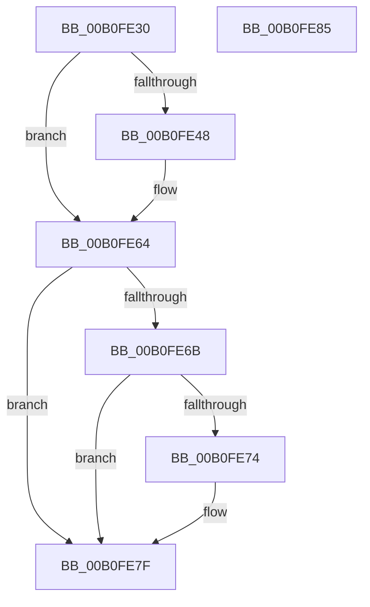

# CcMapData$fin$0

- RVA: `0x00B0FE30`–`0x00B0FE86` (길이 `86` bytes)
- VA: `0x0000000140B0FE30`
- 실행 섹션: `PAGE`
- PDB 이름 있음: `예`; PDB Function 태그: `예`
- unwind 정보 RVA: `0x00095320`
- 디코드: `25`개 명령, `86/86` bytes 표시
- 미해석 바이트: `0` (있으면 어셈블리에 `.byte`로 보존)

> 이 문서는 커널 이미지의 기계어와 PDB 기호를 분석해 생성했습니다. 4번과 5번은 함수 원형과 자료형을 바이너리 사용 방식에서 추정한 C 해석이며 원본 소스 복구 결과는 아닙니다.

## 1. Dependencies

- 직접 호출 지점: **1**; 고유 호출 대상: **1**
- 직접 호출자로 확인된 함수: **0**
- RIP 상대 이미지 참조: **0**

### Outgoing calls
- `0x00B0FE79` → [CcUnpinFileDataEx](../../text/35/CcUnpinFileDataEx_function_00359DEC.md) (function, `0x00359DEC`)

### Direct callers
- 이 함수 시작 RVA로 연결되는 직접 call은 확인되지 않았습니다. 간접 호출은 완전히 역산할 수 없습니다.

### Static image references
- 디코드된 RIP-relative 메모리 참조가 없습니다.

## 2. Other-region calls and transfers

- 다른 실행 섹션으로 향하는 call: **1**
  - `0x00B0FE79` → [CcUnpinFileDataEx](../../text/35/CcUnpinFileDataEx_function_00359DEC.md) (`PAGE` → `.text`)
- 별도 외부 분기/꼬리 이동을 확인하지 못했습니다.

## 3. Assembly (complete function range)

```asm
00B0FE30  40 55                           push rbp
00B0FE32  48 83 EC 50                     sub rsp, 0x50
00B0FE36  48 8B EA                        mov rbp, rdx
00B0FE39  88 4D 50                        mov byte ptr [rbp + 0x50], cl
00B0FE3C  F7 85 A8 00 00 00 00 01 00 00   test dword ptr [rbp + 0xa8], 0x100
00B0FE46  74 1C                           je 0x140b0fe64
00B0FE48  65 48 8B 0C 25 88 01 00 00      mov rcx, qword ptr gs:[0x188]
00B0FE51  0F B6 85 90 00 00 00            movzx eax, byte ptr [rbp + 0x90]
00B0FE58  2C 02                           sub al, 2
00B0FE5A  88 81 AD 05 00 00               mov byte ptr [rcx + 0x5ad], al
00B0FE60  0F B6 4D 50                     movzx ecx, byte ptr [rbp + 0x50]
00B0FE64  0F B6 C1                        movzx eax, cl
00B0FE67  84 C9                           test cl, cl
00B0FE69  74 14                           je 0x140b0fe7f
00B0FE6B  48 8B 4D 58                     mov rcx, qword ptr [rbp + 0x58]
00B0FE6F  48 85 C9                        test rcx, rcx
00B0FE72  74 0B                           je 0x140b0fe7f
00B0FE74  45 33 C0                        xor r8d, r8d
00B0FE77  B2 01                           mov dl, 1
00B0FE79  E8 6E 9F 84 FF                  call 0x140359dec
00B0FE7E  90                              nop
00B0FE7F  48 83 C4 50                     add rsp, 0x50
00B0FE83  5D                              pop rbp
00B0FE84  C3                              ret
00B0FE85  CC                              int3
```

## 4. C-style interpretation (structured pseudocode)

```c
__int64 __fastcall CcMapData_fin_0(unsigned __int8 a1, __int64 a2, int a3)
{
    __int64 result;
    __int64 v_rsp;

    v_rsp = (v_rsp) - (80);
    *(unsigned __int8 *)(a2 + 80) = a1;
    if (((*(unsigned int *)(a2 + 168)) & (256)) != 0) {
        a1 = *(unsigned __int64 *)(gs_base + (0 + 392));
        result = *(unsigned __int8 *)(a2 + 144);
        result = (unsigned __int8)((result) - (2));
        *(unsigned __int8 *)(a1 + 1453) = (unsigned __int8)(result);
        a1 = *(unsigned __int8 *)(a2 + 80);
    }
    if (a1 == 0) goto loc_00B0FE7F;
    result = a1;
    if (*(unsigned __int64 *)(a2 + 88) != 0) {
        a3 = 0;
        a2 = 1;
        result = CcUnpinFileDataEx(*(unsigned __int64 *)(a2 + 88), a2, a3, a4);
    }
    v_rsp = (v_rsp) + (80);
    return result;
}
```

## 5. (Beta) C Style

```c
int64_t CcMapData_fin_0(uint8_t Arg1, void *Arg2, int32_t Arg3)
{
    uint8_t *arg2 = (uint8_t *)Arg2;

    int64_t result;
    int64_t local_rsp;

    local_rsp = (local_rsp) - (80);
    *(uint8_t *)(arg2 + 0x50) = Arg1;
    if (((*(uint32_t *)(arg2 + 0xA8)) & (256)) != 0) {
        Arg1 = *(uint64_t *)(gs_base + (0 + 0x188));
        result = *(uint8_t *)(arg2 + 0x90);
        result = (uint8_t)((result) - (2));
        *(uint8_t *)(Arg1 + 0x5AD) = (uint8_t)(result);
        Arg1 = *(uint8_t *)(arg2 + 0x50);
    }
    if (Arg1 == 0) goto loc_00B0FE7F;
    result = Arg1;
    if (*(uint64_t *)(arg2 + 0x58) != 0) {
        Arg3 = 0;
        Arg2 = 1;
        result = CcUnpinFileDataEx(*(uint64_t *)(arg2 + 0x58), Arg2, Arg3, a4);
    }
    local_rsp = (local_rsp) + (80);
    return result;
}
```

### 관측된 메모리 오프셋

구조체 형식이 확인되지 않은 접근은 인자 기준의 오프셋으로만 기록했습니다.

| 기준 인자 | 오프셋 표현 | 폭 (bit) | 접근 |
|---|---:|---:|---|
| `Arg2` | `+ 0x50` | `8` | `R` |
| `Arg2` | `+ 0x50` | `8` | `W` |
| `Arg2` | `+ 0x58` | `64` | `R` |
| `Arg2` | `+ 0x90` | `8` | `R` |
| `Arg2` | `+ 0xA8` | `32` | `R` |

## 6. Execution-region graph

[열기: 2D/3D 그래프와 함수 탐색 컨트롤 패널](../../../control-panel.html?section=page&rva=0x00B0FE30&view=graph)

- 2D 그래프는 위에서 아래로 흐르고, 3D 그래프는 빈 공간을 드래그해 회전합니다. Shift+드래그는 이동, 휠은 확대·축소, 함수 노드 선택은 대상 보고서 이동입니다.

### Static fallback


