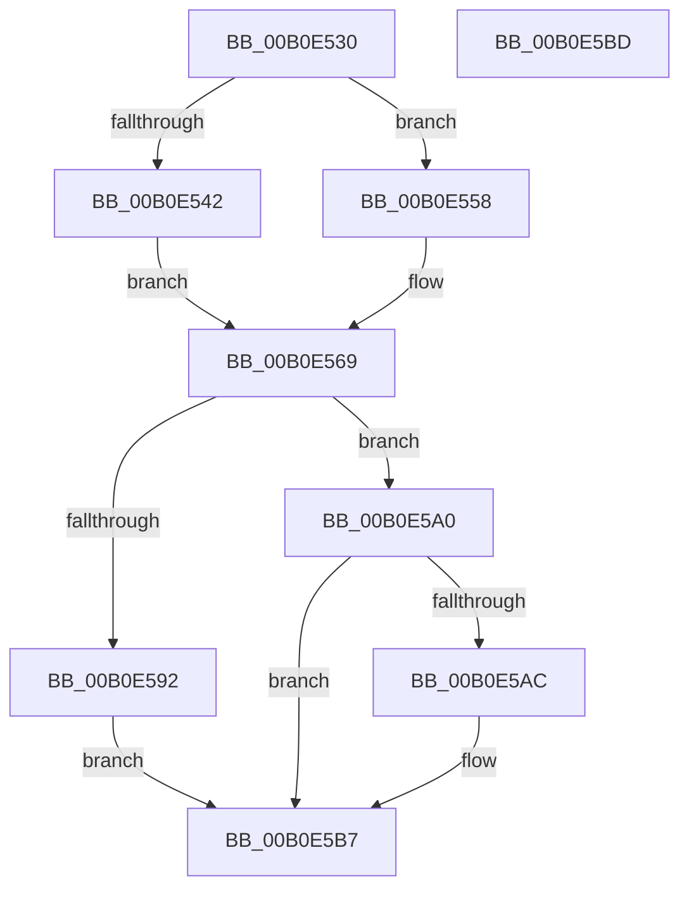

# CmQueryKey$fin$0

- RVA: `0x00B0E530`–`0x00B0E5BE` (길이 `142` bytes)
- VA: `0x0000000140B0E530`
- 실행 섹션: `PAGE`
- PDB 이름 있음: `예`; PDB Function 태그: `예`
- unwind 정보 RVA: `0x0006A920`
- 디코드: `36`개 명령, `142/142` bytes 표시
- 미해석 바이트: `0` (있으면 어셈블리에 `.byte`로 보존)

> 이 문서는 커널 이미지의 기계어와 PDB 기호를 분석해 생성했습니다. 4번과 5번은 함수 원형과 자료형을 바이너리 사용 방식에서 추정한 C 해석이며 원본 소스 복구 결과는 아닙니다.

## 1. Dependencies

- 직접 호출 지점: **7**; 고유 호출 대상: **7**
- 직접 호출자로 확인된 함수: **0**
- RIP 상대 이미지 참조: **0**

### Outgoing calls
- `0x00B0E551` → [CmpUnlockTwoKcbs](../84/CmpUnlockTwoKcbs_function_0084869C.md) (function, `0x0084869C`)
- `0x00B0E563` → [CmpUnlockKcb](../../pagecmrc/BC/CmpUnlockKcb_function_00BC92C0.md) (function, `0x00BC92C0`)
- `0x00B0E572` → [CmpDrainDelayDerefContext](../../text/41/CmpDrainDelayDerefContext_function_0041B9A0.md) (function, `0x0041B9A0`)
- `0x00B0E577` → [CmpUnlockRegistry](../../pagecmrc/BC/CmpUnlockRegistry_function_00BC9A84.md) (function, `0x00BC9A84`)
- `0x00B0E583` → [CmpDetachFromRegistryProcess](../../pagecmrc/BC/CmpDetachFromRegistryProcess_function_00BC9920.md) (function, `0x00BC9920`)
- `0x00B0E599` → [RtlFreeAnsiString](../9C/RtlFreeAnsiString_function_009C0800.md) (function, `0x009C0800`)
- `0x00B0E5B1` → [CmpFreePoolWithTag](../../text/44/CmpFreePoolWithTag_function_004489E0.md) (function, `0x004489E0`)

### Direct callers
- 이 함수 시작 RVA로 연결되는 직접 call은 확인되지 않았습니다. 간접 호출은 완전히 역산할 수 없습니다.

### Static image references
- 디코드된 RIP-relative 메모리 참조가 없습니다.

## 2. Other-region calls and transfers

- 다른 실행 섹션으로 향하는 call: **5**
  - `0x00B0E563` → [CmpUnlockKcb](../../pagecmrc/BC/CmpUnlockKcb_function_00BC92C0.md) (`PAGE` → `PAGECMRC`)
  - `0x00B0E572` → [CmpDrainDelayDerefContext](../../text/41/CmpDrainDelayDerefContext_function_0041B9A0.md) (`PAGE` → `.text`)
  - `0x00B0E577` → [CmpUnlockRegistry](../../pagecmrc/BC/CmpUnlockRegistry_function_00BC9A84.md) (`PAGE` → `PAGECMRC`)
  - `0x00B0E583` → [CmpDetachFromRegistryProcess](../../pagecmrc/BC/CmpDetachFromRegistryProcess_function_00BC9920.md) (`PAGE` → `PAGECMRC`)
  - `0x00B0E5B1` → [CmpFreePoolWithTag](../../text/44/CmpFreePoolWithTag_function_004489E0.md) (`PAGE` → `.text`)
- 별도 외부 분기/꼬리 이동을 확인하지 못했습니다.

## 3. Assembly (complete function range)

```asm
00B0E530  40 55                           push rbp
00B0E532  48 83 EC 50                     sub rsp, 0x50
00B0E536  48 8B EA                        mov rbp, rdx
00B0E539  48 8B 4D 78                     mov rcx, qword ptr [rbp + 0x78]
00B0E53D  48 85 C9                        test rcx, rcx
00B0E540  74 16                           je 0x140b0e558
00B0E542  48 8B 95 98 00 00 00            mov rdx, qword ptr [rbp + 0x98]
00B0E549  48 8B 52 08                     mov rdx, qword ptr [rdx + 8]
00B0E54D  48 8B 49 08                     mov rcx, qword ptr [rcx + 8]
00B0E551  E8 46 A1 D3 FF                  call 0x14084869c
00B0E556  EB 11                           jmp 0x140b0e569
00B0E558  48 8B 8D 98 00 00 00            mov rcx, qword ptr [rbp + 0x98]
00B0E55F  48 8B 49 08                     mov rcx, qword ptr [rcx + 8]
00B0E563  E8 58 AD 0B 00                  call 0x140bc92c0
00B0E568  90                              nop
00B0E569  33 D2                           xor edx, edx
00B0E56B  48 8D 8D C0 00 00 00            lea rcx, [rbp + 0xc0]
00B0E572  E8 29 D4 90 FF                  call 0x14041b9a0
00B0E577  E8 08 B5 0B 00                  call 0x140bc9a84
00B0E57C  48 8D 8D 10 01 00 00            lea rcx, [rbp + 0x110]
00B0E583  E8 98 B3 0B 00                  call 0x140bc9920
00B0E588  48 83 BD D8 00 00 00 00         cmp qword ptr [rbp + 0xd8], 0
00B0E590  74 0E                           je 0x140b0e5a0
00B0E592  48 8D 8D D0 00 00 00            lea rcx, [rbp + 0xd0]
00B0E599  E8 62 22 EB FF                  call 0x1409c0800
00B0E59E  EB 17                           jmp 0x140b0e5b7
00B0E5A0  48 8B 8D 88 00 00 00            mov rcx, qword ptr [rbp + 0x88]
00B0E5A7  48 85 C9                        test rcx, rcx
00B0E5AA  74 0B                           je 0x140b0e5b7
00B0E5AC  BA 43 4D 4E 62                  mov edx, 0x624e4d43
00B0E5B1  E8 2A A4 93 FF                  call 0x1404489e0
00B0E5B6  90                              nop
00B0E5B7  48 83 C4 50                     add rsp, 0x50
00B0E5BB  5D                              pop rbp
00B0E5BC  C3                              ret
00B0E5BD  CC                              int3
```

## 4. C-style interpretation (structured pseudocode)

```c
__int64 __fastcall CmQueryKey_fin_0(__int64 a1, __int64 a2)
{
    __int64 result;
    __int64 v_rsp;

    v_rsp = (v_rsp) - (80);
    if (*(unsigned __int64 *)(a2 + 120) == 0) goto loc_00B0E558;
    result = CmpUnlockTwoKcbs(*(unsigned __int64 *)(*(unsigned __int64 *)(a2 + 120) + 8), *(unsigned __int64 *)(*(unsigned __int64 *)(a2 + 152) + 8), a3, a4);
    goto loc_00B0E569;
loc_00B0E558:
    result = CmpUnlockKcb(*(unsigned __int64 *)(*(unsigned __int64 *)(a2 + 152) + 8), *(unsigned __int64 *)(*(unsigned __int64 *)(a2 + 152) + 8), a3, a4);
loc_00B0E569:
    a2 = 0;
    result = CmpDrainDelayDerefContext(a2 + 192, a2, a3, a4);
    result = CmpUnlockRegistry(a2 + 192, a2, a3, a4);
    result = CmpDetachFromRegistryProcess(a2 + 272, a2, a3, a4);
    if ((*(unsigned __int64 *)(a2 + 216)) == 0) goto loc_00B0E5A0;
    result = RtlFreeAnsiString(a2 + 208, a2, a3, a4);
    goto loc_00B0E5B7;
loc_00B0E5A0:
    if (*(unsigned __int64 *)(a2 + 136) != 0) {
        a2 = 0x624E4D43ULL;
        result = CmpFreePoolWithTag(*(unsigned __int64 *)(a2 + 136), a2, a3, a4);
    }
    v_rsp = (v_rsp) + (80);
    return result;
}
```

## 5. (Beta) C Style

```c
int64_t CmQueryKey_fin_0(int64_t Arg1, void *Arg2)
{
    uint8_t *arg2 = (uint8_t *)Arg2;

    int64_t result;
    int64_t local_rsp;

    local_rsp = (local_rsp) - (80);
    if (*(uint64_t *)(arg2 + 0x78) == 0) goto loc_00B0E558;
    result = CmpUnlockTwoKcbs(*(uint64_t *)(*(uint64_t *)(arg2 + 0x78) + 0x8), *(uint64_t *)(*(uint64_t *)(arg2 + 0x98) + 0x8), a3, a4);
    goto loc_00B0E569;
loc_00B0E558:
    result = CmpUnlockKcb(*(uint64_t *)(*(uint64_t *)(arg2 + 0x98) + 0x8), *(uint64_t *)(*(uint64_t *)(arg2 + 0x98) + 0x8), a3, a4);
loc_00B0E569:
    Arg2 = 0;
    result = CmpDrainDelayDerefContext(Arg2 + 192, Arg2, a3, a4);
    result = CmpUnlockRegistry(Arg2 + 192, Arg2, a3, a4);
    result = CmpDetachFromRegistryProcess(Arg2 + 272, Arg2, a3, a4);
    if ((*(uint64_t *)(arg2 + 0xD8)) == 0) goto loc_00B0E5A0;
    result = RtlFreeAnsiString(Arg2 + 208, Arg2, a3, a4);
    goto loc_00B0E5B7;
loc_00B0E5A0:
    if (*(uint64_t *)(arg2 + 0x88) != 0) {
        Arg2 = 0x624E4D43ULL;
        result = CmpFreePoolWithTag(*(uint64_t *)(arg2 + 0x88), Arg2, a3, a4);
    }
    local_rsp = (local_rsp) + (80);
    return result;
}
```

### 관측된 메모리 오프셋

구조체 형식이 확인되지 않은 접근은 인자 기준의 오프셋으로만 기록했습니다.

| 기준 인자 | 오프셋 표현 | 폭 (bit) | 접근 |
|---|---:|---:|---|
| `Arg2` | `+ 0x78` | `64` | `R` |
| `Arg2` | `+ 0x88` | `64` | `R` |
| `Arg2` | `+ 0x98` | `64` | `R` |
| `Arg2` | `+ 0xC0` | `64` | `R` |
| `Arg2` | `+ 0xD0` | `64` | `R` |
| `Arg2` | `+ 0xD8` | `64` | `R` |
| `Arg2` | `+ 0x110` | `64` | `R` |

## 6. Execution-region graph

[열기: 2D/3D 그래프와 함수 탐색 컨트롤 패널](../../../control-panel.html?section=page&rva=0x00B0E530&view=graph)

- 2D 그래프는 위에서 아래로 흐르고, 3D 그래프는 빈 공간을 드래그해 회전합니다. Shift+드래그는 이동, 휠은 확대·축소, 함수 노드 선택은 대상 보고서 이동입니다.

### Static fallback


