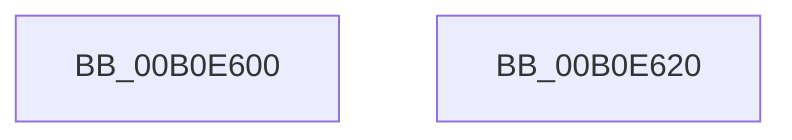

# CmpCallCallBacksEx$filt$1

- RVA: `0x00B0E600`–`0x00B0E621` (길이 `33` bytes)
- VA: `0x0000000140B0E600`
- 실행 섹션: `PAGE`
- PDB 이름 있음: `예`; PDB Function 태그: `예`
- unwind 정보 RVA: `0x0006BC1C`
- 디코드: `11`개 명령, `33/33` bytes 표시
- 미해석 바이트: `0` (있으면 어셈블리에 `.byte`로 보존)

> 이 문서는 커널 이미지의 기계어와 PDB 기호를 분석해 생성했습니다. 4번과 5번은 함수 원형과 자료형을 바이너리 사용 방식에서 추정한 C 해석이며 원본 소스 복구 결과는 아닙니다.

## 1. Dependencies

- 직접 호출 지점: **1**; 고유 호출 대상: **1**
- 직접 호출자로 확인된 함수: **0**
- RIP 상대 이미지 참조: **0**

### Outgoing calls
- `0x00B0E614` → [CmpCallbackFatalFilter](../7E/CmpCallbackFatalFilter_function_007E189C.md) (function, `0x007E189C`)

### Direct callers
- 이 함수 시작 RVA로 연결되는 직접 call은 확인되지 않았습니다. 간접 호출은 완전히 역산할 수 없습니다.

### Static image references
- 디코드된 RIP-relative 메모리 참조가 없습니다.

## 2. Other-region calls and transfers

- 다른 실행 섹션으로 향하는 call: **0**
- 별도 외부 분기/꼬리 이동을 확인하지 못했습니다.

## 3. Assembly (complete function range)

```asm
00B0E600  40 55                           push rbp
00B0E602  48 83 EC 20                     sub rsp, 0x20
00B0E606  48 8B EA                        mov rbp, rdx
00B0E609  48 89 8D B8 00 00 00            mov qword ptr [rbp + 0xb8], rcx
00B0E610  48 8B 55 38                     mov rdx, qword ptr [rbp + 0x38]
00B0E614  E8 83 32 CD FF                  call 0x1407e189c
00B0E619  90                              nop
00B0E61A  48 83 C4 20                     add rsp, 0x20
00B0E61E  5D                              pop rbp
00B0E61F  C3                              ret
00B0E620  CC                              int3
```

## 4. C-style interpretation (structured pseudocode)

```c
__int64 __fastcall CmpCallCallBacksEx_filt_1(__int64 a1, __int64 a2)
{
    __int64 result;
    __int64 v_rsp;

    v_rsp = (v_rsp) - (32);
    *(unsigned __int64 *)(a2 + 184) = a1;
    result = CmpCallbackFatalFilter(a1, *(unsigned __int64 *)(a2 + 56), a3, a4);
    v_rsp = (v_rsp) + (32);
    return result;
}
```

## 5. (Beta) C Style

```c
int64_t CmpCallCallBacksEx_filt_1(int64_t Arg1, void *Arg2)
{
    uint8_t *arg2 = (uint8_t *)Arg2;

    int64_t result;
    int64_t local_rsp;

    local_rsp = (local_rsp) - (32);
    *(uint64_t *)(arg2 + 0xB8) = Arg1;
    result = CmpCallbackFatalFilter(Arg1, *(uint64_t *)(arg2 + 0x38), a3, a4);
    local_rsp = (local_rsp) + (32);
    return result;
}
```

### 관측된 메모리 오프셋

구조체 형식이 확인되지 않은 접근은 인자 기준의 오프셋으로만 기록했습니다.

| 기준 인자 | 오프셋 표현 | 폭 (bit) | 접근 |
|---|---:|---:|---|
| `Arg2` | `+ 0x38` | `64` | `R` |
| `Arg2` | `+ 0xB8` | `64` | `W` |

## 6. Execution-region graph

[열기: 2D/3D 그래프와 함수 탐색 컨트롤 패널](../../../control-panel.html?section=page&rva=0x00B0E600&view=graph)

- 2D 그래프는 위에서 아래로 흐르고, 3D 그래프는 빈 공간을 드래그해 회전합니다. Shift+드래그는 이동, 휠은 확대·축소, 함수 노드 선택은 대상 보고서 이동입니다.

### Static fallback


