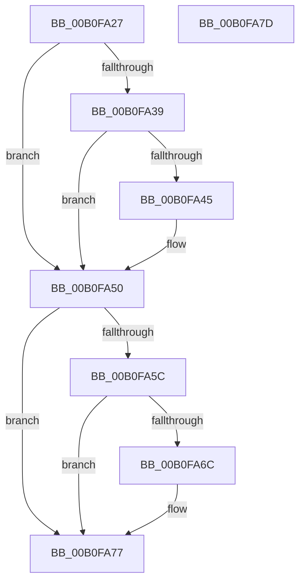

# ExpGetProcessInformation$fin$12

- RVA: `0x00B0FA27`–`0x00B0FA7E` (길이 `87` bytes)
- VA: `0x0000000140B0FA27`
- 실행 섹션: `PAGE`
- PDB 이름 있음: `예`; PDB Function 태그: `예`
- unwind 정보 RVA: `0x0008AFC4`
- 디코드: `25`개 명령, `87/87` bytes 표시
- 미해석 바이트: `0` (있으면 어셈블리에 `.byte`로 보존)

> 이 문서는 커널 이미지의 기계어와 PDB 기호를 분석해 생성했습니다. 4번과 5번은 함수 원형과 자료형을 바이너리 사용 방식에서 추정한 C 해석이며 원본 소스 복구 결과는 아닙니다.

## 1. Dependencies

- 직접 호출 지점: **2**; 고유 호출 대상: **1**
- 직접 호출자로 확인된 함수: **0**
- RIP 상대 이미지 참조: **1**

### Outgoing calls
- `0x00B0FA4A` → [ObfDereferenceObjectWithTag](../../text/2F/ObfDereferenceObjectWithTag_function_002F78E0.md) (function, `0x002F78E0`)
- `0x00B0FA71` → [ObfDereferenceObjectWithTag](../../text/2F/ObfDereferenceObjectWithTag_function_002F78E0.md) (function, `0x002F78E0`)

### Direct callers
- 이 함수 시작 RVA로 연결되는 직접 call은 확인되지 않았습니다. 간접 호출은 완전히 역산할 수 없습니다.

### Static image references
- `0x00B0FA39` → RVA `0x00FC6B70` (`ALMOSTRO`; read)

## 2. Other-region calls and transfers

- 다른 실행 섹션으로 향하는 call: **2**
  - `0x00B0FA4A` → [ObfDereferenceObjectWithTag](../../text/2F/ObfDereferenceObjectWithTag_function_002F78E0.md) (`PAGE` → `.text`)
  - `0x00B0FA71` → [ObfDereferenceObjectWithTag](../../text/2F/ObfDereferenceObjectWithTag_function_002F78E0.md) (`PAGE` → `.text`)
- 별도 외부 분기/꼬리 이동을 확인하지 못했습니다.

## 3. Assembly (complete function range)

```asm
00B0FA27  40 55                           push rbp
00B0FA29  48 83 EC 30                     sub rsp, 0x30
00B0FA2D  48 8B EA                        mov rbp, rdx
00B0FA30  48 8B 4D 60                     mov rcx, qword ptr [rbp + 0x60]
00B0FA34  48 85 C9                        test rcx, rcx
00B0FA37  74 17                           je 0x140b0fa50
00B0FA39  48 8B 05 30 71 4B 00            mov rax, qword ptr [rip + 0x4b7130]
00B0FA40  48 3B C8                        cmp rcx, rax
00B0FA43  74 0B                           je 0x140b0fa50
00B0FA45  BA 50 73 45 6E                  mov edx, 0x6e457350
00B0FA4A  E8 91 7E 7E FF                  call 0x1402f78e0
00B0FA4F  90                              nop
00B0FA50  48 8B 8D 88 00 00 00            mov rcx, qword ptr [rbp + 0x88]
00B0FA57  48 85 C9                        test rcx, rcx
00B0FA5A  74 1B                           je 0x140b0fa77
00B0FA5C  48 8B 05 0D 71 4B 00            mov rax, qword ptr [rip + 0x4b710d]
00B0FA63  48 39 81 20 02 00 00            cmp qword ptr [rcx + 0x220], rax
00B0FA6A  74 0B                           je 0x140b0fa77
00B0FA6C  BA 50 73 45 6E                  mov edx, 0x6e457350
00B0FA71  E8 6A 7E 7E FF                  call 0x1402f78e0
00B0FA76  90                              nop
00B0FA77  48 83 C4 30                     add rsp, 0x30
00B0FA7B  5D                              pop rbp
00B0FA7C  C3                              ret
00B0FA7D  CC                              int3
```

## 4. C-style interpretation (structured pseudocode)

```c
__int64 __fastcall ExpGetProcessInformation_fin_12(__int64 a1, __int64 a2)
{
    __int64 result;
    __int64 v_rsp;

    v_rsp = (v_rsp) - (48);
    if (*(unsigned __int64 *)(a2 + 96) == 0) goto loc_00B0FA50;
    result = *(unsigned __int64 *)(v_rip + 4944176);
    if ((*(unsigned __int64 *)(a2 + 96)) != (*(unsigned __int64 *)(v_rip + 4944176))) {
        a2 = 0x6E457350ULL;
        result = ObfDereferenceObjectWithTag(*(unsigned __int64 *)(a2 + 96), a2, a3, a4);
    }
    if (*(unsigned __int64 *)(a2 + 136) == 0) goto loc_00B0FA77;
    result = *(unsigned __int64 *)(v_rip + 4944141);
    if ((*(unsigned __int64 *)(*(unsigned __int64 *)(a2 + 136) + 544)) != (*(unsigned __int64 *)(v_rip + 4944141))) {
        a2 = 0x6E457350ULL;
        result = ObfDereferenceObjectWithTag(*(unsigned __int64 *)(a2 + 136), a2, a3, a4);
    }
    v_rsp = (v_rsp) + (48);
    return result;
}
```

## 5. (Beta) C Style

```c
int64_t ExpGetProcessInformation_fin_12(int64_t Arg1, void *Arg2)
{
    uint8_t *arg2 = (uint8_t *)Arg2;

    int64_t result;
    int64_t local_rsp;

    local_rsp = (local_rsp) - (48);
    if (*(uint64_t *)(arg2 + 0x60) == 0) goto loc_00B0FA50;
    result = *(uint64_t *)(v_rip + 0x4B7130);
    if ((*(uint64_t *)(arg2 + 0x60)) != (*(uint64_t *)(v_rip + 0x4B7130))) {
        Arg2 = 0x6E457350ULL;
        result = ObfDereferenceObjectWithTag(*(uint64_t *)(arg2 + 0x60), Arg2, a3, a4);
    }
    if (*(uint64_t *)(arg2 + 0x88) == 0) goto loc_00B0FA77;
    result = *(uint64_t *)(v_rip + 0x4B710D);
    if ((*(uint64_t *)(*(uint64_t *)(arg2 + 0x88) + 0x220)) != (*(uint64_t *)(v_rip + 0x4B710D))) {
        Arg2 = 0x6E457350ULL;
        result = ObfDereferenceObjectWithTag(*(uint64_t *)(arg2 + 0x88), Arg2, a3, a4);
    }
    local_rsp = (local_rsp) + (48);
    return result;
}
```

### 관측된 메모리 오프셋

구조체 형식이 확인되지 않은 접근은 인자 기준의 오프셋으로만 기록했습니다.

| 기준 인자 | 오프셋 표현 | 폭 (bit) | 접근 |
|---|---:|---:|---|
| `Arg2` | `+ 0x60` | `64` | `R` |
| `Arg2` | `+ 0x88` | `64` | `R` |

## 6. Execution-region graph

[열기: 2D/3D 그래프와 함수 탐색 컨트롤 패널](../../../control-panel.html?section=page&rva=0x00B0FA27&view=graph)

- 2D 그래프는 위에서 아래로 흐르고, 3D 그래프는 빈 공간을 드래그해 회전합니다. Shift+드래그는 이동, 휠은 확대·축소, 함수 노드 선택은 대상 보고서 이동입니다.

### Static fallback


