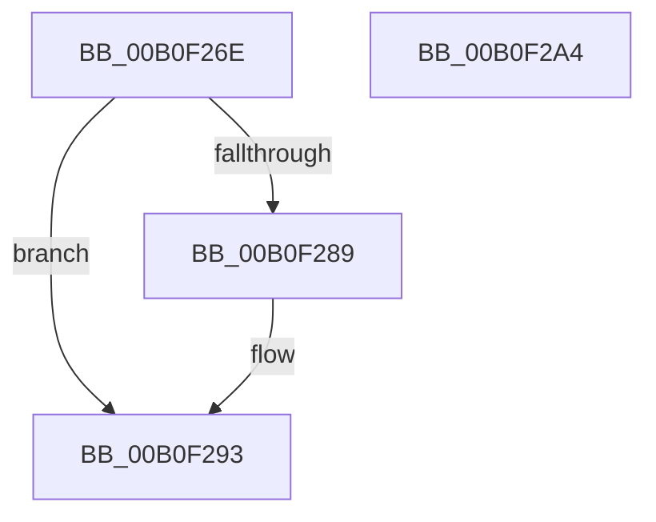

# ExpWnfReadStateData$fin$0

- RVA: `0x00B0F26E`–`0x00B0F2A5` (길이 `55` bytes)
- VA: `0x0000000140B0F26E`
- 실행 섹션: `PAGE`
- PDB 이름 있음: `예`; PDB Function 태그: `예`
- unwind 정보 RVA: `0x00089050`
- 디코드: `20`개 명령, `55/55` bytes 표시
- 미해석 바이트: `0` (있으면 어셈블리에 `.byte`로 보존)

> 이 문서는 커널 이미지의 기계어와 PDB 기호를 분석해 생성했습니다. 4번과 5번은 함수 원형과 자료형을 바이너리 사용 방식에서 추정한 C 해석이며 원본 소스 복구 결과는 아닙니다.

## 1. Dependencies

- 직접 호출 지점: **2**; 고유 호출 대상: **2**
- 직접 호출자로 확인된 함수: **0**
- RIP 상대 이미지 참조: **0**

### Outgoing calls
- `0x00B0F28D` → [ExfReleasePushLockShared](../../text/26/ExfReleasePushLockShared_function_00263440.md) (function, `0x00263440`)
- `0x00B0F297` → [KeAbPostRelease](../../text/2E/KeAbPostRelease_function_002E1600.md) (function, `0x002E1600`)

### Direct callers
- 이 함수 시작 RVA로 연결되는 직접 call은 확인되지 않았습니다. 간접 호출은 완전히 역산할 수 없습니다.

### Static image references
- 디코드된 RIP-relative 메모리 참조가 없습니다.

## 2. Other-region calls and transfers

- 다른 실행 섹션으로 향하는 call: **2**
  - `0x00B0F28D` → [ExfReleasePushLockShared](../../text/26/ExfReleasePushLockShared_function_00263440.md) (`PAGE` → `.text`)
  - `0x00B0F297` → [KeAbPostRelease](../../text/2E/KeAbPostRelease_function_002E1600.md) (`PAGE` → `.text`)
- 별도 외부 분기/꼬리 이동을 확인하지 못했습니다.

## 3. Assembly (complete function range)

```asm
00B0F26E  40 53                           push rbx
00B0F270  55                              push rbp
00B0F271  48 83 EC 28                     sub rsp, 0x28
00B0F275  48 8B EA                        mov rbp, rdx
00B0F278  48 8B 5D 70                     mov rbx, qword ptr [rbp + 0x70]
00B0F27C  33 C9                           xor ecx, ecx
00B0F27E  8D 41 11                        lea eax, [rcx + 0x11]
00B0F281  F0 48 0F B1 4B 50               lock cmpxchg qword ptr [rbx + 0x50], rcx
00B0F287  74 0A                           je 0x140b0f293
00B0F289  48 8D 4B 50                     lea rcx, [rbx + 0x50]
00B0F28D  E8 AE 41 75 FF                  call 0x140263440
00B0F292  90                              nop
00B0F293  48 8D 4B 50                     lea rcx, [rbx + 0x50]
00B0F297  E8 64 23 7D FF                  call 0x1402e1600
00B0F29C  90                              nop
00B0F29D  48 83 C4 28                     add rsp, 0x28
00B0F2A1  5D                              pop rbp
00B0F2A2  5B                              pop rbx
00B0F2A3  C3                              ret
00B0F2A4  CC                              int3
```

## 4. C-style interpretation (structured pseudocode)

```c
__int64 __fastcall ExpWnfReadStateData_fin_0(int a1, __int64 a2)
{
    __int64 result;
    __int64 v_rsp;

    v_rsp = (v_rsp) - (40);
    a1 = 0;
    result = a1 + 17;
    if (!(condition_is_equal)) {
        a1 = *(unsigned __int64 *)(a2 + 112) + 80;
        result = ExfReleasePushLockShared(a1, a2, a3, a4);
    }
    result = KeAbPostRelease(*(unsigned __int64 *)(a2 + 112) + 80, a2, a3, a4);
    v_rsp = (v_rsp) + (40);
    return result;
}
```

## 5. (Beta) C Style

```c
int64_t ExpWnfReadStateData_fin_0(int32_t Arg1, void *Arg2)
{
    uint8_t *arg2 = (uint8_t *)Arg2;

    int64_t result;
    int64_t local_rsp;

    local_rsp = (local_rsp) - (40);
    Arg1 = 0;
    result = Arg1 + 17;
    if (!(condition_is_equal)) {
        Arg1 = *(uint64_t *)(arg2 + 0x70) + 80;
        result = ExfReleasePushLockShared(Arg1, Arg2, a3, a4);
    }
    result = KeAbPostRelease(*(uint64_t *)(arg2 + 0x70) + 80, Arg2, a3, a4);
    local_rsp = (local_rsp) + (40);
    return result;
}
```

### 관측된 메모리 오프셋

구조체 형식이 확인되지 않은 접근은 인자 기준의 오프셋으로만 기록했습니다.

| 기준 인자 | 오프셋 표현 | 폭 (bit) | 접근 |
|---|---:|---:|---|
| `Arg2` | `+ 0x70` | `64` | `R` |

## 6. Execution-region graph

[열기: 2D/3D 그래프와 함수 탐색 컨트롤 패널](../../../control-panel.html?section=page&rva=0x00B0F26E&view=graph)

- 2D 그래프는 위에서 아래로 흐르고, 3D 그래프는 빈 공간을 드래그해 회전합니다. Shift+드래그는 이동, 휠은 확대·축소, 함수 노드 선택은 대상 보고서 이동입니다.

### Static fallback


