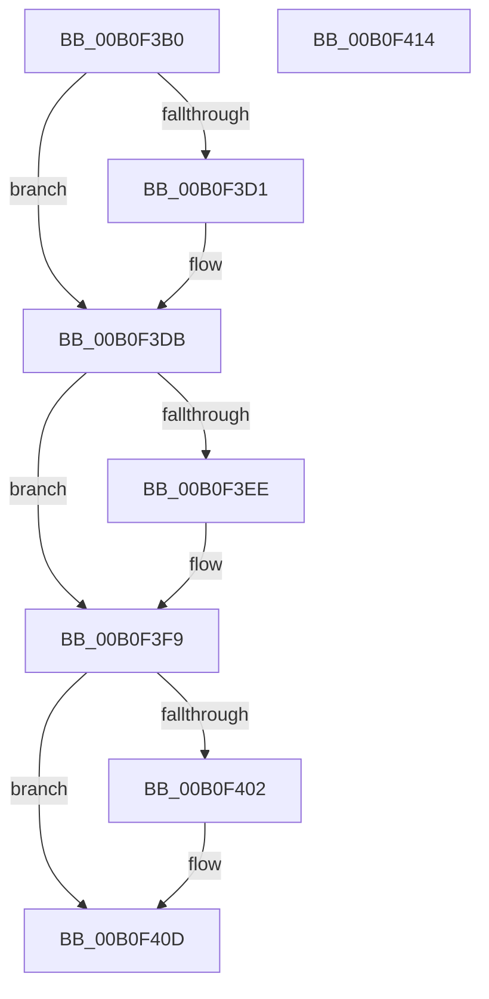

# ExpWnfWriteStateData$fin$0

- RVA: `0x00B0F3B0`–`0x00B0F415` (길이 `101` bytes)
- VA: `0x0000000140B0F3B0`
- 실행 섹션: `PAGE`
- PDB 이름 있음: `예`; PDB Function 태그: `예`
- unwind 정보 RVA: `0x000891E8`
- 디코드: `32`개 명령, `101/101` bytes 표시
- 미해석 바이트: `0` (있으면 어셈블리에 `.byte`로 보존)

> 이 문서는 커널 이미지의 기계어와 PDB 기호를 분석해 생성했습니다. 4번과 5번은 함수 원형과 자료형을 바이너리 사용 방식에서 추정한 C 해석이며 원본 소스 복구 결과는 아닙니다.

## 1. Dependencies

- 직접 호출 지점: **4**; 고유 호출 대상: **3**
- 직접 호출자로 확인된 함수: **0**
- RIP 상대 이미지 참조: **0**

### Outgoing calls
- `0x00B0F3D5` → [ExfTryToWakePushLock](../../text/26/ExfTryToWakePushLock_function_00265DD0.md) (function, `0x00265DD0`)
- `0x00B0F3DF` → [KeAbPostRelease](../../text/2E/KeAbPostRelease_function_002E1600.md) (function, `0x002E1600`)
- `0x00B0F3F3` → [ExFreePoolWithTag](../../poolcode/B8/ExFreePoolWithTag_function_00B82870.md) (function, `0x00B82870`)
- `0x00B0F407` → [ExFreePoolWithTag](../../poolcode/B8/ExFreePoolWithTag_function_00B82870.md) (function, `0x00B82870`)

### Direct callers
- 이 함수 시작 RVA로 연결되는 직접 call은 확인되지 않았습니다. 간접 호출은 완전히 역산할 수 없습니다.

### Static image references
- 디코드된 RIP-relative 메모리 참조가 없습니다.

## 2. Other-region calls and transfers

- 다른 실행 섹션으로 향하는 call: **4**
  - `0x00B0F3D5` → [ExfTryToWakePushLock](../../text/26/ExfTryToWakePushLock_function_00265DD0.md) (`PAGE` → `.text`)
  - `0x00B0F3DF` → [KeAbPostRelease](../../text/2E/KeAbPostRelease_function_002E1600.md) (`PAGE` → `.text`)
  - `0x00B0F3F3` → [ExFreePoolWithTag](../../poolcode/B8/ExFreePoolWithTag_function_00B82870.md) (`PAGE` → `POOLCODE`)
  - `0x00B0F407` → [ExFreePoolWithTag](../../poolcode/B8/ExFreePoolWithTag_function_00B82870.md) (`PAGE` → `POOLCODE`)
- 별도 외부 분기/꼬리 이동을 확인하지 못했습니다.

## 3. Assembly (complete function range)

```asm
00B0F3B0  40 53                           push rbx
00B0F3B2  55                              push rbp
00B0F3B3  48 83 EC 38                     sub rsp, 0x38
00B0F3B7  48 8B EA                        mov rbp, rdx
00B0F3BA  48 8B 5D 78                     mov rbx, qword ptr [rbp + 0x78]
00B0F3BE  48 C7 C0 FF FF FF FF            mov rax, 0xffffffffffffffff
00B0F3C5  F0 48 0F C1 43 50               lock xadd qword ptr [rbx + 0x50], rax
00B0F3CB  24 06                           and al, 6
00B0F3CD  3C 02                           cmp al, 2
00B0F3CF  75 0A                           jne 0x140b0f3db
00B0F3D1  48 8D 4B 50                     lea rcx, [rbx + 0x50]
00B0F3D5  E8 F6 69 75 FF                  call 0x140265dd0
00B0F3DA  90                              nop
00B0F3DB  48 8D 4B 50                     lea rcx, [rbx + 0x50]
00B0F3DF  E8 1C 22 7D FF                  call 0x1402e1600
00B0F3E4  48 8B 4D 40                     mov rcx, qword ptr [rbp + 0x40]
00B0F3E8  48 83 F9 02                     cmp rcx, 2
00B0F3EC  72 0B                           jb 0x140b0f3f9
00B0F3EE  BA 57 6E 66 20                  mov edx, 0x20666e57
00B0F3F3  E8 78 34 07 00                  call 0x140b82870
00B0F3F8  90                              nop
00B0F3F9  48 8B 4D 38                     mov rcx, qword ptr [rbp + 0x38]
00B0F3FD  48 85 C9                        test rcx, rcx
00B0F400  74 0B                           je 0x140b0f40d
00B0F402  BA 57 6E 66 20                  mov edx, 0x20666e57
00B0F407  E8 64 34 07 00                  call 0x140b82870
00B0F40C  90                              nop
00B0F40D  48 83 C4 38                     add rsp, 0x38
00B0F411  5D                              pop rbp
00B0F412  5B                              pop rbx
00B0F413  C3                              ret
00B0F414  CC                              int3
```

## 4. C-style interpretation (structured pseudocode)

```c
__int64 __fastcall ExpWnfWriteStateData_fin_0(__int64 a1, __int64 a2)
{
    __int64 result;
    __int64 v_rsp;

    v_rsp = (v_rsp) - (56);
    result = (unsigned __int8)((-1) & (6));
    if (((unsigned __int8)(result)) == 2) {
        a1 = *(unsigned __int64 *)(a2 + 120) + 80;
        result = ExfTryToWakePushLock(a1, a2, a3, a4);
    }
    result = KeAbPostRelease(*(unsigned __int64 *)(a2 + 120) + 80, a2, a3, a4);
    if ((*(unsigned __int64 *)(a2 + 64)) >= 2) {
        a2 = 0x20666E57ULL;
        result = ExFreePoolWithTag(*(unsigned __int64 *)(a2 + 64), a2, a3, a4);
    }
    if (*(unsigned __int64 *)(a2 + 56) != 0) {
        a2 = 0x20666E57ULL;
        result = ExFreePoolWithTag(*(unsigned __int64 *)(a2 + 56), a2, a3, a4);
    }
    v_rsp = (v_rsp) + (56);
    return result;
}
```

## 5. (Beta) C Style

```c
int64_t ExpWnfWriteStateData_fin_0(int64_t Arg1, void *Arg2)
{
    uint8_t *arg2 = (uint8_t *)Arg2;

    int64_t result;
    int64_t local_rsp;

    local_rsp = (local_rsp) - (56);
    result = (uint8_t)((-1) & (6));
    if (((uint8_t)(result)) == 2) {
        Arg1 = *(uint64_t *)(arg2 + 0x78) + 80;
        result = ExfTryToWakePushLock(Arg1, Arg2, a3, a4);
    }
    result = KeAbPostRelease(*(uint64_t *)(arg2 + 0x78) + 80, Arg2, a3, a4);
    if ((*(uint64_t *)(arg2 + 0x40)) >= 2) {
        Arg2 = 0x20666E57ULL;
        result = ExFreePoolWithTag(*(uint64_t *)(arg2 + 0x40), Arg2, a3, a4);
    }
    if (*(uint64_t *)(arg2 + 0x38) != 0) {
        Arg2 = 0x20666E57ULL;
        result = ExFreePoolWithTag(*(uint64_t *)(arg2 + 0x38), Arg2, a3, a4);
    }
    local_rsp = (local_rsp) + (56);
    return result;
}
```

### 관측된 메모리 오프셋

구조체 형식이 확인되지 않은 접근은 인자 기준의 오프셋으로만 기록했습니다.

| 기준 인자 | 오프셋 표현 | 폭 (bit) | 접근 |
|---|---:|---:|---|
| `Arg2` | `+ 0x38` | `64` | `R` |
| `Arg2` | `+ 0x40` | `64` | `R` |
| `Arg2` | `+ 0x78` | `64` | `R` |

## 6. Execution-region graph

[열기: 2D/3D 그래프와 함수 탐색 컨트롤 패널](../../../control-panel.html?section=page&rva=0x00B0F3B0&view=graph)

- 2D 그래프는 위에서 아래로 흐르고, 3D 그래프는 빈 공간을 드래그해 회전합니다. Shift+드래그는 이동, 휠은 확대·축소, 함수 노드 선택은 대상 보고서 이동입니다.

### Static fallback


