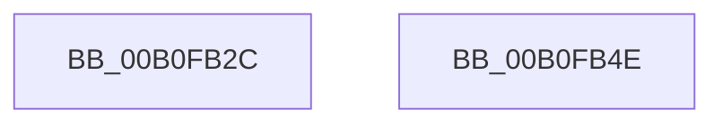

# FsRtlFindInTunnelCacheEx$fin$0

- RVA: `0x00B0FB2C`–`0x00B0FB4F` (길이 `35` bytes)
- VA: `0x0000000140B0FB2C`
- 실행 섹션: `PAGE`
- PDB 이름 있음: `예`; PDB Function 태그: `예`
- unwind 정보 RVA: `0x0008F588`
- 디코드: `12`개 명령, `35/35` bytes 표시
- 미해석 바이트: `0` (있으면 어셈블리에 `.byte`로 보존)

> 이 문서는 커널 이미지의 기계어와 PDB 기호를 분석해 생성했습니다. 4번과 5번은 함수 원형과 자료형을 바이너리 사용 방식에서 추정한 C 해석이며 원본 소스 복구 결과는 아닙니다.

## 1. Dependencies

- 직접 호출 지점: **2**; 고유 호출 대상: **2**
- 직접 호출자로 확인된 함수: **0**
- RIP 상대 이미지 참조: **0**

### Outgoing calls
- `0x00B0FB39` → [ExReleaseFastMutex](../../text/25/ExReleaseFastMutex_function_002519C0.md) (function, `0x002519C0`)
- `0x00B0FB42` → [FsRtlEmptyFreePoolList](../../text/38/FsRtlEmptyFreePoolList_function_00386D30.md) (function, `0x00386D30`)

### Direct callers
- 이 함수 시작 RVA로 연결되는 직접 call은 확인되지 않았습니다. 간접 호출은 완전히 역산할 수 없습니다.

### Static image references
- 디코드된 RIP-relative 메모리 참조가 없습니다.

## 2. Other-region calls and transfers

- 다른 실행 섹션으로 향하는 call: **2**
  - `0x00B0FB39` → [ExReleaseFastMutex](../../text/25/ExReleaseFastMutex_function_002519C0.md) (`PAGE` → `.text`)
  - `0x00B0FB42` → [FsRtlEmptyFreePoolList](../../text/38/FsRtlEmptyFreePoolList_function_00386D30.md) (`PAGE` → `.text`)
- 별도 외부 분기/꼬리 이동을 확인하지 못했습니다.

## 3. Assembly (complete function range)

```asm
00B0FB2C  40 55                           push rbp
00B0FB2E  48 83 EC 20                     sub rsp, 0x20
00B0FB32  48 8B EA                        mov rbp, rdx
00B0FB35  48 8B 4D 60                     mov rcx, qword ptr [rbp + 0x60]
00B0FB39  E8 82 1E 74 FF                  call 0x1402519c0
00B0FB3E  48 8D 4D 20                     lea rcx, [rbp + 0x20]
00B0FB42  E8 E9 71 87 FF                  call 0x140386d30
00B0FB47  90                              nop
00B0FB48  48 83 C4 20                     add rsp, 0x20
00B0FB4C  5D                              pop rbp
00B0FB4D  C3                              ret
00B0FB4E  CC                              int3
```

## 4. C-style interpretation (structured pseudocode)

```c
__int64 __fastcall FsRtlFindInTunnelCacheEx_fin_0(__int64 a1, __int64 a2)
{
    __int64 result;
    __int64 v_rsp;

    v_rsp = (v_rsp) - (32);
    result = ExReleaseFastMutex(*(unsigned __int64 *)(a2 + 96), a2, a3, a4);
    result = FsRtlEmptyFreePoolList(a2 + 32, a2, a3, a4);
    v_rsp = (v_rsp) + (32);
    return result;
}
```

## 5. (Beta) C Style

```c
int64_t FsRtlFindInTunnelCacheEx_fin_0(int64_t Arg1, void *Arg2)
{
    uint8_t *arg2 = (uint8_t *)Arg2;

    int64_t result;
    int64_t local_rsp;

    local_rsp = (local_rsp) - (32);
    result = ExReleaseFastMutex(*(uint64_t *)(arg2 + 0x60), Arg2, a3, a4);
    result = FsRtlEmptyFreePoolList(Arg2 + 32, Arg2, a3, a4);
    local_rsp = (local_rsp) + (32);
    return result;
}
```

### 관측된 메모리 오프셋

구조체 형식이 확인되지 않은 접근은 인자 기준의 오프셋으로만 기록했습니다.

| 기준 인자 | 오프셋 표현 | 폭 (bit) | 접근 |
|---|---:|---:|---|
| `Arg2` | `+ 0x20` | `64` | `R` |
| `Arg2` | `+ 0x60` | `64` | `R` |

## 6. Execution-region graph

[열기: 2D/3D 그래프와 함수 탐색 컨트롤 패널](../../../control-panel.html?section=page&rva=0x00B0FB2C&view=graph)

- 2D 그래프는 위에서 아래로 흐르고, 3D 그래프는 빈 공간을 드래그해 회전합니다. Shift+드래그는 이동, 휠은 확대·축소, 함수 노드 선택은 대상 보고서 이동입니다.

### Static fallback


