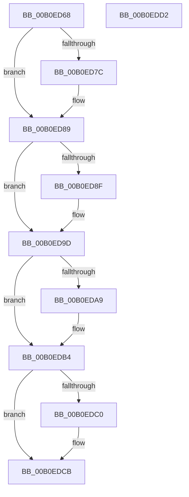

# NtSetInformationThread$fin$1

- RVA: `0x00B0ED68`–`0x00B0EDD3` (길이 `107` bytes)
- VA: `0x0000000140B0ED68`
- 실행 섹션: `PAGE`
- PDB 이름 있음: `예`; PDB Function 태그: `예`
- unwind 정보 RVA: `0x00084498`
- 디코드: `34`개 명령, `107/107` bytes 표시
- 미해석 바이트: `0` (있으면 어셈블리에 `.byte`로 보존)

> 이 문서는 커널 이미지의 기계어와 PDB 기호를 분석해 생성했습니다. 4번과 5번은 함수 원형과 자료형을 바이너리 사용 방식에서 추정한 C 해석이며 원본 소스 복구 결과는 아닙니다.

## 1. Dependencies

- 직접 호출 지점: **4**; 고유 호출 대상: **3**
- 직접 호출자로 확인된 함수: **0**
- RIP 상대 이미지 참조: **0**

### Outgoing calls
- `0x00B0ED83` → [PspUnlockThreadSecurityExclusive](../../text/4E/PspUnlockThreadSecurityExclusive_function_004E97C0.md) (function, `0x004E97C0`)
- `0x00B0ED97` → [ObfDereferenceObjectWithTag](../../text/2F/ObfDereferenceObjectWithTag_function_002F78E0.md) (function, `0x002F78E0`)
- `0x00B0EDAE` → [ExFreePoolWithTag](../../poolcode/B8/ExFreePoolWithTag_function_00B82870.md) (function, `0x00B82870`)
- `0x00B0EDC5` → [ExFreePoolWithTag](../../poolcode/B8/ExFreePoolWithTag_function_00B82870.md) (function, `0x00B82870`)

### Direct callers
- 이 함수 시작 RVA로 연결되는 직접 call은 확인되지 않았습니다. 간접 호출은 완전히 역산할 수 없습니다.

### Static image references
- 디코드된 RIP-relative 메모리 참조가 없습니다.

## 2. Other-region calls and transfers

- 다른 실행 섹션으로 향하는 call: **4**
  - `0x00B0ED83` → [PspUnlockThreadSecurityExclusive](../../text/4E/PspUnlockThreadSecurityExclusive_function_004E97C0.md) (`PAGE` → `.text`)
  - `0x00B0ED97` → [ObfDereferenceObjectWithTag](../../text/2F/ObfDereferenceObjectWithTag_function_002F78E0.md) (`PAGE` → `.text`)
  - `0x00B0EDAE` → [ExFreePoolWithTag](../../poolcode/B8/ExFreePoolWithTag_function_00B82870.md) (`PAGE` → `POOLCODE`)
  - `0x00B0EDC5` → [ExFreePoolWithTag](../../poolcode/B8/ExFreePoolWithTag_function_00B82870.md) (`PAGE` → `POOLCODE`)
- 별도 외부 분기/꼬리 이동을 확인하지 못했습니다.

## 3. Assembly (complete function range)

```asm
00B0ED68  40 53                           push rbx
00B0ED6A  55                              push rbp
00B0ED6B  48 83 EC 48                     sub rsp, 0x48
00B0ED6F  48 8B EA                        mov rbp, rdx
00B0ED72  48 8B 5D 48                     mov rbx, qword ptr [rbp + 0x48]
00B0ED76  80 7D 60 00                     cmp byte ptr [rbp + 0x60], 0
00B0ED7A  74 0D                           je 0x140b0ed89
00B0ED7C  48 8B 55 68                     mov rdx, qword ptr [rbp + 0x68]
00B0ED80  48 8B CB                        mov rcx, rbx
00B0ED83  E8 38 AA 9D FF                  call 0x1404e97c0
00B0ED88  90                              nop
00B0ED89  80 7D 61 00                     cmp byte ptr [rbp + 0x61], 0
00B0ED8D  74 0E                           je 0x140b0ed9d
00B0ED8F  BA 50 73 51 79                  mov edx, 0x79517350
00B0ED94  48 8B CB                        mov rcx, rbx
00B0ED97  E8 44 8B 7E FF                  call 0x1402f78e0
00B0ED9C  90                              nop
00B0ED9D  48 8B 8D B8 00 00 00            mov rcx, qword ptr [rbp + 0xb8]
00B0EDA4  48 85 C9                        test rcx, rcx
00B0EDA7  74 0B                           je 0x140b0edb4
00B0EDA9  BA 54 68 4E 6D                  mov edx, 0x6d4e6854
00B0EDAE  E8 BD 3A 07 00                  call 0x140b82870
00B0EDB3  90                              nop
00B0EDB4  48 8B 8D 98 00 00 00            mov rcx, qword ptr [rbp + 0x98]
00B0EDBB  48 85 C9                        test rcx, rcx
00B0EDBE  74 0B                           je 0x140b0edcb
00B0EDC0  BA 54 68 4E 6D                  mov edx, 0x6d4e6854
00B0EDC5  E8 A6 3A 07 00                  call 0x140b82870
00B0EDCA  90                              nop
00B0EDCB  48 83 C4 48                     add rsp, 0x48
00B0EDCF  5D                              pop rbp
00B0EDD0  5B                              pop rbx
00B0EDD1  C3                              ret
00B0EDD2  CC                              int3
```

## 4. C-style interpretation (structured pseudocode)

```c
__int64 __fastcall NtSetInformationThread_fin_1(__int64 a1, __int64 a2)
{
    __int64 result;
    __int64 v_rsp;

    v_rsp = (v_rsp) - (72);
    if ((*(unsigned __int8 *)(a2 + 96)) != 0) {
        a2 = *(unsigned __int64 *)(a2 + 104);
        a1 = *(unsigned __int64 *)(a2 + 72);
        result = PspUnlockThreadSecurityExclusive(a1, a2, a3, a4);
    }
    if ((*(unsigned __int8 *)(a2 + 97)) != 0) {
        a2 = 0x79517350ULL;
        a1 = *(unsigned __int64 *)(a2 + 72);
        result = ObfDereferenceObjectWithTag(a1, a2, a3, a4);
    }
    if (*(unsigned __int64 *)(a2 + 184) != 0) {
        a2 = 0x6D4E6854ULL;
        result = ExFreePoolWithTag(*(unsigned __int64 *)(a2 + 184), a2, a3, a4);
    }
    if (*(unsigned __int64 *)(a2 + 152) != 0) {
        a2 = 0x6D4E6854ULL;
        result = ExFreePoolWithTag(*(unsigned __int64 *)(a2 + 152), a2, a3, a4);
    }
    v_rsp = (v_rsp) + (72);
    return result;
}
```

## 5. (Beta) C Style

```c
int64_t NtSetInformationThread_fin_1(int64_t Arg1, void *Arg2)
{
    uint8_t *arg2 = (uint8_t *)Arg2;

    int64_t result;
    int64_t local_rsp;

    local_rsp = (local_rsp) - (72);
    if ((*(uint8_t *)(arg2 + 0x60)) != 0) {
        Arg2 = *(uint64_t *)(arg2 + 0x68);
        Arg1 = *(uint64_t *)(arg2 + 0x48);
        result = PspUnlockThreadSecurityExclusive(Arg1, Arg2, a3, a4);
    }
    if ((*(uint8_t *)(arg2 + 0x61)) != 0) {
        Arg2 = 0x79517350ULL;
        Arg1 = *(uint64_t *)(arg2 + 0x48);
        result = ObfDereferenceObjectWithTag(Arg1, Arg2, a3, a4);
    }
    if (*(uint64_t *)(arg2 + 0xB8) != 0) {
        Arg2 = 0x6D4E6854ULL;
        result = ExFreePoolWithTag(*(uint64_t *)(arg2 + 0xB8), Arg2, a3, a4);
    }
    if (*(uint64_t *)(arg2 + 0x98) != 0) {
        Arg2 = 0x6D4E6854ULL;
        result = ExFreePoolWithTag(*(uint64_t *)(arg2 + 0x98), Arg2, a3, a4);
    }
    local_rsp = (local_rsp) + (72);
    return result;
}
```

### 관측된 메모리 오프셋

구조체 형식이 확인되지 않은 접근은 인자 기준의 오프셋으로만 기록했습니다.

| 기준 인자 | 오프셋 표현 | 폭 (bit) | 접근 |
|---|---:|---:|---|
| `Arg2` | `+ 0x48` | `64` | `R` |
| `Arg2` | `+ 0x60` | `8` | `R` |
| `Arg2` | `+ 0x61` | `8` | `R` |
| `Arg2` | `+ 0x68` | `64` | `R` |
| `Arg2` | `+ 0x98` | `64` | `R` |
| `Arg2` | `+ 0xB8` | `64` | `R` |

## 6. Execution-region graph

[열기: 2D/3D 그래프와 함수 탐색 컨트롤 패널](../../../control-panel.html?section=page&rva=0x00B0ED68&view=graph)

- 2D 그래프는 위에서 아래로 흐르고, 3D 그래프는 빈 공간을 드래그해 회전합니다. Shift+드래그는 이동, 휠은 확대·축소, 함수 노드 선택은 대상 보고서 이동입니다.

### Static fallback


