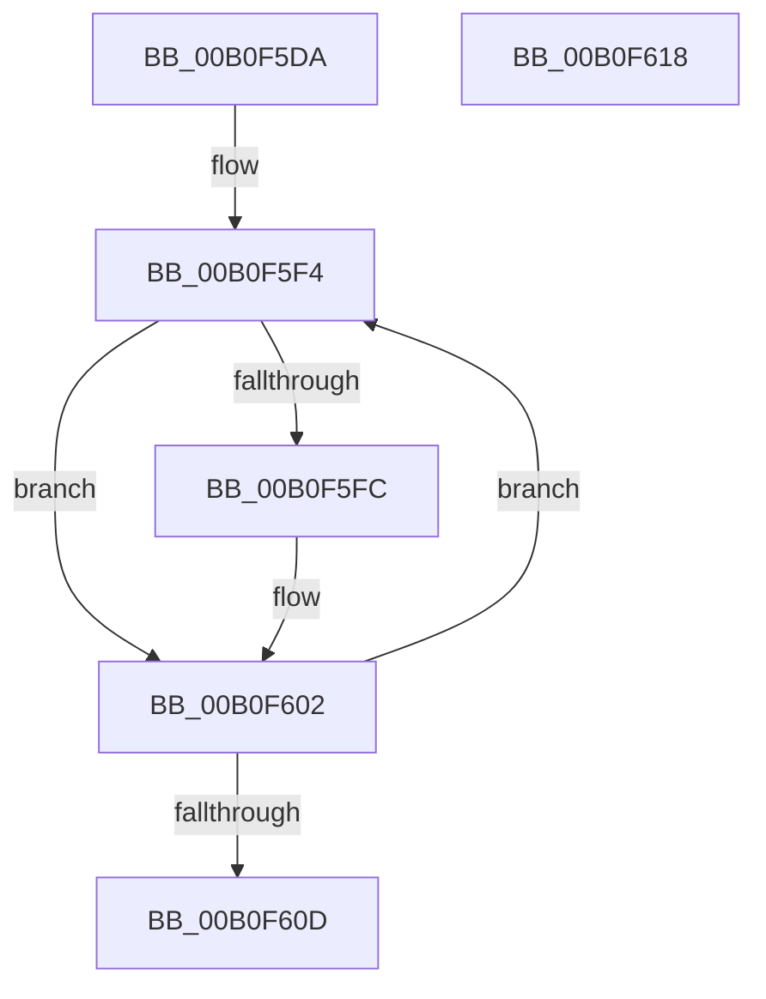

# PopMarshalSettingValues$fin$0

- RVA: `0x00B0F5DA`–`0x00B0F619` (길이 `63` bytes)
- VA: `0x0000000140B0F5DA`
- 실행 섹션: `PAGE`
- PDB 이름 있음: `예`; PDB Function 태그: `예`
- unwind 정보 RVA: `0x0008A820`
- 디코드: `26`개 명령, `63/63` bytes 표시
- 미해석 바이트: `0` (있으면 어셈블리에 `.byte`로 보존)

> 이 문서는 커널 이미지의 기계어와 PDB 기호를 분석해 생성했습니다. 4번과 5번은 함수 원형과 자료형을 바이너리 사용 방식에서 추정한 C 해석이며 원본 소스 복구 결과는 아닙니다.

## 1. Dependencies

- 직접 호출 지점: **1**; 고유 호출 대상: **1**
- 직접 호출자로 확인된 함수: **0**
- RIP 상대 이미지 참조: **0**

### Outgoing calls
- `0x00B0F5FC` → [PopUnreferencePowerSetting](../91/PopUnreferencePowerSetting_function_009164A4.md) (function, `0x009164A4`)

### Direct callers
- 이 함수 시작 RVA로 연결되는 직접 call은 확인되지 않았습니다. 간접 호출은 완전히 역산할 수 없습니다.

### Static image references
- 디코드된 RIP-relative 메모리 참조가 없습니다.

## 2. Other-region calls and transfers

- 다른 실행 섹션으로 향하는 call: **0**
- 별도 외부 분기/꼬리 이동을 확인하지 못했습니다.

## 3. Assembly (complete function range)

```asm
00B0F5DA  40 53                           push rbx
00B0F5DC  55                              push rbp
00B0F5DD  57                              push rdi
00B0F5DE  48 83 EC 20                     sub rsp, 0x20
00B0F5E2  48 8B EA                        mov rbp, rdx
00B0F5E5  33 DB                           xor ebx, ebx
00B0F5E7  89 5D 20                        mov dword ptr [rbp + 0x20], ebx
00B0F5EA  8B C3                           mov eax, ebx
00B0F5EC  48 8D 7D 30                     lea rdi, [rbp + 0x30]
00B0F5F0  48 8D 3C DF                     lea rdi, [rdi + rbx*8]
00B0F5F4  48 8B 0F                        mov rcx, qword ptr [rdi]
00B0F5F7  48 85 C9                        test rcx, rcx
00B0F5FA  74 06                           je 0x140b0f602
00B0F5FC  E8 A3 6E E0 FF                  call 0x1409164a4
00B0F601  90                              nop
00B0F602  FF C3                           inc ebx
00B0F604  48 83 C7 08                     add rdi, 8
00B0F608  83 FB 03                        cmp ebx, 3
00B0F60B  72 E7                           jb 0x140b0f5f4
00B0F60D  89 5D 20                        mov dword ptr [rbp + 0x20], ebx
00B0F610  48 83 C4 20                     add rsp, 0x20
00B0F614  5F                              pop rdi
00B0F615  5D                              pop rbp
00B0F616  5B                              pop rbx
00B0F617  C3                              ret
00B0F618  CC                              int3
```

## 4. C-style interpretation (structured pseudocode)

```c
__int64 __fastcall PopMarshalSettingValues_fin_0(__int64 a1, __int64 a2)
{
    __int64 result;
    __int64 v_rbx;
    __int64 v_rdi;
    __int64 v_rsp;

    v_rsp = (v_rsp) - (32);
    v_rbx = 0;
    *(unsigned int *)(a2 + 32) = 0;
loc_00B0F5F4:
    result = 0;
    if (*(unsigned __int64 *)(a2 + 48 + v_rbx * 8) != 0) {
        result = PopUnreferencePowerSetting(*(unsigned __int64 *)(a2 + 48 + v_rbx * 8), a2, a3, a4);
    }
    v_rbx = (unsigned int)((v_rbx) + 1);
    v_rdi = (a2 + 48 + v_rbx * 8) + (8);
    if (((unsigned int)(v_rbx)) < 3) goto loc_00B0F5F4;
    *(unsigned int *)(a2 + 32) = (unsigned int)(v_rbx);
    v_rsp = (v_rsp) + (32);
    return result;
}
```

## 5. (Beta) C Style

```c
int64_t PopMarshalSettingValues_fin_0(int64_t Arg1, void *Arg2)
{
    uint8_t *arg2 = (uint8_t *)Arg2;

    int64_t result;
    int64_t local_rbx;
    int64_t local_rdi;
    int64_t local_rsp;

    local_rsp = (local_rsp) - (32);
    local_rbx = 0;
    *(uint32_t *)(arg2 + 0x20) = 0;
loc_00B0F5F4:
    result = 0;
    if (*(uint64_t *)(arg2 + 0x30 + local_rbx * 8) != 0) {
        result = PopUnreferencePowerSetting(*(uint64_t *)(arg2 + 0x30 + local_rbx * 8), Arg2, a3, a4);
    }
    local_rbx = (uint32_t)((local_rbx) + 1);
    local_rdi = (Arg2 + 48 + local_rbx * 8) + (8);
    if (((uint32_t)(local_rbx)) < 3) goto loc_00B0F5F4;
    *(uint32_t *)(arg2 + 0x20) = (uint32_t)(local_rbx);
    local_rsp = (local_rsp) + (32);
    return result;
}
```

### 관측된 메모리 오프셋

구조체 형식이 확인되지 않은 접근은 인자 기준의 오프셋으로만 기록했습니다.

| 기준 인자 | 오프셋 표현 | 폭 (bit) | 접근 |
|---|---:|---:|---|
| `Arg2` | `+ 0x0` | `64` | `R` |
| `Arg2` | `+ 0x0 + rbx*8` | `64` | `R` |
| `Arg2` | `+ 0x20` | `32` | `W` |
| `Arg2` | `+ 0x30` | `64` | `R` |

## 6. Execution-region graph

[열기: 2D/3D 그래프와 함수 탐색 컨트롤 패널](../../../control-panel.html?section=page&rva=0x00B0F5DA&view=graph)

- 2D 그래프는 위에서 아래로 흐르고, 3D 그래프는 빈 공간을 드래그해 회전합니다. Shift+드래그는 이동, 휠은 확대·축소, 함수 노드 선택은 대상 보고서 이동입니다.

### Static fallback


