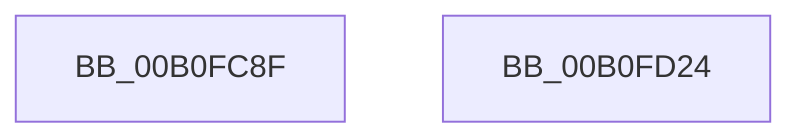

# SdbReleaseDatabase$filt$0

- RVA: `0x00B0FC8F`–`0x00B0FD25` (길이 `150` bytes)
- VA: `0x0000000140B0FC8F`
- 실행 섹션: `PAGE`
- PDB 이름 있음: `예`; PDB Function 태그: `예`
- unwind 정보 RVA: `0x00092B5C`
- 디코드: `36`개 명령, `150/150` bytes 표시
- 미해석 바이트: `0` (있으면 어셈블리에 `.byte`로 보존)

> 이 문서는 커널 이미지의 기계어와 PDB 기호를 분석해 생성했습니다. 4번과 5번은 함수 원형과 자료형을 바이너리 사용 방식에서 추정한 C 해석이며 원본 소스 복구 결과는 아닙니다.

## 1. Dependencies

- 직접 호출 지점: **1**; 고유 호출 대상: **1**
- 직접 호출자로 확인된 함수: **0**
- RIP 상대 이미지 참조: **3**

### Outgoing calls
- `0x00B0FD14` → [AslLogCallPrintf](../95/AslLogCallPrintf_function_0095E4EC.md) (function, `0x0095E4EC`)

### Direct callers
- 이 함수 시작 RVA로 연결되는 직접 call은 확인되지 않았습니다. 간접 호출은 완전히 역산할 수 없습니다.

### Static image references
- `0x00B0FCE8` → RVA `0x0002987F` (`.rdata`; read)
- `0x00B0FCFB` → RVA `0x0003C250` (`.rdata`; read)
- `0x00B0FD08` → RVA `0x0003C230` (`.rdata`; read)

## 2. Other-region calls and transfers

- 다른 실행 섹션으로 향하는 call: **0**
- 별도 외부 분기/꼬리 이동을 확인하지 못했습니다.

## 3. Assembly (complete function range)

```asm
00B0FC8F  40 55                           push rbp
00B0FC91  48 83 EC 60                     sub rsp, 0x60
00B0FC95  48 8B EA                        mov rbp, rdx
00B0FC98  48 89 4D 68                     mov qword ptr [rbp + 0x68], rcx
00B0FC9C  48 89 4D 60                     mov qword ptr [rbp + 0x60], rcx
00B0FCA0  48 8B 4D 60                     mov rcx, qword ptr [rbp + 0x60]
00B0FCA4  48 8B 55 60                     mov rdx, qword ptr [rbp + 0x60]
00B0FCA8  48 8B 45 60                     mov rax, qword ptr [rbp + 0x60]
00B0FCAC  4C 8B 00                        mov r8, qword ptr [rax]
00B0FCAF  48 8B 45 60                     mov rax, qword ptr [rbp + 0x60]
00B0FCB3  4C 8B 48 08                     mov r9, qword ptr [rax + 8]
00B0FCB7  48 8B 45 60                     mov rax, qword ptr [rbp + 0x60]
00B0FCBB  4C 8B 10                        mov r10, qword ptr [rax]
00B0FCBE  48 8B 41 08                     mov rax, qword ptr [rcx + 8]
00B0FCC2  48 89 44 24 50                  mov qword ptr [rsp + 0x50], rax
00B0FCC7  48 8B 02                        mov rax, qword ptr [rdx]
00B0FCCA  48 89 44 24 48                  mov qword ptr [rsp + 0x48], rax
00B0FCCF  41 8B 40 04                     mov eax, dword ptr [r8 + 4]
00B0FCD3  89 44 24 40                     mov dword ptr [rsp + 0x40], eax
00B0FCD7  49 8B 81 F8 00 00 00            mov rax, qword ptr [r9 + 0xf8]
00B0FCDE  48 89 44 24 38                  mov qword ptr [rsp + 0x38], rax
00B0FCE3  83 64 24 30 00                  and dword ptr [rsp + 0x30], 0
00B0FCE8  48 8D 05 90 9B 51 FF            lea rax, [rip - 0xae6470]
00B0FCEF  48 89 44 24 28                  mov qword ptr [rsp + 0x28], rax
00B0FCF4  41 8B 02                        mov eax, dword ptr [r10]
00B0FCF7  89 44 24 20                     mov dword ptr [rsp + 0x20], eax
00B0FCFB  4C 8D 0D 4E C5 52 FF            lea r9, [rip - 0xad3ab2]
00B0FD02  41 B8 F6 00 00 00               mov r8d, 0xf6
00B0FD08  48 8D 15 21 C5 52 FF            lea rdx, [rip - 0xad3adf]
00B0FD0F  B9 01 00 00 00                  mov ecx, 1
00B0FD14  E8 D3 E7 E4 FF                  call 0x14095e4ec
00B0FD19  B8 01 00 00 00                  mov eax, 1
00B0FD1E  48 83 C4 60                     add rsp, 0x60
00B0FD22  5D                              pop rbp
00B0FD23  C3                              ret
00B0FD24  CC                              int3
```

## 4. C-style interpretation (structured pseudocode)

```c
__int64 __fastcall SdbReleaseDatabase_filt_0(__int64 a1, __int64 a2)
{
    __int64 result;
    __int64 v_rsp;
    unsigned __int64 v_stack_m18;
    unsigned __int64 v_stack_m20;
    unsigned int v_stack_m28;
    unsigned __int64 v_stack_m30;
    unsigned int v_stack_m38;
    unsigned __int64 v_stack_m40;
    unsigned int v_stack_m48;

    v_rsp = (v_rsp) - (96);
    *(unsigned __int64 *)(a2 + 104) = a1;
    *(unsigned __int64 *)(a2 + 96) = a1;
    v_stack_m18 = *(unsigned __int64 *)(*(unsigned __int64 *)(a2 + 96) + 8);
    v_stack_m20 = *(unsigned __int64 *)(*(unsigned __int64 *)(a2 + 96));
    v_stack_m28 = (unsigned int)((unsigned int)(*(unsigned int *)(*(unsigned __int64 *)(*(unsigned __int64 *)(a2 + 96)) + 4)));
    v_stack_m30 = *(unsigned __int64 *)(*(unsigned __int64 *)(*(unsigned __int64 *)(a2 + 96) + 8) + 248);
    v_stack_m40 = v_rip - 11428976;
    v_stack_m48 = (unsigned int)((unsigned int)(*(unsigned int *)(*(unsigned __int64 *)(*(unsigned __int64 *)(a2 + 96)))));
    result = AslLogCallPrintf(1, v_rip - 11352799, 246, v_rip - 11352754);
    v_rsp = (v_rsp) + (96);
    return 1;
}
```

## 5. (Beta) C Style

```c
int64_t SdbReleaseDatabase_filt_0(int64_t Arg1, void *Arg2)
{
    uint8_t *arg2 = (uint8_t *)Arg2;

    int64_t result;
    int64_t local_rsp;
    uint64_t v_stack_m18;
    uint64_t v_stack_m20;
    uint32_t v_stack_m28;
    uint64_t v_stack_m30;
    uint32_t v_stack_m38;
    uint64_t v_stack_m40;
    uint32_t v_stack_m48;

    local_rsp = (local_rsp) - (96);
    *(uint64_t *)(arg2 + 0x68) = Arg1;
    *(uint64_t *)(arg2 + 0x60) = Arg1;
    v_stack_m18 = *(uint64_t *)(*(uint64_t *)(arg2 + 0x60) + 0x8);
    v_stack_m20 = *(uint64_t *)(*(uint64_t *)(arg2 + 0x60));
    v_stack_m28 = (uint32_t)((uint32_t)(*(uint32_t *)(*(uint64_t *)(*(uint64_t *)(arg2 + 0x60)) + 0x4)));
    v_stack_m30 = *(uint64_t *)(*(uint64_t *)(*(uint64_t *)(arg2 + 0x60) + 0x8) + 0xF8);
    v_stack_m40 = v_rip - 11428976;
    v_stack_m48 = (uint32_t)((uint32_t)(*(uint32_t *)(*(uint64_t *)(*(uint64_t *)(arg2 + 0x60)))));
    result = AslLogCallPrintf(1, v_rip - 11352799, 246, v_rip - 11352754);
    local_rsp = (local_rsp) + (96);
    return 1;
}
```

### 관측된 메모리 오프셋

구조체 형식이 확인되지 않은 접근은 인자 기준의 오프셋으로만 기록했습니다.

| 기준 인자 | 오프셋 표현 | 폭 (bit) | 접근 |
|---|---:|---:|---|
| `Arg2` | `+ 0x60` | `64` | `R` |
| `Arg2` | `+ 0x60` | `64` | `W` |
| `Arg2` | `+ 0x68` | `64` | `W` |

## 6. Execution-region graph

[열기: 2D/3D 그래프와 함수 탐색 컨트롤 패널](../../../control-panel.html?section=page&rva=0x00B0FC8F&view=graph)

- 2D 그래프는 위에서 아래로 흐르고, 3D 그래프는 빈 공간을 드래그해 회전합니다. Shift+드래그는 이동, 휠은 확대·축소, 함수 노드 선택은 대상 보고서 이동입니다.

### Static fallback


