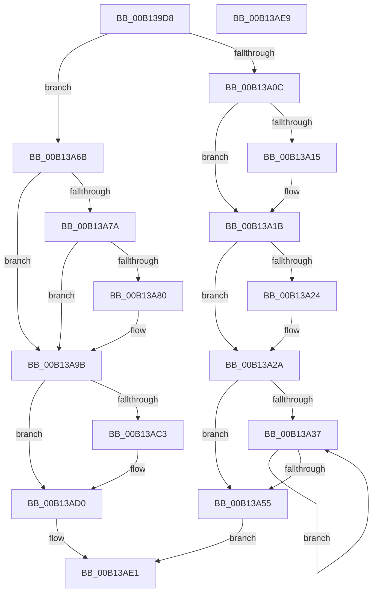

# CcMdlRead$fin$0

- RVA: `0x00B139D8`–`0x00B13AEA` (길이 `274` bytes)
- VA: `0x0000000140B139D8`
- 실행 섹션: `PAGE`
- PDB 이름 있음: `예`; PDB Function 태그: `예`
- unwind 정보 RVA: `0x000BD3D0`
- 디코드: `73`개 명령, `274/274` bytes 표시
- 미해석 바이트: `0` (있으면 어셈블리에 `.byte`로 보존)

> 이 문서는 커널 이미지의 기계어와 PDB 기호를 분석해 생성했습니다. 4번과 5번은 함수 원형과 자료형을 바이너리 사용 방식에서 추정한 C 해석이며 원본 소스 복구 결과는 아닙니다.

## 1. Dependencies

- 직접 호출 지점: **8**; 고유 호출 대상: **6**
- 직접 호출자로 확인된 함수: **0**
- RIP 상대 이미지 참조: **0**

### Outgoing calls
- `0x00B13A15` → [CcFreeVirtualAddress](../../text/33/CcFreeVirtualAddress_function_0033F2C0.md) (function, `0x0033F2C0`)
- `0x00B13A24` → [IoFreeMdl](../../text/29/IoFreeMdl_function_0029EA80.md) (function, `0x0029EA80`)
- `0x00B13A40` → [MmUnlockPages](../../text/29/MmUnlockPages_function_0029EEE0.md) (function, `0x0029EEE0`)
- `0x00B13A48` → [IoFreeMdl](../../text/29/IoFreeMdl_function_0029EA80.md) (function, `0x0029EA80`)
- `0x00B13A64` → [CcUpdateSharedCacheMapFlag](../../text/45/CcUpdateSharedCacheMapFlag_function_0045EC14.md) (function, `0x0045EC14`)
- `0x00B13A95` → [CcScheduleReadAheadEx](../../text/38/CcScheduleReadAheadEx_function_00388820.md) (function, `0x00388820`)
- `0x00B13AAD` → [CcUpdateReadHistory](../../text/45/CcUpdateReadHistory_function_0045E76C.md) (function, `0x0045E76C`)
- `0x00B13ACA` → [CcUpdateSharedCacheMapFlag](../../text/45/CcUpdateSharedCacheMapFlag_function_0045EC14.md) (function, `0x0045EC14`)

### Direct callers
- 이 함수 시작 RVA로 연결되는 직접 call은 확인되지 않았습니다. 간접 호출은 완전히 역산할 수 없습니다.

### Static image references
- 디코드된 RIP-relative 메모리 참조가 없습니다.

## 2. Other-region calls and transfers

- 다른 실행 섹션으로 향하는 call: **8**
  - `0x00B13A15` → [CcFreeVirtualAddress](../../text/33/CcFreeVirtualAddress_function_0033F2C0.md) (`PAGE` → `.text`)
  - `0x00B13A24` → [IoFreeMdl](../../text/29/IoFreeMdl_function_0029EA80.md) (`PAGE` → `.text`)
  - `0x00B13A40` → [MmUnlockPages](../../text/29/MmUnlockPages_function_0029EEE0.md) (`PAGE` → `.text`)
  - `0x00B13A48` → [IoFreeMdl](../../text/29/IoFreeMdl_function_0029EA80.md) (`PAGE` → `.text`)
  - `0x00B13A64` → [CcUpdateSharedCacheMapFlag](../../text/45/CcUpdateSharedCacheMapFlag_function_0045EC14.md) (`PAGE` → `.text`)
  - `0x00B13A95` → [CcScheduleReadAheadEx](../../text/38/CcScheduleReadAheadEx_function_00388820.md) (`PAGE` → `.text`)
  - `0x00B13AAD` → [CcUpdateReadHistory](../../text/45/CcUpdateReadHistory_function_0045E76C.md) (`PAGE` → `.text`)
  - `0x00B13ACA` → [CcUpdateSharedCacheMapFlag](../../text/45/CcUpdateSharedCacheMapFlag_function_0045EC14.md) (`PAGE` → `.text`)
- 별도 외부 분기/꼬리 이동을 확인하지 못했습니다.

## 3. Assembly (complete function range)

```asm
00B139D8  40 53                           push rbx
00B139DA  55                              push rbp
00B139DB  57                              push rdi
00B139DC  48 83 EC 50                     sub rsp, 0x50
00B139E0  48 8B EA                        mov rbp, rdx
00B139E3  88 4D 50                        mov byte ptr [rbp + 0x50], cl
00B139E6  65 48 8B 04 25 88 01 00 00      mov rax, qword ptr gs:[0x188]
00B139EF  48 89 85 88 00 00 00            mov qword ptr [rbp + 0x88], rax
00B139F6  8B 80 DC 05 00 00               mov eax, dword ptr [rax + 0x5dc]
00B139FC  65 01 04 25 A0 89 00 00         add dword ptr gs:[0x89a0], eax
00B13A04  0F B6 45 50                     movzx eax, byte ptr [rbp + 0x50]
00B13A08  85 C0                           test eax, eax
00B13A0A  74 5F                           je 0x140b13a6b
00B13A0C  48 8B 4D 68                     mov rcx, qword ptr [rbp + 0x68]
00B13A10  48 85 C9                        test rcx, rcx
00B13A13  74 06                           je 0x140b13a1b
00B13A15  E8 A6 B8 82 FF                  call 0x14033f2c0
00B13A1A  90                              nop
00B13A1B  48 8B 4D 70                     mov rcx, qword ptr [rbp + 0x70]
00B13A1F  48 85 C9                        test rcx, rcx
00B13A22  74 06                           je 0x140b13a2a
00B13A24  E8 57 B0 78 FF                  call 0x14029ea80
00B13A29  90                              nop
00B13A2A  48 8B BD 08 01 00 00            mov rdi, qword ptr [rbp + 0x108]
00B13A31  48 83 3F 00                     cmp qword ptr [rdi], 0
00B13A35  74 1E                           je 0x140b13a55
00B13A37  48 8B 07                        mov rax, qword ptr [rdi]
00B13A3A  48 8B 18                        mov rbx, qword ptr [rax]
00B13A3D  48 8B C8                        mov rcx, rax
00B13A40  E8 9B B4 78 FF                  call 0x14029eee0
00B13A45  48 8B 0F                        mov rcx, qword ptr [rdi]
00B13A48  E8 33 B0 78 FF                  call 0x14029ea80
00B13A4D  48 89 1F                        mov qword ptr [rdi], rbx
00B13A50  48 85 DB                        test rbx, rbx
00B13A53  75 E2                           jne 0x140b13a37
00B13A55  41 B0 01                        mov r8b, 1
00B13A58  BA 08 00 00 00                  mov edx, 8
00B13A5D  48 8B 8D 80 00 00 00            mov rcx, qword ptr [rbp + 0x80]
00B13A64  E8 AB B1 94 FF                  call 0x14045ec14
00B13A69  EB 76                           jmp 0x140b13ae1
00B13A6B  48 8B 85 A0 00 00 00            mov rax, qword ptr [rbp + 0xa0]
00B13A72  F7 00 00 00 02 00               test dword ptr [rax], 0x20000
00B13A78  75 21                           jne 0x140b13a9b
00B13A7A  83 7D 5C 00                     cmp dword ptr [rbp + 0x5c], 0
00B13A7E  74 1B                           je 0x140b13a9b
00B13A80  45 33 C9                        xor r9d, r9d
00B13A83  44 8B 45 60                     mov r8d, dword ptr [rbp + 0x60]
00B13A87  48 8B 95 F8 00 00 00            mov rdx, qword ptr [rbp + 0xf8]
00B13A8E  48 8B 8D F0 00 00 00            mov rcx, qword ptr [rbp + 0xf0]
00B13A95  E8 86 4D 87 FF                  call 0x140388820
00B13A9A  90                              nop
00B13A9B  44 8B 45 60                     mov r8d, dword ptr [rbp + 0x60]
00B13A9F  48 8B 95 F8 00 00 00            mov rdx, qword ptr [rbp + 0xf8]
00B13AA6  48 8B 8D F0 00 00 00            mov rcx, qword ptr [rbp + 0xf0]
00B13AAD  E8 BA AC 94 FF                  call 0x14045e76c
00B13AB2  48 8B 8D 80 00 00 00            mov rcx, qword ptr [rbp + 0x80]
00B13AB9  8B 81 98 00 00 00               mov eax, dword ptr [rcx + 0x98]
00B13ABF  A8 08                           test al, 8
00B13AC1  74 0D                           je 0x140b13ad0
00B13AC3  45 33 C0                        xor r8d, r8d
00B13AC6  41 8D 50 08                     lea edx, [r8 + 8]
00B13ACA  E8 45 B1 94 FF                  call 0x14045ec14
00B13ACF  90                              nop
00B13AD0  48 8B 8D 10 01 00 00            mov rcx, qword ptr [rbp + 0x110]
00B13AD7  83 21 00                        and dword ptr [rcx], 0
00B13ADA  8B 45 54                        mov eax, dword ptr [rbp + 0x54]
00B13ADD  48 89 41 08                     mov qword ptr [rcx + 8], rax
00B13AE1  48 83 C4 50                     add rsp, 0x50
00B13AE5  5F                              pop rdi
00B13AE6  5D                              pop rbp
00B13AE7  5B                              pop rbx
00B13AE8  C3                              ret
00B13AE9  CC                              int3
```

## 4. C-style interpretation (structured pseudocode)

```c
__int64 __fastcall CcMdlRead_fin_0(unsigned __int8 a1, __int64 a2, __int64 a3, int a4)
{
    __int64 result;
    __int64 v_rsp;

    v_rsp = (v_rsp) - (80);
    *(unsigned __int8 *)(a2 + 80) = a1;
    *(unsigned __int64 *)(a2 + 136) = *(unsigned __int64 *)(gs_base + (0 + 392));
    if ((unsigned int)(*(unsigned __int8 *)(a2 + 80)) == 0) goto loc_00B13A6B;
    result = *(unsigned __int8 *)(a2 + 80);
    if (*(unsigned __int64 *)(a2 + 104) != 0) {
        result = CcFreeVirtualAddress(*(unsigned __int64 *)(a2 + 104), a2, a3, a4);
    }
    if (*(unsigned __int64 *)(a2 + 112) != 0) {
        result = IoFreeMdl(*(unsigned __int64 *)(a2 + 112), a2, a3, a4);
    }
    if ((*(unsigned __int64 *)(*(unsigned __int64 *)(a2 + 264))) == 0) goto loc_00B13A55;
loc_00B13A37:
    result = MmUnlockPages(*(unsigned __int64 *)(*(unsigned __int64 *)(a2 + 264)), a2, a3, a4);
    result = IoFreeMdl(*(unsigned __int64 *)(*(unsigned __int64 *)(a2 + 264)), a2, a3, a4);
    *(unsigned __int64 *)(*(unsigned __int64 *)(a2 + 264)) = *(unsigned __int64 *)(*(unsigned __int64 *)(*(unsigned __int64 *)(a2 + 264)));
    if (*(unsigned __int64 *)(*(unsigned __int64 *)(*(unsigned __int64 *)(a2 + 264))) != 0) goto loc_00B13A37;
loc_00B13A55:
    result = CcUpdateSharedCacheMapFlag(*(unsigned __int64 *)(a2 + 128), 8, 1, a4);
    goto loc_00B13AE1;
loc_00B13A6B:
    if (((*(unsigned int *)(*(unsigned __int64 *)(a2 + 160))) & (0x20000ULL)) != 0) goto loc_00B13A9B;
    result = *(unsigned __int64 *)(a2 + 160);
    if ((*(unsigned int *)(a2 + 92)) != 0) {
        a4 = 0;
        a3 = *(unsigned int *)(a2 + 96);
        a2 = *(unsigned __int64 *)(a2 + 248);
        a1 = *(unsigned __int64 *)(a2 + 240);
        result = CcScheduleReadAheadEx(a1, a2, a3, a4);
    }
    result = CcUpdateReadHistory(*(unsigned __int64 *)(a2 + 240), *(unsigned __int64 *)(a2 + 248), (unsigned int)(*(unsigned int *)(a2 + 96)), a4);
    result = (unsigned int)(*(unsigned int *)(*(unsigned __int64 *)(a2 + 128) + 152));
    if ((((unsigned __int8)((unsigned int)(*(unsigned int *)(*(unsigned __int64 *)(a2 + 128) + 152)))) & (8)) != 0) {
        a3 = 0;
        a2 = a3 + 8;
        result = CcUpdateSharedCacheMapFlag(*(unsigned __int64 *)(a2 + 128), a2, a3, a4);
    }
    *(unsigned __int64 *)(*(unsigned __int64 *)(a2 + 272) + 8) = (unsigned int)(*(unsigned int *)(a2 + 84));
loc_00B13AE1:
    v_rsp = (v_rsp) + (80);
    return (unsigned int)(*(unsigned int *)(a2 + 84));
}
```

## 5. (Beta) C Style

```c
int64_t CcMdlRead_fin_0(uint8_t Arg1, void *Arg2, int64_t Arg3, int32_t Arg4)
{
    uint8_t *arg2 = (uint8_t *)Arg2;

    int64_t result;
    int64_t local_rsp;

    local_rsp = (local_rsp) - (80);
    *(uint8_t *)(arg2 + 0x50) = Arg1;
    *(uint64_t *)(arg2 + 0x88) = *(uint64_t *)(gs_base + (0 + 0x188));
    if ((uint32_t)(*(uint8_t *)(arg2 + 0x50)) == 0) goto loc_00B13A6B;
    result = *(uint8_t *)(arg2 + 0x50);
    if (*(uint64_t *)(arg2 + 0x68) != 0) {
        result = CcFreeVirtualAddress(*(uint64_t *)(arg2 + 0x68), Arg2, Arg3, Arg4);
    }
    if (*(uint64_t *)(arg2 + 0x70) != 0) {
        result = IoFreeMdl(*(uint64_t *)(arg2 + 0x70), Arg2, Arg3, Arg4);
    }
    if ((*(uint64_t *)(*(uint64_t *)(arg2 + 0x108))) == 0) goto loc_00B13A55;
loc_00B13A37:
    result = MmUnlockPages(*(uint64_t *)(*(uint64_t *)(arg2 + 0x108)), Arg2, Arg3, Arg4);
    result = IoFreeMdl(*(uint64_t *)(*(uint64_t *)(arg2 + 0x108)), Arg2, Arg3, Arg4);
    *(uint64_t *)(*(uint64_t *)(arg2 + 0x108)) = *(uint64_t *)(*(uint64_t *)(*(uint64_t *)(arg2 + 0x108)));
    if (*(uint64_t *)(*(uint64_t *)(*(uint64_t *)(arg2 + 0x108))) != 0) goto loc_00B13A37;
loc_00B13A55:
    result = CcUpdateSharedCacheMapFlag(*(uint64_t *)(arg2 + 0x80), 8, 1, Arg4);
    goto loc_00B13AE1;
loc_00B13A6B:
    if (((*(uint32_t *)(*(uint64_t *)(arg2 + 0xA0))) & (0x20000ULL)) != 0) goto loc_00B13A9B;
    result = *(uint64_t *)(arg2 + 0xA0);
    if ((*(uint32_t *)(arg2 + 0x5C)) != 0) {
        Arg4 = 0;
        Arg3 = *(uint32_t *)(arg2 + 0x60);
        Arg2 = *(uint64_t *)(arg2 + 0xF8);
        Arg1 = *(uint64_t *)(arg2 + 0xF0);
        result = CcScheduleReadAheadEx(Arg1, Arg2, Arg3, Arg4);
    }
    result = CcUpdateReadHistory(*(uint64_t *)(arg2 + 0xF0), *(uint64_t *)(arg2 + 0xF8), (uint32_t)(*(uint32_t *)(arg2 + 0x60)), Arg4);
    result = (uint32_t)(*(uint32_t *)(*(uint64_t *)(arg2 + 0x80) + 0x98));
    if ((((uint8_t)((uint32_t)(*(uint32_t *)(*(uint64_t *)(arg2 + 0x80) + 0x98)))) & (8)) != 0) {
        Arg3 = 0;
        Arg2 = Arg3 + 8;
        result = CcUpdateSharedCacheMapFlag(*(uint64_t *)(arg2 + 0x80), Arg2, Arg3, Arg4);
    }
    *(uint64_t *)(*(uint64_t *)(arg2 + 0x110) + 0x8) = (uint32_t)(*(uint32_t *)(arg2 + 0x54));
loc_00B13AE1:
    local_rsp = (local_rsp) + (80);
    return (uint32_t)(*(uint32_t *)(arg2 + 0x54));
}
```

### 관측된 메모리 오프셋

구조체 형식이 확인되지 않은 접근은 인자 기준의 오프셋으로만 기록했습니다.

| 기준 인자 | 오프셋 표현 | 폭 (bit) | 접근 |
|---|---:|---:|---|
| `Arg2` | `+ 0x50` | `8` | `R` |
| `Arg2` | `+ 0x50` | `8` | `W` |
| `Arg2` | `+ 0x54` | `32` | `R` |
| `Arg2` | `+ 0x5C` | `32` | `R` |
| `Arg2` | `+ 0x60` | `32` | `R` |
| `Arg2` | `+ 0x68` | `64` | `R` |
| `Arg2` | `+ 0x70` | `64` | `R` |
| `Arg2` | `+ 0x80` | `64` | `R` |
| `Arg2` | `+ 0x88` | `64` | `W` |
| `Arg2` | `+ 0xA0` | `64` | `R` |
| `Arg2` | `+ 0xF0` | `64` | `R` |
| `Arg2` | `+ 0xF8` | `64` | `R` |
| `Arg2` | `+ 0x108` | `64` | `R` |
| `Arg2` | `+ 0x110` | `64` | `R` |

## 6. Execution-region graph

[열기: 2D/3D 그래프와 함수 탐색 컨트롤 패널](../../../control-panel.html?section=page&rva=0x00B139D8&view=graph)

- 2D 그래프는 위에서 아래로 흐르고, 3D 그래프는 빈 공간을 드래그해 회전합니다. Shift+드래그는 이동, 휠은 확대·축소, 함수 노드 선택은 대상 보고서 이동입니다.

### Static fallback


